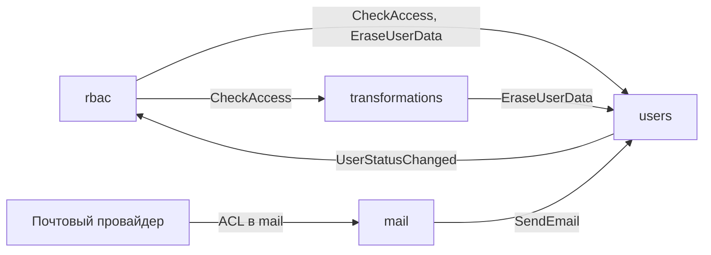
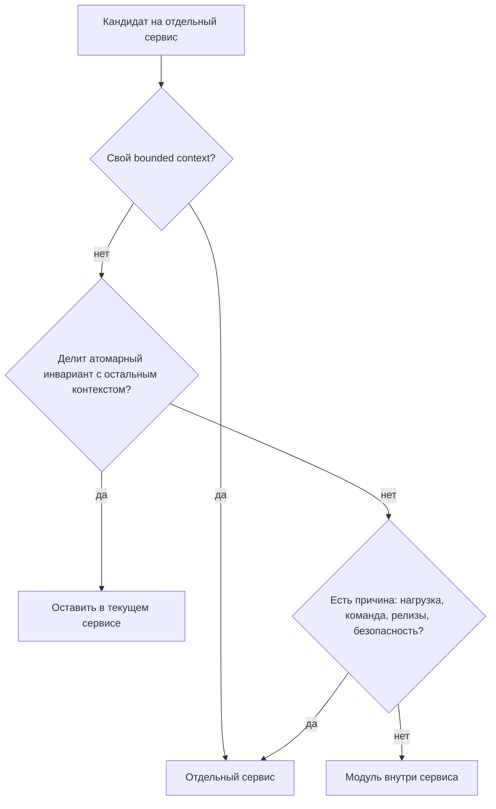
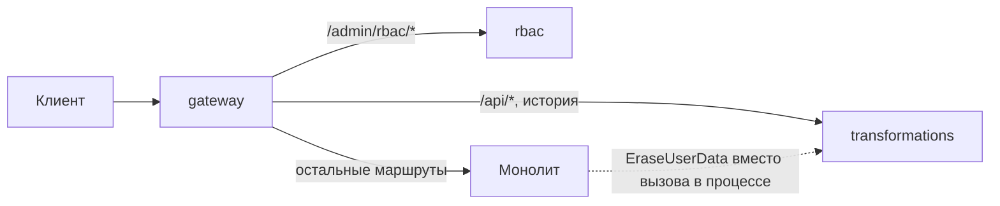
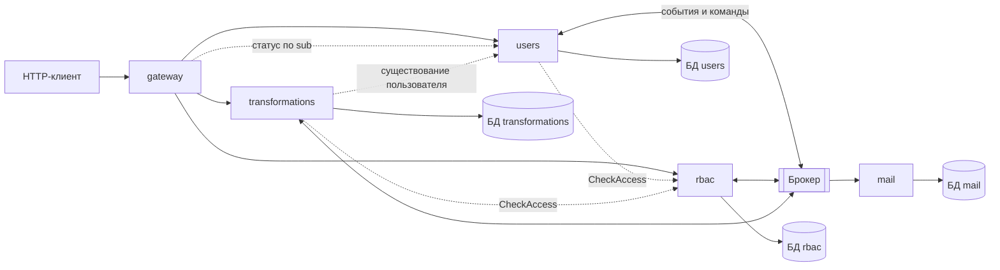

# Декомпозиция на микросервисы

## Содержание

- [Что такое декомпозиция на микросервисы](#что-такое-декомпозиция-на-микросервисы)
- [Поддомены](#поддомены)
- [Bounded context и единый язык](#bounded-context-и-единый-язык)
- [Владение данными](#владение-данными)
- [Инварианты как граница сервиса](#инварианты-как-граница-сервиса)
- [Связанность сервисов](#связанность-сервисов)
- [Размер сервиса](#размер-сервиса)
- [Переход от монолита](#переход-от-монолита)
- [Эталонная декомпозиция системы](#эталонная-декомпозиция-системы)
- [Сравнение](#сравнение)
- [Как выбирать](#как-выбирать)
- [Как это проявляется в системе](#как-это-проявляется-в-системе)
- [Типичные ошибки](#типичные-ошибки)
- [Полезные ссылки](#полезные-ссылки)
- [Вопросы по теории](#вопросы-по-теории)

## Что такое декомпозиция на микросервисы

Декомпозиция на микросервисы — разбиение системы на независимо развёртываемые сервисы, каждый из которых владеет своими данными и правилами. При удачных границах типичное изменение затрагивает один сервис и выкладывается без согласования с соседями.

Итоговая система курса — набор сервисов за единым шлюзом: регистрация, вход, RBAC, работа с профилем, удаление, список пользователей, преобразование файлов, история и хранилище. Для клиента это одно HTTP API, внутри — несколько сервисов со своими данными. От границ зависят все остальные темы: какие вызовы идут по сети, где нужна сага, что проверяет шлюз.

| Способ | Примеры | Когда подходит |
| --- | --- | --- |
| По бизнес-возможностям | учётные записи, контроль доступа, преобразование файлов | основной способ: возможности бизнеса меняются реже технологий |
| По поддоменам DDD | core, supporting и generic части домена | когда нужно решить, во что вкладываться и что заменить готовым решением |
| По нефункциональным требованиям | сервис обработки изображений | часть с особой нагрузкой, безопасностью или циклом релизов |
| По техническим слоям | «сервис базы данных», «сервис валидации» | не подходит: каждое изменение проходит через все слои-сервисы |

## Поддомены

Домен — область задач, которую решает продукт. Поддомен — часть домена со своими правилами и экспертами. DDD различает три вида поддоменов:

- **core** — то, ради чего существует продукт; здесь нужна самая тщательная модель;
- **supporting** — нужен продукту, но не отличает его от конкурентов;
- **generic** — задача уже решена индустрией, выгоднее взять готовое решение.

| Поддомен | Функциональность | Вид | Следствие |
| --- | --- | --- | --- |
| Преобразование файлов | трансформации текстов и изображений, история, хранилище | core | своя модель и независимое масштабирование |
| Учётные записи и профиль | регистрация, профиль, удаление, список пользователей | supporting | собственная реализация под правила продукта |
| Контроль доступа | RBAC и авторизация | supporting | один источник решений для всех сервисов |
| Вход | пароль, OTP, magic link, токены | generic | в продуктах часто отдаётся внешнему IdP по OpenID Connect |
| Отправка писем | письма с OTP и magic link | generic | тонкий адаптер к SMTP или почтовому провайдеру |

Вид поддомена не задаёт сервис напрямую. Он показывает, где модель должна быть точной, а где достаточно адаптера к чужому решению. Вход — generic-задача, но курс реализует его сам, поэтому вход остаётся рядом с учётной записью.

## Bounded context и единый язык

Bounded context — граница, внутри которой модель и термины однозначны. Единый язык (ubiquitous language) — словарь контекста, одинаковый в разговоре, документации и коде. В разных контекстах одно слово означает разное, и это нормально.

| Контекст | Что значит «пользователь» | Какие данные нужны |
| --- | --- | --- |
| `users` | учётная запись и профиль | email, хеш пароля, статус, имя, фотография |
| `rbac` | субъект назначений | `userId`, роли, реплика статуса |
| `transformations` | владелец истории и файлов | только `userId` |
| `mail` | получатель письма | адрес из команды, без хранения |

Каждый контекст хранит только то, что нужно его правилам. `transformations` не копирует email: так меньше персональных данных и меньше работы при удалении.

Отношения между контекстами описывает context map. Upstream-контекст задаёт контракт, downstream-контекст ему следует. Anti-corruption layer (ACL) — слой перевода, который защищает модель контекста от чужого API.

Стрелка ведёт от контекста, который задаёт контракт, к контексту, который на него опирается. Контракт команды задаёт получатель, контракт события — издатель, поэтому `EraseUserData` и `SendEmail` направлены к `users`, а `UserStatusChanged` — от него. `users` и `rbac` зависят друг от друга, но разными механизмами: `users` вызывает `CheckAccess`, а `rbac` узнаёт о статусах из событий и не вызывает `users`.

## Владение данными

Каждый сервис — единственный, кто читает и пишет свои таблицы. Остальные получают данные через его API или события. Барьер делают техническим: у сервиса свой пользователь базы с правами только на свои объекты. Без барьера чужой код рано или поздно обойдёт API.

Отказ от общей базы отменяет часть привычных гарантий реляционной базы:

- `JOIN` данных разных сервисов невозможен: их собирают через API или read model из `0.4 Согласованность данных.md`;
- `FOREIGN KEY` между базами нет: `transformations.user_id` — непрозрачная ссылка, существование пользователя база не гарантирует;
- `ON DELETE CASCADE` не достаёт до соседей: их данные удаляет команда `EraseUserData`;
- общей транзакции нет: правило, которое охватывает два сервиса, выполняется сагой.

Хранилище объектов — такая же инфраструктура, как PostgreSQL. Бакетом фотографий владеет `users`, бакетом результатов — `transformations`. Отдельного сервиса файлов нет: каждый владелец сам пишет, отдаёт и удаляет свои объекты.

Копия чужих данных допустима только как реплика для чтения. Её обновляют события владельца, источником истины остаётся владелец. `rbac` хранит реплику статусов пользователей и по ней проверяет, существует ли пользователь, которому назначают роли.

## Инварианты как граница сервиса

Инвариант — правило, которое выполняется после каждой операции. Внутри одной базы его обеспечивают транзакция и ограничения. Между сервисами общей транзакции нет, поэтому атомарные правила держат внутри одного сервиса. Агрегат — группа данных, которые меняются вместе в одной транзакции, — не делится между сервисами.

| Инвариант | Если бы всё было в одной базе | В эталонной декомпозиции |
| --- | --- | --- |
| один email — одна учётная запись | `UNIQUE` в таблице `users` | `UNIQUE` в базе `users`, внутри сервиса |
| `PATCH /users/{userId}` меняет `email`, `status` и `displayName` вместе | один `UPDATE` | один `UPDATE` в `users`, поэтому профиль не выделен |
| у активного пользователя есть роль `user` | та же транзакция, что и активация | событие `UserStatusChanged`, роль появляется с задержкой |
| остаётся активный носитель `rbac@manage` | общая блокировка политики | резервирование в `rbac` и сага |

Первые два правила определили границу: учётная запись и профиль живут в одном сервисе. Если их разделить, один `PATCH` превратится в две записи в разных базах. Сбой между ними оставит новый email со старым именем, хотя `PATCH` обещает изменить присланные поля вместе.

Два других правила пересекают границу `users` и `rbac`. Объединение сервисов перенесло бы весь RBAC в `users`, хотя доступ проверяют и другие сервисы. Поэтому первое правило выполняется с задержкой, второе — сагой с резервированием; подробности в `0.4 Согласованность данных.md`. Цена решения известна заранее: после активации есть короткое окно, когда у пользователя ещё нет роли.

## Связанность сервисов

Связанность (coupling) показывает, насколько изменение или отказ одного сервиса задевает другой. Связность (cohesion) показывает, насколько функции внутри сервиса относятся к одной задаче. Цель — слабая связанность между сервисами и сильная связность внутри.

| Вид связанности | Признак | Как ослабить |
| --- | --- | --- |
| временная | сервис не отвечает, пока не ответит сосед | событие вместо вызова, реплика, кеш |
| по данным | два сервиса читают одну таблицу | владение данными, доступ через API |
| по развёртыванию | сервисы выкладываются только вместе | совместимые контракты из `0.7 Контракты и тестирование.md` |
| по модели | общий пакет с доменными классами | своя модель в каждом контексте, общим остаётся контракт |
| по реализации | потребитель знает внутренние коды и таблицы | публичный API без внутренних деталей |

Common Closure Principle: то, что меняется по одной причине, живёт вместе. Проверка простая — сколько сервисов затрагивает типичная задача. Если большинство задач меняет два сервиса сразу, граница проведена неудачно.

Общий код допустим, если в нём нет бизнес-правил: настройка логирования, телеметрии, HTTP-клиента. Общий пакет с классом `User` или перечнем статусов заставляет обновлять все сервисы при каждом изменении модели.

Взаимные синхронные вызовы двух сервисов — признак неудачных границ: ни один из них не работает без другого. В эталоне одно направление заменено событием: `rbac` не вызывает `users` и продолжает работать, когда `users` недоступен.

## Размер сервиса

Размер сервиса измеряется не строками кода. Сервис покрывает один bounded context или его часть, принадлежит одной команде, выкладывается отдельно и сам выполняет свои инварианты.

| Признак | Слишком мелкий | Слишком крупный |
| --- | --- | --- |
| вызовы | одна операция пользователя проходит цепочку из трёх-четырёх сервисов | части сервиса почти не обращаются друг к другу |
| данные | агрегат разрезан, сага нужна там, где хватило бы транзакции | в одной базе данные с разными требованиями к хранению |
| изменения | одна задача требует выкладки нескольких сервисов | несколько команд мешают друг другу в одном репозитории |
| нагрузка | масштабирование ничего не даёт: узкое место в соседях | тяжёлая часть масштабируется только вместе со всем сервисом |

При сомнении выбирают более крупный сервис. Разделить сервис проще, чем собрать обратно функциональность, разнесённую по нескольким.

Диаграмма отвечает на вопрос, когда выделять сервис. Свой контекст становится сервисом, а правила на границе с соседями выполняются событиями и сагами. Часть контекста без конкретной причины остаётся модулем внутри сервиса.

## Переход от монолита

Strangler fig — постепенная замена монолита. Фасад перехватывает запросы и по одному маршруту переключает их на новые сервисы. Клиент не замечает переноса, потому что внешний контракт не меняется. Роль фасада выполняет шлюз.

На диаграмме перенесены преобразования и RBAC, остальное пока обслуживает монолит. Вызов очистки данных пользователя внутри процесса заменён командой, потому что модуль преобразований больше не живёт в монолите.

Порядок переноса монолита с той же функциональностью:

1. Поставить шлюз перед монолитом и направить на монолит все маршруты.
2. Первым вынести модуль с наименьшим числом входящих зависимостей и ясным владением данными. От `transformations` зависит только удаление пользователя, а сам модуль обращается лишь к проверке доступа и, в административных маршрутах, к поиску пользователя.
3. Перенести таблицы модуля в его базу: начальная копия, затем синхронизация до переключения. После переключения монолит к этим таблицам не обращается.
4. Заменить вызовы внутри процесса сетевыми вызовами или сообщениями.
5. Повторить для `rbac` и `mail`. Остаток монолита становится сервисом `users`.

Фасад, синхронизация и ACL между старым и новым кодом — переходная архитектура, которая исчезнет после переноса. Это осознанная цена за то, что система работает на каждом шаге.

## Эталонная декомпозиция системы

Примеры всей теории курса опираются на одну декомпозицию. Практика может её уточнить, но рассуждение остаётся тем же.

Публичен только шлюз. Сплошные стрелки от шлюза — проксирование внешних запросов, пунктир — внутренние синхронные вызовы, связи с брокером — события и команды. Загрузка JWKS из `users` не показана: ключи кешируются и запрашиваются заново только при неизвестном `kid`.

| Сервис | Функциональность | Владеет | Сообщения |
| --- | --- | --- | --- |
| `gateway` | единый вход, маршруты, проверка access | конфигурацией маршрутов; кеш JWKS не является источником истины | в обмене сообщениями не участвует |
| `users` | регистрация, вход, профиль, удаление, список пользователей | учётными записями, challenge, профилем, бакетом фотографий, процессом удаления | публикует `UserStatusChanged`, отправляет `SendEmail` и `EraseUserData`, принимает `UserDataErased` |
| `rbac` | роли, разрешения, решения о доступе | ролями, разрешениями, назначениями, версией политики, репликой статусов | публикует `PolicyChanged`, принимает `UserStatusChanged` и `EraseUserData`, отвечает `UserDataErased` |
| `mail` | отправка писем | только inbox обработанных команд, без текста писем | принимает `SendEmail` |
| `transformations` | преобразования, история, хранение результатов | историей и бакетом результатов | принимает `EraseUserData`, отвечает `UserDataErased` |

Отвергнутые варианты тоже показывают ход рассуждения:

- **Отдельный `identity` для входа и email.** Разрезает атомарный `PATCH` и регистрацию. Оправдан, если вход отдаётся внешнему IdP: тогда учётные данные живут у провайдера, а статус и профиль — в `users`.
- **Отдельный `storage`.** Собирает retention и ключи S3 в одном месте, но добавляет сетевой переход к каждой фотографии и каждому результату и требует знать правила владения двух контекстов.
- **Отдельный сервис изображений.** Оправдан нагрузкой на CPU. Сначала его заменяет изолированный пул обработки внутри `transformations` из `0.6 Отказоустойчивость.md`; отдельный сервис нужен, только если пула недостаточно.

## Сравнение

| Вариант хранения | Изоляция | Цена | Подходит для |
| --- | --- | --- | --- |
| общие таблицы | нет: любой модуль пишет в любую таблицу | минимальная | монолит, а не микросервисы |
| свои таблицы в общей базе | соглашение и права на таблицы | низкая | переходный этап strangler fig |
| схема на сервис | своя схема и пользователь с правами только на неё | низкая | небольшие системы на общем сервере СУБД |
| база на сервис | отдельная база и отдельный пользователь | средняя | вариант по умолчанию в курсе |
| сервер на сервис | отдельный экземпляр СУБД | высокая | высокая нагрузка или особый тип хранилища |

## Как выбирать

1. Начинать с bounded context: один контекст — один сервис. В курсе это `users`, `rbac`, `transformations` и `mail`, а шлюз — инфраструктура без своей модели.
2. Держать атомарный инвариант внутри одного сервиса. Сагу выбирать, только если объединение утянет за собой целый контекст, как RBAC.
3. Делить контекст дальше только по конкретной причине: нагрузка, команда, цикл релизов, требования безопасности.
4. При сомнении выбирать более крупный сервис.
5. Хранить данные по схеме «база на сервис». Схема на сервис допустима на общем сервере, общие таблицы — нет.
6. Переносить существующий монолит по маршрутам через шлюз, начиная с модуля с наименьшим числом входящих зависимостей.

## Как это проявляется в системе

**Регистрация.** Учётная запись, challenge и уникальный email живут в `users`, поэтому проверка `UNIQUE` и создание `pending` остаются одной транзакцией. Роль `user` назначает `rbac` после события `UserStatusChanged`, письмо уходит в `mail` командой `SendEmail`.

**RBAC.** Роли, разрешения и назначения хранит только `rbac`. Существование пользователя при назначении ролей проверяется по реплике статусов, а не внешним ключом на чужую таблицу.

**Аутентификация.** Вход, challenge и выпуск токенов находятся в `users`, рядом с хешем пароля и статусом. Если вход перейдёт к внешнему IdP, изменится только этот сервис.

**Авторизация.** Решение о разрешении принимает `rbac`, проверку владельца — сервис, которому принадлежит ресурс. Граница проходит по данным: `rbac` не знает, чей это профиль или файл.

**Просмотр данных пользователя.** Канонический профиль собирается внутри `users` без сетевых вызовов: email, статус, имя и фотография принадлежат одному контексту.

**Изменение данных пользователя.** Атомарный `PATCH` полей `email`, `status` и `displayName` — главный довод против отдельного сервиса профиля. Блокировка администратора дополнительно резервирует инвариант `rbac@manage` в `rbac`.

**Удаление пользователя.** Каждый сервис удаляет только свои данные по команде `EraseUserData`. Оркестратор в `users` хранит состояние процесса в своей базе, поэтому процесс переживает перезапуск.

**Просмотр списка всех пользователей.** Поиск и сортировка идут по таблице одного сервиса `users`, поэтому read model из нескольких источников не нужна.

**Трансформация изображений.** Тяжёлая обработка — кандидат на выделение по нагрузке. Пока её изолирует отдельный пул внутри `transformations`, граница сервиса не меняется.

**Просмотр истории трансформаций файлов пользователя.** История хранится в базе `transformations`, владелец записан непрозрачным `userId`. Email и имя для истории не копируются.

**Сохранение результатов трансформаций в хранилище.** Бакет результатов принадлежит `transformations`: этот сервис пишет, отдаёт и удаляет объекты, включая очистку по `EraseUserData`.

## Типичные ошибки

| Что видно | Причина и исправление |
| --- | --- |
| Сервисы выкладываются только вместе | распределённый монолит: общая база или общая доменная библиотека; закрепить данные и модель за одним сервисом |
| Одна операция пользователя вызывает четыре сервиса по цепочке | сервисы слишком мелкие или агрегат разрезан; объединить сервисы или заменить часть вызовов событиями |
| Большинство задач меняет два сервиса сразу | то, что меняется вместе, разнесено; пересмотреть границы по Common Closure Principle |
| `PATCH` профиля изменил email, но не имя | атомарная операция разнесена по двум сервисам; держать поля одного инварианта в одном сервисе |
| Сервис читает таблицы соседа напрямую | нет барьера владения; выдать сервису пользователя базы с правами только на свою схему |
| Назначение роли несуществующему пользователю проходит | внешнего ключа между базами нет; проверять существование по реплике или через API владельца |
| «Сервис валидации» вызывается из каждого запроса | деление по техническому слою; правила валидации живут в сервисе, которому принадлежат данные |
| В `transformations` хранится email пользователя | контекст копирует лишние персональные данные; хранить только `userId` |
| После удаления пользователя в общем бакете остались файлы | у бакета нет владельца; бакет принадлежит одному сервису, который удаляет свои объекты |
| Пакет `domain-models` обновляется во всех сервисах сразу | общая доменная модель; у каждого контекста своя модель, общим остаётся опубликованный контракт |
| Перенос монолита идёт «большим взрывом» и не заканчивается | полное переписывание вместо strangler fig; переключать маршруты по одному через шлюз |
| Сервис `mail` проверяет права и читает профиль | generic-сервис получил бизнес-логику; команда `SendEmail` несёт всё, что нужно для письма |
| Изменение структуры таблицы ломает соседний сервис | соседи зависят от схемы, а не от API; публиковать контракт, а схему держать приватной |

## Полезные ссылки

### Общие

- [Martin Fowler — Bounded Context](https://martinfowler.com/bliki/BoundedContext.html) — почему единая модель всей системы не работает и как её делят на контексты.
- [microservices.io — Decompose by business capability](https://microservices.io/patterns/decomposition/decompose-by-business-capability.html) — декомпозиция по бизнес-возможностям и Common Closure Principle.
- [microservices.io — Decompose by subdomain](https://microservices.io/patterns/decomposition/decompose-by-subdomain.html) — поддомены core, supporting и generic.
- [microservices.io — Database per service](https://microservices.io/patterns/data/database-per-service.html) — приватные таблицы, схема и сервер на сервис.
- [Microsoft — Use domain analysis to model microservices](https://learn.microsoft.com/en-us/azure/architecture/microservices/model/domain-analysis) — анализ домена, bounded context и context map.
- [Microsoft — Identify microservice boundaries](https://learn.microsoft.com/en-us/azure/architecture/microservices/model/microservice-boundaries) — от агрегатов к сервисам и критерии проверки границ.
- [Martin Fowler — Monolith First](https://martinfowler.com/bliki/MonolithFirst.html) — почему границы проще найти в монолите и начинать с крупных сервисов.
- [Martin Fowler — Strangler Fig](https://martinfowler.com/bliki/StranglerFigApplication.html) — постепенная замена унаследованной системы.
- [Microsoft — Strangler Fig pattern](https://learn.microsoft.com/en-us/azure/architecture/patterns/strangler-fig) — фасад, фазы переноса и выделение базы домена.

### По языку

#### Node.js

- [NestJS — Workspaces](https://docs.nestjs.com/cli/monorepo) — несколько приложений-сервисов и общие технические библиотеки в одном репозитории.

#### .NET

- [Microsoft — Data sovereignty per microservice](https://learn.microsoft.com/en-us/dotnet/architecture/microservices/architect-microservice-container-applications/data-sovereignty-per-microservice) — владение данными и связь микросервиса с bounded context.
- [GitHub — dotnet/eShop](https://github.com/dotnet/eShop) — эталонное приложение .NET из нескольких сервисов.

#### Python

- [Cosmic Python — Aggregates and Consistency Boundaries](https://www.cosmicpython.com/book/chapter_07_aggregate.html) — агрегат как граница согласованности.

## Вопросы по теории

1. Почему деление по техническим слоям считается антипаттерном, а деление по бизнес-возможностям — нет?
2. Чем bounded context отличается от сервиса и почему «пользователь» в `users`, `rbac` и `transformations` означает разное?
3. Почему учётная запись и профиль в эталонной декомпозиции не разделены на два сервиса?
4. Что произойдёт с внешним ключом `transformations.user_id`, когда история и пользователи окажутся в разных базах, и чем заменяют его гарантии?
5. Как поступить с инвариантом, который охватывает данные двух сервисов, например «останется активный носитель `rbac@manage`»?
6. Зачем при сомнении выбирать более крупный сервис?
7. Как перенести существующий монолит в микросервисы, не останавливая работу клиентов?
