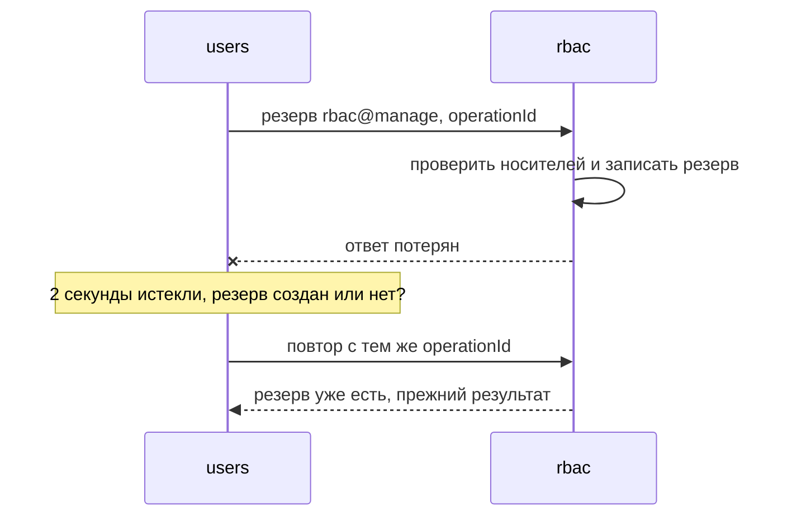
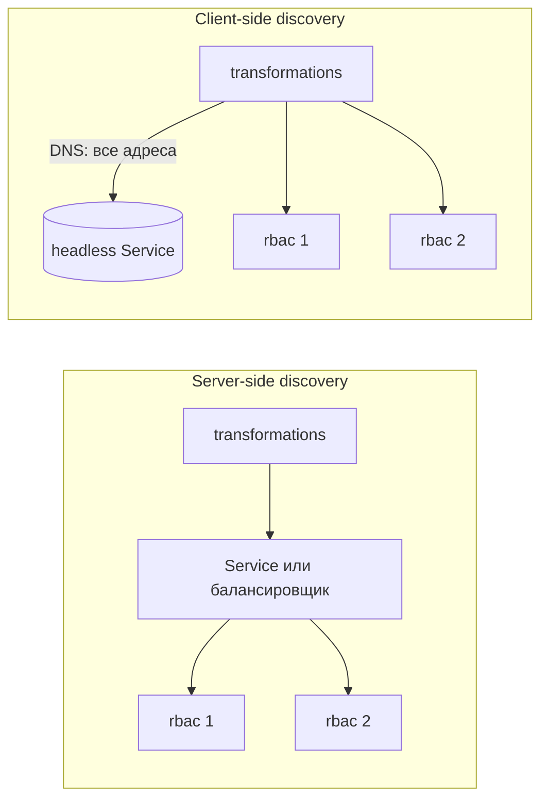
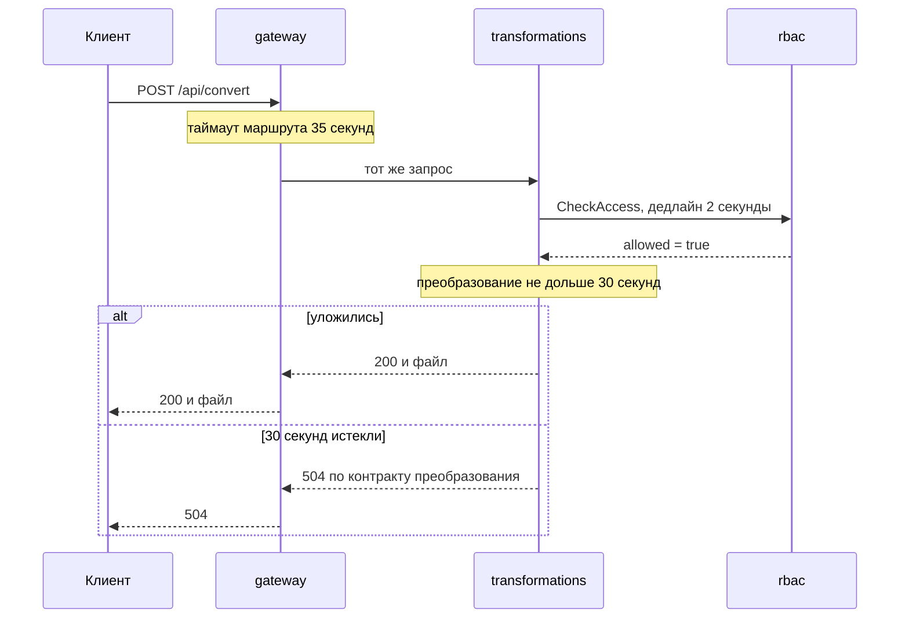
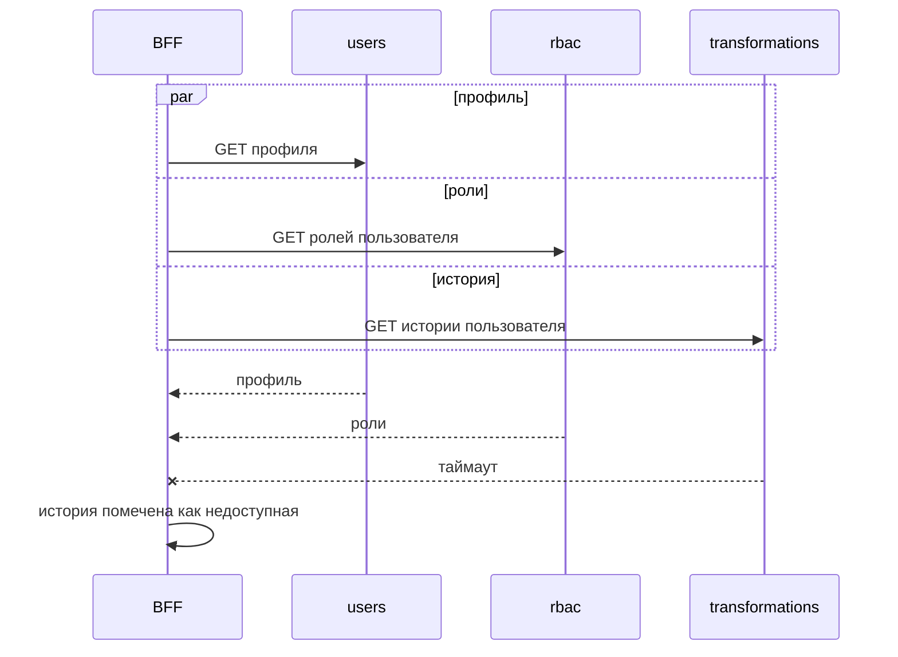

# Синхронное взаимодействие

## Содержание

- [Что такое синхронное взаимодействие](#что-такое-синхронное-взаимодействие)
- [Сетевой вызов не равен вызову функции](#сетевой-вызов-не-равен-вызову-функции)
- [Внутренний HTTP API](#внутренний-http-api)
- [gRPC и Protocol Buffers](#grpc-и-protocol-buffers)
- [Обнаружение сервисов и балансировка](#обнаружение-сервисов-и-балансировка)
- [Таймауты и дедлайны](#таймауты-и-дедлайны)
- [Цепочки и fan-out](#цепочки-и-fan-out)
- [API composition](#api-composition)
- [Передача контекста](#передача-контекста)
- [Сравнение](#сравнение)
- [Как выбирать](#как-выбирать)
- [Как это проявляется в системе](#как-это-проявляется-в-системе)
- [Типичные ошибки](#типичные-ошибки)
- [Полезные ссылки](#полезные-ссылки)
- [Вопросы по теории](#вопросы-по-теории)

## Что такое синхронное взаимодействие

Синхронное взаимодействие — вызов, при котором сервис отправляет запрос другому сервису и ждёт ответа, прежде чем продолжить работу. Это привычная модель «запрос — ответ», но между процессами и по сети.

В системе курса синхронно работают шлюз, проверка доступа `CheckAccess` в `rbac` и резервирование инварианта `rbac@manage`. Шлюз проксирует внешние запросы и проверяет статус пользователя в `users`. Всё, что может подождать, — письма, удаление данных, назначение роли — уходит в сообщения из `0.3 Асинхронное взаимодействие.md`.

| Протокол | Примеры | Когда подходит |
| --- | --- | --- |
| HTTP с JSON | внешний API, запросы шлюза к сервисам | по умолчанию: понятен всем стекам, читается в логах, описывается OpenAPI |
| gRPC | `CheckAccess` в `rbac` | частые внутренние вызовы со строгим контрактом и дедлайнами |
| GraphQL | агрегирующий API для разных клиентов | клиенту нужна гибкая выборка из нескольких источников |

## Сетевой вызов не равен вызову функции

Вызов функции внутри процесса либо возвращает результат, либо бросает исключение. Сетевой вызов добавляет третий исход: ответ не пришёл, и неизвестно, выполнил ли сервер работу. Таймаут — не ошибка сервера, а отсутствие сведений о результате.

Ошибки распределённых вычислений (fallacies of distributed computing) — восемь ложных допущений: сеть надёжна, задержка нулевая, полоса бесконечна, сеть безопасна, топология не меняется, администратор один, передача ничего не стоит, сеть однородна. В микросервисах каждое из них однажды оказывается ложным.



Резерв в `rbac` создан, но `users` об этом не узнал. Повтор безопасен только потому, что запрос несёт идентификатор операции и `rbac` узнаёт повтор. Поэтому изменяющий внутренний вызов либо идемпотентен — его повтор не меняет результат первого выполнения, — либо автоматически не повторяется.

## Внутренний HTTP API

Внутренний API — такой же контракт, как внешний. Его описывают в OpenAPI, проверяют тестами и меняют совместимо, как в `0.7 Контракты и тестирование.md`. Внутренние маршруты живут под отдельным префиксом, например `/internal/`, и шлюз их наружу не публикует.

Ошибки возвращаются в формате Problem Details (RFC 9457): `application/problem+json` с полями `type`, `title`, `status` и при необходимости `detail`. Поле `type` — постоянный идентификатор вида ошибки, по нему вызывающий код принимает решение.

```json
{
  "type": "https://errors.example.test/rbac/policy-unavailable",
  "title": "Политика доступа недоступна",
  "status": 503
}
```

Ответ соседа не пробрасывается клиенту как есть. Вызывающий сервис переводит его в свой контракт, а внутренние имена, адреса и тексты исключений оставляет в логах.

| Ответ зависимости | Ответ клиенту | Почему |
| --- | --- | --- |
| `rbac`: доступ запрещён | **403** | решение принято, повтор ничего не изменит |
| `rbac`: таймаут или **503** | **503** | решение невозможно, запрос не выполняется |
| `users` в шлюзе: статус не `active` | **401** | личность не установлена |
| неожиданный **500** соседа | **503** без деталей соседа | клиенту не нужно внутреннее устройство системы |

Сбой зависимости не маскируется под **401** или **403**: иначе временный сбой выглядел бы для клиента как потеря сессии или прав.

## gRPC и Protocol Buffers

gRPC — RPC-фреймворк поверх HTTP/2. Контракт описывается в файле `.proto`, по нему генерируются клиент и сервер для каждого стека. Сообщения передаются в бинарном формате Protocol Buffers, вызов поддерживает дедлайн, отмену и потоковую передачу.

```proto
syntax = "proto3";

package rbac.v1;

service AccessService {
  rpc CheckAccess(CheckAccessRequest) returns (CheckAccessResponse);
}

message CheckAccessRequest {
  string user_id = 1;
  string permission = 2;
  string action = 3;
}

message CheckAccessResponse {
  bool allowed = 1;
  int64 policy_version = 2;
}
```

Номер поля — часть формата передачи: имя поля можно переименовать, номер менять нельзя. `policy_version` позволяет записать в журнал, какая версия политики приняла решение.

Запрет — обычный ответ `allowed = false`, а не ошибка. Так вызывающий сервис отличает решение от сбоя:

| Результат `CheckAccess` | Смысл | Ответ клиенту |
| --- | --- | --- |
| `OK`, `allowed = true` | разрешено | обработчик выполняется |
| `OK`, `allowed = false` | запрещено, в том числе неизвестное разрешение | **403** |
| `UNAVAILABLE` | `rbac` недоступен | **503**, обработчик не выполняется |
| `DEADLINE_EXCEEDED` | ответ не успел к дедлайну | **503**, повтор только в пределах бюджета времени |

Для изменяющих операций `DEADLINE_EXCEEDED` возможен и после успешного выполнения: это тот же неизвестный исход, что у таймаута HTTP. Браузер не вызывает gRPC напрямую без gRPC-Web, поэтому внешний API остаётся HTTP с JSON.

## Обнаружение сервисов и балансировка

Экземпляры сервисов появляются и исчезают, их IP-адреса меняются. Поэтому вызывающий код обращается по имени, а не по адресу. В Compose имя сервиса — DNS-имя в сети проекта: `http://rbac:8080`. В Kubernetes имя Service разрешается в стабильный адрес, а headless Service — в адреса всех подов.



В server-side варианте клиент знает один адрес, а распределяет вызовы инфраструктура. В client-side варианте клиент сам получает адреса экземпляров и выбирает, куда отправить вызов.

HTTP/2 мультиплексирует все вызовы в одном долгоживущем соединении. L4-балансировщик распределяет соединения, а не вызовы, поэтому все вызовы gRPC одного клиента уходят в один экземпляр. Для gRPC нужна client-side балансировка (`round_robin` по headless Service) или L7-прокси, который видит отдельные вызовы.

## Таймауты и дедлайны

Таймаут — сколько вызов может длиться. Дедлайн — момент, после которого ответ уже не нужен. Дедлайн, переданный во вложенный вызов, gRPC отправляет как оставшийся таймаут, поэтому расхождение часов между серверами на него не влияет. Сам по себе дедлайн не передаётся: в .NET включают `EnableCallContextPropagation`, в Node.js передают входящий вызов в опции `parent`, в Python задают `timeout` из `context.time_remaining()`.

Умолчания клиентов не годятся как политика: HTTPX ждёт 5 секунд, `HttpClient` в .NET — 100 секунд, у gRPC дедлайна по умолчанию нет. Поэтому таймаут задаётся явно. Внутренний вызов в системе курса ограничен 2 секундами на попытку.

```ts
const response = await fetch(`${RBAC_URL}/internal/reservations`, {
  method: 'POST',
  headers: { 'content-type': 'application/json', 'idempotency-key': operationId },
  body: JSON.stringify({ userId, permission: 'rbac@manage' }),
  signal: AbortSignal.timeout(2_000),
});
```

Без `signal` запрос ждёт столько, сколько позволяют умолчания Node.js. Ключ `idempotency-key` делает повтор после таймаута безопасным.

Внешний таймаут всегда больше внутреннего. Преобразование файла по контракту длится не дольше 30 секунд, а таймаут маршрута преобразований на шлюзе — 35 секунд.



Внутренний предел меньше внешнего, поэтому клиент получает ответ сервиса, а не обрыв на шлюзе. При обратном порядке шлюз вернёт **504**, пока сервис ещё работает, и результат пропадёт. Когда вызывающий перестаёт ждать, вызываемый тоже должен остановиться: `CancellationToken`, `AbortSignal` и контекст gRPC передаются во все вложенные вызовы.

## Цепочки и fan-out

Доступность последовательной цепочки — произведение доступностей её звеньев. Три сервиса с доступностью 99,9 % каждый дают около 99,7 %. Задержки складываются, а хвост распределения растёт: чем больше вызовов в запросе, тем вероятнее, что один из них попадёт в медленный p99.

Fan-out — параллельный вызов нескольких сервисов. Общее время равно самой медленной ветке, но нагрузка растёт, а хвост задержек становится заметнее.

N+1 — отдельный запрос за каждым элементом списка. По сети он обходится дороже, чем в базе: каждый лишний вызов стоит сетевого перехода, сериализации и места в пуле соединений. Список из 50 элементов с вызовом соседа на каждый элемент — это 50 сетевых запросов. Решения: batch-запрос с массивом идентификаторов, реплика данных или данные у владельца.

В эталоне цепочка внутри запроса не глубже двух переходов: шлюз → сервис → `rbac`. Более длинная цепочка — признак неудачных границ из `0.1 Декомпозиция на микросервисы.md`.

## API composition

API composition — выполнение запроса вызовами сервисов-владельцев и сборкой ответа в памяти. Сборщиком в общем случае выступает шлюз, BFF или отдельный сервис. В курсе это BFF: шлюз из `0.5 API Gateway и безопасность.md` ответы не собирает.

Если клиенту администратора нужна одна страница с профилем, ролями и историей пользователя, BFF вызывает три существующих endpoint параллельно:



Для каждой части заранее решают, обязательна ли она. Без профиля страница не имеет смысла — запрос завершается ошибкой. Без истории страница полезна — часть помечается недоступной.

Composition не подходит для фильтрации и сортировки по данным нескольких сервисов: «пользователи с ролью `admin`, отсортированные по email, с cursor» потребует выгрузить и соединить в памяти всё. Для таких запросов строят read model из `0.4 Согласованность данных.md`.

## Передача контекста

| Что передаётся | Как | Зачем |
| --- | --- | --- |
| контекст трассировки | заголовок `traceparent` | один trace на весь запрос через все сервисы |
| личность пользователя | access в `Authorization: Bearer` от шлюза, `user_id` в теле вложенного вызова | сервис знает, от чьего имени запрос; другие способы — в `0.5 API Gateway и безопасность.md` |
| ключ операции | `Idempotency-Key` | повтор внутреннего вызова узнаётся как повтор |
| оставшееся время | дедлайн gRPC или таймаут вызова | вложенный вызов не ждёт дольше внешнего |

Дальше шлюза не уходят `Cookie` клиента, hop-by-hop заголовки вроде `Connection` и любые `X-User-*`, пришедшие снаружи. Access шлюз передаёт сервису как `Authorization: Bearer`, а сервис соседям его не пересылает: `CheckAccess` получает `user_id` в теле запроса. `traceparent` к исходящим вызовам добавляет автоинструментация OpenTelemetry, если она загружена раньше HTTP-клиента.

## Сравнение

| Способ | Ожидание | Контракт | Подходит для |
| --- | --- | --- | --- |
| HTTP с JSON | вызывающий ждёт ответа | OpenAPI, Problem Details | внешний API, простые внутренние запросы |
| gRPC | вызывающий ждёт, дедлайн задаётся явно | `.proto` с генерацией кода | частые внутренние вызовы, `CheckAccess` |
| GraphQL | вызывающий ждёт, сервер собирает граф | схема GraphQL | гибкая выборка для разных клиентов |
| Сообщения через брокер | отправитель не ждёт получателя | схема события или команды | побочные эффекты и долгие процессы |

## Как выбирать

1. По умолчанию — HTTP с JSON и OpenAPI: понятен всем стекам курса и читается в логах.
2. gRPC — для частых внутренних вызовов со строгим контрактом: `CheckAccess` выполняется в каждом защищённом запросе.
3. Синхронный вызов — только когда ответ нужен для ответа клиенту. Письма, удаление данных, назначение роли — сообщениями.
4. Каждому вызову — явный таймаут, вложенному — меньше внешнего.
5. Цепочка — не глубже двух внутренних переходов; более глубокая требует пересмотра границ.
6. Фильтрация и сортировка по данным нескольких сервисов — через read model, а не через composition.

## Как это проявляется в системе

**Аутентификация.** Шлюз проверяет подпись access по JWKS из `users`, но не запрашивает ключи в каждом запросе: они кешируются, а новый запрос идёт только при неизвестном `kid`.

**Авторизация.** Защищённый запрос проходит два синхронных шага: шлюз проверяет статус в `users`, сервис вызывает `CheckAccess` в `rbac`. Таймаут или сбой любого шага даёт **503**, а не **401** или **403**.

**Изменение данных пользователя.** Блокировка администратора синхронно резервирует инвариант `rbac@manage`. Потерянный ответ безопасно повторяется с тем же идентификатором операции.

**Удаление пользователя.** Принятие удаления синхронно резервирует тот же инвариант, остальная работа идёт сообщениями. Клиент получает **202**, не дожидаясь `rbac` и `transformations`.

**Просмотр списка всех пользователей.** Страница строится одним запросом к базе `users`. Элемент списка — канонический профиль без ролей, поэтому вызова `rbac` на каждую строку нет.

**Общие требования к трансформации файлов.** Таймаут маршрута на шлюзе — 35 секунд, больше 30 секунд преобразования. Клиент получает **504** от сервиса по контракту преобразования, а не обрыв на шлюзе.

**Просмотр истории трансформаций файлов пользователя.** Административный путь сначала вызывает `CheckAccess` с `transformations@history_any`, затем синхронно спрашивает `users`, существует ли цель, — отсутствующий пользователь получает **404**. Вызов оправдан: операция редкая, а `users` и так нужен каждому запросу через шлюз.

**Сохранение результатов трансформаций в хранилище.** Административное скачивание повторяет порядок истории с `transformations@download_any`. Файл передаётся потоком через шлюз, поэтому таймаут маршрута скачивания учитывает размер результата.

## Типичные ошибки

| Что видно | Причина и исправление |
| --- | --- |
| Запрос висит минуту, когда `rbac` перегружен | у вызова нет таймаута; задать 2 секунды и дедлайн gRPC явно |
| Клиент получает **504** шлюза, хотя преобразование укладывается в 30 секунд | таймаут маршрута короче таймаута сервиса; внешний предел больше внутреннего |
| После таймаута повтор создал второй резерв | изменяющий вызов без идентификатора операции; передавать `Idempotency-Key` и узнавать повтор |
| Все gRPC-вызовы идут в один экземпляр `rbac` | HTTP/2 за L4-балансировщиком; client-side `round_robin` по headless Service или L7-прокси |
| Временный сбой `rbac` превратился в **403** | сбой принят за запрет; сбой — **503**, запрет — только ответ `allowed = false` |
| Клиент видит текст исключения соседнего сервиса | ответ зависимости проброшен как есть; переводить в свой контракт и Problem Details |
| Страница из 50 строк делает 50 вызовов соседа | N+1 по сети; batch-запрос, реплика или данные у владельца |
| Сервис медленный, хотя каждый сосед быстрый | длинная последовательная цепочка; параллельные вызовы, меньше переходов, события вместо вызовов |
| Внешний клиент вызвал внутренний endpoint | шлюз маршрутизирует `/internal/`; не публиковать внутренние пути и проверять вызывающий сервис |
| После перезапуска контейнера сервис не находит соседа | адрес задан IP; обращаться по имени сервиса в DNS Compose или Kubernetes |
| Сервер продолжает работу после отказа клиента | отмена не передаётся; передавать `CancellationToken`, `AbortSignal` или контекст gRPC |
| У каждого сервиса свой `trace_id` на один запрос | `traceparent` не передаётся; загрузить инструментацию HTTP-клиента до первого вызова |
| Сервис пересылает соседу cookie клиента | внешние учётные данные уходят внутрь; передавать проверенную личность |

## Полезные ссылки

### Общие

- [Wikipedia — Fallacies of distributed computing](https://en.wikipedia.org/wiki/Fallacies_of_distributed_computing) — восемь ложных допущений о сети.
- [RFC 9457 — Problem Details for HTTP APIs](https://www.rfc-editor.org/rfc/rfc9457.html) — единый формат ошибок HTTP API.
- [OpenAPI Initiative — OpenAPI Specification](https://spec.openapis.org/oas/latest.html) — описание HTTP-контракта сервиса.
- [gRPC — Introduction to gRPC](https://grpc.io/docs/what-is-grpc/introduction/) — сервисы, сообщения Protobuf и генерация кода.
- [gRPC — Deadlines](https://grpc.io/docs/guides/deadlines/) — дедлайны на клиенте и сервере и их распространение.
- [gRPC — Status Codes](https://grpc.io/docs/guides/status-codes/) — значения `UNAVAILABLE`, `DEADLINE_EXCEEDED` и `PERMISSION_DENIED`.
- [Protocol Buffers — Language Guide (proto 3)](https://protobuf.dev/programming-guides/proto3/) — синтаксис `.proto` и номера полей.
- [microservices.io — Server-side service discovery](https://microservices.io/patterns/server-side-discovery.html) — обнаружение через маршрутизатор.
- [microservices.io — Client-side service discovery](https://microservices.io/patterns/client-side-discovery.html) — обнаружение и балансировка на стороне клиента.
- [Kubernetes — gRPC Load Balancing on Kubernetes without Tears](https://kubernetes.io/blog/2018/11/07/grpc-load-balancing-on-kubernetes-without-tears/) — почему L4-балансировка не распределяет вызовы gRPC.
- [Kubernetes — DNS for Services and Pods](https://kubernetes.io/docs/concepts/services-networking/dns-pod-service/) — имена сервисов и headless Service.
- [Docker — Networking in Compose](https://docs.docker.com/compose/how-tos/networking/) — обращение к сервисам по имени в Compose.
- [microservices.io — API Composition](https://microservices.io/patterns/data/api-composition.html) — сборка ответа из нескольких сервисов и её ограничения.
- [Google Research — The Tail at Scale](https://research.google/pubs/the-tail-at-scale/) — почему хвост задержек растёт с числом вызываемых сервисов.

### По языку

#### Node.js

- [NestJS — gRPC](https://docs.nestjs.com/microservices/grpc) — gRPC-сервер и клиент в NestJS.
- [NestJS — HTTP client](https://docs.nestjs.com/techniques/http-module) — HTTP-клиент с базовыми адресами, таймаутами и именованными клиентами.

#### .NET

- [Microsoft — Reliable gRPC services with deadlines and cancellation](https://learn.microsoft.com/en-us/aspnet/core/grpc/deadlines-cancellation) — дедлайны, отмена и `EnableCallContextPropagation`.
- [Microsoft — gRPC client-side load balancing](https://learn.microsoft.com/en-us/aspnet/core/grpc/loadbalancing) — resolver `dns` и балансировщик `round_robin`.
- [Microsoft — Use the IHttpClientFactory](https://learn.microsoft.com/en-us/dotnet/core/extensions/httpclient-factory) — именованные клиенты и управление соединениями.

#### Python

- [gRPC — Python Quick start](https://grpc.io/docs/languages/python/quickstart/) — генерация кода из `.proto` и вызов сервиса.
- [HTTPX — Timeouts](https://www.python-httpx.org/advanced/timeouts/) — таймауты подключения, чтения, записи и пула.

## Вопросы по теории

1. Почему таймаут сетевого вызова не означает, что сервер не выполнил работу, и как сделать повтор безопасным?
2. Чем запрет `allowed = false` отличается от статуса `UNAVAILABLE` и какой ответ получает клиент в каждом случае?
3. Почему таймаут маршрута преобразований на шлюзе должен быть больше 30 секунд?
4. Что произойдёт с распределением вызовов gRPC за L4-балансировщиком и как это исправить?
5. Зачем переводить ошибки зависимости в свой контракт, а не пробрасывать их клиенту?
6. Чем API composition отличается от read model и когда composition не подходит?
7. Какие заголовки передаются во внутренние вызовы, а какие останавливаются на шлюзе?
