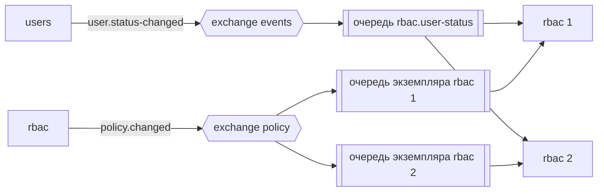
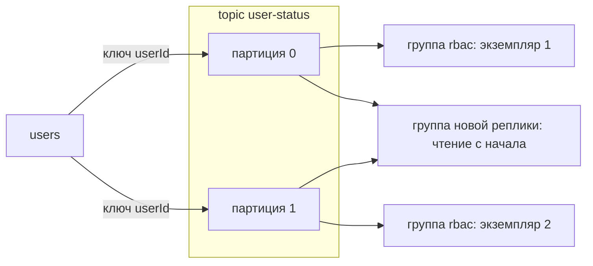
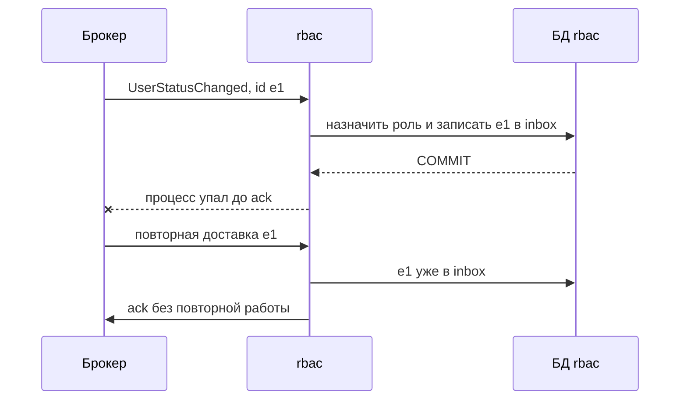
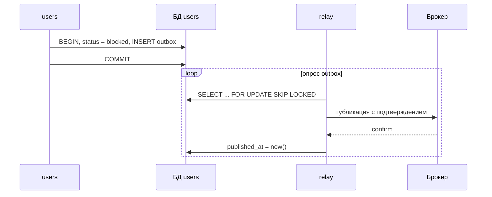

# Асинхронное взаимодействие

## Содержание

- [Что такое асинхронное взаимодействие](#что-такое-асинхронное-взаимодействие)
- [Команды и события](#команды-и-события)
- [Очередь и журнал](#очередь-и-журнал)
- [Гарантии доставки](#гарантии-доставки)
- [Порядок сообщений](#порядок-сообщений)
- [Повторы и DLQ](#повторы-и-dlq)
- [Transactional outbox](#transactional-outbox)
- [Inbox и идемпотентный потребитель](#inbox-и-идемпотентный-потребитель)
- [Конверт сообщения](#конверт-сообщения)
- [Сравнение](#сравнение)
- [Как выбирать](#как-выбирать)
- [Как это проявляется в системе](#как-это-проявляется-в-системе)
- [Типичные ошибки](#типичные-ошибки)
- [Полезные ссылки](#полезные-ссылки)
- [Вопросы по теории](#вопросы-по-теории)

## Что такое асинхронное взаимодействие

Асинхронное взаимодействие — обмен сообщениями через брокер, при котором отправитель не ждёт, пока получатель обработает сообщение. Брокер хранит сообщение и доставляет его, когда получатель готов, поэтому получателю не нужно быть доступным в момент отправки.

В системе курса сообщениями передаются письма, назначение роли `user` после активации, удаление данных пользователя в соседних сервисах и изменения политики доступа. Здесь разобраны устройство брокеров, гарантии доставки и способы не потерять и не продублировать сообщение.

| Вид сообщения | Пример | Когда подходит |
| --- | --- | --- |
| Команда | `SendEmail`, `EraseUserData` | отправитель хочет, чтобы конкретный получатель выполнил действие |
| Событие | `UserStatusChanged`, `PolicyChanged` | владелец данных сообщает о свершившемся факте, подписчиков сколько угодно |
| Ответ | `UserDataErased` | получатель команды сообщает результат отправителю |

## Команды и события

| Признак | Команда | Событие |
| --- | --- | --- |
| смысл | просьба выполнить действие | факт, который уже произошёл |
| имя | глагол действия: `SendEmail` | прошедшее время: `UserStatusChanged` |
| получатели | один логический получатель | ноль или много подписчиков |
| владелец схемы | получатель | издатель |
| ответ | возможен: `UserDataErased` | не ожидается |

Событие, после которого издатель на самом деле ждёт конкретного действия, — «пассивно-агрессивная команда». Если `users` ждёт, что соседи удалят данные пользователя, это команда `EraseUserData` с ответом, а не событие «пользователь удалён».

Событие бывает двух видов. Event notification несёт только идентификатор, и подписчик при необходимости спрашивает подробности у издателя. Event-carried state transfer несёт изменённое состояние, и подписчик ведёт свою копию без обращения к издателю. `UserStatusChanged` с полями `userId`, `status` и `version` — второй вид: `rbac` обновляет реплику статусов и не вызывает `users`.

## Очередь и журнал

RabbitMQ — брокер очередей. Издатель отправляет сообщение в exchange, а тот по привязкам (binding) и ключу маршрутизации (routing key) кладёт копию в каждую подходящую очередь. После подтверждения потребителем сообщение из очереди удаляется.



Реплику статусов экземпляры `rbac` держат в общей базе, поэтому читают одну очередь `rbac.user-status` и делят сообщения между собой — это конкурирующие потребители. Снимок политики живёт в памяти каждого экземпляра, поэтому `PolicyChanged` нужен всем: у каждого экземпляра своя эксклюзивная очередь, которая исчезает вместе с ним.

Kafka — распределённый журнал. Topic разделён на партиции, сообщения дописываются в конец партиции и хранятся заданный срок (retention) независимо от чтения. Потребитель сам фиксирует смещение (offset) прочитанного, а Kafka хранит его для группы потребителей. Consumer group делит партиции между экземплярами, а разные группы читают один topic независимо.



Сообщения одного `userId` попадают в одну партицию. Группа `rbac` делит партиции между экземплярами, а группа новой реплики читает обе независимо от неё. Прочитанное сообщение не удаляется, поэтому новый подписчик перечитывает журнал с начала (replay) и строит свою реплику.

## Гарантии доставки

| Гарантия | Как получается | Риск |
| --- | --- | --- |
| at-most-once | подтверждение до обработки или автоматический ack | сообщение теряется при сбое обработчика |
| at-least-once | подтверждение после обработки и фиксации | сообщение может прийти повторно |
| exactly-once | транзакции Kafka внутри Kafka | побочные эффекты вне брокера всё равно повторяются |

Вариант по умолчанию — at-least-once и идемпотентный обработчик. Издатель включает подтверждения брокера (publisher confirms в RabbitMQ, `acks=all` в Kafka), чтобы знать, что сообщение сохранено. Потребитель подтверждает сообщение только после фиксации своей транзакции.



Сбой между фиксацией и подтверждением — штатный сценарий at-least-once. Повтор безопасен только благодаря inbox. Обратный порядок — подтвердить, затем обработать — даёт at-most-once: упавший обработчик теряет сообщение навсегда.

## Порядок сообщений

RabbitMQ сохраняет порядок внутри очереди для одного потребителя. Конкурирующие потребители и повторные доставки этот порядок нарушают. Kafka гарантирует порядок внутри партиции, поэтому ключом партиции выбирают идентификатор сущности: все события одного `userId` идут друг за другом.

Даже упорядоченный транспорт не защищает от перестановки: relay outbox публикует пачками, повтор приходит позже следующего сообщения. Поэтому событие состояния несёт `version`, а подписчик применяет только более новую версию. Событие `blocked` с версией 7, пришедшее после `active` с версией 8, ничего не меняет. Как выглядит такой upsert, показано в `0.4 Согласованность данных.md`.

## Повторы и DLQ

Временная ошибка — база недоступна, сосед отвечает **503** — лечится повтором позже. Постоянная ошибка — неизвестная версия схемы, нарушенный формат — повтором не лечится, такое сообщение сразу отправляют в dead letter queue (DLQ).

Немедленный возврат сообщения в очередь создаёт горячий цикл: сообщение возвращается тысячи раз в секунду. В системе курса сообщение доставляется не больше 5 раз с паузой 1 минута между доставками, затем уходит в DLQ.

- В RabbitMQ сообщение попадает в dead letter exchange при отказе без возврата, истечении TTL, переполнении очереди или превышении delivery limit quorum-очереди. С версии 4.0 этот предел по умолчанию — 20 доставок, с 4.3 quorum-очереди умеют отложенный повтор с линейной паузой. В более старых версиях паузу строят циклом через DLX и очередь с TTL.
- В Kafka нет подтверждения отдельного сообщения. Повтор строят отдельными topic для повторов и DLQ, иначе одно плохое сообщение останавливает всю партицию.

Poison message — сообщение, которое всегда роняет обработчик. Без предела попыток оно занимает потребителя навсегда. DLQ — не корзина: непустая DLQ вызывает алерт, сообщения разбирают и после исправления отправляют повторно.

TTL ограничивает жизнь сообщения. Код в `SendEmail` действует 10 минут, а TTL очереди отсчитывается с момента публикации и не учитывает время в outbox: после сбоя брокера команда может попасть в очередь с уже недействительным кодом. Поэтому команда несёт в заголовках абсолютный срок `expiresAt` — момент истечения challenge. Relay выставляет TTL сообщения по оставшемуся до него времени, а `mail` перед отправкой сверяет срок и просроченную команду отправляет в DLX без письма.

## Transactional outbox

Dual write — запись в базу и отправка в брокер двумя независимыми действиями. Сбой между ними теряет событие или публикует событие об откатившейся транзакции. Outbox записывает сообщение в таблицу той же транзакцией, что и данные, а отдельный relay доставляет его в брокер.

```sql
CREATE TABLE outbox (
  id           uuid PRIMARY KEY,
  type         text NOT NULL,
  subject      text NOT NULL,
  payload      jsonb NOT NULL,
  headers      jsonb NOT NULL DEFAULT '{}',
  created_at   timestamptz NOT NULL DEFAULT now(),
  published_at timestamptz
);

SELECT id, type, subject, payload, headers
FROM outbox
WHERE published_at IS NULL
ORDER BY created_at
LIMIT 100
FOR UPDATE SKIP LOCKED;
```

`FOR UPDATE SKIP LOCKED` позволяет нескольким экземплярам relay работать параллельно: строки, заблокированные одним экземпляром, другой пропускает. `id` строки outbox становится `id` сообщения, по нему потребитель узнаёт повтор. Столбец `headers` сохраняет заголовки сообщения: `traceparent` исходного запроса, а у `SendEmail` ещё и `expiresAt`.



Если relay упал после подтверждения брокера, но до записи `published_at`, сообщение уйдёт повторно. Outbox гарантирует «хотя бы один раз», а не «ровно один». Опубликованные строки удаляются фоновой очисткой.

Relay опросом работает с любой базой. Альтернатива — CDC (change data capture): Debezium читает журнал транзакций PostgreSQL (WAL) и публикует строки outbox без опроса. Задержка меньше, но появляется ещё одна инфраструктура.

## Inbox и идемпотентный потребитель

Inbox — таблица обработанных сообщений с первичным ключом `(consumer, message_id)`. Обработчик вставляет `id` сообщения той же транзакцией, что и полезную работу. Повторная доставка получает конфликт ключа, и сообщение подтверждается без повторной работы.

Естественная идемпотентность проще inbox. «Назначить роль `user`, если её нет» через `INSERT ... ON CONFLICT DO NOTHING` можно выполнить сколько угодно раз. Inbox нужен эффектам, которые повтор накапливает.

Эффект вне базы нельзя включить в её транзакцию. `mail` не может откатить SMTP:

- записать `id` в inbox до отправки — сбой после записи потеряет письмо;
- отправить, затем записать — сбой между шагами отправит письмо повторно.

`mail` выбирает второй порядок: письмо с тем же кодом, пришедшее дважды, безопаснее потерянного кода.

## Конверт сообщения

CloudEvents — стандарт описания события: обязательные атрибуты `specversion`, `id`, `source`, `type`, необязательные `subject`, `time`, `datacontenttype`. Единый конверт позволяет маршрутизировать, трассировать и отбрасывать дубли, не разбирая тело.

```json
{
  "specversion": "1.0",
  "id": "0f9b2c7e-3c55-4a8e-9d0e-6b1f7f2a4c11",
  "source": "/users",
  "type": "UserStatusChanged",
  "subject": "2b8f4a0e-7d1c-4c3a-9a51-3e6f0b7d9c20",
  "time": "2026-10-27T11:12:13Z",
  "datacontenttype": "application/json",
  "data": {
    "userId": "2b8f4a0e-7d1c-4c3a-9a51-3e6f0b7d9c20",
    "status": "blocked",
    "version": 8
  }
}
```

Контекст трассировки `traceparent` передаётся в заголовках сообщения. Сервис записывает его в столбец `headers` строки outbox той же транзакцией, relay переносит в заголовки сообщения, а потребитель извлекает и начинает span потребителя. Так обработка сообщения попадает в тот же trace, что и исходный HTTP-запрос, хотя публикует сообщение relay.

Сообщение несёт минимум данных. `UserStatusChanged` не содержит email. `SendEmail` по необходимости содержит адрес и одноразовый код, поэтому тело этой команды не пишется в журналы и атрибуты span, а доступ к её очереди и DLQ ограничен.

`users` шифрует тело `SendEmail` ключом, который есть только у `users` и `mail`. Открытых адреса и кода нет ни в строке outbox, ни в брокере и DLQ, а база `users` по-прежнему хранит код только в виде HMAC, как требует практика.

## Сравнение

| Вариант | Модель | Повторное чтение | Порядок | Подходит для |
| --- | --- | --- | --- | --- |
| Таблица заданий в БД | строки со статусом и lease в базе сервиса | нет | задаёт запрос выборки | фоновая работа внутри одного сервиса |
| RabbitMQ | exchange, очереди, подтверждения | нет: сообщение удаляется после ack | внутри очереди | команды и события умеренного объёма |
| Kafka | журнал с партициями и offset | да, в пределах retention | внутри партиции | потоки событий, replay, большой объём |

## Как выбирать

1. Фоновую работу внутри одного сервиса держать в таблице заданий: брокер для неё не нужен.
2. Между сервисами по умолчанию использовать RabbitMQ: команды и события умеренного объёма, маршрутизация, DLX.
3. Kafka выбирать, когда нужен replay: построение новой реплики с начала журнала, аналитика, большой поток событий.
4. Всегда работать в режиме at-least-once: ручное подтверждение после фиксации и идемпотентный обработчик.
5. Публиковать только через outbox. Relay опросом достаточно, CDC — при высокой нагрузке.
6. Команду отправлять, когда отправитель ждёт действия; событие — когда он сообщает факт.

## Как это проявляется в системе

**Регистрация.** `users` одной транзакцией создаёт `pending`, challenge и строку outbox с командой `SendEmail`. Ответ клиенту не ждёт SMTP: если почтовый сервер временно не принимает письмо, `mail` повторяет доставку до срока `expiresAt`, а регистрация уже завершена. Это осознанное отличие от практики монолита: там непринятое письмо даёт **503**, а здесь регистрация, вход, смена email и удаление отвечают, не дожидаясь почты. Письмо, которое так и не ушло, пользователь запрашивает повторной отправкой через 60 секунд.

**Аутентификация.** OTP и magic link входа — та же команда `SendEmail` со сроком `expiresAt` через 10 минут после выпуска кода. Просроченная команда уходит в DLX без отправки, даже если пролежала это время в outbox.

**RBAC.** Каждое изменение политики публикует через outbox `rbac` событие `PolicyChanged` с новой `version`. Каждый экземпляр `rbac` получает событие из своей очереди и перестраивает снимок в памяти заранее, но перед решением по-прежнему сверяет версию: событие ускоряет обновление, а сверка гарантирует его.

**Изменение данных пользователя.** Блокировка публикует `UserStatusChanged` со статусом `blocked`. `rbac` обновляет реплику статусов и закрывает резерв `rbac@manage`, а шлюз видит `blocked` при следующей проверке статуса в `users`. Письмо для смены email уходит командой `SendEmail`.

**Удаление пользователя.** Оркестратор в `users` отправляет `EraseUserData` в `rbac` и `transformations` и ждёт ответов `UserDataErased`. Команда несёт `userId` и `jobId`, и повтор той же пары безопасен: участник, у которого данных уже нет, отвечает `succeeded`. Временный сбой участник сообщает ответом `retryable_failure`, а попытки считает оркестратор: 5 с паузой 1 минута, затем задание переходит в `failed`, как в `0.4 Согласованность данных.md`. Повторная доставка брокером и DLQ относятся к сбоям самого обработчика: процесс упал до подтверждения или сообщение нельзя разобрать.

**Сохранение результатов трансформаций в хранилище.** Фоновое сохранение не покидает `transformations`, поэтому очередью служат строки истории со статусом `pending`. Брокер понадобится, только если работу нужно раздать другому сервису.

## Типичные ошибки

| Что видно | Причина и исправление |
| --- | --- |
| Сообщение пропало после падения обработчика | автоматическое подтверждение, в транспорте RabbitMQ NestJS по умолчанию `noAck: true`; ручной ack после фиксации |
| Событие опубликовано, а транзакция откатилась | публикация до `COMMIT`; публиковать только через outbox |
| Данные сохранены, события нет | публикация после `COMMIT` без outbox, процесс упал между шагами; outbox |
| Роль назначена дважды или письмо ушло дважды | повторная доставка без идемпотентности; inbox или `ON CONFLICT DO NOTHING` |
| Одно сообщение бесконечно возвращается в очередь | poison message без предела попыток; delivery limit и DLQ |
| Очередь гоняет сообщение тысячи раз в секунду | немедленный возврат при временной ошибке; отложенный повтор с паузой 1 минута |
| В DLQ тысячи сообщений, и никто не знает | нет алерта; метрика длины DLQ, разбор и повторная отправка |
| Пользователь получил письмо с истёкшим кодом | у `SendEmail` нет срока или TTL отсчитан от публикации после долгого ожидания в outbox; абсолютный `expiresAt` и проверка срока в `mail` |
| В реплике `blocked` сменился обратно на `active` | события пришли не по порядку; применять только более новую `version` |
| Один потребитель Kafka перегружен, остальные простаивают | перекос ключа или партиций меньше, чем экземпляров; ключ `userId` и достаточно партиций |
| Потребитель Kafka потерял сообщение при сбое | offset зафиксирован до обработки; сохранять offset после обработки |
| `users` ждёт удаления данных, но никто его не выполняет | событие использовано как команда; явная команда `EraseUserData` с ответом |
| В логах и трассах виден OTP | тело `SendEmail` записывается целиком; не писать payload команд в журнал и атрибуты span |
| В строках outbox и в DLQ виден OTP | тело `SendEmail` хранится открытым; шифровать его ключом `users` и `mail` |
| Обработчик падает на новом поле события | строгая десериализация; tolerant reader из `0.7 Контракты и тестирование.md` |

## Полезные ссылки

### Общие

- [Martin Fowler — What do you mean by “Event-Driven”?](https://martinfowler.com/articles/201701-event-driven.html) — event notification, event-carried state transfer и «пассивно-агрессивная команда».
- [RabbitMQ — AMQP 0-9-1 Model Explained](https://www.rabbitmq.com/tutorials/amqp-concepts) — exchange, binding, routing key и очереди.
- [RabbitMQ — Consumer Acknowledgements and Publisher Confirms](https://www.rabbitmq.com/docs/confirms) — ручное подтверждение, prefetch и подтверждения издателю.
- [RabbitMQ — Dead Letter Exchanges](https://www.rabbitmq.com/docs/dlx) — причины dead lettering и отложенные повторы.
- [RabbitMQ — Quorum Queues](https://www.rabbitmq.com/docs/quorum-queues) — delivery limit и обработка poison message.
- [RabbitMQ — Time-to-Live and Expiration](https://www.rabbitmq.com/docs/ttl) — срок жизни сообщений и очередей.
- [Apache Kafka — Introduction](https://kafka.apache.org/intro) — topic, партиции, ключ и порядок внутри партиции.
- [Apache Kafka — Design](https://kafka.apache.org/44/design/design/#message-delivery-semantics) — гарантии at-most-once, at-least-once и exactly-once.
- [microservices.io — Transactional outbox](https://microservices.io/patterns/data/transactional-outbox.html) — атомарная запись данных и сообщения.
- [microservices.io — Idempotent Consumer](https://microservices.io/patterns/communication-style/idempotent-consumer.html) — таблица обработанных сообщений.
- [Debezium — Outbox Event Router](https://debezium.io/documentation/reference/stable/transformations/outbox-event-router.html) — публикация outbox из журнала транзакций.
- [CloudEvents — Specification](https://github.com/cloudevents/spec/blob/main/cloudevents/spec.md) — обязательные и необязательные атрибуты конверта.
- [CloudEvents — Distributed Tracing extension](https://github.com/cloudevents/spec/blob/main/cloudevents/extensions/distributed-tracing.md) — `traceparent` в событии и его связь с заголовками протокола.
- [OpenTelemetry — Semantic conventions for messaging spans](https://opentelemetry.io/docs/specs/semconv/messaging/messaging-spans/) — spans издателя и потребителя.
- [PostgreSQL — SELECT](https://www.postgresql.org/docs/current/sql-select.html) — `FOR UPDATE SKIP LOCKED` для параллельных relay.

### По языку

#### Node.js

- [NestJS — RabbitMQ](https://docs.nestjs.com/microservices/rabbitmq) — транспорт RabbitMQ, `noAck` и ручное подтверждение.
- [NestJS — Kafka](https://docs.nestjs.com/microservices/kafka) — транспорт Kafka и группы потребителей.

#### .NET

- [RabbitMQ — .NET/C# Client API Guide](https://www.rabbitmq.com/client-libraries/dotnet-api-guide) — подключение, публикация и потребление из .NET.
- [Confluent — .NET Client for Apache Kafka](https://docs.confluent.io/kafka-clients/dotnet/current/overview.html) — сохранение offset после обработки и idempotent producer.

#### Python

- [aio-pika — Documentation](https://docs.aio-pika.com/) — асинхронный клиент RabbitMQ с publisher confirms.
- [Confluent — Python Client for Apache Kafka](https://docs.confluent.io/kafka-clients/python/current/overview.html) — производитель и потребитель Kafka.
- [Cosmic Python — Event-Driven Architecture: Using Events to Integrate Microservices](https://www.cosmicpython.com/book/chapter_11_external_events.html) — внешние события между сервисами.

## Вопросы по теории

1. Чем команда отличается от события и почему удаление данных пользователя в соседних сервисах оформлено командой?
2. Почему потребитель подтверждает сообщение только после фиксации транзакции и что произойдёт при обратном порядке?
3. Чем журнал Kafka отличается от очереди RabbitMQ и когда нужен replay?
4. Что произойдёт, если `users` отправит событие в брокер после `COMMIT` без outbox?
5. Как подписчик защищается от событий, пришедших не по порядку?
6. Зачем сообщению предел попыток и DLQ и почему немедленный возврат в очередь вреден?
7. Почему `mail` сначала отправляет письмо, а затем записывает `id` в inbox?
