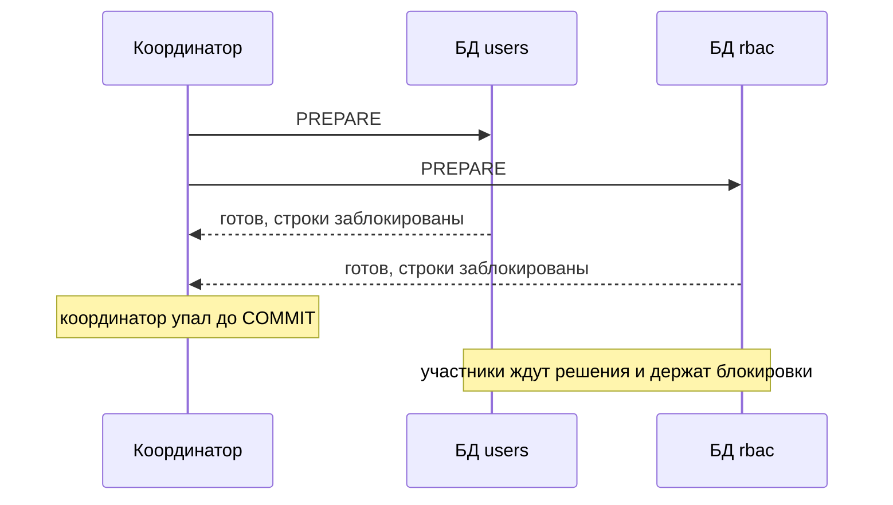
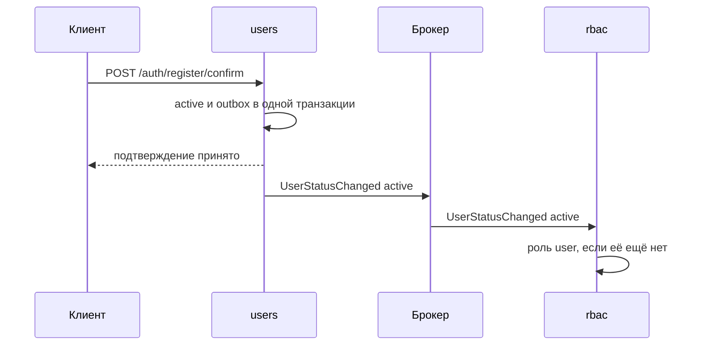
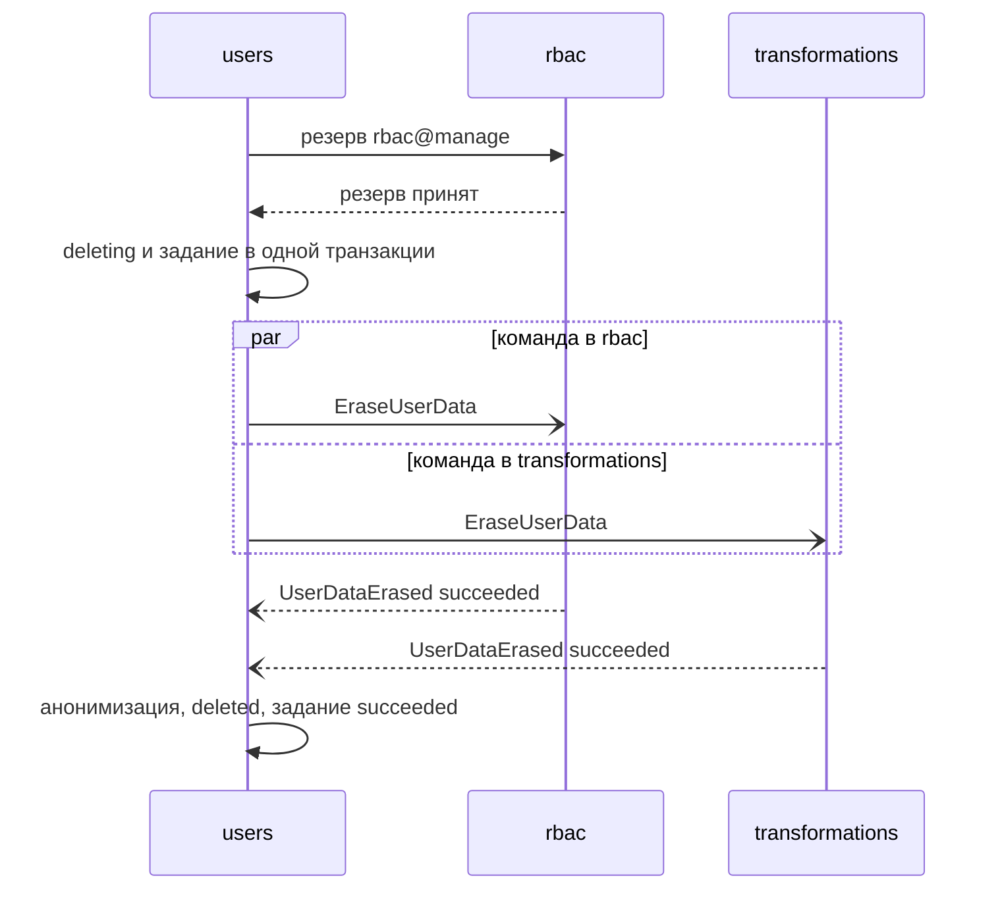
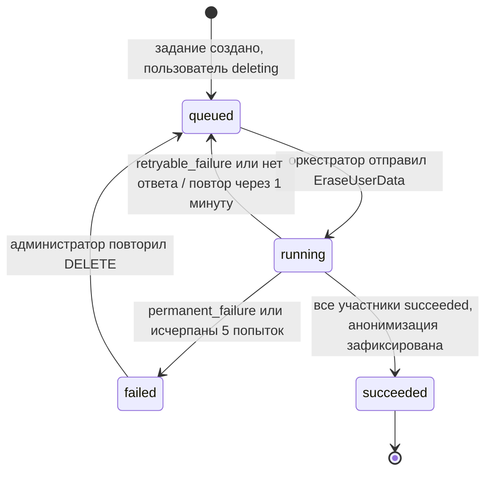

# Согласованность данных

## Содержание

- [Что такое согласованность данных](#что-такое-согласованность-данных)
- [Почему нет общей транзакции](#почему-нет-общей-транзакции)
- [Сага](#сага)
- [Хореография и оркестрация](#хореография-и-оркестрация)
- [Состояние оркестратора](#состояние-оркестратора)
- [Компенсации и изоляция](#компенсации-и-изоляция)
- [Реплики данных](#реплики-данных)
- [Запросы к данным нескольких сервисов](#запросы-к-данным-нескольких-сервисов)
- [Что видит пользователь](#что-видит-пользователь)
- [Сравнение](#сравнение)
- [Как выбирать](#как-выбирать)
- [Как это проявляется в системе](#как-это-проявляется-в-системе)
- [Типичные ошибки](#типичные-ошибки)
- [Полезные ссылки](#полезные-ссылки)
- [Вопросы по теории](#вопросы-по-теории)

## Что такое согласованность данных

Согласованность данных — свойство, при котором каждая часть системы видит данные, не нарушающие её правил. Внутри одной базы её обеспечивают транзакции и ограничения. Между сервисами общей транзакции нет, поэтому данные разных сервисов сходятся через сообщения и со временем.

Тема нужна во всех процессах, которые затрагивают несколько сервисов: активация с ролью `user`, блокировка с инвариантом `rbac@manage`, удаление пользователя, реплика статусов в `rbac`.

| Модель | Примеры | Когда подходит |
| --- | --- | --- |
| Строгая (транзакция) | уникальный email, `PATCH` профиля внутри `users` | инвариант внутри одного сервиса |
| Read-your-writes | автор видит свой изменённый профиль сразу | пользователь проверяет результат своего действия |
| Eventual consistency | реплика статусов в `rbac`, роль `user` после активации | данные другого сервиса, где допустима задержка |

## Почему нет общей транзакции

Two-phase commit (2PC) — протокол распределённой транзакции. Координатор просит участников подготовиться (prepare): каждый записывает работу во временное состояние и держит блокировки. Если все готовы, координатор приказывает зафиксировать (commit).



Участник, ответивший «готов», не может сам ни зафиксировать, ни откатить работу: он ждёт координатора. Пока координатор недоступен, заблокированные строки недоступны и другим запросам.

В микросервисах 2PC не применяют. Брокер, SMTP и объектное хранилище в нём не участвуют. Доступность транзакции равна произведению доступностей участников, а блокировки живут на время сетевых переходов. PostgreSQL умеет `PREPARE TRANSACTION`, но это механизм для внешнего менеджера транзакций, а не замена проектированию без общей транзакции.

Теорема CAP: при разделении сети (partition) система выбирает между согласованностью (отказать) и доступностью (ответить, возможно, устаревшими данными). PACELC добавляет: без разделения выбор идёт между задержкой и согласованностью.

В системе курса есть оба выбора. `rbac` при недоступном `users` продолжает решать по реплике статусов — это доступность. Шлюз при недоступном `users` отвечает **503** — это согласованность, потому что блокировка должна действовать со следующего запроса.

## Сага

Сага — последовательность локальных транзакций в разных сервисах. Каждый шаг фиксируется сразу и запускает следующий сообщением. Если шаг невозможен, уже выполненные шаги отменяются компенсирующими транзакциями.

| Вид шага | Смысл | Пример из удаления пользователя |
| --- | --- | --- |
| компенсируемый | можно отменить новой транзакцией | резерв инварианта `rbac@manage` в `rbac` |
| поворотный (pivot) | точка невозврата, после неё отмены нет | `deleting` и задание удаления в одной транзакции `users` |
| повторяемый | идёт после pivot, идемпотентен, повторяется до успеха | `EraseUserData` в соседях и финальная анонимизация |

Порядок шагов выбирают так, чтобы до pivot стояли только проверки и компенсируемые шаги. Удалённые данные не восстановить, поэтому `EraseUserData` идёт после точки невозврата, когда отмена уже не нужна.

## Хореография и оркестрация

Хореография — сага без центра: каждый сервис реагирует на событие и публикует своё. Назначение роли `user` после активации — хореография из одного шага.



`users` не знает, кто подписан на событие, и не ждёт `rbac`. Ответ клиенту уходит раньше, чем роль назначена.

Оркестрация — сага с координатором. Оркестратор хранит состояние процесса, отправляет команды участникам и принимает их ответы. Удаление пользователя оркестрирует `users`.



Резерв — синхронный компенсируемый шаг, переход в `deleting` — pivot, команды и анонимизация — повторяемые шаги. Хореография проще, но процесс из нескольких участников с повторами и статусом для клиента в ней не виден целиком: его логика размазана по подписчикам.

## Состояние оркестратора

Оркестратор хранит состояние в своей базе — в задании удаления: статус, число попыток, `next_attempt_at`, безопасный код последней ошибки. Перезапуск процесса не теряет сагу, а любой экземпляр `users` продолжает её с сохранённого шага.

Внутри одного процесса обработчики очистки можно вызвать по очереди и не хранить прогресс по каждому. Между сервисами ответы приходят сообщениями в разное время, поэтому оркестратор записывает результат каждого участника и переходит дальше, когда все ответили `succeeded`.



Эти состояния клиент видит в endpoint статуса удаления. Переходы запускают ответы участников, а отсутствие ответа обнаруживает таймаут. Ответ, пришедший после повтора, применяется идемпотентно: результат участника по тому же `jobId` записывается один раз.

## Компенсации и изоляция

Компенсация — новая бизнес-транзакция, а не откат. Она не возвращает снимок прошлого состояния, потому что за это время данные могли измениться другими операциями. Компенсация тоже может не пройти, поэтому она идемпотентна и повторяется.

У саги нет изоляции: другие операции видят промежуточные состояния. Против аномалий применяют контрмеры:

- **semantic lock** — флаг «операция в процессе», который другие операции уважают;
- **commutative updates** — изменения, результат которых не зависит от порядка;
- **pessimistic view** — рискованные и необратимые шаги ставятся после всех проверок;
- **reread value** — перед изменением проверить, что данные не изменились;
- **version file** — журнал операций над записью, по которому их применяют в правильном порядке.

Статус `deleting` — semantic lock: вход и изменение профиля отказывают пользователю, пока идёт удаление.

Инвариант «останется активный носитель `rbac@manage`» требует резерва, потому что статус живёт в `users`, а назначения — в `rbac`:

1. `users` записывает в своей базе намерение с идентификатором операции и просит `rbac` зарезервировать выход пользователя из числа носителей.
2. `rbac` атомарно проверяет, что останется другой активный носитель, считая уже зарезервированных неактивными. Если нет, `users` закрывает намерение и возвращает **409**, статус не меняется.
3. `users` одной транзакцией фиксирует `blocked` или `deleting`, закрывает намерение и публикует `UserStatusChanged` через outbox.
4. `rbac` получает событие, обновляет реплику и закрывает резерв.
5. Если шаг 3 не прошёл, `users` отменяет резерв. Незавершённые намерения старше таймаута запроса, оставшиеся после сбоя `users`, фоновая сверка отменяет вместе с резервом.

Два параллельных запроса на блокировку двух последних администраторов больше не проходят оба. Первый резерв принят, второй видит первого пользователя уже неактивным и получает отказ.

По сроку резерв не снимается: пока не пришло событие или отмена, `rbac` считает пользователя неактивным. Иначе при сбое брокера `blocked` уже зафиксирован, событие ещё не доставлено, а второй резерв прошёл бы по устаревшей реплике.

## Реплики данных

Реплика — локальная копия чужих данных для чтения, которую обновляют события владельца. `rbac` хранит статусы пользователей и по ним проверяет инвариант и существование пользователя при назначении ролей. Событие может прийти повторно и не по порядку, поэтому реплика применяет только более новую версию:

```sql
INSERT INTO user_status_replica (user_id, status, version)
VALUES ($1, $2, $3)
ON CONFLICT (user_id) DO UPDATE
SET status = EXCLUDED.status, version = EXCLUDED.version
WHERE user_status_replica.version < EXCLUDED.version;
```

Повтор того же события и устаревшее событие не меняют строку. Upsert идемпотентен и без inbox.

Новой реплике нужна начальная загрузка. Сначала подписаться на события, затем загрузить снимок у владельца или перечитать журнал Kafka. События, пришедшие во время загрузки, применяются по той же проверке версии, поэтому пересечение снимка и событий безопасно.

Реплика всегда отстаёт на время доставки. Решения о безопасности принимаются по данным владельца: статус по `sub` шлюз проверяет в `users`, а не по реплике. Секреты, хеши паролей и лишние персональные данные не реплицируются.

## Запросы к данным нескольких сервисов

| Способ | Как работает | Цена | Подходит для |
| --- | --- | --- | --- |
| API composition | вызвать владельцев и соединить ответы в памяти | задержка и доступность всех владельцев | выборка по идентификатору, небольшие ответы |
| Read model | отдельная таблица, которую обновляют события владельцев | задержка обновления и код синхронизации | поиск, фильтры, сортировка и cursor по данным нескольких сервисов |

В эталоне список пользователей строится по таблице `users`, поэтому read model не нужна. Она понадобится, если фильтр затронет данные `rbac`, например «пользователи с ролью `admin`». Тогда `users` или отдельный сервис чтения держит копию назначений, обновляемую событиями `rbac`.

## Что видит пользователь

**Окно без роли.** После подтверждения регистрации пользователь уже `active`, а роль `user` появится, когда `rbac` обработает событие. Первый защищённый запрос в этом окне получит **403**. Окно равно времени доставки события и обычно короче секунды. Если контракт требует, чтобы первый же запрос видел роль, подтверждение дожидается ответа `rbac`, и регистрация снова зависит от его доступности.

**Read-your-writes.** `PATCH` профиля возвращает новое каноническое представление от владельца — `users`. Читать из реплики сразу после записи нельзя: она может ещё не обновиться.

**Долгий процесс.** Удаление возвращает **202** и `jobId`, ход саги виден в endpoint статуса. Клиент не ждёт ответа всех участников.

## Сравнение

| Подход | Координация | Изоляция | Подходит для |
| --- | --- | --- | --- |
| 2PC | координатор с фазами prepare и commit | полная, ценой блокировок | базы под одним менеджером транзакций, не микросервисы |
| Сага-хореография | события без центра | нет, нужны контрмеры | короткие реакции на факт без компенсаций |
| Сага-оркестрация | оркестратор с сохранённым состоянием | нет, нужны контрмеры | процессы с несколькими участниками, повторами и статусом для клиента |

## Как выбирать

1. Сначала проверить границы: если правило требует транзакции двух сервисов, возможно, данные должны жить в одном, как в `0.1 Декомпозиция на микросервисы.md`.
2. Короткую реакцию на факт без отката делать хореографией: роль `user` после активации.
3. Процесс с несколькими участниками, повторами и статусом для клиента делать оркестрацией: удаление пользователя.
4. Необратимые шаги ставить после pivot и после всех проверок.
5. Инвариант через границу защищать резервом с semantic lock, который закрывают только событие владельца или явная отмена.
6. Чужие данные для чтения держать в реплике с `version`, данные для решений о безопасности запрашивать у владельца.
7. 2PC между микросервисами не использовать.

## Как это проявляется в системе

**Регистрация.** Подтверждение переводит пользователя в `active` и публикует `UserStatusChanged`, а роль `user` назначает `rbac` позже. Окно без роли — цена отказа от общей транзакции `users` и `rbac`.

**RBAC.** Назначение ролей проверяет существование пользователя по реплике статусов. `EraseUserData` снимает назначения и помечает пользователя в реплике удалённым, поэтому позднее назначение по устаревшим данным отклоняется.

**Авторизация.** Статус по `sub` шлюз проверяет у владельца синхронно. Реплика в `rbac` может отставать, но запрос заблокированного пользователя останавливается раньше, на шлюзе.

**Изменение данных пользователя.** Блокировка администратора проходит резерв в `rbac`, затем `blocked` в `users`, затем событие закрывает резерв. Параллельная блокировка двух последних администраторов получает **409** на втором резерве.

**Удаление пользователя.** Оркестрация в `users`: резерв — компенсируемый шаг, `deleting` с заданием — pivot, `EraseUserData` и анонимизация — повторяемые шаги. Клиент видит состояния задания `queued`, `running`, `succeeded` и `failed` в endpoint статуса.

**Просмотр списка всех пользователей.** Поиск идёт по таблице `users`, read model не нужна. Она появится, только если список начнут фильтровать по данным `rbac`.

**Сохранение результатов трансформаций в хранилище.** Результаты и история удаляются по `EraseUserData` в `transformations`. До обработки команды они ещё существуют, но владелец уже не может их запросить: шлюз отклоняет пользователя в `deleting`.

## Типичные ошибки

| Что видно | Причина и исправление |
| --- | --- |
| Сервисы зависают, когда координатор транзакции недоступен | 2PC держит блокировки до решения координатора; заменить сагой |
| Удаление остановилось на середине, и никто об этом не знает | состояние саги только в памяти; durable состояние задания и алерт на `failed` |
| Оркестратор бесконечно ждёт ответа участника | нет таймаута ответа; отсутствие ответа считать временным сбоем и повторять команду |
| Компенсация вернула старое значение поверх чужого изменения | компенсация как откат к снимку; компенсировать бизнес-действием с учётом текущего состояния |
| Заблокированы оба последних администратора | инвариант проверен без резерва; резерв с semantic lock в `rbac` |
| Резерв `rbac@manage` остался после сбоя `users` | намерение не записано до вызова `rbac`; записывать намерение в `users` и отменять незавершённые резервы фоновой сверкой |
| Оба последних администратора заблокированы, хотя резерв был | резерв снят по сроку, пока событие `blocked` задержано; закрывать резерв только событием или явной отменой |
| Письмо отправлено, а операция потом отменена | необратимый шаг до pivot; необратимые действия — после всех проверок |
| Реплика показывает старый статус после серии изменений | события применены без проверки порядка; upsert только по более новой `version` |
| Новая реплика пуста для старых пользователей | нет начальной загрузки; подписка, затем снимок у владельца или replay журнала |
| Пользователь не видит своё изменение сразу после сохранения | ответ прочитан из реплики; возвращать новое состояние от владельца |
| Первый запрос после подтверждения регистрации получил **403** | роль назначается событием с задержкой; учесть окно в контракте или дождаться `rbac` |
| Доступ разрешён по устаревшей реплике статуса | решение о безопасности по eventual consistency; статус по `sub` проверять у владельца |
| События зациклились между сервисами | хореография без владельца процесса; сложный процесс перевести в оркестрацию |

## Полезные ссылки

### Общие

- [microservices.io — Saga](https://microservices.io/patterns/data/saga.html) — хореография, оркестрация и отсутствие изоляции.
- [Microsoft — Saga Design Pattern](https://learn.microsoft.com/en-us/azure/architecture/patterns/saga) — компенсируемые, поворотные и повторяемые шаги, контрмеры аномалий.
- [Microsoft — Compensating Transaction Pattern](https://learn.microsoft.com/en-us/azure/architecture/patterns/compensating-transaction) — почему компенсация не равна откату.
- [Hector Garcia-Molina, Kenneth Salem — Sagas](https://www.cs.cornell.edu/andru/cs711/2002fa/reading/sagas.pdf) — исходная статья 1987 года о сагах.
- [microservices.io — CQRS](https://microservices.io/patterns/data/cqrs.html) — read model из событий нескольких сервисов.
- [Microsoft — Data considerations for microservices](https://learn.microsoft.com/en-us/azure/architecture/microservices/design/data-considerations) — владение данными, согласованность и реплики.
- [Werner Vogels — Eventually Consistent](https://www.allthingsdistributed.com/2008/12/eventually_consistent.html) — модели согласованности, включая read-your-writes.
- [Jepsen — Consistency](https://jepsen.io/consistency) — справочник моделей согласованности.
- [Wikipedia — CAP theorem](https://en.wikipedia.org/wiki/CAP_theorem) — выбор между согласованностью и доступностью при разделении сети.
- [Wikipedia — PACELC design principle](https://en.wikipedia.org/wiki/PACELC_design_principle) — выбор между задержкой и согласованностью без разделения.
- [PostgreSQL — PREPARE TRANSACTION](https://www.postgresql.org/docs/current/sql-prepare-transaction.html) — первая фаза 2PC и её назначение.

### По языку

#### Node.js

- [NestJS — CQRS](https://docs.nestjs.com/recipes/cqrs) — команды, события и саги в NestJS, включая durable sagas.
- [Temporal — TypeScript SDK developer guide](https://docs.temporal.io/develop/typescript) — оркестрация долгих процессов с сохранённым состоянием.

#### .NET

- [Microsoft — Implementing event-based communication between microservices](https://learn.microsoft.com/en-us/dotnet/architecture/microservices/multi-container-microservice-net-applications/integration-event-based-microservice-communications) — интеграционные события и eventual consistency в .NET.
- [Temporal — .NET SDK developer guide](https://docs.temporal.io/develop/dotnet) — оркестрация долгих процессов на .NET.

#### Python

- [Cosmic Python — Command-Query Responsibility Segregation (CQRS)](https://www.cosmicpython.com/book/chapter_12_cqrs.html) — read model, обновляемая событиями.
- [Temporal — Python SDK developer guide](https://docs.temporal.io/develop/python) — оркестрация долгих процессов на Python.

## Вопросы по теории

1. Почему участник 2PC не может сам принять решение после ответа «готов» и чем это опасно для микросервисов?
2. Чем поворотный шаг саги отличается от компенсируемого и повторяемого и где он в удалении пользователя?
3. Когда выбирать хореографию, а когда оркестрацию?
4. Почему компенсация — не откат к прошлому снимку?
5. Как резерв в `rbac` не даёт двум параллельным запросам заблокировать двух последних администраторов?
6. Что произойдёт с репликой статусов, если события придут не по порядку, и как это предотвратить?
7. Почему после подтверждения регистрации возможен **403** и какой ценой его можно убрать?
