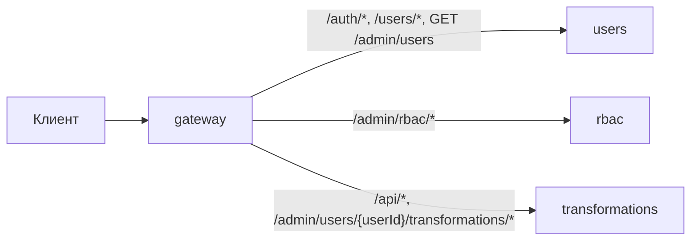
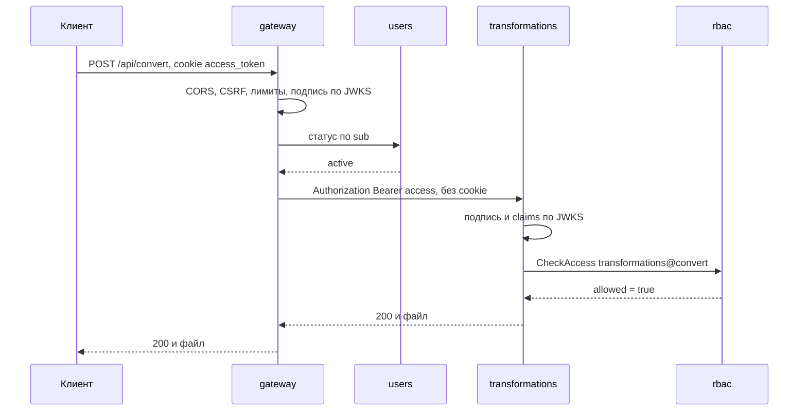
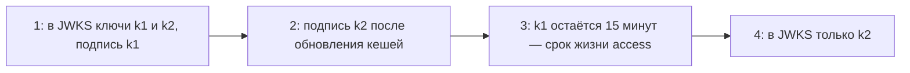

# API Gateway и безопасность

## Содержание

- [Что такое API Gateway](#что-такое-api-gateway)
- [Обязанности шлюза](#обязанности-шлюза)
- [Чего нет в шлюзе](#чего-нет-в-шлюзе)
- [Backend for Frontend](#backend-for-frontend)
- [Где проверять access JWT](#где-проверять-access-jwt)
- [Асимметричная подпись и JWKS](#асимметричная-подпись-и-jwks)
- [Личность пользователя внутри системы](#личность-пользователя-внутри-системы)
- [Межсервисная аутентификация](#межсервисная-аутентификация)
- [Распределённая авторизация](#распределённая-авторизация)
- [Cookies, CORS и CSRF на шлюзе](#cookies-cors-и-csrf-на-шлюзе)
- [Сравнение](#сравнение)
- [Как выбирать](#как-выбирать)
- [Как это проявляется в системе](#как-это-проявляется-в-системе)
- [Типичные ошибки](#типичные-ошибки)
- [Полезные ссылки](#полезные-ссылки)
- [Вопросы по теории](#вопросы-по-теории)

## Что такое API Gateway

API Gateway — единственная публичная точка входа в систему: обратный прокси, который принимает внешние запросы, применяет общие политики и направляет запросы в нужные сервисы. Для клиента система выглядит одним API.

Шлюз системы курса публикует внешний HTTP API целиком, сервисы снаружи недоступны. По устройству шлюз — конвейер middleware, вынесенный в отдельный процесс: каждый запрос проходит одни и те же общие проверки до того, как попадёт в сервис.

| Вид | Примеры | Когда подходит |
| --- | --- | --- |
| Edge gateway | Envoy, NGINX, Traefik, Kong, YARP | одна точка входа для всех клиентов |
| Backend for Frontend | отдельный шлюз для веб- и мобильного клиента | у клиентов разные потребности в данных |
| Ingress или Gateway API | ingress-контроллер Kubernetes | внешний трафик в кластер |
| Service mesh | Istio, Linkerd | трафик между сервисами: mTLS, повторы, телеметрия |

## Обязанности шлюза

| Задача | Как в системе курса |
| --- | --- |
| маршрутизация | шаблоны путей внешнего API ведут в нужный сервис |
| TLS | шлюз принимает HTTPS, дальше трафик идёт во внутренней сети |
| CORS и CSRF | проверяются один раз на входе |
| лимиты | слишком большое тело — **413** до сервиса, частота — **429** |
| таймауты и сбои | свой таймаут на маршрут, у преобразований — 35 секунд; таймаут сервиса — **504**, недоступный сервис — **503** |
| аутентификация | подпись access по JWKS и статус по `sub` в `users` |
| заголовки | удаление внешних `X-User-*`, добавление `traceparent` |



Маршрут выбирается по самому точному шаблону: `/admin/users/{userId}/transformations/history` начинается как административный путь пользователей, но ведёт в `transformations`. Путь не обязан совпадать с именем сервиса: клиент видит единое API, а карта маршрутов — внутреннее дело шлюза.

Шлюз — единая точка отказа, поэтому работает в нескольких экземплярах и не хранит состояние между запросами, кроме кешей с ограниченным сроком.

## Чего нет в шлюзе

- бизнес-правил и доступа к базам сервисов;
- проверки владельца ресурса и действий `*_any`: шлюз не знает, чей это профиль или файл;
- сборки ответов ради одного экрана — это задача BFF;
- преобразования доменных ошибок — сервисы сами отвечают в формате внешнего контракта.

Шлюз с бизнес-логикой превращается в монолит посередине: каждое изменение сервиса требует выкладки шлюза.

## Backend for Frontend

Backend for Frontend (BFF) — шлюз под конкретный тип клиента. Он собирает данные для экранов этого клиента, упрощает форму ответа и держит сессию в cookie. Веб и мобильное приложение получают разные BFF, потому что их потребности расходятся.

В курсе один веб-клиент и один шлюз. BFF понадобится со вторым типом клиента или со сборкой административной страницы из нескольких сервисов, как в `0.2 Синхронное взаимодействие.md`.

## Где проверять access JWT

Проверка только на шлюзе предполагает, что внутренняя сеть доверенная. Zero trust исходит из обратного: любой внутренний компонент может быть скомпрометирован, а запрос — направлен в обход шлюза. Поэтому шлюз отсекает недействительные токены рано и дёшево, а сервис проверяет подпись и claims ещё раз.



**401** выдаётся до обращения к `rbac`, **403** — после решения о разрешении, **503** — при сбое любой проверки. По коду клиент понимает, что делать: обновить сессию, отказаться от действия или повторить позже.

## Асимметричная подпись и JWKS

Когда токен проверяет один процесс, достаточно HS256: секрет знает только он. В системе курса access проверяют шлюз и несколько сервисов. С HS256 секрет пришлось бы раздать всем, а кто знает секрет, тот может и выпустить токен. Скомпрометированный `transformations` выпустил бы токен администратора.

Асимметричная подпись разделяет выпуск и проверку. `users` подписывает access закрытым ключом ES256, а проверяющие получают только открытые ключи из JWKS — JSON-набора ключей по RFC 7517. Заголовок `kid` в токене указывает, каким ключом он подписан.

```ts
import { createRemoteJWKSet, jwtVerify } from 'jose';

const jwks = createRemoteJWKSet(new URL('http://users:8080/.well-known/jwks.json'));

export async function verifyAccess(token: string): Promise<string> {
  const { payload } = await jwtVerify(token, jwks, {
    algorithms: ['ES256'],
    issuer: 'course-api',
    audience: 'course-web',
  });
  if (payload.token_use !== 'access' || typeof payload.sub !== 'string') {
    throw new Error('invalid_session');
  }
  return payload.sub;
}
```

Алгоритм фиксирует проверяющий, а не токен: `algorithms: ['ES256']` отвергает `none` и попытку выдать открытый ключ за HS256-секрет. `createRemoteJWKSet` кеширует ключи и загружает их заново при неизвестном `kid` не чаще, чем позволяет пауза между загрузками. Кроме подписи проверяются `iss`, `aud`, `sub` и `token_use`: refresh нельзя предъявить вместо access.

Refresh проверяет только `users`, поэтому для него достаточно HS256 со своим секретом. Ключ подписи access меняют без волны **401**:



Новый ключ публикуется раньше, чем им начинают подписывать, а старый удаляется не раньше, чем истекут подписанные им access.

## Личность пользователя внутри системы

| Способ | Как работает | Риск |
| --- | --- | --- |
| пересылка access | шлюз передаёт тот же JWT в `Authorization: Bearer` | токен с общим `aud` проходит через все сервисы |
| заголовок шлюза | шлюз передаёт проверенный `X-User-Id` | без mTLS любой, кто достучался до сервиса, подделает заголовок |
| внутренний токен | шлюз обменивает access на короткий токен для конкретного сервиса (RFC 8693) | ещё один выпуск токенов и свои ключи |

В эталоне шлюз пересылает access как Bearer, и сервис проверяет его сам. Любые `X-User-*`, пришедшие снаружи, шлюз удаляет независимо от выбранного способа.

## Межсервисная аутентификация

Личность пользователя отвечает на вопрос «от чьего имени запрос», личность сервиса — «кто вызывает». Вторая нужна, чтобы внутренний API `rbac` принимал вызовы только от `users` и `transformations`.

- **mTLS** — обе стороны предъявляют сертификаты, личность сервиса записана в сертификате, например в виде SPIFFE ID. Сертификаты обычно выпускает и обновляет service mesh.
- **Client credentials** (RFC 6749) — сервис получает собственный токен с `aud` вызываемого сервиса.
- **Сетевые правила** — внутренние порты недоступны снаружи, а база и брокер доступны только своим сервисам.

Каждому сервису выдаются минимальные права: свой пользователь базы, свой пользователь брокера, доступ только к своему бакету.

## Распределённая авторизация

Policy enforcement point (PEP) — место, где решение применяется: обработчик сервиса. Policy decision point (PDP) — тот, кто решает: `rbac`.

| Вариант | Как работает | Цена |
| --- | --- | --- |
| синхронный `CheckAccess` | сервис спрашивает `rbac` в каждом защищённом запросе | задержка и зависимость от доступности `rbac` |
| локальный снимок | сервис держит снимок политики и перестраивает его по `PolicyChanged` | решение может отставать на время доставки события |
| права в JWT | роли и разрешения в claims | снятая роль действует до истечения `exp` |

Решение принимается по актуальной политике: снятая роль перестаёт действовать со следующего запроса. Поэтому эталон использует синхронный `CheckAccess`. Локальный снимок допустим, только если контракт явно разрешает задержку применения изменений политики.

Статус `active` по `sub` шлюз проверяет в `users` на каждом защищённом запросе: блокировка действует со следующего запроса. Короткий кеш статуса со сбросом по `UserStatusChanged` снижает нагрузку, но превращает «со следующего запроса» в «после доставки события». Такой кеш допустим, только если практика задаст предел задержки, а событие получит каждый экземпляр шлюза из своей очереди. В эталоне кеша статуса нет.

Проверка владельца и действий `*_any` остаётся в сервисе-владельце ресурса: после `CheckAccess` базового разрешения и до поиска цели. Любой сбой PDP или проверки статуса даёт **503** и никогда — разрешение.

## Cookies, CORS и CSRF на шлюзе

Фронтенд и шлюз по умолчанию работают на одном origin. Cookies host-only принадлежат домену шлюза и сохраняют атрибуты `HttpOnly; Secure; SameSite=Strict`.

- Шлюз читает `access_token` и передаёт его сервису как `Authorization: Bearer`; заголовок `Cookie` во внутреннюю сеть не уходит.
- Cookie refresh с `Path=/auth/refresh` попадает только на маршрут обновления в `users`.
- `Set-Cookie` из ответов `users` на вход, обновление и выход шлюз передаёт клиенту без изменений.
- CORS и проверка `Origin` с `X-CSRF-Protection: 1` выполняются на шлюзе: браузер не обращается к сервисам напрямую.

## Сравнение

| Где проверяется личность | Защита | Цена | Подходит для |
| --- | --- | --- | --- |
| только шлюз | периметр | внутренний компонент действует от любого имени | прототип в изолированной сети |
| шлюз и каждый сервис | zero trust для личности пользователя | повторная проверка подписи в сервисах | вариант по умолчанию в курсе |
| mesh с mTLS и сервисы | личность пользователя и сервиса | инфраструктура mesh | много сервисов и команд, требования аудита |

## Как выбирать

1. Держать один шлюз на систему, BFF добавлять со вторым типом клиента.
2. Подписывать access асимметрично, ES256 с `kid`: сервисы получают только открытые ключи.
3. Проверять access и на шлюзе, и в сервисе. Алгоритм, `iss`, `aud` и `token_use` фиксирует проверяющий.
4. Решение о разрешении получать синхронным `CheckAccess`, владельца проверять в сервисе-владельце ресурса.
5. Любой сбой проверки превращать в **503**, а не в разрешение.
6. Удалять внешние `X-User-*` на шлюзе всегда.
7. Добавлять mTLS и service mesh с ростом числа сервисов и требований к аудиту.

## Как это проявляется в системе

**Регистрация.** Публичный маршрут: шлюз не требует access, но применяет лимиты частоты по IP.

**Аутентификация.** `users` подписывает access ключом ES256 и публикует JWKS по внутреннему адресу. Refresh подписан HS256 и проверяется только в `users`, а cookie refresh шлюз передаёт только на маршрут `/auth/refresh`.

**Авторизация.** Шлюз проверяет подпись и статус, сервис — подпись, `CheckAccess` и владельца. Сбой `users` или `rbac` даёт **503**, а не **401** или **403**.

**Просмотр данных пользователя.** Проверку собственного профиля или права `users@read_any` выполняет `users`: шлюз не знает, чей профиль запрошен.

**Изменение данных пользователя.** `PATCH` и загрузка фотографии меняют состояние, поэтому для другого origin шлюз проверяет `Origin` и `X-CSRF-Protection`. Для маршрута загрузки фотографии шлюз задаёт свой лимит тела под файл до 5 МиБ из контракта загрузки. Поэтому слишком большой файл получает **413** до передачи в `users`.

**Общие требования к трансформации файлов.** Шлюз отсекает тело больше общего лимита до передачи сервису и ждёт ответа не дольше 35 секунд. Лимит конкретного формата — 10 МиБ по умолчанию — проверяет `transformations`.

**Сохранение результатов трансформаций в хранилище.** Скачивание идёт потоком через шлюз. Прямой адрес бакета клиенту не выдаётся: владельца результата проверяет `transformations`.

## Типичные ошибки

| Что видно | Причина и исправление |
| --- | --- |
| Сервис доступен снаружи в обход шлюза | порт сервиса опубликован; наружу открыт только шлюз |
| Внешний клиент прислал `X-User-Id` и получил чужие данные | шлюз пропускает внешние заголовки личности; удалять `X-User-*` на входе |
| Скомпрометированный сервис выпустил токен администратора | общий HS256-секрет у всех проверяющих; ES256 и JWKS |
| Принят токен с `alg: none` или HS256 на открытом ключе | алгоритм взят из токена; фиксировать `algorithms: ['ES256']` у проверяющего |
| После смены ключа все запросы получают **401** | новым ключом подписали до публикации в JWKS; сначала опубликовать, затем подписывать |
| Шлюз загружает JWKS в каждом запросе | нет кеша ключей; кеш и повторная загрузка только при неизвестном `kid` |
| Заблокированный пользователь продолжает работать | статус берётся из кеша без сброса; синхронная проверка или сброс по `UserStatusChanged` |
| Сбой `rbac` открыл доступ всем | fail open; любой сбой проверки — **503** |
| Шлюз проверяет, кому принадлежит профиль | правило ресурса на шлюзе; проверка владельца живёт в сервисе-владельце |
| Браузер не видит тело ошибки **401** | CORS настроен в сервисе, а не на шлюзе; CORS один раз на входе |
| Сервис получил cookie клиента | шлюз проксирует заголовок `Cookie`; передавать access как Bearer |
| Права остались после снятия роли | роли записаны в JWT; решения только по актуальной политике `rbac` |
| Шлюз стал узким местом | один экземпляр или состояние в памяти; несколько экземпляров без состояния |

## Полезные ссылки

### Общие

- [microservices.io — API Gateway / Backends for Frontends](https://microservices.io/patterns/apigateway.html) — шлюз как единая точка входа и вариант BFF.
- [Sam Newman — Backends For Frontends](https://samnewman.io/patterns/architectural/bff/) — шлюз под конкретный тип клиента.
- [Microsoft — Gateway Routing pattern](https://learn.microsoft.com/en-us/azure/architecture/patterns/gateway-routing) — маршрутизация запросов в сервисы.
- [Microsoft — Gateway Offloading Pattern](https://learn.microsoft.com/en-us/azure/architecture/patterns/gateway-offloading) — какие общие задачи выносить на шлюз.
- [RFC 7517 — JSON Web Key (JWK)](https://www.rfc-editor.org/rfc/rfc7517.html) — формат JWKS и параметр `kid`.
- [RFC 8725 — JSON Web Token Best Current Practices](https://www.rfc-editor.org/rfc/rfc8725.html) — фиксированный алгоритм и проверка `iss` и `aud`.
- [RFC 8693 — OAuth 2.0 Token Exchange](https://www.rfc-editor.org/rfc/rfc8693.html) — обмен токена на внутренний с узким `aud`.
- [RFC 6749 — Client Credentials Grant](https://www.rfc-editor.org/rfc/rfc6749.html#section-4.4) — собственный токен сервиса для межсервисных вызовов.
- [OWASP — Microservices Security Cheat Sheet](https://cheatsheetseries.owasp.org/cheatsheets/Microservices_Security_Cheat_Sheet.html) — проверка на шлюзе и в сервисах, передача личности.
- [NIST — SP 800-207, Zero Trust Architecture](https://csrc.nist.gov/pubs/sp/800/207/final) — почему внутренняя сеть не считается доверенной.
- [SPIFFE — Overview](https://spiffe.io/docs/latest/spiffe-about/overview/) — идентичность сервиса для mTLS.
- [Open Policy Agent — Documentation](https://www.openpolicyagent.org/docs) — вынесенный PDP с политиками в виде кода.
- [Envoy — Documentation](https://www.envoyproxy.io/docs/envoy/latest/) — прокси для шлюза и service mesh.
- [Traefik — Proxy Documentation](https://doc.traefik.io/traefik/) — шлюз с маршрутизацией по меткам контейнеров.

### По языку

#### Node.js

- [GitHub — panva/jose](https://github.com/panva/jose) — JWT, JWS и JWKS; `createRemoteJWKSet` кеширует ключи.
- [NestJS — Authentication](https://docs.nestjs.com/security/authentication) — guard с проверкой JWT.

#### .NET

- [Microsoft — Overview of YARP](https://learn.microsoft.com/en-us/aspnet/core/fundamentals/servers/yarp/yarp-overview) — обратный прокси на ASP.NET Core для шлюза.
- [Microsoft — Configure JWT bearer authentication in ASP.NET Core](https://learn.microsoft.com/en-us/aspnet/core/security/authentication/configure-jwt-bearer-authentication) — проверка JWT по открытым ключам.
- [Microsoft — Rate limiting middleware in ASP.NET Core](https://learn.microsoft.com/en-us/aspnet/core/performance/rate-limit) — лимиты частоты на шлюзе.

#### Python

- [PyJWT — Usage Examples](https://pyjwt.readthedocs.io/en/stable/usage.html#retrieve-rsa-signing-keys-from-a-jwks-endpoint) — `PyJWKClient` и выбор ключа по `kid`.

## Вопросы по теории

1. Почему шлюз не проверяет, принадлежит ли профиль пользователю, и где выполняется эта проверка?
2. Чем опасен общий HS256-секрет, если access проверяют шлюз и несколько сервисов?
3. Почему refresh можно подписывать HS256, а access — нет?
4. Как сменить ключ подписи access, не получив волну **401**?
5. Что произойдёт, если шлюз пропустит внешний заголовок `X-User-Id`?
6. Чем синхронный `CheckAccess` отличается от локального снимка политики и почему эталон выбирает первый?
7. Зачем сервису проверять подпись access ещё раз, если шлюз её уже проверил?
