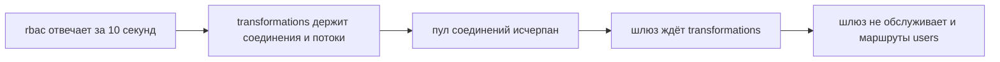
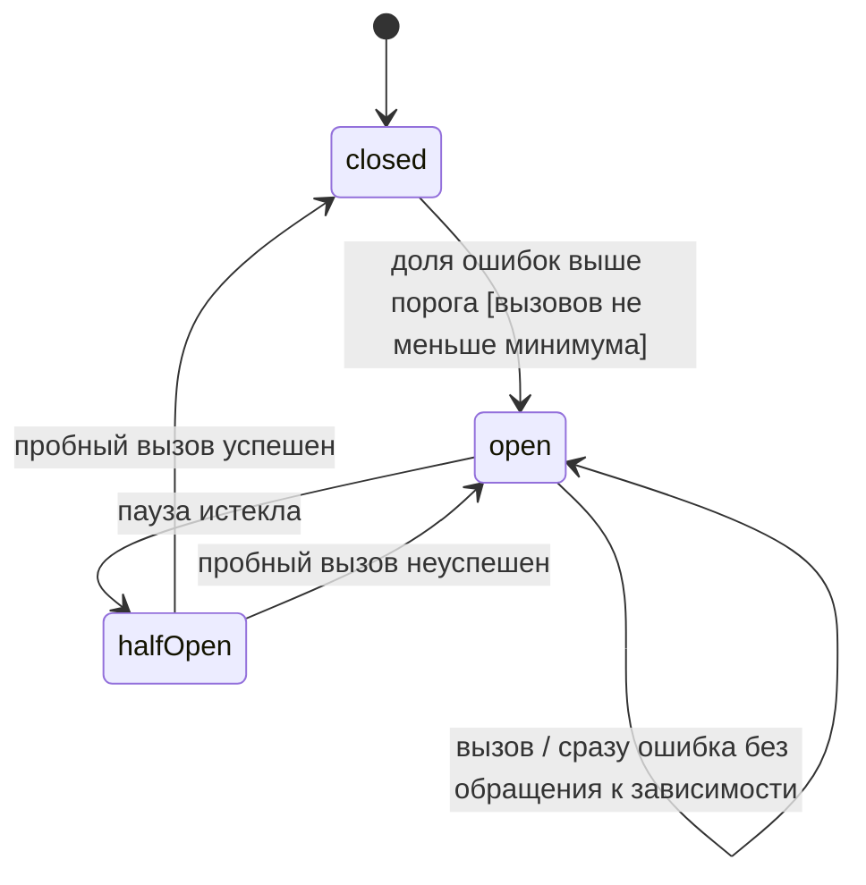
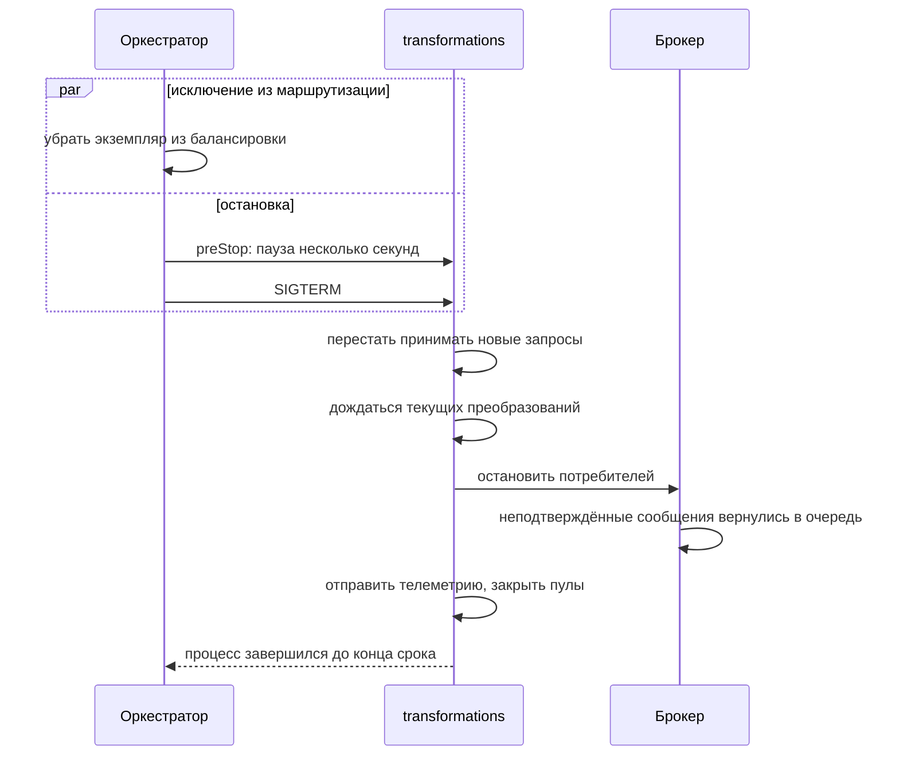

# Отказоустойчивость

## Содержание

- [Что такое отказоустойчивость](#что-такое-отказоустойчивость)
- [Виды отказов](#виды-отказов)
- [Каскадный отказ](#каскадный-отказ)
- [Таймауты](#таймауты)
- [Повторы с паузой и jitter](#повторы-с-паузой-и-jitter)
- [Circuit breaker](#circuit-breaker)
- [Bulkhead](#bulkhead)
- [Перегрузка](#перегрузка)
- [Деградация и fail closed](#деградация-и-fail-closed)
- [Health checks](#health-checks)
- [Graceful shutdown](#graceful-shutdown)
- [Сравнение](#сравнение)
- [Как выбирать](#как-выбирать)
- [Как это проявляется в системе](#как-это-проявляется-в-системе)
- [Типичные ошибки](#типичные-ошибки)
- [Полезные ссылки](#полезные-ссылки)
- [Вопросы по теории](#вопросы-по-теории)

## Что такое отказоустойчивость

Отказоустойчивость — способность системы продолжать работу, полностью или частично, когда отдельные её части отказывают. В микросервисах частичный отказ — обычное состояние: какой-то экземпляр перезапускается, какая-то зависимость отвечает медленно.

Каждый синхронный вызов из `0.2 Синхронное взаимодействие.md` и каждый потребитель из `0.3 Асинхронное взаимодействие.md` должен пережить отказ соседа. Повторять можно только идемпотентные операции: их повтор не меняет результат первого выполнения. Отказ замечают по метрикам и алертам — доле ошибок, задержке и длине очередей.

| Группа паттернов | Примеры | Когда подходит |
| --- | --- | --- |
| Защита вызова | таймаут, повтор с jitter, circuit breaker | каждая синхронная зависимость |
| Изоляция ресурсов | bulkhead, отдельные пулы соединений | тяжёлая работа рядом с лёгкой |
| Управление нагрузкой | rate limiting, load shedding, очередь | всплески и перегрузка |
| Жизненный цикл экземпляра | health checks, graceful shutdown | запуск, выкладка и остановка каждого сервиса |

## Виды отказов

Паттерн выбирают под конкретный вид отказа, поэтому сначала нужно понять, как отказ выглядит со стороны вызывающего.

| Вид отказа | Пример | Как обнаружить |
| --- | --- | --- |
| падение процесса | контейнер `rbac` перезапускается | ошибка соединения, проба liveness |
| медленный ответ | `users` отвечает за 5 секунд вместо 50 мс | таймаут, рост p99 |
| ошибочный ответ | сосед возвращает **500** | статус ответа, доля ошибок |
| перегрузка | запросов приходит больше, чем сервис успевает обработать | **429**, **503**, длина очереди |
| разделение сети | `transformations` не видит `rbac`, остальные видят | ошибки соединения у части клиентов |
| отказ инфраструктуры | брокер недоступен, HTTP работает | ошибки публикации, рост таблицы outbox |

## Каскадный отказ

Каскадный отказ — распространение сбоя одного сервиса на остальные. Медленный сосед опаснее упавшего: упавший отвечает ошибкой сразу, а медленный держит потоки, соединения и память вызывающих.



Без ограничений медленный `rbac` останавливает шлюз целиком, хотя `users` здоров. Цепочку разрывают таймауты, circuit breaker и изоляция ресурсов.

## Таймауты

Таймаут ограничивает время, которое вызывающий готов потратить. Значение выбирают по распределению задержек зависимости: p99 плюс запас, а не «на всякий случай побольше». Слишком большой таймаут держит ресурсы, слишком маленький даёт ложные отказы.

В системе курса таймаут внутреннего вызова — 2 секунды на попытку. Дедлайн gRPC охватывает и повторы, поэтому `CheckAccess` целиком укладывается в 2 секунды. Внешний предел всегда больше внутреннего: маршрут преобразований на шлюзе ждёт 35 секунд, преобразование — не дольше 30. Шлюз, не дождавшийся сервиса, отвечает **504**, а при недоступном сервисе — **503**.

## Повторы с паузой и jitter

Повтор лечит кратковременный сбой: перезапуск экземпляра, потерю пакета, **503** при выкладке. Повторяют только временные ошибки: таймаут, **503**, `UNAVAILABLE`. **400**, **403** и **409** повтор не исправит.

Пауза растёт экспоненциально и содержит случайную часть. Full jitter выбирает паузу случайно от нуля до экспоненциальной границы. В системе курса идемпотентный вызов повторяется не больше двух раз: первая пауза — случайная до 100 мс, вторая — до 200 мс. Без случайной части клиенты, получившие ошибку одновременно, повторяют тоже одновременно и снова перегружают восстановившийся сервис.

Повторы умножаются по слоям. Если шлюз, сервис и клиент сервиса делают по три попытки, нижняя зависимость получит до 27 вызовов на один запрос пользователя. Поэтому повторяет только ближайший к зависимости уровень, а шлюз запросы не повторяет. Заголовок `Retry-After` в ответах **429** и **503** сообщает, когда повтор имеет смысл.

```csharp
builder.Services
    .AddHttpClient<RbacClient>(client => client.BaseAddress = new Uri("http://rbac:8080"))
    .AddStandardResilienceHandler(options =>
    {
        options.AttemptTimeout.Timeout = TimeSpan.FromSeconds(2);
        options.Retry.MaxRetryAttempts = 2;
        options.Retry.Delay = TimeSpan.FromMilliseconds(100);
        options.Retry.DisableForUnsafeHttpMethods();
    });
```

Стандартный конвейер .NET по умолчанию повторяет все HTTP-методы, включая `POST`. `DisableForUnsafeHttpMethods()` отключает повторы `POST`, `PUT`, `PATCH` и `DELETE`. Изменяющий вызов повторяют только с ключом идемпотентности. При экспоненциальной паузе Polly считает jitter по формуле decorrelated jitter, а не full jitter, поэтому паузы получаются около 100 и 200 мс, а не строго до них.

## Circuit breaker

Circuit breaker — предохранитель на зависимость. Когда доля ошибок превышает порог, он перестаёт пропускать вызовы и сразу возвращает ошибку. Через паузу пропускает пробные вызовы и по их результату закрывается или снова открывается.



В состоянии `open` вызывающий не тратит время и соединения на заведомо больную зависимость, а зависимость получает паузу для восстановления. Умолчания стандартного конвейера .NET: 10 % ошибок за 30 секунд при минимуме 100 вызовов, пауза 5 секунд.

Порядок стратегий в конвейере важен. Стандартный конвейер .NET снаружи внутрь: ограничение параллелизма, общий таймаут, повтор, circuit breaker, таймаут попытки. Общий таймаут ограничивает все повторы вместе, а breaker видит каждую попытку отдельно.

## Bulkhead

Bulkhead — изоляция ресурсов по видам работы, как отсеки корабля: пробоина в одном не топит остальные. У каждой зависимости свой пул соединений, у тяжёлой работы — свой лимит параллелизма.

Преобразование изображений нагружает CPU сильнее текстового. При общем пуле всплеск изображений занимает все слоты, и текстовые преобразования и пробы здоровья ждут. Отдельный лимит параллельных преобразований изображений сохраняет обслуживание остального; запрос сверх лимита получает **503** с `Retry-After` вместо бесконечного ожидания.

## Перегрузка

Rate limiting ограничивает частоту запросов одного клиента: шлюз отвечает **429** по лимитам публичных маршрутов. Load shedding отбрасывает часть запросов, когда перегружен сам сервис: **503** с `Retry-After` лучше, чем медленный ответ всем.

Queue-based load leveling сглаживает всплески очередью. Команды `EraseUserData` обрабатываются со скоростью потребителей, а prefetch ограничивает число сообщений в работе одновременно. Очередь подходит работе, которой не нужен мгновенный ответ клиенту.

## Деградация и fail closed

Деградация — работа без необязательной части. Профиль отдаётся, даже если хранилище фотографий недоступно: `photoUrl` — ссылка, а сам файл запрашивается отдельным вызовом. Административная страница из `0.2 Синхронное взаимодействие.md` показывает профиль без истории, если `transformations` не ответил.

Проверки безопасности не деградируют. При сбое `CheckAccess` или проверки статуса запрос получает **503**: разрешение «временно, пока `rbac` болен» отдало бы систему любому пользователю. Это правило fail closed: при невозможности проверить — отказ.

Каждый fallback считается метрикой. Деградация без алерта скрывает сбой неделями.

## Health checks

| Проба | Что проверяет | Что делает оркестратор при отказе |
| --- | --- | --- |
| liveness | процесс жив и не завис | перезапускает контейнер |
| readiness | сервис готов обслуживать: база, конфигурация, снимок политики | убирает экземпляр из маршрутизации, не перезапуская |
| startup | долгий запуск завершён | откладывает liveness, пока запуск идёт |

Liveness не проверяет зависимости. Если liveness проверяет базу, её кратковременный отказ перезапустит все экземпляры всех сервисов сразу — это каскадный отказ, устроенный своими руками. Зависимости проверяет readiness.

`/health/ready` экземпляра `rbac` не проходит, пока не загружен снимок политики. `/health/ready` шлюза — пока не загружен JWKS. Потребитель сообщений готов, когда подключён к брокеру.

## Graceful shutdown

Graceful shutdown — остановка без потери работы. Оркестратор отправляет SIGTERM и ждёт срок завершения: в Kubernetes по умолчанию 30 секунд, после чего отправляет SIGKILL.



Исключение из маршрутизации и остановка идут параллельно, а маршрутизация обновляется не мгновенно. Поэтому экземпляр ещё несколько секунд принимает запросы — эту паузу даёт preStop-хук — и только затем перестаёт принимать новые. Если закрыть приём сразу, запросы, уже направленные на экземпляр, получат ошибку соединения.

Срок завершения больше, чем самый долгий запрос вместе с паузой preStop. Преобразование длится до 30 секунд, поэтому срок по умолчанию в 30 секунд для `transformations` мал: SIGKILL оборвёт последние запросы. Сообщения, которые потребитель не успел подтвердить, брокер вернёт в очередь сам, а задание с истёкшим lease возьмёт другой экземпляр.

## Сравнение

| Паттерн | От чего защищает | Цена | Подходит для |
| --- | --- | --- | --- |
| таймаут | вечное ожидание | ложные отказы при слишком малом значении | каждый сетевой вызов |
| повтор с jitter | кратковременные сбои | дополнительная нагрузка на соседа | чтения и идемпотентные записи |
| circuit breaker | каскадный отказ и бесполезные вызовы | быстрые отказы, пока зависимость восстанавливается | синхронная зависимость, которая может лечь целиком |
| bulkhead | захват всех ресурсов одним видом работы | часть ресурсов простаивает | тяжёлая работа рядом с лёгкой |
| rate limiting | перегрузка одним клиентом | отказ части запросов клиента | публичный вход |
| load shedding | перегрузка всей системы | отказ части запросов при всплеске | сервис на пределе мощности |
| очередь | всплески нагрузки | задержка обработки | работа без мгновенного ответа |

## Как выбирать

1. Задавать таймаут каждому вызову по p99 зависимости с запасом; в системе курса — 2 секунды на попытку.
2. Повторять только идемпотентные операции, на одном уровне, не больше двух раз, с паузой и jitter.
3. Ставить circuit breaker на каждую синхронную зависимость; открытый breaker даёт быстрый **503**.
4. Изолировать тяжёлую работу: преобразования изображений отдельно от текстовых.
5. Проверки безопасности держать fail closed, деградировать только необязательные части ответа.
6. Liveness делать без зависимостей, readiness — с зависимостями.
7. Делать срок graceful shutdown больше самого долгого запроса.

## Как это проявляется в системе

**Регистрация.** Отказ `mail` или SMTP не останавливает регистрацию: команда `SendEmail` ждёт в очереди до своего срока `expiresAt`, 10 минут от выпуска кода, после этого пользователь запрашивает письмо повторно. Отказ брокера тоже: строки outbox копятся в базе `users` и уходят после восстановления, а команды с истёкшим `expiresAt` письма уже не отправляют.

**Аутентификация.** Шлюз держит JWKS в кеше, поэтому короткий перезапуск `users` не ломает проверку подписи. Проверка статуса при этом не проходит, и запрос получает **503**.

**Авторизация.** `CheckAccess` защищён таймаутом 2 секунды и circuit breaker. Открытый breaker сразу даёт **503**; разрешение при сбое не выдаётся никогда.

**RBAC.** Readiness экземпляра `rbac` не проходит до загрузки снимка политики, поэтому трафик не попадает на экземпляр, который не может принять решение.

**Общие требования к трансформации файлов.** Срок graceful shutdown `transformations` больше 30 секунд, иначе выкладка обрывает преобразования на середине.

**Трансформация изображений.** Отдельный лимит параллельных преобразований изображений не даёт им занять ресурсы текстовых преобразований и проб.

**Удаление пользователя.** Временный сбой участника оркестратор повторяет с паузой 1 минута, всего не больше 5 попыток, затем задание переходит в `failed` и ждёт ручного повтора администратором. Остановка экземпляра `users` посреди саги её не теряет: состояние хранится в базе.

**Сохранение результатов трансформаций в хранилище.** Недоступное хранилище не ломает преобразование: результат уже отдан клиенту, строка истории остаётся `pending` и дописывается позже.

## Типичные ошибки

| Что видно | Причина и исправление |
| --- | --- |
| Медленный `rbac` остановил шлюз и все сервисы | нет таймаутов и breaker, ресурсы ждут; таймаут 2 секунды и breaker на зависимость |
| Короткий сбой соседа превратился в лавину запросов | повторы на каждом уровне без паузы; повторять на одном уровне с jitter |
| Повтор `POST` создал дубль | стандартный конвейер .NET повторяет все методы; `DisableForUnsafeHttpMethods()` или ключ идемпотентности |
| Клиенты повторяют одновременно и снова роняют сервис | пауза без случайной части; full jitter |
| Breaker остаётся открытым, хотя сосед давно здоров | нет пробных вызовов; half-open после паузы |
| Отказ базы перезапустил все экземпляры | liveness проверяет зависимости; зависимости только в readiness |
| Трафик пришёл на экземпляр до загрузки политики | readiness не учитывает снимок; ready только после загрузки |
| Выкладка оборвала преобразования на середине | срок завершения 30 секунд по умолчанию; увеличить его больше самого долгого запроса |
| При выкладке часть запросов получает ошибку соединения | приём закрыт сразу по SIGTERM, пока маршрутизация не обновилась; пауза preStop перед закрытием приёма |
| После остановки потребителя сообщения потеряны | ack до обработки; подтверждать после фиксации, неподтверждённые вернутся сами |
| Изображения заблокировали текстовые преобразования | общий пул; отдельный лимит параллелизма для изображений |
| При сбое `rbac` доступ разрешён «временно» | fallback на разрешение; fail closed и **503** |
| Fallback неделями скрывал сбой | деградация без метрики; считать срабатывания и ставить алерт |
| Сервис отвечает медленно всем вместо отказа части | нет load shedding; **503** с `Retry-After` сверх предела мощности |

## Полезные ссылки

### Общие

- [Microsoft — Circuit Breaker Pattern](https://learn.microsoft.com/en-us/azure/architecture/patterns/circuit-breaker) — состояния closed, open и half-open.
- [Martin Fowler — Circuit Breaker](https://martinfowler.com/bliki/CircuitBreaker.html) — исходное описание паттерна.
- [Microsoft — Bulkhead Pattern](https://learn.microsoft.com/en-us/azure/architecture/patterns/bulkhead) — изоляция ресурсов по видам работы.
- [Microsoft — Retry pattern](https://learn.microsoft.com/en-us/azure/architecture/patterns/retry) — когда повтор уместен.
- [AWS — Timeouts, retries, and backoff with jitter](https://aws.amazon.com/builders-library/timeouts-retries-and-backoff-with-jitter/) — выбор таймаутов и умножение повторов по слоям.
- [AWS Architecture Blog — Exponential Backoff And Jitter](https://aws.amazon.com/blogs/architecture/exponential-backoff-and-jitter/) — full jitter и сравнение стратегий пауз.
- [Google SRE — Handling Overload](https://sre.google/sre-book/handling-overload/) — отбрасывание нагрузки и бюджет повторов.
- [Google SRE — Addressing Cascading Failures](https://sre.google/sre-book/addressing-cascading-failures/) — как перегрузка распространяется по системе.
- [Microsoft — Queue-Based Load Leveling Pattern](https://learn.microsoft.com/en-us/azure/architecture/patterns/queue-based-load-leveling) — очередь как буфер всплесков.
- [Microsoft — Health Endpoint Monitoring Pattern](https://learn.microsoft.com/en-us/azure/architecture/patterns/health-endpoint-monitoring) — что проверять в health endpoint.
- [Kubernetes — Configure Liveness, Readiness and Startup Probes](https://kubernetes.io/docs/tasks/configure-pod-container/configure-liveness-readiness-startup-probes/) — три вида проб и их последствия.
- [Kubernetes — Pod Lifecycle](https://kubernetes.io/docs/concepts/workloads/pods/pod-lifecycle/#pod-termination) — SIGTERM, срок завершения и SIGKILL.
- [RFC 9110 — Retry-After](https://www.rfc-editor.org/rfc/rfc9110.html#name-retry-after) — пауза перед повтором для **429** и **503**.

### По языку

#### Node.js

- [GitHub — connor4312/cockatiel](https://github.com/connor4312/cockatiel) — повторы, circuit breaker, таймауты и bulkhead для Node.js.
- [NestJS — Health checks (Terminus)](https://docs.nestjs.com/recipes/terminus) — endpoints liveness и readiness.
- [NestJS — Lifecycle Events](https://docs.nestjs.com/fundamentals/lifecycle-events) — `enableShutdownHooks` и завершение по сигналу.

#### .NET

- [Microsoft — Build resilient HTTP apps](https://learn.microsoft.com/en-us/dotnet/core/resilience/http-resilience) — стандартный конвейер устойчивости и его умолчания.
- [Polly — Documentation](https://www.pollydocs.org/) — стратегии устойчивости для .NET.
- [Microsoft — Health checks in ASP.NET Core](https://learn.microsoft.com/en-us/aspnet/core/host-and-deploy/health-checks) — раздельные проверки live и ready.

#### Python

- [Tenacity — Documentation](https://tenacity.readthedocs.io/) — повторы с экспоненциальной паузой и jitter.
- [FastAPI — Lifespan Events](https://fastapi.tiangolo.com/advanced/events/) — действия при запуске и остановке приложения.

## Вопросы по теории

1. Почему медленная зависимость опаснее упавшей и какие паттерны разрывают каскад?
2. Почему повторять вызов можно только на одном уровне и только для идемпотентных операций?
3. Зачем паузе между повторами случайная часть?
4. Чем состояние half-open отличается от closed и open?
5. Почему liveness не проверяет базу данных, а readiness проверяет?
6. Что произойдёт при выкладке `transformations`, если срок graceful shutdown останется 30 секунд?
7. Почему при сбое `rbac` нельзя «временно разрешить» запрос?
