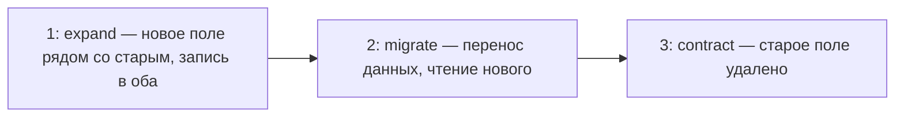
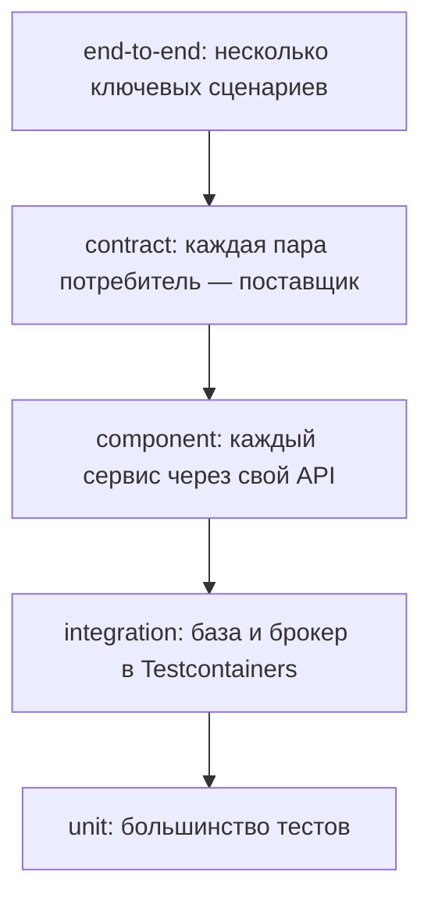
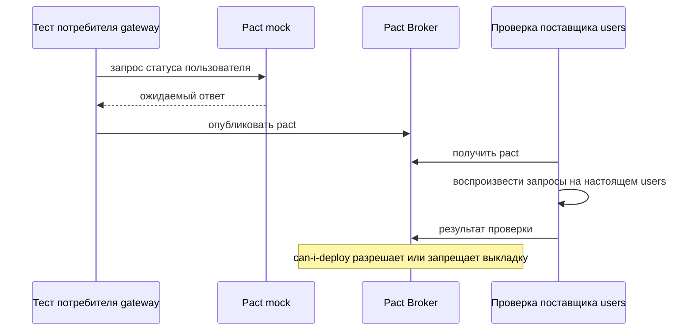

# Контракты и тестирование

## Содержание

- [Что такое контракт сервиса](#что-такое-контракт-сервиса)
- [Совместимость изменений](#совместимость-изменений)
- [Версионирование](#версионирование)
- [Эволюция Protobuf](#эволюция-protobuf)
- [Expand and contract](#expand-and-contract)
- [Пирамида тестов](#пирамида-тестов)
- [Consumer-driven contracts](#consumer-driven-contracts)
- [Интеграционные тесты с Testcontainers](#интеграционные-тесты-с-testcontainers)
- [Тесты асинхронных сценариев](#тесты-асинхронных-сценариев)
- [Сравнение](#сравнение)
- [Как выбирать](#как-выбирать)
- [Как это проявляется в системе](#как-это-проявляется-в-системе)
- [Типичные ошибки](#типичные-ошибки)
- [Полезные ссылки](#полезные-ссылки)
- [Вопросы по теории](#вопросы-по-теории)

## Что такое контракт сервиса

Контракт сервиса — всё, на что полагаются его потребители: форма запросов и ответов, коды ошибок, схемы событий и команд, их смысл и гарантии — идемпотентность, порядок, сроки. Сервис выкладывается независимо, пока каждое изменение сохраняет контракт для уже работающих потребителей.

Внешний контракт системы курса — её HTTP API за шлюзом. Внутренние контракты появились вместе с границами сервисов: `CheckAccess`, резерв `rbac@manage`, JWKS, `UserStatusChanged`, `PolicyChanged`, `SendEmail`, `EraseUserData` и `UserDataErased`. К ним предъявляются те же требования, что к внешнему API: описание, проверки и совместимые изменения.

| Вид контракта | Формат | Когда подходит |
| --- | --- | --- |
| HTTP API | OpenAPI | внешний API и внутренние HTTP-вызовы |
| gRPC | `.proto` | `CheckAccess` и другие частые внутренние вызовы |
| Сообщения | AsyncAPI и JSON Schema | события и команды через брокер |

## Совместимость изменений

Обратная совместимость (backward) — новая версия поставщика работает со старыми потребителями. Прямая совместимость (forward) — старый потребитель переживает данные новой версии, например неизвестные поля. При rolling update старые и новые экземпляры работают одновременно, поэтому нужны обе.

| Изменение | Совместимо | Почему |
| --- | --- | --- |
| добавить необязательное поле в ответ или событие | да, если потребитель — tolerant reader | старый код новое поле не читает |
| добавить необязательный параметр запроса | да | старые клиенты его не передают |
| сделать параметр обязательным | нет | старые клиенты получат **400** |
| удалить или переименовать поле | нет | потребители читают старое имя |
| изменить тип поля | нет | десериализация ломается |
| добавить значение в перечисление | с осторожностью | строгий потребитель падает на неизвестном значении |
| изменить смысл поля или кода | нет, даже при той же форме | потребители принимают решения по старому смыслу |

Tolerant reader читает только нужные поля, игнорирует неизвестные и не падает на новых значениях перечислений. Неизвестное значение получает безопасную трактовку. Если в `UserStatusChanged` появится новый статус, `rbac` считает его неактивным: это и совместимо, и соответствует fail closed.

## Версионирование

Внешний API живёт без номера версии, пока изменения совместимы. Ломающее изменение публикуется новой версией пути, например `/v2/...`, рядом со старой. Старая версия объявляется устаревшей заранее:

```http
Deprecation: @1782863999
Sunset: Thu, 31 Dec 2026 23:59:59 GMT
Link: <https://docs.example.test/deprecations/v1>; rel="deprecation"
```

`Deprecation` (RFC 9745) сообщает момент устаревания — здесь 30 июня 2026 года, `Sunset` (RFC 8594) — дату, после которой ресурс перестанет отвечать. Ссылка ведёт на описание перехода.

Внутренние API меняются без номеров версий через expand and contract: все потребители известны и обновляются по очереди. Пакет `rbac.v1` в `.proto` меняется на `rbac.v2` только при изменении, которое нельзя сделать совместимо. Ломающее изменение события публикуется новым типом события параллельно со старым, пока подписчики не перейдут. Общие технические библиотеки версионируются по Semantic Versioning: ломающее изменение повышает MAJOR.

## Эволюция Protobuf

Номер поля идентифицирует его в двоичном формате. Смена номера равна удалению поля и созданию нового. Номер удалённого поля нельзя использовать повторно: старый клиент прочтёт в нём чужие данные.

```proto
message CheckAccessResponse {
  reserved 3;
  reserved "reason_text";
  bool allowed = 1;
  int64 policy_version = 2;
  string decision_id = 4;
}
```

Поле `reason_text` с номером 3 удалено, номер и имя зарезервированы, новое поле получило номер 4. Парсер proto3 сохраняет неизвестные поля, поэтому старый потребитель переживает ответ новой версии.

## Expand and contract

Expand and contract (parallel change) — ломающее изменение в три совместимых шага. Подходит для столбцов базы, полей API и полей событий.



Каждый шаг — отдельная выкладка. Между шагами работают и старые, и новые экземпляры, поэтому ни одна выкладка не ломает соседей и не требует выкладывать сервисы вместе. Миграция схемы выполняется до кода, который её использует, а удаление старого столбца — после того, как его перестал читать последний экземпляр.

Переименование столбца `photo_key` в базе `users` выглядит так: добавить новый столбец и писать в оба, перенести значения и читать новый, перестать писать старый и удалить его. Внешний API на всех шагах прежний.

## Пирамида тестов

| Уровень | Что проверяет | Зависимости |
| --- | --- | --- |
| unit | правила одного модуля | заглушки |
| integration | код вместе с настоящей базой и брокером | Testcontainers |
| component | один сервис целиком через его API | соседи заменены заглушками |
| contract | совместимость потребителя и поставщика | Pact, без совместного запуска |
| end-to-end | сценарий через шлюз и все сервисы | вся система в Compose |



Чем выше уровень, тем тест медленнее и хрупче и тем меньше таких тестов. End-to-end не заменяет контрактные тесты: он проверяет один путь при одном наборе версий, а не совместимость каждой пары.

## Consumer-driven contracts

Consumer-driven contract — контракт, который задаёт потребитель: он описывает только те запросы и поля, которые действительно использует. Поставщик проверяет, что выполняет ожидания всех своих потребителей.



Тест потребителя работает с mock и записывает взаимодействия в pact. Поставщик воспроизводит их на настоящем сервисе, подготовив нужное состояние данных. Pact Broker хранит контракты и результаты проверок, а `can-i-deploy` отвечает, совместима ли версия с версиями в окружении.

Pact проверяет и сообщения: message pact описывает событие или команду без привязки к брокеру. Поставщик меняет всё, что потребители не используют, а ломающее изменение обнаруживается до выкладки.

## Интеграционные тесты с Testcontainers

Testcontainers запускает в Docker настоящие PostgreSQL, RabbitMQ или Kafka на время теста. Версии те же, что в окружении.

Заглушка базы не проверяет SQL, ограничения `UNIQUE`, `ON CONFLICT`, транзакции и `FOR UPDATE SKIP LOCKED`. Заглушка брокера не проверяет подтверждения, повторную доставку и DLX. Именно на этих местах ломаются outbox, inbox и реплики.

Запуск контейнера стоит секунд, поэтому контейнер переиспользуют в рамках набора тестов, а данные очищают между тестами.

## Тесты асинхронных сценариев

Результат асинхронного сценария появляется не сразу. Тест опрашивает состояние до таймаута теста вместо фиксированного `sleep`: короткий `sleep` даёт случайные падения, длинный замедляет набор.

Обязательные проверки асинхронного кода:

- **двойная доставка** — то же сообщение дважды даёт один эффект;
- **нарушенный порядок** — событие с `version` 8, затем 7, оставляет состояние версии 8;
- **outbox** — откаченная транзакция не оставляет строки outbox, а зафиксированная оставляет ровно одну;
- **саги** — `retryable_failure` приводит к повтору, `permanent_failure` — к `failed`, потерянный ответ — к повтору по таймауту;
- **poison message** — после предела попыток сообщение оказывается в DLQ.

## Сравнение

| Подход | Что ловит | Цена | Подходит для |
| --- | --- | --- | --- |
| проверка схемы на совместимость | ломающие изменения OpenAPI, `.proto` и JSON Schema | не видит, что использует конкретный потребитель | все контракты, автоматически в CI |
| consumer-driven contracts | изменения, ломающие реальных потребителей | тесты у каждой пары и брокер контрактов | HTTP и сообщения между сервисами |
| end-to-end | ошибки сборки системы целиком | медленно, хрупко, причину трудно найти | несколько ключевых сценариев |

## Как выбирать

1. Описывать каждый контракт в машиночитаемом виде: OpenAPI, `.proto`, схема сообщений.
2. Менять контракты совместимо. Ломающее изменение проводить через expand and contract или новую версию рядом со старой.
3. Писать потребителей как tolerant reader: неизвестные поля игнорировать, неизвестным значениям давать безопасную трактовку.
4. Основу тестов строить из unit и integration с Testcontainers, контрактные тесты писать на каждую пару сервисов, end-to-end — на несколько сценариев через шлюз.
5. Проверять асинхронные сценарии ожиданием с таймаутом, двойной доставкой и нарушенным порядком.
6. Разрешать выкладку только при совместимости с версиями в окружении.

## Как это проявляется в системе

**Регистрация.** Сценарий «подтверждение — роль `user`» проверяется ожиданием с таймаутом: роль появляется после доставки события, а не в ответе на подтверждение.

**Аутентификация.** JWKS — контракт `users` со шлюзом и сервисами: формат ключей, `kid` и порядок ротации. Тест проверяет, что новый ключ появляется в JWKS раньше первого токена, подписанного им.

**Авторизация.** `CheckAccess` описан в `.proto` с пакетом `rbac.v1`. Удалённые поля резервируются, а запрет остаётся ответом `allowed = false`, а не статусом ошибки.

**RBAC.** `PolicyChanged` и `UserStatusChanged` — опубликованный язык контекстов. Новый статус пользователя не ломает `rbac`: неизвестный статус считается неактивным.

**Просмотр данных пользователя.** Канонический профиль пользователя — часть внешнего контракта. Новое поле в ответе совместимо, переименование `displayName` — нет. Изменения схемы базы `users` проходят expand and contract и наружу не видны.

**Удаление пользователя.** `EraseUserData` и `UserDataErased` реализуют все участники саги. Контрактный тест каждого участника проверяет повтор той же пары `userId` и `jobId` и все три результата: `succeeded`, `retryable_failure` и `permanent_failure`.

**Общие требования к трансформации файлов.** Внешний контракт преобразований проверяется end-to-end через шлюз: запросы из HTTP-клиента получают ответы и коды, описанные в контракте.

## Типичные ошибки

| Что видно | Причина и исправление |
| --- | --- |
| После выкладки поставщика упал потребитель | несовместимое изменение без проверки; контрактный тест и `can-i-deploy` до выкладки |
| Потребитель падает на новом поле | строгая десериализация; tolerant reader |
| `rbac` упал на новом значении статуса | неизвестное значение перечисления считается ошибкой; трактовать его как неактивный статус |
| Старое и новое поле Protobuf перепутались | номер поля использован повторно; `reserved` для удалённых номеров и имён |
| Миграция базы сломала работающие экземпляры | столбец удалён в той же выкладке, что и код; expand and contract |
| Сервисы выкладываются только пачкой | контракты меняются несовместимо; совместимые изменения и независимые выкладки |
| Тесты зелёные, а SQL в окружении не работает | база в тестах заменена заглушкой; Testcontainers с той же версией PostgreSQL |
| Тест асинхронного сценария то проходит, то нет | фиксированный `sleep`; опрос результата до таймаута |
| Дубль сообщения создал вторую запись только в production | двойная доставка не тестировалась; тест с повторной доставкой |
| End-to-end тесты идут час и падают случайно | сценариев через всю систему слишком много; перенести проверки в контрактные и компонентные тесты |
| Клиенты узнали об удалении версии API в день удаления | нет сигналов устаревания; `Deprecation`, `Sunset` и ссылка на описание заранее |
| Контракт сообщения существует только в коде издателя | нет схемы; AsyncAPI или JSON Schema рядом с кодом |

## Полезные ссылки

### Общие

- [OpenAPI Initiative — OpenAPI Specification](https://spec.openapis.org/oas/latest.html) — машиночитаемый HTTP-контракт.
- [AsyncAPI Initiative — Documentation](https://www.asyncapi.com/docs) — описание каналов, событий и команд.
- [JSON Schema — Specification](https://json-schema.org/specification) — схема тела сообщений.
- [Protocol Buffers — Updating A Message Type](https://protobuf.dev/programming-guides/proto3/#updating) — совместимые изменения `.proto`.
- [Protocol Buffers — Proto Best Practices](https://protobuf.dev/best-practices/dos-donts/) — что нельзя делать с полями и их номерами.
- [Google — AIP-180: Backwards compatibility](https://google.aip.dev/180) — какие изменения API считаются ломающими.
- [Martin Fowler — Tolerant Reader](https://martinfowler.com/bliki/TolerantReader.html) — потребитель, которого не ломают новые поля.
- [Martin Fowler — Parallel Change](https://martinfowler.com/bliki/ParallelChange.html) — шаги expand, migrate и contract.
- [Ian Robinson — Consumer-Driven Contracts: A Service Evolution Pattern](https://martinfowler.com/articles/consumerDrivenContracts.html) — исходное описание подхода.
- [Ham Vocke — The Practical Test Pyramid](https://martinfowler.com/articles/practical-test-pyramid.html) — уровни тестов и их соотношение.
- [Toby Clemson — Testing Strategies in a Microservice Architecture](https://martinfowler.com/articles/microservice-testing/) — компонентные, контрактные и end-to-end тесты сервисов.
- [Pact — How Pact works](https://docs.pact.io/getting_started/how_pact_works) — тест потребителя, проверка поставщика и message pacts.
- [Pact — Can I Deploy](https://docs.pact.io/pact_broker/can_i_deploy) — проверка совместимости перед выкладкой.
- [Testcontainers — Getting Started](https://testcontainers.com/getting-started/) — настоящие зависимости в контейнерах для тестов.
- [RFC 9745 — The Deprecation HTTP Response Header Field](https://www.rfc-editor.org/rfc/rfc9745.html) — сигнал об устаревании ресурса.
- [RFC 8594 — The Sunset HTTP Header Field](https://www.rfc-editor.org/rfc/rfc8594.html) — дата, после которой ресурс перестанет отвечать.
- [Semantic Versioning — Semantic Versioning 2.0.0](https://semver.org/) — версии пакетов и общих библиотек.

### По языку

#### Node.js

- [Pact — JavaScript](https://docs.pact.io/implementation_guides/javascript) — Pact для Node.js.
- [Testcontainers — Testcontainers for NodeJS](https://node.testcontainers.org/) — контейнеры PostgreSQL и RabbitMQ в тестах.

#### .NET

- [Pact — .NET](https://docs.pact.io/implementation_guides/net) — Pact для .NET.
- [Testcontainers — Testcontainers for .NET](https://dotnet.testcontainers.org/) — контейнеры зависимостей в тестах xUnit.
- [Microsoft — Integration tests in ASP.NET Core](https://learn.microsoft.com/en-us/aspnet/core/test/integration-tests) — компонентный тест сервиса через `WebApplicationFactory`.

#### Python

- [Pact — Python](https://docs.pact.io/implementation_guides/python) — Pact для Python.
- [Testcontainers — testcontainers-python](https://testcontainers-python.readthedocs.io/) — контейнеры зависимостей в pytest.

## Вопросы по теории

1. Чем обратная совместимость отличается от прямой и почему при rolling update нужны обе?
2. Почему добавление значения в перечисление может сломать потребителя и как этого избежать?
3. Как переименовать столбец в базе `users`, не останавливая работающие экземпляры?
4. Зачем номер удалённого поля Protobuf помечают `reserved`?
5. Чем consumer-driven contract отличается от end-to-end теста?
6. Почему интеграционные тесты используют настоящую PostgreSQL в контейнере, а не заглушку?
7. Как проверить асинхронный сценарий без фиксированного `sleep`?
