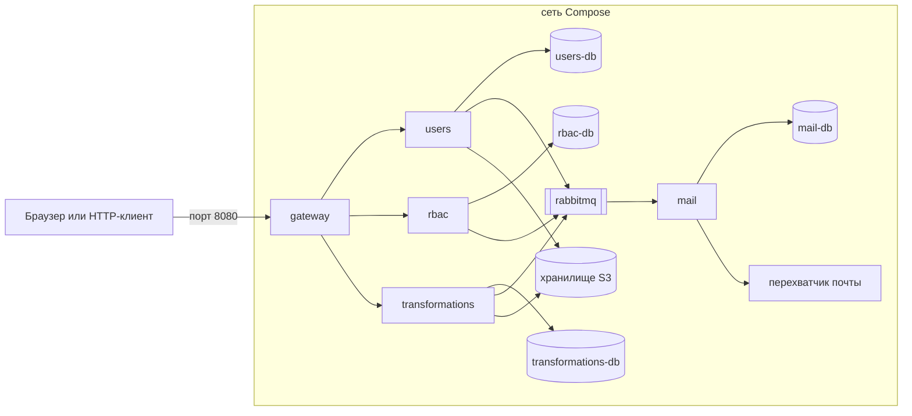
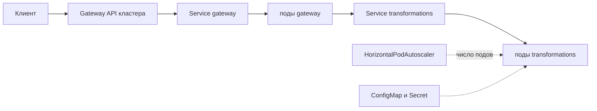
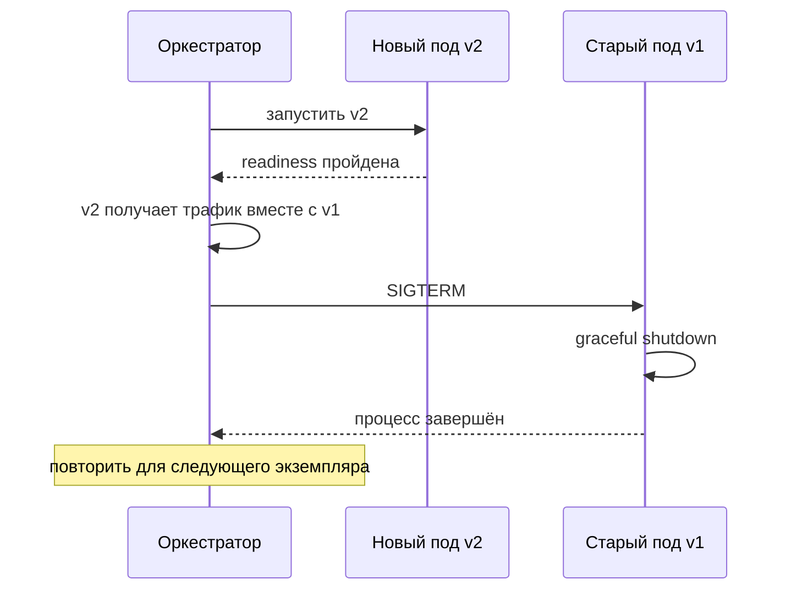

# Контейнеризация и развёртывание

## Содержание

- [Что такое контейнеризация и развёртывание](#что-такое-контейнеризация-и-развёртывание)
- [Образ и контейнер](#образ-и-контейнер)
- [Конфигурация и секреты](#конфигурация-и-секреты)
- [Локальная система в Compose](#локальная-система-в-compose)
- [Kubernetes: основные объекты](#kubernetes-основные-объекты)
- [Независимая сборка и выкладка](#независимая-сборка-и-выкладка)
- [Стратегии выкладки](#стратегии-выкладки)
- [Service mesh](#service-mesh)
- [Сравнение](#сравнение)
- [Как выбирать](#как-выбирать)
- [Как это проявляется в системе](#как-это-проявляется-в-системе)
- [Типичные ошибки](#типичные-ошибки)
- [Полезные ссылки](#полезные-ссылки)
- [Вопросы по теории](#вопросы-по-теории)

## Что такое контейнеризация и развёртывание

Контейнеризация — упаковка сервиса вместе с окружением выполнения в неизменяемый образ, который одинаково запускается на любой машине. Развёртывание — запуск образов нужной версии в нужном количестве, обновление без простоя и восстановление после сбоев.

Система курса состоит из пяти приложений, четырёх баз, брокера, хранилища и вспомогательных сервисов. Без контейнеров её не запустить одной командой, а без независимой выкладки теряется главный смысл микросервисов. Приложения не хранят состояние в памяти процесса, поэтому каждое можно запускать в нескольких экземплярах.

| Среда | Примеры | Когда подходит |
| --- | --- | --- |
| Docker Compose | `docker compose up` на машине разработчика | локальная разработка и проверка всей системы |
| Kubernetes | управляемый кластер в облаке | production с несколькими экземплярами и автоматическим восстановлением |
| Managed containers | Cloud Run, Azure Container Apps, Amazon ECS | production без управления кластером |
| Локальная оркестрация стека | Aspire | разработка с панелью телеметрии и запуском зависимостей |

## Образ и контейнер

Образ — неизменяемый набор слоёв файловой системы и команда запуска. Контейнер — запущенный процесс из образа со своей файловой системой и сетью. Один контейнер — один процесс сервиса; логи идут в stdout, а не в файлы внутри контейнера.

```dockerfile
FROM node:22-alpine AS build
WORKDIR /app
COPY package*.json ./
RUN npm ci
COPY . .
RUN npm run build && npm prune --omit=dev

FROM node:22-alpine
WORKDIR /app
ENV NODE_ENV=production
COPY --from=build /app/node_modules ./node_modules
COPY --from=build /app/dist ./dist
USER node
EXPOSE 8080
CMD ["node", "--import", "./dist/instrumentation.js", "dist/main.js"]
```

Multi-stage build собирает код в первой стадии, а в итоговый образ копирует только результат и зависимости выполнения. Компилятор, исходники и dev-зависимости в production не попадают. `USER node` запускает процесс без прав root, а `--import` загружает инструментацию OpenTelemetry раньше кода приложения: иначе она не успеет подключиться к HTTP-серверу и драйверам.

Порядок `COPY` важен для кеша слоёв: зависимости ставятся до копирования исходников и не переустанавливаются при каждом изменении кода. `.dockerignore` исключает `node_modules`, `.git` и локальные секреты из контекста сборки. Образ помечается тегом по commit SHA, а не `latest`: тег однозначно указывает, какой код запущен.

## Конфигурация и секреты

Конфигурация — всё, что меняется между окружениями: адреса баз и брокера, таймауты, лимиты. Она передаётся при запуске, а образ остаётся одним для всех окружений. Сервис проверяет конфигурацию при старте и не становится ready, пока она неполна.

Секреты не попадают ни в образ, ни в репозиторий. Переменные окружения легко утекают в логи и дочерние процессы, поэтому секреты лучше монтировать файлами: Compose кладёт их в `/run/secrets/`, Kubernetes — в том из Secret. Secret в Kubernetes по умолчанию хранится в etcd без шифрования, поэтому включают шифрование хранилища или внешний менеджер секретов.

Секреты системы курса закреплены за владельцами:

- закрытый ключ ES256 для access, секрет HS256 для refresh и ключ HMAC для challenge — только у `users`;
- ключ шифрования тела `SendEmail` — только у `users` и `mail`;
- пароли баз и учётные данные брокера — у каждого сервиса свои;
- ключи доступа к бакету — только у владельца бакета.

## Локальная система в Compose

Одна команда `docker compose up` поднимает всю систему: шлюз, четыре доменных сервиса, базу каждого сервиса, RabbitMQ, S3-совместимое хранилище, перехватчик почты и OpenTelemetry Collector.



Порт на хосте публикует только шлюз. Остальные контейнеры доступны друг другу по именам внутри сети Compose. Каждая база запущена отдельным контейнером: так видно, что у сервиса нет доступа к чужим данным. В production базы сервисов могут жить на одном сервере СУБД как отдельные базы с отдельными пользователями.

```yaml
services:
  gateway:
    image: registry.example.test/course/gateway:3f9c2ab
    ports:
      - "8080:8080"
    depends_on:
      users:
        condition: service_healthy

  users:
    image: registry.example.test/course/users:3f9c2ab
    environment:
      DATABASE_URL: postgres://users@users-db:5432/users
    depends_on:
      users-db:
        condition: service_healthy
    healthcheck:
      test: ["CMD", "wget", "-qO-", "http://localhost:8080/health/ready"]
      interval: 5s
      retries: 12

  transformations:
    image: registry.example.test/course/transformations:3f9c2ab
    stop_grace_period: 40s
```

`depends_on` с `condition: service_healthy` запускает сервис после того, как зависимость прошла healthcheck. Порядок запуска не отменяет повторов подключения: база может перезапуститься и после старта. Compose по умолчанию ждёт остановки контейнера 10 секунд, поэтому `transformations` получает `stop_grace_period` больше 30 секунд преобразования.

## Kubernetes: основные объекты

| Объект | Назначение | В системе курса |
| --- | --- | --- |
| Pod | один или несколько контейнеров с общей сетью | экземпляр `rbac` |
| Deployment | желаемое число подов и обновление версии | несколько экземпляров `transformations` |
| Service | стабильное имя и адрес набора подов | обращение к `rbac` по имени |
| Gateway API или Ingress | внешний вход в кластер | маршрут до `gateway` |
| ConfigMap и Secret | конфигурация и секреты | адрес брокера, ключ подписи access |
| пробы | liveness, readiness и startup | `/health/live` и `/health/ready` |
| requests и limits | гарантированные и предельные ресурсы | лимит CPU для преобразований изображений |
| HorizontalPodAutoscaler | число подов по нагрузке | масштабирование `transformations` по CPU |



Gateway API Kubernetes — объект входа в кластер, а `gateway` системы курса — приложение за ним. В небольшой системе часть задач шлюза берёт на себя ingress-контроллер, но проверка JWKS и статуса остаётся в приложении. Обнаружение сервисов по DNS и пробы разобраны в `0.2 Синхронное взаимодействие.md` и `0.6 Отказоустойчивость.md`.

## Независимая сборка и выкладка

У каждого сервиса свой конвейер: тесты, сборка образа, публикация в реестр с тегом по SHA, выкладка в тестовое окружение, проверка совместимости контрактов, выкладка в production. Изменение `rbac` не пересобирает и не выкладывает `users`.

Образ собирается один раз и проходит все окружения без пересборки (build once, deploy many). Окружения различаются только конфигурацией — так в production попадает ровно тот код, который проверен в тестовом окружении.

Монорепозиторий хранит все сервисы вместе: проще общие инструменты и сквозной поиск, но конвейеры запускаются по изменённым путям, а соблазн выкладывать всё вместе выше. Отдельный репозиторий на сервис делает владение явным, но затрудняет изменения, затрагивающие несколько сервисов. Независимость выкладки важнее выбора репозитория.

Миграция базы выполняется отдельным шагом до выкладки кода, который её использует. Ломающие изменения схемы проходят expand and contract из `0.7 Контракты и тестирование.md`. Автоматическая синхронизация схемы с моделями в production не включается.

## Стратегии выкладки



Rolling update заменяет экземпляры по одному. Во время выкладки v1 и v2 работают одновременно, поэтому контракты и схема базы совместимы в обе стороны. Readiness не пускает трафик на неготовый под, graceful shutdown не обрывает запросы старого.

Blue-green держит две полные среды и переключает трафик целиком; откат — обратное переключение. Canary направляет на новую версию небольшую часть трафика и расширяет её, пока метрики ошибок и задержек в норме. Recreate останавливает старую версию перед запуском новой и допустим только там, где простой не важен.

## Service mesh

Service mesh — слой прокси рядом с каждым сервисом (sidecar) или на каждом узле. Прокси берут на себя mTLS, повторы, таймауты, разделение трафика для canary и телеметрию, не меняя код сервисов. Istio и Linkerd — распространённые реализации.

Цена mesh — ещё одна сложная инфраструктура, ресурсы на прокси и трудная отладка. Повторы mesh складываются с повторами в коде, умножая нагрузку, как описано в `0.6 Отказоустойчивость.md`. Для учебной системы mesh не нужен: те же функции выполняют библиотеки в сервисах.

## Сравнение

| Стратегия | Простой | Откат | Требования | Подходит для |
| --- | --- | --- | --- | --- |
| recreate | есть | новая выкладка старой версии | нет | локальная среда, допустимый простой |
| rolling update | нет | обратное обновление | совместимость версий, readiness, graceful shutdown | вариант по умолчанию |
| blue-green | нет | мгновенное переключение назад | двойные ресурсы, совместимая база | критичные релизы с быстрым откатом |
| canary | нет | возврат трафика на старую версию | метрики и правило автоматического решения | рискованные изменения при заметном трафике |

## Как выбирать

1. Локально запускать систему в Compose одной командой; наружу публиковать только порт шлюза.
2. Собирать образ multi-stage, без root, с тегом по commit SHA.
3. Передавать конфигурацию при запуске, секреты — файлами; образ один для всех окружений.
4. Держать отдельный конвейер у каждого сервиса и не выкладывать сервисы пачкой.
5. По умолчанию выкладывать rolling update; canary — для рискованных изменений при достаточном трафике.
6. Делать срок остановки больше самого долгого запроса.
7. Не добавлять service mesh, пока библиотеки в сервисах справляются.

## Как это проявляется в системе

**Аутентификация.** Закрытый ключ ES256 монтируется секретом только в `users`, остальные сервисы получают открытые ключи через JWKS. Смена ключа — новая версия секрета и ротация по `kid`, а не пересборка образа.

**Авторизация.** Readiness `rbac` не проходит до загрузки снимка политики. В Kubernetes неготовый под не получает трафик, поэтому сервисы не получают решений от неготового экземпляра. В Compose healthcheck трафик не отключает, а только задаёт порядок запуска через `depends_on`.

**Регистрация.** Письма в локальной системе уходят в перехватчик почты: `mail` ничего не знает об окружении, меняется только адрес SMTP в конфигурации.

**Удаление пользователя.** Остановка экземпляра `users` при выкладке не прерывает сагу: состояние в базе, а команды в брокере. Новый экземпляр продолжает с сохранённого шага.

**Общие требования к трансформации файлов.** `stop_grace_period` в Compose и срок завершения в Kubernetes больше 30 секунд, иначе выкладка обрывает преобразования.

**Трансформация изображений.** Requests и limits CPU и масштабирование по нагрузке позволяют добавить экземпляры `transformations`, не трогая остальные сервисы.

**Сохранение результатов трансформаций в хранилище.** Локально результаты пишутся в S3-совместимое хранилище в Compose: тот же адаптер, что в production, меняются только адрес и ключи.

## Типичные ошибки

| Что видно | Причина и исправление |
| --- | --- |
| Образ весит гигабайт и долго собирается | инструменты сборки в итоговом образе; multi-stage build и `.dockerignore` |
| Секрет виден в истории образа | секрет передан через `ENV` или скопирован в слой; секреты только при запуске |
| Процесс в контейнере работает от root | нет `USER`; запускать от непривилегированного пользователя |
| В production запущен не тот код | изменяемый тег `latest`; тег по commit SHA |
| Сервис падает при старте, база ещё не готова | `depends_on` без условия; `condition: service_healthy` и повторы подключения |
| База сервиса доступна с хоста | порт базы опубликован; наружу открыт только шлюз |
| Остановка Compose обрывает преобразования | срок остановки 10 секунд по умолчанию; `stop_grace_period` больше 30 секунд |
| После выкладки v2 падают запросы к v1 | несовместимые изменения при rolling update; expand and contract |
| Логи пропадают при перезапуске контейнера | логи пишутся в файл внутри контейнера; писать в stdout |
| Один и тот же код ведёт себя по-разному в окружениях | образ пересобирается для каждого окружения; build once, конфигурация из окружения |
| Под выгоняется из-за нехватки памяти | requests и limits не заданы или занижены; задать по измеренному потреблению |
| Секреты Kubernetes читаются из etcd в открытом виде | шифрование хранилища не включено; encryption at rest или внешний менеджер секретов |
| Выкладка одного сервиса требует выкладки остальных | общий конвейер и общий тег версии; отдельный конвейер и образ у каждого сервиса |

## Полезные ссылки

### Общие

- [Docker — Building best practices](https://docs.docker.com/build/building/best-practices/) — кеш слоёв, `.dockerignore` и непривилегированный пользователь.
- [Docker — Multi-stage builds](https://docs.docker.com/build/building/multi-stage/) — отделение сборки от итогового образа.
- [Docker — Compose file reference](https://docs.docker.com/reference/compose-file/) — сервисы, сети, тома, секреты и `stop_grace_period`.
- [Docker — Control startup and shutdown order in Compose](https://docs.docker.com/compose/how-tos/startup-order/) — `depends_on` и `service_healthy`.
- [Docker — Manage secrets securely in Docker Compose](https://docs.docker.com/compose/how-tos/use-secrets/) — секреты файлами в `/run/secrets`.
- [The Twelve-Factor App — Конфигурация](https://12factor.net/ru/config) — конфигурация в окружении, а не в коде.
- [The Twelve-Factor App — Сборка, релиз, выполнение](https://12factor.net/ru/build-release-run) — один образ для всех окружений.
- [The Twelve-Factor App — Журналирование](https://12factor.net/ru/logs) — логи как поток в stdout.
- [Kubernetes — Deployments](https://kubernetes.io/docs/concepts/workloads/controllers/deployment/) — реплики и rolling update.
- [Kubernetes — Service](https://kubernetes.io/docs/concepts/services-networking/service/) — стабильное имя набора подов.
- [Kubernetes — Gateway API](https://kubernetes.io/docs/concepts/services-networking/gateway/) — внешний вход в кластер.
- [Kubernetes — Secrets](https://kubernetes.io/docs/concepts/configuration/secret/) — хранение секретов и предупреждение о шифровании.
- [Kubernetes — Resource Management for Pods and Containers](https://kubernetes.io/docs/concepts/configuration/manage-resources-containers/) — requests и limits.
- [Kubernetes — Horizontal Pod Autoscaling](https://kubernetes.io/docs/concepts/workloads/autoscaling/horizontal-pod-autoscale/) — масштабирование по нагрузке.
- [Martin Fowler — Blue Green Deployment](https://martinfowler.com/bliki/BlueGreenDeployment.html) — две среды и переключение трафика.
- [Martin Fowler — Canary Release](https://martinfowler.com/bliki/CanaryRelease.html) — постепенный перевод трафика на новую версию.
- [Linkerd — What is a service mesh?](https://linkerd.io/what-is-a-service-mesh/) — что даёт mesh и чего он стоит.

### По языку

#### Node.js

- [Docker — Node.js language-specific guide](https://docs.docker.com/guides/nodejs/) — образ, Compose и тесты Node.js-приложения.
- [GitHub — nodejs/docker-node Best Practices](https://github.com/nodejs/docker-node/blob/main/docs/BestPractices.md) — пользователь `node`, сигналы и `NODE_ENV` в образе.

#### .NET

- [Microsoft — Containerize an app with Docker tutorial](https://learn.microsoft.com/en-us/dotnet/core/docker/build-container) — Dockerfile для .NET-приложения.
- [Microsoft — Containerize an app with dotnet publish](https://learn.microsoft.com/en-us/dotnet/core/containers/sdk-publish) — образ без Dockerfile средствами SDK.
- [Microsoft — What is Aspire?](https://learn.microsoft.com/en-us/dotnet/aspire/get-started/aspire-overview) — локальный запуск нескольких сервисов с телеметрией.

#### Python

- [FastAPI — FastAPI in Containers - Docker](https://fastapi.tiangolo.com/deployment/docker/) — образ FastAPI-приложения.
- [Docker — Python language-specific guide](https://docs.docker.com/guides/python/) — образ, Compose и тесты Python-приложения.

## Вопросы по теории

1. Зачем multi-stage build и что не должно попасть в итоговый образ?
2. Почему образ помечают тегом по commit SHA, а не `latest`?
3. Почему секреты монтируют файлами, а не передают переменными окружения или в образе?
4. Что произойдёт при остановке `transformations` в Compose, если не задать `stop_grace_period`?
5. Почему `depends_on` с `service_healthy` не отменяет повторов подключения к базе?
6. Чем rolling update отличается от blue-green и что требуется от контрактов при rolling update?
7. Когда service mesh оправдан и почему для учебной системы он не нужен?
