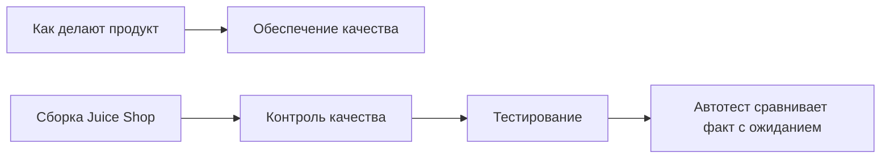
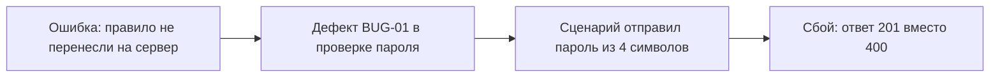

# Обеспечение качества

## Содержание

- [Что такое обеспечение качества](#что-такое-обеспечение-качества)
- [Обеспечение, контроль и тестирование](#обеспечение-контроль-и-тестирование)
- [Ошибка, дефект и сбой](#ошибка-дефект-и-сбой)
- [Семь принципов тестирования](#семь-принципов-тестирования)
- [Верификация и валидация](#верификация-и-валидация)
- [Тестовый оракул](#тестовый-оракул)
- [Чёрный, белый и серый ящик](#чёрный-белый-и-серый-ящик)
- [Образ мышления QA](#образ-мышления-qa)
- [Сравнение](#сравнение)
- [Как выбирать](#как-выбирать)
- [Как это проявляется в системе](#как-это-проявляется-в-системе)
- [Типичные ошибки](#типичные-ошибки)
- [Полезные ссылки](#полезные-ссылки)
- [Вопросы по теории](#вопросы-по-теории)

## Что такое обеспечение качества

> Раздел «Основы QA» покрывает только базовые теоретические понятия обеспечения качества, которые нужны, чтобы автоматизировать проверки. Глубокое ручное тестирование требует отдельного углублённого обучения. Этот курс такое обучение не затрагивает: курс направлен на автоматизацию тестирования (AQA).

Обеспечение качества — это способ организовать работу так, чтобы в продукт реже попадали ошибки, а уже попавшие находились до пользователя. В курсе продукт — учебный магазин OWASP Juice Shop версии 20.4.0. Итог курса — репозиторий автотестов этого магазина на одном стеке: TypeScript, Python или C#.

Понятия этого файла нужны там, где автотест решает, пройден сценарий или нет. В `1.1` ожидаемый ответ берут из правила, а не из сегодняшнего поведения стенда. В `1.5` после заказа проверяют побочные эффекты. В `5.1` атаку оценивают по внешнему ответу.

| Вопрос | Зачем он в автотесте | Где виден в курсе |
| --- | --- | --- |
| Как устроена работа | дефект дешевле поймать правилом прогона, чем разбором падения | метка известного дефекта, прогон в CI |
| Совпал ли продукт со спецификацией | тест сравнивает факт с ожиданием | регистрация, корзина, права |
| Годится ли сценарий человеку | зелёный набор ещё не доказывает пользу магазина | сквозной заказ в `1.5` и `2.3` |

## Обеспечение, контроль и тестирование

Три слова часто ставят рядом, хотя они про разное.

Обеспечение качества (quality assurance, QA) смотрит на то, как делают продукт: откуда берётся ожидание, когда запускается набор, что считается готовым. Контроль качества (quality control, QC) смотрит на сам продукт и ищет в нём расхождения со спецификацией. Тестирование — один из приёмов контроля: продукт запускают на выбранных данных и сравнивают поведение с ожиданием.

Автотест в этом курсе — инструмент тестирования. Репозиторий вокруг него — кусок обеспечения качества: идентификатор кейса, теги, запрет молча подставлять секрет, отдельная метка для уже известного дефекта. Прогон на стенде — контроль конкретной сборки образа `bkimminich/juice-shop:v20.4.0`.

В Juice Shop форма регистрации не даёт отправить пароль короче 5 символов. Это контроль на стороне интерфейса. Тот же магазин по `POST /api/Users` такой пароль принимает и отвечает **201**. Контроль интерфейса дефект сервера не закрыл. Обеспечение качества как раз требует, чтобы правило жило в одном месте и проверялось тем же ожиданием и в API, и в UI.

Путаница трёх слов ломает отчёт о прогоне. Фраза «QA пройдено» ничего не говорит: непонятно, речь о правилах репозитория, о конкретной сборке или об одном кейсе. В курсе говорят точнее. Набор тестов — средство контроля. Зелёный кейс `TC-REG-01` — результат одного испытания. Договорённость «ожидание берётся из требования» — правило обеспечения качества, оно действует и на красных кейсах.



Диаграмма разделяет работу над процессом и проверку конкретной сборки. Автотест стоит внутри тестирования, а правила репозитория остаются частью обеспечения качества.

## Ошибка, дефект и сбой

Цепочка из трёх разных событий объясняет, что именно поймал тест.

Человек, который проектирует или пишет систему, принимает неверное решение. Это ошибка (error): путаница в правиле, пропущенная проверка, копирование старого условия. Ошибку в голове тест не видит.

Ошибка остаётся в артефакте: в коде, в конфигурации, в тексте требования. Такой изъян называют дефектом (defect). Пока сценарий до изъяна не дошёл, магазин выглядит исправным.

Когда сценарий доходит до дефекта и наблюдаемое поведение расходится с требуемым, возникает сбой (failure). Автотест ловит сбой. Дефекту человек даёт идентификатор, чтобы сбой можно было отличить от поломки самого теста.

На регистрации Juice Shop это выглядит так. Правило формы: пароль от 5 до 40 символов, иначе сервер должен ответить **400**. Разработчик не перенёс ту же проверку в `POST /api/Users` — это ошибка. Изъян в серверной проверке — дефект `BUG-01`. Пароль из 4 символов получает **201** — это сбой. Пароль из 41 символа, невалидный email и несовпадающий `passwordRepeat` выходят из того же дефекта другими сбоями.



Диаграмма показывает порядок, в котором события появляются. Зелёный прогон возможен и при живом дефекте, если ни один сценарий до него не дошёл.

Пустой email в том же запросе даёт другой наблюдаемый результат: **400** и текст `Invalid email/password cannot be empty`. Здесь сбоя по этому правилу нет. Соседний дефект не делает красным весь метод.

Один дефект способен дать несколько сбоев, и несколько ошибок способны слиться в один отчёт, если их не развести. `BUG-01` проявляется и на коротком пароле, и на пароле длиннее 40 символов, и на невалидном email, и на несовпадающем `passwordRepeat`. Это четыре сбоя одного изъяна: сервер не повторяет проверки формы. Отчёт о тестировании считает дефект один раз, а кейсы — четыре раза. Иначе метрика «сколько упало» преувеличивает число дыр в коде и занижает число дыр в сценариях.

## Семь принципов тестирования

Программа ISTQB Certified Tester Foundation Level v4.0 собирает семь ограничений. Каждое ограничивает, что можно обещать по зелёному прогону.

| Принцип | Смысл простыми словами | Пример на Juice Shop |
| --- | --- | --- |
| Тестирование показывает наличие дефектов, а не их отсутствие | Найденный сбой доказывает дефект; тихий прогон не доказывает чистоту | `BUG-01` найден; это не значит, что соседние поля чисты |
| Исчерпывающее тестирование невозможно | Все значения перебрать нельзя | Все строки пароля не отправить; берут классы и границы, см. `0.3` |
| Раннее тестирование экономит время и деньги | Чем раньше сравнение с правилом, тем дешевле сбой | Правило 5–40 фиксируют в `1.1`, до большого UI-набора |
| Дефекты скапливаются | Изъяны кучкуются в одних модулях | Слабые проверки регистрации и корзины: `BUG-01`, `BUG-02`, `BUG-03` |
| Тесты изнашиваются | Один и тот же набор перестаёт ловить новое | Вечный поиск `apple` не заменит кейсы доступа и границ |
| Тестирование зависит от контекста | Глубина следует из роли системы | Учебный уязвимый магазин проверяют на своём стенде, чужой хост не нагружают |
| Заблуждение об отсутствии дефектов | Продукт без известных сбоев может быть бесполезным | Набор без сценария покупки не говорит, что магазином можно пользоваться |

Старое имя пятого принципа — «парадокс пестицида»: насекомые привыкают к одному составу, дефекты «привыкают» к одним и тем же проверкам. Старое имя седьмого — «заблуждение об отсутствии ошибок». В v4.0 оба принципа названы прямее, смысл тот же.

Контекст курса конкретный. Juice Shop специально содержит уязвимости, образ запускают локально с `NODE_ENV=quiet`, порт `3000`. Ожидание безопасности берут из обычного правила (чужая корзина недоступна, инъекция не открывает каталог), а факт стенда записывают как известный дефект. Такой контекст не переносится на чужой боевой магазин.

Раннее тестирование в курсе видно по порядку файлов. Сначала фиксируют правило и идентификатор кейса, потом автоматизируют регистрацию, и только следом наращивают корзину, интерфейс и безопасность. Если ждать «полного магазина» и один раз прогнать всё в конце, дефект `BUG-01` всплывёт, когда на неверном **201** уже построены фикстуры покупателя. Переделывать общий клиент дороже, чем поправить ожидание в первом же кейсе.

## Верификация и валидация

Проверке нужны два разных вопроса.

Верификация спрашивает, собран ли продукт по заданному правилу. Валидация спрашивает, нужен ли этот продукт человеку, который будет им пользоваться.

Правило «пароль длиной 5–40 символов» — предмет верификации. Форма показывает `Password must be 5-40 characters long.` и не даёт нажать `Register`, если символов четыре. Сервер по тому же правилу должен ответить **400**. Ответ **201** верификацию не проходит, даже если учётка после этого входит в магазин.

Страница завершения заказа благодарит покупателя за покупку. Это ближе к валидации: человек дошёл до конца сценария и видит понятный исход. Оба вопроса живут в наборе. Верификация ловит `BUG-01`. Сквозной заказ проверяет, что правила корзины, адреса, доставки и оплаты складываются в покупку, а код **200** на каждом шаге сам по себе покупку не доказывает.

Автотесты курса в основном верифицируют уже названные правила. Валидацию «магазин удобен людям» целиком автотест не закрывает: для неё нужны наблюдения человека, и это как раз та глубина ручной работы, которую курс не берёт.

## Тестовый оракул

Тесту нужно знать правильный ответ до сравнения. Источник правильного ответа называют тестовым оракулом (test oracle).

Оракулом может быть текст правила, соседняя согласованная система, модель, эксперт. В этом курсе оракул — требование. Ответ стенда — факт, который с требованием сравнивают. Если факт и требование разошлись, тест падает. Если расхождение уже разобрано и занесено как дефект Juice Shop, тест помечают ожидаемым падением и тегом `known-issue`, ожидание не переписывают.

```ts
// Плохо: ожидание снято с сегодняшнего ответа стенда.
expect(response.status()).toBe(201);

// Хорошо: ожидание взято из правила «пароль 5–40 символов».
expect(response.status()).toBe(400);
```

Фрагмент показывает одну развилку. Первый вариант делает стенд оракулом самого себя: дефект `BUG-01` навсегда зелёный. Второй вариант сохраняет требование. Пока сервер отвечает **201**, тест красный и несёт метку `BUG-01`. В день исправления дефекта тот же тест станет зелёным неожиданно, и метку снимают.

Независимый источник того же правила в Juice Shop — текст формы и неактивная кнопка `Register` при четырёх символах. UI и API расходятся. Расхождение подтверждает, что оракул лежит вне сегодняшнего JSON сервера.

Оракул указывает и на поля, не только на код. Дубликат email: **400**, `errors[0].field = email`, `errors[0].message = email must be unique`. Неверный пароль при входе: **401** и текст `Invalid email or password.` Тот же текст при неизвестном email — отдельное требование: сервер не сообщает, какая из двух проверок не прошла.

Ещё один оракул легко перепутать с деталью реализации. `GET /rest/user/whoami` возвращает почту, когда токен лежит в cookie `token`. Тот же токен, переданный только заголовком `Authorization`, даёт тело `{"user":{}}`. Требование кейса `TC-AUTH-04` называет оба исхода. Если оставить в ожидании только «удобный» заголовок, тест начнёт чинить стенд под привычку клиента и пропустит реальный контракт cookie.

## Чёрный, белый и серый ящик

Степень знания внутреннего устройства меняет, откуда берутся данные теста. Имя приёма — по тому, видно ли «внутрь ящика».

Чёрный ящик смотрит только на вход и выход. Как устроен код, автору проверки для вердикта не нужно. Белый ящик смотрит на структуру: ветки, условия, пути в коде. Серый ящик знает часть устройства, вызывает систему снаружи и сверяет ещё и побочный эффект.

Курс не меняет исходники Juice Shop и не меряет покрытие веток сервера. Белый ящик остаётся практикой разработчика модуля. Набор участника строится из чёрного и серого ящика.

Чёрный ящик на входе: `POST /rest/user/login` с верной парой почта–пароль возвращает **200**, `authentication.token`, `authentication.bid`, `authentication.umail`. Неверная пара возвращает **401**. Внутренний SQL для этого вердикта не читают.

Серый ящик на заказе: одного `orderConfirmation` мало. После оформления корзина пуста, заказ виден в `GET /rest/order-history`, `totalPrice` сходится с суммой цен и доставки, остаток товара уменьшился, метрика `juiceshop_orders_placed_total` выросла. База SQLite внутри образа без оболочки недоступна, поэтому побочный эффект читают другими публичными операциями и `/metrics`. Знание, что именно должно измениться, — серая часть. Вызов идёт через API, как снаружи.

Атаки в `5.1` оценивают как чёрный ящик. Поиск с `q='))--` не должен отдавать весь каталог. Вход с `' OR 1=1--` не должен выдавать токен администратора. Полезная нагрузка выбрана из гипотезы об обработке строки, а вердикт — по внешнему требованию: параметризованный запрос и **401** на таком входе. Факт стенда — дефект `BUG-08`.

## Образ мышления QA

Образ мышления здесь — привычка доводить сравнение до требования и отделять виды проблем друг от друга.

Правило сначала записывают ожиданием, и только потом смотрят на стенд. Счастливый путь регистрации валидного покупателя (**201**, роль `customer`, заголовок `Location`) обязателен, и рядом обязателен путь, который правило запрещает.

Сбой сопровождают данными, по которым его повторяют: метод, тело, код, фрагмент ответа, версия образа. Без этого красный прогон не отличить от случайности. Пароль, токен, cookie `token` и хеш пароля в такой записи не хранят: в JWT Juice Shop как раз лежит MD5 пароля (`BUG-09`), и копировать полезную нагрузку токена в отчёт нельзя.

Расхождение делят на три корзины. Продукт нарушил требование — дефект с идентификатором `BUG-<NN>`. Тест неверно понял требование — правят тест. Поведение прыгает от запуска к запуску — нестабильный тест, его разбирают отдельно в `2.6`, метку `known-issue` на него не вешают.

Наконец, стенд курса — только свой контейнер. Проверка чужого хоста теми же приёмами уже не обучение на Juice Shop.

Та же привычка удерживает тест от «починки» продукта внутри проверки. Автотест не подменяет серверную валидацию своим фильтром и не молчит, если код неожиданно стал верным. Исправленный `BUG-01` должен сделать помеченный тест красным по другой причине: ожидание **400** наконец совпало с фактом, а метка ожидаемого падения ещё висит. Это сигнал снять метку, а не ослабить проверку.

Пока метка на месте, красный цвет такого теста ожидаем. В сводке его отделяют от настоящего падения, чтобы шум известного дефекта не прятал новый сбой.

## Сравнение

| Подход | Что использует тест | Подходит для |
| --- | --- | --- |
| Чёрный ящик | Вход и наблюдаемый ответ | Контракт API и текст интерфейса: регистрация, вход, атака снаружи |
| Серый ящик | Внешний вызов плюс известный побочный эффект | Заказ: история, остаток, метрика, без входа в SQLite |
| Белый ящик | Ветки и пути в коде | Модульные тесты команды, которая этот код пишет |
| Оракул-требование | Ожидание из правила | Любой кейс курса, включая известный дефект |
| Оракул-стенд | Ожидание снято с текущего ответа | Нигде в курсе: прячет `BUG-01` и соседние дефекты |

## Как выбирать

1. По умолчанию автотест — чёрный ящик, оракул — записанное требование, идентификатор кейса стоит в имени теста.
2. Серый ящик добавляют, когда вердикт зависит от побочного эффекта, а база стенда снаружи недоступна. Так устроен заказ в `1.5`.
3. Белый ящик не ставят целью набора: образ Juice Shop участник не собирает из исходников и покрытие сервера не обещает.
4. Если факт стабильно расходится с требованием, ожидание оставляют, тесту дают метку `known-issue` и идентификатор `BUG-<NN>`.
5. Если расхождение прыгает между прогонами, это нестабильность. Её чинят разбором причины, а не сменой оракула на «как повезёт».

## Как это проявляется в системе

**Регистрация и вход (`1.1`).** Оракул кейсов `TC-REG-04`, `TC-REG-05`, `TC-REG-07` и `TC-REG-08` — правило формы и код **400**. Факт стенда — **201**. Это `BUG-01`. Кейс `TC-REG-06` на длинах 5 и 40 остаётся успешным: граница правила как раз эти длины. Кейс `TC-AUTH-02` ждёт **401** и нейтральный текст, одинаковый для неверного пароля и неизвестной почты.

**Корзина и заказ (`1.5`).** Серый ящик на `TC-ORDER-01`: после **200** и номера заказа вида `^[0-9a-f]{4}-[0-9a-f]{16}$` корзина пуста, заказ есть в истории, сумма сходится (например, 2 × 1.99 + 0.99 = 4.97), остаток товара уменьшился. `TC-ORDER-02` ждёт рост `juiceshop_orders_placed_total`. Прямой запрос в SQLite описан как приём для систем, где база доступна; у этого образа его нет.

**Аутентификация, авторизация и сессии (`5.1`).** Чёрный ящик на уже известных уязвимостях. Чужая корзина и список пользователей (`BUG-06`, `BUG-07`), инъекция (`BUG-08`), хеш пароля в JWT (`BUG-09`) оцениваются по тому, чего внешний контракт не должен отдавать. Матрица ролей из `1.3` задаёт спокойный оракул доступа; `5.1` добавляет вредоносные входы к тому же правилу.

## Типичные ошибки

| Что видно | Причина и исправление |
| --- | --- |
| Пароль из 4 символов считается успешной регистрацией | Ожидание снято со стенда. Вернуть **400** и метку `BUG-01` |
| Зелёный набор объявлен доказательством отсутствия дефектов | Нарушен первый принцип. Искать непокрытые правила, а не обещать чистоту |
| После checkout проверен только код **200** | Побочный эффект не попал в оракул. Добавить историю, сумму, остаток, метрику |
| UI-проверка длины пароля засчитана за проверку API | Форма и `POST /api/Users` — разные пути. `BUG-01` живёт на сервере |
| В отчёт попали токен, cookie `token` или MD5 пароля | Секрет принят за диагностику. Оставить код, поля без секрета и идентификатор дефекта |
| Один и тот же поиск `apple` гоняют месяцами как весь контроль | Тесты износились. Добавлять границы, роли и новые правила |
| Нестабильный тест помечен `known-issue` | Метка предназначена для устойчивого дефекта продукта. Нестабильность разбирать в `2.6` |
| Чужой стенд проверяют теми же атаками, что Juice Shop | Контекст курса — свой контейнер. Чужой хост в работу не входит |
| Пустой email и короткий пароль склеены в один дефект | У пустых полей ответ уже **400**. Это другой исход, не `BUG-01` |
| Сбой описан как «регистрация сломалась» без кода и тела | По записи нельзя повторить цепочку. Нужны шаги, факт и требование |

## Полезные ссылки

- [ISTQB — Glossary](https://glossary.istqb.org/) — определения error, defect, failure, verification, validation и test oracle в терминах ISTQB.
- [ISTQB — официальный сайт](https://www.istqb.org/) — программа Certified Tester Foundation Level, откуда взяты семь принципов v4.0.
- [OWASP — Juice Shop](https://owasp.org/www-project-juice-shop/) — что это за учебное приложение и зачем в нём оставлены уязвимости.
- [ISO — ISO/IEC 25010:2011](https://www.iso.org/standard/35733.html) — модель качества продукта: отдельные характеристики, которые верификация и валидация затрагивают по-разному.

## Вопросы по теории

1. Почему автотест регистрации не может взять ожидаемый код из сегодняшнего ответа `POST /api/Users`?
2. Чем ошибка, дефект `BUG-01` и сбой на пароле из 4 символов отличаются друг от друга?
3. Что произойдёт с набором, если оракулом сделать текущее поведение Juice Shop?
4. Зачем после **200** на оформлении заказа читать историю, остаток и метрику?
5. Чем чёрный ящик атаки в `5.1` отличается от серого ящика заказа в `1.5`?
6. Почему зелёный прогон не отвечает на вопрос валидации «магазином можно пользоваться»?
7. Как принцип скопления дефектов помогает выбрать, куда добавлять следующие кейсы?
