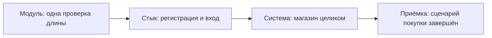
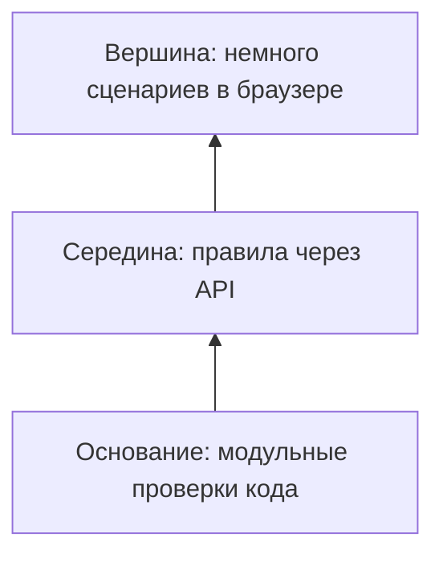
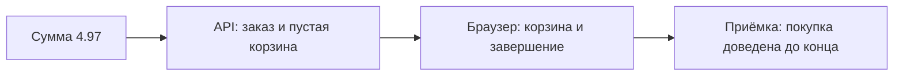

# Уровни и виды тестирования

## Содержание

- [Что такое уровни и виды тестирования](#что-такое-уровни-и-виды-тестирования)
- [Уровни от модуля до приёмки](#уровни-от-модуля-до-приёмки)
- [Функциональное и нефункциональное](#функциональное-и-нефункциональное)
- [Прогоны по цели](#прогоны-по-цели)
- [Пирамида и автоматизация](#пирамида-и-автоматизация)
- [Заказ на разных уровнях](#заказ-на-разных-уровнях)
- [Что не автоматизировать](#что-не-автоматизировать)
- [Сравнение](#сравнение)
- [Как выбирать](#как-выбирать)
- [Как это проявляется в системе](#как-это-проявляется-в-системе)
- [Типичные ошибки](#типичные-ошибки)
- [Полезные ссылки](#полезные-ссылки)
- [Вопросы по теории](#вопросы-по-теории)

## Что такое уровни и виды тестирования

Уровень тестирования — это то, насколько крупный кусок продукта попадает под одну проверку: одна функция, стык частей, весь магазин или сценарий глазами заказчика. Вид тестирования — это вопрос, на который проверка отвечает: делает ли магазин нужное дело, или делает ли он это достаточно быстро, доступно и безопасно.

Деление нужно, чтобы автотест не пытался одним сценарием ответить на все вопросы сразу. Регистрация через API, снимок карточки товара, проверка клавиатуры и нагрузочный поиск — разные проверки, даже если все они ходят в один Juice Shop.

Файл `0.1` отдельно оговаривает границу курса: здесь только база, без которой автоматизацию не собрать. Глубокая ручная работа по тем же уровням в курс не входит. Дальше уровни и виды раскладываются по практическим файлам `1.0`, `2.0`, `2.5`, `3.0` и `4.0`.

## Уровни от модуля до приёмки

Модульный уровень проверяет один кусок кода в изоляции от магазина. Такой кусок называют модулем, а проверку — модульным тестом (unit test). Для правила «пароль от 5 до 40 символов» модульный тест вызвал бы функцию проверки длины и не поднимал бы HTTP. Исходники Juice Shop участник не развивает, поэтому модульный уровень остаётся у тех, кто пишет сервер. В репозитории автотестов его нет, и это честное следствие границы системы, а не пробел в наборе.

Интеграционный уровень проверяет стык нескольких частей. Слово «интеграция» здесь значит «собрали вместе и смотрим шов». Регистрация `POST /api/Users`, затем ответы на секретный вопрос, затем `POST /rest/user/login` — шов между учётом и входом. Если пользователь создан, а вход его не видит, модули по отдельности могли быть правы, а шов нет. В курсе такие цепочки живут внутри API-набора, рядом с системными проверками всего магазина, потому что снаружи шов и система видны через один и тот же HTTP.

Системный уровень смотрит на Juice Shop целиком, как на чёрный или серый ящик из `0.1`. Покупатель ищет `apple`, кладёт товар, оформляет заказ. Клиент API делает то же цепочкой запросов. Образ `bkimminich/juice-shop:v20.4.0` и есть система под тестом. Готовность системы — `GET /rest/admin/application-version` с ответом **200** и полем `version`. Точное значение версии в теле не утверждают: оракул готовности — живой сервис и наличие поля.

Приёмочный уровень отвечает на вопрос заказчика: можно ли этим пользоваться в заявленном сценарии. Его часто называют UAT (user acceptance testing) — приёмкой пользователем. Отдельного заказчика в курсе нет. Роль приёмки выполняет записанное требование плюс сквозной сценарий: валидный покупатель регистрируется, входит и доводит покупку до подтверждения. Если системные коды зелёные, а сценарий покупки в набор не входит, приёмка не состоялась.

Диаграмма идёт от мелкой проверки к крупной. Стрелка не означает, что без модульных тестов Juice Shop системный набор бесполезен: модули пишет другая сторона, а участник принимает систему снаружи.

На каждом уровне оракул один и тот же по смыслу — требование, — и разный по форме. На модуле это утверждение о функции. На системе это код, поле и побочный эффект. На приёмке это законченный результат для роли `customer`, `admin` или `accounting`.

## Функциональное и нефункциональное

Функциональная проверка спрашивает, что система делает. Поиск `q=apple` возвращает три товара: `Apple Juice (1000ml)`, `Apple Pomace`, `Pineapple Juice (1000ml)`. Пустой `q` возвращает каталог из 46 товаров. Роль `accounting` читает `GET /rest/order-history/orders` с кодом **200**, роль `customer` на том же адресе получает **403**. Это функции магазина.

Нефункциональная проверка спрашивает, как система это делает. Скорость, устойчивость к нагрузке, доступность интерфейса для клавиатуры и читалки, устойчивость к подбору пароля и к инъекции — качества, а не отдельные кнопки. Модель качеств продукта описывает такие характеристики отдельно от функций: одна и та же операция «найти сок» может быть правильной по составу ответа и непригодной по времени.

Граница видна на одном URL. `GET /rest/products/search?q=apple` в функциональном кейсе проверяет имена трёх товаров. Тот же адрес в нагрузочном сценарии проверяет, что при росте параллельных пользователей доля ошибок и время ответа остаются в пороге. Путать эти два вопроса в одном тесте нельзя: падение порога скорости тогда выглядит как «поиск сломался», хотя тройка товаров на месте.

Доступность — тоже качество, а не новая функция входа. Страница `/#/login` может принимать верный пароль и при этом прятать подпись поля от вспомогательной технологии. Функциональный `TC-AUTH-10` этого не увидит. Поэтому у доступности свой набор и свой порог: блокируют нарушения серьёзности `critical` и `serious`.

Безопасность в курсе проверяет те же функции с вредоносным входом. Ожидание функциональное: чужая корзина недоступна, каталог по инъекции не раскрывается. Наблюдение часто нефункциональное по характеру риска: утечка стека, отсутствие защитных заголовков, отсутствие **429** на серии неудачных входов. Вид «безопасность» не заменяет уровни. Это системные проверки со своим тегом `security`.

Один и тот же адрес раскладывают по вопросам заранее, чтобы потом не слепить их в одной проверке.

| Качество | Какой вопрос | Пример на Juice Shop |
| --- | --- | --- |
| Функция | Верный ли состав ответа | Три товара на запрос `q=apple` |
| Права | Та ли роль пускает к операции | `accounting` читает заказы, `customer` получает **403** |
| Скорость | Укладывается ли ответ в порог | Поиск под нагрузкой: p95 короче 500 мс |
| Доступность | Есть ли доступное имя у элемента | Кнопки количества в корзине без имени ловит отдельный прогон |
| Совместимость | Жив ли сценарий в другом движке | Вход повторяют в Firefox и WebKit |
| Безопасность | Держится ли правило на злом входе | Инъекция в поиске не должна раскрывать каталог |
| Изоляция | Не портят ли тесты данные друг друга | У каждого теста свой email покупателя |

Таблица не размножает проверки внутри одного теста. Она показывает, почему поиск в курсе живёт в нескольких файлах: состав ответа, снимок карточки, нагрузка и атака сверяют разные ожидания.

## Прогоны по цели

Цель прогона — зачем запускают уже написанные проверки. Один и тот же кейс входа может входить в короткий прогон и в полный.

Дымовой прогон (smoke) — короткая проверка, что сборка подаёт признаки жизни. Английское имя значит «дымит ли»: система хотя бы стартует и отвечает на простой запрос. Для стенда это готовность по `GET /rest/admin/application-version` и один успешный вход. Тег — `smoke`. Дымовой прогон не доказывает корзину, права и оплату.

Санитарный прогон (sanity) — узкая проверка одной только что сделанной правки. После починки локатора кнопки входа достаточно кейса входа, а не всего регресса. Санитарный прогон отвечает на вопрос «эта правка не развалила свой шов». Выпускать сборку только по нему нельзя: соседние швы он сознательно не трогает.

Регрессионный прогон (regression) проверяет, что старое поведение живо после новых изменений. Слово «регрессия» здесь — возврат к уже исправленной или уже принятой поломке. Тег — `regression`. В него входят и дымовые кейсы, и границы пароля, и заказ. Полный прогон API и UI в Chromium в CI укладывают в 10 минут. Всё, что длиннее этой роли, выносят в отдельные задания пайплайна.

Исследовательское тестирование (exploratory testing) — работа человека без пошагового сценария: есть тема и время, маршрут рождается по ходу. Находку затем превращают в кейс с оракулом. Поиск с `q='))--`, который внезапно показывает весь каталог, сначала находка, затем кейс `TC-SEC-03` и дефект `BUG-08`. Сам поиск без сценария автоматизация не заменяет. Курс не учит вести такую сессию глубоко; он учит не терять находку и не объявлять её новым требованием.

Проверка совместимости (compatibility) смотрит ту же функцию в другом окружении. Вход и поиск гоняют в `chromium`, `firefox` и `webkit`. Отдельно смотрят узкий экран: меню открывается кнопкой `Open Sidenav`, а не постоянной панелью. Совместимость не плодит новые бизнес-правила. Она повторяет уже выбранные кейсы, например `TC-AUTH-10` и `TC-SEARCH-10`, в другом браузере.

Теги курса позволяют собрать прогон по цели, не переписывая кейсы. Имена тегов общие: `smoke`, `regression`, `api`, `ui`, `a11y`, `security`, `visual`, `email`, `known-issue`.

| Стек | Как помечен тест | Как отобрать smoke |
| --- | --- | --- |
| TypeScript | `tag: ['@smoke']` | `npx playwright test --grep @smoke` |
| Python | маркер `smoke` | `pytest -m smoke` |
| C# | `[Category("smoke")]` | `dotnet test --filter Category=smoke` |

В Python дефис в имени маркера заменяют на подчёркивание: тег `known-issue` становится маркером `known_issue`. Смысл тега от этого не меняется.

Нагрузочное тестирование делит прогоны по форме нагрузки, и это уже виды из `4.0`, не замена дыму функционального набора. Короткий прогон на одного пользователя проверяет, что скрипт жив. Нагрузка держит рабочий профиль. Стресс ищет предел. Всплеск бьёт резким пиком. Длительный прогон ловит утечки за долгое время. Прогон до упора ищет точку, после которой система ломается. Пороги курса относятся к профилю поиска и корзины, а не к каждому функциональному кейсу.

## Пирамида и автоматизация

Пирамида тестирования — картинка распределения проверок. В основании много быстрых модульных тестов, выше меньше интеграционных, на вершине мало дорогих сценариев через интерфейс. Смысл картинки практический: бизнес-правило, которое можно решить запросом, не стоит прокликивать в трёх браузерах на каждом коммите.

Диаграмма ставит дешёвые проверки ниже дорогих. Участник не владеет основанием: модули Juice Shop ему не отдают. Середина и вершина — его репозиторий. Пирамида всё равно запрещает перевернуть фигуру и проверить длину пароля только кликом по форме.

Правило автоматизации простое. Автоматизируют то, у чего есть устойчивый оракул и что будут повторять. Граница пароля, код доступа роли, схема JSON, пустая корзина после заказа — да. Вкус формулировки на баннере и маршрут исследовательской сессии — нет, пока из них не собран кейс с ожидаемым результатом.

Дублирование между серединой и вершиной контролируют. То, что сервер принимает пароль из 4 символов, видно по API (`BUG-01`). То, что кнопка `Register` при этом неактивна и форма пишет про длину 5–40, видно только в браузере. Оба факта нужны, и это не два экземпляра одной проверки. Повторный полный заказ и через API, и через UI нужен один раз на каждом уровне, а не на каждый товар каталога.

Нефункциональные наборы стоят рядом с пирамидой, а не внутри UI-вершины. Доступность, визуальное сравнение и нагрузка не становятся «ещё одним кликом» в регрессе покупки. Иначе десять минут на API и UI раздуваются снимками, сканером и пятью минутами поиска под нагрузкой. В пайплайне у них свои задания.

Выбор прогона после правки следует из того, какой шов задет.

| Что изменилось | Какой прогон достаточен сразу | Что оставить полному регрессу |
| --- | --- | --- |
| Локатор кнопки входа | Санитарный UI-кейс входа | Права, корзина, нагрузка |
| Правило длины пароля | Границы 4, 5, 40 и 41 символов в API | Снимок формы, пока текст правила тот же |
| Лимит 5 штук на товар 1 | Количества 5 и 6 через API | Поиск по слову `apple` |
| Эталон скриншота | Один визуальный кейс затронутой страницы | Функциональный заказ |
| Порог p95 поиска | Нагрузочный сценарий поиска | Регистрация и роли |

Санитарный прогон из таблицы экономит время только пока автор правки честно назвал задетый шов. Сомнение в шве — повод взять регресс, а не повод объявить санитарный прогон выпуском.

## Заказ на разных уровнях

Покупка двух бутылок `Apple Juice (1000ml)` с доставкой за 0.99 собирает уровни в один сюжет. Сумма 2 × 1.99 + 0.99 равна 4.97. На модульном уровне это было бы утверждение о функции цены. В репозитории курса такой функции нет: сумму подтверждают полем `totalPrice` в истории заказа.

На стыке частей проверяют цепочку API. Товар добавляют, количество доводят до двух, создают адрес и карту, оформляют заказ. Ожидание: **200**, номер заказа по шаблону из четырёх и шестнадцати шестнадцатеричных знаков, пустая корзина, заказ в истории, остаток товара меньше на две штуки. Экраны при этом не открывают.

В браузере тот же покупатель видит сообщение, что сок положен в корзину, счётчик корзины и страницу благодарности за покупку. Кнопки «минус», «плюс» и удаления в строке корзины не имеют доступного имени. Это соседнее качество той же страницы, и функциональный заказ его не закрывает.

Приёмка задаёт один вопрос: покупатель с ролью `customer` завершил покупку и видит её в истории. Каталог из 46 товаров в приёмку не копируют. Яблочный сок представляет сценарий. Границы количества 5 и 6 проверяют отдельно, потому что у товара 1 лимит пять штук на покупателя, а шестая должна давать **400**.

Диаграмма держит один заказ на четырёх вопросах. Каждый следующий вопрос дороже, поэтому на вершине пирамиды таких сценариев мало, а проверка суммы живёт в API.

## Что не автоматизировать

В регресс попадает повтор с устойчивым ожиданием. Соседние задачи либо остаются человеку, либо уходят в отдельный прогон.

| Задача | Почему её нет в функциональном регрессе | Куда деть результат |
| --- | --- | --- |
| Свободный обход магазина | Маршрут не записан заранее | Кейс с оракулом, если находка повторяется |
| Оценка тона баннера | Нет правила «верно или неверно» | В набор курса не входит |
| Полный проход со скринридером | Дерево доступности автоматика читает не целиком | Короткий ручной список рядом с автопроверками |
| Починка дефекта внутри теста | Образ магазина задан и не переписывается | Метка `known-issue` и `BUG-<NN>` |
| Нагрузка на каждый коммит | Минуты профиля не входят в бюджет 10 минут | Отдельное задание пайплайна |
| Все сочетания браузера, товара и роли | Число прогонов растёт произведением | Показательные кейсы и отбор пар, см. `0.3` |

Свободный обход, из которого появился `BUG-08`, ценен тем, что после него возник обычный кейс с ожиданием. Запись случайных кликов таким кейсом не становится. Ручной список для скринридера тоже остаётся списком человека: курс не обещает заменить его автотестом, и глубокую методику такого прохода не разворачивает.

## Сравнение

| Уровень или вид | Что даёт прогон | Подходит для |
| --- | --- | --- |
| Модульный | Вердикт о функции без магазина | Код, который развивает команда продукта |
| Интеграционный | Вердикт о шве частей | Цепочка регистрация → вход → `whoami` |
| Системный | Вердикт о Juice Shop снаружи | API-набор и UI-набор курса |
| Приёмочный | Вердикт о законченном сценарии | Покупка и вход в роль, а не отдельный код **200** |
| Функциональный | Состав и коды поведения | Каталог, корзина, роли |
| Нефункциональный | Качество того же поведения | Нагрузка, доступность, безопасность, визуальная устойчивость |
| Дымовой | Ответ «сборка жива» | Старт стенда и короткий вход |
| Регрессионный | Ответ «старое живо» | Накопленные кейсы с тегом `regression` |

## Как выбирать

1. Правило данных и прав проверять на системном API-уровне. Оно быстрее и устойчивее клика.
2. В браузер уходить, когда ожидание видно только там: неактивная кнопка, текст подсказки, фокус, снимок, меню на узком экране.
3. Дымовой тег вешать на короткий признак жизни стенда и на один основной путь. Регрессионный тег — на накопленный набор.
4. Санитарный прогон собирать под конкретную правку и не подменять им решение о выпуске.
5. Исследовательскую находку оформлять кейсом. Саму сессию в автотест не переписывать.
6. Нагрузку, доступность и визуальные снимки держать отдельными прогонами, чтобы функциональный регресс оставался в бюджете 10 минут.

## Как это проявляется в системе

**Общие требования к API-автотестам (`1.0`).** Здесь задают системный API-уровень для всего блока: теги `api`, `smoke`, `regression`, структура репозитория и готовность стенда по **200** на `GET /rest/admin/application-version`. Модульных тестов магазина файл не требует. Дым отделён от полного регресса фильтром тега, одним и тем же на трёх стеках.

**Общие требования к UI-автотестам (`2.0`).** Системный уровень через браузер. Маршруты магазина — с решёткой, вида `/#/login`. Контекст браузера изолирует покупателей друг от друга. Файл объясняет, какие проверки остаются в API, а какие появляются только в интерфейсе, чтобы вершина пирамиды не повторила весь средний слой.

**Визуальные проверки и кросс-браузерность (`2.5`).** Совместимость и визуальный вид. Снимок карточки `Apple Juice (1000ml)` и формы регистрации сравнивают с эталоном. `TC-AUTH-10` и `TC-SEARCH-10` повторяют в `chromium`, `firefox` и `webkit`. Узкий экран проверяет меню `Open Sidenav`. Это не новые функции поиска и входа.

**Общие требования к проверкам доступности (`3.0`).** Нефункциональный вид. Автоматика ловит часть правил WCAG, клавиатуру и смысл для читалки проверяют отдельно. Страницы те же, что в функциональном UI: вход, регистрация, поиск, корзина, отзыв. Порог блокировки — `critical` и `serious`, а не «страница открылась».

**Общие требования к нагрузочному тестированию (`4.0`).** Нефункциональный вид с собственными целями прогона: короткий, рабочий, стресс, всплеск, длительный, до предела. Нагружают только свой локальный стенд. Функциональный оракул поиска («три товара на apple») здесь не заменяет порог времени и доли ошибок.

## Типичные ошибки

| Что видно | Причина и исправление |
| --- | --- |
| Длина пароля проверяется только кликом по форме | Правило сервера не на том уровне. Добавить API-кейс, UI оставить для кнопки и текста |
| Дымовой прогон объявлен полным регрессом | Цель прогона перепутана. Дым — жизнь стенда; регресс — накопленные кейсы |
| После правки локатора гоняют нагрузку и все браузеры | Нужен санитарный прогон затронутого кейса. Широкий набор — по решению о выпуске |
| В репозитории ищут модульные тесты Juice Shop | Основание пирамиды не у участника. Системный набор это не заменяет и не имитирует |
| Поиск `apple` и падение p95 записаны одним тестом | Функция и качество склеены. Разнести по `2.1` и `4.1` |
| Исследовательский заход с инъекцией оставлен без кейса | Находка не стала регрессом. Оформить ожидание и идентификатор дефекта |
| Совместимость проверена только в Chromium | Вид совместимости не закрыт. Повторить выбранные кейсы в Firefox и WebKit |
| Доступность считают пройденной, раз логин кликается | Функциональный успех не про качество интерфейса. Нужен отдельный прогон `a11y` |
| Нагрузочный скрипт направлен на чужой хост | Контекст курса — локальный контейнер. Чужой адрес в прогон не подставлять |
| На приёмку показывают пачку кодов **200** без покупки | Уровень приёмки — законченный сценарий. Нужен заказ до подтверждения |
| Тег `smoke` висит на всём каталоге кейсов | Фильтр перестаёт быть коротким. Оставить дыму готовность и один основной путь |

## Полезные ссылки

- [ISTQB — Glossary](https://glossary.istqb.org/) — определения уровней тестирования, smoke, regression и exploratory testing.
- [Martin Fowler — The Practical Test Pyramid](https://martinfowler.com/articles/practical-test-pyramid.html) — зачем оснований в пирамиде больше, чем сценариев через интерфейс.
- [Playwright — Annotations](https://playwright.dev/docs/test-annotations) — как тег на тесте задаёт состав прогона.
- [W3C — WCAG 2.2](https://www.w3.org/TR/WCAG22/) — свод правил доступности, из которого нефункциональный набор берёт критерии.
- [Grafana — k6](https://grafana.com/docs/k6/) — документация инструмента, которым в курсе различают виды нагрузки.

## Вопросы по теории

1. Почему правило длины пароля проверяют запросом к API, а текст подсказки и неактивную кнопку `Register` — в браузере?
2. Чем дымовой прогон отличается от санитарного и от регрессионного на одном и том же стенде?
3. Что произойдёт с бюджетом в 10 минут, если снимки, доступность и нагрузку смешать с каждым функциональным кейсом?
4. Зачем пирамида, если модульные тесты Juice Shop в репозиторий участника не входят?
5. Как находка исследовательского поиска с `q='))--` становится регрессионным кейсом?
6. Чем функциональная проверка поиска отличается от нагрузочной проверки того же адреса?
7. Почему пачка ответов **200** ещё не приёмка сценария покупки?
