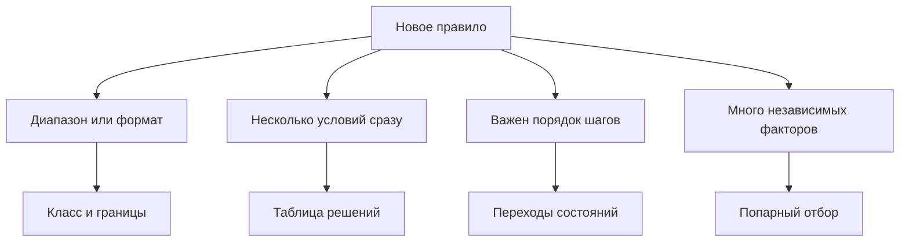
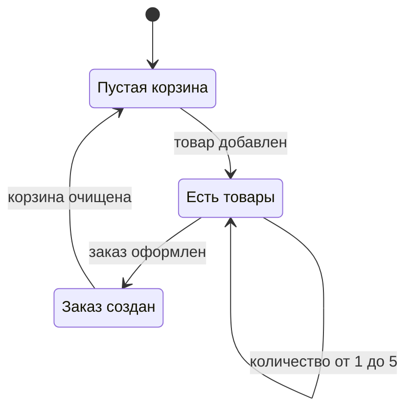

# Техники тест-дизайна

## Содержание

- [Что такое техники тест-дизайна](#что-такое-техники-тест-дизайна)
- [Классы эквивалентности](#классы-эквивалентности)
- [Граничные значения](#граничные-значения)
- [Таблица решений](#таблица-решений)
- [Переходы состояний](#переходы-состояний)
- [Попарный отбор и предугадывание ошибок](#попарный-отбор-и-предугадывание-ошибок)
- [Приоритет по риску](#приоритет-по-риску)
- [От правила к кейсу](#от-правила-к-кейсу)
- [Сравнение](#сравнение)
- [Как выбирать](#как-выбирать)
- [Как это проявляется в системе](#как-это-проявляется-в-системе)
- [Типичные ошибки](#типичные-ошибки)
- [Полезные ссылки](#полезные-ссылки)
- [Вопросы по теории](#вопросы-по-теории)

## Что такое техники тест-дизайна

Техника тест-дизайна — способ выбрать немного проверок так, чтобы они представляли много возможных данных. Исчерпывающий перебор невозможен, это уже сказано в `0.1`. Техника отвечает на следующий вопрос: какие конкретные значения оставить в наборе.

В курсе техники видны на регистрации и пароле, на правах ролей, на пути от корзины к заказу и на файле с несколькими строками данных. Практические файлы — `1.1`, `1.3`, `2.1` и `7.1`. Глубокая ручная методика проектирования проверок, как и весь раздел ручного тестирования, остаётся за рамкой курса: здесь только то, без чего автотест нечего наполнять.

Диаграмма не выбирает технику за человека. Она показывает, с какого вопроса начинать: про диапазон, про сочетание условий, про порядок или про тучу независимых факторов.

## Классы эквивалентности

Класс эквивалентности — группа входов, на которых система по правилу обязана вести себя одинаково. Достаточно одного представителя группы, если внутри группы нет особой точки. Второй представитель той же группы почти не добавляет знания.

Пароль регистрации по правилу формы делится так. Слишком короткий: длина от 1 до 4, ожидаемый ответ **400**. Допустимый: длина от 5 до 40, ожидаемый ответ **201**. Слишком длинный: 41 и больше, ожидаемый ответ **400**. Пароли длины 6, 12 и 20 лежат в одном допустимом классе. Проверять все три значит трижды спрашивать одно и то же. Пустой пароль в этот класс не входит: у пустых email и пароля отдельный ответ **400** с текстом `Invalid email/password cannot be empty`.

Почта делится иначе, потому что сообщения разные. Пустая почта — тот же текст про пустые поля. Неверный формат — по правилу **400**, на стенде это `BUG-01` и факт **201**. Новая корректная почта — **201**, роль `customer`, заголовок `Location`. Повтор уже занятой почты — **400**, `errors[0].field = email`, `errors[0].message = email must be unique`. Четыре класса, четыре разных ожидания. Склеить «неверную почту» и «повтор почты» в один класс нельзя: сервер уже умеет отличить повтор.

Товары тоже образуют классы. Товар 1, `Apple Juice (1000ml)`, стоит 1.99 и ограничен пятью штуками на покупателя. Товар 2, `Orange Juice (1000ml)`, стоит 2.99 и такого лимита не имеет. Вывод «лимита в магазине нет», сделанный только на апельсиновом соке, описывает другой класс товаров.

Класс описывает требование, а не сегодняшнюю дыру. Раз сервер принимает длину 4 и длину 41, оба входа нельзя объявить новым «допустимым» классом. Ожидание остаётся **400**, дефект один — `BUG-01`, представителей по-прежнему два, потому что это два разных запрещённых класса.

## Граничные значения

Граница — место, где класс кончается и начинается соседний. Дефекты чаще сидят на границе, чем в середине класса. Анализ граничных значений (boundary value analysis) как раз берёт значения по краям.

Для включительного диапазона 5–40 края такие: 4 и 5, 40 и 41. Длина 4 ещё запрещена, длина 5 уже разрешена. Длина 40 ещё разрешена, длина 41 уже запрещена. Кейс `TC-REG-04` смотрит 4 символа, `TC-REG-05` смотрит 41, `TC-REG-06` смотрит обе разрешённые границы, 5 и 40. Середина вроде 12 или 20 нового класса не открывает. В учебниках иногда добавляют ещё 6 и 39, шаг внутрь от края. Курс оставляет края, на которых меняется код ответа: этого достаточно, чтобы поймать сдвиг границы на единицу.

| Вход | Класс | Ожидание | Зачем это значение |
| --- | --- | --- | --- |
| Пароль из 4 символов | короче минимума | **400** | Последнее запрещённое перед краем |
| Пароль из 5 символов | минимум | **201** | Первое разрешённое |
| Пароль из 40 символов | максимум | **201** | Последнее разрешённое |
| Пароль из 41 символа | длиннее максимума | **400** | Первое запрещённое после края |
| Пустые email и пароль | отдельный класс пустоты | **400** и текст про пустые поля | Пустота не равна «слишком короткий» |
| Количество 5 у товара 1 | верх лимита | **200** | Последнее разрешённое число штук |
| Количество 6 у товара 1 | сверх лимита | **400** | Текст про лимит в 5 штук |
| Количество 0 и −1 | неположительное | **400** | Ноль и минус не входят в «от 1 до 5» |

Лимит штук устроен так же, как длина пароля. `PUT /api/BasketItems/{id}` с количеством 5 для товара 1 отвечает **200**. Количество 6 отвечает **400** и текстом `You can order only up to 5 items of this product.` Это пара границ. Ноль и отрицательное количество — не «ещё одна шестёрка», а другой класс: покупка нуля штук не имеет смысла. Ожидание **400**. Факт стенда — **200**, дефект `BUG-03`. Если проверить только 5 и обрадоваться, ноль останется незамеченным.

В интерфейсе граница видна раньше запроса. При длине 4 кнопка `Register` неактивна, рядом текст `Password must be 5-40 characters long.` Это тот же край 4/5, только оракул другой: не код HTTP, а состояние кнопки и подпись. Кейсы UI не заменяют `TC-REG-04`: сервер границу не держит.

## Таблица решений

Таблица решений нужна, когда ответ зависит сразу от нескольких условий, и каждое сочетание легко забыть. Строка — одно сочетание. В клетках — условия и действие системы. Для Juice Shop главное сочетание — роль и операция.

Роли стенда: `guest` без токена, `customer` из регистрации, встроенные `accounting` и `admin`. Ожидание берут из правила «кому можно», факт расхождения помечают дефектом и не подставляют в клетку как новое правило.

| Операция | Кто | Ожидание | Что стенд делает иначе |
| --- | --- | --- | --- |
| `GET /api/Users` | `admin` | **200** | Правило: список только у администратора |
| `GET /api/Users` | `customer` | **403** | Факт **200**, `BUG-07` |
| `GET /api/Users` | `guest` | **401** | Нет токена, до проверки роли дело не доходит |
| `GET /rest/order-history/orders` | `accounting` | **200** | Правило: история всех заказов у бухгалтерии |
| `GET /rest/order-history/orders` | `customer` | **403** | Текст `Malicious activity detected` |
| `DELETE /api/Products/{id}` | вошедшая роль | **403** | Факт **401**, `BUG-05` |
| `PUT /api/Users/{id}` | вошедшая роль | **403** | Факт **401**, `BUG-05` |
| `GET /rest/basket/{свой id}` | владелец | **200** | Чужой идентификатор сюда не подставляют |
| `GET /rest/basket/{чужой id}` | `customer` | **403** | Факт **200**, `BUG-06` |

Гость на защищённой операции получает **401**, потому что сессии нет. Вошедший без права должен получать **403**: сервер узнал человека и отказал в действии. `BUG-05` как раз смешивает эти два ответа: запрещённые изменение пользователя и удаление товара отвечают **401**. Таблица фиксирует ожидаемые **403**, иначе дефект растворится в «и так бывает неавторизовано».

Пустая клетка в такой таблице опаснее длинной строки. Если про администратора на `GET /api/Users` забыли, набор докажет только запреты и не докажет, что роль, которой можно, всё ещё может. Поэтому в таблице есть и разрешённая строка, и запрещённая.

## Переходы состояний

Переход состояний описывает, что объект бывает в разных состояниях и что перевод из одного в другое допустим не всегда. Для корзины порядок важнее, чем набор несвязанных запросов.

Пустая корзина переходит в корзину с товаром после добавления. Пока количество товара 1 лежит от 1 до 5, корзина остаётся в том же состоянии «есть позиции». Оформление заказа переводит её обратно в пустую и создаёт заказ. Оформление пустой корзины в интерфейсе недоступно: кнопка оформления неактивна. Повторное добавление того же товара в ту же корзину по правилу не плодит вторую строку молча: ожидание **400** или **409** без внутренних деталей. Факт — **500** и поле `stack`, дефект `BUG-02`.

Диаграмма показывает разрешённую жизнь корзины. Сбойные количества 0, −1 и 6 на неё не нанесены: они не новые состояния заказа, а отклонённые попытки остаться в состоянии «есть товары» с плохим числом.

После `Ordered` проверка серая, из `0.1`: номер заказа, пустая корзина, строка истории, сумма, остаток. Состояние «заказ есть» не выводится из одного кода **200**, если корзина не очистилась. В браузере тот же путь длиннее по экранам: выбор адреса, способ доставки, оплата, сводка, завершение. Пропуск шага оставляет кнопку продолжения неактивной. Это тоже переход: без выбранного адреса состояние «адрес выбран» не наступает.

## Попарный отбор и предугадывание ошибок

Попарное тестирование (pairwise) сокращает сочетания независимых факторов. Полный перебор перемножает число значений. Попарный отбор требует меньшего: каждое значение одного фактора встречается в паре с каждым значением другого фактора хотя бы раз. Тройки при этом покрыты не все.

Грубый пример на трёх факторах по два значения — допустимый или нет пароль, верная или нет почта, совпал ли повтор пароля. Полный перебор даёт 8 строк. Попарный набор из 4 строк уже содержит каждую пару значений. Он не заменяет границы 4, 5, 40 и 41: фактор «пароль плохой» слишком крупный и прячет край. Сначала выделяют классы и границы, и только потом режут сочетания тех факторов, которые друг от друга не зависят. Браузер, роль и способ доставки как раз такие факторы. Три браузера, три роли и три доставки дают 27 прогонов. Попарный отбор оставляет набор, где каждая пара «браузер–роль», «браузер–доставка» и «роль–доставка» встретилась, без обещания покрыть каждую тройку.

Предугадывание ошибок (error guessing) — приём из опыта, а не из формулы. Человек называет входы, на которых системы часто лгут: пусто, ноль, минус, повтор, слишком длинная строка, кавычка, чужой идентификатор. В Juice Shop такие догадки уже стали дефектами. Повторная строка корзины — `BUG-02`. Количество 0 и −1 — `BUG-03`. Поиск `q='))--` отдаёт весь каталог — `BUG-08`. Неизвестный путь `/api/Nope` отвечает **500** и стеком — `BUG-04`. Догадка без ожидания в набор не входит. Её записывают как кейс: что отправили, какой код требует правило, что ответил стенд.

Длинный поисковый `q` стенд обрезает до 200 символов. Это отдельное поведение края, его не путают с инъекцией: обрезка меняет вход до запроса, инъекция меняет смысл запроса. Оба входа рождаются из догадки «а что со строкой сделают», и оракул у них разный.

Четыре строки ниже покрывают пары трёх грубых факторов. Полный перебор тех же факторов — восемь строк. Края длины 4, 5, 40 и 41 в таблицу нарочно не входят.

| Строка | Пароль по классу | Почта | Повтор пароля |
| --- | --- | --- | --- |
| 1 | допустимый | верная новая | совпал |
| 2 | допустимый | неверный формат | не совпал |
| 3 | недопустимый | верная новая | не совпал |
| 4 | недопустимый | неверный формат | совпал |

В строке 1 пароль «допустимый» ещё нужно раскрыть границами 5 и 40, иначе край диапазона так и не будет отправлен. Строка 2 не отменяет отдельный кейс пустой почты: пустота в эту пару не попала. Попарный отбор режет сочетания, он не составляет список классов.

## Приоритет по риску

Риск здесь — оценка, насколько больно пропустить дефект и насколько область вообще склонна ломаться. Сначала автоматизируют то, где ущерб большой или дефекты уже кучкуются. Скопление дефектов из `0.1` как раз подсказывает область: регистрация и корзина уже содержат `BUG-01`, `BUG-02`, `BUG-03`.

Ущерб и польза набора — разные очереди. Дыра, которая пускает короткий пароль или отдаёт чужих пользователей, больнее магазина, чем расхождение одного снимка формы. При этом набор не из чего собрать, если валидная регистрация не работает: фикстура покупателя зависит от **201**. Поэтому сначала оживляют путь, без которого остальные кейсы не стартуют, и сразу рядом ставят границы с высоким ущербом. Снимок экрана и редкая косметика ждут, пока живы заказ, роли и известные дыры доступа.

| Что проверяют | Почему это высоко в очереди | Почему это может подождать |
| --- | --- | --- |
| Валидная регистрация и вход | Без них нет покупателя для остальных кейсов | Сама по себе не ловит `BUG-01` |
| Границы пароля и лимит 5 штук | Дефекты здесь уже есть, правило простое | Середина диапазона почти ничего не добавляет |
| Чужие корзина и список пользователей | Утечка чужих данных | Нужна готовая роль `customer` |
| Сумма заказа 4.97 | Ошибка денег в истории | Нужны адрес, карта и доставка |
| Снимок формы регистрации | Ловит визуальный сдвиг вёрстки | Не ловит **201** на коротком пароле |

Очередь пересматривают, когда появляется новый дефект. Парадокс износа тестов из `0.1` про то же: вечный представитель одного класса перестаёт быть риском. Новый риск — соседний класс, который ещё не представлен.

## От правила к кейсу

Правило «пароль от 5 до 40 символов, иначе **400**» превращается в набор короткими шагами. Так видно, что техника — не украшение отчёта, а способ не потерять край.

1. Выписать ожидание словами правила, не глядя на сегодняшний **201** стенда.
2. Назвать классы: пусто, короче 5, от 5 до 40, длиннее 40.
3. На каждом краю взять по значению с обеих сторон: 4 и 5, 40 и 41.
4. Пустоту оставить отдельным кейсом, потому что текст ответа другой.
5. Середину 12 или 20 не добавлять, пока не появилось новое правило внутри диапазона.
6. Повесить идентификаторы: границы запрета — `TC-REG-04` и `TC-REG-05`, разрешённые края — `TC-REG-06`, пустота — `TC-REG-03`.
7. Факт **201** на запрещённых классах записать как `BUG-01`, ожидание **400** не переписывать.
8. Тот же край 4/5 повторить в браузере отдельно: неактивная кнопка и текст формы. Это другой оракул, не второй представитель API-класса.

Тот же порядок годится для лимита штук. Классы: от 1 до 5, больше 5, ноль и отрицательные. Края: 5 и 6. Ноль не выводят из шестёрки. Товар берут тот, у которого лимит есть.

## Сравнение

| Техника | Что сокращает | Подходит для |
| --- | --- | --- |
| Классы эквивалентности | Повторы внутри одной группы входов | Формат почты, пустота, «пароль допустим» |
| Граничные значения | Середину диапазона | Длина 5–40, лимит 5 штук, обрезка `q` до 200 |
| Таблица решений | Забытые сочетания условий | Роль × операция и код ответа |
| Переходы состояний | Недопустимый порядок шагов | Пустая корзина, позиции, заказ |
| Попарный отбор | Полное произведение независимых факторов | Браузер, роль и доставка, после того как классы уже выделены |
| Предугадывание ошибок | Слепые зоны формул | Ноль, повтор, кавычка, чужой id |
| Приоритет по риску | Очередь, а не число кейсов | Что писать раньше снимка и что не откладывать |

## Как выбирать

1. Для диапазона и формата сначала назвать классы, затем взять края, на которых меняется ответ. Середину класса не размножать.
2. Таблицу решений строить, когда условий больше одного. В каждой значимой комбинации заполнять и разрешение, и отказ.
3. Диаграмму состояний рисовать, когда шаг имеет смысл только после другого шага. Корзина и оформление — такой путь.
4. Попарный отбор применять к независимым факторам окружения. Им не заменять границы одного диапазона.
5. Догадку из опыта записывать отдельным кейсом с ожиданием из правила. Устойчивый промах стенда помечать идентификатором дефекта.
6. Раньше автоматизировать путь, на котором держится остальной набор, и области, где ущерб или уже найденные дефекты высоки.

## Как это проявляется в системе

**Регистрация и вход (`1.1`).** Классы и границы пароля — кейсы `TC-REG-04`, `TC-REG-05`, `TC-REG-06`. Пустые поля — `TC-REG-03`, неверный формат почты — `TC-REG-07`, несовпавший повтор — `TC-REG-08`, занятая почта — `TC-REG-02`. Четыре из них держат ожидание **400** при факте **201** и ссылаются на `BUG-01`. Успешный вход и нейтральный **401** — отдельные классы учётных данных, не «ещё один пароль».

**Роли и права доступа (`1.3`).** Таблица «роль × операция» становится матрицей кейсов `TC-ACL-02` … `TC-ACL-07`. Ожидание гостя на защищённой операции — **401**. Ожидание чужой корзины и чужого списка пользователей — **403**, факты **200** остаются `BUG-06` и `BUG-07`. Запрещённые изменение и удаление ждут **403**, факт **401** — `BUG-05`.

**Локаторы, действия и автоожидание (`2.1`).** Те же классы видны в форме. Длина 4 не отправляет запрос: кнопка неактивна, текст говорит про 5–40 символов. Несовпавший повтор даёт `Passwords do not match`. Поиск `apple` проверяет класс результата из трёх карточек. Граница сервера при этом по-прежнему живёт в API.

**Фабрики и data-driven тесты (`7.1`).** Представители классов пароля и почты лежат в `data/registration-cases.json`. Кейсы `TC-REG-04` … `TC-REG-08` собираются в один параметризованный тест, идентификаторы в именах сохраняются. Так класс не расползается копиями одного и того же сценария. Уникальность email между воркерами — отдельное правило данных, его не смешивают с классом «неверная почта».

## Типичные ошибки

| Что видно | Причина и исправление |
| --- | --- |
| В наборе пароли длины 6, 7 и 8 | Это один допустимый класс. Оставить края 5 и 40, середину не копить |
| Проверен только пароль из 5 символов | Верхняя граница 40/41 отсутствует. Добавить `TC-REG-05` и длину 40 |
| Пустой пароль склеен с паролем из 4 символов | Разные тексты и разные правила. Пустоту держать отдельным кейсом |
| Лимит 5 штук проверен на апельсиновом соке | У товара 2 лимита нет. Брать товар 1 |
| Количество 6 проверено, ноль нет | Ноль — другой класс. Ожидание **400**, факт **200** — `BUG-03` |
| В матрице прав есть только отказы | Разрешённая роль не доказана. Добавить строку, которой операция положена |
| Гость и `customer` оба ждут **403** на списке пользователей | Без токена ожидание **401**. **403** — для уже вошедшего |
| Попарный набор заменил длины 4, 5, 40, 41 | Крупный фактор «пароль плохой» съел края. Границы вернуть явными кейсами |
| Догадка с кавычкой в поиске зелёная, потому что стенд так отвечает | Оракулом стал факт. Ожидание — каталог не раскрыт целиком, дефект `BUG-08` |
| Снимок формы блокирует работу раньше дыры в правах | Очередь риска перевёрнута. Сначала доступ и деньги, снимок — рядом, не вместо |
| Повторное добавление товара считают вторым успешным классом | Ожидание **400** или **409**. Факт **500** — `BUG-02`, не новое правило |

## Полезные ссылки

- [ISTQB — Glossary](https://glossary.istqb.org/) — определения equivalence partitioning, boundary value analysis, decision table testing, state transition testing, pairwise testing и error guessing.
- [ISTQB — официальный сайт](https://www.istqb.org/) — программа базового уровня, в которой эти техники входят в проектирование тестов.
- [OWASP — Juice Shop](https://owasp.org/www-project-juice-shop/) — учебный магазин, на правилах которого разобраны классы, роли и состояния корзины.

## Вопросы по теории

1. Почему пароли длины 6 и 20 попадают в один класс, а длины 4 и 5 — в разные?
2. Чем пустые email и пароль отличаются от пароля из четырёх символов как от класса?
3. Что произойдёт с `BUG-03`, если проверить количества 5 и 6 и не проверить 0?
4. Зачем в таблице прав строка, которой операция разрешена, рядом со строкой отказа?
5. Чем попарный отбор трёх браузеров и трёх ролей отличается от границ одного диапазона?
6. Почему факт **201** на неверной почте не создаёт класс «такая почта допустима»?
7. Как риск расставляет сумму заказа и снимок формы, если оба когда-нибудь нужны в наборе?
