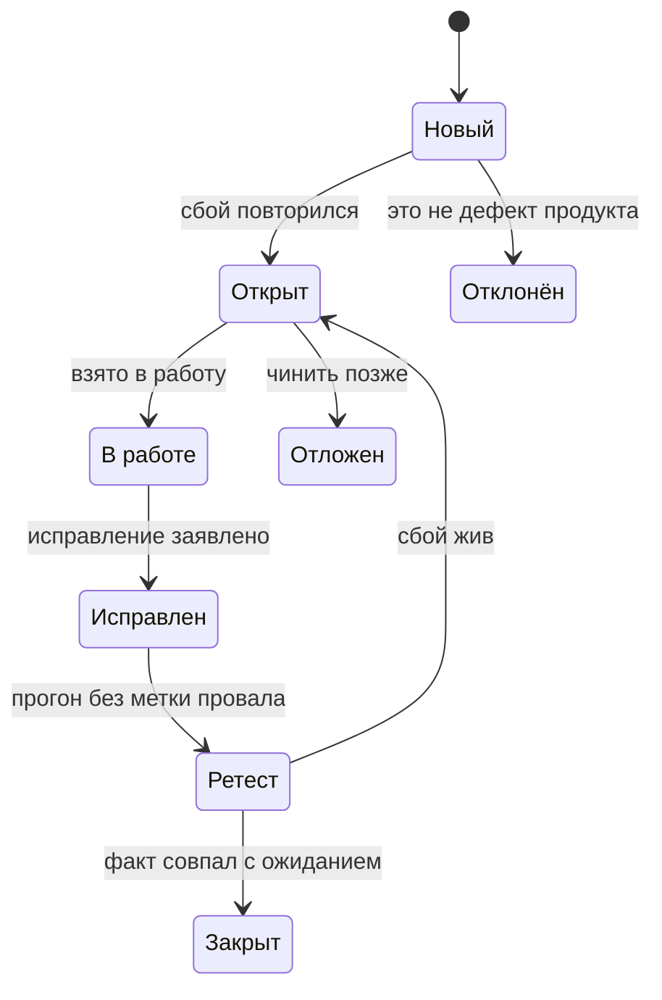
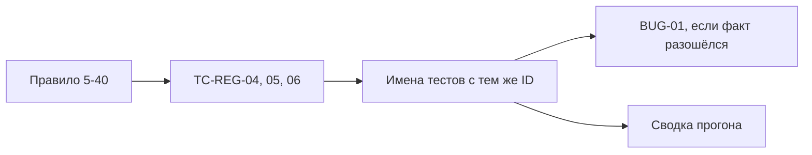

# Документация и управление тестированием

## Содержание

- [Что такое документация и управление тестированием](#что-такое-документация-и-управление-тестированием)
- [Стратегия и тест-план](#стратегия-и-тест-план)
- [Тест-кейс, сценарий и чек-лист](#тест-кейс-сценарий-и-чек-лист)
- [Баг-репорт](#баг-репорт)
- [Жизненный цикл дефекта](#жизненный-цикл-дефекта)
- [Трассируемость](#трассируемость)
- [Системы кейсов и трекеры](#системы-кейсов-и-трекеры)
- [Сравнение](#сравнение)
- [Как выбирать](#как-выбирать)
- [Как это проявляется в системе](#как-это-проявляется-в-системе)
- [Типичные ошибки](#типичные-ошибки)
- [Полезные ссылки](#полезные-ссылки)
- [Вопросы по теории](#вопросы-по-теории)

## Что такое документация и управление тестированием

Документация тестирования — записи, по которым проверку можно повторить, а сбой отличить от случайности. Управление тестированием — то, как эти записи живут: кто заводит дефект, когда кейс считается покрытым, какой прогон берёт какой набор.

Без записей автотест превращается в скрипт, понятный только автору в день написания. Идентификатор в имени, ожидание из правила и отчёт о дефекте связывают файлы `1.0`, `1.1`, `2.6`, `8.0` и `8.1`. Пометка из `0.1` здесь та же: курс держит базу, нужную автоматизации, и не заменяет отдельное обучение полному ручному документообороту.

На стенде запись особенно нужна, потому что часть «падений» ожидаема. `BUG-01` будет красным, пока сервер принимает короткий пароль. Если это не записано, красный прогон выглядит как поломка теста. Если записано слишком общо, новый дефект прячется в той же краске.

## Стратегия и тест-план

Стратегия тестирования — устойчивые решения о том, как в этом проекте вообще проверяют. Она меняется редко. Тест-план — план конкретного усилия: что входит, на каком стенде, когда прогон можно начать и когда его результат годится для вывода.

Для репозитория курса стратегия звучит коротко. Уровень — системный, API и UI, пирамида из `0.2`. Оракул — требование, не сегодняшний ответ стенда, как в `0.1`. Стек один, на выбор участника. Известный дефект продукта помечают, ожидание не подменяют. Нестабильный тест этой меткой не лечат. Нагрузка, доступность и сканер не смешиваются с десятиминутным прогоном API и UI.

Тест-план этого усилия уже конкретнее.

| Пункт плана | Решение в курсе |
| --- | --- |
| Объект | Образ `bkimminich/juice-shop:v20.4.0`, порт `3000`, `NODE_ENV=quiet` |
| Что входит | Кейсы блоков от API до headless-прогона, каждый со своим файлом |
| Что не входит | Правка сервера Juice Shop, чужие хосты, глубокое ручное тестирование |
| Вход | `GET /rest/admin/application-version` отвечает **200** и содержит поле `version` |
| Выход | У каждого обещанного кейса есть автотест, известные дефекты помечены, в отчёте нет секретов |
| Срок прогона | Полные API и UI в Chromium в CI — не дольше 10 минут |
| Сброс данных | Новый контейнер: база стенда создаётся заново при запуске |

План не дублирует шаги каждого кейса. Шаги живут в автотесте и в идентификаторе. План говорит, какой вывод можно сделать из зелёного, ожидаемо красного и неожиданно красного прогона.

## Тест-кейс, сценарий и чек-лист

Тест-кейс — одна проверка с предусловиями, шагами и ожидаемым результатом. Идентификатор имеет вид `TC-<ОБЛАСТЬ>-<NN>`. Области курса: `REG`, `AUTH`, `ACL`, `CART`, `ORDER`, `SEARCH`, `FEEDBACK`, `A11Y`, `SEC`, `MAIL`, `PERF`. Идентификатор стоит в начале имени теста: `TC-REG-01 регистрирует валидного покупателя`.

Сценарий — путь роли через несколько проверок. «Покупатель оформляет заказ яблочного сока» собирает корзину, адрес, доставку, оплату и подтверждение. Внутри сценария несколько кейсов, и падение одного не обязано красить остальные. Сценарий удобно рассказывать человеку. Кейс удобно запускать фильтром.

Чек-лист — список пунктов без подробных шагов. Он быстрый и плохо повторяется чужими руками. В курсе чек-лист уместен для разового прохода человека, например со скринридером. Ворота CI чек-лист не заменяет: у ворот должен быть кейс с ожиданием, которое раннер сравнивает сам.

| Запись | Насколько подробна | Подходит для |
| --- | --- | --- |
| Сценарий | Путь роли, несколько исходов | Объяснить покупку или регистрацию целиком |
| Тест-кейс | Шаги и одно ожидание | Автотест с идентификатором `TC-…` |
| Чек-лист | Пункты без полного сценария | Разовый человеческий проход |

Поля кейса, которые курс держит даже когда шаги спрятаны в код:

| Поле | Что записать |
| --- | --- |
| Идентификатор | `TC-REG-06` и короткое имя действия |
| Предусловия | Стенд поднят, учётки ещё нет, пароль нужной длины |
| Шаги | Инфинитив: отправить, открыть, проверить |
| Ожидание | Код, поля, текст правила |
| Теги | `api` или `ui`, плюс `smoke` или `regression`, когда это цель прогона |
| Дефект | `BUG-<NN>`, только если факт устойчиво расходится с ожиданием |

`TC-REG-06` по этим полям читается так. Предусловие — новая почта. Шаги — отправить регистрацию с паролем из 5 символов и отдельно с паролем из 40. Ожидание — **201** оба раза. Это разрешённые края из `0.3`, не описание бага.

## Баг-репорт

Баг-репорт — запись о дефекте, по которой другой человек повторяет сбой и видит, какое правило нарушено. Серьёзность (severity) говорит, насколько сильно сломан продукт. Приоритет (priority) говорит, насколько срочно это чинить. Это разные шкалы: тяжёлый дефект с обходным путём могут чинить после лёгкого, который блокирует завтрашний показ, и наоборот.

Шкала серьёзности в курсе такая.

| Серьёзность | Когда ставить | Пример |
| --- | --- | --- |
| Critical | Чужие данные или секрет утекают, либо основной сценарий невозможен без обхода | Вход инъекцией даёт токен администратора, `BUG-08` |
| Major | Важное правило нарушено, сценарий жив узким обходом или задет не весь путь | API принимает пароль из 4 символов, форма его ещё держит, `BUG-01` |
| Minor | Локальный сбой, покупка и вход возможны | Неверный текст второстепенной подсказки при верном коде |
| Trivial | Косметика, смысл сценария не страдает | Опечатка вне правила проверки |

Приоритет — High, Medium или Low. `BUG-01` при серьёзности Major получает High: правило пароля относится к защите учётки, даже если кнопка в браузере пока не даёт отправить форму. Утечка стека на неизвестном пути, `BUG-04`, тоже Major по ущербу сведениям, а приоритет Medium: покупка из-за неизвестного URL не встаёт. Шкалы нарочно можно расставить по-разному. Смешивать их в одно слово «важно» нельзя.

Поля отчёта фиксированы, чтобы `1.1` заполнял первый отчёт по одному шаблону.

| Поле | Содержание |
| --- | --- |
| Идентификатор | `BUG-<NN>` из общего списка дефектов стенда |
| Заголовок | Что нарушено, одной фразой |
| Стенд | Образ `bkimminich/juice-shop:v20.4.0`, `NODE_ENV=quiet`, порт `3000` |
| Кейсы | Идентификаторы `TC-…`, на которых дефект виден |
| Предусловия | Стенд отвечает на проверку версии |
| Шаги | Нумерованный инфинитив, без секретов встроенных учёток |
| Ожидание | Код и текст правила |
| Факт | Код и безопасный фрагмент тела |
| Серьёзность и приоритет | По шкалам выше |
| Вложения | Снимок или тело без токена, cookie `token`, полного JWT и хеша пароля |

Короткий образец на `BUG-01`. Заголовок: `POST /api/Users` принимает невалидный email, пароль вне диапазона 5–40 и несовпавший `passwordRepeat`. Шаги: отправить регистрацию новой почты с паролем из 4 символов и повтором того же пароля, затем повторить для длины 41, неверной почты и несовпавшего повтора. Ожидание: **400**. Факт: **201**. Это один дефект и несколько сбоев, как в `0.1`. Пароль администратора в образец не подставляют. Его берут из `.env` по документации Juice Shop, в тексте курса и в отчёте литералом он не нужен.

## Жизненный цикл дефекта

Жизненный цикл дефекта — допустимые состояния записи от появления до закрытия. Состояние отвечает на вопрос, можно ли ещё ждать этот сбой.

Диаграмма отделяет «ещё воспроизводится» от «уже заявлено исправленным». Закрытие стоит только после ретеста. Повторный сбой возвращает запись в открытые, а не оставляет её в закрытых с оговоркой в комментарии.

На учебном стенде участник сервер не чинит. Открытый дефект живёт меткой `known-issue` на тесте, который по-прежнему ждёт требование и ожидает падение. Состояние Deferred здесь честное: чинить будет не этот репозиторий. Когда образ начнёт отвечать **400** на короткий пароль, тот же тест без снятой метки станет неожиданно зелёным и должен покраснеть из-за метки. Это сигнал ретеста: снять `known-issue` и `BUG-01`, закрыть дефект. Пока метка висит, зелёный прогон всего набора врёт.

Нестабильный тест в этот цикл не кладут. Он падает через раз, причина может быть в самом тесте: гонка, общие данные, пауза по времени. Для него в `2.6` другой путь. Заводят запись, временно выключают тест ссылкой на запись (`test.fixme` или пропуск), чинят причину и возвращают. Тег `known-issue` для такой записи не используют. Пять подряд зелёных прогонов UI-набора — признак, что нестабильность не спрятана ретраями.

## Трассируемость

Трассируемость — возможность пройти от требования к кейсу, от кейса к автотесту и от упавшего автотеста к дефекту. Без этой цепочки отчёт «12 passed» не говорит, какое правило покрыто.

Диаграмма читается слева направо. Дырка на любом звене рвёт вывод. Есть правило и нет идентификатора — покрытие не посчитать. Есть тест без идентификатора в имени — сводка не склеится с планом. Есть красный прогон без `BUG-<NN>` — непонятно, дефект это продукта или ошибка теста.

То же правило в браузере продолжается кейсом `TC-REG-11`: длина 4 не активирует кнопку `Register`. Это второе звено того же требования, не дубль `TC-REG-04`. В матрице оба идентификатора стоят напротив одной строки «пароль 5–40». Покрытие считают по строкам требований, а не по числу функций `test`.

В сводке из `8.0` как раз видны доля пройденных, доля нестабильных, длительность, покрытие требований кейсами и открытые `BUG-xx`. Трассируемость делает эти числа расшифровкой, а не украшением.

## Системы кейсов и трекеры

Система управления тестированием (test management system, TMS) хранит кейсы, прогоны и связи с требованиями. Трекер хранит задачи и дефекты как работу команды. Репозиторий автотестов хранит исполняемую проверку. Путать три места значит либо потерять ожидание в комментарии к задаче, либо завести кейс, который никто не запускает.

| Место | Что хранит | Подходит для |
| --- | --- | --- |
| Репозиторий курса | Исполняемый тест, ID в имени, теги | Источник правды для CI |
| TestRail | Кейсы, прогоны, связь с требованиями | Команда, где кейсы ревьюят без чтения кода |
| Zephyr | Кейсы рядом с задачами Jira | Тот же контур, если работа уже в Jira |
| Qase | Кейсы и прогоны в отдельном сервисе | Небольшой контур вне репозитория |
| TestLink | Кейсы на своём сервере | Контур, который ходят разворачивать сами |
| qTest | Кейсы и отчётность в линейке Tricentis | Контур, где уже принят этот набор |
| Jira, YouTrack, Trello | Задачи и дефекты | Жизненный цикл `BUG-xx` и карантин нестабильных |

Курс не обязывает поднять TMS. Идентификатор в имени теста и идентификатор дефекта в метке уже дают минимальную трассируемость. Трекер подключают, когда дефект или карантин нужно вести как работу: состояние, исполнитель, срок. Trello выдерживает простой поток состояний из диаграммы выше. Jira и YouTrack удобнее, когда у дефекта поля серьёзности и приоритета и связь с прогоном. Ни один трекер не заменяет ожидание внутри теста: карточка «починить пароль» с фактическим **201** в описании легко начинает жить как новое требование.

Отчёт Allure, который собирают в `8.1`, показывает шаги, вложения и ссылки на `TC-…` и `BUG-…`. Это витрина прогона, а не второе хранилище кейсов. Источник идентификатора остаётся репозиторием.

## Сравнение

| Запись | Вопрос, на который отвечает | Подходит для |
| --- | --- | --- |
| Стратегия | Как в проекте проверяют вообще | Решения, общие для всех файлов курса |
| Тест-план | Что входит в это усилие и когда прогон годный | Вход, выход, границы стенда |
| Тест-кейс | Что именно сравнивает один автотест | `TC-…` в имени теста |
| Сценарий | Какой путь проходит роль | Связка кейсов заказа или регистрации |
| Чек-лист | Что не забыть при ручном проходе | Скринридер, разовая сверка |
| Баг-репорт | Какое правило нарушил стенд | `BUG-01` и остальные известные дефекты |
| Метка `known-issue` | Падение ожидаемо, дефект ещё открыт | Устойчивый дефект продукта |
| Карантин | Тест выключен, пока ищут причину мигания | Нестабильность, не дефект магазина |

## Как выбирать

1. По умолчанию кейс живёт рядом с автотестом: идентификатор в имени, теги на прогон, ожидание в проверках.
2. Баг-репорт заводят по шаблону этого файла, когда факт устойчиво расходится с правилом. Ожидание в тесте не переписывают.
3. Метку `known-issue` вешают только на такой дефект. Мигающий тест уходит в карантин со ссылкой на запись и без этой метки.
4. Чек-лист оставляют разовому проходу человека. Всё, что должно держать CI, оформляют кейсом.
5. TMS добавляют, когда кейсы читают люди без репозитория. До этого момента второй список кейсов не заводят: он разойдётся с именами тестов.
6. Трекер добавляют, когда у дефекта или карантина появляется исполнитель и состояние. Карточка ссылается на `BUG-<NN>` или на тест, а не подменяет их.

## Как это проявляется в системе

**Общие требования к API-автотестам (`1.0`).** Файл вводит идентификатор в имени и теги `api`, `smoke`, `regression`, `known-issue`. Здесь же механизм ожидаемого падения: тест проверяет требование, метка объясняет красный цвет. План прогона опирается на вход стенда по **200** и на отказ сразу, если обязательной переменной окружения нет.

**Регистрация и вход (`1.1`).** Первый баг-репорт курса заполняют по шаблону этого файла для `BUG-01`. Кейсы `TC-REG-04`, `TC-REG-05`, `TC-REG-07` и `TC-REG-08` остаются с ожиданием **400**. Отчёт перечисляет четыре входа одного дефекта, а не четыре разных «желания сервера».

**Стабильность и отладка UI-тестов (`2.6`).** Карантин отделён от жизненного цикла продуктового дефекта. Нестабильный тест получает запись и временное выключение со ссылкой. Тег `known-issue` на него не вешают. Набор UI обязан пройти пять повторов подряд без падений, ретрай не считается починкой.

**Общие требования к отчётности (`8.0`).** Сводка для разработчика, автора тестов и руководителя собирается из тех же идентификаторов: доля прохождения, доля нестабильных, длительность, покрытие требований кейсами, открытые `BUG-xx`. Без трассируемости сводка не из чего собрать, кроме голого числа тестов.

**Отчёты Playwright и Allure (`8.1`).** В отчёт попадают шаги, вложения без секретов и ссылки на `TC-…` и `BUG-…`. Серьёзность дефекта можно показать полем отчёта, источник шкалы — этот файл. История прогонов не заменяет трекер: она показывает, что метка всё ещё честно красная.

## Типичные ошибки

| Что видно | Причина и исправление |
| --- | --- |
| Тест называется «регистрация» без `TC-REG-01` | Идентификатор нельзя склеить со сводкой. Поставить ID в начало имени |
| В ожидании записан фактический **201** короткого пароля | Репорт не заведён, оракул испорчен. Вернуть **400** и `BUG-01` |
| Серьёзность и приоритет записаны одним словом | Шкалы смешаны. Развести ущерб и срочность |
| Четыре входа `BUG-01` заведены как четыре несвязанных дефекта | Один изъян размножен. Один идентификатор, несколько шагов |
| В отчёт вложен полный JWT | Вложение стало утечкой. Оставить код, поля без секрета и `BUG-<NN>` |
| Дефект закрыт, потому что UI-кнопка неактивна | Ретест API не делали. `BUG-01` живёт на `POST /api/Users` |
| Мигающий тест помечен `known-issue` | Цикл дефекта перепутан с карантином. Запись и временное выключение, метку не ставить |
| Зелёный тест с меткой ожидаемого падения оставлен зелёным | Ретест проигнорирован. Снять метку, раз факт совпал с правилом |
| Чек-лист из десяти пунктов объявлен воротами CI | Повторить прогон чужими руками нельзя. Нужны кейсы с ожиданием |
| В TMS и в репозитории разные шаги одного `TC-REG-06` | Два источника правды. Пока нет необходимости в TMS, кейс живёт в коде |
| Карточка трекера говорит «сервер так и задумано» | Карточка подменила требование. Ожидание держать в тесте, карточку связать с `BUG-<NN>` |
| План обещает весь каталог из 46 товаров | Граница усилия размыта. Сценарий на представителе, края — отдельными кейсами |

## Полезные ссылки

- [ISTQB — Glossary](https://glossary.istqb.org/) — определения test case, test plan, test strategy, defect report и traceability.
- [TestRail](https://www.testrail.com/) — пример TMS, где кейсы и прогоны живут отдельно от репозитория.
- [TestLink](https://testlink.org/) — система кейсов, которую можно развернуть у себя.
- [Qase](https://qase.io/) — сервис кейсов и прогонов вне трекера задач.
- [Atlassian — Jira](https://www.atlassian.com/software/jira) — трекер, в котором ведут дефект и его состояния.
- [JetBrains — YouTrack](https://www.jetbrains.com/youtrack/) — трекер задач и дефектов с полями приоритета.
- [Trello](https://trello.com/) — простой поток карточек, если хватает состояний без тяжёлой схемы.
- [Allure Report](https://allurereport.org/) — витрина прогона со шагами и ссылками, не замена хранилищу кейсов.

## Вопросы по теории

1. Почему `TC-REG-01` стоит в имени теста, а не только в комментарии или в карточке трекера?
2. Чем серьёзность `BUG-01` отличается от его приоритета?
3. Что произойдёт с прогоном, если дефект исправят, а метку `known-issue` не снимут?
4. Зачем тест-план, если шаги уже спрятаны в автотестах?
5. Чем карантин нестабильного теста в `2.6` отличается от метки известного дефекта?
6. Как трассируемость связывает правило «пароль 5–40» с кейсами API и с кнопкой `Register`?
7. Когда хватает чек-листа, а когда тот же пункт нужно поднимать до тест-кейса?
