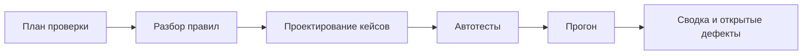
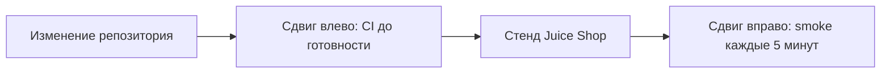

# QA в жизненном цикле разработки

## Содержание

- [Что такое QA в жизненном цикле разработки](#что-такое-qa-в-жизненном-цикле-разработки)
- [Модели разработки](#модели-разработки)
- [Жизненный цикл тестирования](#жизненный-цикл-тестирования)
- [Сдвиг влево и сдвиг вправо](#сдвиг-влево-и-сдвиг-вправо)
- [TDD, BDD и ATDD](#tdd-bdd-и-atdd)
- [Причина сбоя и готовность задачи](#причина-сбоя-и-готовность-задачи)
- [Отрезок регистрации целиком](#отрезок-регистрации-целиком)
- [Сравнение](#сравнение)
- [Как выбирать](#как-выбирать)
- [Как это проявляется в системе](#как-это-проявляется-в-системе)
- [Типичные ошибки](#типичные-ошибки)
- [Полезные ссылки](#полезные-ссылки)
- [Вопросы по теории](#вопросы-по-теории)

## Что такое QA в жизненном цикле разработки

Жизненный цикл разработки — порядок, в котором из правила появляется работающий магазин и в котором этот магазин потом сопровождают. Место проверки в этом порядке решает, насколько дорого обходится `BUG-01`: в первом кейсе регистрации или после того, как на неверном **201** уже построены фикстуры и интерфейс.

Файл собирает модели порядка, отдельный цикл именно тестирования, ранний и поздний прогон, три способа писать ожидание до кода и разбор причины. Это применяется в `1.6`, `2.6`, `9.2` и `10.1`. Как и весь раздел основ, файл не заменяет углублённое обучение ручному тестированию: он нужен, чтобы автотест занимал понятное место в работе, а не «этап в конце, если останется время».

## Модели разработки

Модель — договорённость, когда пишут правила, когда код и когда сравнивают поведение с правилом. На одном и том же Juice Shop разные модели по-разному относятся к уже известным дефектам.

Каскад (waterfall) выстраивает работу одним проходом: сначала все правила, потом устройство, потом код, потом проверка, потом выпуск. Проверка оказывается фазой у двери. Если короткий пароль впервые сравнивают с правилом в этой фазе, клиент регистрации уже привык к **201**. Каскад понятен на короткой задаче с неподвижным правилом. На стенде, где дефекты вскрываются кейсами, фаза «проверим всё потом» откладывает `BUG-01` до самого дорогого момента.

V-образная модель ставит напротив каждой ступени создания свою ступень проверки. Напротив правил — приёмка сценария. Напротив устройства — системные и стыковые проверки. Напротив кода модулей — модульные тесты тех, кто этот код пишет. Буква V нужна как картинка пар: у правила «пароль 5–40» сразу есть пара `TC-REG-04`, а не обещание проверить пароль когда-нибудь в конце. Участник не пишет модули магазина, поэтому левая нижняя часть V ему не принадлежит. Правая, приёмочная и системная, принадлежит репозиторию автотестов.

Спираль идёт витками. Каждый виток смотрит на самый болезненный риск, делает кусок и оценивает результат. Первый виток курса: контейнер жив, `GET /rest/admin/application-version` даёт **200**. Следующий: регистрация и края пароля, потому что без покупателя нет набора, а `BUG-01` уже сидит в этой области. Дальше заказ и сумма 4.97, затем чужие данные и инъекция. Спираль не отменяет пары «правило — кейс». Она выбирает, какую пару брать следующей. Очередь риска из `0.3` — как раз вопрос витка.

Гибкая разработка (agile) делит работу на короткие отрезки. В конце отрезка есть работающий прирост, а проверка входит внутрь отрезка, а не стоит за ним. Четыре имени вокруг этого слова легко смешать, хотя они про разное.

| Имя | Что добавляет к короткому отрезку | Где это видно на курсе |
| --- | --- | --- |
| Scrum | Отрезок фиксированной длины, список работы, обзор прироста в конце | Цель отрезка «кейсы регистрации `TC-REG-01`…`TC-REG-08`» |
| Kanban | Поток без обязательного ритма и предел одновременно открытой работы | Колонки дефекта из `0.4`: не копить пачку в состоянии «в работе» |
| XP | Инженерные привычки: маленькие поставки, тест рядом с кодом, общая ответственность за качество | Ожидание в автотесте, а не в устной договорённости |
| SAFe | Общий календарь нескольких команд, которые выпускают вместе | Одному репозиторию и одному участнику эти слои не нужны |

Scrum называет фиксированный отрезок спринтом, список работы — бэклогом, результат спринта — приростом. Роли там разделены: кто заказывает ценность, кто держит рамки процесса, кто делает прирост. В курсе рядом с участником есть ментор, и это не перевод всех ролей Scrum на двоих людей. Имена нужны, чтобы читать чужой процесс и не назвать любой список задач «скрамом».

Kanban ограничивает число карточек в работе. Если в колонке «в работе» уже две записи дефектов, третью не начинают, пока одна не сдвинется к ретесту. Так каскад из десятка полуразобранных `BUG-xx` не прячет тот единственный, который блокирует фикстуру.

XP (extreme programming) — набор привычек маленькой команды. Из него в курс переходит главная: проверка живёт рядом с кодом и запускается часто. Парное программирование и игра в планирование здесь не вводятся.

SAFe описывает, как много команд стыкуют короткие отрезки в общий интервал планирования. Слово нужно, чтобы схема крупной организации не выглядела отдельным видом теста. Репозиторий автотестов Juice Shop такой схемы не строит.

## Жизненный цикл тестирования

Жизненный цикл тестирования (software testing life cycle, STLC) — порядок самой проверки, его не путают с моделью разработки. Разработка отвечает, когда появляется код. STLC отвечает, когда появляется кейс, прогон и вывод.

Диаграмма идёт от договорённости к выводу. Пропуск разбора правил приводит к тому, что автотест сразу копирует ответ стенда. Пропуск сводки оставляет открытые `BUG-xx` невидимыми на фоне числа passed.

| Шаг STLC | Что делают | Куда это ложится в курсе |
| --- | --- | --- |
| Планирование | Стратегия, границы, вход и выход | `0.4`, общие правила `1.0` и `2.0` |
| Анализ | Сверить правило с фактом стенда | Список `BUG-01` … `BUG-13` |
| Проектирование | Классы, границы, роли, состояния | `0.3`, идентификаторы `TC-…` |
| Реализация | Написать автотест на одном стеке | Файлы практики по порядку номеров |
| Выполнение | Прогнать локально и в CI | `1.6`, пайплайн `10.1` |
| Завершение | Сводка, открытые дефекты, следы прогона | `8.0`, `8.1` |

На анализе как раз возникает известный дефект. Правило говорит **400**, стенд отвечает **201**, запись получает `BUG-01`. Реализация не «чинит» анализ тем, что подставляет **201** в ожидание. Выполнение тогда честно красное там, где стоит метка, и честно зелёное на `TC-REG-06`, где длины 5 и 40 стенд принимает.

Завершение не ждёт идеального магазина. Сводка имеет право сказать: прогон годный, открыты такие-то дефекты, метки на месте. Годный прогон и пустой список дефектов — разные предложения.

## Сдвиг влево и сдвиг вправо

Сдвиг влево (shift-left) переносит сравнение с правилом ближе к началу работы. Слева на обычной шкале времени стоят правила и первые коммиты, справа — выпуск и жизнь стенда. Раньше поймать расхождение дешевле, чем переписывать клиентов, которые уже завязаны на неверный код.

В курсе левый сдвиг — это прогон в CI на каждом изменении репозитория, а не ночная ручная проверка перед разговором с ментором. Отсутствие `ADMIN_PASSWORD` или `ACCOUNTANT_PASSWORD` роняет прогон сразу, с понятным текстом, а не в середине сценария заказа. Готовность Juice Shop ждут опросом `GET /rest/admin/application-version`, потому что у образа нет оболочки и встроенная проверка здоровья контейнера с curl не работает. Это тоже ранний сигнал: набор не начинает заказ на мёртвом порте.

Сдвиг вправо (shift-right) продолжает наблюдение после того, как набор уже влит и стенд живёт своей жизнью. Практический вид — синтетический прогон: тот же короткий smoke по расписанию, на уже поднятом стенде, с тревогой, если жизнь оборвалась. В `9.2` контейнер `synthetic` запускает smoke каждые 5 минут и отдаёт в Pushgateway метрики `aqa_synthetic_success` и `aqa_synthetic_duration_seconds`. Тревога в Grafana поднимается после двух неуспешных прогонов подряд. Проверка живости адреса `/rest/admin/application-version` рядом делает blackbox exporter. Для постоянного стенда тот же смысл у расписания `.github/workflows/synthetic.yml`.

Диаграмма ставит CI левее объявления «задача готова», а расписание — правее уже поднятого стенда. Оба прогона могут вызывать один и тот же smoke. Разница в моменте, а не в названии тега.

Левый сдвиг не обещает, что код Juice Shop пишут после тестов участника. Сервер уже собран. Сдвиг относится к репозиторию автотестов и к решению о готовности: ветку не считают готовой, пока пайплайн не показал результат. Правый сдвиг не заменяет левый. Ночной синтетический прогон не видит поломку в ту минуту, когда её внесли. CI не видит, что стенд умер в субботу, когда коммитов не было.

## TDD, BDD и ATDD

Три сокращения про одно желание: ожидание появляется раньше, чем его подгоняют под случайный факт. Различаются они тем, чьё это ожидание и что именно пишут первым.

Разработка через тесты (test-driven development, TDD) идёт коротким циклом. Сначала проверка падает, потому что поведения ещё нет. Потом код доводят до зелёного. Потом убирают лишнее, не меняя результат. Цвета цикла так и называют: красный, зелёный, рефакторинг. Цикл относится к коду, который участник пишет сам. Метод клиента `login` можно начать с падающей проверки «верный вход возвращает token, bid и umail», затем заполнить клиент, пока проверка не станет зелёной. Сервер Juice Shop этим циклом не переписывают. Подставить в проверку фактический **201** короткого пароля — не TDD, а отказ от ожидания.

Разработка через примеры поведения (behavior-driven development, BDD) записывает ожидание языком, который понимают и автор правила, и автор теста. Часто это три части: дано состояние, когда действие, тогда результат. Общая нотация таких примеров — Gherkin. Курс не требует отдельных файлов примеров. Имя `TC-AUTH-02` и ожидание **401** с текстом `Invalid email or password.` уже есть пример поведения. Файл примеров имеет смысл, когда пример читают люди, которые не открывают репозиторий. Второй список тогда приходится склеивать с идентификаторами, иначе получится два источника правды, как с лишней TMS в `0.4`.

Разработка через приёмочные проверки (acceptance test-driven development, ATDD) договаривается о приёмочном примере до реализации. Ближе всего к курсу именно это: ожидаемый код записан из правила, стенду разрешено быть неправым, метка хранит расхождение. Реализация магазина уже существует, поэтому «до кода» здесь значит «до того, как факт стенда признают правилом». `TC-ORDER-01` ждут сумму 4.97 и пустую корзину, даже если какой-то промежуточный ответ уже зелёный. Приёмка из `0.2` как раз про законченный результат, а не про первый успешный код.

## Причина сбоя и готовность задачи

Разбор причины (root cause analysis, RCA) ищет изъян, из-за которого сбой повторяется, а не ближайший симптом. Пять вопросов «почему» — простой вид такого разбора. Останавливаются, когда следующий ответ уже действие, которое убирает повторение.

Мигающий UI-тест часто выглядит как «кнопка иногда не нажалась». Почему клик промахнулся: элемент ещё ехал анимацией. Почему тест этого не переждал: стоит пауза фиксированной длины. Почему пауза: ожидание привязали ко времени, а не к состоянию элемента. Почему это всплыло в CI: локально машина быстрее, пауза успевала. Действие — ждать условие, паузу `waitForTimeout` или `sleep` не оставлять. Ретрай два раза в CI маскирует симптом и не является причиной. Локально ретраев нет как раз для того, чтобы мигание было видно.

Другой разбор про данные. Тест падает только в параллели. Почему: второй воркер регистрирует ту же почту. Почему почта совпала: в ней нет `RUN_ID` и номера воркера. Правило адреса `aqa.<RUN_ID>.<номер воркера>.<порядковый номер>@example.test` как раз разделяет воркеров. Домен `.test` никуда не доставляется. Починка общим `sleep` между тестами причину не трогает.

Продуктовый дефект разбирают до записи, но не чинят внутри теста. `BUG-02`: повторное добавление того же товара в ту же корзину даёт **500** и `stack`. Почему **500**: сервер не обрабатывает повтор как отказ клиента. Ожидание остаётся **400** или **409** без внутренних деталей. Причина лежит в образе. Репозиторий хранит метку, а не патч сервера.

Определение готовности (definition of done) — список, по которому задачу можно считать законченной. Зелёный счастливый путь на одной машине в список не входит.

| Пункт готовности | Как проверить |
| --- | --- |
| Обещанные `TC-…` есть, ID в имени | Фильтр по идентификатору находит тест |
| Известный дефект помечен `known-issue` и `BUG-<NN>` | Падение ожидаемое, ожидание совпадает с правилом |
| Нестабильность не спрятана меткой дефекта | Пять подряд прогонов UI без падения, карантин отдельно |
| В отчёте нет секретов | Нет пароля, cookie `token`, полного JWT, хеша из `BUG-09` |
| Прогон в бюджете | API и UI в Chromium не дольше 10 минут, воркеров в CI — 2 |
| Нет фиксированных пауз | Ожидание завязано на состояние, таймаут теста 30 с, проверки — 5 с |
| Ретраи по среде | 2 в CI, 0 локально |

Задачу регистрации нельзя закрыть одним `TC-REG-01`. Края и `BUG-01` входят в ту же готовность, иначе определение описывает демонстрацию, а не правило.

## Отрезок регистрации целиком

Короткий отрезок собирает модели в одну последовательность. Предмет отрезка — регистрация покупателя. Каскад отложил бы сравнение с правилом до отдельной фазы. Здесь сравнение стоит внутри отрезка, парами, как в V-модели, а порядок пар берёт вопрос спирали: что больнее пропустить.

| Шаг отрезка | Действие | Признак, что шаг сделан |
| --- | --- | --- |
| Анализ | Сверить правило 5–40 с `POST /api/Users` | Записан `BUG-01`, ожидание осталось **400** |
| Проектирование | Назвать классы и края | Есть `TC-REG-03` … `TC-REG-08`, середина диапазона не раздута |
| Реализация | Написать автотест на выбранном стеке | ID стоит в имени, метка `known-issue` только на расхождении |
| Выполнение | Прогнать задание `api` в CI | Нет секрета в среде — прогон встал сразу; стенд дождались опросом версии |
| Завершение | Собрать сводку | Открытый `BUG-01` виден, `TC-REG-06` зелёный |
| Готовность | Сверить список | Края, метка, бюджет времени, отсутствие секретов в отчёте |

Валидный путь `TC-REG-01` в этой таблице не потерян: без **201** на хорошей учётке фикстура покупателя не из чего родиться. Он стоит рядом с краями, а не вместо них. Следующий отрезок по риску — корзина и сумма, не снимок формы. Снимок не запрещён, он просто не блокирует вывод «регистрация как задача проверки закрыта».

Тот же отрезок показывает, чего в курсе нет. Участник не ведёт стендап и не рисует программу нескольких команд. Ментор смотрит статус, пайплайн показывает факт. Scrum здесь узнаётся по законченному приросту — набор регистрации, который можно прогнать, — а не по названиям встреч.

Правый сдвиг в этот отрезок не входит. Пока стенд поднимают ради прогона и гасят, субботняя смерть ничего не значит. Когда стенд оставляют жить, к готовности добавляется smoke по расписанию. Путать это с незакрытым `BUG-01` не стоит: синтетика отвечает, жив ли магазин, а не принял ли он пароль из четырёх символов.

## Сравнение

| Модель или приём | Что решает | Подходит для |
| --- | --- | --- |
| Каскад | Один проход и проверка фазой в конце | Короткое неподвижное правило, не набор на живом стенде с дырами |
| V-модель | Пара ступени создания и ступени проверки | Правило пароля напротив `TC-REG-04` |
| Спираль | Какой риск брать следующим витком | Очередь: стенд, регистрация, заказ, доступ |
| Scrum | Ритм и обзор прироста | Отрезок с понятной целью вроде блока регистрации |
| Kanban | Предел незавершённой работы | Поток дефектов и карантина |
| XP | Привычки вокруг кода | Тест рядом с клиентом, частый прогон |
| SAFe | Стыковка многих команд | Чужой крупный процесс, не этот репозиторий |
| Сдвиг влево | Проверка до объявления готовности | CI на изменении, ранний отказ из-за среды |
| Сдвиг вправо | Наблюдение живого стенда | Smoke каждые 5 минут |
| TDD | Цикл красный — зелёный на своём коде | Клиент и фикстура, не патч Juice Shop |
| ATDD | Приёмочное ожидание из правила | Сумма заказа и код регистрации до веры в факт |

## Как выбирать

1. Для курса рабочий порядок — короткий отрезок: правило, кейсы, автотест, прогон в CI. Это гибкая разработка в миниатюре и пара из V-модели одновременно.
2. Фазу «проверим в конце» не брать за основу. На неверном коде успеха успевают построиться следующие файлы.
3. Следующий кусок выбирать по риску и по зависимости набора: сначала путь, без которого нет покупателя, рядом — уже известная дыра.
4. TDD применять к коду репозитория автотестов. Ожидание сервера Juice Shop под факт не подгонять: это не цикл TDD.
5. Сдвиг влево держать воротами готовности. Сдвиг вправо добавлять, когда стенд остаётся поднятым и его смерть нужно увидеть без нового коммита.
6. Готовность задачи сверять со списком, а не с одним зелёным сценарием на локальной машине.

## Как это проявляется в системе

**Запуск автотестов в CI (`1.6`).** Сдвиг влево на практике. Workflow `.github/workflows/tests.yml`, задание `api`. Juice Shop поднимается сервисом, готовность ждут отдельным опросом версии, потому что образ distroless не даёт curl внутри health-check. Секреты `ADMIN_PASSWORD` и `ACCOUNTANT_PASSWORD` приходят из секретов CI. Нет переменной — прогон останавливается сразу. Ретраи и воркеры берутся из общих настроек: 2 и 2 в CI.

**Стабильность и отладка UI-тестов (`2.6`).** Разбор причины мигания. Гонка, общие данные, анимация, порядок тестов, время и сеть — типичные «почему», и каждое чинится своим действием. Ретрай и статус flaky показывают симптом. Карантин со ссылкой на запись выключает тест, пока причина не найдена. Пять повторов подряд без падения — пункт готовности UI-набора.

**Синтетический мониторинг (`9.2`).** Сдвиг вправо. Smoke по расписанию, метрики успеха и длительности, тревога после двух неуспехов подряд, проверка версии снаружи. Тот же приём для постоянного стенда — workflow с расписанием. Это наблюдение жизни, а не замена кейсов регистрации.

**Headless в контейнере и CI (`10.1`).** Левый сдвиг исполняется одинаково на машине участника и в контейнере без окна. Итоговый пайплайн собирает задания `api`, `ui` двумя шардами, `a11y`, `security`, `perf-smoke` и `report`. Готовность ветки читают по этому пайплайну. Локальный один браузер с окном остаётся способом разобрать падение, а не определением готового.

## Типичные ошибки

| Что видно | Причина и исправление |
| --- | --- |
| `BUG-01` всплывает, когда фикстуры уже ждут **201** на любом пароле | Проверку оставили фазой в конце. Края пароля входят в первый отрезок регистрации |
| Любой список задач называют Scrum | Нет ни ритма, ни прироста. Имя оставить для отрезка с обзором результата |
| В работе двадцать дефектов сразу | Предела потока нет. Ограничить колонку и довести запись до ретеста |
| Ожидание клиента скопировали с ответа стенда и назвали это TDD | Цикл потерял красный шаг на правиле. TDD оставить коду репозитория, дефект пометить |
| Файл примеров Gherkin расходится с именем теста | Два источника правды. Пока пример читают в репозитории, идентификатор живёт в тесте |
| Мигающий клик лечат третьим ретраем | Симптом принят за причину. Разобрать ожидание состояния, паузу убрать |
| Субботняя смерть стенда обнаруживается в понедельник по CI | Правого сдвига нет. Smoke по расписанию и тревога после двух неуспехов |
| CI зелёный, стенд к утру пустой, и это никто не видит | Левый сдвиг не наблюдает простой. Добавить синтетический прогон |
| Задача закрыта одним успешным входом | Определение готовности подменено демонстрацией. Сверить список: края, метки, секреты, бюджет времени |
| Пайплайн гоняет только UI на машине автора | `10.1` не выполнен. Нужны задания API, UI, доступности, безопасности, короткой нагрузки и отчёта |
| curl в health-check контейнера Juice Shop | У образа нет оболочки. Готовность ждать внешним опросом версии |

## Полезные ссылки

- [ISTQB — Glossary](https://glossary.istqb.org/) — определения test-driven development, shift-left и связанных терминов жизненного цикла проверки.
- [Scrum Guides — The Scrum Guide](https://scrumguides.org/scrum-guide.html) — спринт, бэклог, прирост и роли в первоисточнике Scrum.
- [Scaled Agile — SAFe](https://scaledagileframework.com/) — как короткий отрезок команды стыкуют в общий интервал нескольких команд.
- [Kanban University](https://kanban.university/) — предел незавершённой работы и поток, из которых берётся Kanban в этом файле.
- [Martin Fowler — Test-Driven Development](https://martinfowler.com/bliki/TestDrivenDevelopment.html) — цикл красный, зелёный, рефакторинг на коде, который пишет автор теста.
- [Playwright — Continuous Integration](https://playwright.dev/docs/ci) — как прогон в CI становится ранней проверкой, а не ручным шагом перед сдачей.

## Вопросы по теории

1. Почему прогон в CI называют сдвигом влево, хотя сервер Juice Shop уже написан?
2. Чем TDD клиента `login` отличается от подстановки фактического **201** в кейс короткого пароля?
3. Что произойдёт с мигающим тестом, если его единственной починкой оставить ретраи?
4. Зачем smoke каждые пять минут, если тот же smoke уже есть в CI?
5. Как V-модель видна в паре «пароль 5–40» и `TC-REG-04`?
6. Чем определение готовности регистрации отличается от одного зелёного `TC-REG-01`?
7. Почему Scrum, Kanban, XP и SAFe не являются четырьмя разными видами тестирования?
