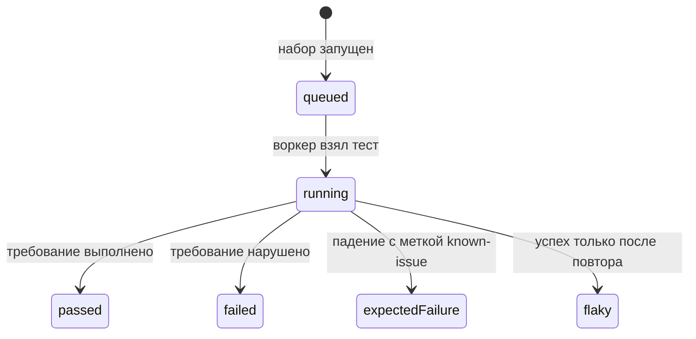

# Общие требования к API-автотестам

## Содержание

- [Теория](#теория)
  - [Ситуация](#ситуация)
  - [Модель](#модель)
  - [Понятия и связь с автоматизацией тестирования](#понятия-и-связь-с-автоматизацией-тестирования)
  - [Зоны ответственности](#зоны-ответственности)
  - [Пример](#пример)
  - [Типичные сбои](#типичные-сбои)
  - [Полезные ссылки](#полезные-ссылки)
  - [Вопросы по теории](#вопросы-по-теории)
- [Практическое задание](#практическое-задание)
  - [1.1 Общее](#11-общее)
  - [1.2 Сценарии](#12-сценарии-user-stories)
  - [1.3 Контракт](#13-контракт)
  - [1.4 Ошибки и ограничения](#14-ошибки-и-ограничения)
  - [1.5 Аудит](#15-аудитлоги)
  - [1.6 Нефункциональные требования](#16-нефункциональные-требования)

# Теория

## Ситуация

Набор тестов запускает API-прогон против Juice Shop. Дальше возможен один из исходов: стенд отвечает **200** и в теле есть поле `version`, стенд отвечает другим кодом, соединение со стендом не устанавливается, обязательный секрет не задан и прогон останавливается до тестов, проверка известного дефекта завершается ожидаемым падением (`known-issue`) либо дефект уже исправлен, а метка снята не была, и прогон падает.

Отдельная разработка не нужна: достаточно запущенного контейнера Juice Shop и команды `npx playwright test --grep @api` (`pytest -m api`, `dotnet test --filter Category=api`).

## Модель

В прогоне участвуют тест, чтение окружения, базовый `ApiClient`, стенд Juice Shop и отчёт раннера. Тест решает, какой запрос отправить. Решение о прохождении принимает оракул теста — требование, а не текущий ответ стенда.

Стенд поднимается одной командой. Новый контейнер получает пустую базу: так устроен полный сброс, пока API не удаляет пользователя. `NODE_ENV=quiet` убирает приветственный баннер, уведомления о челленджах и подсказки. Порт — `3000`.

`docker run --rm -p 3000:3000 -e NODE_ENV=quiet bkimminich/juice-shop:v20.4.0`

Автотест читает `BASE_URL` и через `ApiClient` вызывает `GET /rest/admin/application-version`. Нет соединения — прогон останавливается. Код **200** и поле `version` позволяют сверить ответ с требованием до регистрации и заказа. Иначе падение сценария смешивается с выключенным стендом.



Переход в `passed` значит, что проверки совпали с требованием. Переход в `failed` — требование нарушено и метки нет. Переход в `expectedFailure` идёт вместе с тегом `known-issue` и идентификатором `BUG-<NN>`. Состояние `flaky` разбирает `2.6`.

Возможный набор полей (схема может быть и другой):

| `application-version` | Описание |
| --- | --- |
| `version` | непустая строка версии приложения в теле **200** |

Файл не вводит пользователя, товар, корзину и заказ. Эти сущности стенда используются начиная с `1.1`, `1.2` и `1.5`. Точную строку `version` автотест не сравнивает с `20.4.0`: образ уже выбран командой запуска, а проверка смотрит код **200** и наличие поля.

## Понятия и связь с автоматизацией тестирования

### API-автотест

Браузер для такой проверки не нужен. Программа сама отправляет HTTP-запрос и читает код, заголовки и тело. Этот приём называют API-автотестом. На Juice Shop им проверяют служебный адрес версии, а дальше — регистрацию, корзину и заказ. В пирамиде из `0.2` это системная проверка: выше модульной и ниже полного обхода экранов. В контракте тест называет ожидаемый код и поля.

### Оракул

Нужен независимый источник истины: откуда тест знает, какой ответ правильный. Этот источник называют оракулом. На Juice Shop оракул API-теста — требование к операции, записанное в кейсе `TC-<ОБЛАСТЬ>-<NN>`. Если стенд однажды ответил **201** на короткий пароль, это наблюдение не становится нормой. Норма остаётся той, что записана у формы: пароль короче 5 символов сервер отклоняет. В контракте ожидаемый код и текст берутся из требования. Расхождение с фактом оформляют известным дефектом, ожидание в тесте остаётся прежним.

### Базовый клиент

Один и тот же адрес не стоит собирать в каждом тесте заново: легко забыть базовый URL или заголовок. Общий объект, который отправляет запрос и возвращает ответ целиком, называют базовым `ApiClient`. На Juice Shop он ходит на `BASE_URL`, по умолчанию `http://localhost:3000`, и отдаёт тесту статус, заголовки и тело. Проверок внутри клиента нет: негативный тест сам решает, что **401** — ожидаемый исход, а не поломка транспорта. В контракте сигнатура клиента возвращает ответ целиком. Разделение на `AuthClient`, `UsersClient` и остальные клиенты — задача `1.4`.

### Идентификатор и тег

Когда падений много, нужно сразу видеть, какой сценарий сломался и какой набор запускать отдельно. Для этого у теста есть идентификатор кейса и тег. Идентификатор стоит в начале имени: `TC-REG-01 регистрирует валидного покупателя`. Тег `api` относит тест к этому блоку. На Juice Shop тот же механизм помечает `smoke` и `regression`. В TypeScript тег пишется как `@api` и выбирается командой `--grep @api`. В Python маркер называется `api`, а дефис в имени маркера заменяется на `_`, поэтому `known-issue` становится `known_issue`. Запуск — `pytest -m api`. В C# категория задаётся атрибутом `[Category("api")]`, запуск — `--filter Category=api`. В контракте у каждого теста блока есть тег `api` и, когда появляется кейс, идентификатор в имени.

### Известный дефект

Стенд учебного приложения иногда нарушает собственное правило, и это уже зафиксировано. Тест всё равно проверяет правило. Падение, которого ждут, пока дефект жив, помечают тегом `known-issue` и идентификатором `BUG-<NN>`. На Juice Shop v20.4.0 такой список ведётся в `1.1`, `1.3` и `1.5`. Если дефект исправят, а метку забудут снять, тест станет красным: ожидаемое падение не случилось. В контракте метка ссылается на конкретный `BUG-<NN>`. Для нестабильных тестов она запрещена. Их путь — тикет и временный пропуск со ссылкой, это разбирает `2.6`.

В TypeScript тест получает `tag: ['@api', '@known-issue']`, аннотацию `annotation: { type: 'issue', description: 'BUG-06' }` и вызов `test.fail()`. В Python рядом стоят `@pytest.mark.known_issue` и `@pytest.mark.xfail(strict=True, reason="BUG-06")`. Параметр `strict=True` превращает неожиданный успех в падение. В C# ставятся `[Category("known-issue")]` и `[Property("issue", "BUG-06")]`, а тело выполняется внутри `KnownIssue.ExpectFailureAsync`. Вспомогательный метод ловит `AssertionException` и `PlaywrightException`. Если исключения не было, он вызывает `Assert.Fail` с текстом `BUG-06 больше не воспроизводится: снимите метку known-issue`.

### Сравнение

Подробно в этом блоке используется Playwright: один `APIRequestContext` на тест, общий `baseURL` и тот же отчёт, что позже получат UI-тесты. Остальные инструменты закрывают другие входы в ту же задачу.

| Инструмент | Подходит для |
| --- | --- |
| Playwright `APIRequestContext` | API и UI в одном репозитории и одном отчёте |
| Postman и Newman | коллекции запросов и их прогон отдельной командой |
| REST Assured | HTTP-проверки в Java-проекте |
| Karate | сценарии на собственном языке поверх HTTP |
| SoapUI | проверки SOAP и REST вне кода тестов |
| Supertest | запросы к Node.js-приложению рядом с его кодом |
| pytest, `requests` или `httpx` | API на Python без браузерного раннера |
| RestSharp | API на .NET без браузерного раннера |

### Что будет в регистрации и входе через API

Файл `1.1` берёт отсюда окружение, тег `api`, имя кейса и политику известных дефектов. Первые кейсы регистрации и входа уже могут ссылаться на `BUG-01`, не договаривая заново, что делать с расхождением требования и факта. Клиенты и фикстуры ролей появятся в `1.4`, но базовый запрет на проверки внутри клиента действует с этого файла.

### Сводка

| Понятие | Смысл в правилах API-прогона | На что опирается реализация |
| --- | --- | --- |
| API-автотест | запрос к стенду без браузера | `APIRequestContext` и базовый `ApiClient` |
| Оракул | ожидаемый код и поля из требования | идентификатор `TC-<ОБЛАСТЬ>-<NN>` |
| Базовый клиент | статус, заголовки и тело без проверок | `src/config`, `aqa/config.py`, `Config/TestEnv.cs` |
| Идентификатор и тег | какой кейс и какой набор запущен | `@api`, маркер `api`, `[Category("api")]` |
| Известный дефект | ожидаемое падение со ссылкой на дефект | `known-issue` и `BUG-<NN>` |
| Готовность стенда | можно ли вообще слать остальные запросы | `GET /rest/admin/application-version` |

## Зоны ответственности

| Автотест | Фреймворк |
| --- | --- |
| Сверяет код, заголовки и тело с требованием | Даёт контекст запроса, базовый URL и таймауты |
| Останавливает прогон, если секрет пуст | Читает переменные окружения до первого теста |
| Ставит в имя идентификатор кейса и тег `api` | Фильтрует набор командой раннера |
| Помечает известный дефект идентификатором `BUG-<NN>` | Фиксирует ожидаемое падение и неожиданный успех |
| Пишет в отчёт статус и идентификатор, без секретов | Сохраняет trace по правилу прогона |

Тег `known-issue` не заменяет разбор нестабильных тестов из `2.6`. Коллекция в Postman отправляет тот же запрос, но отчёт и идентификаторы `TC-…` остаются в этом репозитории.

## Пример

Программа один раз спрашивает у Juice Shop версию приложения. Она считает успехом код **200** и непустое поле `version`. Точную строку версии программа не сравнивает. На всех стеках раннер сообщает об одном пройденном тесте.

### TypeScript

**Node.js 22 или новее, @playwright/test.** Встроенный контекст `request` шлёт HTTP без страницы. Ключевой параметр — `baseURL` стенда.

```sh
npm install -D @playwright/test
npx playwright install
npx playwright test --grep @smoke
```

```typescript
import { expect, test } from '@playwright/test';

const baseURL = process.env.BASE_URL ?? 'http://localhost:3000';
test('стенд отвечает версией', { tag: ['@api', '@smoke'] }, async ({ playwright }) => {
  const api = await playwright.request.newContext({ baseURL });
  const response = await api.get('/rest/admin/application-version');
  expect(response.status()).toBe(200);
  const body = await response.json();
  expect(typeof body.version).toBe('string');
  expect(body.version.length).toBeGreaterThan(0);
  await api.dispose();
});
```

### Python

**Python 3.10 или новее, pytest-playwright.** Контекст `playwright.request` выполняет тот же запрос. Ключевой параметр — `base_url`.

```sh
pip install pytest pytest-playwright
playwright install
pytest -m smoke
```

```python
import os
import pytest
from playwright.sync_api import Playwright
@pytest.mark.api
@pytest.mark.smoke
def test_stand_returns_version(playwright: Playwright) -> None:
    base_url = os.environ.get("BASE_URL", "http://localhost:3000")
    api = playwright.request.new_context(base_url=base_url)
    response = api.get("/rest/admin/application-version")
    assert response.status == 200
    body = response.json()
    assert isinstance(body.get("version"), str)
    assert body["version"]
    api.dispose()
```

### C#

**.NET 8 или новее, Microsoft.Playwright.NUnit.** `Playwright.APIRequest` создаёт контекст без браузера. Ключевой параметр — `BaseURL`.

```sh
dotnet add package Microsoft.Playwright.NUnit
dotnet build
pwsh bin/Debug/net8.0/playwright.ps1 install
dotnet test --filter Category=smoke
```

```csharp
using Microsoft.Playwright.NUnit;
using NUnit.Framework;

[TestFixture]
public class StandReadyTests : PlaywrightTest
{
    [Test]
    [Category("api")]
    [Category("smoke")]
    public async Task StandReturnsVersion()
    {
        var baseUrl = Environment.GetEnvironmentVariable("BASE_URL") ?? "http://localhost:3000";
        var api = await Playwright.APIRequest.NewContextAsync(new() { BaseURL = baseUrl });
        var response = await api.GetAsync("/rest/admin/application-version");
        Assert.That(response.Status, Is.EqualTo(200));
        var body = await response.JsonAsync();
        Assert.That(body?.GetProperty("version").GetString(), Is.Not.Null.And.Not.Empty);
        await api.DisposeAsync();
    }
}
```

---

Каждый раннер сообщает о 1 пройденном тесте. Это доказывает, что запрос дошёл до Juice Shop, код равен **200** и поле `version` — непустая строка. Совпадение с номером `20.4.0` в отчёт не входит.

## Типичные сбои

| Что видно | Куда смотреть |
| --- | --- |
| Сообщение, что нет `ADMIN_PASSWORD` или `ACCOUNTANT_PASSWORD` | `.env` локально и секреты CI, значения по документации Juice Shop |
| Ошибка соединения на порту `3000` | Контейнер `bkimminich/juice-shop:v20.4.0` и проброс порта |
| **200**, но падение на поле `version` | Тело `GET /rest/admin/application-version` |
| Зелёный тест на коротком пароле | Оракул формы: короткий пароль — **400**, расхождение метится как дефект |
| `known-issue` стал красным без падения проверок | Дефект исправлен, метку и `test.fail` / `xfail` / helper пора снять |
| Пропущен весь набор `api` | Фильтр `@api`, `-m api` или `Category=api` и регистрация маркера |
| В логе виден пароль или JWT | Журнал теста: секреты и полный токен туда не пишутся |
| Повтор «зелёного» только со второй попытки | Это `flaky`, его не прячут под `known-issue`, см. `2.6` |

## Полезные ссылки

### Общие

- [Playwright — API testing](https://playwright.dev/docs/api-testing) — как `APIRequestContext` отправляет запрос без страницы.
- [OWASP — Juice Shop](https://owasp.org/www-project-juice-shop/) — что за стенд поднимает образ `bkimminich/juice-shop:v20.4.0`.
- [Docker — docker container run](https://docs.docker.com/reference/cli/docker/container/run/) — флаги `--rm`, `-p` и `-e` команды запуска.
- [RFC 2606 — Reserved Top Level DNS Names](https://www.rfc-editor.org/rfc/rfc2606) — почему учебная почта живёт в домене `.test`.

### По языку

#### TypeScript

**TypeScript, Playwright Test.** На JavaScript контракт правил API-прогона остаётся тем же.

- [Playwright — Annotations](https://playwright.dev/docs/test-annotations) — `tag`, `annotation` и `test.fail()` для известного дефекта.
- [Playwright — Configuration](https://playwright.dev/docs/test-configuration) — `retries`, `timeout`, `trace` и `baseURL`.

#### Python

**Python, pytest-playwright.** На синхронном Playwright API без pytest или на async API контракт правил API-прогона остаётся тем же.

- [Playwright Python — API testing](https://playwright.dev/python/docs/api-testing) — контекст `playwright.request` и разбор JSON.
- [pytest — How to mark test functions](https://docs.pytest.org/en/stable/how-to/mark.html) — маркеры `api` и `known_issue`.
- [pytest — Skip and xfail](https://docs.pytest.org/en/stable/how-to/skipping.html) — `xfail(strict=True)` и неожиданный успех.

#### C#

**C#, Playwright для .NET с NUnit.** На MSTest или xUnit контракт правил API-прогона остаётся тем же.

- [Playwright .NET — API testing](https://playwright.dev/dotnet/docs/api-testing) — `APIRequest.NewContextAsync` и `JsonAsync`.
- [NUnit — Category](https://docs.nunit.org/articles/nunit/writing-tests/attributes/category.html) — фильтр `Category=api`.
- [NUnit — Retry](https://docs.nunit.org/articles/nunit/writing-tests/attributes/retry.html) — повтор только вокруг провала проверки.

## Вопросы по теории

1. Почему автотест не подставляет в ожидание тот код, который стенд вернул вчера?
2. Зачем `ADMIN_PASSWORD` и `ACCOUNTANT_PASSWORD` останавливают прогон, а `BASE_URL` может быть `http://localhost:3000`?
3. Что произойдёт, если дефект закроют, а `test.fail()`, `xfail` или `KnownIssue.ExpectFailureAsync` останутся?
4. Чем метка `known-issue` отличается от временного пропуска нестабильного теста?
5. Как по отчёту понять, какой кейс упал, если в наборе десятки запросов?
6. Почему проверка готовности не требует строку `20.4.0` внутри поля `version`?
7. Зачем один и тот же `ApiClient` описан тремя наборами имён, если смысл один?

# Практическое задание

Функциональность правил API-прогона в системе.
Набор и конфигурация API-автотестов для Juice Shop.
AQA-инженер задаёт окружение, базовый клиент, теги и политику известных дефектов.

## 1) Общие требования к API-автотестам

### 1.1 Общее

**Назначение:** зафиксировать общие правила API-автотестов, чтобы файлы `1.1`–`1.6` проверяли требование одинаково.

**Пользователи/роли:**

- AQA-инженер — описывает кейсы, теги и метки `BUG-<NN>`;
- разработчик — держит репозиторий тестов и файл `.env.example` без значений секретов;
- пайплайн CI — подставляет секреты и запускает фильтр `api`;
- `guest`, `customer`, `accounting`, `admin` — роли стенда, которые набор начнёт применять со следующих файлов.

**Зависимости/связанные настройки:**

- `0.2` — место API-проверок среди уровней и дымового набора;
- `0.4` — идентификатор тест-кейса и поля баг-репорта;
- `BASE_URL` — адрес стенда, по умолчанию `http://localhost:3000`;
- `ADMIN_EMAIL` — `admin@juice-sh.op`;
- `ACCOUNTANT_EMAIL` — `accountant@juice-sh.op`;
- `ADMIN_PASSWORD`, `ACCOUNTANT_PASSWORD` — только из `.env` и секретов CI, без литерала в тестах;
- `RUN_ID` — в CI равен `${{ github.run_id }}`, локально создаётся при старте прогона;
- `CI` — отличает локальные ретраи `0` от ретраев `2`.

Регистрация и вход описаны в `1.1`, схема тел — в `1.2`, матрица ролей — в `1.3`, клиенты и фикстуры — в `1.4`, корзина и заказ — в `1.5`, workflow — в `1.6`. Этот файл задаёт каркас и проверку готовности, а не сценарии покупок.

### 1.2 Сценарии (user stories)

1. **Стенд готов:** набор запрашивает версию, видит **200** и непустое поле `version`, после чего остальные API-тесты имеют право идти.
2. **Секрет не задан:** чтение окружения останавливает прогон понятным сообщением до первого запроса к Juice Shop.
3. **Выбран только API:** фильтр `api` запускает этот блок и не тащит UI, доступность и нагрузку.
4. **Дефект уже известен:** тест требования падает ожидаемо и носит идентификатор `BUG-<NN>`.
5. **Дефект исчез:** та же метка делает прогон красным, пока её не снимут.

### 1.3 Контракт

#### 1.3.1 Переменные окружения

| Переменная | Проверки/валидация |
| --- | --- |
| `BASE_URL` | строка URL, иначе `http://localhost:3000` |
| `ADMIN_EMAIL` | иначе `admin@juice-sh.op` |
| `ACCOUNTANT_EMAIL` | иначе `accountant@juice-sh.op` |
| `ADMIN_PASSWORD` | непустая строка, значения по умолчанию нет |
| `ACCOUNTANT_PASSWORD` | непустая строка, значения по умолчанию нет |
| `RUN_ID` | в CI — `${{ github.run_id }}`, локально — новое значение на старт |
| `CI` | признак CI-прогона для ретраев и числа воркеров |

**Логика/шаги:**

1. Прочитать переменные до создания контекста запросов.
2. Подставить значения по умолчанию только для `BASE_URL`, `ADMIN_EMAIL` и `ACCOUNTANT_EMAIL`.
3. Остановить прогон с именем отсутствующей переменной, если пуст `ADMIN_PASSWORD` или `ACCOUNTANT_PASSWORD`.
4. Создать `RUN_ID`, если снаружи он не передан.
5. Вернуть готовый объект настроек тестам и `ApiClient`.

Повтор после ошибки безопасен: к стенду запрос ещё не уходил, данные Juice Shop не менялись. Секрет дописывают в `.env` или в секреты CI и запускают набор снова.

**Ответы:**

- **Успех:** объект настроек, с которым можно открыть `APIRequestContext`.
- **Ошибки:** см. раздел 1.4.

#### 1.3.2 Каркас репозитория и `ApiClient`

**Общее правило:** смысл каталогов один на трёх стеках. Имена файлов различаются только принятым стилем языка. Клиент возвращает статус, заголовки и тело и не вызывает проверки.

| Стек | Входные данные и правила |
| --- | --- |
| TypeScript | `playwright.config.ts`, `src/config/env.ts`, `src/clients/ApiClient.ts`, `src/support/known-issue.ts`, `tests/api/` |
| Python | `pyproject.toml`, `aqa/config.py`, `aqa/clients/api_client.py`, `aqa/support/known_issue.py`, `tests/api/` |
| C# | `AqaJuiceShop.sln`, `.runsettings`, `Config/TestEnv.cs`, `Clients/ApiClient.cs`, `Support/KnownIssue.cs`, `Tests/Api/` |

Корень называется `aqa-juice-shop/`. Рядом лежит `.env.example` без секретов. Страницы, схемы, `perf/`, `security/` и `infra/` заполняются в следующих уроках.

**Логика/шаги:**

1. Создать контекст с `BASE_URL` и отправить запрос методом клиента.
2. Вернуть статус, заголовки и тело. Закрыть контекст в конце теста.

**Ответы:**

- **Успех:** объект ответа и для **200**, и для **400** или **401**.
- **Ошибки:** см. раздел 1.4.

#### 1.3.3 Теги и идентификаторы

| Поле имени | Проверки/валидация |
| --- | --- |
| Идентификатор | `TC-<ОБЛАСТЬ>-<NN>` в начале имени теста |
| Тег блока | `api` на каждом тесте этого блока |
| Области | `REG`, `AUTH`, `ACL`, `CART`, `ORDER`, `SEARCH`, `FEEDBACK`, `A11Y`, `SEC`, `MAIL`, `PERF` |

**Логика/шаги:**

1. Поставить `TC-…` в начало имени и тег `api` способом своего раннера.
2. Зарегистрировать маркер pytest и выбрать набор: `--grep @api`, `-m api` или `--filter Category=api`.

**Ответы:**

- **Успех:** в отчёте видно имя с `TC-…` и тег `api`.
- **Ошибки:** см. раздел 1.4.

#### 1.3.4 Политика известного дефекта

| Метка | Проверки/валидация |
| --- | --- |
| Тег | `known-issue` (`known_issue` в pytest) |
| Ссылка | ровно один идентификатор `BUG-<NN>` |
| Тело | проверки требования, без подгонки ожидаемого кода под факт |

**Логика/шаги:**

1. Оставить в тесте ожидание из требования.
2. Пометить тест тегом `known-issue` и идентификатором дефекта.
3. Включить режим ожидаемого падения своего раннера.
4. Снять метку, когда проверки требования начинают проходить.

В C# тело передаётся в helper. Метод перехватывает `AssertionException` и `PlaywrightException`. Если исключения не было, сообщение такое: `BUG-06 больше не воспроизводится: снимите метку known-issue`. Вместо `BUG-06` стоит идентификатор этого дефекта. Повтор после созданного пользователя берёт новый email: удалить учётку через API нельзя, подробности в `1.4`.

**Ответы:**

- **Ожидаемое падение:** требование нарушено, метка на месте.
- **Ошибки:** см. раздел 1.4.

#### 1.3.5 Настройки прогона

| Настройка | Проверки/валидация |
| --- | --- |
| Ретраи | `2` при `CI`, `0` локально |
| Trace | `on-first-retry` в Playwright Test |
| Скриншот | только при падении |
| Видео | `retain-on-failure` |
| Таймаут теста | 30 с |
| Таймаут проверки `expect` | 5 с |
| Воркеры в CI | 2 |

В Python след пишется флагом `--tracing retain-on-failure`: в CLI pytest-playwright нет значения `on-first-retry`. Повтор даёт `pytest-rerunfailures` и аргумент `--reruns`. В CI для двух воркеров ставится `pytest-xdist` и `-n 2`. В C# число воркеров задаёт `[assembly: LevelOfParallelism(2)]` вместе с `[Parallelizable]`. Атрибут `[Retry(2)]` повторяет тест при провале проверки NUnit и не обещает тот же повтор для любого сбоя вне `Assert`, в отличие от `retries` Playwright Test.

**Логика/шаги:**

1. Прочитать `CI` и включить два ретрая и двух воркеров только там.
2. Сохранить trace, скриншот и видео по таблице. Ограничить тест 30 с, проверку `expect` — 5 с.

**Ответы:**

- **Успех:** локально ретраев нет, в CI их две и воркера два.
- **Ошибки:** см. раздел 1.4.

#### 1.3.6 Готовность стенда

| `GET /rest/admin/application-version` | Проверки/валидация |
| --- | --- |
| метод и путь | ровно этот служебный адрес |
| код | **200** |
| `version` | непустая строка, без сравнения с `20.4.0` |

**Логика/шаги:**

1. Запустить контейнер командой из раздела «Модель», если он ещё не слушает порт `3000`.
2. Отправить `GET /rest/admin/application-version`.
3. Проверить код **200** и непустое поле `version`.
4. Вернуть управление остальным тестам блока `api`. Повтор после обрыва — тот же `GET`: этот запрос данные не меняет.

**Ответы:**

- **Успех:** **200**, в JSON есть непустой `version`.
- **Ошибки:** см. раздел 1.4.

### 1.4 Ошибки и ограничения

- **Остановка до тестов** — пустые `ADMIN_PASSWORD` или `ACCOUNTANT_PASSWORD`. Сообщение называет переменную.
- **Ошибка соединения** — контейнер не запущен, порт `3000` занят другим процессом или образ ещё не слушает порт.
- **Код не 200** — `GET /rest/admin/application-version` ответил иначе. Набор не считает стенд готовым.
- **200 без `version`** — тело не содержит непустую строку `version`.
- **Неожиданный успех метки** — требование начало выполняться, а `known-issue` ещё висит. Прогон красный, текст просит снять метку.
- **Чужой фильтр** — маркер Python не зарегистрирован или категория C# названа иначе, чем `api`. Набор молча пуст.
- **Секрет в репозитории** — пароль встроенной учётки записан литералом. Локально он в `.env`, в CI — в секретах.

Сначала окружение, затем соединение, затем код и поле `version`, и только потом сценарии `1.1`–`1.5`.

### 1.5 Аудит/логи

Логировать: имя теста, тег, код ответа готовности, факт наличия поля `version`, идентификатор `BUG-<NN>` у ожидаемого падения и текст об отсутствующей переменной.

В журнал не попадают пароли, значение cookie `token`, полный JWT, ответы с хешами паролей и персональные данные. В лог готовности достаточно кода и имени поля.

### 1.6 Нефункциональные требования

- Таймаут одного теста — 30 с, таймаут проверки `expect` — 5 с.
- Ретраи: 0 локально и 2 в CI. Воркеров в CI — 2.
- Фиксированные паузы `waitForTimeout` и `sleep` в тесте запрещены. Ожидание готовности — повтор запроса, пока не будет **200** или не кончится таймаут шага.
- Полный прогон API и UI в Chromium в CI — не дольше 10 минут. Готовность покрывает **200** и поле `version`.
- Общие нефункциональные требования курса — ретраи, trace `on-first-retry` в Playwright Test, скриншот только при падении, видео `retain-on-failure`, два воркера в CI — относятся и к этому каркасу.
