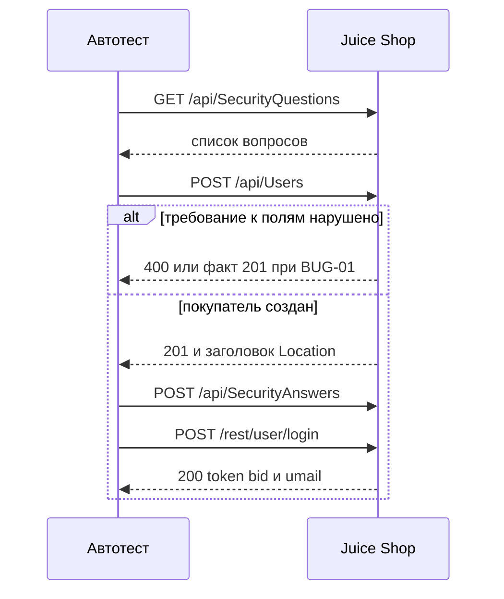
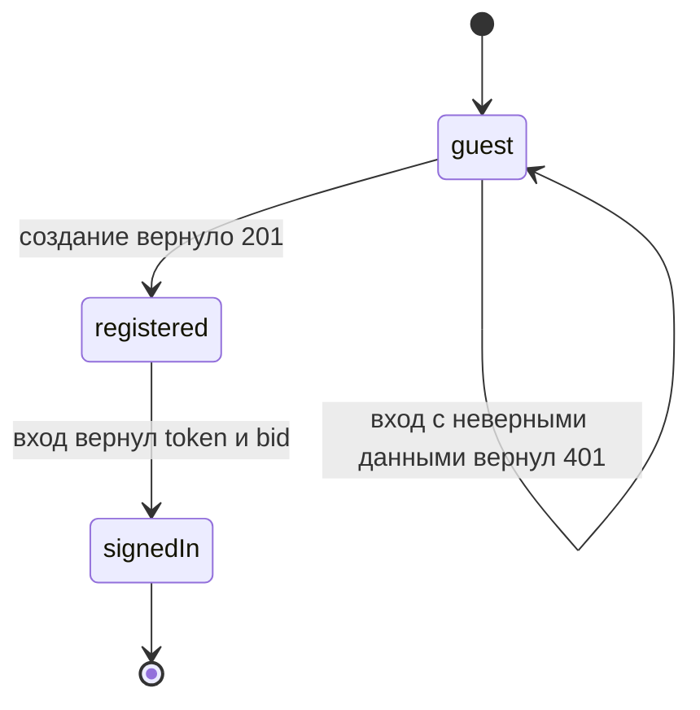

# Регистрация и вход через API

## Содержание

- [Теория](#теория)
  - [Ситуация](#ситуация)
  - [Модель](#модель)
  - [Понятия и связь с автоматизацией тестирования](#понятия-и-связь-с-автоматизацией-тестирования)
  - [Зоны ответственности](#зоны-ответственности)
  - [Пример](#пример)
  - [Типичные сбои](#типичные-сбои)
  - [Полезные ссылки](#полезные-ссылки)
  - [Вопросы по теории](#вопросы-по-теории)
- [Практическое задание](#практическое-задание)
  - [1.1 Общее](#11-общее)
  - [1.2 Сценарии](#12-сценарии-user-stories)
  - [1.3 Контракт](#13-контракт)
  - [1.4 Ошибки и ограничения](#14-ошибки-и-ограничения)
  - [1.5 Аудит](#15-аудитлоги)
  - [1.6 Нефункциональные требования](#16-нефункциональные-требования)

# Теория

## Ситуация

Автотест регистрирует покупателя и входит под ним через API Juice Shop. Дальше возможен один из исходов: создание с **201** и роль `customer`, отказ в дубликате или пустых полях с **400**, вход с **200** и полями `authentication.token`, `authentication.bid`, `authentication.umail`, отказ во входе с **401** и текстом `Invalid email or password.`, ожидаемое падение `known-issue` для `BUG-01`, неожиданный успех этой метки либо недоступность стенда.

Отдельная разработка не нужна: достаточно запущенного контейнера Juice Shop и команды `npx playwright test --grep @api` (`pytest -m api`, `dotnet test --filter Category=api`).

## Модель

В сценарии участвуют тест, стенд Juice Shop и отчёт. Тест подставляет email и пароль. Решение о прохождении принимает оракул теста — требование, а не текущий ответ стенда. Форма регистрации на стенде уже задаёт это требование: пароль от 5 до 40 символов, email похож на адрес, повтор пароля совпадает. Сервер в v20.4.0 часть этих правил пропускает. Тест всё равно ждёт отказ.



Диаграмма идёт в том же порядке, что и интерфейс: сначала вопрос, потом учётка, потом ответ на вопрос, потом вход. Вход без созданного покупателя остаётся на ветке отказа **401**, если email никому не принадлежит.



Переход в `registered` разрешён только после **201**. Переход в `signedIn` — после **200** с токеном и номером корзины. Неверный пароль и неизвестный email оставляют участника в `guest`. Запроса «войти без учётки и получить токен» на диаграмме нет.

Возможный набор полей (схема может быть и другой):

| `User` | Описание |
| --- | --- |
| `id` | числовой идентификатор новой записи |
| `email` | уникальный адрес покупателя |
| `role` | у нового покупателя строка `customer` |
| `username` | пустая строка сразу после создания |
| `isActive` | `true` |
| `deletedAt` | `null` |
| `password` | в теле **201** отсутствует |
| `totpSecret` | в теле **201** отсутствует |

| `authentication` | Описание |
| --- | --- |
| `token` | JWT успешного входа |
| `bid` | номер корзины этого покупателя |
| `umail` | email, под которым выполнен вход |

Файл использует пользователя Juice Shop, секретный вопрос и корзину, чей номер вход отдаёт в `bid`. Отдельной реляционной схемы курс не вводит.

## Понятия и связь с автоматизацией тестирования

### Регистрация через API

Покупатель появляется, когда сервер принимает адрес, пароль и ответ на контрольный вопрос и возвращает номер записи. Это регистрация через API. На Juice Shop первый запрос — `POST /api/Users`. Тело содержит `email`, `password`, `passwordRepeat`, объект `securityQuestion` (`id`, `question`, `createdAt`, `updatedAt`) и `securityAnswer`. Вопрос берут из `GET /api/SecurityQuestions`: в списке 14 пунктов, первый — `{ id: 1, question: "Your eldest siblings middle name?" }`. После **201** интерфейс шлёт `POST /api/SecurityAnswers` с `UserId`, `answer` и `SecurityQuestionId`. В контракте успешный кейс `TC-REG-01` проверяет **201**, `data.role = customer` и заголовок `Location: /api/Users/{id}`.

### Граница длины пароля

У поля с ограничением «от и до» ломаются не середина диапазона, а края. Это границы из `0.3`. Форма Juice Shop пишет: пароль от 5 до 40 символов. Значит 5 и 40 символов сервер принимает, 4 и 41 — отвергает с **400**. Кейс `TC-REG-06` фиксирует обе законные границы и ждёт **201**. Кейсы `TC-REG-04` и `TC-REG-05` ждут **400**. Стенд на обеих незаконных длинах отвечает **201**. Это `BUG-01`, и тесты помечаются `known-issue` по правилу из `1.0`. В контракте ожидание короткого и длинного пароля остаётся **400**.

Тот же дефект шире длины. Непохожий на адрес email (`TC-REG-07`) и несовпадающий `passwordRepeat` (`TC-REG-08`) тоже должны дать **400**, а стенд создаёт пользователя с **201**. Пустые email и пароль стенд уже отвергает сам: **400** и текст `Invalid email/password cannot be empty` (`TC-REG-03`). Повтор уже занятого email тоже отвергается: **400**, `errors[0].field = email`, `errors[0].message = email must be unique` (`TC-REG-02`).

### Нейтральная ошибка входа

По тексту отказа не должно быть понятно, что именно не совпало: адрес или пароль. Иначе посторонний перебирает, какие ящики уже есть. Такой ответ называют нейтральной ошибкой. На Juice Shop и неверный пароль (`TC-AUTH-02`), и неизвестный email (`TC-AUTH-03`) дают **401** и один текст: `Invalid email or password.` Тело приходит как `text/html`, не как JSON. Верные данные (`TC-AUTH-01`) дают **200** и объект `authentication` с `token`, `bid` и `umail`. В контракте оба отказа сравниваются с одной и той же строкой.

### Cookie и заголовок Authorization

После входа у клиента два способа представиться. Заголовок `Authorization: Bearer <token>` стенд принимает на многих адресах. Запрос «кто я» устроен иначе. `GET /rest/user/whoami` читает только cookie `token`. С этой cookie ответ содержит email вошедшего. С одним заголовком `Authorization` и без cookie тело равно `{"user":{}}`. Это кейс `TC-AUTH-04`. В контракте проверка личности после входа ставит cookie, а не ограничивается заголовком.

### Баг-репорт

Расхождение требования и факта нужно записать так, чтобы его мог взять разработчик. Такой документ — баг-репорт из `0.4`. Для регистрации он один: `BUG-01`. Стенд — Juice Shop v20.4.0 при `NODE_ENV=quiet`. Серьёзность — Major, приоритет — High: учётка создаётся, хотя форма эти данные не отправила бы. Ожидание — **400**. Факт — **201**. Кейсы `TC-REG-04`, `TC-REG-05`, `TC-REG-07` и `TC-REG-08` ссылаются на этот идентификатор и остаются ожидаемо падающими, пока требование не начнёт выполняться. В контракте отчёт содержит шаги, ожидание и факт. Пароль в отчёт не копируют.

### Что будет в проверке контракта ответов

Файл `1.2` возьмёт успешные тела регистрации и входа и сверит их со схемой. Отсутствие `password` и `totpSecret` в **201** здесь уже названо. Там это станет проверкой схемы `user.schema.json` в кейсе `TC-REG-09`. Текст **401** и коды этого файла схема не отменяет.

### Сводка

| Понятие | Смысл в регистрации и входе | На что опирается реализация |
| --- | --- | --- |
| Регистрация через API | создание покупателя запросом | `POST /api/Users` и `POST /api/SecurityAnswers` |
| Граница пароля | 5 и 40 принимаются, 4 и 41 нет | `TC-REG-04` … `TC-REG-06`, `BUG-01` |
| Нейтральная ошибка | один текст на чужой email и чужой пароль | `TC-AUTH-02`, `TC-AUTH-03` |
| Cookie `token` | `whoami` узнаёт покупателя только по ней | `TC-AUTH-04` |
| Баг-репорт | запись `BUG-01` для разработчика | шаблон из `0.4`, тег `known-issue` |

## Зоны ответственности

| Тест | Стенд |
| --- | --- |
| Собирает тело регистрации и уникальный email | Создаёт запись и заголовок `Location` |
| Ждёт **400** на пустых полях и на дубликате | Сам отвергает пустые поля и повтор email |
| Ждёт **400** на длине, формате email и повторе пароля | В v20.4.0 отвечает **201** — это `BUG-01` |
| Ждёт один и тот же текст **401** | Не сообщает, существует ли email |
| Ставит cookie `token` для `whoami` | Читает личность только из этой cookie |

Метка `known-issue` из `1.0` не подменяет баг-репорт. Отчёт нужен человеку, метка — раннеру. Схема полей из `1.2` не заменяет коды этого файла.

## Пример

Программа входит с адресом, которого на стенде нет, и проверяет нейтральный отказ. Успех — код **401** и текст `Invalid email or password.` На всех стеках раннер сообщает об одном пройденном тесте.

### TypeScript

**Node.js 22 или новее, @playwright/test.** Контекст `request` отправляет JSON без страницы. Ключевой параметр — тело `email` и `password`.

```sh
npm install -D @playwright/test
npx playwright install
npx playwright test --grep TC-AUTH-03
```

```typescript
import { expect, test } from '@playwright/test';

test('TC-AUTH-03 неизвестный email', { tag: ['@api', '@regression'] }, async ({ playwright }) => {
  const baseURL = process.env.BASE_URL ?? 'http://localhost:3000';
  const api = await playwright.request.newContext({ baseURL });
  const response = await api.post('/rest/user/login', {
    data: { email: 'nobody@example.test', password: 'wrong-pass' },
  });
  expect(response.status()).toBe(401);
  expect(await response.text()).toContain('Invalid email or password.');
  await api.dispose();
});
```

### Python

**Python 3.10 или новее, pytest-playwright.** Метод `post` контекста `request` передаёт тот же JSON. Ключевой параметр — словарь `data`.

```sh
pip install pytest pytest-playwright
playwright install
pytest -m api -k tc_auth_03
```

```python
import os
import pytest
from playwright.sync_api import Playwright

@pytest.mark.api
@pytest.mark.regression
def test_tc_auth_03_unknown_email(playwright: Playwright) -> None:
    base_url = os.environ.get("BASE_URL", "http://localhost:3000")
    api = playwright.request.new_context(base_url=base_url)
    response = api.post("/rest/user/login", data={"email": "nobody@example.test", "password": "wrong-pass"})
    assert response.status == 401
    assert "Invalid email or password." in response.text()
    api.dispose()
```

### C#

**.NET 8 или новее, Microsoft.Playwright.NUnit.** `PostAsync` принимает `DataObject`. Ключевой параметр — словарь полей входа.

```sh
dotnet add package Microsoft.Playwright.NUnit
dotnet build
pwsh bin/Debug/net8.0/playwright.ps1 install
dotnet test --filter "Category=api&Name~TC_AUTH_03"
```

```csharp
using Microsoft.Playwright.NUnit;
using NUnit.Framework;

[TestFixture]
public class LoginTests : PlaywrightTest
{
    [Test]
    [Category("api")]
    [Category("regression")]
    public async Task TC_AUTH_03()
    {
        var baseUrl = Environment.GetEnvironmentVariable("BASE_URL") ?? "http://localhost:3000";
        var api = await Playwright.APIRequest.NewContextAsync(new() { BaseURL = baseUrl });
        var response = await api.PostAsync("/rest/user/login", new()
        {
            DataObject = new Dictionary<string, string>
            {
                ["email"] = "nobody@example.test",
                ["password"] = "wrong-pass",
            },
        });
        Assert.That(response.Status, Is.EqualTo(401));
        Assert.That(await response.TextAsync(), Does.Contain("Invalid email or password."));
        await api.DisposeAsync();
    }
}
```

---

Каждый раннер сообщает о 1 пройденном тесте. Это доказывает, что неизвестный email получил **401** и в теле есть строка `Invalid email or password.` Отдельного сообщения «такого адреса нет» в ответе нет.

## Типичные сбои

| Что видно | Куда смотреть |
| --- | --- |
| **201** на пароле из 4 символов и красный тест без метки | `BUG-01`: ожидание **400**, на тесте нужен `known-issue` |
| `response.json()` падает на пустом email | Тело `TC-REG-03` — `text/html`, читать как текст |
| Дубликат email разобран не тем полем | `errors[0].field` равен `email`, текст `email must be unique` |
| `whoami` вернул `{"user":{}}` | Cookie `token` не поставлена, заголовка `Authorization` мало |
| Два теста получили **400** «email must be unique» | Адрес `aqa.<RUN_ID>.<воркер>.<номер>@example.test` совпал |
| В отчёте виден JWT | Вложение и лог: полный токен не сохраняют |
| `known-issue` по `BUG-01` внезапно красный без падения проверки | Требование уже выполняется, метку снимают |
| Вход сразу после создания даёт **401** | Не отправлен `POST /api/SecurityAnswers` или перепутан пароль |

## Полезные ссылки

### Общие

- [Playwright — API testing](https://playwright.dev/docs/api-testing) — как отправить JSON и прочитать текст ответа.
- [RFC 9110 — HTTP Semantics](https://www.rfc-editor.org/rfc/rfc9110) — смысл **201**, **400** и **401**.
- [OWASP — Juice Shop](https://owasp.org/www-project-juice-shop/) — учебный стенд, на котором живут эти адреса.

### По языку

#### TypeScript

**TypeScript, Playwright Test.** На JavaScript контракт регистрации и входа остаётся тем же.

- [Playwright — APIRequestContext](https://playwright.dev/docs/api/class-apirequestcontext) — `post`, `get` и заголовки ответа, включая `Location`.

#### Python

**Python, pytest-playwright.** На синхронном Playwright API без pytest или на async API контракт регистрации и входа остаётся тем же.

- [Playwright Python — API testing](https://playwright.dev/python/docs/api-testing) — `response.status`, `response.text()` и `response.json()`.

#### C#

**C#, Playwright для .NET с NUnit.** На MSTest или xUnit контракт регистрации и входа остаётся тем же.

- [Playwright .NET — API testing](https://playwright.dev/dotnet/docs/api-testing) — `PostAsync`, `DataObject` и `TextAsync`.

## Вопросы по теории

1. Почему пароль из 4 символов в тесте всё ещё ожидает **400**, если стенд отвечает **201**?
2. Зачем `TC-REG-06` проверяет и 5, и 40 символов, а не одну «обычную» длину?
3. Чем отказ на неизвестный email отличается по тексту от отказа на неверный пароль?
4. Что произойдёт с `GET /rest/user/whoami`, если передать только `Authorization: Bearer`?
5. Зачем после **201** отдельно вызывать `POST /api/SecurityAnswers`?
6. Как повторить регистрацию, если учётка с этим email уже создана?
7. Почему баг-репорт `BUG-01` описывает правило формы, а не сегодняшний код **201**?

# Практическое задание

Функциональность регистрации и входа в системе.
Автотесты регистрации и входа для Juice Shop.
Автотест создаёт покупателя, проверяет границы пароля и входит. Итог — набор `TC-REG-01` … `TC-REG-08` и `TC-AUTH-01` … `TC-AUTH-04` плюс баг-репорт `BUG-01`.

## 1) Регистрация и вход через API

### 1.1 Общее

**Назначение:** проверить, что API создаёт покупателя и пускает его по тем же правилам, что форма.

**Пользователи/роли:**

- AQA-инженер — пишет кейсы и баг-репорт `BUG-01`;
- `customer` — учётка, которую тест создаёт сам;
- `guest` — ещё не вошедший клиент на ветке **401**.

**Зависимости/связанные настройки:**

- `1.0` — готовность стенда, тег `api`, политика `known-issue`;
- `0.3` — границы 5 и 40 и классы «пустой / дубликат / неверный формат»;
- `0.4` — поля баг-репорта;
- `BASE_URL` — по умолчанию `http://localhost:3000`;
- `RUN_ID` — часть уникального email.

Схема тел — в `1.2`. Роли `admin` и `accounting` — в `1.3`. Общий клиент `UsersClient` — в `1.4`. Этот файл вызывает адреса напрямую.

### 1.2 Сценарии (user stories)

1. **Новый покупатель:** уникальный email и пароль допустимой длины заканчиваются **201**, ролью `customer` и заголовком `Location`.
2. **Края пароля:** длины 5 и 40 создают учётки, длины 4 и 41 остаются требованием **400**.
3. **Занятый и пустой адрес:** дубликат и пустые поля стенд отвергает сам.
4. **Вход:** верная пара даёт токен, номер корзины и email. Чужая пара даёт один и тот же **401**.
5. **Кто вошёл:** cookie `token` возвращает email, один заголовок `Authorization` — пустой объект `user`.

### 1.3 Контракт

#### 1.3.1 Успешная регистрация

| Кейс | Проверки/валидация |
| --- | --- |
| `TC-REG-01` | **201**, `data.role = customer`, заголовок `Location: /api/Users/{id}` |
| `TC-REG-06` | пароль из 5 символов и пароль из 40 символов, каждый раз **201** |

Тело `POST /api/Users`: `email`, `password`, `passwordRepeat`, `securityQuestion` (`id`, `question`, `createdAt`, `updatedAt`), `securityAnswer`. Email — `aqa.<RUN_ID>.<номер воркера>.<порядковый номер>@example.test`. Пароль успешного кейса — 12 символов: буквы обоих регистров, цифры и спецсимвол. Ответ на вопрос — слово. Объект вопроса копируют из `GET /api/SecurityQuestions`, первый элемент списка имеет `id` 1 и текст `Your eldest siblings middle name?`.

**Логика/шаги:**

1. Запросить список секретных вопросов.
2. Отправить `POST /api/Users` с новым email и паролем нужной длины.
3. Проверить **201**, `data.role`, отсутствие `password` и `totpSecret`, заголовок `Location`.
4. Отправить `POST /api/SecurityAnswers` с `UserId`, `answer` и `SecurityQuestionId`.

Если учётка создалась, а ответ на вопрос не сохранился, запись уже жива: удалить пользователя API нельзя. Повтор идёт с новым email.

**Ответы:**

- **Успех:** **201**, `data.id`, `data.email`, `data.role` = `customer`, `data.username` = `""`, `data.isActive` = `true`, `deletedAt` = `null`, заголовок `Location: /api/Users/{id}`.
- В теле нет `password` и `totpSecret`.
- **Ошибки:** см. раздел 1.4.

#### 1.3.2 Отказы, которые стенд выполняет сам

| Кейс | Проверки/валидация |
| --- | --- |
| `TC-REG-02` | повтор email, **400**, `errors[0].field = email`, `errors[0].message = email must be unique` |
| `TC-REG-03` | пустые email и пароль, **400**, текст `Invalid email/password cannot be empty` |

**Логика/шаги:**

1. Для дубликата создать покупателя, затем отправить тот же email ещё раз.
2. Для пустых полей отправить `email` и `password` пустыми строками.
3. Прочитать JSON у дубликата и текст у пустых полей.

Повтор дубликата безопасен: вторая запись не создаётся. Пустой запрос тоже ничего не создаёт.

**Ответы:**

- **Дубликат:** **400**, тело `{"message":"Validation error","errors":[{"field":"email","message":"email must be unique"}]}`.
- **Пустые поля:** **400**, `text/html`, в теле есть `Invalid email/password cannot be empty`.
- **Ошибки:** см. раздел 1.4.

#### 1.3.3 Отказы, которые стенд пропускает

| Кейс | Проверки/валидация |
| --- | --- |
| `TC-REG-04` | пароль из 4 символов, ожидание **400**, факт **201**, `BUG-01` |
| `TC-REG-05` | пароль из 41 символа, ожидание **400**, факт **201**, `BUG-01` |
| `TC-REG-07` | email без вида адреса, ожидание **400**, факт **201**, `BUG-01` |
| `TC-REG-08` | `passwordRepeat` отличается от `password`, ожидание **400**, факт **201**, `BUG-01` |

**Логика/шаги:**

1. Оставить в проверке код **400**.
2. Пометить тест `known-issue` и описанием `BUG-01` по правилу из `1.0`.
3. Отправить запрос с описанным нарушением.
4. Снять метку, когда ответ станет **400**.

Созданная лишняя учётка остаётся в базе контейнера. Следующий прогон берёт новый email.

**Ответы:**

- **Ожидание:** **400**.
- **Факт v20.4.0:** **201** (`BUG-01`).
- **Ошибки:** см. раздел 1.4.

#### 1.3.4 Вход

| Кейс | Проверки/валидация |
| --- | --- |
| `TC-AUTH-01` | верные email и пароль, **200**, есть `authentication.token`, `authentication.bid`, `authentication.umail` |
| `TC-AUTH-02` | неверный пароль, **401**, текст `Invalid email or password.` |
| `TC-AUTH-03` | неизвестный email, **401**, тот же текст |

**Логика/шаги:**

1. Взять покупателя из `TC-REG-01` либо отправить заведомо неизвестный email.
2. Отправить `POST /rest/user/login` с `email` и `password`.
3. Для успеха прочитать JSON. Для отказа прочитать текст.

**Ответы:**

- **Успех:** **200**, тело `{"authentication":{"token":"<JWT>","bid":<number>,"umail":"<email>"}}`.
- **Отказ:** **401**, `text/html`, текст `Invalid email or password.`
- **Ошибки:** см. раздел 1.4.

#### 1.3.5 Кто вошёл

| `TC-AUTH-04` | Проверки/валидация |
| --- | --- |
| cookie `token` | ответ содержит email этого покупателя |
| только `Authorization: Bearer <token>` | тело `{"user":{}}` |

**Логика/шаги:**

1. Войти и сохранить `authentication.token`.
2. Вызвать `GET /rest/user/whoami` с cookie `token` и проверить email.
3. Повторить запрос с одним заголовком `Authorization` и без cookie.

**Ответы:**

- **С cookie:** в объекте пользователя есть email входа.
- **Без cookie:** `{"user":{}}`.
- **Ошибки:** см. раздел 1.4.

#### 1.3.6 Баг-репорт `BUG-01`

| Поле отчёта | Проверки/валидация |
| --- | --- |
| Идентификатор | `BUG-01` |
| Стенд | Juice Shop v20.4.0, `NODE_ENV=quiet` |
| Серьёзность и приоритет | Major и High |
| Ожидание | **400**, как у формы: пароль 5–40, email похож на адрес, `passwordRepeat` совпадает |
| Факт | **201** на всех четырёх нарушениях |
| Кейсы | `TC-REG-04`, `TC-REG-05`, `TC-REG-07`, `TC-REG-08` |

**Логика/шаги:**

1. Описать шаги каждого из четырёх кейсов в инфинитиве.
2. Записать ожидание **400** и факт **201**.
3. Связать отчёт с меткой `known-issue` на этих тестах.

**Ответы:**

- **Успех документа:** по отчёту видно правило формы и фактический **201**.
- Пароль, токен и cookie в текст отчёта не входят.
- **Ошибки:** см. раздел 1.4.

### 1.4 Ошибки и ограничения

- **201 Created** — покупатель создан. Для `TC-REG-04`, `TC-REG-05`, `TC-REG-07` и `TC-REG-08` это факт дефекта `BUG-01`, ожидание остаётся **400**.
- **400** на дубликате — `errors[0].field = email`, `errors[0].message = email must be unique`.
- **400** на пустых email и пароле — текст `Invalid email/password cannot be empty`, тело `text/html`.
- **200** — вход выполнен, в `authentication` есть `token`, `bid`, `umail`.
- **401** — неверный пароль или неизвестный email, текст `Invalid email or password.`
- **401** с `{"status":"totp_token_required","data":{"tmpToken":…}}` — у учётки включена второй фактор. Учебные покупатели этого файла создаются без него.
- **Ошибка соединения** — стенд не готов, см. `1.0`.
- **Неожиданный успех `BUG-01`** — сервер начал отвечать **400**, метка `known-issue` всё ещё висит.

Пустые поля и дубликат проверяются отдельными запросами. Их нельзя смешивать с `BUG-01`: там стенд как раз соблюдает требование, и метка известного дефекта не нужна.

### 1.5 Аудит/логи

Логировать: идентификатор кейса, код ответа, для **201** — `data.role` и наличие заголовка `Location`, для отказа входа — факт совпадения нейтрального текста, для `BUG-01` — идентификатор дефекта.

В журнал не попадают пароль, `passwordRepeat`, `securityAnswer`, cookie `token`, полный JWT и персональные данные сверх учебного email на домене `.test`.

### 1.6 Нефункциональные требования

- Каждый тест укладывается в 30 с, проверка `expect` — в 5 с.
- В тесте нет `waitForTimeout` и `sleep`.
- Ретраи: 0 локально, 2 в CI. Воркеров в CI — 2.
- Набор покрывает `TC-REG-01` … `TC-REG-08` и `TC-AUTH-01` … `TC-AUTH-04`.
- У `TC-REG-04`, `TC-REG-05`, `TC-REG-07` и `TC-REG-08` есть метка `known-issue` и ссылка `BUG-01`.
- Общие правила прогона из `1.0` — trace, скриншот, видео и предел 10 минут на API вместе с UI в Chromium — относятся и к этим тестам.
