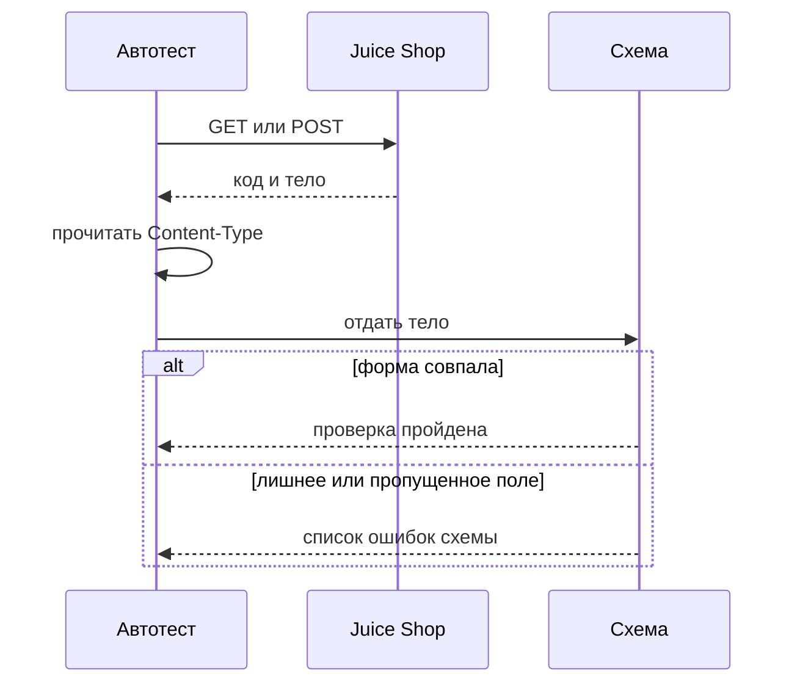
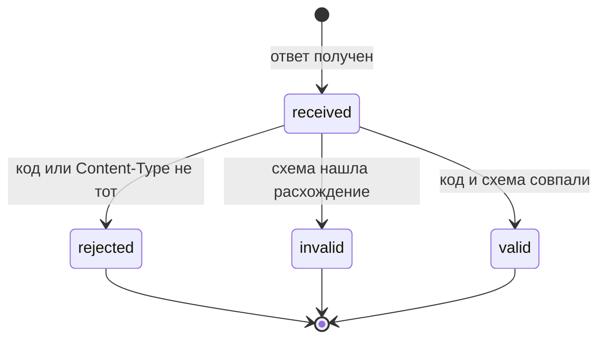

# Проверка контракта ответов

## Содержание

- [Теория](#теория)
  - [Ситуация](#ситуация)
  - [Модель](#модель)
  - [Понятия и связь с автоматизацией тестирования](#понятия-и-связь-с-автоматизацией-тестирования)
  - [Зоны ответственности](#зоны-ответственности)
  - [Пример](#пример)
  - [Типичные сбои](#типичные-сбои)
  - [Полезные ссылки](#полезные-ссылки)
  - [Вопросы по теории](#вопросы-по-теории)
- [Практическое задание](#практическое-задание)
  - [1.1 Общее](#11-общее)
  - [1.2 Сценарии](#12-сценарии-user-stories)
  - [1.3 Контракт](#13-контракт)
  - [1.4 Ошибки и ограничения](#14-ошибки-и-ограничения)
  - [1.5 Аудит](#15-аудитлоги)
  - [1.6 Нефункциональные требования](#16-нефункциональные-требования)

# Теория

## Ситуация

Автотест сверяет форму JSON-ответов Juice Shop со схемой. Дальше возможен один из исходов: тело совпало со схемой и код **200** или **201**, список товаров содержит 46 записей или три товара поиска, корзина совпала со своей схемой, ошибка без токена пришла как JSON с **401**, схема не сошлась при прежнем коде, заголовок `Content-Type` оказался другим либо стенд недоступен.

Отдельная разработка не нужна: достаточно запущенного контейнера Juice Shop и команды `npx playwright test --grep @api` (`pytest -m api`, `dotnet test --filter Category=api`).

## Модель

Участвуют тест, файл схемы, стенд и отчёт. Стенд отдаёт байты. Решение о прохождении принимает оракул теста — требование, а не текущий ответ стенда. Схема описывает, какие поля обязаны быть и каких полей быть не должно. Код **200** сам по себе форму не доказывает.



Сначала читается код и тип содержимого, потом схема. Иначе HTML-страница ошибки попадает в разбор JSON и сообщение схемы заслоняет настоящую причину.



В `valid` ответ проходит и по коду, и по схеме. В `invalid` код может быть ожидаемым, а набор полей — нет. В `rejected` до схемы дело не доходит: это чужой тип тела или чужой код.

Возможный набор полей (схема может быть и другой):

| `Product` | Описание |
| --- | --- |
| `id` | число товара |
| `name` | название, у товара 1 это `Apple Juice (1000ml)` |
| `description` | текст описания |
| `price` | цена, у товара 1 равна `1.99` |
| `deluxePrice` | цена deluxe, у товара 1 равна `0.99` |
| `image` | путь к картинке |
| `createdAt` | время создания |
| `updatedAt` | время изменения |
| `deletedAt` | `null`, пока товар не скрыт |

Файл также использует пользователя из `1.1`, элемент корзины и объект ошибки входа без токена. Отдельной реляционной схемы курс не вводит.

## Понятия и связь с автоматизацией тестирования

### JSON Schema

Код ответа говорит, чем закончился запрос, но не говорит, из каких полей состоит тело. Описание допустимой формы JSON называют JSON Schema. На Juice Shop схемы лежат рядом с тестами: `user.schema.json`, `product.schema.json`, `basket-item.schema.json`, `login-response.schema.json`, `error.schema.json`. Проверка идёт библиотекой стека: `ajv` и `ajv-formats` в TypeScript, `jsonschema` в Python, `JsonSchema.Net` в C#. В контракте кейс называет файл схемы и поля, которых в ответе быть не должно.

Ответы семейства `/api/<Model>s` завёрнуты в объект `{"status":"success","data":…}`. Схема пользователя проверяет `data` после создания: есть `id`, `email`, `role`, нет `password` и `totpSecret`. Это кейс `TC-REG-09`. Схема входа (`TC-AUTH-05`) ждёт объект `authentication` с `token`, `bid` и `umail`.

### Тип содержимого

Прежде чем разбирать JSON, нужно понять, JSON ли пришёл. За это отвечает заголовок `Content-Type`. На каталоге Juice Shop это `application/json`. Ошибка без токена по умолчанию приходит HTML-страницей. Заголовок `Accept: application/json` просит JSON. Тогда тело выглядит так: `error.name = UnauthorizedError`, `error.code = credentials_required`, внутри есть `error.message`, `error.status` и `error.inner`. Это кейс `TC-ACL-01`. В контракте у каждого разбора JSON сначала проверяется `Content-Type` или явно запрошен `Accept`.

### Список и поиск товаров

Каталог можно прочитать целиком или сузить строкой поиска. `GET /api/Products` возвращает 46 товаров (`TC-SEARCH-01`). Поиск `GET /rest/products/search?q=apple` возвращает три названия: `Apple Juice (1000ml)`, `Apple Pomace`, `Pineapple Juice (1000ml)` (`TC-SEARCH-02`). Пустой `q` возвращает весь каталог, те же 46 (`TC-SEARCH-03`). Параметр `q` стенд обрезает до 200 символов. Ответ поиска тоже имеет вид `{status, data}`. В контракте число и имена — часть оракула, не только схема одного товара.

### Схема корзины

Корзина — не плоский список, а объект с вложенными товарами. `GET /rest/basket/{bid}` отдаёт `{"status":"success","data":{…}}`. В `data` есть `id`, `coupon`, `UserId`, `createdAt`, `updatedAt` и массив `Products`. У товара внутри лежит `BasketItem` с `id` и `quantity`. Это описывает `basket-item.schema.json`, кейс `TC-CART-01`. Номер `bid` берётся из входа `1.1`. В контракте схема проверяет вложение, а количество штук в заказе проверяет уже `1.5`.

### Описание API и контракт двух сторон

Схему одного ответа можно написать руками. Описание всех адресов сразу называют спецификацией OpenAPI. Соглашение «клиент и сервер обещали друг другу одно и то же» называют контрактным тестом. Инструмент такого класса — Pact. У Juice Shop открытое описание есть только как `/api-docs` для B2B, полного контракта витрины нет. Поэтому учебный набор проверяет выборочные схемы на живом стенде, а не гоняет Pact против отсутствующего документа. В контракте этого файла схема прикреплена к конкретному кейсу.

### Сравнение

| Подход | Подходит для |
| --- | --- |
| JSON Schema в тесте | проверить тело одного ответа на своём стенде |
| OpenAPI | описать все адреса и генерировать клиентов |
| Pact | поймать разъезд потребителя и поставщика до выкладки |
| Проверка только кода HTTP | заметить отказ, не замечая пропавшее поле |

Для Juice Shop v20.4.0 рабочий путь — JSON Schema. OpenAPI витрины в репозитории тестов не появляется, пока у стенда нет полного документа.

### Что будет в ролях и правах доступа

Файл `1.3` берёт форму ошибки **401** из `TC-ACL-01` и смотрит, кому какой код положен. Покупатель, бухгалтер и администратор получат уже не «нет токена», а разрешение или запрет. Схема `error.schema.json` для отсутствия токена остаётся здесь.

### Сводка

| Понятие | Смысл в проверке ответов | На что опирается реализация |
| --- | --- | --- |
| JSON Schema | набор обязательных и запрещённых полей | `ajv`, `jsonschema`, `JsonSchema.Net` |
| Обёртка | `status` и `data` у ответов `/api` | общая схема вокруг `data` |
| `Content-Type` | можно ли читать тело как JSON | заголовок ответа и `Accept` |
| Каталог и поиск | 46 товаров и три товара на `apple` | `TC-SEARCH-01` … `TC-SEARCH-03` |
| Корзина | вложенный `BasketItem` | `TC-CART-01` |
| OpenAPI и Pact | другие способы хранить контракт | `/api-docs` только для B2B |

## Зоны ответственности

| Автотест | Фреймворк |
| --- | --- |
| Выбирает схему под конкретный адрес | Запускает `ajv`, `jsonschema` или `JsonSchema.Net` |
| Проверяет код и `Content-Type` до разбора | Отдаёт заголовки и тело без собственных проверок |
| Фиксирует число товаров и точные имена | Не подменяет каталог стенда локальным списком |
| Просит JSON заголовком `Accept` там, где без него приходит HTML | Не меняет ответ стенда |

Схема не заменяет код из `1.1`. Pact не заменяет эти файлы схем, пока у витрины нет пары «потребитель — поставщик» в отдельном репозитории.

## Пример

Программа читает каталог и проверяет обёртку `{status, data}` плюс длину 46. Успех — код **200**, тип JSON и совпадение со схемой. На всех стеках раннер сообщает об одном пройденном тесте.

### TypeScript

**Node.js 22 или новее, @playwright/test.** Рядом стоит `ajv`: он компилирует схему и возвращает признак совпадения. Ключевой параметр — объект схемы с `required`.

```sh
npm install -D @playwright/test ajv
npx playwright install
npx playwright test --grep TC-SEARCH-01
```

```typescript
import Ajv from 'ajv';
import { expect, test } from '@playwright/test';

const validate = new Ajv().compile({
  type: 'object',
  required: ['status', 'data'],
  properties: {
    status: { const: 'success' },
    data: { type: 'array', minItems: 46, maxItems: 46 },
  },
});

test('TC-SEARCH-01 список товаров', { tag: ['@api', '@regression'] }, async ({ playwright }) => {
  const baseURL = process.env.BASE_URL ?? 'http://localhost:3000';
  const api = await playwright.request.newContext({ baseURL });
  const response = await api.get('/api/Products');
  expect(response.status()).toBe(200);
  expect(response.headers()['content-type']).toContain('application/json');
  const body = await response.json();
  expect(validate(body)).toBeTruthy();
  await api.dispose();
});
```

### Python

**Python 3.10 или новее, pytest-playwright.** Пакет `jsonschema` бросает ошибку, если тело не совпало. Ключевой параметр — словарь схемы.

```sh
pip install pytest pytest-playwright jsonschema
playwright install
pytest -m api -k tc_search_01
```

```python
import os
import jsonschema
import pytest
from playwright.sync_api import Playwright

SCHEMA = {
    "type": "object",
    "required": ["status", "data"],
    "properties": {
        "status": {"const": "success"},
        "data": {"type": "array", "minItems": 46, "maxItems": 46},
    },
}

@pytest.mark.api
@pytest.mark.regression
def test_tc_search_01_products(playwright: Playwright) -> None:
    base_url = os.environ.get("BASE_URL", "http://localhost:3000")
    api = playwright.request.new_context(base_url=base_url)
    response = api.get("/api/Products")
    assert response.status == 200
    assert "application/json" in response.headers["content-type"]
    jsonschema.validate(response.json(), SCHEMA)
    api.dispose()
```

### C#

**.NET 8 или новее, Microsoft.Playwright.NUnit.** `JsonSchema.Build` читает схему, `Evaluate` возвращает результат. Ключевой параметр — `IsValid`.

```sh
dotnet add package Microsoft.Playwright.NUnit
dotnet add package JsonSchema.Net
dotnet build
pwsh bin/Debug/net8.0/playwright.ps1 install
dotnet test --filter "Category=api&Name~TC_SEARCH_01"
```

```csharp
using System.Text.Json;
using Json.Schema;
using Microsoft.Playwright.NUnit;
using NUnit.Framework;

[TestFixture]
public class ProductContractTests : PlaywrightTest
{
    [Test]
    [Category("api")]
    [Category("regression")]
    public async Task TC_SEARCH_01()
    {
        var schema = JsonSchema.Build(JsonDocument.Parse(
            """{"type":"object","required":["status","data"],"properties":{"status":{"const":"success"},"data":{"type":"array","minItems":46,"maxItems":46}}}""").RootElement);
        var baseUrl = Environment.GetEnvironmentVariable("BASE_URL") ?? "http://localhost:3000";
        var api = await Playwright.APIRequest.NewContextAsync(new() { BaseURL = baseUrl });
        var response = await api.GetAsync("/api/Products");
        Assert.That(response.Status, Is.EqualTo(200));
        Assert.That(response.Headers["content-type"], Does.Contain("application/json"));
        var body = await response.JsonAsync();
        Assert.That(schema.Evaluate(body!.Value).IsValid, Is.True);
        await api.DisposeAsync();
    }
}
```

---

Каждый раннер сообщает о 1 пройденном тесте. Это доказывает, что `GET /api/Products` вернул **200**, тело имеет тип JSON, поле `status` равно `success`, а в `data` ровно 46 элементов.

## Типичные сбои

| Что видно | Куда смотреть |
| --- | --- |
| Ошибка разбора JSON на **401** | Нет заголовка `Accept: application/json`, пришёл HTML |
| Схема пользователя требует `password` | В `user.schema.json` полей `password` и `totpSecret` быть не должно |
| Каталог длиннее или короче 46 | `TC-SEARCH-01` и пустой `q` в `TC-SEARCH-03` |
| Поиск `apple` вернул не те имена | Три строки: `Apple Juice (1000ml)`, `Apple Pomace`, `Pineapple Juice (1000ml)` |
| `Content-Type` есть, схема молчит | Проверка типа не заменяет `TC-REG-09` и `TC-AUTH-05` |
| Корзина без `BasketItem` | `GET /rest/basket/{bid}` и вложение `Products` |
| `q` длиннее 200 символов обрезан | Стенд режет параметр, кейс поиска это учитывает |
| Ошибка схемы без кода ответа | В отчёте рядом с текстом схемы сохраняют HTTP-код |

## Полезные ссылки

### Общие

- [JSON Schema — Understanding JSON Schema](https://json-schema.org/understanding-json-schema) — обязательные поля, типы и запрет лишних свойств.
- [OpenAPI Initiative — Specification](https://swagger.io/specification/) — как выглядит полное описание адресов, которого у витрины нет.
- [Pact — Docs](https://docs.pact.io/) — контракт потребителя и поставщика.

### По языку

#### TypeScript

**TypeScript, Playwright Test.** На JavaScript контракт проверки ответов остаётся тем же.

- [Ajv — JSON Schema validator](https://ajv.js.org/guide/getting-started.html) — `compile` и проверка тела.

#### Python

**Python, pytest-playwright.** На синхронном Playwright API без pytest или на async API контракт проверки ответов остаётся тем же.

- [jsonschema — Documentation](https://python-jsonschema.readthedocs.io/en/stable/) — `jsonschema.validate`.

#### C#

**C#, Playwright для .NET с NUnit.** На MSTest или xUnit контракт проверки ответов остаётся тем же.

- [JsonSchema.Net — Basics](https://docs.json-everything.net/schema/basics/) — `JsonSchema.Build` и `Evaluate`.

## Вопросы по теории

1. Почему код **200** не заменяет схему пользователя?
2. Зачем в `user.schema.json` запрещены `password` и `totpSecret`?
3. Что произойдёт, если вызвать защищённый адрес без токена и без `Accept: application/json`?
4. Чем проверка JSON Schema на своём стенде отличается от теста Pact?
5. Почему пустой `q` — отдельный кейс, хотя товаров снова 46?
6. Как схема корзины показывает количество, не превращаясь в проверку заказа?
7. Зачем смотреть `Content-Type`, если тело и так удалось прочитать как JSON?

# Практическое задание

Функциональность формы ответов API в системе.
Автотесты контракта ответов для Juice Shop.
Автотест сверяет пользователя, вход, каталог, поиск, корзину и ошибку без токена со схемами. Итог — кейсы `TC-REG-09`, `TC-AUTH-05`, `TC-SEARCH-01` … `TC-SEARCH-03`, `TC-CART-01` и `TC-ACL-01`.

## 1) Проверка контракта ответов

### 1.1 Общее

**Назначение:** поймать ответ, у которого верный код и сломанный набор полей.

**Пользователи/роли:**

- AQA-инженер — хранит файлы схем рядом с тестами;
- `customer` — владелец корзины для `TC-CART-01`;
- `guest` — вызов без токена в `TC-ACL-01`.

**Зависимости/связанные настройки:**

- `1.0` — тег `api` и готовый стенд;
- `1.1` — созданный пользователь, токен и `bid`;
- `BASE_URL` — по умолчанию `http://localhost:3000`.

Кто имеет право на адрес, решает `1.3`. Наполнение корзины и заказ — `1.5`. Здесь только форма тел.

### 1.2 Сценарии (user stories)

1. **Новый пользователь:** тело **201** совпадает с `user.schema.json` и не содержит секретов.
2. **Вход:** тело **200** совпадает с `login-response.schema.json`.
3. **Каталог:** 46 товаров, у каждого поля из схемы товара.
4. **Поиск:** `apple` даёт три известных названия, пустой запрос — весь каталог.
5. **Корзина:** объект корзины содержит вложенные позиции.
6. **Нет токена:** при `Accept: application/json` ошибка совпадает с `error.schema.json`.

### 1.3 Контракт

#### 1.3.1 Пользователь и вход

| Кейс | Проверки/валидация |
| --- | --- |
| `TC-REG-09` | схема созданного пользователя, нет `password` и `totpSecret` |
| `TC-AUTH-05` | схема ответа входа: `authentication.token`, `authentication.bid`, `authentication.umail` |

**Логика/шаги:**

1. Создать покупателя и войти так, как в `1.1`.
2. Проверить `Content-Type` на JSON.
3. Прогнать тело через `user.schema.json` и `login-response.schema.json`.
4. Отдельно убедиться, что в пользователе нет `password` и `totpSecret`.

Повтор после сбоя создания идёт с новым email.

**Ответы:**

- **Пользователь:** **201**, обёртка `status` и `data`, роль `customer`.
- **Вход:** **200**, объект `authentication`.
- **Ошибки:** см. раздел 1.4.

#### 1.3.2 Каталог и поиск

| Кейс | Проверки/валидация |
| --- | --- |
| `TC-SEARCH-01` | `GET /api/Products`, схема списка, 46 товаров |
| `TC-SEARCH-02` | `GET /rest/products/search?q=apple`, ровно `Apple Juice (1000ml)`, `Apple Pomace`, `Pineapple Juice (1000ml)` |
| `TC-SEARCH-03` | пустой `q`, весь каталог из 46 товаров |

Поля товара в `product.schema.json`: `id`, `name`, `description`, `price`, `deluxePrice`, `image`, `createdAt`, `updatedAt`, `deletedAt`. У товара `Apple Juice (1000ml)` цена `1.99`, `deluxePrice` — `0.99`.

**Логика/шаги:**

1. Запросить `GET /api/Products` и сверить длину и схему.
2. Запросить поиск с `q=apple` и сверить три имени.
3. Запросить поиск с пустым `q` и сверить длину 46.
4. Проверить `Content-Type` на каждом ответе.

Эти запросы каталог не меняют. Повтор безопасен.

**Ответы:**

- **Успех:** **200**, тело `{status, data}`.
- **Ошибки:** см. раздел 1.4.

#### 1.3.3 Корзина

| `TC-CART-01` | Проверки/валидация |
| --- | --- |
| `GET /rest/basket/{bid}` | `status` = `success`, в `data` есть `id`, `coupon`, `UserId`, `Products` |
| элемент `Products` | вложенный `BasketItem` с `id` и `quantity` по `basket-item.schema.json` |

**Логика/шаги:**

1. Войти и взять `authentication.bid`.
2. Запросить корзину с токеном владельца.
3. Прогнать тело через схему корзины.

Чужая корзина в этом файле не читается: это матрица `1.3` и дефект `BUG-06`.

**Ответы:**

- **Успех:** **200**, JSON со структурой корзины.
- **Ошибки:** см. раздел 1.4.

#### 1.3.4 Ошибка без токена

| `TC-ACL-01` | Проверки/валидация |
| --- | --- |
| запрос | защищённый адрес без токена, заголовок `Accept: application/json` |
| тело | `error.name = UnauthorizedError`, `error.code = credentials_required` |
| схема | `error.schema.json` для ошибки express-jwt |

**Логика/шаги:**

1. Отправить запрос без cookie и без `Authorization`.
2. Передать `Accept: application/json`.
3. Проверить **401**, имя, код и схему.

**Ответы:**

- **Успех проверки:** **401**, JSON `{"error":{"message":"No Authorization header was found","name":"UnauthorizedError","code":"credentials_required","status":401,"inner":{…}}}`.
- **Ошибки:** см. раздел 1.4.

### 1.4 Ошибки и ограничения

- **200** — каталог, поиск, корзина или вход. Форма всё равно проходит схему.
- **201** — созданный пользователь. Схема запрещает `password` и `totpSecret`.
- **401** — нет токена. С `Accept: application/json` тело подходит `error.schema.json`. Без этого заголовка тело — HTML, и схему JSON к нему не применяют.
- **Несовпадение схемы** — код ожидаемый, поля нет или появилось запрещённое. Тест красный, это не `known-issue`.
- **Длина каталога не 46** — `TC-SEARCH-01` или `TC-SEARCH-03` падает.
- **Имена поиска не совпали** — `TC-SEARCH-02` падает, даже если схема товара верна.
- **Ошибка соединения** — стенд не готов, см. `1.0`.
- **`q` длиннее 200 символов** — стенд обрезает строку. Кейс `apple` этой границы не касается.

Код и схема проверяются оба. Совпадения только кода недостаточно, совпадения только схемы при чужом коде тоже.

### 1.5 Аудит/логи

Логировать: идентификатор кейса, код, `Content-Type`, имя файла схемы и короткий список ошибок схемы.

В журнал не попадают `password`, `totpSecret`, полный JWT, cookie `token` и тело входа целиком. Для `TC-AUTH-05` достаточно признака, что поля `token`, `bid` и `umail` есть.

### 1.6 Нефункциональные требования

- Тест укладывается в 30 с, проверка `expect` — в 5 с. Пауз `waitForTimeout` и `sleep` нет.
- Ретраи: 0 локально, 2 в CI. Воркеров в CI — 2.
- Покрыты `TC-REG-09`, `TC-AUTH-05`, `TC-SEARCH-01`, `TC-SEARCH-02`, `TC-SEARCH-03`, `TC-CART-01`, `TC-ACL-01`.
- Общие правила прогона из `1.0` относятся и к проверкам схем.
