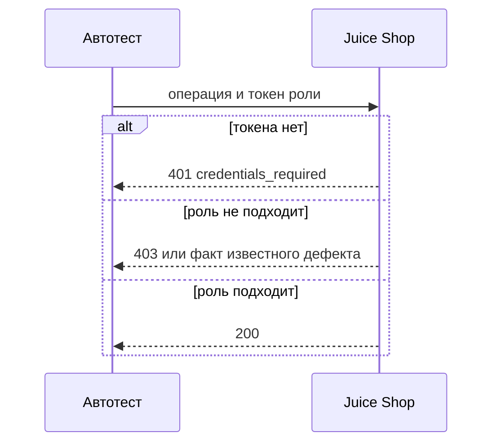
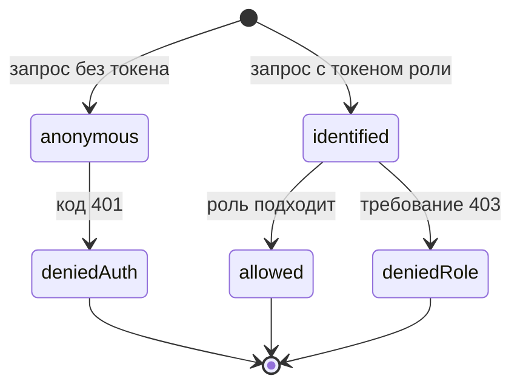

# Роли и права доступа

## Содержание

- [Теория](#теория)
  - [Ситуация](#ситуация)
  - [Модель](#модель)
  - [Понятия и связь с автоматизацией тестирования](#понятия-и-связь-с-автоматизацией-тестирования)
  - [Зоны ответственности](#зоны-ответственности)
  - [Пример](#пример)
  - [Типичные сбои](#типичные-сбои)
  - [Полезные ссылки](#полезные-ссылки)
  - [Вопросы по теории](#вопросы-по-теории)
- [Практическое задание](#практическое-задание)
  - [1.1 Общее](#11-общее)
  - [1.2 Сценарии](#12-сценарии-user-stories)
  - [1.3 Контракт](#13-контракт)
  - [1.4 Ошибки и ограничения](#14-ошибки-и-ограничения)
  - [1.5 Аудит](#15-аудитлоги)
  - [1.6 Нефункциональные требования](#16-нефункциональные-требования)

# Теория

## Ситуация

Автотест вызывает один и тот же адрес Juice Shop от имени разных ролей. Дальше возможен один из исходов: гость без токена получает **401**, покупатель получает **403** там, где операция чужая, бухгалтер получает **200** на списке всех заказов, владелец читает свою корзину, ожидание **403** расходится с фактом и тест помечен `known-issue` (`BUG-05`, `BUG-06`, `BUG-07`) либо стенд недоступен.

Отдельная разработка не нужна: достаточно запущенного контейнера Juice Shop и команды `npx playwright test --grep @api` (`pytest -m api`, `dotnet test --filter Category=api`).

## Модель

Участвуют тест, роль стенда и отчёт. Роль задаёт, какой токен подставить. Решение о прохождении принимает оракул теста — требование, а не текущий ответ стенда. Сначала стенд проверяет, есть ли токен. Потом — хватает ли роли. Поэтому отсутствие токена и нехватка прав — разные коды.



Порядок на диаграмме совпадает с порядком проверок стенда. Гость не доходит до вопроса «какая роль», потому что токена нет.



`deniedAuth` — это **401**. `deniedRole` — требование **403**, даже если сегодняшний стенд ответил иначе и кейс помечен дефектом. `allowed` — **200** для роли, которой операция разрешена. Перехода «гость сразу получает **403**» нет: без токена код **401**.

Возможный набор полей (схема может быть и другой):

| `роль` | Описание |
| --- | --- |
| `guest` | запрос без токена |
| `customer` | покупатель, созданный тестом, свой email и свой `bid` |
| `accounting` | встроенный `accountant@juice-sh.op` |
| `admin` | встроенный `admin@juice-sh.op` |

Пароли `accounting` и `admin` берутся из `ACCOUNTANT_PASSWORD` и `ADMIN_PASSWORD`. В тест их не вписывают литералом. Файл использует эти роли и корзину покупателя. Отдельной реляционной схемы курс не вводит.

## Понятия и связь с автоматизацией тестирования

### Таблица решений

Когда исход зависит от пары «кто спрашивает» и «что спрашивает», перебор пар записывают таблицей. Это таблица решений из `0.3`. Строка — операция, столбец — роль, ячейка — код, который требует правило. На Juice Shop строк минимум шесть.

| Операция | `guest` | `customer` | `accounting` | `admin` |
| --- | --- | --- | --- | --- |
| `GET /api/Users` | **401** | ожидание **403**, факт **200** (`BUG-07`) | ожидание **403** | **200** |
| `GET /api/Users/1` | **401** | ожидание **403**, факт **200** (`BUG-07`) | ожидание **403** | **200** |
| `GET /rest/order-history/orders` | **401** | **403** | **200** | **403** |
| `DELETE /api/Products/{id}` | **401** без токена | ожидание **403**, факт **401** (`BUG-05`) | то же ожидание **403** | то же ожидание **403** |
| `PUT /api/Users/{id}` | **401** без токена | ожидание **403**, факт **401** (`BUG-05`) | то же ожидание **403** | то же ожидание **403** |
| `GET /rest/basket/{свой bid}` | **401** | **200** | чужой номер — ожидание **403** | чужой номер — ожидание **403** |
| `GET /rest/basket/{чужой bid}` | **401** | ожидание **403**, факт **200** (`BUG-06`) | ожидание **403** | ожидание **403** |

В контракте каждая автоматическая проверка ссылается на ячейку. Успех администратора на `GET /api/Users` — ячейка требования. Отдельного нового идентификатора сверх списка кейсов файл не вводит.

### Гость и код 401

Гость — это отсутствие токена, а не пустой пароль. Защищённый адрес без cookie и без `Authorization` отвечает **401**. С заголовком `Accept: application/json` тело то же, что в `TC-ACL-01`: `error.name = UnauthorizedError`, `error.code = credentials_required`. Кейс `TC-ACL-02` проверяет этот код на защищённых операциях таблицы. В контракте гость не получает **403**: до роли проверка не доходит.

### Покупатель и бухгалтер

Один адрес может быть разрешён одной роли и закрыт для соседней. `GET /rest/order-history/orders` отдаёт все заказы только роли `accounting`. Покупатель (`TC-ACL-03`) получает **403** и тело `{"error":"Malicious activity detected"}`. Бухгалтер (`TC-ACL-04`) получает **200**. Та же формула у стенда для любого, кто не `accounting`: **403** с этим текстом. Администратор на этом адресе тоже не бухгалтер. В контракте оба кейса бьют в один путь и расходятся только токеном.

Учётка бухгалтера — `accountant@juice-sh.op`, администратора — `admin@juice-sh.op`. Пароль каждый раз из своей переменной окружения.

### Запрет, который стенд путает с токеном

Некоторые операции закрыты для всех ролей. `DELETE /api/Products/{id}` и `PUT /api/Users/{id}` по правилу отвечают **403**: токен может быть настоящим, но действие всё равно нельзя. Стенд v20.4.0 отвечает **401** с кодом `invalid_token`. Это `BUG-05`, кейс `TC-ACL-05`. Его не смешивают с гостем: у гостя код `credentials_required`, потому что заголовка нет. В контракте ожидание остаётся **403**, тест несёт `known-issue` и `BUG-05`.

### Чужие данные

Своя корзина открыта владельцу: `GET /rest/basket/{свой bid}` для `customer` — **200**. Чужая корзина по правилу закрыта: **403**. Стенд отдаёт покупателю чужую корзину с **200**. Это `BUG-06`, кейс `TC-ACL-06`. Список людей устроен так же. `GET /api/Users` и `GET /api/Users/1` по правилу видит администратор. Покупатель должен получить **403**, а получает **200**. Это `BUG-07`, кейс `TC-ACL-07`. Как именно подбирают чужой номер, разбирает `5.1`. Здесь фиксируется матрица, а не приём атаки. В контракте оба кейса ждут **403** и помечены своими дефектами.

### Что будет в фикстурах и слое API-клиента

Файл `1.4` перестанет собирать токен роли внутри каждого теста. Появятся `guestApi`, `customerApi`, `accountantApi` и `adminApi`. Коды из таблицы не изменятся. Поменяется только место, где токен получают.

### Сводка

| Понятие | Смысл в правах доступа | На что опирается реализация |
| --- | --- | --- |
| Таблица решений | роль и операция задают код | пары из `0.3` |
| Гость | нет токена, **401** | `TC-ACL-02` |
| Разделение ролей | бухгалтер видит все заказы, покупатель нет | `TC-ACL-03`, `TC-ACL-04` |
| Запрет для всех | **403**, факт **401** | `TC-ACL-05`, `BUG-05` |
| Чужая корзина и список людей | ожидание **403**, факт **200** | `BUG-06`, `BUG-07` |

## Зоны ответственности

| Тест | Стенд |
| --- | --- |
| Подставляет токен нужной роли или не подставляет его | Сначала ищет токен, потом роль |
| Ждёт **401** у гостя | Отвечает `credentials_required` |
| Ждёт **403** покупателю на всех заказах | Отвечает `Malicious activity detected` |
| Ждёт **200** бухгалтеру на том же пути | Отдаёт список заказов |
| Оставляет ожидание **403** на ячейках `BUG-05`, `BUG-06`, `BUG-07` | Отвечает сегодняшним фактом этих дефектов |

Матрица не заменяет разбор атак из `5.1`. Метка `known-issue` не превращает факт **200** в новое правило.

## Пример

Программа вызывает список пользователей без токена и ждёт **401**. Успех — этот код и `error.code = credentials_required` при `Accept: application/json`. На всех стеках раннер сообщает об одном пройденном тесте.

### TypeScript

**Node.js 22 или новее, @playwright/test.** Запрос идёт без заголовка `Authorization`. Ключевой параметр — `Accept: application/json`.

```sh
npm install -D @playwright/test
npx playwright install
npx playwright test --grep TC-ACL-02
```

```typescript
import { expect, test } from '@playwright/test';

test('TC-ACL-02 гость без токена', { tag: ['@api', '@regression'] }, async ({ playwright }) => {
  const baseURL = process.env.BASE_URL ?? 'http://localhost:3000';
  const api = await playwright.request.newContext({ baseURL });
  const response = await api.get('/api/Users', {
    headers: { Accept: 'application/json' },
  });
  expect(response.status()).toBe(401);
  const body = await response.json();
  expect(body.error.name).toBe('UnauthorizedError');
  expect(body.error.code).toBe('credentials_required');
  await api.dispose();
});
```

### Python

**Python 3.10 или новее, pytest-playwright.** Тот же путь и тот же заголовок `Accept`. Ключевой параметр — отсутствие токена.

```sh
pip install pytest pytest-playwright
playwright install
pytest -m api -k tc_acl_02
```

```python
import os
import pytest
from playwright.sync_api import Playwright

@pytest.mark.api
@pytest.mark.regression
def test_tc_acl_02_guest(playwright: Playwright) -> None:
    base_url = os.environ.get("BASE_URL", "http://localhost:3000")
    api = playwright.request.new_context(base_url=base_url)
    response = api.get("/api/Users", headers={"Accept": "application/json"})
    assert response.status == 401
    body = response.json()
    assert body["error"]["name"] == "UnauthorizedError"
    assert body["error"]["code"] == "credentials_required"
    api.dispose()
```

### C#

**.NET 8 или новее, Microsoft.Playwright.NUnit.** `GetAsync` передаёт словарь заголовков. Ключевой параметр — `Accept`.

```sh
dotnet add package Microsoft.Playwright.NUnit
dotnet build
pwsh bin/Debug/net8.0/playwright.ps1 install
dotnet test --filter "Category=api&Name~TC_ACL_02"
```

```csharp
using System.Text.Json;
using Microsoft.Playwright.NUnit;
using NUnit.Framework;

[TestFixture]
public class GuestAccessTests : PlaywrightTest
{
    [Test]
    [Category("api")]
    [Category("regression")]
    public async Task TC_ACL_02()
    {
        var baseUrl = Environment.GetEnvironmentVariable("BASE_URL") ?? "http://localhost:3000";
        var api = await Playwright.APIRequest.NewContextAsync(new() { BaseURL = baseUrl });
        var response = await api.GetAsync("/api/Users", new()
        {
            Headers = new Dictionary<string, string> { ["Accept"] = "application/json" },
        });
        Assert.That(response.Status, Is.EqualTo(401));
        var body = await response.JsonAsync();
        Assert.That(body?.GetProperty("error").GetProperty("code").GetString(), Is.EqualTo("credentials_required"));
        await api.DisposeAsync();
    }
}
```

---

Каждый раннер сообщает о 1 пройденном тесте. Это доказывает, что гость на `GET /api/Users` получил **401**, имя ошибки `UnauthorizedError` и код `credentials_required`.

## Типичные сбои

| Что видно | Куда смотреть |
| --- | --- |
| Гость получил **403** | Запрос ушёл с токеном предыдущего теста |
| Покупатель на всех заказах получил **401** | В запрос не попал `Bearer`, смотреть `TC-ACL-03` |
| Текст **403** другой | Ожидается ровно `{"error":"Malicious activity detected"}` |
| Бухгалтер получил **403** | `ACCOUNTANT_EMAIL` и `ACCOUNTANT_PASSWORD`, роль `accounting` |
| **401** `invalid_token` на удалении товара без метки | Это `BUG-05`, ожидание **403**, тег `known-issue` |
| Покупатель прочитал чужую корзину, тест зелёный | Ожидание `TC-ACL-06` — **403**, факт **200**, метка `BUG-06` |
| `GET /api/Users` от покупателя зелёный | Ожидание `TC-ACL-07` — **403**, факт **200**, метка `BUG-07` |
| В логе пароль администратора | Секрет только в `.env` и в секретах CI |

## Полезные ссылки

### Общие

- [RFC 9110 — HTTP Semantics](https://www.rfc-editor.org/rfc/rfc9110) — разница **401** и **403**.
- [OWASP — Authorization Cheat Sheet](https://cheatsheetseries.owasp.org/cheatsheets/Authorization_Cheat_Sheet.html) — почему доступ проверяют на сервере для каждой операции.
- [Playwright — API testing](https://playwright.dev/docs/api-testing) — как передать или не передать заголовок.

### По языку

#### TypeScript

**TypeScript, Playwright Test.** На JavaScript контракт ролей и прав остаётся тем же.

- [Playwright — APIRequestContext](https://playwright.dev/docs/api/class-apirequestcontext) — заголовки отдельного запроса.

#### Python

**Python, pytest-playwright.** На синхронном Playwright API без pytest или на async API контракт ролей и прав остаётся тем же.

- [Playwright Python — API testing](https://playwright.dev/python/docs/api-testing) — `headers` у `get` и `post`.

#### C#

**C#, Playwright для .NET с NUnit.** На MSTest или xUnit контракт ролей и прав остаётся тем же.

- [Playwright .NET — API testing](https://playwright.dev/dotnet/docs/api-testing) — `Headers` в параметрах `GetAsync`.

## Вопросы по теории

1. Почему гость на защищённом адресе получает **401**, а покупатель на чужой операции — **403**?
2. Чем роль `accounting` отличается от `admin` на `GET /rest/order-history/orders`?
3. Что произойдёт, если `customer` вызовет `GET /api/Users` и `GET /api/Users/1`?
4. Почему `DELETE /api/Products/{id}` помечен `BUG-05`, хотя ответ и так ошибочный?
5. Как таблица решений из `0.3` превращается в список кейсов?
6. Почему чужая корзина в требовании закрыта, хотя стенд отвечает **200**?
7. Зачем приёмы обхода прав вынесены в `5.1`, если коды уже записаны здесь?

# Практическое задание

Функциональность прав на операции API в системе.
Автотесты ролей и прав доступа для Juice Shop.
Автотест проходит таблицу «роль × операция» и оставляет известные расхождения под своими `BUG-…`. Итог — кейсы `TC-ACL-02` … `TC-ACL-07`.

## 1) Роли и права доступа

### 1.1 Общее

**Назначение:** проверить, что код операции зависит от роли так, как требует матрица.

**Пользователи/роли:**

- `guest` — без токена;
- `customer` — новый покупатель на кейс;
- `accounting` — `accountant@juice-sh.op`;
- `admin` — `admin@juice-sh.op`;
- AQA-инженер — не подставляет пароли литералом.

**Зависимости/связанные настройки:**

- `1.0` — `known-issue` и fail-fast секретов;
- `1.1` — регистрация покупателя и вход;
- `1.2` — форма **401** при `Accept: application/json`;
- `ADMIN_EMAIL`, `ADMIN_PASSWORD`, `ACCOUNTANT_EMAIL`, `ACCOUNTANT_PASSWORD`.

Клиенты ролей собираются в `1.4`. Разбор обхода прав — в `5.1`.

### 1.2 Сценарии (user stories)

1. **Гость:** защищённые операции отвечают **401** без токена.
2. **Чужие заказы:** покупатель получает **403**, бухгалтер — **200**.
3. **Запрет для всех:** удаление товара и правка пользователя ждут **403**.
4. **Своя и чужая корзина:** владелец читает свой `bid`, чужой номер закрыт требованием.
5. **Список людей:** покупатель не должен видеть `GET /api/Users` и карточку `GET /api/Users/1`.

### 1.3 Контракт

#### 1.3.1 Гость

| `TC-ACL-02` | Проверки/валидация |
| --- | --- |
| операции | `GET /api/Users`, `GET /rest/order-history/orders`, `GET /rest/basket/{bid}` |
| токен | отсутствует |
| код | **401**, с `Accept: application/json` код ошибки `credentials_required` |

**Логика/шаги:**

1. Открыть контекст без заголовка `Authorization` и без cookie.
2. Вызвать перечисленные защищённые пути.
3. Проверить **401**.

Данные стенда не меняются. Повтор безопасен.

**Ответы:**

- **Успех проверки:** **401**.
- **Ошибки:** см. раздел 1.4.

#### 1.3.2 Заказы всех покупателей

| Кейс | Проверки/валидация |
| --- | --- |
| `TC-ACL-03` | токен `customer`, `GET /rest/order-history/orders`, **403**, тело `{"error":"Malicious activity detected"}` |
| `TC-ACL-04` | токен `accounting`, тот же путь, **200** |

**Логика/шаги:**

1. Зарегистрировать покупателя и войти, как в `1.1`.
2. Войти бухгалтером с email `accountant@juice-sh.op` и паролем из `ACCOUNTANT_PASSWORD`.
3. Вызвать один и тот же путь двумя токенами.
4. Сверить **403** и **200**.

**Ответы:**

- **Покупатель:** **403**, `{"error":"Malicious activity detected"}`.
- **Бухгалтер:** **200**.
- **Ошибки:** см. раздел 1.4.

#### 1.3.3 Операции, закрытые для всех

| `TC-ACL-05` | Проверки/валидация |
| --- | --- |
| `PUT /api/Users/{id}` | ожидание **403**, факт **401** `invalid_token`, `BUG-05` |
| `DELETE /api/Products/{id}` | ожидание **403**, факт **401** `invalid_token`, `BUG-05` |

**Логика/шаги:**

1. Войти ролью с настоящим токеном.
2. Оставить в тесте ожидание **403**.
3. Пометить `known-issue` и `BUG-05`.
4. Вызвать обе операции.

Запись пользователя и товар этими ответами не удаляются: стенд не выполняет действие. Повтор безопасен для данных.

**Ответы:**

- **Ожидание:** **403**.
- **Факт:** **401** (`BUG-05`).
- **Ошибки:** см. раздел 1.4.

#### 1.3.4 Корзина и список пользователей

| Кейс | Проверки/валидация |
| --- | --- |
| своя корзина | `customer` и свой `bid`, **200** |
| `TC-ACL-06` | `customer` и чужой `bid`, ожидание **403**, факт **200**, `BUG-06` |
| `TC-ACL-07` | `customer`, `GET /api/Users` и `GET /api/Users/1`, ожидание **403**, факт **200**, `BUG-07` |

**Логика/шаги:**

1. Создать двух покупателей и запомнить оба `bid`.
2. Прочитать свою корзину и ожидать **200**.
3. Прочитать чужую с ожиданием **403** и меткой `BUG-06`.
4. Запросить список и карточку пользователя `1` с ожиданием **403** и меткой `BUG-07`.

Чужой `bid` принадлежит второму покупателю этого же прогона. После факта **200** данные корзины не меняются, меняется только то, что их увидели. Повтор создаёт новую пару покупателей.

**Ответы:**

- **Своя корзина:** **200**.
- **Чужая корзина:** ожидание **403**, факт **200** (`BUG-06`).
- **Список и карточка:** ожидание **403**, факт **200** (`BUG-07`).
- **Ошибки:** см. раздел 1.4.

### 1.4 Ошибки и ограничения

- **401** и `credentials_required` — токена нет. Это гость, `TC-ACL-02`.
- **401** и `invalid_token` на `PUT /api/Users/{id}` и `DELETE /api/Products/{id}` — факт `BUG-05`. Ожидание — **403**.
- **403** и `{"error":"Malicious activity detected"}` — токен есть, роль не `accounting`, путь `GET /rest/order-history/orders`.
- **200** на этом пути — токен `accounting`.
- **200** на своей корзине — `bid` принадлежит токену.
- **200** на чужой корзине — факт `BUG-06`, ожидание **403**.
- **200** на `GET /api/Users` и `GET /api/Users/1` от покупателя — факт `BUG-07`, ожидание **403**.
- **Ошибка соединения** и пустой секрет — см. `1.0`.
- **Неожиданный успех метки** — стенд начал отвечать **403**, а `known-issue` ещё стоит.

Сначала проверяется наличие токена, затем роль, и только потом расхождение с `BUG-05`, `BUG-06` и `BUG-07`. Иначе гостевой **401** запишут как дефект прав.

### 1.5 Аудит/логи

Логировать: кейс, роль, путь, ожидаемый код, фактический код и идентификатор `BUG-…`, если метка есть.

В журнал не попадают пароли `admin` и `accounting`, cookie `token`, полный JWT и тела, в которых виден хеш пароля. Email встроенных ролей писать можно: это `admin@juice-sh.op` и `accountant@juice-sh.op`.

### 1.6 Нефункциональные требования

- Тест укладывается в 30 с, проверка `expect` — в 5 с. Пауз `waitForTimeout` и `sleep` нет.
- Ретраи: 0 локально, 2 в CI. Воркеров в CI — 2.
- Покрыты `TC-ACL-02`, `TC-ACL-03`, `TC-ACL-04`, `TC-ACL-05`, `TC-ACL-06`, `TC-ACL-07`.
- У `TC-ACL-05`, `TC-ACL-06` и `TC-ACL-07` есть `known-issue` и свой `BUG-…`.
- Общие правила прогона из `1.0` относятся и к матрице прав.
