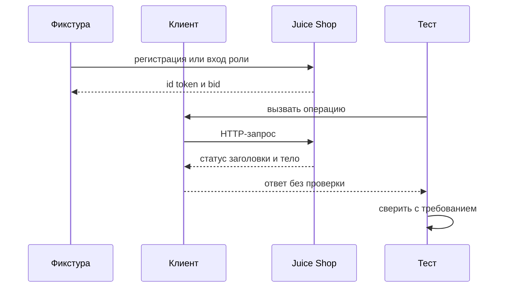
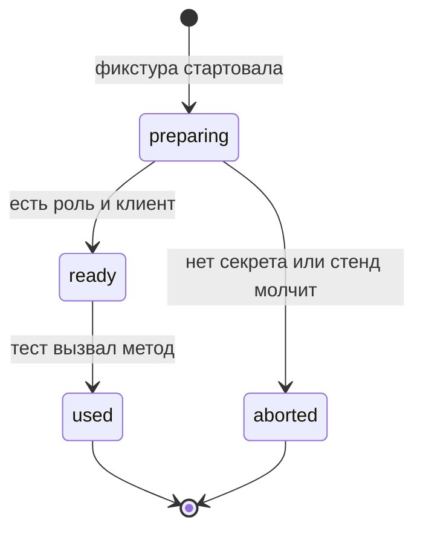

# Фикстуры и слой API-клиента

## Содержание

- [Теория](#теория)
  - [Ситуация](#ситуация)
  - [Модель](#модель)
  - [Понятия и связь с автоматизацией тестирования](#понятия-и-связь-с-автоматизацией-тестирования)
  - [Зоны ответственности](#зоны-ответственности)
  - [Пример](#пример)
  - [Типичные сбои](#типичные-сбои)
  - [Полезные ссылки](#полезные-ссылки)
  - [Вопросы по теории](#вопросы-по-теории)
- [Практическое задание](#практическое-задание)
  - [1.1 Общее](#11-общее)
  - [1.2 Сценарии](#12-сценарии-user-stories)
  - [1.3 Контракт](#13-контракт)
  - [1.4 Ошибки и ограничения](#14-ошибки-и-ограничения)
  - [1.5 Аудит](#15-аудитлоги)
  - [1.6 Нефункциональные требования](#16-нефункциональные-требования)

# Теория

## Ситуация

Набор тестов готовит роль и вызывает Juice Shop через клиент, а не через разрозненные URL. Дальше возможен один из исходов: фикстура отдала свежего покупателя и клиент вернул статус, вход встроенной роли удался один раз на воркер, email двух воркеров совпал и стенд ответил **400**, обязательный секрет пуст и прогон остановился, пользователь после теста остался в базе либо стенд недоступен.

Отдельная разработка не нужна: достаточно запущенного контейнера Juice Shop и команды `npx playwright test --grep @api` (`pytest -m api`, `dotnet test --filter Category=api`).

## Модель

Участвуют фикстура, клиент, тест и стенд. Фикстура решает, какой токен выдать. Клиент только отправляет запрос и возвращает ответ целиком. Решение о прохождении принимает оракул теста — требование, а не текущий ответ стенда. Проверки внутрь клиента не переносят: иначе негативный **401** выглядит как поломка клиента.



Фикстура ходит на стенд до теста, потому что токен нужен уже в первой строке сценария. Клиент не решает, хороший код или плохой. Это делает тест, который знает кейс.



В `ready` у теста есть `customer` или контекст роли. В `aborted` кейсы `1.1`–`1.3` не начинаются. Повтор после `aborted` не оставляет новую учётку, если регистрация не успела. Если регистрация успела, а вход нет, учётка остаётся: удалить её API нельзя.

Возможный набор полей (схема может быть и другой):

| `customer` | Описание |
| --- | --- |
| `email` | `aqa.<RUN_ID>.<номер воркера>.<порядковый номер>@example.test` |
| `password` | 12 символов, оба регистра, цифры и спецсимвол |
| `id` | `data.id` после **201** |
| `token` | `authentication.token` после входа |
| `basketId` | `authentication.bid` |

Файл использует того же пользователя, товар и корзину, что `1.1`–`1.3`. Новых полей стенда нет. Отдельной реляционной схемы курс не вводит.

## Понятия и связь с автоматизацией тестирования

### Клиент API

Адрес, метод и разбор тела легко расползаются по тестам, и правка пути превращается в десяток правок. Общий объект на группу адресов называют клиентом. Клиент возвращает статус, заголовки и тело. На Juice Shop клиентов шесть: `AuthClient`, `UsersClient`, `ProductsClient`, `BasketClient`, `OrdersClient`, `FeedbackClient`. Имена методов в TypeScript — camelCase, в Python — snake_case, в C# — PascalCase и суффикс `Async`. Смысл аргументов один. В контракте у каждого метода указан путь стенда, а проверки остаются в тесте.

### Фикстура

Одинаковую подготовку не копируют в каждый тест. Кусок, который выдаёт готовые данные и убирает за собой то, что убрать можно, называют фикстурой. Здесь уборка пользователя невозможна, поэтому фикстура обеспечивает уникальность, а не удаление. `customer` создаёт нового покупателя на каждый тест: `email`, `password`, `id`, `token`, `basketId`. `customerApi` — контекст с `Authorization: Bearer <token>` этого покупателя. `guestApi` — контекст без токена. `adminApi` и `accountantApi` входят один раз на воркер. В контракте тест `1.1`–`1.3` получает роль аргументом, а не повторяет регистрацию в теле.

В TypeScript фикстуры расширяют тест в `src/fixtures/test.ts` через `test.extend`. В Python они лежат в `conftest.py`: `customer` со scope `function`, `admin_api` и `accountant_api` со scope `session`. В C# базовый класс `ApiTestBase : PlaywrightTest` даёт `CreateCustomerAsync()` и свойства `AdminApi`, `AccountantApi`, `GuestApi`.

### Уникальный email

Два воркера, которые пишут одного и того же покупателя, ломают друг друга дубликатом. Адрес собирают так: `aqa.<RUN_ID>.<номер воркера>.<порядковый номер>@example.test`. Домен `.test` зарезервирован и никуда не доставляется. `RUN_ID` в CI равен `${{ github.run_id }}`, локально создаётся на старте. Номер воркера различает параллельные процессы, порядковый номер — нескольких покупателей внутри одного теста. В контракте фикстура `customer` не принимает email снаружи, она его собирает.

### Что остаётся после теста

После проверки учётка всё ещё в базе. `DELETE /api/Users/{id}` стенд не выполняет, это закрытая операция из `1.3`. Данные разных тестов разъезжаются уникальным email. Полный сброс — новый контейнер: база Juice Shop создаётся заново при каждом запуске. Как этим пользоваться в фабриках и data-driven наборах, разбирает `7.1`. В контракте тест не вызывает удаление пользователя.

Простые фабрики уже нужны клиенту регистрации. `buildCustomer`, `buildAddress`, `buildCard` и `buildFeedback` лежат в `src/data/factories.ts`, `aqa/data/factories.py` и `Data/TestData.cs`. TypeScript берёт `@faker-js/faker`, Python — `Faker`, C# — `Bogus`. Пароль покупателя — 12 символов описанного вида. Ответ на секретный вопрос — слово. Номер карты — 16 цифр. Имена Python — `build_customer` и соседние. Имена C# — `TestData.Customer()`, `TestData.Address()`, `TestData.Card()`, `TestData.Feedback()`.

### Что будет в корзине и заказе

Файл `1.5` вызывает `BasketClient` и `OrdersClient`, а покупателя берёт из `customer`. Путь `POST /api/BasketItems` и номер `bid` больше не собираются в тесте заказа. Правила количества и цены остаются в `1.5`.

### Сводка

| Понятие | Смысл в слое клиента | На что опирается реализация |
| --- | --- | --- |
| Клиент | путь и метод без проверок | шесть классов и таблица методов |
| Фикстура | готовая роль для теста | `test.extend`, `conftest.py`, `ApiTestBase` |
| Уникальный email | параллельные воркеры не делят ящик | `RUN_ID`, номер воркера, номер по порядку |
| Фабрика | пароль, адрес, карта, отзыв | `@faker-js/faker`, `Faker`, `Bogus` |
| Сброс | чистая база | новый контейнер, подробности в `7.1` |

## Зоны ответственности

| Автотест | Фреймворк |
| --- | --- |
| Сверяет код и поля с кейсом | Клиент возвращает статус, заголовки и тело |
| Берёт `customer` и не повторяет регистрацию | Фикстура создаёт покупателя на тест |
| Берёт `adminApi` и `accountantApi` как уже вошедшие | Вход встроенной роли один раз на воркер |
| Собирает сценарий из методов клиента | Методы знают пути Juice Shop |
| Не удаляет пользователя | Уникальный email и перезапуск контейнера разделяют данные |

Клиент не заменяет оракул из `1.0`. Фикстура не заменяет матрицу прав из `1.3`: она только приносит токен.

## Пример

Программа входит неизвестным email через `AuthClient` и проверяет отказ в тесте, не в клиенте. Успех — **401** и текст `Invalid email or password.` На всех стеках раннер сообщает об одном пройденном тесте.

### TypeScript

**Node.js 22 или новее, @playwright/test.** Класс клиента возвращает ответ `post`. Ключевой параметр — пара email и пароль.

```sh
npm install -D @playwright/test
npx playwright install
npx playwright test --grep TC-AUTH-03
```

```typescript
import { expect, test, type APIRequestContext, type APIResponse } from '@playwright/test';

class AuthClient {
  constructor(private readonly api: APIRequestContext) {}
  login(email: string, password: string): Promise<APIResponse> {
    return this.api.post('/rest/user/login', { data: { email, password } });
  }
}

test('TC-AUTH-03 неизвестный email', { tag: ['@api'] }, async ({ playwright }) => {
  const api = await playwright.request.newContext({
    baseURL: process.env.BASE_URL ?? 'http://localhost:3000',
  });
  const response = await new AuthClient(api).login('nobody@example.test', 'wrong-pass');
  expect(response.status()).toBe(401);
  expect(await response.text()).toContain('Invalid email or password.');
  await api.dispose();
});
```

### Python

**Python 3.10 или новее, pytest-playwright.** Метод `login` возвращает ответ библиотеки. Ключевой параметр — те же два поля.

```sh
pip install pytest pytest-playwright
playwright install
pytest -m api -k tc_auth_03
```

```python
import os
import pytest
from playwright.sync_api import APIRequestContext, Playwright

class AuthClient:
    def __init__(self, api: APIRequestContext) -> None:
        self.api = api
    def login(self, email: str, password: str):
        return self.api.post("/rest/user/login", data={"email": email, "password": password})

@pytest.mark.api
def test_tc_auth_03_unknown_email(playwright: Playwright) -> None:
    api = playwright.request.new_context(base_url=os.environ.get("BASE_URL", "http://localhost:3000"))
    response = AuthClient(api).login("nobody@example.test", "wrong-pass")
    assert response.status == 401
    assert "Invalid email or password." in response.text()
    api.dispose()
```

### C#

**.NET 8 или новее, Microsoft.Playwright.NUnit.** `LoginAsync` возвращает `IAPIResponse` без `Assert` внутри. Ключевой параметр — словарь тела.

```sh
dotnet add package Microsoft.Playwright.NUnit
dotnet build
pwsh bin/Debug/net8.0/playwright.ps1 install
dotnet test --filter "Category=api&Name~TC_AUTH_03"
```

```csharp
using Microsoft.Playwright;
using Microsoft.Playwright.NUnit;
using NUnit.Framework;

public sealed class AuthClient
{
    private readonly IAPIRequestContext api;
    public AuthClient(IAPIRequestContext api) => this.api = api;
    public Task<IAPIResponse> LoginAsync(string email, string password) =>
        api.PostAsync("/rest/user/login", new()
        {
            DataObject = new Dictionary<string, string> { ["email"] = email, ["password"] = password },
        });
}

[TestFixture]
public class AuthClientTests : PlaywrightTest
{
    [Test]
    [Category("api")]
    public async Task TC_AUTH_03()
    {
        var baseUrl = Environment.GetEnvironmentVariable("BASE_URL") ?? "http://localhost:3000";
        var api = await Playwright.APIRequest.NewContextAsync(new() { BaseURL = baseUrl });
        var response = await new AuthClient(api).LoginAsync("nobody@example.test", "wrong-pass");
        Assert.That(response.Status, Is.EqualTo(401));
        Assert.That(await response.TextAsync(), Does.Contain("Invalid email or password."));
        await api.DisposeAsync();
    }
}
```

---

Каждый раннер сообщает о 1 пройденном тесте. Это доказывает, что клиент вернул ответ как есть, а проверка **401** и нейтрального текста стоит в тесте.

## Типичные сбои

| Что видно | Куда смотреть |
| --- | --- |
| **400** `email must be unique` у свежей фикстуры | В адресе нет номера воркера или `RUN_ID` общий и статичный |
| Клиент сам бросает ошибку на **401** | Проверку перенести в тест, клиент возвращает ответ |
| `adminApi` логинится в каждом тесте | Scope воркера или session, пароль из `ADMIN_PASSWORD` |
| Пустой `ACCOUNTANT_PASSWORD` посреди набора | Fail-fast из `1.0` до тестов, не значение по умолчанию |
| Тест удаляет пользователя и получает **401** | `DELETE /api/Users/{id}` закрыт, изоляция — новый email |
| В логе пароль фикстуры | Журнал пишет email на `.test` и код, не пароль и не JWT |
| Два теста читают один `bid` | `customer` создаётся на тест, не на весь прогон |
| Фабрика выдала пароль короче 5 символов | Правило 12 символов, оба регистра, цифра и спецсимвол |

## Полезные ссылки

### Общие

- [Playwright — Fixtures](https://playwright.dev/docs/test-fixtures) — как расширять тест подготовкой данных.
- [RFC 2606 — Reserved Top Level DNS Names](https://www.rfc-editor.org/rfc/rfc2606) — домен `.test` у учебного email.
- [Playwright — API testing](https://playwright.dev/docs/api-testing) — контекст запроса, который прячет клиент.

### По языку

#### TypeScript

**TypeScript, Playwright Test.** На JavaScript контракт фикстур и клиента остаётся тем же.

- [Playwright — test.extend](https://playwright.dev/docs/api/class-test#test-extend) — фикстуры `customer` и контекстов ролей.

#### Python

**Python, pytest-playwright.** На синхронном Playwright API без pytest или на async API контракт фикстур и клиента остаётся тем же.

- [pytest — Fixtures](https://docs.pytest.org/en/stable/how-to/fixtures.html) — scope `function` и `session`.

#### C#

**C#, Playwright для .NET с NUnit.** На MSTest или xUnit контракт фикстур и клиента остаётся тем же.

- [NUnit — SetUp and TearDown](https://docs.nunit.org/articles/nunit/writing-tests/setup-teardown.html) — место `CreateCustomerAsync` в базовом классе.
- [Playwright .NET — API testing](https://playwright.dev/dotnet/docs/api-testing) — контекст, который хранит `ApiTestBase`.

## Вопросы по теории

1. Почему клиент возвращает статус и тело и не содержит проверок?
2. Что произойдёт, если два воркера зарегистрируют один email?
3. Зачем `adminApi` входит один раз на воркер, а `customer` создаётся на каждый тест?
4. Чем фикстура отличается от фабрики `buildCustomer`?
5. Почему после теста пользователя не удаляют вызовом API?
6. Как в email попадают `RUN_ID` и номер воркера?
7. Когда для чистой базы нужен новый контейнер, а когда хватает нового адреса?

# Практическое задание

Функциональность слоя доступа к API в системе.
Автотесты регистрации, контракта и ролей для Juice Shop на клиентах и фикстурах.
Новых кейсов нет. Итог — тесты `1.1`–`1.3` вызывают методы клиентов и получают роли из фикстур.

## 1) Фикстуры и слой API-клиента

### 1.1 Общее

**Назначение:** собрать пути Juice Shop и подготовку ролей в одном слое, чтобы кейсы проверяли требование.

**Пользователи/роли:**

- `customer` — новый покупатель на тест;
- `guest` — контекст без токена;
- `accounting` и `admin` — вход один раз на воркер;
- AQA-инженер — переписывает прежние тесты на этот слой.

**Зависимости/связанные настройки:**

- `1.0` — `ApiClient`, `RUN_ID`, секреты;
- `1.1`–`1.3` — кейсы, которые переезжают на клиенты;
- `BASE_URL`, `ADMIN_EMAIL`, `ADMIN_PASSWORD`, `ACCOUNTANT_EMAIL`, `ACCOUNTANT_PASSWORD`.

Корзина и заказ — `1.5`. Полный разбор сброса данных — `7.1`.

### 1.2 Сценарии (user stories)

1. **Тот же кейс, другой вызов:** `TC-REG-01` идёт через `UsersClient.register`, ожидания не меняются.
2. **Свежий покупатель:** фикстура `customer` даёт email, пароль, id, токен и `basketId`.
3. **Встроенные роли:** бухгалтер и администратор входят один раз на воркер.
4. **Гость:** `guestApi` шлёт запрос без токена, и `TC-ACL-02` по-прежнему ждёт **401**.
5. **Параллельный прогон:** у двух воркеров разные email, дубликата между ними нет.

### 1.3 Контракт

#### 1.3.1 Методы клиентов

**Общее правило:** метод возвращает статус, заголовки и тело. Внутри метода нет `expect` и `assert`.

| Клиент | Методы | Эндпоинты |
| --- | --- | --- |
| `AuthClient` | `login(email, password)`, `whoami(token)` | `POST /rest/user/login`, `GET /rest/user/whoami` |
| `UsersClient` | `register(user)`, `get(id)`, `list()` | `POST /api/Users` и `POST /api/SecurityAnswers`, `GET /api/Users/{id}`, `GET /api/Users` |
| `ProductsClient` | `list()`, `search(q)` | `GET /api/Products`, `GET /rest/products/search?q=` |
| `BasketClient` | `get(basketId)`, `addItem(basketId, productId, quantity)`, `updateItem(itemId, quantity)`, `checkout(basketId, orderDetails)` | `GET /rest/basket/{id}`, `POST /api/BasketItems`, `PUT /api/BasketItems/{id}`, `POST /rest/basket/{id}/checkout` |
| `OrdersClient` | `history()`, `all()`, `addAddress(address)`, `addCard(card)`, `deliveryMethods()`, `quantities()` | `GET /rest/order-history`, `GET /rest/order-history/orders`, `POST /api/Addresss`, `POST /api/Cards`, `GET /api/Deliverys`, `GET /api/Quantitys` |
| `FeedbackClient` | `captcha()`, `create(feedback)` | `GET /rest/captcha`, `POST /api/Feedbacks` |

`whoami` передаёт токен cookie `token`. `addItem` кладёт `BasketId` строкой. Имена C# получают суффикс `Async`, имена Python — подчёркивания.

**Логика/шаги:**

1. Создать контекст с `BASE_URL` и токеном фикстуры, если роль не гость.
2. Вызвать метод клиента из теста.
3. Вернуть ответ в тест без проверки.
4. Закрыть контекст вместе с фикстурой.

Если `register` вернул **201**, а следующий шаг упал, учётка уже есть. Повтор фикстуры берёт новый порядковый номер.

**Ответы:**

- **Успех слоя:** тест получил полный ответ и сам сверил его с кейсом.
- **Ошибки:** см. раздел 1.4.

#### 1.3.2 Фикстуры

| Фикстура | Проверки/валидация |
| --- | --- |
| `customer` | новый покупатель на тест: `email`, `password`, `id`, `token`, `basketId` |
| `customerApi` | `Authorization: Bearer` этого покупателя |
| `adminApi` | вход `admin@juice-sh.op` один раз на воркер |
| `accountantApi` | вход `accountant@juice-sh.op` один раз на воркер |
| `guestApi` | контекст без токена |

**Логика/шаги:**

1. Собрать email по правилу `aqa.<RUN_ID>.<номер воркера>.<порядковый номер>@example.test`.
2. Зарегистрировать покупателя фабрикой и войти.
3. Отдать тест структуру `customer` и контекст.
4. Для встроенных ролей войти один раз и переиспользовать контекст.

**Ответы:**

- **Успех:** тест пишет кейс, не копируя `POST /api/Users`.
- **Ошибки:** см. раздел 1.4.

#### 1.3.3 Перенос прежних кейсов

| Группа | Проверки/валидация |
| --- | --- |
| `1.1` | `TC-REG-01` … `TC-REG-08`, `TC-AUTH-01` … `TC-AUTH-04` через `UsersClient` и `AuthClient` |
| `1.2` | `TC-REG-09`, `TC-AUTH-05`, `TC-SEARCH-01` … `TC-SEARCH-03`, `TC-CART-01`, `TC-ACL-01` через клиентов и схемы |
| `1.3` | `TC-ACL-02` … `TC-ACL-07` через `guestApi`, `customerApi`, `accountantApi` |

**Логика/шаги:**

1. Заменить прямой URL на метод клиента.
2. Заменить ручную регистрацию на фикстуру там, где нужен свой покупатель.
3. Оставить коды, тексты и метки `BUG-…` как в исходном кейсе.

**Ответы:**

- **Успех:** идентификаторы кейсов те же, ожидания те же.
- **Ошибки:** см. раздел 1.4.

### 1.4 Ошибки и ограничения

- **400** `email must be unique` — фикстура повторила адрес. Следующий порядковый номер или другой номер воркера.
- **401** на операции гостя — ожидаемый исход `TC-ACL-02`, не ошибка клиента.
- **201** или **200** — ответ для теста. Клиент его не оценивает.
- **Остановка до тестов** — пустые `ADMIN_PASSWORD` или `ACCOUNTANT_PASSWORD`.
- **Ошибка соединения** — стенд не готов, см. `1.0`.
- **Удаление пользователя** — API его не выполняет. Повтор опирается на новый email.
- **Секрет в коде фабрики** — пароли встроенных ролей только из окружения. Пароль свежего покупателя генерирует фабрика и не пишет его в лог.

Порядок такой: сначала окружение и `RUN_ID`, потом фикстура роли, потом метод клиента, потом проверка кейса.

### 1.5 Аудит/логи

Логировать: имя фикстуры, email на домене `.test` без пароля, метод клиента, путь и код ответа.

В журнал не попадают пароль, ответ на секретный вопрос, номер карты, cookie `token`, полный JWT и хеш пароля из тела.

### 1.6 Нефункциональные требования

- Создание `customer` укладывается в таймаут теста 30 с.
- В фикстуре и тесте нет `waitForTimeout` и `sleep`.
- В CI два воркера, и их email различаются номером воркера.
- Ретраи: 0 локально, 2 в CI.
- Перенос покрывает все кейсы `1.1`, `1.2` и `1.3` без смены идентификаторов.
- Общие правила прогона из `1.0` относятся и к этому слою.
