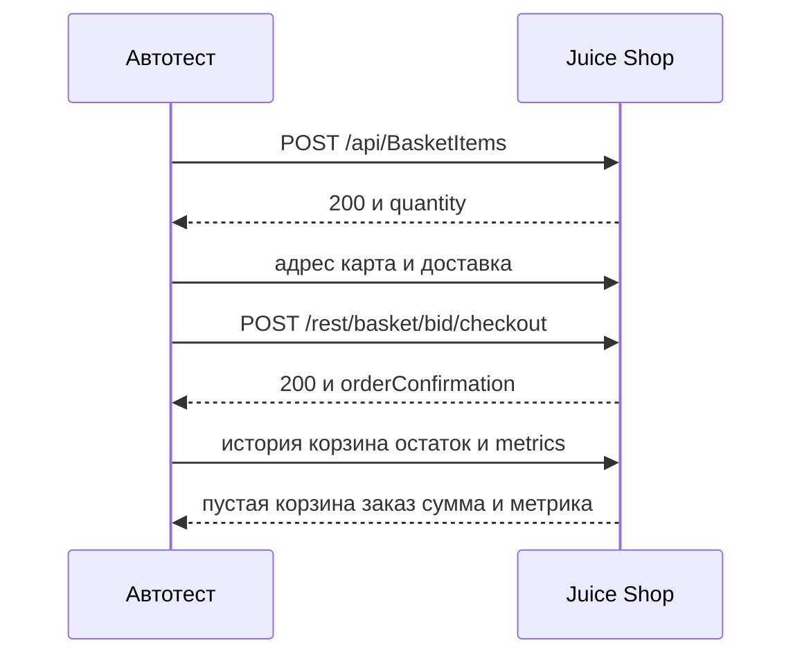
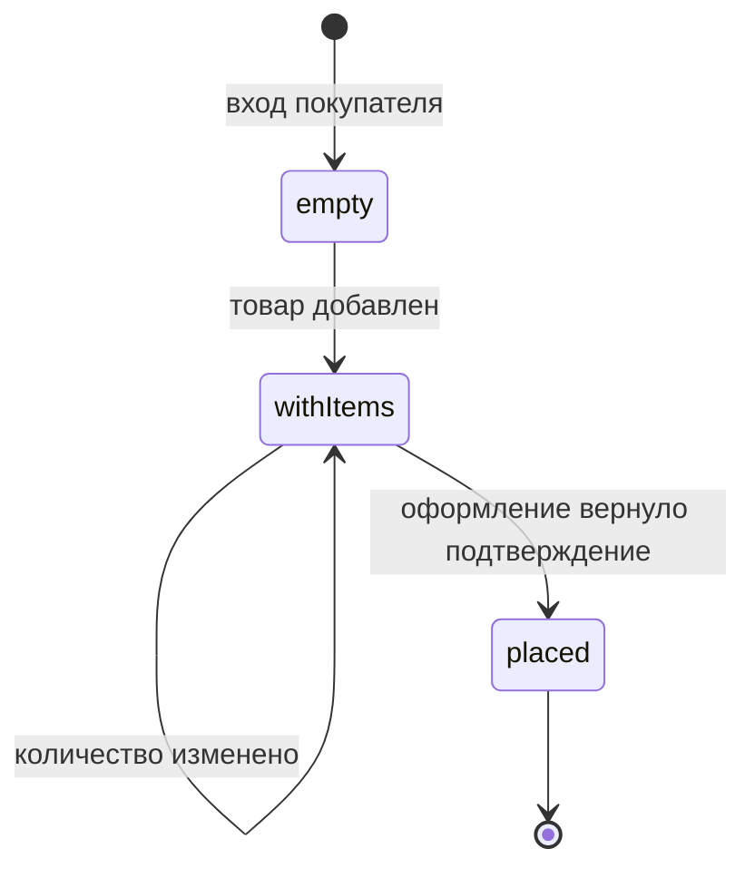

# Корзина и заказ

## Содержание

- [Теория](#теория)
  - [Ситуация](#ситуация)
  - [Модель](#модель)
  - [Понятия и связь с автоматизацией тестирования](#понятия-и-связь-с-автоматизацией-тестирования)
  - [Зоны ответственности](#зоны-ответственности)
  - [Пример](#пример)
  - [Типичные сбои](#типичные-сбои)
  - [Полезные ссылки](#полезные-ссылки)
  - [Вопросы по теории](#вопросы-по-теории)
- [Практическое задание](#практическое-задание)
  - [1.1 Общее](#11-общее)
  - [1.2 Сценарии](#12-сценарии-user-stories)
  - [1.3 Контракт](#13-контракт)
  - [1.4 Ошибки и ограничения](#14-ошибки-и-ограничения)
  - [1.5 Аудит](#15-аудитлоги)
  - [1.6 Нефункциональные требования](#16-нефункциональные-требования)

# Теория

## Ситуация

Автотест кладёт товар в корзину Juice Shop и оформляет заказ. Дальше возможен один из исходов: позиция создана с **200** и `quantity = 1`, количество доведено до 5, шестая штука товара 1 отвергнута с **400**, повтор того же товара или количество 0 и −1 расходятся с требованием и помечены `known-issue`, заказ создан и подтверждён соседними запросами, метрика заказов выросла не сразу либо стенд недоступен.

Отдельная разработка не нужна: достаточно запущенного контейнера Juice Shop и команды `npx playwright test --grep @api` (`pytest -m api`, `dotnet test --filter Category=api`).

## Модель

Участвуют тест, `BasketClient`, `OrdersClient` и стенд. Тест задаёт товар, количество, адрес, карту и доставку. Решение о прохождении принимает оракул теста — требование, а не текущий ответ стенда. Успех заказа виден не только по коду оформления. Корзина пустеет, заказ появляется в истории, сумма сходится с ценами, остаток товара уменьшается. Это проверка побочного эффекта через другие операции API. Прямой SQL здесь недоступен: внутри образа SQLite, а образ distroless, без shell. Там, где база открыта снаружи, тот же эффект можно прочитать запросом к ней. На этом стенде граница такая: снаружи есть HTTP и `/metrics`.



Оформление стоит после адреса, карты и доставки, потому что телу нужны `paymentId`, `addressId` и `deliveryMethodId`. История и метрика читаются после, иначе тест увидит старое состояние.



В `withItems` корзина принадлежит `bid` покупателя. В `placed` корзина этого `bid` пустая, а заказ лежит в истории. Перехода «оформить пустую корзину» в кейсах нет: `TC-ORDER-01` стартует из корзины с товаром.

Возможный набор полей (схема может быть и другой):

| `BasketItem` | Описание |
| --- | --- |
| `id` | номер позиции |
| `ProductId` | товар, в кейсах лимита это `1` |
| `BasketId` | номер корзины, в запросе передаётся строкой |
| `quantity` | штуки, у товара 1 не больше 5 |

| `заказ` | Описание |
| --- | --- |
| `orderConfirmation` | строка вида `^[0-9a-f]{4}-[0-9a-f]{16}$` |
| `totalPrice` | сумма цен позиций плюс цена доставки |
| `deliveryPrice` | цена выбранного способа |

Файл использует корзину, адрес, карту, способ доставки, историю заказов и остаток. Отдельной реляционной схемы курс не вводит.

## Понятия и связь с автоматизацией тестирования

### Позиция корзины

Товар в корзине — отдельная запись со количеством. Её создают `POST /api/BasketItems`. Тело: `ProductId`, `BasketId` строкой и `quantity`. У создания пользователя код был **201**. У позиции корзины код **200**, и это норма для стенда, а не пропущенный дефект. Кейс `TC-CART-02` кладёт товар 1 и ждёт **200** и `quantity = 1`. Товар 1 — `Apple Juice (1000ml)`, цена `1.99`, лимит 5 штук на покупателя. Товар 2 — `Orange Juice (1000ml)`, цена `2.99`, лимита нет. В контракте лимит проверяют на товаре 1.

Повторный `POST` того же товара в ту же корзину по правилу должен завершиться отказом **400** без внутренних деталей. Стенд отвечает **500** и кладёт в тело `stack`. Это `BUG-02`, кейс `TC-CART-05`. В контракте ожидание остаётся **400**.

### Количество

Уже созданную позицию меняют `PUT /api/BasketItems/{id}` с телом `{ quantity }`. Поднять товар 1 до 5 штук — законно, код **200**. Это `TC-CART-03`. Шестая штука переходит границу из `0.3`: **400** и тело `{"error":"You can order only up to 5 items of this product."}`. Это `TC-CART-04`. Ноль и минус одну штуку правило отвергает с **400**. Стенд отвечает **200**. Это `BUG-03`, кейс `TC-CART-06`. В контракте оба недопустимых количества ждут **400**. Если товара нет на складе, стенд отвечает **400** и `{"error":"We are out of stock! Sorry for the inconvenience."}`.

### Оформление

Заказ собирается из трёх ссылок: адрес, карта и доставка. Адрес — `POST /api/Addresss` с `fullName`, `mobileNum`, `zipCode`, `streetAddress`, `city`, `state`, `country`, код **201**. Карта — `POST /api/Cards` с `fullName`, `cardNum`, `expMonth`, `expYear`, код **201**. Способы доставки — `GET /api/Deliverys`. Для обычного покупателя их три: `1` `One Day Delivery` цена `0.99` и `eta` `1`, `2` `Fast Delivery` цена `0.5` и `eta` `3`, `3` `Standard Delivery` цена `0` и `eta` `5`. Оформление — `POST /rest/basket/{bid}/checkout` с телом `{ orderDetails: { paymentId, addressId, deliveryMethodId } }`. Ответ **200** и `{"orderConfirmation":"xxxx-<16 hex>"}`. В контракте `TC-ORDER-01` проверяет шаблон `^[0-9a-f]{4}-[0-9a-f]{16}$`.

### Серая коробка

Мало увидеть подтверждение. Нужно увидеть, что заказ действительно сложился. Проверку через другие наблюдаемые выходы, без чтения внутренностей, называют серой коробкой. Здесь после оформления корзина пуста, заказ есть в `GET /rest/order-history`, а `totalPrice` равен сумме «цена × количество» плюс доставка. Учебный пример: две штуки товара 1 и доставка `One Day Delivery`, то есть `2 × 1.99 + 0.99 = 4.97`. Остаток товара 1 в `GET /api/Quantitys` уменьшился на 2. Этот список читает роль `accounting`. В контракте все четыре наблюдения входят в `TC-ORDER-01`.

Чужой `BasketId` при добавлении позиция не создаёт: **401** и текст `{'error' : 'Invalid BasketId'}`. Неизвестный товар даёт **500** и текст `No such product found!`.

### Метрика заказа

Счётчик заказов живёт не в ответе оформления, а на `GET /metrics`. Имя — `juiceshop_orders_placed_total`, общий ярлык стенда — `app="juiceshop"`. Показания обновляются раз в 5 секунд, поэтому сразу после **200** число может быть прежним. Кейс `TC-ORDER-02` опрашивает метрику, пока она не станет больше значения до заказа, но не дольше 15 секунд. В контракте опрос — повтор чтения, а не единственная пауза `sleep`.

### Что будет в запуске в CI

Файл `1.6` гоняет этот набор вместе с остальными API-кейсами в job `api`. Опрос метрики остаётся внутри теста и укладывается в таймаут 30 с. Пайплайн отдельно ждёт только готовность стенда.

### Сводка

| Понятие | Смысл в корзине и заказе | На что опирается реализация |
| --- | --- | --- |
| Позиция | **200** и `quantity` | `TC-CART-02`, `BasketClient.addItem` |
| Лимит 5 | шестая штука товара 1 — **400** | `TC-CART-04` |
| Известные дефекты | повтор позиции и количество 0 или −1 | `BUG-02`, `BUG-03` |
| Сумма | цена × штуки + доставка | пример `4.97` |
| Серая коробка | история, пустая корзина, остаток, метрика | `TC-ORDER-01`, `TC-ORDER-02` |

## Зоны ответственности

| Тест | Стенд |
| --- | --- |
| Кладёт товар 1 и сверяет **200** и `quantity` | Создаёт позицию корзины |
| Доводит количество до 5 и отвергает 6 | Хранит лимит 5 у товара 1 |
| Ждёт **400** на повторе и на количестве 0 и −1 | Отвечает фактами `BUG-02` и `BUG-03` |
| Считает `4.97` из цен стенда | Пишет `totalPrice` в историю |
| Читает остаток от имени `accounting` | Отдаёт `GET /api/Quantitys` |
| Опрашивает `juiceshop_orders_placed_total` до 15 с | Обновляет показатель раз в 5 с |

Чтение SQLite не заменяет эти запросы на данном образе. Метка `known-issue` не меняет лимит 5 и формулу суммы.

## Пример

Программа добавляет товар 1 в корзину свежего покупателя. Успех — **200**, `data.quantity = 1` и `ProductId = 1`. Фикстура `customer` и `BasketClient` берутся из `1.4`. На всех стеках раннер сообщает об одном пройденном тесте.

### TypeScript

**Node.js 22 или новее, @playwright/test.** Метод `addItem` шлёт `POST /api/BasketItems`. Ключевой параметр — товар `1` и количество `1`.

```sh
npm install -D @playwright/test
npx playwright install
npx playwright test --grep TC-CART-02
```

```typescript
import { expect } from '@playwright/test';
import { test } from '../src/fixtures/test';

test('TC-CART-02 добавляет товар 1', { tag: ['@api', '@regression'] }, async ({ basketClient, customer }) => {
  const response = await basketClient.addItem(customer.basketId, 1, 1);
  expect(response.status()).toBe(200);
  const body = await response.json();
  expect(body.status).toBe('success');
  expect(body.data.ProductId).toBe(1);
  expect(body.data.quantity).toBe(1);
});
```

### Python

**Python 3.10 или новее, pytest-playwright.** Метод `add_item` делает тот же запрос. Ключевой параметр — идентификаторы корзины и товара.

```sh
pip install pytest pytest-playwright
playwright install
pytest -m api -k tc_cart_02
```

```python
import pytest

@pytest.mark.api
@pytest.mark.regression
def test_tc_cart_02_add_item(basket_client, customer) -> None:
    response = basket_client.add_item(customer.basket_id, 1, 1)
    assert response.status == 200
    body = response.json()
    assert body["status"] == "success"
    assert body["data"]["ProductId"] == 1
    assert body["data"]["quantity"] == 1
```

### C#

**.NET 8 или новее, Microsoft.Playwright.NUnit.** `AddItemAsync` возвращает ответ без проверки. Ключевой параметр — товар `1`.

```sh
dotnet add package Microsoft.Playwright.NUnit
dotnet build
pwsh bin/Debug/net8.0/playwright.ps1 install
dotnet test --filter "Category=api&Name~TC_CART_02"
```

```csharp
using Microsoft.Playwright.NUnit;
using NUnit.Framework;

[TestFixture]
public class CartTests : ApiTestBase
{
    [Test]
    [Category("api")]
    [Category("regression")]
    public async Task TC_CART_02()
    {
        var customer = await CreateCustomerAsync();
        var response = await new BasketClient(CustomerApi).AddItemAsync(customer.BasketId, 1, 1);
        Assert.That(response.Status, Is.EqualTo(200));
        var body = await response.JsonAsync();
        Assert.That(body?.GetProperty("data").GetProperty("quantity").GetInt32(), Is.EqualTo(1));
        Assert.That(body?.GetProperty("data").GetProperty("ProductId").GetInt32(), Is.EqualTo(1));
    }
}
```

---

Каждый раннер сообщает о 1 пройденном тесте. Это доказывает, что добавление товара 1 завершилось кодом **200**, а в теле `quantity` равен 1 и `ProductId` равен 1.

## Типичные сбои

| Что видно | Куда смотреть |
| --- | --- |
| Тест ждёт **201** на `POST /api/BasketItems` | Для позиции нормален **200**, см. `TC-CART-02` |
| Шестая штука прошла | Лимит 5 только у товара 1, товар 2 без лимита |
| **500** и `stack` на повторном добавлении | `BUG-02`, ожидание **400**, тег `known-issue` |
| Количество 0 сохранилось | `BUG-03`, ожидание **400** |
| `totalPrice` не 4.97 | Две штуки по `1.99` и доставка `0.99` |
| Остаток не изменился | `GET /api/Quantitys` от роли `accounting`, минус 2 |
| Метрика не выросла в ту же секунду | Опрос до 15 с, обновление раз в 5 с |
| Вложение заказа содержит номер карты | В отчёт карты и `stack` целиком не кладут |

## Полезные ссылки

### Общие

- [Playwright — API testing](https://playwright.dev/docs/api-testing) — цепочка запросов одного покупателя.
- [RFC 9110 — HTTP Semantics](https://www.rfc-editor.org/rfc/rfc9110) — **200**, **400** и **500** в этой цепочке.
- [Prometheus — Exposition formats](https://prometheus.io/docs/instrumenting/exposition_formats/) — как прочитать `juiceshop_orders_placed_total`.

### По языку

#### TypeScript

**TypeScript, Playwright Test.** На JavaScript контракт корзины и заказа остаётся тем же.

- [Playwright — expect.poll](https://playwright.dev/docs/test-assertions#expectpoll) — опрос метрики до 15 с без единственной паузы.

#### Python

**Python, pytest-playwright.** На синхронном Playwright API без pytest или на async API контракт корзины и заказа остаётся тем же.

- [Playwright Python — Assertions](https://playwright.dev/python/docs/test-assertions) — проверки ответа клиента.

#### C#

**C#, Playwright для .NET с NUnit.** На MSTest или xUnit контракт корзины и заказа остаётся тем же.

- [Playwright .NET — API testing](https://playwright.dev/dotnet/docs/api-testing) — `PostAsync` для позиции и оформления.

## Вопросы по теории

1. Почему добавление товара ждёт **200**, хотя создание пользователя ждало **201**?
2. Что произойдёт при втором `POST /api/BasketItems` того же товара в ту же корзину?
3. Как увидеть, что заказ уменьшил остаток, если в контейнер нельзя зайти ради SQL?
4. Почему количество 0 считается нарушением требования?
5. Откуда в примере берётся сумма `4.97`?
6. Зачем метрику читают до 15 секунд, а не один раз сразу после оформления?
7. Чем товар 1 отличается от товара 2 в проверке лимита?

# Практическое задание

Функциональность корзины и заказа в системе.
Автотесты корзины и заказа для Juice Shop.
Автотест меняет количество, оформляет заказ и сверяет последствия через API и метрику. Итог — `TC-CART-02` … `TC-CART-06`, `TC-ORDER-01` и `TC-ORDER-02`.

## 1) Корзина и заказ

### 1.1 Общее

**Назначение:** проверить позицию, лимит, оформление и следы заказа вне одного ответа.

**Пользователи/роли:**

- `customer` — владелец корзины из фикстуры `1.4`;
- `accounting` — читает `GET /api/Quantitys`;
- AQA-инженер — помечает `BUG-02` и `BUG-03`.

**Зависимости/связанные настройки:**

- `1.4` — `BasketClient`, `OrdersClient`, `customer`, `accountantApi`;
- `0.1` — серая коробка как проверка побочного эффекта;
- `0.3` — граница количества 5;
- `BASE_URL`.

Запуск в пайплайне — `1.6`. Прямой доступ к SQLite этот файл не добавляет.

### 1.2 Сценарии (user stories)

1. **Первая штука:** товар 1 появляется в корзине с количеством 1.
2. **До лимита и за него:** 5 штук принимаются, 6 — нет.
3. **Повтор и мусорное количество:** второй POST и количества 0 и −1 остаются требованиями отказа.
4. **Заказ:** подтверждение, пустая корзина, история, сумма `4.97` и остаток минус 2.
5. **Счётчик:** `juiceshop_orders_placed_total` становится больше в пределах 15 секунд.

### 1.3 Контракт

#### 1.3.1 Добавление и изменение

| Кейс | Проверки/валидация |
| --- | --- |
| `TC-CART-02` | товар 1, **200**, `quantity = 1` |
| `TC-CART-03` | `PUT` до количества 5, **200** |
| `TC-CART-04` | 6 штук товара 1, **400**, текст `You can order only up to 5 items of this product.` |
| `TC-CART-05` | повторный `POST` того же товара в ту же корзину, ожидание **400**, факт **500** со `stack`, `BUG-02` |
| `TC-CART-06` | `quantity` 0 и −1, ожидание **400**, факт **200**, `BUG-03` |

**Логика/шаги:**

1. Взять `customer.basketId`.
2. Отправить `POST /api/BasketItems` с `ProductId` 1, `BasketId` строкой и `quantity` 1.
3. Обновить позицию до 5, затем отправить 6.
4. Повторить добавление и отдельно отправить количества 0 и −1 с метками дефектов.

Повтор `TC-CART-05` может оставить стенд в **500**. Следующий кейс создаёт нового покупателя, а не продолжает сломанную позицию.

**Ответы:**

- **Первая позиция:** **200**, `{status, data:{id, ProductId, BasketId, quantity, createdAt, updatedAt}}`.
- **Лимит:** **400**, `{"error":"You can order only up to 5 items of this product."}`.
- **Ошибки:** см. раздел 1.4.

#### 1.3.2 Оформление

| `TC-ORDER-01` | Проверки/валидация |
| --- | --- |
| состав | 2 штуки товара 1, доставка `1` `One Day Delivery` |
| ответ | **200**, `orderConfirmation` по `^[0-9a-f]{4}-[0-9a-f]{16}$` |
| корзина | `GET /rest/basket/{bid}` без товаров |
| история | заказ есть в `GET /rest/order-history`, `totalPrice` = `4.97` |
| остаток | `GET /api/Quantitys` от `accounting`, количество товара 1 меньше на 2 |

**Логика/шаги:**

1. Положить в корзину две штуки товара 1.
2. Создать адрес и карту, запросить `GET /api/Deliverys` и взять способ `1`.
3. Отправить `POST /rest/basket/{bid}/checkout` с `paymentId`, `addressId` и `deliveryMethodId`.
4. Прочитать корзину, историю и остаток.

Если адрес создался, а оформление оборвалось, адрес и карта остаются у покупателя. Повтор заказа идёт тем же покупателем, если корзина ещё полная, либо новым покупателем, если корзина уже пуста.

**Ответы:**

- **Успех:** **200** и подтверждение по шаблону.
- Сумма `2 × 1.99 + 0.99 = 4.97`.
- **Ошибки:** см. раздел 1.4.

#### 1.3.3 Метрика

| `TC-ORDER-02` | Проверки/валидация |
| --- | --- |
| имя | `juiceshop_orders_placed_total` |
| условие | значение больше, чем до оформления |
| предел | опрос не дольше 15 с |

**Логика/шаги:**

1. Прочитать метрику до заказа.
2. Оформить заказ по `TC-ORDER-01`.
3. Повторять `GET /metrics`, пока счётчик не вырастет или не истечёт 15 с.

**Ответы:**

- **Успех:** счётчик вырос в пределах 15 с.
- **Ошибки:** см. раздел 1.4.

### 1.4 Ошибки и ограничения

- **200** — позиция создана или количество принято. Для `TC-CART-06` это факт `BUG-03`, ожидание **400**.
- **400** и текст про 5 штук — законный отказ `TC-CART-04`.
- **400** и `We are out of stock! Sorry for the inconvenience.` — товара нет на складе. Кейс лимита тогда не доказывает границу 5. Нужен свежий контейнер или другой запас.
- **400** на повторе позиции — ожидание `TC-CART-05`.
- **500** со `stack` на повторе — факт `BUG-02`.
- **401** и текст `{'error' : 'Invalid BasketId'}` — в тело подставлен чужой номер корзины.
- **500** `No such product found!` — неизвестный `ProductId`.
- **200** оформления — есть `orderConfirmation`. Пустая корзина, история, сумма и остаток проверяются отдельно.
- **Метрика не выросла за 15 с** — `TC-ORDER-02` падает.
- **Ошибка соединения** — см. `1.0`.

Сначала проверяют код позиции, потом лимит, потом оформление, потом следы. Метрику не читают раньше заказа.

### 1.5 Аудит/логи

Логировать: кейс, `ProductId`, количество, код, факт `orderConfirmation` по шаблону без лишних персональных полей, изменение остатка и направление метрики.

В журнал не попадают номер карты, срок, полный адрес, cookie `token`, JWT и целиком `stack` из **500**. Для `BUG-02` достаточно кода **500** и факта, что в теле есть поле `stack`.

### 1.6 Нефункциональные требования

- Тест укладывается в 30 с. Опрос метрики — не дольше 15 с и входит в этот предел.
- В тесте нет шага, который только вызывает `waitForTimeout` или `sleep`.
- Ретраи: 0 локально, 2 в CI. Воркеров в CI — 2, у каждого свой покупатель.
- Покрыты `TC-CART-02`, `TC-CART-03`, `TC-CART-04`, `TC-CART-05`, `TC-CART-06`, `TC-ORDER-01`, `TC-ORDER-02`.
- У `TC-CART-05` метка `BUG-02`, у `TC-CART-06` метка `BUG-03`.
- Общие правила прогона из `1.0` относятся и к этим тестам.
