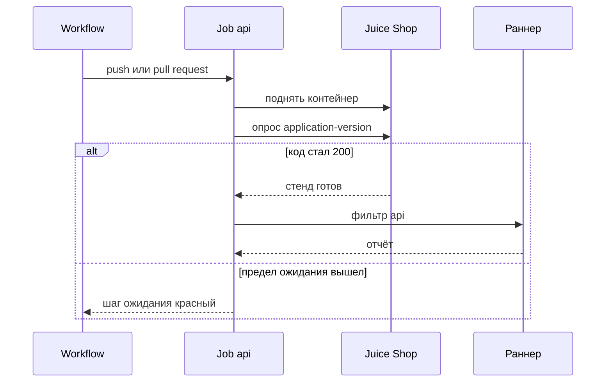
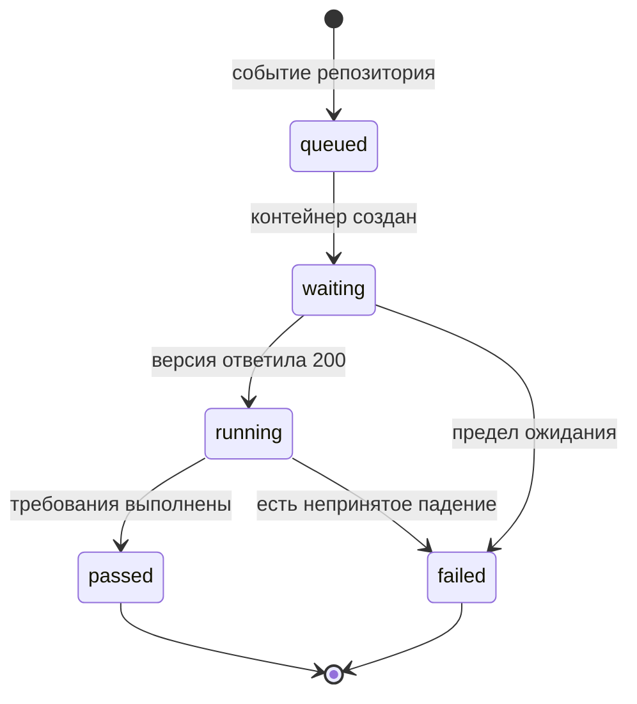

# Запуск автотестов в CI

## Содержание

- [Теория](#теория)
  - [Ситуация](#ситуация)
  - [Модель](#модель)
  - [Понятия и связь с автоматизацией тестирования](#понятия-и-связь-с-автоматизацией-тестирования)
  - [Зоны ответственности](#зоны-ответственности)
  - [Пример](#пример)
  - [Типичные сбои](#типичные-сбои)
  - [Полезные ссылки](#полезные-ссылки)
  - [Вопросы по теории](#вопросы-по-теории)
- [Практическое задание](#практическое-задание)
  - [1.1 Общее](#11-общее)
  - [1.2 Сценарии](#12-сценарии-user-stories)
  - [1.3 Контракт](#13-контракт)
  - [1.4 Ошибки и ограничения](#14-ошибки-и-ограничения)
  - [1.5 Аудит](#15-аудитлоги)
  - [1.6 Нефункциональные требования](#16-нефункциональные-требования)

# Теория

## Ситуация

Пайплайн CI запускает API-набор против Juice Shop в том же прогоне, что и сборка. Дальше возможен один из исходов: job `api` зелёный, тесты упали и в артефакты попали отчёт и trace, стенд не ответил **200** за время ожидания, секрет `ADMIN_PASSWORD` или `ACCOUNTANT_PASSWORD` пуст, метка `known-issue` погасила ожидаемое падение, та же метка вскрыла уже исправленный дефект либо контейнер стенда не стартовал.

Отдельная разработка не нужна: достаточно запущенного контейнера Juice Shop и команды `npx playwright test --grep @api` (`pytest -m api`, `dotnet test --filter Category=api`).

## Модель

Участвуют workflow, job `api`, контейнер стенда и раннер тестов. Workflow решает, когда стартовать job. Решение о прохождении принимает оракул теста — требование, а не текущий ответ стенда. Зелёный job означает, что требования выполнены или падение было заранее помечено. Он не означает, что любой ответ стенда принят.

Стенд в job — сервисный контейнер, не заранее поднятый вручную. Образ `bkimminich/juice-shop:v20.4.0`, переменная `NODE_ENV=quiet`, порт `3000`. Проверка `--health-cmd` с curl здесь не работает: образ distroless, в нём нет shell и curl. Готовность ждёт отдельный шаг. Он опрашивает `GET /rest/admin/application-version`, пока код не станет **200** или не кончится предел шага.



Тесты не стартуют раньше **200**. Иначе падения `1.1`–`1.5` смешиваются с ещё не слушающим портом. Артефакты снимаются после прогона, если он красный.



`passed` включает ожидаемые падения `known-issue`, пока они действительно падают. Неожиданный успех такой метки ведёт в `failed`. В `failed` после тестов job сохраняет отчёт и trace. Ожидание, которое не дождалось стенда, trace тестов не имеет: тесты не запускались.

Файл использует тот же стенд и те же переменные, что `1.0`. Новых полей ответа версия не добавляет: по-прежнему нужен код **200** и непустое поле `version`. Отдельной реляционной схемы курс не вводит.

## Понятия и связь с автоматизацией тестирования

### Job API

Проверки, которые раньше запускали на своей машине, на каждую правку должен запускать сервер. Такой автоматический прогон называют непрерывной интеграцией, а кусок workflow с одной задачей — job. Для API это job `api` в `.github/workflows/tests.yml`. События — `push` и `pull_request`. Рядом позже появятся job `ui`, `a11y`, `security`, `perf-smoke` и `report`. Их команды этот файл не пишет. В контракте описан только `api`: поднять стенд, дождаться **200**, прогнать фильтр `api`, сохранить артефакты при падении.

Команда шага зависит от стека. TypeScript: `npx playwright test --grep @api`. Python: `pytest -m api`. C#: `dotnet test --filter Category=api`. Ретраи и воркеры включает признак `CI`, а не отдельный флажок в этой команде. В CI ретраев 2 и воркеров 2. Локально ретраев 0.

### Ожидание distroless-образа

Обычный сервис в GitHub Actions умеет `options` с `--health-cmd`. Для Juice Shop этот приём пустой: выполнить curl внутри контейнера нельзя. Шаг на раннере сам ходит на `http://localhost:3000/rest/admin/application-version`, потому что порт проброшен на машину job. Точную строку `version` шаг не сравнивает с `20.4.0`. В контракте неуспех ожидания завершает job до тестов.

Между попытками шаг делает короткую паузу, чтобы не долбить ещё не открытый порт. Эта пауза живёт в шаге workflow. Тесты `1.1`–`1.5` по-прежнему не заменяют проверку одной командой `waitForTimeout` или `sleep`.

### Секреты и идентификатор прогона

Пароли встроенных ролей в репозиторий не коммитят. В job они приходят из секретов `ADMIN_PASSWORD` и `ACCOUNTANT_PASSWORD`. Адреса остаются явными: `ADMIN_EMAIL` — `admin@juice-sh.op`, `ACCOUNTANT_EMAIL` — `accountant@juice-sh.op`. `BASE_URL` внутри job — `http://localhost:3000`. `RUN_ID` равен `${{ github.run_id }}`, чтобы email фикстур из `1.4` не столкнулся с другим прогоном. Признак `CI` равен `true`. В контракте пустой секрет по-прежнему останавливает прогон понятным текстом, как в `1.0`.

### Артефакты

Зелёный статус не показывает, какой запрос разъехался с требованием. Для этого сохраняют отчёт и trace. Trace в Playwright Test пишется при первом ретрае, значение `on-first-retry`. Скриншот — только при падении, видео — `retain-on-failure`. У pytest-playwright в CLI нет `on-first-retry`, след при падении включает `--tracing retain-on-failure`, повтор даёт `--reruns`. В C# `[Retry(2)]` повторяет провал проверки и не обещает тот же повтор для любого исключения вне `Assert`. Загрузка артефакта стоит на `if: failure()`. В контракте успешный job не тащит тяжёлый каталог trace в хранилище.

Каталоги: у Playwright Test — `playwright-report` и `test-results`, у pytest-playwright — `test-results`, у `dotnet test` — каталог результатов прогона. В отчёт не попадают пароли и токены, это правило `1.0` и `1.5`.

### Сравнение

Подробно собирается GitHub Actions: файл в репозитории, секреты репозитория, сервисный контейнер. Остальные системы закрывают ту же схему «шаги и секрет» другим синтаксисом.

| Система | Подходит для |
| --- | --- |
| GitHub Actions | репозиторий на GitHub и workflow рядом с тестами |
| GitLab CI | репозиторий на GitLab и описание в `.gitlab-ci.yml` |
| Jenkins | свой сервер и сценарий Pipeline |
| Azure DevOps | репозиторий и агенты Azure DevOps |
| TeamCity | свой сервер JetBrains и шаги сборки |
| CircleCI | облачный или свой runner и `config.yml` |

Смысл job `api` от выбора системы не меняется: стенд v20.4.0, ожидание **200** снаружи контейнера, фильтр `api`, секреты не в git.

### Что остаётся за этим файлом

UI-шарды, доступность, ZAP, дымовая нагрузка и сводный отчёт подключаются к тому же workflow в файлах `2.6`, `3.1`, `5.2`, `4.1` и `8.1`. Расписание синтетики живёт отдельно, в `9.2`. Здесь пайплайн обязан прогнать API на каждую правку. Это сдвиг проверки ближе к моменту изменения, о чём говорит `0.5`.

### Сводка

| Понятие | Смысл в запуске API | На что опирается реализация |
| --- | --- | --- |
| Job `api` | фильтр API на push и pull request | `.github/workflows/tests.yml` |
| Ожидание готовности | опрос снаружи distroless-контейнера | `GET /rest/admin/application-version` |
| Секреты | пароли ролей не в git | `ADMIN_PASSWORD`, `ACCOUNTANT_PASSWORD` |
| `RUN_ID` | разные прогоны не делят email | `${{ github.run_id }}` |
| Артефакт | отчёт и trace после красного прогона | `if: failure()` |

## Зоны ответственности

| Разработчик | CI |
| --- | --- |
| Кладёт `tests.yml` в репозиторий | Запускает job на push и pull request |
| Не записывает пароли в файл | Подставляет секреты в переменные job |
| Описывает шаг ожидания снаружи контейнера | Поднимает образ `bkimminich/juice-shop:v20.4.0` |
| Включает два ретрая и двух воркеров при `CI` | Выполняет фильтр `api` |
| Забирает артефакт красного прогона | Сохраняет отчёт и trace только при падении |

Локальный `docker run` из `1.0` не заменяет job: на чужой машине контейнера нет, пока его не описал workflow. Секрет в `.env` на ноутбуке не заменяет секрет репозитория.

## Пример

Программа опрашивает версию стенда и печатает `ready`, когда код стал **200**. Предел опроса — 30 секунд. Это тот же критерий, что у шага ожидания в job `api`. На всех стеках в журнале есть строка `ready`.

### TypeScript

**Node.js 22 или новее, @playwright/test.** Контекст `request` бьёт в служебный адрес. Ключевой параметр — предел 30 секунд.

```sh
npm install -D @playwright/test
npx playwright install
node --experimental-strip-types wait-for-shop.ts
```

```typescript
import { request } from '@playwright/test';

async function main(): Promise<void> {
  const api = await request.newContext({
    baseURL: process.env.BASE_URL ?? 'http://localhost:3000',
  });
  const deadline = Date.now() + 30_000;
  let status = 0;
  while (Date.now() < deadline) {
    try {
      status = (await api.get('/rest/admin/application-version')).status();
      if (status === 200) break;
    } catch {
      status = 0;
    }
    await new Promise((resolve) => setTimeout(resolve, 1000));
  }
  await api.dispose();
  if (status !== 200) throw new Error('стенд не готов');
  console.log('ready');
}

void main();
```

### Python

**Python 3.10 или новее, pytest-playwright.** Тот же путь читает `playwright.request`. Ключевой параметр — `base_url` и предел 30 секунд.

```sh
pip install pytest pytest-playwright
playwright install
python wait_for_shop.py
```

```python
import os
import time
from playwright.sync_api import sync_playwright

with sync_playwright() as playwright:
    api = playwright.request.new_context(
        base_url=os.environ.get("BASE_URL", "http://localhost:3000")
    )
    deadline = time.time() + 30
    status = 0
    while time.time() < deadline:
        try:
            status = api.get("/rest/admin/application-version").status
            if status == 200:
                break
        except Exception:
            status = 0
        time.sleep(1)
    api.dispose()
if status != 200:
    raise SystemExit("стенд не готов")
print("ready")
```

### C#

**.NET 8 или новее, Microsoft.Playwright.NUnit.** `APIRequest` создаётся без браузера. Ключевой параметр — `BaseURL` и предел 30 секунд.

```sh
dotnet add package Microsoft.Playwright
pwsh bin/Debug/net8.0/playwright.ps1 install
dotnet run --project WaitForShop
```

```csharp
using Microsoft.Playwright;

var baseUrl = Environment.GetEnvironmentVariable("BASE_URL") ?? "http://localhost:3000";
using var playwright = await Playwright.CreateAsync();
var api = await playwright.APIRequest.NewContextAsync(new() { BaseURL = baseUrl });
var deadline = DateTime.UtcNow.AddSeconds(30);
var status = 0;
while (DateTime.UtcNow < deadline)
{
    try
    {
        status = (await api.GetAsync("/rest/admin/application-version")).Status;
        if (status == 200) break;
    }
    catch
    {
        status = 0;
    }
    await Task.Delay(1000);
}
await api.DisposeAsync();
if (status != 200) throw new Exception("стенд не готов");
Console.WriteLine("ready");
```

---

Каждая программа печатает строку `ready`. Строка появляется только после кода **200** на `GET /rest/admin/application-version` и не позже 30 секунд. Если порт молчит, программа завершается с ошибкой и строку не печатает.

## Типичные сбои

| Что видно | Куда смотреть |
| --- | --- |
| Шаг ожидания красный, тестов нет | Порт `3000`, образ `bkimminich/juice-shop:v20.4.0`, опрос с раннера |
| `--health-cmd` сразу падает | В образе нет shell и curl, ждать отдельным шагом |
| Тесты пишут, что нет `ADMIN_PASSWORD` | Секрет репозитория и имя переменной в job |
| Два прогона делят email | `RUN_ID` не равен `${{ github.run_id }}` |
| Зелёный job при живом дефекте без метки | Ожидание кейса подменили фактом стенда |
| Красный job, хотя падение было `BUG-…` | Метка `known-issue` не попала в прогон |
| Артефакта нет после падения | Условие `if: failure()` и путь каталога отчёта |
| Прогон дольше 10 минут вместе с UI | Два воркера, фильтры job, ретраи только в CI |
| Локально тесты сами повторяются | `CI` не должен быть включён на ноутбуке без нужды |

## Полезные ссылки

### Общие

- [GitHub Docs — Workflow syntax](https://docs.github.com/en/actions/using-workflows/workflow-syntax-for-github-actions) — `jobs`, `services`, `env` и `steps`.
- [GitHub Docs — Service containers](https://docs.github.com/en/actions/using-containerized-services/about-service-containers) — порт контейнера на машине job.
- [GitHub Docs — Using secrets](https://docs.github.com/en/actions/security-guides/using-secrets-in-github-actions) — `ADMIN_PASSWORD` и `ACCOUNTANT_PASSWORD`.
- [Docker — docker container run](https://docs.docker.com/reference/cli/docker/container/run/) — тот же образ, который job поднимает сервисом.

### По языку

#### TypeScript

**TypeScript, Playwright Test.** На JavaScript контракт запуска API в CI остаётся тем же.

- [Playwright — CI](https://playwright.dev/docs/ci-intro) — `CI`, ретраи и загрузка отчёта.
- [Playwright — Trace viewer](https://playwright.dev/docs/trace-viewer) — что лежит в артефакте после ретрая.

#### Python

**Python, pytest-playwright.** На синхронном Playwright API без pytest или на async API контракт запуска API в CI остаётся тем же.

- [pytest — pytest-xdist](https://pytest-xdist.readthedocs.io/en/stable/) — `-n 2` для двух воркеров.
- [Playwright Python — Test runners](https://playwright.dev/python/docs/test-runners) — `--tracing retain-on-failure`.

#### C#

**C#, Playwright для .NET с NUnit.** На MSTest или xUnit контракт запуска API в CI остаётся тем же.

- [Microsoft — dotnet test](https://learn.microsoft.com/dotnet/core/tools/dotnet-test) — `--filter Category=api`.
- [NUnit — Retry](https://docs.nunit.org/articles/nunit/writing-tests/attributes/retry.html) — предел повтора проверки.

## Вопросы по теории

1. Почему готовность Juice Shop ждут отдельным шагом, а не `--health-cmd`?
2. Что произойдёт с job, если секрет `ADMIN_PASSWORD` не задан?
3. Зачем в CI две попытки и два воркера, а на ноутбуке попыток нет?
4. Чем артефакт trace полезен после красного job?
5. Как `RUN_ID` в CI связан с `${{ github.run_id }}` и с email из `1.4`?
6. Почему ожидаемое падение `known-issue` не обязано красить job, а неожиданный успех метки обязано?
7. Куда девается полный прогон API и UI относительно предела в 10 минут?

# Практическое задание

Функциональность автоматического прогона API в системе.
Набор и конфигурация job `api` для Juice Shop.
Пайплайн поднимает стенд, дожидается **200** и запускает фильтр `api`. Итог — workflow, который на каждую правку повторяет правила `1.0`–`1.5`.

## 1) Запуск автотестов в CI

### 1.1 Общее

**Назначение:** гонять API-набор на сервере при каждой отправке кода, с тем же оракулом, что локально.

**Пользователи/роли:**

- разработчик — хранит workflow и не кладёт секреты в git;
- пайплайн CI — поднимает стенд и запускает фильтр;
- AQA-инженер — читает артефакт красного прогона.

**Зависимости/связанные настройки:**

- `1.0` — ретраи, воркеры, trace, fail-fast;
- `1.4` — `RUN_ID` в email;
- `1.5` — кейсы корзины входят в фильтр `api`;
- `0.5` — прогон на изменении как сдвиг проверки ближе к правке;
- секреты `ADMIN_PASSWORD` и `ACCOUNTANT_PASSWORD`.

UI, доступность, сканер, нагрузка и сводный отчёт в этот job не входят.

### 1.2 Сценарии (user stories)

1. **Правка в репозитории:** push или pull request запускает job `api`.
2. **Стенд поднялся:** опрос версии дождался **200**, тесты пошли.
3. **Стенд молчит:** шаг ожидания красный, тесты не стартуют.
4. **Набор красный:** отчёт и trace лежат в артефактах.
5. **Секрет пуст:** прогон останавливается текстом о переменной, пароль в лог не попадает.

### 1.3 Контракт

#### 1.3.1 Сервис стенда

| Поле job | Проверки/валидация |
| --- | --- |
| образ | `bkimminich/juice-shop:v20.4.0` |
| `NODE_ENV` | `quiet` |
| порт | `3000:3000` |
| готовность | отдельный шаг, `GET /rest/admin/application-version`, код **200** |

**Логика/шаги:**

1. Описать сервис `juice-shop` без `--health-cmd`.
2. Опрашивать версию с раннера, пока код не станет **200** или не выйдет предел шага.
3. Передать управление шагу тестов только после **200**.

Если контейнер не стал слушать порт, данные тестов не создавались. Повтор — новый запуск job.

**Ответы:**

- **Успех:** шаг ожидания зелёный.
- **Ошибки:** см. раздел 1.4.

#### 1.3.2 Переменные и команда

| Переменная | Проверки/валидация |
| --- | --- |
| `BASE_URL` | `http://localhost:3000` |
| `ADMIN_EMAIL` | `admin@juice-sh.op` |
| `ACCOUNTANT_EMAIL` | `accountant@juice-sh.op` |
| `ADMIN_PASSWORD` | `${{ secrets.ADMIN_PASSWORD }}` |
| `ACCOUNTANT_PASSWORD` | `${{ secrets.ACCOUNTANT_PASSWORD }}` |
| `RUN_ID` | `${{ github.run_id }}` |
| `CI` | `true` |

**Логика/шаги:**

1. Подставить переменные в окружение job.
2. Запустить фильтр своего стека: `--grep @api`, `-m api` или `--filter Category=api`.
3. Взять два ретрая и двух воркеров из настроек, потому что `CI` задан.

**Ответы:**

- **Успех:** в журнале job виден фильтр `api` и отчёт раннера.
- **Ошибки:** см. раздел 1.4.

#### 1.3.3 Артефакты

| Условие | Проверки/валидация |
| --- | --- |
| падение job | загрузить отчёт и trace |
| успех | каталог trace не публиковать |
| содержимое | без паролей, cookie `token` и полного JWT |

**Логика/шаги:**

1. Поставить шаг загрузки с `if: failure()`.
2. Указать каталог отчёта своего стека и каталог trace.
3. Проверить, что секрет не попал в файл отчёта.

**Ответы:**

- **Успех загрузки:** у красного прогона есть артефакт.
- **Ошибки:** см. раздел 1.4.

### 1.4 Ошибки и ограничения

- **Шаг ожидания красный** — за предел шага не было **200**. Тесты не запускаются.
- **Ошибка соединения внутри тестов** — ожидание закончилось слишком рано или порт проброшен не на `3000`.
- **Остановка из-за секрета** — пустые `ADMIN_PASSWORD` или `ACCOUNTANT_PASSWORD`. Текст называет переменную и не содержит значение.
- **Падение требования** — кейс без метки или неожиданный успех `known-issue`. Job красный, артефакт сохраняется.
- **Ожидаемое падение** — метка `known-issue` и реальное нарушение. Job из-за одного этого факта не красится.
- **Пустой набор** — фильтр не совпал с тегом `api`. В журнале нет кейсов `TC-…`.
- **Чужой health-check** — `--health-cmd` внутри distroless-образа. Его не используют.

Сначала поднимается контейнер, потом ожидание **200**, потом секреты и тесты, потом артефакт. Секрет проверяет сам набор, как в `1.0`, сразу после старта тестов.

### 1.5 Аудит/логи

Логировать: номер `github.run_id`, имя job, результат шага ожидания, команду фильтра и ссылку на артефакт при падении.

В журнал job не попадают значения секретов, cookie `token`, полный JWT, номер карты из `1.5` и целиком `stack` ответов **500**. Маскирование секретов GitHub Actions не отменяет запрет печатать их из теста.

### 1.6 Нефункциональные требования

- Шаг ожидания ограничен по времени и завершается на первом **200**.
- Ретраи в CI — 2, локально — 0. Воркеров в CI — 2.
- Таймаут теста — 30 с, таймаут `expect` — 5 с.
- Полный прогон API и UI в Chromium в CI — не дольше 10 минут. Job `api` входит в этот бюджет.
- Trace — `on-first-retry` в Playwright Test. В Python ближайшая запись следа при падении — `--tracing retain-on-failure`.
- Фильтр `api` покрывает кейсы `1.1`–`1.5` с их метками `BUG-…`.
