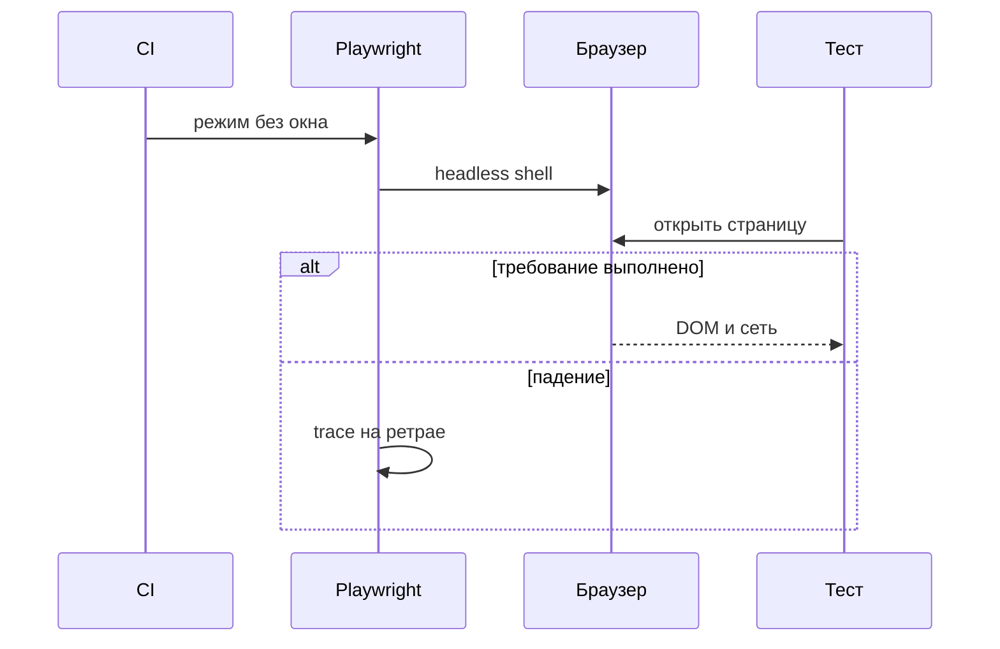
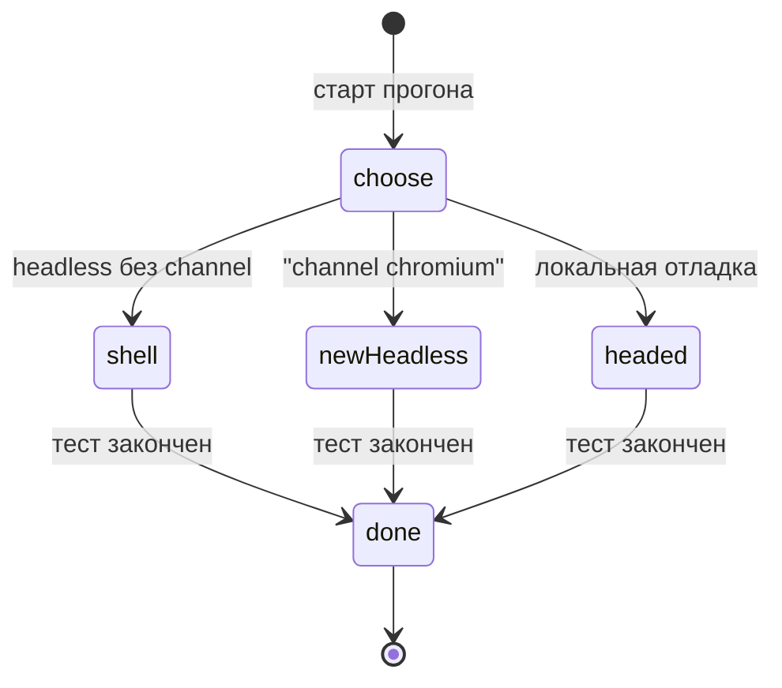

# Общие требования к headless-запуску

## Содержание

- [Теория](#теория)
  - [Ситуация](#ситуация)
  - [Модель](#модель)
  - [Понятия и связь с автоматизацией тестирования](#понятия-и-связь-с-автоматизацией-тестирования)
  - [Зоны ответственности](#зоны-ответственности)
  - [Пример](#пример)
  - [Типичные сбои](#типичные-сбои)
  - [Полезные ссылки](#полезные-ссылки)
  - [Вопросы по теории](#вопросы-по-теории)
- [Практическое задание](#практическое-задание)
  - [1.1 Общее](#11-общее)
  - [1.2 Сценарии](#12-сценарии-user-stories)
  - [1.3 Контракт](#13-контракт)
  - [1.4 Ошибки и ограничения](#14-ошибки-и-ограничения)
  - [1.5 Аудит](#15-аудитлоги)
  - [1.6 Нефункциональные требования](#16-нефункциональные-требования)

# Теория

## Ситуация

Пайплайн CI запускает UI-тесты Juice Shop на машине без монитора. Дальше возможен один из исходов: страница открывается в headless, проверки DOM проходят; снимок из `2.5` расходится со снимком ноутбука из-за шрифтов; тест падает только без окна, и локально его повторяют с окном; эмулятор DOM зелёный, а настоящий браузер на `/#/login` красный; браузер не стартует, trace при первом ретрае показывает причину.

Окно на столе нужно человеку. Движок и дерево страницы нужны проверке. В CI оставляют движок.

Отдельная разработка не нужна: достаточно запущенного контейнера Juice Shop и команды `npx playwright test --grep @ui` (`pytest -m ui`, `dotnet test --filter Category=ui`).

## Модель

Участники: CI, Playwright, браузер, тест, trace. CI задаёт режим без окна. Playwright поднимает Chromium, Firefox или WebKit. Тест работает со страницей. При падении раннер оставляет trace. Решение о прохождении принимает оракул теста — требование, а не текущий ответ стенда. Наличие окна в это решение не входит.



Режим выбирают до запуска браузера. Менять его посередине теста поздно: шрифты и размер окна уже зафиксированы.



`shell` — обычный путь CI: отдельный бинарник headless shell. `newHeadless` — полный Chromium в новом headless, его включает `channel: 'chromium'`. `headed` — окно для разбора падения. В один прогон проекта берут один из трёх, а не смесь внутри одного теста.

Возможный набор полей (схема может быть и другой):

| `launch` | Описание |
| --- | --- |
| `headless` | В CI `true` |
| `channel` | Пусто для shell, `chromium` для нового headless |
| `viewport` | Явный размер, в примере `1280x720` |
| `trace` | `on-first-retry` |

Файл использует страницы Juice Shop из `2.x` и проекты браузеров `chromium`, `firefox`, `webkit`. Новых API магазина нет.

## Понятия и связь с автоматизацией тестирования

### Без окна и с окном

Headless — тот же браузер без окна на экране. CI не рисует рабочий стол, а DOM, сеть и доступность на месте. Headed — режим с окном. Им пользуются локально, когда нужно увидеть, куда делся фокус или баннер.

Проверка «кнопка Log in видна» от окна не зависит. Проверка снимка пикселей зависит от шрифта и сглаживания. Поэтому функциональный UI в CI идёт headless, а эталон снимка из `2.5` хранят отдельно для той ОС, где снимок сняли.

Контракт режима: в CI `headless: true`. Окно включают командой отладки, а не как постоянный режим job.

### Два headless у Chromium

Playwright возит обычный Chromium для окна и отдельный headless shell для режима без окна. Пока `channel` не задан, headless идёт через shell. На CI, где окна нет, ставят только его: `npx playwright install --with-deps --only-shell` (в Python и .NET команда `playwright install` с теми же флагами).

Новый headless — полный браузер, ближе к обычному Chrome. Его включают каналом `chromium`. Документация Chrome называет этот режим самим браузером, а не урезанной оболочкой. В конфиге TypeScript у проекта `channel: 'chromium'`. В Python — `pytest --browser-channel chromium`. В .NET канал задают в опциях запуска. Тогда shell можно не скачивать: флаг `--no-shell`.

Каналы `chrome` и `msedge` тоже живут в новом headless и ставятся отдельно. Для курса по умолчанию остаётся shell: он легче и совпадает с тем, что уже гоняют `chromium` / `firefox` / `webkit`. Новый headless включают, когда падение есть только в shell и его нужно сверить с полным Chromium.

Контракт канала: CI на shell, пока проект явно не попросил `chromium`.

### Чем прогон без окна отличается

Шрифты в образе и на ноутбуке разные. Снимок карточки `Apple Juice (1000ml)` разъедется, хотя вёрстка та же. Эталоны `2.5` привязаны к ОС и браузеру.

Видеокарта в CI часто не участвует, рисует программный растеризатор. Холст и тени могут сдвинуться на пиксель. Для функционального локатора это незаметно, для порога снимка — заметно.

Размер окна неоткуда взять: монитора нет. Viewport задают в проекте. Иначе `screen` и раскладка плавают между агентами.

Загрузка файла не показывает системный диалог. Playwright ловит загрузку своим API. Тест, который ждёт окно «Сохранить», в headless его не дождётся.

Буфер обмена завязан на разрешение и на окно. Сценарий Juice Shop буфер не требует. Если появится, разрешение выдают явно и проверяют оба режима.

`navigator.webdriver` при автоматизации истинен. Juice Shop ветки на этот флаг не делает. Чужой сайт может спрятать кнопку. Знание флага объясняет расхождение «руками работает».

Контракт среды: viewport задан, эталоны сняты в той же среде, что CI, функциональные тесты не требуют GPU.

### Эмулятор — не браузер

jsdom, HtmlUnit и Zombie.js изображают кусок DOM в процессе теста. Раскладки Angular Material, шрифтов и дерева доступности axe там нет. Юнит компонента на jsdom уместен там, где это описано в `2.0`. Страницы `/#/login`, `/#/search`, `/#/basket` курс открывает в Chromium, Firefox и WebKit.

Контракт инструмента UI: реальный браузер Playwright. Зелёный jsdom страницу магазина не закрывает.

### Как смотреть падение без окна

Настройки `3.6` уже оставляют след: trace на первом ретрае, скриншот и видео только при падении. Trace viewer показывает DOM, сеть и действие. Это основной разбор CI.

Повторить локально с окном: `npx playwright test --headed`, у pytest — `--headed`, у .NET — переменная `HEADED=1`. Инспектор шагов в TypeScript открывает `PWDEBUG=1`. Точные флаги .NET и Python сверяют со страницей debug своего стека: имена меняются реже, чем кажется, но страница первична.

Контракт отладки: сначала trace артефакта, потом тот же тест с окном. Падение headless не лечат добавлением `sleep`.

### Сравнение

| Инструмент | Подходит для |
| --- | --- |
| Playwright | UI курса в Chromium, Firefox и WebKit, shell и новый headless |
| Puppeteer | Сценарии на Chromium, если набор уже на нём |
| Headless Chrome или Firefox напрямую | Один браузер без обвязки теста |
| `cypress run` | Прогон Cypress без окна |
| Selenium headless | Набор на WebDriver |
| HtmlUnit, Zombie.js, jsdom | Узкий DOM без раскладки и без axe |

В курсе UI идёт через Playwright. Остальные строки — ориентир, если соседний репозиторий уже выбран.

### Что будет в контейнере и CI

`10.1` возьмёт shell как режим по умолчанию, официальный образ с браузерами и два шарда UI. Отладка с окном в CI, если она понадобится, пойдёт через xvfb и не станет режимом каждого job.

### Сводка

| Понятие | Смысл в headless | На что опирается реализация |
| --- | --- | --- |
| Headless | Браузер без окна | `headless: true` в CI |
| Headless shell | Лёгкий Chromium по умолчанию | Пустой `channel`, флаг `--only-shell` |
| Новый headless | Полный Chromium | `channel: 'chromium'` |
| Viewport | Размер без монитора | Явные ширина и высота |
| Trace | Разбор падения без окна | `on-first-retry` |
| Эмулятор DOM | Не замена странице магазина | Юнит из `2.0`, не UI-проект |

## Зоны ответственности

| Автотест | Фреймворк |
| --- | --- |
| Проверяет требование к странице | Поднимает браузер в режиме прогона |
| Задаёт viewport в проекте | В CI оставляет shell, пока не попросили канал |
| Сверяет снимок с эталоном той же ОС | Хранит trace, скриншот и видео по `3.6` |
| Повторяет падение с окном локально | Даёт `--headed` или `HEADED=1` |

Shell и новый headless — два режима одного Chromium. Снимок, снятый в одном, не подкладывают эталоном для другого.

## Пример

Программа при `CI=true` выбирает headless shell, viewport `1280x720` и trace `on-first-retry`. Это решение job до запуска браузера.

### TypeScript

**Node.js 22 или новее, @playwright/test.** Те же поля потом лягут в `playwright.config.ts`.

```sh
npm init -y
npm install -D @playwright/test@1.65
export CI=true
npx playwright test launch-rule.spec.ts
cat result.txt
```

```typescript
import { test, expect } from '@playwright/test';
import { writeFileSync } from 'node:fs';

function launchPlan(ci: boolean) {
  return {
    headless: ci ? 'true' : 'false',
    channel: ci ? 'headless-shell' : 'headed',
    viewport: '1280x720',
    trace: 'on-first-retry',
  };
}

test('план CI', () => {
  const plan = launchPlan(process.env.CI === 'true');
  const lines = [`headless=${plan.headless}`, `channel=${plan.channel}`, `viewport=${plan.viewport}`, `trace=${plan.trace}`];
  expect(lines[0]).toBe('headless=true');
  writeFileSync('result.txt', `${lines.join('\n')}\n`);
});
```

### Python

**Python 3.10 или новее, pytest-playwright.** План совпадает с тем, что даёт прогон без `--headed`.

```sh
python -m pip install pytest pytest-playwright
export CI=true
pytest -q launch_rule.py
cat result.txt
```

```python
import os

def launch_plan(ci):
    return ("true" if ci else "false", "headless-shell" if ci else "headed", "1280x720", "on-first-retry")

def test_launch_plan():
    headless, channel, viewport, trace = launch_plan(os.environ.get("CI") == "true")
    lines = [f"headless={headless}", f"channel={channel}", f"viewport={viewport}", f"trace={trace}"]
    assert lines[0] == "headless=true"
    open("result.txt", "w", encoding="utf-8").write("\n".join(lines) + "\n")
```

### C#

**.NET 8 или новее, Microsoft.Playwright.NUnit.** При `CI=true` окно не включают, `HEADED` для этого плана не нужен.

```sh
dotnet new nunit -n LaunchRule -o .
dotnet add package Microsoft.Playwright.NUnit --version 1.64.1
export CI=true
dotnet test
cat result.txt
```

```csharp
using NUnit.Framework;

public class LaunchRule
{
    static string[] Plan(bool ci) => new[]
    {
        $"headless={(ci ? "true" : "false")}",
        $"channel={(ci ? "headless-shell" : "headed")}",
        "viewport=1280x720",
        "trace=on-first-retry",
    };

    [Test]
    public void CiPlan()
    {
        var lines = Plan(Environment.GetEnvironmentVariable("CI") == "true");
        Assert.That(lines[0], Is.EqualTo("headless=true"));
        File.WriteAllText("result.txt", string.Join('\n', lines) + "\n");
    }
}
```

---

Все программы записывают `headless=true`, `channel=headless-shell`, `viewport=1280x720`, `trace=on-first-retry`. Первая строка — режим CI. Вторая — shell, потому что канал `chromium` не просили. Третья фиксирует размер без монитора. Четвёртая — след для падения на ретрае. Раннер сообщает об одном пройденном тесте.

## Типичные сбои

| Что видно | Куда смотреть |
| --- | --- |
| Снимок зелёный локально и красный в CI | Эталон снят на других шрифтах или в другом режиме |
| Падение только в shell | Повторить с `channel: 'chromium'` и сравнить trace |
| Страница шириной во весь стол | Viewport в проекте не задан |
| Тест ждёт диалог сохранения файла | В headless диалога нет, загрузку ловит API Playwright |
| `navigator.webdriver` прячет виджет на чужом стенде | Флаг автоматизации истинен, это не дефект Juice Shop |
| jsdom прошёл, `/#/login` в CI упал | Эмулятор не открывал страницу |
| В артефакте нет trace | Смотрят первый заход, trace лежит на `on-first-retry` |
| Локальный `--headed` не повторяет CI | Другое разрешение и другие шрифты, смотреть trace |
| `playwright install` качает лишний полный Chromium | Для shell достаточно `--only-shell` |

## Полезные ссылки

### Общие

- [Playwright — Browsers](https://playwright.dev/docs/browsers#chromium-headless-shell) — shell, `--only-shell` и отличие от полного Chromium.
- [Playwright — New headless mode](https://playwright.dev/docs/browsers#chromium-new-headless-mode) — канал `chromium`.
- [Playwright — Trace viewer](https://playwright.dev/docs/trace-viewer) — разбор падения без окна.

### По языку

#### TypeScript

**TypeScript, Playwright Test.** На JavaScript контракт headless-запуска остаётся тем же.

- [Playwright — Debugging](https://playwright.dev/docs/debug) — `--headed` и `PWDEBUG=1`.
- [Playwright — Configuration](https://playwright.dev/docs/test-configuration) — `headless`, viewport, trace.

#### Python

**Python, pytest-playwright.** На синхронном Playwright API без pytest или на async API контракт headless-запуска остаётся тем же.

- [Playwright Python — Browsers](https://playwright.dev/python/docs/browsers#chromium-new-headless-mode) — `--browser-channel chromium`.
- [Playwright Python — Debugging](https://playwright.dev/python/docs/debug) — `--headed`.

#### C#

**C#, Playwright для .NET с NUnit.** На MSTest или xUnit контракт headless-запуска остаётся тем же.

- [Playwright .NET — Browsers](https://playwright.dev/dotnet/docs/browsers) — канал запуска.
- [Playwright .NET — Debug](https://playwright.dev/dotnet/docs/debug) — `HEADED=1`.

## Вопросы по теории

1. Почему в CI браузер запускают без окна?
2. Чем headless shell отличается от нового headless с каналом `chromium`?
3. Почему снимок с ноутбука не годится эталоном для контейнера?
4. Зачем задавать viewport, если страница и так открывается?
5. Почему jsdom не закрывает `TC-AUTH-10`?
6. С чего начинают разбор падения, которого не видно на экране?
7. Когда имеет смысл включить `channel: 'chromium'`, если shell уже зелёный на большинстве тестов?

# Практическое задание

Функциональность headless-запуска UI в системе.
Набор открывает Juice Shop без окна, с явным viewport и trace на первом ретрае. По умолчанию Chromium идёт через headless shell. Окно включают только для локального разбора.

## 1) Режим без окна

### 1.1 Общее

**Назначение:** зафиксировать режим браузера в CI и способ разобрать падение без монитора.

**Пользователи/роли:**

- AQA-инженер — выбирает shell или канал `chromium`;
- разработчик — открывает trace упавшего UI-теста;
- CI — запускает headless;
- локальный запуск — может включить окно.

**Зависимости/связанные настройки:**

- `2.0` — проекты `chromium`, `firefox`, `webkit`;
- `2.5` — снимки и эталоны по ОС;
- `2.6` и словарь `3.6` — trace, скриншот, видео;
- `CI` — признак прогона без окна.

Контейнер, шарды и образ — `10.1`. Здесь режим, а не docker-флаги.

### 1.2 Сценарии (user stories)

1. **CI:** UI идёт headless shell, viewport `1280x720`, окно не открывается.
2. **Снимок:** эталон собран в той же среде, что прогон, расхождение шрифтов не считают дефектом магазина.
3. **Падение:** первый ретрай пишет trace, его открывают без повтора на ноутбуке.
4. **Сверка режима:** сомнительный тест один раз гоняют с `channel: 'chromium'`.
5. **Окно:** локально `--headed` или `HEADED=1` показывает тот же сценарий человеку.

### 1.3 Контракт

#### 1.3.1 Параметры запуска

| Поле | Проверки/валидация |
| --- | --- |
| `headless` | `true`, когда задана переменная `CI` |
| `channel` | Пусто для shell. `chromium` только в отдельном проекте сверки |
| viewport | Ширина и высота заданы, пример `1280` на `720` |
| trace | `on-first-retry` |
| скриншот и видео | Только при падении |

**Логика/шаги:**

1. В конфиге проекта включить headless для CI.
2. Задать viewport.
3. Оставить trace, скриншот и видео как в `3.6`.
4. Для установки на CI, где нужен только shell, передать `--only-shell`.

Повтор с окном не меняет оракул. Он меняет то, что видит человек.

**Ответы:**

- Успех — UI-проект стартует без окна и пишет trace на ретрае.
- **Ошибки:** см. раздел 1.4.

#### 1.3.2 Отладка

**Общее правило:** сначала артефакт прогона, потом локальное окно.

| Стек | Как включить окно |
| --- | --- |
| TypeScript | `npx playwright test --headed`, инспектор `PWDEBUG=1` |
| Python | `pytest --headed` |
| C# | `HEADED=1` перед `dotnet test` |

**Логика/шаги:**

1. Открыть trace упавшего ретрая.
2. Если шага не хватает, повторить тест с окном на той же версии библиотеки.
3. Если расхождение только у shell, повторить с каналом `chromium`.

**Ответы:**

- Успех разбора — причина названа по trace или по окну, тайминги теста не увеличены паузой.
- **Ошибки:** см. раздел 1.4.

### 1.4 Ошибки и ограничения

- Браузер не скачан — `playwright install` для версии библиотеки. Для одного shell достаточно `--only-shell`.
- Снимок красный только в CI — эталон другой среды или другой канал.
- Нет trace на первом падении в CI — его пишут на ретрае. Локально ретраев 0, trace включают явно на время разбора.
- jsdom и HtmlUnit в контракт UI не входят.
- `sleep` не лечит падение headless.
- Пустой viewport — ширина плавает, тест на раскладку не принимается.
- `channel: 'chromium'` в основном проекте CI меняет режим всех тестов. Для разовой сверки это отдельный запуск.

### 1.5 Аудит/логи

В лог прогона писать режим (`shell` или канал), viewport и имя проекта браузера.

В trace не должны оставаться пароль, cookie `token` и полный JWT. Их не вводят в шаг без нужды и не кладут в `storageState`, который попадёт в артефакт сверх правил `2.3`.

### 1.6 Нефункциональные требования

- Таймаут теста 30 секунд, проверки 5 секунд, ретраи CI 2, локально 0.
- В CI 2 воркера. Полный UI на chromium вместе с API — не дольше 10 минут, шардирование этого предела — в `10.1`.
- Пять повторов UI без падений, как требует `2.6`, гоняют в headless.
- В тестах нет `waitForTimeout`.
