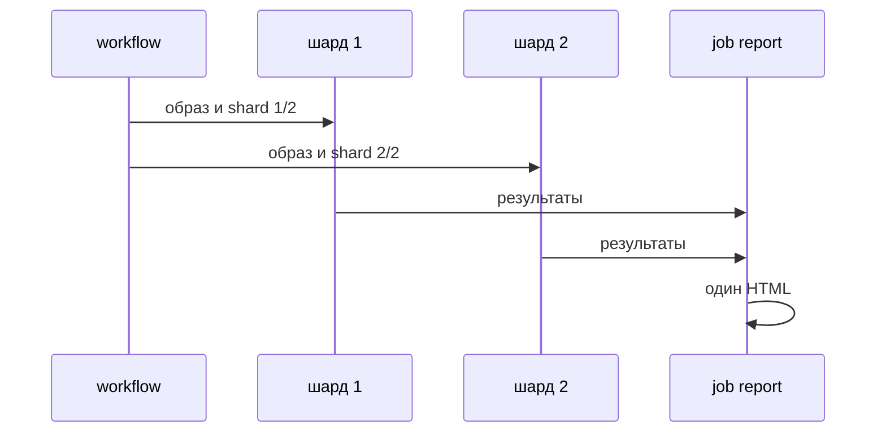
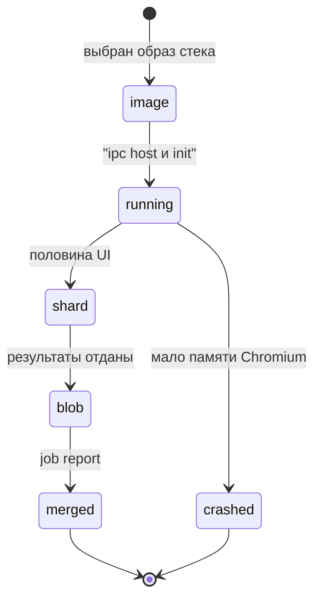

# Headless в контейнере и CI

## Содержание

- [Теория](#теория)
  - [Ситуация](#ситуация)
  - [Модель](#модель)
  - [Понятия и связь с автоматизацией тестирования](#понятия-и-связь-с-автоматизацией-тестирования)
  - [Зоны ответственности](#зоны-ответственности)
  - [Пример](#пример)
  - [Типичные сбои](#типичные-сбои)
  - [Полезные ссылки](#полезные-ссылки)
  - [Вопросы по теории](#вопросы-по-теории)
- [Практическое задание](#практическое-задание)
  - [1.1 Общее](#11-общее)
  - [1.2 Сценарии](#12-сценарии-user-stories)
  - [1.3 Контракт](#13-контракт)
  - [1.4 Ошибки и ограничения](#14-ошибки-и-ограничения)
  - [1.5 Аудит](#15-аудитлоги)
  - [1.6 Нефункциональные требования](#16-нефункциональные-требования)

# Теория

## Ситуация

Пайплайн CI запускает UI в контейнере без монитора. Дальше возможен один из исходов: тесты проходят в официальном образе; Chromium падает на маленьком `/dev/shm`; процесс не умирает по остановке job и висит до таймаута; шарды закончились, а общего отчёта нет; headed-повтор в CI не находит экран; стенд Juice Shop не даёт **200** на `GET /rest/admin/application-version`, и UI красный по соединению.

Образ уже содержит браузеры той же версии, что библиотека. Job остаётся собрать проект и поделить UI на две машины.

Отдельная разработка не нужна: достаточно образа своего стека и команды прогона с шардом. Локально тот же смысл проверяют `npx playwright test --shard=1/2` (`pytest` с делением на две группы, `dotnet test` с фильтром половины UI).

## Модель

Участники: workflow, два шарда `ui`, образ Playwright, Juice Shop, job `report`. Workflow поднимает контейнер с флагами памяти и init. Шард гоняет свою половину headless. Job `report` склеивает отчёты. Решение о прохождении принимает оракул теста — требование, а не текущий ответ стенда. Склейка отчёта вердикт не меняет.



Шарды стартуют вместе и не ждут друг друга. Склейка начинается, когда оба закончились, в том числе если один красный. Иначе упавшая половина остаётся без общего отчёта.



`crashed` — типичный обрыв без `--ipc=host`: браузер не доходит до первой страницы. `merged` — HTML, который читает человек. Пропуск `merged` оставляет два куска и ни одной картины прогона.

Возможный набор полей (схема может быть и другой):

| `ciJob` | Описание |
| --- | --- |
| `image` | Официальный образ стека, тег равен версии библиотеки |
| `ipc` | `host` |
| `init` | Процесс init включён |
| `shard` | `1/2` или `2/2` у job `ui` |

Файл использует те же тесты UI и API, что предыдущие разделы, и workflow `.github/workflows/tests.yml`.

## Понятия и связь с автоматизацией тестирования

### Образ той же версии

Официальный образ уже содержит браузеры и системные библиотеки. Пакет тестов в нём не лежит: `npm ci`, `pip install` или `dotnet restore` job делает сам. Выигрыш в другом. Версия браузера совпадает с версией Playwright, и не нужно собирать `apt` на каждом раннере.

Тег равен версии библиотеки в проекте:

| Стек | Образ |
| --- | --- |
| TypeScript, `@playwright/test` 1.65 | `mcr.microsoft.com/playwright:v1.65.0-noble` |
| Python, `playwright` 1.65.1 | `mcr.microsoft.com/playwright/python:v1.65.1-noble` |
| C#, `Microsoft.Playwright` 1.64.1 | `mcr.microsoft.com/playwright/dotnet:v1.64.1-noble` |

Расхождение тега и библиотеки выглядит как «браузер не найден», хотя файл на месте: исполняемый файл лежит в каталоге другой версии. Контракт образа: тег из таблицы своего стека, headless shell из `10.0`.

### Память Chromium и первый процесс

Chromium общается через общую память. У контейнера `/dev/shm` по умолчанию маленький, браузер падает или ведёт себя нестабильно ещё до сценария. Флаг `--ipc=host` отдаёт контейнеру IPC хоста, и памяти хватает. В compose то же поле — `ipc: host`.

Первый процесс контейнера не собирает завершившихся детей и плохо принимает остановку. Браузер оставляет зомби, job висит до своего таймаута. Флаг `--init` ставит init первым процессом, зомби убираются, `SIGTERM` доходит до Playwright. Оба флага рекомендует документация Docker у Playwright. Их ставят и на `synthetic` из `9.2`.

Контракт запуска: `--ipc=host` и `--init` на каждом контейнере, где живёт Chromium.

### Две половины UI

Полный прогон API и UI на chromium укладывают в 10 минут. Одна машина с двумя воркерами этот потолок держит не всегда. Шард — отдельная машина со своей половиной тестов. У job `ui` шардов два. Внутри шарда воркеров тоже два: так словарь курса задаёт параллельность CI.

В TypeScript деление встроено: `npx playwright test --shard=1/2` и `--shard=2/2`. С `fullyParallel: true` Playwright делит отдельные тесты, а не целые файлы, и половины ровнее. Без этого флага в шард попадает файл целиком, и толстый файл перекашивает время.

У pytest и `dotnet test` флага `--shard` нет. Python делят плагином `pytest-split` (`--splits 2 --group 1` и `--group 2`) или двумя запусками по разным каталогам `tests/ui`. C# делят `--filter` по пространству имён или по Category. Имя флага плагина сверяют с его страницей перед тем, как вписать в workflow.

Контракт деления: две половины `ui`, внутри каждой 2 воркера, режим headless.

### Один отчёт из кусков

Каждый шард пишет свой кусок. Человеку нужен один HTML.

TypeScript на CI включает репортер `blob`. Имена файлов содержат номер шарда и не затирают друг друга. Job `report` скачивает каталоги и выполняет `npx playwright merge-reports --reporter html ./all-blob-reports`. В HTML попадают и trace со скриншотами.

Python и C# отдают каталоги `allure-results`. Файлы результатов независимы, job складывает их в один каталог и вызывает `npx allure generate`, как в `8.1`. JUnit XML или TRX каждого шарда тоже сохраняют: сводка CI видит обе половины.

Job `report` стоит с `if: ${{ !cancelled() }}` и `needs` на тестовые job. Красный шард не отменяет склейку.

Контракт склейки: blob сливается командой Playwright, Allure — общей генерацией из `8.1`.

### Окно в CI

Обычный job headless и xvfb не требует. Если падение повторяется только с окном, разовый запуск идёт так: `xvfb-run npx playwright test --headed`. Виртуальный экран заменяет монитор. Делать headed режимом всех шардов не нужно: шрифты и GPU всё равно другие, а trace headless уже лежит в артефакте.

Контракт окна: xvfb только для разовой сверки headed.

### Итоговый пайплайн

В `.github/workflows/tests.yml` шесть job. Смысл каждого уже введён раньше, здесь они стоят в одном файле.

| Job | Откуда |
| --- | --- |
| `api` | `1.6`, сервис Juice Shop, опрос версии |
| `ui` | два шарда, образ Playwright, headless |
| `a11y` | `3.1` |
| `security` | `5.2` |
| `perf-smoke` | `4.1`, короткий k6 |
| `report` | склейка HTML, Allure, артефакт |

Секреты job — `ADMIN_PASSWORD` и `ACCOUNTANT_PASSWORD`. Образ distroless у Juice Shop по-прежнему без curl, готовность — отдельный опрос **200**.

Контракт пайплайна: эти шесть имён, `ui` из двух шардов, `report` после них.

### Сводка

| Понятие | Смысл в контейнере | На что опирается реализация |
| --- | --- | --- |
| Образ | Браузеры совпадают с библиотекой | Три тега из таблицы стеков |
| `--ipc=host` | Chromium не упирается в `/dev/shm` | Опция контейнера job |
| `--init` | Остановка job доходит до браузера | Опция контейнера job |
| Шард | Половина UI на своей машине | `--shard` или фильтр стека |
| Склейка | Один HTML | `merge-reports` и Allure |
| Шесть job | Весь курс в одном workflow | `tests.yml` |

## Зоны ответственности

| Разработчик пайплайна | Раннер |
| --- | --- |
| Пинит тег образа версией библиотеки | Поднимает контейнер с браузерами |
| Ставит `--ipc=host` и `--init` | Даёт Chromium память и собирает зомби |
| Делит `ui` на два шарда | Гоняет половину headless, 2 воркера |
| Склеивает отчёт и при красном прогоне | Отдаёт blob, Allure и JUnit каждого шарда |

Образ и `playwright install` на голом раннере решают одну задачу — найти браузер. В курсе её решает образ, чтобы системные библиотеки не собирать заново.

## Пример

Программа записывает общие флаги контейнера: IPC, init, первый шард из двух и число job пайплайна. Образ в файл не печатает: тест каждого стека сверяет свой тег отдельно, а четыре строки остаются общими.

### TypeScript

**Node.js 22 или новее, @playwright/test.** Рядом с флагами тест держит тег `mcr.microsoft.com/playwright:v1.65.0-noble`.

```sh
npm init -y
npm install -D @playwright/test@1.65
npx playwright test ci-plan.spec.ts
cat result.txt
```

```typescript
import { test, expect } from '@playwright/test';
import { writeFileSync } from 'node:fs';

const image = 'mcr.microsoft.com/playwright:v1.65.0-noble';

test('план контейнера', () => {
  expect(image).toBe('mcr.microsoft.com/playwright:v1.65.0-noble');
  const lines = ['ipc=host', 'init=true', 'shard=1/2', 'job_count=6'];
  expect(lines[2]).toBe('shard=1/2');
  writeFileSync('result.txt', `${lines.join('\n')}\n`);
});
```

### Python

**Python 3.10 или новее, pytest-playwright.** Тег образа — `mcr.microsoft.com/playwright/python:v1.65.1-noble`.

```sh
python -m pip install pytest pytest-playwright
pytest -q ci_plan.py
cat result.txt
```

```python
IMAGE = "mcr.microsoft.com/playwright/python:v1.65.1-noble"

def container_lines():
    return [
        "ipc=host",
        "init=true",
        "shard=1/2",
        "job_count=6",
    ]

def test_container_plan():
    assert IMAGE == "mcr.microsoft.com/playwright/python:v1.65.1-noble"
    lines = container_lines()
    assert lines[2] == "shard=1/2"
    open("result.txt", "w", encoding="utf-8").write("\n".join(lines) + "\n")
```

### C#

**.NET 8 или новее, Microsoft.Playwright.NUnit.** Тег образа — `mcr.microsoft.com/playwright/dotnet:v1.64.1-noble`.

```sh
dotnet new nunit -n CiPlan -o .
dotnet add package Microsoft.Playwright.NUnit --version 1.64.1
dotnet test
cat result.txt
```

```csharp
using NUnit.Framework;

public class CiPlan
{
    const string Image = "mcr.microsoft.com/playwright/dotnet:v1.64.1-noble";

    [Test]
    public void ContainerPlan()
    {
        Assert.That(Image, Is.EqualTo("mcr.microsoft.com/playwright/dotnet:v1.64.1-noble"));
        var lines = new[] { "ipc=host", "init=true", "shard=1/2", "job_count=6" };
        Assert.That(lines[2], Is.EqualTo("shard=1/2"));
        File.WriteAllText("result.txt", string.Join('\n', lines) + "\n");
    }
}
```

---

Все программы записывают `ipc=host`, `init=true`, `shard=1/2`, `job_count=6` и раннер сообщает об одном пройденном тесте. Первые две строки — флаги Chromium в контейнере. Третья — первая половина UI. Четвёртая — число job в `tests.yml`. Проверка образа в коде совпадает с тегом своего стека и в общий файл не попадает.

## Типичные сбои

| Что видно | Куда смотреть |
| --- | --- |
| «Executable doesn't exist» в контейнере | Тег образа и версия библиотеки разошлись |
| Chromium падает до первой страницы | Нет `--ipc=host`, тесен `/dev/shm` |
| Job висит после отмены | Нет `--init`, зомби браузера не собраны |
| Один шард пустой, другой длинный | Нет `fullyParallel`, деление пошло по файлам |
| Два HTML вместо одного | Job `report` не вызвал `merge-reports` или не сложил `allure-results` |
| Красный шард без отчёта | У `report` условие `success()`, нужно `!cancelled()` |
| Headed в CI сразу падает | Нет xvfb, а окно зачем-то включено на всех шардах |
| Python-шард гоняет все тесты дважды | Фильтр группы не передан, оба job без `--group` |
| Готовность Juice Shop через `docker exec` | Образ distroless без shell, нужен опрос HTTP **200** |

## Полезные ссылки

### Общие

- [Playwright — Docker](https://playwright.dev/docs/docker) — образ, `--ipc=host`, `--init`, совпадение версии.
- [Playwright — Sharding](https://playwright.dev/docs/test-sharding) — `--shard`, репортер `blob`, `merge-reports`.
- [Playwright — CI](https://playwright.dev/docs/ci) — пример job и артефактов.

### По языку

#### TypeScript

**TypeScript, Playwright Test.** На JavaScript контракт контейнера и шардов остаётся тем же.

- [Playwright — Sharding](https://playwright.dev/docs/test-sharding) — matrix из двух шардов и склейка HTML.
- [Playwright — Browsers](https://playwright.dev/docs/browsers#chromium-headless-shell) — shell внутри образа.

#### Python

**Python, pytest-playwright.** На синхронном Playwright API без pytest или на async API контракт контейнера и шардов остаётся тем же.

- [Playwright Python — Docker](https://playwright.dev/python/docs/docker) — образ `v1.65.1-noble`.
- [pytest-split](https://github.com/jerry-git/pytest-split) — `--splits` и `--group`, если делят не каталогами.

#### C#

**C#, Playwright для .NET с NUnit.** На MSTest или xUnit контракт контейнера и шардов остаётся тем же.

- [Playwright .NET — Docker](https://playwright.dev/dotnet/docs/docker) — образ `v1.64.1-noble`.
- [dotnet test](https://learn.microsoft.com/dotnet/core/tools/dotnet-test) — `--filter` для половины UI.

## Вопросы по теории

1. Почему тег образа обязан совпадать с версией библиотеки?
2. Что ломает маленький `/dev/shm` у Chromium?
3. Зачем контейнеру `--init`, если тест и так завершается?
4. Почему у TypeScript шард — флаг раннера, а у Python и C# — фильтр или плагин?
5. Что теряется, если job `report` запускается только при зелёных шардах?
6. Когда в CI нужен xvfb?
7. Какие шесть job составляют пайплайн курса и кто из них делит UI?

# Практическое задание

Функциональность headless-прогона в контейнере CI в системе.
Workflow поднимает официальный образ Playwright с `--ipc=host` и `--init`, делит UI на два шарда и склеивает отчёт в job `report`. Рядом работают `api`, `a11y`, `security` и `perf-smoke`.

## 1) Контейнер и шарды

### 1.1 Общее

**Назначение:** собрать итоговый пайплайн курса так, чтобы UI шёл headless в образе своей версии и укладывался в общее время.

**Пользователи/роли:**

- AQA-инженер — держит тег образа и число шардов;
- разработчик — открывает склеенный HTML;
- CI — шесть job в `tests.yml`;
- Juice Shop — сервис job `api` и `ui`, готовность опросом **200**.

**Зависимости/связанные настройки:**

- `10.0` — shell, viewport, trace;
- `8.1` — Allure и условие `!cancelled()`;
- `1.6` — job `api` и секреты;
- образы трёх стеков из таблицы выше;
- `ADMIN_PASSWORD`, `ACCOUNTANT_PASSWORD`.

Синтетика по расписанию остаётся в `synthetic.yml` (`9.2`) и в эти шесть job не входит.

### 1.2 Сценарии (user stories)

1. **Образ:** job `ui` стартует в теге своего стека, браузер находится без отдельного `install --with-deps` системных пакетов.
2. **Память:** Chromium доходит до `/#/login`, `/dev/shm` не обрывает процесс.
3. **Две половины:** шарды `1/2` и `2/2` заканчиваются, у каждого 2 воркера.
4. **Склейка:** красный шард всё равно попадает в один HTML.
5. **Остановка:** отмена job завершает браузер, а не ждёт таймаут раннера.

### 1.3 Контракт

#### 1.3.1 Контейнер job `ui`

| Поле | Проверки/валидация |
| --- | --- |
| `image` | Тег стека из таблицы образов |
| `options` | `--ipc=host --init` |
| режим | headless shell, viewport из `10.0` |
| воркеры | 2 на шард |
| ретраи | 2 в CI, trace `on-first-retry` |

**Логика/шаги:**

1. Указать образ в `container` job.
2. Передать опции IPC и init.
3. Поставить зависимости проекта.
4. Запустить половину UI.
5. Выложить blob или `allure-results` и JUnit/TRX, даже если тесты красные.

Сбой на середине шарда оставляет уже снятый trace на ретрае. Второй шард из-за этого не останавливают: у strategy `fail-fast: false`.

**Ответы:**

- Успех — браузер стартовал, артефакт шарда лежит в прогоне.
- **Ошибки:** см. раздел 1.4.

#### 1.3.2 Шарды и job `report`

**Общее правило:** UI делят на две половины. Склейка одна. Имена job фиксированы.

| Job | Деление и отчёт |
| --- | --- |
| `ui` | TypeScript `--shard=$n/2`. Python `--splits 2 --group $n` или два каталога. C# два `--filter` |
| `report` | `merge-reports` для blob и `allure generate` для `allure-results` |
| `api`, `a11y`, `security`, `perf-smoke` | Без шарда UI, свои команды из своих файлов |

**Логика/шаги:**

1. Задать matrix из двух значений шарда, `fail-fast: false`.
2. В TypeScript включить `fullyParallel` и репортер `blob` при `CI`.
3. Дождаться всех тестовых job.
4. Склеить HTML и выложить артефакт.
5. Headed-сверку, если она нужна, запустить отдельно под `xvfb-run`, не в этих двух шардах.

**Ответы:**

- Успех — один HTML на оба шарда.
- **Ошибки:** см. раздел 1.4.

### 1.4 Ошибки и ограничения

- Браузер не найден — тег образа не равен версии библиотеки.
- Падение Chromium до сценария — нет `--ipc=host`.
- Зависший job при отмене — нет `--init`.
- Пустой шард — фильтр группы не передан, или `fullyParallel` выключен и файлы легли в одну половину.
- Нет общего HTML — `report` не скачал артефакты или стоит `if: success()`.
- Headed без xvfb — job не находит дисплей. Основной путь — headless.
- **200** версии нет — UI не запускают, сначала опрос, не `docker exec`.
- Секреты в логе контейнера — `ADMIN_PASSWORD` и `ACCOUNTANT_PASSWORD` только из секретов GitHub.

Половины считают от одного и того же коммита. Смешивать шард с другой ветки в `merge-reports` нельзя: отчёт перестанет совпадать с проверками.

### 1.5 Аудит/логи

В лог job писать тег образа, номер шарда и команду прогона.

Не писать пароли ролей, cookie `token`, полный JWT и содержимое `.auth`. Каталог `.auth` в git не коммитят, как в `2.3`.

### 1.6 Нефункциональные требования

- API и UI на chromium вместе — не дольше 10 минут за счёт двух шардов и двух воркеров в каждом.
- Ретраи CI — 2, локально 0. Trace — `on-first-retry`. Скриншот и видео — только при падении.
- В тестах нет `waitForTimeout`.
- `report` не добавляет паузу: стартует после артефактов.
- Пять стабильных повторов UI из `2.6` остаются требованием к headless-прогону, а не к разовому xvfb.
