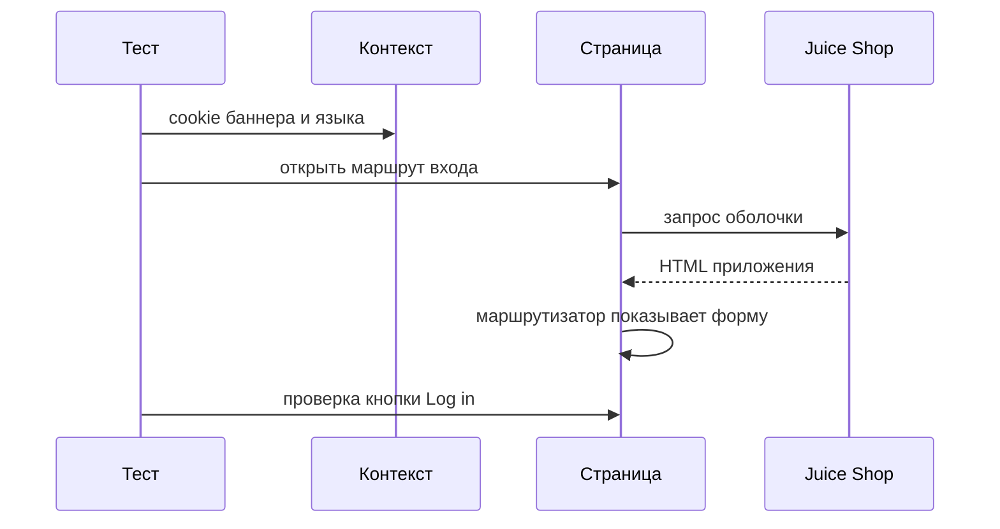
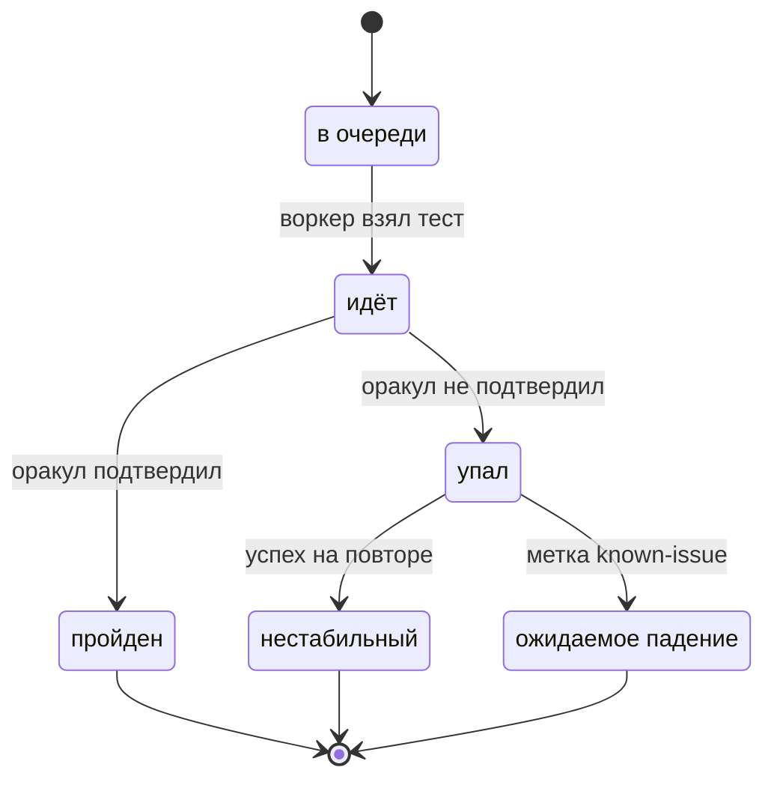

# Общие требования к UI-автотестам

## Содержание

- [Теория](#теория)
  - [Ситуация](#ситуация)
  - [Модель](#модель)
  - [Понятия и связь с автоматизацией тестирования](#понятия-и-связь-с-автоматизацией-тестирования)
  - [Зоны ответственности](#зоны-ответственности)
  - [Пример](#пример)
  - [Типичные сбои](#типичные-сбои)
  - [Полезные ссылки](#полезные-ссылки)
  - [Вопросы по теории](#вопросы-по-теории)
- [Практическое задание](#практическое-задание)
  - [1.1 Общее](#11-общее)
  - [1.2 Сценарии](#12-сценарии-user-stories)
  - [1.3 Контракт](#13-контракт)
  - [1.4 Ошибки и ограничения](#14-ошибки-и-ограничения)
  - [1.5 Аудит](#15-аудитлоги)
  - [1.6 Нефункциональные требования](#16-нефункциональные-требования)

# Теория

## Ситуация

Автотест открывает форму входа Juice Shop. Дальше возможен один из исходов: оболочка приложения отвечает **200** и кнопка `Log in` неактивна, баннер cookie перекрывает поля, интерфейс показан не на английском, либо стенд не принимает соединение.

Отдельная разработка не нужна: достаточно запущенного контейнера Juice Shop и команды `npx playwright test --grep @ui` (`pytest -m ui`, `dotnet test --filter Category=ui`).

## Модель

Участники — тест, браузер, контекст, страница и Juice Shop. Браузер — процесс движка. Контекст — отдельный профиль: свои cookie, `localStorage` и `sessionStorage`. Страница — одна вкладка этого профиля. Решение о прохождении принимает оракул теста — требование, а не текущий ответ стенда.



Диаграмма показывает старт UI-теста. Cookie попадают в контекст раньше перехода, поэтому баннер и язык уже заданы к моменту, когда приложение рисует форму входа.



Диаграмма показывает одну попытку теста. Успех на повторе даёт статус flaky. Метка `known-issue` переводит падение в ожидаемое. Из пройденного состояния возврата нет: следующий запуск снова начинается с очереди. Для flaky в этом файле метка `known-issue` не используется — свой процесс описан в `2.6`.

Cookie, которые контекст отдаёт приложению:

| `cookie` | Описание |
| --- | --- |
| `cookieconsent_status` | Значение `dismiss` скрывает баннер cookieconsent до отрисовки |
| `language` | Значение `en` оставляет строки интерфейса на английском |
| `welcomebanner_status` | Значение `dismiss` скрывает приветственный баннер, если режим стенда другой |

Стенд для этого каркаса использует одну HTML-оболочку и cookie браузера. Экран выбирает hash-маршрут, язык и баннеры читаются из cookie. Каталог, корзина и сессия покупателя появятся в следующих файлах и здесь в таблицы не выносятся.

## Понятия и связь с автоматизацией тестирования

### Браузер, контекст и страница

Тест входа не должен видеть корзину, которую собрал соседний тест. Для этого Playwright держит три уровня: браузер (`browser`), контекст (`browser context`) и страницу (`page`). Браузер запускается один на воркер и дорог в старте. Контекст создаётся на каждый тест и стоит дёшево: это профиль без общих cookie. Страница принадлежит контексту. В одном браузере можно открыть два контекста: в первом `/#/login`, во втором `/#/basket`. Cookie `token` из первого во втором не появляется. В контракте у каждого теста свой контекст и одна страница по умолчанию.

### Изоляция с чистого профиля

Стирать данные предыдущего теста легко забыть: остаётся «посещённая» ссылка, язык или баннер, который уже закрыли. Новый контекст начинается пустым, и причину падения ищут внутри одного теста. Поиск на `/#/search` каждый раз открывается без cookie `token` и без товаров в корзине. Общий профиль на весь прогон в контракт не входит.

### Hash-маршруты

Juice Shop — одностраничное приложение. Сервер отдаёт одну оболочку, а экран выбирает часть адреса после `#`. Такой адрес называют hash-маршрутом. Форма входа — `page.goto('/#/login')`, каталог — `/#/search`, корзина — `/#/basket`. Путь `/login` без решётки оставляет маршрутизатор на другом экране, хотя оболочка и ответила **200**. База адреса берётся из `baseURL`, поэтому в тесте пишут путь от корня, а хост и порт живут в `BASE_URL`. В контракте UI-переходы идут на `/#/…` относительно `baseURL`.

### Проекты браузеров

Одна и та же форма входа должна открываться в разных движках, но полный прогон API и UI в CI укладывается в 10 минут на одном движке. Проект (`project`) — это именованный набор настроек. В курсе три проекта: `chromium`, `firefox`, `webkit`. Обычный job `ui` запускает `chromium`. Тот же тест формы входа на трёх движках — отдельный прогон, его состав задаёт `2.5`. В Python проекты заменяет повтор флага `--browser`. В C# движок задаёт переменная `BROWSER` или `BrowserName` в `.runsettings`. В контракте описание трёх движков есть на каждом стеке, а регулярный прогон UI идёт в `chromium`.

### Баннер cookie и язык интерфейса

Баннер закрывает кнопку `Log in`, а подпись на другом языке ломает проверку английской строки. Библиотека cookieconsent показывает текст `This website uses fruit cookies to ensure you get the juiciest tracking experience.` и кнопку `Me want it!`. Cookie `cookieconsent_status` со значением `dismiss`, поставленная в контекст до перехода, не даёт баннеру появиться. Второй способ — обработчик локатора, если баннер всё же всплыл посреди теста:

```ts
await page.addLocatorHandler(page.getByText('Me want it!', { exact: true }), async () => {
  await page.getByText('Me want it!', { exact: true }).click();
});
```

В Python метод называется `add_locator_handler`, в C# — `AddLocatorHandlerAsync`. Обработчик нужен для неожиданного перекрытия. Предсказуемый баннер первого визита закрывают cookie. Приветственный баннер при `NODE_ENV=quiet` не показывается. Cookie `welcomebanner_status=dismiss` страхует другой режим: кнопка с `aria-label="Close Welcome Banner"` тогда не появляется. Язык фиксирует cookie `language=en`, иначе строки `Login`, `Email`, `Password` и `Log in` нельзя сверять с требованием. В контракте три cookie стоят в контексте до первого `goto`.

### Запись сценария и разбор падения

Первый сценарий быстрее записать, чем собрать по памяти, а падение проще смотреть как ленту действий. `codegen` открывает браузер и Playwright Inspector и пишет шаги, пока по экрану ходят мышкой: `npx playwright codegen http://localhost:3000/#/login`. Inspector на уже написанном тесте открывает `npx playwright test --debug`. В Python и C# тот же Inspector включает переменная `PWDEBUG=1` (`$env:PWDEBUG=1` в PowerShell). UI mode — окно со списком тестов, фильтром по тегу и лентой действий — есть только у Playwright Test: `npx playwright test --ui`. Trace viewer читает `trace.zip` на всех стеках: видно локатор, снимок DOM и сеть. Команды просмотра: `npx playwright show-trace`, `playwright show-trace`, `pwsh bin/Debug/net8.0/playwright.ps1 show-trace`. В контракте trace снимается по правилу из настроек прогона, а не на каждый зелёный тест.

### Сравнение

| Инструмент | Подходит для |
| --- | --- |
| Playwright | Сквозной UI и API в одном репозитории, три движка, trace |
| Selenium WebDriver | Уже написанные наборы на протоколе WebDriver |
| Cypress | UI-сценарии в браузере семейства Chromium |
| WebdriverIO | WebDriver и протокол DevTools в Node.js |
| Puppeteer | Скрипты управления Chromium, не набор тестов продукта |
| Nightwatch | Сценарии на WebDriver в Node.js |
| TestCafe | Прогон без отдельного драйвера браузера |
| Robot Framework и библиотека Browser | Сценарии ключевыми словами, движок на Playwright |
| Selenium IDE, BugBug, Ghost Inspector, QA Wolf | Короткая запись сценария без своего кода |
| Jest, Vitest, Jasmine, Testing Library | Модуль и компонент без целого стенда |

Подробно курс разбирает Playwright: на нём уже построены API-тесты `1.0`–`1.6`. Jest, Vitest, Jasmine и Testing Library проверяют компонент в jsdom и не открывают `/#/login` в настоящем браузере. Баннер, hash-маршрут и движок им не видны. Это уровень модульных и компонентных проверок из `0.2`. Инструменты записи без кода оставляют сценарий в своём сервисе. Набор курса живёт в репозитории на одном из трёх стеков, поэтому каркас ниже описан кодом Playwright.

### Что будет в локаторах, действиях и автоожидании

Каркас этого файла даёт контекст, язык, отсутствие баннера и адрес стенда. Файл `2.1` на этом старте заполняет форму входа, регистрирует покупателя и ищет `apple`. Там же появятся тест-кейсы `TC-AUTH-10`, `TC-AUTH-11`, `TC-REG-10`, `TC-REG-11`, `TC-REG-12` и `TC-SEARCH-10`. Страницы как объекты — в `2.2`, сессия после входа — в `2.3`.

### Сводка

| Понятие | Смысл в каркасе UI | На что опирается реализация |
| --- | --- | --- |
| Браузер, контекст, страница | Чистый профиль на каждый тест | Фикстуры `page` и `context`, класс `PageTest` |
| Hash-маршрут | Экран внутри одной оболочки | `baseURL` и путь `/#/login` |
| Проект браузера | Тот же тест на трёх движках | `projects`, `--browser`, `BROWSER` |
| Cookie баннера и языка | Форма на английском и без перекрытия | `addCookies` до `goto` |
| Обработчик локатора | Снять баннер, если он всплыл позже | `addLocatorHandler` |
| codegen и Inspector | Записать и пошагово пройти сценарий | CLI и `PWDEBUG=1` |
| UI mode | Смотреть прогон в окне | Только `npx playwright test --ui` |
| Trace viewer | Разобрать падение по снимкам | `trace.zip` на трёх стеках |

## Зоны ответственности

| Автотест | Фреймворк |
| --- | --- |
| Открывает hash-маршрут и сверяет видимые строки с требованием | Создаёт браузер, контекст и страницу на каждый тест |
| Кладёт cookie баннера и языка до перехода | Хранит `baseURL`, таймауты, trace, скриншот и видео |
| Помечает тест тегом `ui` | Отбирает тесты по тегу и по проекту движка |
| Оставляет пароль и токен вне журнала | Прикладывает trace и скриншот к упавшему тесту |

Cookie в контексте и обработчик локатора закрывают один баннер в разные моменты и друг друга не заменяют. Проверка компонента в Testing Library не заменяет открытие `/#/login` в движке.

## Пример

Программа открывает `/#/login` в контексте, где уже лежат cookie баннера и английского языка. Кнопка `#loginButton` неактивна, текста `Me want it!` на странице нет. Каждый раннер сообщает об одном пройденном тесте.

### TypeScript

**Node.js 22 или новее, @playwright/test.** Контекст с cookie до перехода, параметр `baseURL`.

```sh
npm install -D @playwright/test
npx playwright install chromium
npx playwright test --grep @ui
```

```ts
import { expect, test } from '@playwright/test';

test.use({ baseURL: 'http://localhost:3000' });

test('форма входа без баннера', { tag: ['@ui'] }, async ({ page }) => {
  await page.context().addCookies([
    { name: 'cookieconsent_status', value: 'dismiss', url: 'http://localhost:3000' },
    { name: 'language', value: 'en', url: 'http://localhost:3000' },
    { name: 'welcomebanner_status', value: 'dismiss', url: 'http://localhost:3000' },
  ]);
  await page.goto('/#/login');
  await expect(page.locator('#loginButton')).toBeDisabled();
  await expect(page.getByText('Me want it!', { exact: true })).toHaveCount(0);
});
```

### Python

**Python 3.10 или новее, pytest-playwright.** Контекст с cookie до перехода, параметр `--base-url`.

```sh
pip install pytest pytest-playwright
playwright install chromium
pytest -m ui --base-url http://localhost:3000
```

```python
import pytest
from playwright.sync_api import Page, expect

@pytest.mark.ui
def test_login_form_without_banner(page: Page) -> None:
    page.context.add_cookies([
        {"name": "cookieconsent_status", "value": "dismiss", "url": "http://localhost:3000"},
        {"name": "language", "value": "en", "url": "http://localhost:3000"},
        {"name": "welcomebanner_status", "value": "dismiss", "url": "http://localhost:3000"},
    ])
    page.goto("/#/login")
    expect(page.locator("#loginButton")).to_be_disabled()
    expect(page.get_by_text("Me want it!", exact=True)).to_have_count(0)
```

### C#

**.NET 8 или новее, Microsoft.Playwright.NUnit.** Контекст с cookie до перехода, свойство `BaseURL`.

```sh
dotnet new nunit -n AqaJuiceShop.Tests
dotnet add package Microsoft.Playwright.NUnit
dotnet build
pwsh bin/Debug/net8.0/playwright.ps1 install chromium
dotnet test --filter Category=ui
```

```csharp
using Microsoft.Playwright;
using Microsoft.Playwright.NUnit;
using NUnit.Framework;

[Parallelizable(ParallelScope.Self)]
public class LoginShellTests : PageTest
{
    public override BrowserNewContextOptions ContextOptions()
        => new() { BaseURL = "http://localhost:3000" };

    [Test]
    [Category("ui")]
    public async Task LoginFormWithoutBanner()
    {
        await Context.AddCookiesAsync(new[]
        {
            new Cookie { Name = "cookieconsent_status", Value = "dismiss", Url = "http://localhost:3000" },
            new Cookie { Name = "language", Value = "en", Url = "http://localhost:3000" },
            new Cookie { Name = "welcomebanner_status", Value = "dismiss", Url = "http://localhost:3000" },
        });
        await Page.GotoAsync("/#/login");
        await Expect(Page.Locator("#loginButton")).ToBeDisabledAsync();
        await Expect(Page.GetByText("Me want it!", new() { Exact = true })).ToHaveCountAsync(0);
    }
}
```

---

Каждый раннер сообщает о 1 пройденном тесте. Неактивная `#loginButton` подтверждает требование формы: поля пустые, кнопка `Log in` выключена. Нулевое число вхождений `Me want it!` подтверждает, что баннер cookieconsent не показан. Английский язык удерживает cookie `language`.

## Типичные сбои

| Что видно | Куда смотреть |
| --- | --- |
| На форме нет `Log in`, подписи на другом языке | Cookie `language=en` добавлена до `goto` |
| Клик не доходит, поверх формы текст про fruit cookies | Cookie `cookieconsent_status=dismiss` или обработчик `Me want it!` |
| Поверх страницы приветствие и `Close Welcome Banner` | `NODE_ENV=quiet` и cookie `welcomebanner_status=dismiss` |
| Оболочка открылась, формы входа нет | Путь `/#/login` и `baseURL`, а не `/login` |
| `net::ERR_CONNECTION_REFUSED` | Контейнер Juice Shop слушает порт `3000` |
| Проверка падает ровно через 5 с | Таймаут expect: строки или кнопки нет в нужном состоянии |
| Поиск видит чужой `token` | На тест создаётся новый контекст |
| Баннер есть, хотя cookie в коде стоят | `url` cookie и хост `BASE_URL` различаются |
| В CI прогон UI идёт во всех движках и не укладывается в 10 минут | Обычный job — `chromium`; три движка — в `2.5` |
| Локально у падения нет trace | Ретраев 0, trace в TypeScript пишется на первом повторе |
| Pytest пишет, что маркер `ui` не зарегистрирован | Маркер `ui` объявлен в конфигурации pytest |
| `dotnet test --filter Category=ui` запускает 0 тестов | На методе есть `[Category("ui")]` |

## Полезные ссылки

### Общие

- [Playwright — Isolation](https://playwright.dev/docs/browser-contexts) — зачем каждому тесту свой контекст.
- [Playwright — Projects](https://playwright.dev/docs/test-projects) — проекты `chromium`, `firefox` и `webkit`.
- [Playwright — Test generator](https://playwright.dev/docs/codegen) — `codegen` и запись шагов в Inspector.
- [Playwright — Debugging Tests](https://playwright.dev/docs/debug) — `npx playwright test --debug` и `page.pause()`.
- [Playwright — UI Mode](https://playwright.dev/docs/test-ui-mode) — окно прогона Playwright Test.
- [Playwright — Trace viewer](https://playwright.dev/docs/trace-viewer) — разбор `trace.zip`.
- [Playwright — addLocatorHandler](https://playwright.dev/docs/api/class-page#page-add-locator-handler) — обработчик баннера, который всплыл посреди теста.
- [Selenium — WebDriver](https://www.selenium.dev/documentation/webdriver/) — протокол и место Selenium среди UI-инструментов.
- [Testing Library — Introduction](https://testing-library.com/docs/) — проверки компонента без целого стенда.

### По языку

#### TypeScript

**TypeScript, Playwright Test.** На JavaScript контракт каркаса UI остаётся тем же.

- [Playwright — Projects](https://playwright.dev/docs/test-projects) — `projects` и запуск `--project=chromium`.

#### Python

**Python, pytest-playwright.** На синхронном Playwright API без pytest или на async API контракт каркаса UI остаётся тем же.

- [Playwright — Pytest Plugin Reference](https://playwright.dev/python/docs/test-runners) — фикстуры `page` и `context`, флаги `--base-url`, `--browser`, `--tracing`, `--screenshot`, `--video`.

#### C#

**C#, Playwright для .NET с NUnit.** На MSTest или xUnit контракт каркаса UI остаётся тем же.

- [Playwright — Installation](https://playwright.dev/dotnet/docs/intro) — проект NUnit, базовый класс `PageTest`, установка браузеров.
- [Playwright — Trace viewer](https://playwright.dev/dotnet/docs/trace-viewer) — `Context.Tracing` и сохранение zip после падения.

## Вопросы по теории

1. Зачем каждому тесту свой контекст, если браузер уже запущен?
2. Почему форму входа открывают адресом `/#/login`?
3. Зачем cookie `language` со значением `en`?
4. Когда баннер закрывают cookie, а когда обработчиком локатора?
5. Почему обычный прогон UI в CI идёт в `chromium`, хотя движков три?
6. Чем `codegen` отличается от trace viewer?
7. Почему прохождение решает требование к экрану?

## Практическое задание

Автотесты каркаса UI для Juice Shop.

Набор открывает экраны в отдельном контексте, на английском и без баннеров. Конфиг фиксирует движок, таймауты и вложения отчёта. Итог на трёх стеках один: форма входа на месте, кнопка `Log in` неактивна, текст `Me want it!` не показан.

## 1) Каркас UI-прогона

### 1.1 Общее

**Назначение:** дать каждому UI-тесту чистый английский экран Juice Shop без баннера.

**Пользователи/роли:**

- AQA-инженер — описывает каркас и пример открытия `/#/login`;
- разработчик — читает trace и скриншот упавшего теста;
- CI — запускает тег `ui` в проекте `chromium`;
- `guest` — роль стенда для этого файла: входа нет, cookie `token` нет.

**Зависимости/связанные настройки:**

- `0.2` — место UI-тестов в пирамиде, отдельно от проверок компонента;
- `1.0` — репозиторий, чтение окружения, fail-fast секретов, теги и лимиты прогона;
- `BASE_URL` — адрес стенда, по умолчанию `http://localhost:3000`;
- `NODE_ENV=quiet` — приветственный баннер выключен;
- `CI` — включает 2 ретрая и 2 воркера.

Локаторы полей, клики и тест-кейсы входа — в `2.1`. Объекты страниц — в `2.2`. Перенос сессии — в `2.3`. Сеть и моки — в `2.4`. Снимки экрана и прогон выбранных кейсов в трёх движках — в `2.5`. Нестабильные тесты — в `2.6`.

### 1.2 Сценарии (user stories)

1. **Чистая форма входа:** автотест открывает `/#/login` в новом контексте. Кнопка `Log in` неактивна, текста `Me want it!` нет.
2. **Каталог без чужой сессии:** автотест открывает `/#/search`. Cookie `token` другого теста в этом контексте нет.
3. **Две корзины рядом:** два контекста одного браузера открывают `/#/basket`. Состав корзины одного контекста не виден другому.
4. **Тот же старт на трёх стеках:** TypeScript, Python и C# ставят одни cookie и открывают один hash-маршрут.

### 1.3 Контракт

#### 1.3.1 Контекст и cookie

| Подготовка контекста | Проверки/валидация |
| --- | --- |
| `cookieconsent_status=dismiss` | Текст `Me want it!` отсутствует |
| `language=en` | На форме есть английские `Email`, `Password` и кнопка `Log in` |
| `welcomebanner_status=dismiss` | Кнопка `Close Welcome Banner` не показана |
| `baseURL` из `BASE_URL`, иначе `http://localhost:3000` | `goto('/#/login')` показывает `#loginButton` |
| Новый контекст на тест | Cookie `token` в контексте нет |

**Логика/шаги:**

1. Прочитать `BASE_URL`. При пустом значении взять `http://localhost:3000`.
2. Создать контекст и страницу для этого теста.
3. Добавить три cookie. Поле `url` cookie совпадает с адресом стенда.
4. Открыть `/#/login`.
5. Проверить, что `#loginButton` неактивна и текст `Me want it!` отсутствует.

Контекст уничтожается в конце теста. Покупатель на стенде не создаётся, повтор безопасен.

**Ответы:**

- **Успех:** запрос оболочки — **200**, на маршруте входа видна неактивная `#loginButton`.
- **Ошибки:** см. раздел 1.4.

#### 1.3.2 Движки и тег `ui`

**Общее правило:** тест каркаса помечен тегом `ui`. Регулярный прогон, включая CI, выполняет его в `chromium`. Проекты `firefox` и `webkit` описаны и запускаются отдельно. Состав кросс-браузерных кейсов — в `2.5`.

| Движок | Как включить |
| --- | --- |
| `chromium` | Проект по умолчанию для job `ui` |
| `firefox` | `--project=firefox`, `--browser firefox`, `BROWSER=firefox` |
| `webkit` | `--project=webkit`, `--browser webkit`, `BROWSER=webkit` |

**Логика/шаги:**

1. Пометить тест: в TypeScript `{ tag: ['@ui'] }`, в Python `@pytest.mark.ui`, в C# `[Category("ui")]`.
2. Зарегистрировать маркер `ui` в конфигурации pytest.
3. Описать три движка в `playwright.config.ts`, в флагах pytest и в `.runsettings` (`BrowserName`).
4. Запустить фильтр `npx playwright test --grep @ui`, `pytest -m ui` или `dotnet test --filter Category=ui`.

**Ответы:**

- **Успех:** раннер сообщает о пройденном тесте в выбранном движке. Оболочка стенда — **200**.
- **Ошибки:** см. раздел 1.4.

#### 1.3.3 Настройки прогона

**Общее правило:** числа ниже записаны в конфиге явно. Совпадение с сегодняшним значением по умолчанию библиотеки не отменяет запись: смена версии не должна тихо сдвинуть лимит.

| Настройка | TypeScript | Python | C# |
| --- | --- | --- | --- |
| Таймаут теста 30 с | `timeout: 30_000` | `set_default_timeout(30_000)` | `[Timeout(30000)]` |
| Таймаут проверки 5 с | `expect.timeout: 5_000` | `expect.set_options(timeout=5_000)` | `SetDefaultExpectTimeout(5000)` |
| Ретраи 2 в CI, 0 локально | `retries` | `--reruns 2` в CI | `[Retry(2)]` только в CI |
| Воркеры в CI — 2 | `workers: 2` | `pytest-xdist -n 2` | `LevelOfParallelism(2)` |
| Trace на неуспехе | `trace: 'on-first-retry'` | `--tracing retain-on-failure` | `Context.Tracing`, zip только если тест упал |
| Скриншот при падении | `screenshot: 'only-on-failure'` | `--screenshot only-on-failure` | `ScreenshotAsync` в разборе падения |
| Видео при падении | `video: 'retain-on-failure'` | `--video retain-on-failure` | каталог видео, файл удалить при успехе |

**Логика/шаги:**

1. Прочитать переменную `CI`.
2. Включить два ретрая и двух воркеров, когда `CI` задана. Локально ретраи выключить.
3. Включить trace, скриншот и видео по колонке стека.
4. Запустить тег `ui` в `chromium`.

В C# `[Retry]` повторяет метод после провала, включая провал `Expect`. Разбор нестабильных повторов — в `2.6`. Trace в Python хранится у упавшего прохода (`retain-on-failure`): отдельного режима «только первый ретрай», как `on-first-retry` в TypeScript, у pytest-playwright нет.

**Ответы:**

- **Успех:** тест зелёный, вложений с падения нет, оболочка — **200**.
- **Ошибки:** см. раздел 1.4.

### 1.4 Ошибки и ограничения

- **200** — оболочка приложения получена. Код страницы сам по себе форму входа не доказывает: без `/#/login` маршрутизатор показывает другой экран.
- Соединение не установлено — контейнер не слушает `3000` или `BASE_URL` указывает мимо стенда. Повторить после `docker run --rm -p 3000:3000 -e NODE_ENV=quiet bkimminich/juice-shop:v20.4.0` и проверки `GET /rest/admin/application-version`.
- Таймаут проверки 5 с — нет `#loginButton`, кнопка активна при пустых полях, на экране есть `Me want it!` или `Close Welcome Banner`, либо строки не на английском.
- Таймаут теста 30 с — страница не дошла до проверки. Смотреть доступность стенда и trace, если он есть.
- Фильтр тега пустой — маркер `ui` не зарегистрирован или категория не стоит на методе.
- Секрет без значения — отказ прогона с понятным текстом, как в `1.0`. Каркас UI пароли встроенных ролей не читает.
- `known-issue` этот файл не ставит: дефект экрана входа здесь не ожидается.

Порядок такой: сначала соединение и **200** оболочки, затем маршрут, затем cookie и строки. Пока оболочка не открылась, текст баннера не проверяют.

### 1.5 Аудит/логи

Логировать имя теста, движок, маршрут и итог проверки `#loginButton`. В отчёт при падении класть скриншот и trace по правилу 1.3.3.

В журнал и во вложения не попадают пароль, токен, cookie `token`, полный JWT и тело ответа с хешем пароля. В этом файле поле `Password` не заполняют. Если trace позже снимет введённый пароль, значение в текст отчёта не копируют.

### 1.6 Нефункциональные требования

- Таймаут теста — 30 с, таймаут проверки — 5 с.
- Фиксированные паузы `waitForTimeout`, `sleep` и `Thread.Sleep` запрещены.
- Ретраи: 2 в CI, 0 локально. Воркеров в CI — 2.
- Trace, скриншот и видео — по таблице 1.3.3.
- Полный прогон API и UI в `chromium` — не дольше 10 минут.
- Набор покрывает сценарии чистого старта `/#/login` на трёх стеках.
- Общие лимиты прогона из словаря курса относятся и к этому каркасу.
