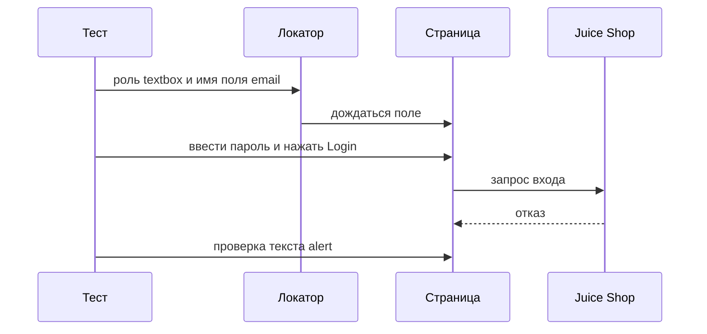
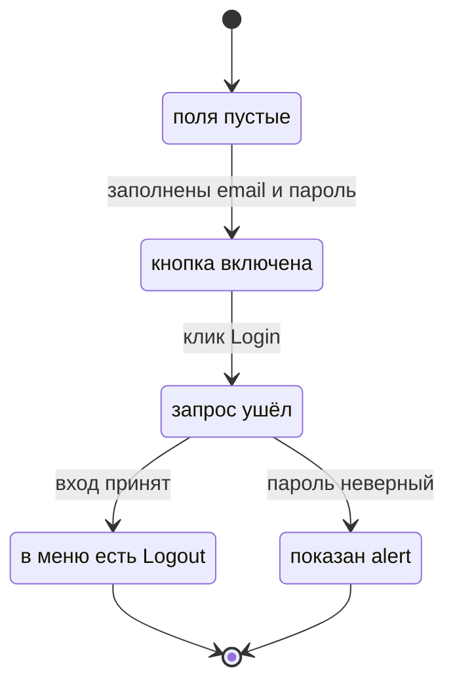

# Локаторы, действия и автоожидание

## Содержание

- [Теория](#теория)
  - [Ситуация](#ситуация)
  - [Модель](#модель)
  - [Понятия и связь с автоматизацией тестирования](#понятия-и-связь-с-автоматизацией-тестирования)
  - [Зоны ответственности](#зоны-ответственности)
  - [Пример](#пример)
  - [Типичные сбои](#типичные-сбои)
  - [Полезные ссылки](#полезные-ссылки)
  - [Вопросы по теории](#вопросы-по-теории)
- [Практическое задание](#практическое-задание)
  - [1.1 Общее](#11-общее)
  - [1.2 Сценарии](#12-сценарии-user-stories)
  - [1.3 Контракт](#13-контракт)
  - [1.4 Ошибки и ограничения](#14-ошибки-и-ограничения)
  - [1.5 Аудит](#15-аудитлоги)
  - [1.6 Нефункциональные требования](#16-нефункциональные-требования)

# Теория

## Ситуация

Автотест заполняет форму входа Juice Shop и нажимает `Log in`. Дальше возможен один из исходов: в меню аккаунта появляется `Logout`, на форме виден `role=alert` с текстом `Invalid email or password.`, кнопка остаётся неактивной, либо стенд не принимает соединение.

Отдельная разработка не нужна: достаточно запущенного контейнера Juice Shop и команды `npx playwright test --grep @ui` (`pytest -m ui`, `dotnet test --filter Category=ui`).

## Модель

Участники — тест, локатор, страница и Juice Shop. Локатор описывает элемент словами интерфейса и заново ищет его перед каждым действием. Каркас контекста, язык и баннер берутся из `2.0`. Решение о прохождении принимает оракул теста — требование, а не текущий ответ стенда.



Диаграмма показывает неверный пароль. Локатор ждёт поле сам. Проверка alert тоже ждёт текст. Отдельной паузы между кликом и проверкой нет: ответ входа приходит по сети, и ожидание сидит внутри действия и `expect`.



Диаграмма показывает форму входа. Пока поля пустые, `#loginButton` неактивна, и клик по ней не является переходом. После отправки форма приходит либо к `Logout`, либо к alert. Обратного перехода из этих двух состояний в этой диаграмме нет: новый тест начинает с пустой формы.

Поля формы входа, как их видит локатор:

| `поле` | Описание |
| --- | --- |
| `email` | `#email`, доступное имя `Text field for the login email`, подпись `Email` |
| `password` | `#password`, доступное имя `Text field for the login password`, подпись `Password` |
| `login` | `#loginButton`, доступное имя `Login`, видимый текст `Log in`, выключена при пустых полях |

Стенд хранит покупателя у себя, а тест в этом файле видит форму, alert и меню. Таблица выше — подписи экрана, не учётная запись. Учётную запись создаёт фикстура `customer` из `1.4`.

## Понятия и связь с автоматизацией тестирования

### Зачем локатор

Координата кнопки на скриншоте разъезжается от ширины окна и от баннера. Локатор называет элемент так, как его находит человек или читалка экрана, и Playwright ищет этот элемент в момент действия. На форме входа это кнопка с доступным именем `Login`. В контракте каждый клик и ввод идут через локатор, а не через точку на экране.

### Роль и доступное имя

Сначала элемент ищут по роли и доступному имени: `getByRole` / `get_by_role` / `GetByRole`. Роль — это button, textbox, alert. Доступное имя берётся из `aria-label`, если он задан, и тогда видимый текст в имя не входит.

У `#loginButton` видимый текст `Log in`, а `aria-label` равен `Login`. Локатор — роль `button` и имя `Login`. Имя `Log in` эту кнопку не находит. У `#registerButton` видимый текст `Register`, а имя — `Button to complete the registration`. У поля email имя — `Text field for the login email`, у пароля — `Text field for the login password`. Подпись `Email` при этом тоже есть, но для роли textbox имя задаёт `aria-label`.

После удачного входа в меню `#navbarAccount` (имя `Show/hide account menu`) лежит пункт `#navbarLogoutButton` с именем `Logout`. Это оракул `TC-AUTH-10`. Отказ входа рисует `p.error` с ролью `alert` и текстом `Invalid email or password.` Это оракул `TC-AUTH-11`. В контракте вход и отказ ищутся ролью и этим именем.

### Подпись, текст и запасной путь

Если роли недостаточно, следующий шаг — подпись поля (`getByLabel`): она совпадает и с `<label>`, и с `aria-label`. Дальше идут текст и placeholder. Текст `Password must be 5-40 characters long.` и `Passwords do not match` — это сообщения формы, у них нет отдельной роли в спецификации экрана, поэтому их берёт текстовый локатор. Надпись `Search Results` стоит в `div`, а не в заголовке, поэтому роль heading её не видит. Рядом `#searchValue` показывает введённое слово.

`data-testid` уместен, когда роли и подписи нет и договориться о ней не вышло. CSS и XPath — последний шаг. Идентификатор `#loginButton` в курсе известен, но при живом `aria-label` тест опирается на роль. В контракте порядок такой: роль и имя, затем подпись, затем текст, затем test id, и только потом CSS.

### Кнопки корзины без имени

В строке `mat-row` корзины три кнопки: «−», «+» и удаление. В разметке у них нет `aria-label` и нет текста, только иконка. Роль `button` внутри строки находит все три сразу, и клик по имени невозможен. Обход — сузить поиск строкой товара:

```ts
const row = page.locator('mat-row').filter({ hasText: 'Apple Juice (1000ml)' });
```

Строка не даёт нажать «+» у другого товара, но внутри неё кнопки по-прежнему безымянные. Индекс кнопки сломается, если порядок иконок изменится. Правильное решение — попросить у разработчиков `aria-label` или `data-testid`. Пока подписи нет, тест количества в этом файле не строится: товар кладут кнопкой карточки с именем `Add to Basket`, это уже `2.2`.

### Действие

Действие — то, что делает человек: `fill` вводит текст, `click` нажимает, `press` шлёт клавишу. Поиск в навбаре устроен так: поле ввода лежит внутри `#searchQuery` (`aria-label="Click to search"`), а поиск вызывается по Enter. Поэтому `TC-SEARCH-10` заполняет textbox внутри `#searchQuery` словом `apple` и нажимает Enter. Клик по `#registerButton` уходит только когда форма валидна: само действие ждёт, пока кнопка станет активной. В контракте у каждого сценария есть действие и отдельная проверка, действие само ничего не утверждает.

### Автоожидание

Клик сам ждёт, что элемент виден, стабилен, принимает события и включён. `expect` повторяет проверку до 5 с. Пауза `waitForTimeout` этого не знает: она спит и при быстром ответе, и при медленном. После клика `Login` alert появляется, когда придёт ответ. Проверка `toHaveText('Invalid email or password.')` дождётся текста. То же с тремя карточками после Enter: проверка числа кнопок `Add to Basket` ждёт отрисовку. В контракте фиксированных пауз нет.

### Что будет в Page Object

Здесь локатор и действие лежат прямо в тесте, чтобы было видно, что именно ищется. В `2.2` те же локаторы переедут в `LoginPage`, `RegisterPage`, `SearchResultsPage` и `Navbar`. Проверки останутся в тестах. Кейсы этого файла там вызываются методами страниц, а не новыми требованиями.

### Сводка

| Понятие | Смысл в действиях на экране | На что опирается реализация |
| --- | --- | --- |
| Локатор | Как найти элемент в момент действия | `getByRole`, `getByLabel`, `getByText` |
| Доступное имя | Имя из `aria-label`, если он есть | `Login`, `Logout`, длинное имя `Register` |
| Текст | Сообщение без своей роли | ошибки пароля, `Search Results` |
| Строка корзины | Узкий обход безымянных кнопок | `mat-row` и имя товара |
| Действие | Ввод, клик, Enter | `fill`, `click`, `press` |
| Автоожидание | Дождаться элемент и ответ без паузы | повтор внутри клика и `expect` |

## Зоны ответственности

| Автотест | Фреймворк |
| --- | --- |
| Выбирает роль, имя или текст по экрану | Ищет элемент заново перед действием |
| Нажимает и вводит так, как это делает человек | Ждёт видимость, стабильность и включённость |
| Сверяет alert, меню и число карточек с требованием | Повторяет проверку до 5 с |
| Не ставит фиксированную паузу | Пишет в отчёт локатор, по которому ждал |

Роль с именем и CSS-идентификатор описывают одну кнопку по-разному. Пока у кнопки есть `aria-label`, контракт держится на роли. Пауза не заменяет автоожидание.

## Пример

Программа открывает `/#/login` под покупателем из фикстуры `customer` и отправляет его пароль с лишним символом. На форме появляется alert `Invalid email or password.` Паузы в коде нет. Каждый раннер сообщает об 1 пройденном тесте. Баннер и язык уже ставит фикстура из `2.0`.

### TypeScript

**Node.js 22 или новее, @playwright/test.** Роль и доступное имя, автоожидание у `expect`.

```sh
npm install -D @playwright/test
npx playwright install chromium
npx playwright test --grep TC-AUTH-11
```

```ts
import { expect, test } from '../../src/fixtures/test';

test('TC-AUTH-11 отказывает при неверном пароле', { tag: ['@ui'] }, async ({ page, customer }) => {
  await page.goto('/#/login');
  await page.getByRole('textbox', { name: 'Text field for the login email' }).fill(customer.email);
  await page.getByRole('textbox', { name: 'Text field for the login password' }).fill(`${customer.password}x`);
  await expect(page.getByRole('button', { name: 'Login' })).toBeEnabled();
  await page.getByRole('button', { name: 'Login' }).click();
  await expect(page.getByRole('alert')).toHaveText('Invalid email or password.');
});
```

### Python

**Python 3.10 или новее, pytest-playwright.** Роль и доступное имя, автоожидание у `expect`.

```sh
pip install pytest pytest-playwright
playwright install chromium
pytest -m ui -k TC-AUTH-11 --base-url http://localhost:3000
```

```python
import pytest
from playwright.sync_api import Page, expect

@pytest.mark.ui
def test_tc_auth_11(page: Page, customer) -> None:
    page.goto("/#/login")
    page.get_by_role("textbox", name="Text field for the login email").fill(customer.email)
    page.get_by_role("textbox", name="Text field for the login password").fill(f"{customer.password}x")
    page.get_by_role("button", name="Login").click()
    expect(page.get_by_role("alert")).to_have_text("Invalid email or password.")
```

### C#

**.NET 8 или новее, Microsoft.Playwright.NUnit.** Роль и доступное имя, автоожидание у `Expect`.

```sh
dotnet test --filter "Name~TC-AUTH-11"
```

```csharp
using Microsoft.Playwright;
using NUnit.Framework;

[Test]
[Category("ui")]
public async Task TcAuth11WrongPassword()
{
    var customer = await CreateCustomerAsync();
    await Page.GotoAsync("/#/login");
    await Page.GetByRole(AriaRole.Textbox, new() { Name = "Text field for the login email" }).FillAsync(customer.Email);
    await Page.GetByRole(AriaRole.Textbox, new() { Name = "Text field for the login password" }).FillAsync(customer.Password + "x");
    await Page.GetByRole(AriaRole.Button, new() { Name = "Login" }).ClickAsync();
    await Expect(Page.GetByRole(AriaRole.Alert)).ToHaveTextAsync("Invalid email or password.");
}
```

---

Каждый раннер сообщает о 1 пройденном тесте. Строка `Invalid email or password.` доказывает, что отправлен пароль этого покупателя с лишним символом и форма показала отказ. Имя кнопки `Login` доказывает, что клик попал в `#loginButton`, а не в видимый текст `Log in`.

## Типичные сбои

| Что видно | Куда смотреть |
| --- | --- |
| Кнопка `Log in` не найдена | Доступное имя `#loginButton` — `Login` |
| Кнопка `Register` не найдена по видимому тексту | Имя — `Button to complete the registration` |
| `strict mode violation`, локатор нашёл несколько кнопок | Уточнить имя или сузить строкой `mat-row` |
| Alert не появился за 5 с | Текст `Invalid email or password.` и что клик вообще ушёл |
| Клик по `Login` ждёт 5 с и падает | Поля пустые, кнопка выключена, пока их не заполнят |
| На выдаче десятки карточек вместо трёх | Слово `apple` подтверждено Enter внутри `#searchQuery` |
| Роль heading не видит `Search Results` | Надпись лежит в `div`, её берёт текст |
| «+» нажимается у чужого товара | Строка `mat-row` с именем товара; у кнопок нет имени |
| Тест зелёный только с `waitForTimeout` | Убрать паузу, оставить `expect` на текст или число карточек |
| Сообщение о длине пароля не видно | В поле пароля 4 символа, текст `Password must be 5-40 characters long.` |
| Повторный `TC-REG-10` падает на занятом email | Новый адрес по правилу `aqa.<RUN_ID>…@example.test` |

## Полезные ссылки

### Общие

- [Playwright — Locators](https://playwright.dev/docs/locators) — роль, подпись, текст и порядок выбора.
- [Playwright — Actions](https://playwright.dev/docs/input) — `fill`, `click` и что действие ждёт само.
- [Playwright — Auto-waiting](https://playwright.dev/docs/actionability) — видимость, стабильность и включённость перед кликом.
- [Playwright — Assertions](https://playwright.dev/docs/test-assertions) — повтор проверки до таймаута expect.

### По языку

#### TypeScript

**TypeScript, Playwright Test.** На JavaScript контракт локаторов и действий остаётся тем же.

- [Playwright — Locators](https://playwright.dev/docs/locators) — `getByRole` и доступное имя.

#### Python

**Python, pytest-playwright.** На синхронном Playwright API без pytest или на async API контракт локаторов и действий остаётся тем же.

- [Playwright — Locators](https://playwright.dev/python/docs/locators) — `get_by_role` и `get_by_label`.
- [Playwright — Auto-waiting](https://playwright.dev/python/docs/actionability) — те же условия клика, что в TypeScript.

#### C#

**C#, Playwright для .NET с NUnit.** На MSTest или xUnit контракт локаторов и действий остаётся тем же.

- [Playwright — Locators](https://playwright.dev/dotnet/docs/locators) — `GetByRole` и `AriaRole`.
- [Playwright — Auto-waiting](https://playwright.dev/dotnet/docs/actionability) — ожидание перед `ClickAsync` и `FillAsync`.

## Вопросы по теории

1. Почему кнопку входа ищут по имени `Login`, хотя на ней написано `Log in`?
2. Когда подпись `Email` уместнее роли textbox?
3. Почему `Search Results` не находится как heading?
4. Что даёт строка `mat-row`, если у «+» всё равно нет имени?
5. Почему после клика `Login` не ставят паузу перед проверкой alert?
6. Почему клик по `Register` при коротком пароле дожидается таймаута?
7. Зачем в `TC-SEARCH-10` нажимать Enter, а не только вписать `apple`?

# Практическое задание

Автотесты локаторов и действий для Juice Shop.

Набор входит в магазин через форму, отказывает при неверном пароле, регистрирует покупателя и ищет `apple`. Локатор каждый раз называется ролью, подписью или текстом. Итог — шесть тест-кейсов без фиксированных пауз.

## 1) Локаторы и действия

### 1.1 Общее

**Назначение:** проверять вход, регистрацию и поиск так, как их видит человек на английском экране.

**Пользователи/роли:**

- AQA-инженер — выбирает локатор и пишет проверку;
- разработчик — добавляет `aria-label` или `data-testid` безымянным кнопкам корзины;
- CI — запускает тег `ui`;
- `customer` — свежий покупатель фикстуры для входа и отдельный адрес для регистрации;
- `guest` — поиск без входа.

**Зависимости/связанные настройки:**

- `2.0` — контекст, cookie языка и баннера, `baseURL`, тег `ui`;
- `1.4` — фикстура `customer` с `email` и `password`;
- `0.3` — граница пароля 5–40 символов на форме;
- `BASE_URL` — адрес стенда.

Объекты страниц — в `2.2`. Вход через API и перенос сессии — в `2.3`. Мок выдачи — в `2.4`. Кнопки «+» и «−» в корзине этот файл не нажимает.

### 1.2 Сценарии (user stories)

1. **Вход:** `TC-AUTH-10` заполняет форму покупателя. В меню аккаунта есть `Logout`.
2. **Неверный пароль:** `TC-AUTH-11` отправляет пароль с лишним символом. Виден alert `Invalid email or password.`
3. **Регистрация:** `TC-REG-10` заполняет форму. Снэкбар говорит `Registration completed successfully. You can now log in.`, адрес становится `/#/login`.
4. **Короткий пароль:** `TC-REG-11` вводит 4 символа. Кнопка `Register` неактивна, виден текст `Password must be 5-40 characters long.`
5. **Пароли не совпали:** `TC-REG-12` повторяет пароль иначе. Виден текст `Passwords do not match`.
6. **Поиск:** `TC-SEARCH-10` вводит `apple` и жмёт Enter. На экране три товара: `Apple Juice (1000ml)`, `Apple Pomace`, `Pineapple Juice (1000ml)`.

### 1.3 Контракт

#### 1.3.1 Порядок локатора

| Шаг | Правило |
| --- | --- |
| Роль и доступное имя | Кнопка `Login`, пункт `Logout`, alert, кнопка `Add to Basket` |
| Подпись | `Email` и `Password`, если роль неоднозначна |
| Текст | Сообщения пароля, снэкбар, `Search Results`, `No results found` |
| Test id | Просьба разработчику, если у элемента нет имени |
| CSS | `#searchQuery` как рамка поля, `#loginButton` только как запасной адрес |

**Логика/шаги:**

1. Прочитать доступное имя в разметке.
2. Взять роль и это имя.
3. Если роли нет — взять подпись или видимый текст.
4. CSS оставить на случай, когда имя не задано и строку товара нужно сузить.

**Ответы:**

- **Успех:** локатор находит один элемент.
- **Ошибки:** см. раздел 1.4.

#### 1.3.2 Вход

| Кейс | Проверки/валидация |
| --- | --- |
| `TC-AUTH-10` | После входа в меню `#navbarAccount` есть элемент с именем `Logout` |
| `TC-AUTH-11` | `role=alert` имеет текст `Invalid email or password.` |

**Логика/шаги:**

1. Открыть `/#/login` в контексте из `2.0`.
2. Для `TC-AUTH-10` взять `email` и `password` фикстуры `customer`. Для `TC-AUTH-11` взять тот же email и пароль с добавленным символом.
3. Заполнить textbox с именами `Text field for the login email` и `Text field for the login password`.
4. Нажать кнопку с именем `Login`.
5. Для успеха открыть меню с именем `Show/hide account menu` и проверить `Logout`. Для отказа проверить alert.

Покупатель уже создан фикстурой. Повтор `TC-AUTH-11` безопасен: пароль на стенде не меняется.

**Ответы:**

- **Успех `TC-AUTH-10`:** пункт `Logout` виден. Запрос входа на стенде — **200**.
- **Отказ `TC-AUTH-11`:** текст alert равен `Invalid email or password.` Запрос входа — **401**.
- **Ошибки:** см. раздел 1.4.

#### 1.3.3 Регистрация

| Кейс | Проверки/валидация |
| --- | --- |
| `TC-REG-10` | Снэкбар `Registration completed successfully. You can now log in.` и адрес `/#/login` |
| `TC-REG-11` | Пароль из 4 символов, кнопка с именем `Button to complete the registration` неактивна, текст `Password must be 5-40 characters long.` |
| `TC-REG-12` | Текст `Passwords do not match` |

**Логика/шаги:**

1. Открыть `/#/register`.
2. Для `TC-REG-10` заполнить email по правилу `aqa.<RUN_ID>.<воркер>.<номер>@example.test`, пароль фикстуры в оба поля, выбрать вопрос `Your eldest siblings middle name?` в списке с именем `Selection list for the security question`, ввести слово в поле с именем `Field for the answer to the security question`.
3. Нажать кнопку с именем `Button to complete the registration`.
4. Проверить адрес `/#/login` и текст снэкбара.
5. Для `TC-REG-11` ввести в поле с именем `Field for the password` четыре символа и проверить текст и неактивную кнопку. Клик по кнопке не выполнять.
6. Для `TC-REG-12` ввести в повтор другой пароль и проверить текст `Passwords do not match`.

Если `TC-REG-10` создал покупателя и упал на снэкбаре, повтор идёт с новым email: старый адрес уже занят.

**Ответы:**

- **Успех `TC-REG-10`:** переход на `/#/login`, текст снэкбара как в таблице. Создание на стенде — **201**.
- **Отказ формы:** кнопка неактивна, запрос регистрации не уходит.
- **Ошибки:** см. раздел 1.4.

#### 1.3.4 Поиск

| Кейс | Проверки/валидация |
| --- | --- |
| `TC-SEARCH-10` | Видны `Apple Juice (1000ml)`, `Apple Pomace`, `Pineapple Juice (1000ml)` и три кнопки `Add to Basket` |

**Логика/шаги:**

1. Открыть `/#/search` без входа.
2. Найти textbox внутри `#searchQuery`.
3. Ввести `apple` и нажать Enter.
4. Проверить три имени и число кнопок с именем `Add to Basket`.
5. Проверить, что на экране есть текст `Search Results`.

Поиск ничего не пишет в учётные данные. Повтор безопасен.

**Ответы:**

- **Успех:** три карточки. Страница запрашивает каталог и оставляет на экране три имени. Оболочка — **200**.
- **Ошибки:** см. раздел 1.4.

### 1.4 Ошибки и ограничения

- **200** — вход `TC-AUTH-10` и оболочка поиска. Для входа этого мало: в меню должен быть `Logout`.
- **201** — регистрация `TC-REG-10`. Для экрана этого мало: нужны снэкбар и `/#/login`.
- **401** — неверный пароль. На экране это alert `Invalid email or password.`, не код в тексте страницы.
- **400** — занятый email при повторе `TC-REG-10` без нового адреса. Сообщение формы тогда не равно снэкбару успеха.
- Таймаут проверки 5 с — локатор не нашёл один элемент или текст не появился.
- Таймаут клика — кнопка выключена. Для `TC-REG-11` клик не выполняют, проверяют неактивность.
- Соединение не установлено — стенд не слушает `3000`. Поднять контейнер, как в `2.0`.
- Строгий режим Playwright — локатор попал в несколько элементов. Сузить именем или строкой.
- Безымянные кнопки корзины этим файлом не нажимаются.

Сначала соединение, затем локатор, затем действие. Пока кнопка выключена, отказ **401** не возникает: запрос не отправлен.

### 1.5 Аудит/логи

Логировать id кейса, маршрут и итог проверки: `Logout`, текст alert, снэкбар или три имени товаров.

В журнал не попадают пароль, токен, cookie `token` и полный JWT. В сообщение падения пароль не дописывают. Trace может снять символы в поле — это вложение упавшего теста, его не копируют в текст отчёта.

### 1.6 Нефункциональные требования

- Таймаут теста — 30 с, таймаут проверки — 5 с.
- `waitForTimeout`, `sleep` и `Thread.Sleep` запрещены.
- Ретраи: 2 в CI, 0 локально. Воркеров в CI — 2.
- Набор покрывает `TC-AUTH-10`, `TC-AUTH-11`, `TC-REG-10`, `TC-REG-11`, `TC-REG-12`, `TC-SEARCH-10`.
- Полный прогон API и UI в `chromium` — не дольше 10 минут.
- Общие лимиты прогона из словаря курса относятся и к этим действиям.
