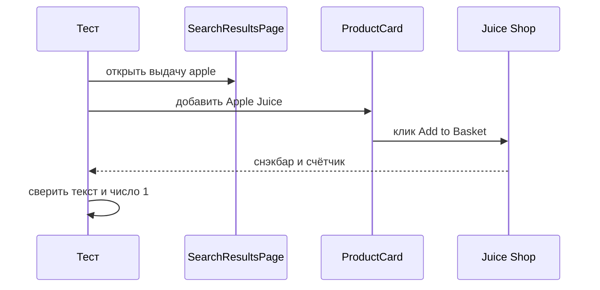
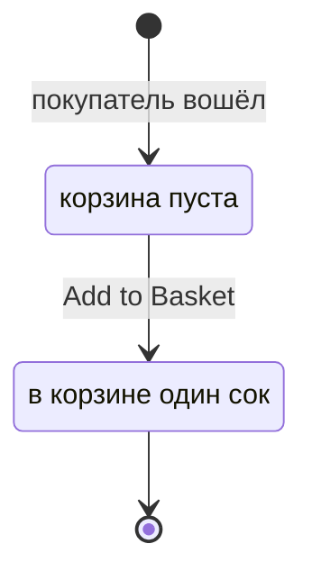

# Page Object и компоненты

## Содержание

- [Теория](#теория)
  - [Ситуация](#ситуация)
  - [Модель](#модель)
  - [Понятия и связь с автоматизацией тестирования](#понятия-и-связь-с-автоматизацией-тестирования)
  - [Зоны ответственности](#зоны-ответственности)
  - [Пример](#пример)
  - [Типичные сбои](#типичные-сбои)
  - [Полезные ссылки](#полезные-ссылки)
  - [Вопросы по теории](#вопросы-по-теории)
- [Практическое задание](#практическое-задание)
  - [1.1 Общее](#11-общее)
  - [1.2 Сценарии](#12-сценарии-user-stories)
  - [1.3 Контракт](#13-контракт)
  - [1.4 Ошибки и ограничения](#14-ошибки-и-ограничения)
  - [1.5 Аудит](#15-аудитлоги)
  - [1.6 Нефункциональные требования](#16-нефункциональные-требования)

# Теория

## Ситуация

Автотест кладёт `Apple Juice (1000ml)` в корзину и отправляет отзыв. Дальше возможен один из исходов: снэкбар `Placed Apple Juice (1000ml) into basket.` и счётчик корзины `1`, отзыв заканчивается текстом `Thank you for your feedback.`, кнопка отправки неактивна, либо стенд не принимает соединение.

Отдельная разработка не нужна: достаточно запущенного контейнера Juice Shop и команды `npx playwright test --grep @ui` (`pytest -m ui`, `dotnet test --filter Category=ui`).

## Модель

Участники — тест, объект страницы, компонент, Juice Shop и отчёт. Страница знает адрес и действие. Компонент знает кусок экрана, который повторяется: навбар и карточку товара. Проверка текста и счётчика остаётся в тесте. Решение о прохождении принимает оракул теста — требование, а не текущий ответ стенда.



Диаграмма показывает `TC-CART-10`. Страница открывает выдачу, карточка нажимает кнопку с именем `Add to Basket`. Снэкбар и счётчик сверяет тест, не карточка.



Диаграмма показывает корзину в `TC-CART-10`. Пока товар не добавлен, счётчик не равен `1`, и переход к оформлению заказа этот файл не делает. Повторный клик по той же карточке дал бы другой снэкбар — `Added another Apple Juice (1000ml) to basket.` — и в этот кейс не входит.

Стенд для отзыва показывает выражение капчи и принимает комментарий. Отдельной таблицы под страницу в базе нет: страница — объект теста, а товар и отзыв живут на стенде.

## Понятия и связь с автоматизацией тестирования

### Зачем страница

Один и тот же вход нужен и регистрации, и корзине, и заказу. Если локатор `#loginButton` скопирован в пять тестов, смена `aria-label` правится пять раз. Объект страницы собирает адрес и действия одного экрана в одном классе. В курсе это `LoginPage`, `RegisterPage`, `SearchResultsPage`, `BasketPage`, `AddressSelectPage`, `DeliveryMethodPage`, `PaymentPage`, `OrderSummaryPage`, `OrderCompletionPage`, `ContactPage`, `AdministrationPage`. Проверка `Logout` или текста снэкбара в класс не переезжает: рядом с id кейса видно, какое требование подтверждено.

### Методы

Имена методов одинаковы по смыслу на трёх стеках. В TypeScript это `open` и `login`. В Python — `open` и `login` в snake_case у модуля `login_page`. В C# — `OpenAsync` и `LoginAsync`.

| Класс | Методы |
| --- | --- |
| `LoginPage` | `open()`, `login(email, password)` |
| `RegisterPage` | `open()`, `register(customer)` |
| `SearchResultsPage` | `open(query?)`, `productCard(name)` |
| `BasketPage` | `open()`, `checkout()` |
| `Navbar` | `openAccountMenu()`, `basketCount()`, `search(text)` |
| `ProductCard` | `addToBasket()` |

`open` ждёт, что экран дошёл до своего адреса. Это единственное ожидание внутри страницы. `login` заполняет поля из `2.1` и нажимает кнопку с именем `Login`. `search` вводит текст в `#searchQuery` и жмёт Enter. `productCard` возвращает карточку с этим именем товара. `addToBasket` нажимает кнопку с именем `Add to Basket`. `basketCount` возвращает локатор счётчика у кнопки `Show the shopping cart`, а число сверяет тест.

### Компонент

Навбар виден и на выдаче, и в корзине. Карточка товара повторяется в сетке. Их держат `Navbar` и `ProductCard`, а не копируют в каждую страницу. `SearchResultsPage.productCard('Apple Juice (1000ml)')` отдаёт `ProductCard` только этой карточки, чтобы клик не попал в `Apple Pomace`. В контракте навбар и карточка — отдельные классы в `components`.

### Фикстура страницы

Тест не вызывает конструктор в каждой строке. Фикстура собирает страницу из уже открытого `page`: в TypeScript это `test.extend` в `src/fixtures/test.ts`, в Python — фикстура в `conftest.py`, в C# — свойство базового класса UI-тестов. Имена фикстур совпадают с ролью: `loginPage`, `searchResults`, `navbar`. В Python те же имена в snake_case: `login_page`, `search_results`, `navbar`.

### Шаг в отчёте

Длинный сценарий в отчёте читается кусками. В TypeScript кусок задаёт `test.step`: «войти», «положить сок». Падение показывает имя шага. В Python и C# такого метода у раннера нет. Шаг туда попадает через отчёт, это разобрано в `8.1`, либо через короткий контекстный блок с тем же именем в комментарии сценария. В контракте `test.step` обязателен в TypeScript для `TC-CART-10` и `TC-FEEDBACK-01`. На других стеках имена тех же шагов есть в тексте теста.

### Капча отзыва без eval

На `/#/contact` выражение лежит в `#captcha`, например `4+6-6`. Поле ответа — `#captchaControl` с именем `Field for the result of the CAPTCHA code`. Считать выражение через `eval`, `Function` или `exec` в тесте нельзя: строка со страницы не должна стать кодом. Разбор ручной, слева направо, только для вида `a op b op c`, где операция — `+` или `-`. Для `4+6-6` это `4 + 6 = 10`, затем `10 - 6 = 4`. Кнопка отправки имеет имя `Button to send the review`. Успех при оценке не в 5 звёзд — текст `Thank you for your feedback.` Пять звёзд дают другую фразу: `Thank you so much for your amazing 5-star feedback!` Кейс `TC-FEEDBACK-01` берёт оценку не 5, чтобы оракул был первой фразой.

### Что будет в авторизации UI

Здесь вход в `TC-CART-10` идёт через `LoginPage.login` и форму. Файл `2.3` оставляет те же страницы корзины и оформления, но сессию приносит из API, чтобы каждый заказ не кликал форму входа заново.

### Сводка

| Понятие | Смысл в страницах Juice Shop | На что опирается реализация |
| --- | --- | --- |
| Page Object | Адрес и действия одного экрана | классы в `pages` |
| Компонент | Навбар и карточка, общие для экранов | `Navbar`, `ProductCard` |
| Фикстура страницы | Готовый объект внутри теста | `test.extend`, фикстура pytest, свойство класса |
| Шаг | Имя куска сценария в отчёте | `test.step` в TypeScript |
| Капча | Выражение `a op b op c` с экрана | разбор символов, без `eval` |

## Зоны ответственности

| Автотест | Фреймворк |
| --- | --- |
| Вызывает метод страницы и сверяет текст с требованием | Держит класс страницы и локаторы из `2.1` |
| Передаёт email и пароль в `login`, не хранит их в классе страницы | Фикстура создаёт страницу на текущий `page` |
| Считает капчу кодом теста | Страница только читает `#captcha` и вводит число |
| Именует шаги сценария | TypeScript показывает `test.step` в отчёте |

Страница и проверка не меняют друг друга. Метод `addToBasket` не утверждает снэкбар. Снэкбар утверждает тест.

## Пример

Программа входит формой, открывает выдачу `apple` и кладёт `Apple Juice (1000ml)` в корзину. Проверка снэкбара и счётчика стоит в тесте. Каждый раннер сообщает об 1 пройденном тесте. Классы страниц в примере сокращены до вызова: полные сигнатуры — в контракте.

### TypeScript

**Node.js 22 или новее, @playwright/test.** Фикстуры страниц и `test.step`.

```sh
npx playwright test --grep TC-CART-10
```

```ts
import { expect, test } from '../../src/fixtures/test';

test('TC-CART-10 кладёт сок в корзину', { tag: ['@ui'] }, async ({
  page, customer, loginPage, searchResults, navbar,
}) => {
  await test.step('войти', async () => {
    await loginPage.open();
    await loginPage.login(customer.email, customer.password);
  });
  await test.step('положить сок', async () => {
    await searchResults.open('apple');
    await searchResults.productCard('Apple Juice (1000ml)').addToBasket();
  });
  await expect(page.getByText('Placed Apple Juice (1000ml) into basket.')).toBeVisible();
  await expect(navbar.basketCount()).toContainText('1');
});
```

### Python

**Python 3.10 или новее, pytest-playwright.** Те же методы страниц, шаг виден именем вызова.

```sh
pytest -m ui -k TC-CART-10 --base-url http://localhost:3000
```

```python
import pytest
from playwright.sync_api import Page, expect

@pytest.mark.ui
def test_tc_cart_10(page: Page, customer, login_page, search_results, navbar) -> None:
    login_page.open()
    login_page.login(customer.email, customer.password)
    search_results.open("apple")
    search_results.product_card("Apple Juice (1000ml)").add_to_basket()
    expect(page.get_by_text("Placed Apple Juice (1000ml) into basket.")).to_be_visible()
    expect(navbar.basket_count()).to_contain_text("1")
```

### C#

**.NET 8 или новее, Microsoft.Playwright.NUnit.** Методы с суффиксом `Async`.

```sh
dotnet test --filter "Name~TC-CART-10"
```

```csharp
[Test]
[Category("ui")]
public async Task TcCart10PlacesJuiceIntoBasket()
{
    var customer = await CreateCustomerAsync();
    await LoginPage.OpenAsync();
    await LoginPage.LoginAsync(customer.Email, customer.Password);
    await SearchResults.OpenAsync("apple");
    await SearchResults.ProductCard("Apple Juice (1000ml)").AddToBasketAsync();
    await Expect(Page.GetByText("Placed Apple Juice (1000ml) into basket.")).ToBeVisibleAsync();
    await Expect(Navbar.BasketCount()).ToContainTextAsync("1");
}
```

---

Каждый раннер сообщает о 1 пройденном тесте. Текст `Placed Apple Juice (1000ml) into basket.` доказывает, что нажата карточка этого сока. Счётчик `1` доказывает, что навбар увидел ту же корзину.

## Типичные сбои

| Что видно | Куда смотреть |
| --- | --- |
| Снэкбар про `Apple Pomace` | `productCard` получил имя `Apple Juice (1000ml)` |
| Счётчик пустой, хотя снэкбар есть | `basketCount` смотрит кнопку `Show the shopping cart` |
| Клик `Add to Basket` уводит на вход | Перед выдачей вызван `LoginPage.login` |
| `addToBasket` утверждает текст внутри класса | Проверку перенести в тест |
| Шаг в отчёте TypeScript не виден | Действие обёрнуто в `test.step` |
| Капча решена через `eval` | Разбор `a op b op c` слева направо |
| Отзыв ждёт фразу про 5 звёзд | Оценка слайдера не 5, текст `Thank you for your feedback.` |
| `open('apple')` показывает весь каталог | Внутри `open` есть Enter по `#searchQuery` |
| Две фикстуры держат разные `page` | Страница и навбар созданы из одного `page` теста |

## Полезные ссылки

### Общие

- [Playwright — Page object models](https://playwright.dev/docs/pom) — класс экрана поверх `page`.
- [Playwright — Locators](https://playwright.dev/docs/locators) — локаторы, которые страница прячет внутри методов.

### По языку

#### TypeScript

**TypeScript, Playwright Test.** На JavaScript контракт страниц и компонентов остаётся тем же.

- [Playwright — Page object models](https://playwright.dev/docs/pom) — пример класса и вызов из теста.
- [Playwright — test.step](https://playwright.dev/docs/api/class-test#test-step) — имя шага в отчёте.

#### Python

**Python, pytest-playwright.** На синхронном Playwright API без pytest или на async API контракт страниц и компонентов остаётся тем же.

- [Playwright — Page object models](https://playwright.dev/python/docs/pom) — тот же приём класса на Python.

#### C#

**C#, Playwright для .NET с NUnit.** На MSTest или xUnit контракт страниц и компонентов остаётся тем же.

- [Playwright — Page object models](https://playwright.dev/dotnet/docs/pom) — класс страницы и вызов из NUnit.

## Вопросы по теории

1. Почему текст снэкбара проверяет тест, а не `ProductCard`?
2. Зачем `Navbar` вынесен из `SearchResultsPage`?
3. Что делает `productCard`, прежде чем вернуть карточку?
4. Почему капчу нельзя посчитать через `eval`?
5. Чем `test.step` в TypeScript отличается от комментария в Python?
6. Почему `LoginPage.login` не проверяет `Logout` сам?
7. Куда денется повторный клик по тому же соку?

# Практическое задание

Автотесты страниц и компонентов для Juice Shop.

Набор кладёт товар в корзину и отправляет отзыв через объекты экранов. Локаторы остаются внутри классов. Итог — два тест-кейса, проверки которых лежат в тесте.

## 1) Страницы и компоненты

### 1.1 Общее

**Назначение:** собрать действия экранов Juice Shop в классах и оставить требования в тестах.

**Пользователи/роли:**

- AQA-инженер — добавляет метод страницы и проверку кейса;
- разработчик — читает шаг отчёта, а не цепочку локаторов;
- CI — запускает тег `ui`;
- `customer` — покупатель для `TC-CART-10`;
- `guest` — отзыв `TC-FEEDBACK-01`, вход для него не нужен.

**Зависимости/связанные настройки:**

- `2.1` — локаторы роли и автоожидание;
- `2.0` — контекст, язык, баннер;
- `1.4` — фикстура `customer`;
- `BASE_URL` — адрес стенда.

Оформление заказа целиком и вход через API — в `2.3`. Классы `AddressSelectPage`, `DeliveryMethodPage`, `PaymentPage`, `OrderSummaryPage`, `OrderCompletionPage` и `AdministrationPage` заводятся здесь как пустые по действию каркасы методов `open`, чтобы `2.3` их наполнил.

### 1.2 Сценарии (user stories)

1. **Сок в корзине:** `TC-CART-10` входит, ищет `apple` и добавляет `Apple Juice (1000ml)`. Снэкбар — `Placed Apple Juice (1000ml) into basket.`, счётчик корзины — `1`.
2. **Отзыв:** `TC-FEEDBACK-01` открывает `/#/contact`, пишет комментарий, ставит оценку не 5, считает выражение из `#captcha` и отправляет. На экране `Thank you for your feedback.`

### 1.3 Контракт

#### 1.3.1 Классы

| Класс | Контракт метода |
| --- | --- |
| `LoginPage.open` | Переход на `/#/login` |
| `LoginPage.login` | Ввод email и пароля, клик `Login`, без проверки `Logout` |
| `SearchResultsPage.open(query)` | Переход на выдачу, ввод `query`, Enter |
| `SearchResultsPage.productCard(name)` | Карточка, в тексте которой есть `name` |
| `ProductCard.addToBasket` | Клик `Add to Basket` внутри этой карточки |
| `Navbar.basketCount` | Локатор счётчика у `Show the shopping cart` |
| `ContactPage.open` | Переход на `/#/contact` |
| `ContactPage.captchaExpression` | Текст `#captcha` |
| `ContactPage.submit` | Комментарий, оценка, число капчи, клик `Button to send the review` |

**Логика/шаги:**

1. Создать класс с конструктором от `page`.
2. Спрятать локаторы из `2.1` в методы.
3. Отдать объект в фикстуру теста.
4. В тесте вызвать метод и отдельно вызвать `expect`.

**Ответы:**

- **Успех:** метод завершился, проверку делает тест.
- **Ошибки:** см. раздел 1.4.

#### 1.3.2 Корзина

| Кейс | Проверки/валидация |
| --- | --- |
| `TC-CART-10` | Текст `Placed Apple Juice (1000ml) into basket.` и счётчик содержит `1` |

**Логика/шаги:**

1. Создать `customer`.
2. Шаг «войти»: `open` и `login`.
3. Шаг «положить сок»: `open('apple')`, `productCard('Apple Juice (1000ml)')`, `addToBasket`.
4. Проверить снэкбар сразу после клика.
5. Проверить `basketCount`.

Повтор создаёт нового покупателя, корзина снова пустая.

**Ответы:**

- **Успех:** оба текста на месте. Добавление на стенде — **200** у `POST /api/BasketItems`.
- **Ошибки:** см. раздел 1.4.

#### 1.3.3 Отзыв

| Кейс | Проверки/валидация |
| --- | --- |
| `TC-FEEDBACK-01` | Текст `Thank you for your feedback.` |

**Логика/шаги:**

1. Открыть `/#/contact`.
2. Прочитать `#captcha` и посчитать `a op b op c` слева направо. `eval` не вызывать.
3. Заполнить поле с именем `Field for entering the comment or the feedback`.
4. Выставить слайдер с именем `Slider for selecting the star rating` в значение не 5.
5. Ввести число в поле с именем `Field for the result of the CAPTCHA code`.
6. Нажать `Button to send the review`.
7. Проверить текст благодарности.

Неверная капча оставляет форму на месте. Повтор читает новое выражение: id капчи на стенде меняется.

**Ответы:**

- **Успех:** текст благодарности. Создание отзыва — **201**.
- **Неверная капча:** **401** и текст `Wrong answer to CAPTCHA. Please try again.` Этот текст — не оракул успеха.
- **Ошибки:** см. раздел 1.4.

### 1.4 Ошибки и ограничения

- **200** — товар добавлен в корзину. Для кейса этого мало без снэкбара и счётчика `1`.
- **201** — отзыв создан. Для кейса этого мало без `Thank you for your feedback.`
- **401** — неверная капча, текст `Wrong answer to CAPTCHA. Please try again.`
- Таймаут проверки 5 с — снэкбар уже исчез или карточка не найдена по имени.
- Таймаут клика — кнопки `Add to Basket` нет, выдача не отфильтрована.
- Соединение не установлено — стенд не слушает `3000`.
- `eval` в тесте запрещён, даже если выражение похоже на арифметику.
- Безымянные «+» и «−» в корзине сюда не входят: добавление идёт с карточки.

Сначала вход, затем выдача, затем клик. Без входа счётчик корзины покупателя не появляется.

### 1.5 Аудит/логи

Логировать id кейса, имя шага и итог: снэкбар или благодарность.

В журнал не попадают пароль, токен, cookie `token` и ответ капчи с поля `answer` у `GET /rest/captcha`. Тест читает выражение с экрана. Готовое поле `answer` из API не подставляют.

### 1.6 Нефункциональные требования

- Таймаут теста — 30 с, таймаут проверки — 5 с.
- `waitForTimeout`, `sleep` и `Thread.Sleep` запрещены.
- Ретраи: 2 в CI, 0 локально. Воркеров в CI — 2.
- Набор покрывает `TC-CART-10` и `TC-FEEDBACK-01`.
- TypeScript помечает оба сценария шагами `test.step`.
- Полный прогон API и UI в `chromium` — не дольше 10 минут.
- Общие лимиты прогона из словаря курса относятся и к этим страницам.
