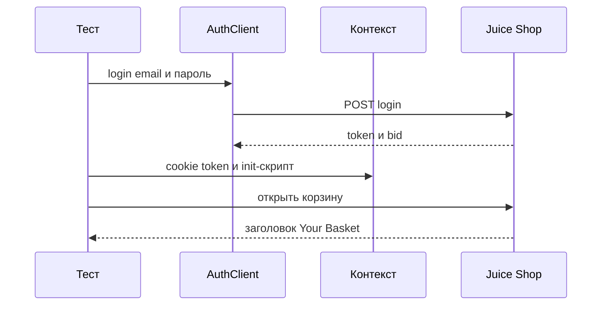
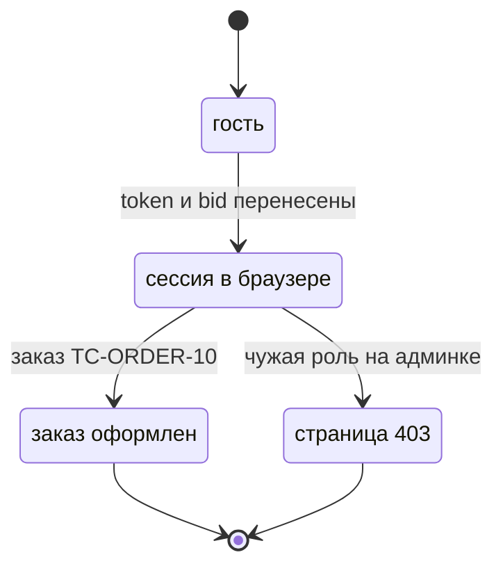

# Авторизация в UI-тестах

## Содержание

- [Теория](#теория)
  - [Ситуация](#ситуация)
  - [Модель](#модель)
  - [Понятия и связь с автоматизацией тестирования](#понятия-и-связь-с-автоматизацией-тестирования)
  - [Зоны ответственности](#зоны-ответственности)
  - [Пример](#пример)
  - [Типичные сбои](#типичные-сбои)
  - [Полезные ссылки](#полезные-ссылки)
  - [Вопросы по теории](#вопросы-по-теории)
- [Практическое задание](#практическое-задание)
  - [1.1 Общее](#11-общее)
  - [1.2 Сценарии](#12-сценарии-user-stories)
  - [1.3 Контракт](#13-контракт)
  - [1.4 Ошибки и ограничения](#14-ошибки-и-ограничения)
  - [1.5 Аудит](#15-аудитлоги)
  - [1.6 Нефункциональные требования](#16-нефункциональные-требования)

# Теория

## Ситуация

Автотест открывает защищённый экран Juice Shop уже вошедшим покупателем. Дальше возможен один из исходов: заказ заканчивается текстом `Thank you for your purchase!`, `admin` видит `Administration`, `customer` на админке попадает на `/#/403` с текстом `You are not allowed to access this page!`, либо стенд не принимает соединение.

Отдельная разработка не нужна: достаточно запущенного контейнера Juice Shop и команды `npx playwright test --grep @ui` (`pytest -m ui`, `dotnet test --filter Category=ui`).

## Модель

Участники — тест, API-вход, контекст браузера, страница и Juice Shop. Пароль уходит в `POST /rest/user/login` один раз. Браузер получает уже готовую сессию. Форма `/#/login` для этих кейсов не нажимается. Решение о прохождении принимает оракул теста — требование, а не текущий ответ стенда.



Диаграмма показывает перенос сессии. Вход идёт по API. В браузер кладутся cookie `token`, `localStorage.token` и `sessionStorage.bid`. Корзина открывается уже с этим `bid`.



Диаграмма показывает сессию UI. Гость без токена на защищённом маршруте видит `Please login to view this page.` Это другой исход, не `TC-ACL-11`. Из оформленного заказа корзина пуста, и тот же `bid` для второго заказа уже не годится.

Сессия, как её держит браузер:

| `ключ` | Описание |
| --- | --- |
| cookie `token` | JWT, его читает `GET /rest/user/whoami` |
| `localStorage.token` | тот же JWT для экранов приложения |
| `sessionStorage.bid` | id корзины, в файл `storageState` не попадает |
| `localStorage.email` | адрес для «Remember me», этим файлом не заполняется |

Одна HTML-оболочка и три хранилища браузера. Учётная запись по-прежнему создаётся фикстурой `customer` или берётся из `admin` и `accounting`.

## Понятия и связь с автоматизацией тестирования

### Зачем вход через API

Форма входа уже проверена в `TC-AUTH-10`. Заказ и админка проверяют другое: адрес, доставку, оплату и роль. Повторять клики по `Email` и `Password` на каждом таком тесте долго и смешивает два требования. `AuthClient.login` из `1.4` возвращает `token` и `bid`. Браузер только принимает их. В контракте `TC-ORDER-10`, `TC-ACL-10`, `TC-ACL-11` и `TC-ACL-12` не открывают `/#/login`.

### Что именно хранит Juice Shop

После входа приложению нужны три значения. Cookie `token` — чтобы запросы уходили с сессией. `localStorage.token` — чтобы экран считал пользователя вошедшим. `sessionStorage.bid` — чтобы корзина знала свою корзину. Пароль в браузер не кладётся. Email для чекбокса `Remember me` этот набор не пишет.

### storageState и дыра sessionStorage

`storageState` сохраняет cookie и `localStorage` в json. `sessionStorage` в этот файл не входит: так устроен Playwright. Файл `playwright/.auth/admin.json` в TypeScript и `.auth/admin.json` в Python и C# поднимает админа на новом контексте, но `bid` там пустой. `bid` возвращает `addInitScript` / `add_init_script` / `AddInitScriptAsync`: скрипт выполняется до скриптов страницы и пишет `sessionStorage.bid`. Для админки `bid` не нужен. Для корзины и заказа нужен.

Каталог `.auth` в `.gitignore`. В репозиторий json с токеном не коммитят.

### Кто входит один раз

`admin` и `accounting` — встроенные учётки. Пароли читаются из `ADMIN_PASSWORD` и `ACCOUNTANT_PASSWORD`, в исходник теста литералом не пишутся. Их сессию готовят один раз на воркер: проект `setup` в TypeScript, фикстура области `session` в Python, `[OneTimeSetUp]` в C#. `customer` на каждый тест свой, потому что заказ опустошает корзину. Его файл между тестами не делят.

### Заказ и чужая роль

`TC-ORDER-10` создаёт адрес и карту через API, затем в UI выбирает их радиокнопками. Кнопка с именем `Continue` на `/#/address/select` молчит, пока адрес не выбран. Дальше `/#/delivery-method` и кнопка `Proceed to delivery method selection`, затем `/#/payment/shop` и `Proceed to review`, затем `/#/order-summary` и кнопка с именем `Complete your purchase`. Финал — `Thank you for your purchase!` Доставка в кейсе — `Standard Delivery`.

`TC-ACL-10`: `admin` открывает `/#/administration` и видит текст `Administration`. `TC-ACL-11`: `customer` открывает тот же адрес и оказывается на `/#/403` с текстом `You are not allowed to access this page!` `TC-ACL-12`: `accounting` остаётся на `/#/accounting` и не уходит на `/#/403`.

### Что будет в перехвате сети

Сессия здесь настоящая: заказ и админка ходят в живой стенд. Файл `2.4` подменяет ответ поиска, не трогая токен. Мок пустой выдачи не заменяет вход.

### Сводка

| Понятие | Смысл во входе через UI | На что опирается реализация |
| --- | --- | --- |
| Вход через API | Пароль не набирается на форме | `AuthClient.login` |
| Cookie и localStorage | Сессия, которую хранит `storageState` | json в `.auth` |
| `bid` | Корзина в `sessionStorage` | `addInitScript` на каждый контекст |
| Роль | Админка, бухгалтерия, покупатель | отдельные файлы и свежий `customer` |
| Заказ | Выбор уже созданных адреса и карты | страницы из `2.2` |

## Зоны ответственности

| Автотест | Фреймворк |
| --- | --- |
| Решает, какая роль открывает маршрут | Кладёт cookie и поднимает `storageState` |
| Возвращает `bid` скриптом до загрузки страницы | Не записывает `sessionStorage` в json |
| Сверяет благодарность, `Administration` или текст 403 | Держит страницы выбора адреса и оплаты |
| Не печатает пароль и JWT | Хранит `.auth` вне git |

Форма `LoginPage` из `2.2` и перенос сессии закрывают разные задачи. Кейсы этого файла форму не вызывают.

## Пример

Программа входит через API покупателем, кладёт токен и `bid` в новый контекст и открывает `/#/basket`. На экране виден заголовок `Your Basket`. Форма входа не открывается. Каждый раннер сообщает об 1 пройденном тесте.

### TypeScript

**Node.js 22 или новее, @playwright/test.** `addInitScript` до первого перехода, `baseURL` из конфига.

```sh
npx playwright test --grep TC-AUTH-SESSION
```

```ts
import { expect, test } from '../../src/fixtures/test';

test('корзина открывается с bid из API', { tag: ['@ui'] }, async ({ page, customer }) => {
  const bid = String(customer.basketId);
  await page.context().addCookies([
    { name: 'token', value: customer.token, url: 'http://localhost:3000' },
  ]);
  await page.context().addInitScript(({ token, bid }) => {
    window.localStorage.setItem('token', token);
    window.sessionStorage.setItem('bid', bid);
  }, { token: customer.token, bid });
  await page.goto('/#/basket');
  await expect(page.getByRole('heading', { name: 'Your Basket' })).toBeVisible();
});
```

### Python

**Python 3.10 или новее, pytest-playwright.** `add_init_script` до `goto`.

```sh
pytest -m ui -k basket_from_api --base-url http://localhost:3000
```

```python
import json
import pytest
from playwright.sync_api import Page, expect

@pytest.mark.ui
def test_basket_from_api(page: Page, customer) -> None:
    page.context.add_cookies([
        {"name": "token", "value": customer.token, "url": "http://localhost:3000"},
    ])
    state = json.dumps({"token": customer.token, "bid": str(customer.basket_id)})
    page.context.add_init_script(
        f"""(() => {{
          const state = {state};
          window.localStorage.setItem('token', state.token);
          window.sessionStorage.setItem('bid', state.bid);
        }})()"""
    )
    page.goto("/#/basket")
    expect(page.get_by_role("heading", name="Your Basket")).to_be_visible()
```

### C#

**.NET 8 или новее, Microsoft.Playwright.NUnit.** `AddInitScriptAsync` до `GotoAsync`.

```sh
dotnet test --filter "Name~BasketFromApi"
```

```csharp
using System.Text.Json;

[Test]
[Category("ui")]
public async Task BasketFromApi()
{
    var customer = await CreateCustomerAsync();
    await Context.AddCookiesAsync(new[]
    {
        new Cookie { Name = "token", Value = customer.Token, Url = "http://localhost:3000" },
    });
    var state = JsonSerializer.Serialize(new { token = customer.Token, bid = customer.BasketId.ToString() });
    await Context.AddInitScriptAsync(
        $$"""
        (() => {
          const state = {{state}};
          window.localStorage.setItem('token', state.token);
          window.sessionStorage.setItem('bid', state.bid);
        })();
        """);
    await Page.GotoAsync("/#/basket");
    await Expect(Page.GetByRole(AriaRole.Heading, new() { Name = "Your Basket" })).ToBeVisibleAsync();
}
```

---

Каждый раннер сообщает о 1 пройденном тесте. Заголовок `Your Basket` доказывает, что экран корзины открылся с перенесённой сессией. Форма `Login` в сценарии не участвует.

## Типичные сбои

| Что видно | Куда смотреть |
| --- | --- |
| Корзина пустая и без email в заголовке | `sessionStorage.bid` записан в `addInitScript` до `goto` |
| `whoami` пустой, экран как у гостя | В контексте есть cookie `token`, не только `localStorage` |
| Админка открывается гостем с текстом `Please login to view this page.` | Для `TC-ACL-11` в контексте сессия `customer` |
| `customer` видит `Administration` | Ожидание кейса — `/#/403` и запрещающий текст |
| В git попал `admin.json` | Каталог `.auth` в `.gitignore` |
| Второй заказ того же покупателя не находит корзину | Новый `customer`: прошлый checkout корзину очистил |
| Кнопка `Continue` не нажимается | Сначала выбрана радиокнопка адреса |
| В логе виден JWT | Токен не печатать, в отчёт класть маршрут и роль |
| Скрипт init не видит `bid` | Скрипт зарегистрирован до `goto`, значение передано внутри `script` |

## Полезные ссылки

### Общие

- [Playwright — Authentication](https://playwright.dev/docs/auth) — `storageState`, проект `setup` и отдельно `sessionStorage`.
- [Playwright — Browser contexts](https://playwright.dev/docs/browser-contexts) — изоляция cookie между тестами.

### По языку

#### TypeScript

**TypeScript, Playwright Test.** На JavaScript контракт переноса сессии остаётся тем же.

- [Playwright — Authentication](https://playwright.dev/docs/auth) — файл `playwright/.auth` и зависимости проектов.

#### Python

**Python, pytest-playwright.** На синхронном Playwright API без pytest или на async API контракт переноса сессии остаётся тем же.

- [Playwright — Authentication](https://playwright.dev/python/docs/auth) — `storage_state` и скрипт для `sessionStorage`.

#### C#

**C#, Playwright для .NET с NUnit.** На MSTest или xUnit контракт переноса сессии остаётся тем же.

- [Playwright — Authentication](https://playwright.dev/dotnet/docs/auth) — `StorageStateAsync` и `[OneTimeSetUp]`.

## Вопросы по теории

1. Почему заказ не входит через форму `/#/login`?
2. Какие три значения браузера составляют сессию Juice Shop?
3. Почему `bid` пропадает после `storageState`?
4. Почему файл `admin.json` нельзя коммитить?
5. Почему `customer` не делит один json на все тесты воркера?
6. Чем текст на `/#/403` отличается от текста гостя?
7. Зачем адрес и карта создаются через API до кликов по оформлению?

# Практическое задание

Автотесты сессии UI для Juice Shop.

Набор переносит вход из API в браузер и на этой сессии оформляет заказ и проверяет три роли. Форма логина остаётся в `2.1`. Итог — четыре тест-кейса.

## 1) Сессия в браузере

### 1.1 Общее

**Назначение:** открывать защищённые экраны с уже полученными `token` и `bid`.

**Пользователи/роли:**

- AQA-инженер — описывает перенос сессии и кейсы заказа и ролей;
- CI — берёт `ADMIN_PASSWORD` и `ACCOUNTANT_PASSWORD` из секретов;
- `customer` — новый покупатель на тест заказа и на запрет админки;
- `admin` — вход один раз на воркер;
- `accounting` — вход один раз на воркер.

**Зависимости/связанные настройки:**

- `1.4` — `AuthClient.login`, фикстура `customer`;
- `2.2` — страницы оформления и `AdministrationPage`;
- `1.5` — поля адреса, карты и доставки `Standard Delivery`;
- `ADMIN_EMAIL`, `ADMIN_PASSWORD`, `ACCOUNTANT_EMAIL`, `ACCOUNTANT_PASSWORD`;
- `BASE_URL`.

Моки поиска — в `2.4`. Повторный UI-вход для проверки самой формы — в `2.1`, его здесь не дублируют.

### 1.2 Сценарии (user stories)

1. **Заказ:** `TC-ORDER-10` создаёт адрес и карту через API, в UI выбирает адрес, `Standard Delivery` и карту. На экране `Thank you for your purchase!`
2. **Админ:** `TC-ACL-10` открывает `/#/administration`. Виден текст `Administration`.
3. **Чужая роль:** `TC-ACL-11` открывает `/#/administration` покупателем. Адрес `/#/403`, текст `You are not allowed to access this page!`
4. **Бухгалтерия:** `TC-ACL-12` открывает `/#/accounting` и остаётся на этом маршруте.

### 1.3 Контракт

#### 1.3.1 Перенос сессии

| Хранилище | Правило |
| --- | --- |
| cookie `token` | Значение JWT из `authentication.token`, `url` равен адресу стенда |
| `localStorage.token` | Тот же JWT через init-скрипт или через страницу до `storageState` |
| `sessionStorage.bid` | Строка `authentication.bid` в init-скрипте каждого контекста заказа |
| Файл роли | `playwright/.auth/<роль>.json` в TypeScript, `.auth/<роль>.json` в Python и C# |

**Логика/шаги:**

1. Вызвать `login` и забрать `token` и `bid`.
2. Положить cookie `token` в контекст.
3. Зарегистрировать init-скрипт с `localStorage.token` и, для корзины, `sessionStorage.bid`.
4. Для `admin` и `accounting` сохранить `storageState` один раз на воркер.
5. Добавить `.auth` в `.gitignore`.

Потерянный json восстанавливается новым входом. Покупателя создают заново.

**Ответы:**

- **Успех входа API:** **200**, в теле есть `authentication.token` и `authentication.bid`.
- **Ошибки:** см. раздел 1.4.

#### 1.3.2 Заказ

| Кейс | Проверки/валидация |
| --- | --- |
| `TC-ORDER-10` | Текст `Thank you for your purchase!` |

**Логика/шаги:**

1. Создать `customer` и перенести сессию вместе с `bid`.
2. Создать адрес и карту через API.
3. Открыть `/#/address/select`, выбрать радиокнопку адреса, нажать `Continue`.
4. На `/#/delivery-method` выбрать `Standard Delivery`, нажать `Proceed to delivery method selection`.
5. На `/#/payment/shop` выбрать радиокнопку карты, нажать `Proceed to review`.
6. На `/#/order-summary` нажать `Complete your purchase`.
7. Проверить текст благодарности.

Если благодарность не появилась после клика, корзина могла уже очиститься. Повтор — новым покупателем.

**Ответы:**

- **Успех:** текст благодарности, маршрут `/#/order-completion/…`. Checkout — **200**, в теле `orderConfirmation`.
- **Ошибки:** см. раздел 1.4.

#### 1.3.3 Роли

| Кейс | Проверки/валидация |
| --- | --- |
| `TC-ACL-10` | Текст `Administration` на `/#/administration` |
| `TC-ACL-11` | Адрес `/#/403` и текст `You are not allowed to access this page!` |
| `TC-ACL-12` | Адрес остаётся `/#/accounting` |

**Логика/шаги:**

1. Поднять сессию нужной роли.
2. Открыть маршрут кейса.
3. Сверить адрес и текст.

**Ответы:**

- **Успех роли:** экран совпал с таблицей. Оболочка — **200**.
- **Гость:** текст `Please login to view this page.` Для этих трёх кейсов это ошибка подготовки, не ожидаемый оракул.
- **Ошибки:** см. раздел 1.4.

### 1.4 Ошибки и ограничения

- **200** — login API, checkout и оболочка страницы. Для заказа этого мало без текста благодарности.
- **401** — пароль роли не подошёл. Проверить секрет окружения, не печатать значение.
- **403** на API чужой корзины в этот файл не входит: UI-оракул запрета — страница `/#/403`.
- Таймаут кнопки `Continue` — адрес не выбран.
- Нет `bid` — корзина не та. Повторить init-скрипт.
- Нет обязательного секрета — отказ прогона, как в `1.0`.
- Соединение не установлено — стенд не слушает `3000`.
- Файл `.auth` с токеном в коммите — убрать из git и перевыпустить сессию.

Сначала API-вход, затем хранилища браузера, затем маршрут. Пока cookie `token` нет, экран ведёт себя как гость.

### 1.5 Аудит/логи

Логировать роль, маршрут и итог: благодарность, `Administration` или текст 403.

В журнал, в имя файла отчёта и в пример урока не попадают пароль, JWT, cookie `token` и полный номер карты. В git не попадает каталог `.auth`.

### 1.6 Нефункциональные требования

- Таймаут теста — 30 с, таймаут проверки — 5 с. Заказ укладывается в 30 с за счёт входа через API.
- `waitForTimeout`, `sleep` и `Thread.Sleep` запрещены.
- Ретраи: 2 в CI, 0 локально. Воркеров в CI — 2.
- Вход `admin` и `accounting` — один раз на воркер.
- Набор покрывает `TC-ORDER-10`, `TC-ACL-10`, `TC-ACL-11`, `TC-ACL-12`.
- Полный прогон API и UI в `chromium` — не дольше 10 минут.
- Общие лимиты прогона из словаря курса относятся и к этой сессии.
