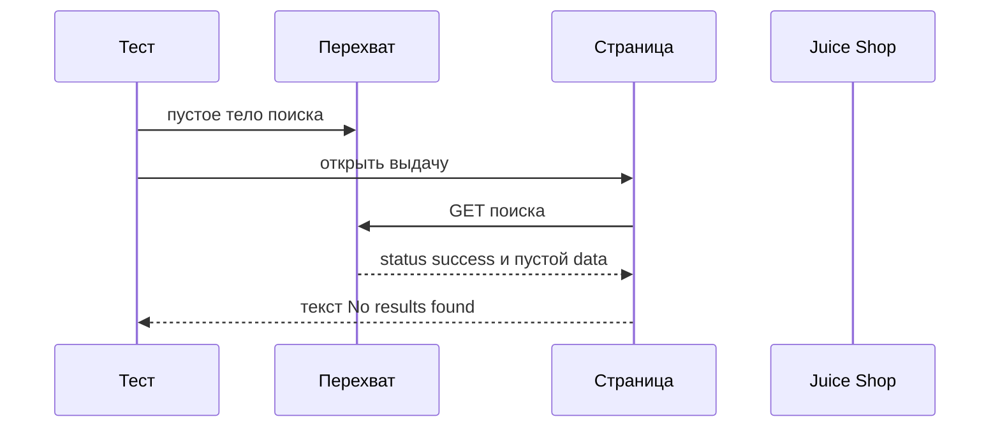
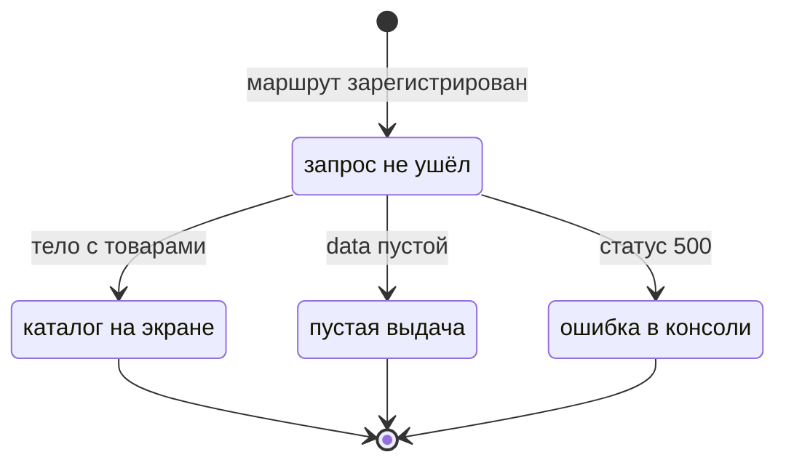

# Перехват сети и моки

## Содержание

- [Теория](#теория)
  - [Ситуация](#ситуация)
  - [Модель](#модель)
  - [Понятия и связь с автоматизацией тестирования](#понятия-и-связь-с-автоматизацией-тестирования)
  - [Зоны ответственности](#зоны-ответственности)
  - [Пример](#пример)
  - [Типичные сбои](#типичные-сбои)
  - [Полезные ссылки](#полезные-ссылки)
  - [Вопросы по теории](#вопросы-по-теории)
- [Практическое задание](#практическое-задание)
  - [1.1 Общее](#11-общее)
  - [1.2 Сценарии](#12-сценарии-user-stories)
  - [1.3 Контракт](#13-контракт)
  - [1.4 Ошибки и ограничения](#14-ошибки-и-ограничения)
  - [1.5 Аудит](#15-аудитлоги)
  - [1.6 Нефункциональные требования](#16-нефункциональные-требования)

# Теория

## Ситуация

Автотест открывает выдачу Juice Shop и подменяет ответ каталога. Дальше возможен один из исходов: пустое тело даёт текст `No results found`, ответ **500** оставляет ноль карточек и запись в консоли браузера, задержанный ответ всё же показывает три товара `apple`, либо стенд не принимает соединение.

Отдельная разработка не нужна: достаточно запущенного контейнера Juice Shop и команды `npx playwright test --grep @ui` (`pytest -m ui`, `dotnet test --filter Category=ui`).

## Модель

Участники — тест, маршрут перехвата, страница и Juice Shop. Перехват стоит между страницей и сетью. Он может ответить сам, пропустить запрос или оборвать его. Экран по-прежнему фильтрует каталог у себя. Решение о прохождении принимает оракул теста — требование, а не текущий ответ стенда.



Диаграмма показывает `TC-SEARCH-11`. Запрос поиска не доходит до стенда: перехват отвечает раньше. Страница рисует пустую выдачу, потому что в `data` нет товаров.



Диаграмма показывает один запрос поиска. Пока маршрут не зарегистрирован, страница ходит в живой стенд. Пустой `data` и **500** — разные ветки: в первой есть текст `No results found`, во второй текста ошибки на экране нет.

Ответ поиска, как его ждёт страница:

| `поле` | Описание |
| --- | --- |
| `status` | Строка `success` у обычного каталога |
| `data` | Массив товаров. Пустой массив — пустая выдача |
| запрос | `GET /rest/products/search?q=` один раз на открытие страницы |

Страница берёт этот массив и фильтрует его в браузере. Отдельной таблицы под мок нет: мок живёт в тесте.

## Понятия и связь с автоматизацией тестирования

### Зачем перехват

Пустую выдачу и падение каталога на живом стенде не заказать: в базе 46 товаров, а **500** на поиске `apple` само не возникает. Перехват (`page.route` / `page.route` / `Page.RouteAsync`) отвечает вместо сервера. Так проверяют экран, а не удачу стенда. В контракте маршрут ставится до `goto`, иначе первый запрос уже уйдёт наружу.

### Как устроен поиск Juice Shop

Страница `/#/search` один раз запрашивает `GET /rest/products/search?q=` и дальше фильтрует массив сама. Слово `apple` в адресе не обязано попасть в query этого запроса. Поэтому `TC-SEARCH-10` видит три карточки при полном каталоге, а мок пустого `data` убирает карточки даже при `q=apple` в hash. Ошибка запроса в коде страницы пишется через `console.log`. Отдельной плашки на экране нет. Оракул `TC-SEARCH-12` — событие `console` и ноль кнопок `Add to Basket`.

### Пустой ответ, ошибка и пауза сервера

`route.fulfill` отдаёт статус и тело. Пустой каталог — **200** и `{"status":"success","data":[]}`. Тогда виден текст `No results found`. Для **500** тело может быть коротким: страница не показывает его людям, она пишет в консоль. Задержку в 3 секунды делают внутри обработчика, затем отдают настоящий ответ через `route.fetch` и `route.fulfill({ response })`. Тест после этого проверяет три карточки обычным `expect`. `waitForTimeout` тут не нужен: проверка сама ждёт до 5 с, а 3 с задержки в этот бюджет входят.

### Дождаться ответ

`waitForResponse` ставят до действия, которое шлёт запрос, и только потом открывают страницу. Иначе ответ можно пропустить. `TC-SEARCH-14` ждёт `GET /rest/products/search` и смотрит тело: `status` и длина `data`. Для живого стенда без фильтра в query это 46 товаров. На экране при слове `apple` карточек всё равно три. Сеть и экран в этом кейсе проверяются оба.

### HAR и обрыв картинок

HAR — запись запросов и ответов. `routeFromHAR` / `route_from_har` / `RouteFromHARAsync` может дописать файл (`update`) или отвечать из него. Для выдачи в файле каталог, не пароль. Картинки обрывают `route.abort()`, когда тесту нужны имена товаров, а байты jpeg только тормозят прогон. Для снимка экрана из `2.5` обрыв вреден: в эталоне пропадает фото сока. Обрыв картинок не ставят на тег `visual`.

### Что будет в снимках

Мок этого файла меняет данные. Снимок карточки в `2.5` снимают с живого ответа, иначе эталон запомнит пустую выдачу. Перехват и снимок в одном тесте не смешивают.

### Сводка

| Понятие | Смысл в выдаче | На что опирается реализация |
| --- | --- | --- |
| Перехват | Ответ вместо стенда | `route` до перехода |
| Пустой `data` | Текст `No results found` | `fulfill` со статусом **200** |
| **500** | Ноль карточек и консоль | событие `console` |
| Задержка | Карточки приходят без паузы теста | `fetch`, затем `fulfill` |
| `waitForResponse` | Тело живого каталога | подписка до `goto` |
| HAR | Повтор записанной выдачи | `routeFromHAR` |
| `abort` | Быстрее без картинок | не для тега `visual` |

## Зоны ответственности

| Автотест | Фреймворк |
| --- | --- |
| Задаёт тело, статус или обрыв до открытия страницы | Не пускает запрос в сеть, если вызван `fulfill` или `abort` |
| Сверяет текст, число карточек и консоль | Отдаёт событие `console` и объект ответа |
| Ждёт ответ через `waitForResponse`, не через сон | Повторяет проверку экрана до 5 с |
| Не подменяет выдачу в тесте со снимком | Хранит HAR рядом с тестом |

Мок и живой `waitForResponse` отвечают на разные вопросы. Первый проверяет экран при заданном теле. Второй проверяет, что стенд отдал каталог.

## Пример

Программа подменяет поиск пустым `data` и открывает `/#/search`. На экране есть `No results found` и нет кнопки `Add to Basket`. Каждый раннер сообщает об 1 пройденном тесте.

### TypeScript

**Node.js 22 или новее, @playwright/test.** `page.route` до `goto`.

```sh
npx playwright test --grep TC-SEARCH-11
```

```ts
import { expect, test } from '@playwright/test';

test.use({ baseURL: 'http://localhost:3000' });

test('TC-SEARCH-11 пустой мок даёт No results found', { tag: ['@ui'] }, async ({ page }) => {
  await page.route('**/rest/products/search**', (route) =>
    route.fulfill({
      status: 200,
      contentType: 'application/json',
      body: JSON.stringify({ status: 'success', data: [] }),
    }),
  );
  await page.goto('/#/search?q=apple');
  await expect(page.getByText('No results found')).toBeVisible();
  await expect(page.getByRole('button', { name: 'Add to Basket' })).toHaveCount(0);
});
```

### Python

**Python 3.10 или новее, pytest-playwright.** `page.route` до `goto`.

```sh
pytest -m ui -k TC-SEARCH-11 --base-url http://localhost:3000
```

```python
import json
import pytest
from playwright.sync_api import Page, expect

@pytest.mark.ui
def test_tc_search_11(page: Page) -> None:
    def handle(route) -> None:
        route.fulfill(
            status=200,
            content_type="application/json",
            body=json.dumps({"status": "success", "data": []}),
        )
    page.route("**/rest/products/search**", handle)
    page.goto("/#/search?q=apple")
    expect(page.get_by_text("No results found")).to_be_visible()
    expect(page.get_by_role("button", name="Add to Basket")).to_have_count(0)
```

### C#

**.NET 8 или новее, Microsoft.Playwright.NUnit.** `RouteAsync` до `GotoAsync`.

```sh
dotnet test --filter "Name~TC-SEARCH-11"
```

```csharp
using System.Text.Json;

[Test]
[Category("ui")]
public async Task TcSearch11EmptyMock()
{
    await Page.RouteAsync("**/rest/products/search**", async (route) =>
    {
        var body = JsonSerializer.Serialize(new { status = "success", data = Array.Empty<object>() });
        await route.FulfillAsync(new() { Status = 200, ContentType = "application/json", Body = body });
    });
    await Page.GotoAsync("/#/search?q=apple");
    await Expect(Page.GetByText("No results found")).ToBeVisibleAsync();
    await Expect(Page.GetByRole(AriaRole.Button, new() { Name = "Add to Basket" })).ToHaveCountAsync(0);
}
```

---

Каждый раннер сообщает о 1 пройденном тесте. Текст `No results found` доказывает, что страница приняла пустой `data`. Нуль кнопок `Add to Basket` доказывает, что карточки не нарисованы, хотя в адресе есть `apple`.

## Типичные сбои

| Что видно | Куда смотреть |
| --- | --- |
| На экране три сока, мок не сработал | `route` вызван до `goto` |
| Глоб не ловит запрос | В шаблоне `**`, звёздочка без второй звёздочки не ест `/` |
| `waitForResponse` упал сразу | Подписка создана до перехода, не после |
| Пустой мок, а текста нет | Тело именно `{"status":"success","data":[]}` и `Content-Type` json |
| **500**, на экране ищут плашку | Плашки нет. Оракул — событие `console` и 0 карточек |
| Тест спит 3 с через `waitForTimeout` | Задержка внутри обработчика, на экране обычный `expect` |
| Снимок карточки серый | `route.abort` на картинки не стоит в теге `visual` |
| HAR записал пароль | В этот файл пишут только поиск каталога |

## Полезные ссылки

### Общие

- [Playwright — Network](https://playwright.dev/docs/network) — `route`, `fulfill`, `abort`, `waitForResponse`.
- [Playwright — Mock APIs](https://playwright.dev/docs/mock) — мок ответа и HAR.

### По языку

#### TypeScript

**TypeScript, Playwright Test.** На JavaScript контракт перехвата остаётся тем же.

- [Playwright — Network](https://playwright.dev/docs/network) — порядок подписки и глобы URL.

#### Python

**Python, pytest-playwright.** На синхронном Playwright API без pytest или на async API контракт перехвата остаётся тем же.

- [Playwright — Network](https://playwright.dev/python/docs/network) — `page.route` и `route.fulfill`.

#### C#

**C#, Playwright для .NET с NUnit.** На MSTest или xUnit контракт перехвата остаётся тем же.

- [Playwright — Network](https://playwright.dev/dotnet/docs/network) — `RouteAsync` и `FulfillAsync`.

## Вопросы по теории

1. Почему мок ставят до `goto`?
2. Почему `apple` в адресе не гарантирует три карточки при пустом `data`?
3. Где искать ошибку каталога, если на экране нет плашки?
4. Почему задержку в 3 с не делают через `waitForTimeout`?
5. Зачем `waitForResponse`, если карточки и так видны?
6. Когда `route.abort` для картинок вреден?
7. Почему снимок из `2.5` не снимают на этом моке?

# Практическое задание

Автотесты перехвата выдачи для Juice Shop.

Набор подменяет, задерживает и читает `GET /rest/products/search`. Экран остаётся прежним: карточки, пустой текст или консоль. Итог — четыре тест-кейса и два приёма: HAR и обрыв картинок.

## 1) Перехват выдачи

### 1.1 Общее

**Назначение:** проверить экран поиска при заданном ответе каталога.

**Пользователи/роли:**

- AQA-инженер — задаёт тело ответа и оракул экрана;
- разработчик — смотрит, что **500** поиска не имеет текста на странице;
- CI — запускает тег `ui`;
- `guest` — выдача без входа.

**Зависимости/связанные настройки:**

- `2.0` — контекст и `baseURL`;
- `2.1` — `TC-SEARCH-10` и кнопка `Add to Basket`;
- `2.5` — снимки, которым нельзя обрывать картинки.

Сессия и заказ — в `2.3`. Их запросы этот файл не мокает.

### 1.2 Сценарии (user stories)

1. **Пусто:** `TC-SEARCH-11` отдаёт `data: []`. Виден `No results found`.
2. **Ошибка:** `TC-SEARCH-12` отдаёт **500**. Карточек 0, в консоли браузера есть запись.
3. **Задержка:** `TC-SEARCH-13` держит ответ 3 с. Три карточки `apple` появляются без `waitForTimeout`.
4. **Живое тело:** `TC-SEARCH-14` дожидается ответа поиска и проверяет `data`. На экране при `apple` три товара.

### 1.3 Контракт

#### 1.3.1 Мок тела

| Кейс | Проверки/валидация |
| --- | --- |
| `TC-SEARCH-11` | Текст `No results found`, кнопок `Add to Basket` нет |
| `TC-SEARCH-12` | Кнопок `Add to Basket` нет, за время теста пришло событие `console` |
| `TC-SEARCH-13` | Три имени: `Apple Juice (1000ml)`, `Apple Pomace`, `Pineapple Juice (1000ml)` |

**Логика/шаги:**

1. Подписаться на `console`, если кейс — `TC-SEARCH-12`.
2. Поставить `route` на `**/rest/products/search**`.
3. Для пустого кейса ответить **200** и `{"status":"success","data":[]}`.
4. Для ошибки ответить **500**.
5. Для задержки вызвать `route.fetch`, подождать 3 с внутри обработчика и отдать `response`.
6. Открыть `/#/search?q=apple`.
7. Проверить экран.

Повтор ничего не пишет на стенд: ответ подменён.

**Ответы:**

- **Успех пустого мока:** текст на экране, до стенда запрос не дошёл.
- **Успех 500:** ноль карточек и консоль. Текста ошибки на странице нет.
- **Успех задержки:** три имени. В тесте нет `waitForTimeout`.
- **Ошибки:** см. раздел 1.4.

#### 1.3.2 Живой ответ, HAR и картинки

| Приём | Правило |
| --- | --- |
| `TC-SEARCH-14` | `waitForResponse` на поиск до `goto`, в `data` 46 товаров при пустом `q` запроса |
| HAR | Запись каталога поиска и воспроизведение через `routeFromHAR` |
| Картинки | `abort` для jpeg и png только вне тега `visual` |

**Логика/шаги:**

1. Создать обещание `waitForResponse` по URL поиска.
2. Открыть выдачу `apple`.
3. Прочитать JSON и длину `data`.
4. Проверить три карточки на экране.
5. HAR обновить отдельным прогоном и положить файл в каталог теста.
6. Обрыв картинок не включать в `TC-SEARCH-15`.

**Ответы:**

- **Успех:** тело содержит 46 товаров, на экране три имени. Оболочка страницы — **200**.
- **Ошибки:** см. раздел 1.4.

### 1.4 Ошибки и ограничения

- **200** с пустым `data` — это заданный мок, не «стенд сломался».
- **500** мока — экран молчит, консоль нет. Не ждать плашку.
- **200** живого поиска — 46 элементов в `data`, если query запроса пустой.
- Таймаут `waitForResponse` — подписка позже перехода или глоб не совпал.
- Таймаут expect 5 с — задержка длиннее 5 с. В кейсе задержка 3 с.
- Соединение не установлено — для `TC-SEARCH-14` и для `route.fetch` стенд нужен. Пустой `fulfill` стенд не вызывает.
- `waitForTimeout` в тесте запрещён.
- Обрыв картинок запрещён на снимках `2.5`.

Сначала маршрут, затем переход, затем экран. Пока маршрут не стоит, пустой текст с живого каталога не получить.

### 1.5 Аудит/логи

Логировать id кейса, статус подмены и итог экрана: пустой текст, ноль карточек или три имени.

В HAR и в журнал не кладут пароль, токен и cookie `token`. Запись ограничена URL поиска.

### 1.6 Нефункциональные требования

- Таймаут теста — 30 с, таймаут проверки — 5 с.
- Задержка мока — 3 с и только внутри обработчика маршрута.
- `waitForTimeout`, `sleep` и `Thread.Sleep` в тесте запрещены.
- Ретраи: 2 в CI, 0 локально. Воркеров в CI — 2.
- Набор покрывает `TC-SEARCH-11`, `TC-SEARCH-12`, `TC-SEARCH-13`, `TC-SEARCH-14`.
- Полный прогон API и UI в `chromium` — не дольше 10 минут.
- Общие лимиты прогона из словаря курса относятся и к перехвату.
