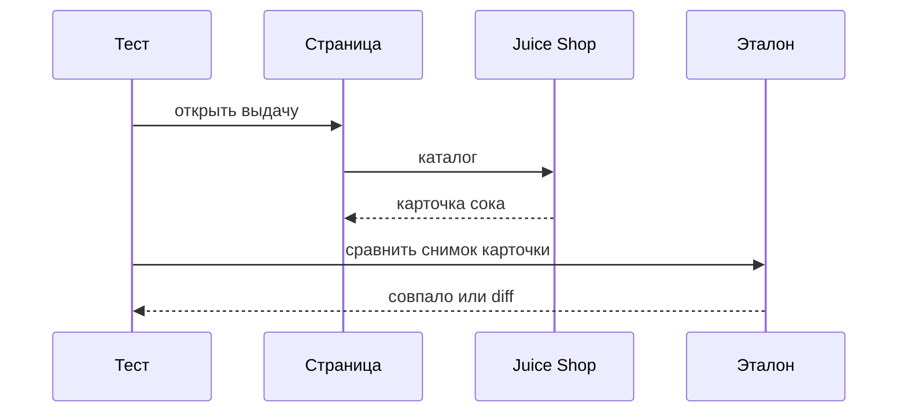
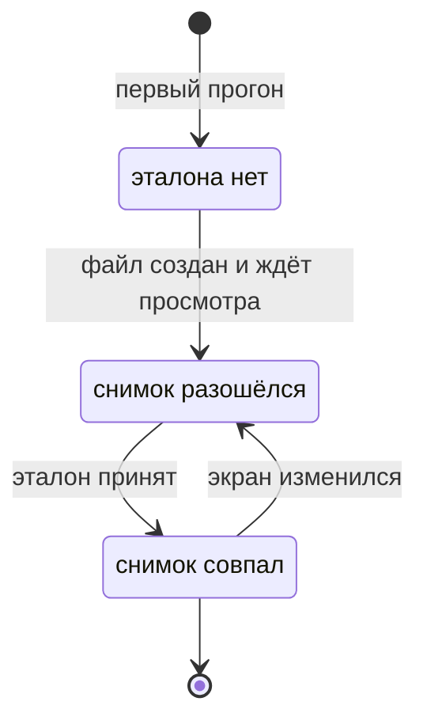

# Визуальные проверки и кросс-браузерность

## Содержание

- [Теория](#теория)
  - [Ситуация](#ситуация)
  - [Модель](#модель)
  - [Понятия и связь с автоматизацией тестирования](#понятия-и-связь-с-автоматизацией-тестирования)
  - [Зоны ответственности](#зоны-ответственности)
  - [Пример](#пример)
  - [Типичные сбои](#типичные-сбои)
  - [Полезные ссылки](#полезные-ссылки)
  - [Вопросы по теории](#вопросы-по-теории)
- [Практическое задание](#практическое-задание)
  - [1.1 Общее](#11-общее)
  - [1.2 Сценарии](#12-сценарии-user-stories)
  - [1.3 Контракт](#13-контракт)
  - [1.4 Ошибки и ограничения](#14-ошибки-и-ограничения)
  - [1.5 Аудит](#15-аудитлоги)
  - [1.6 Нефункциональные требования](#16-нефункциональные-требования)

# Теория

## Ситуация

Автотест сравнивает экран Juice Shop с сохранённым снимком. Дальше возможен один из исходов: карточка `Apple Juice (1000ml)` совпала с эталоном, форма регистрации совпала, на узком экране открылось меню `Open Sidenav`, снимок отличается сильнее порога, либо стенд не принимает соединение.

Отдельная разработка не нужна: достаточно запущенного контейнера Juice Shop и команды `npx playwright test --grep @visual` (`pytest -m visual`, `dotnet test --filter Category=visual`).

## Модель

Участники — тест, эталон снимка, страница и Juice Shop. Тест снимает кусок экрана и сравнивает его с файлом, который уже просмотрели. Первый прогон эталон только создаёт. Решение о прохождении принимает оракул теста — требование, а не текущий ответ стенда. Для снимка требование — это утверждённый файл, а не «как сегодня нарисовал стенд».



Диаграмма показывает `TC-SEARCH-15`. Сначала страница получает живой каталог, без мока из `2.4`. Потом снимок карточки сравнивается с файлом эталона.



Диаграмма показывает жизнь эталона. Пока файл не просмотрен, зелёный прогон не считается принятым. После принятия расхождение снова делает тест красным. Автоматически перезаписать эталон в CI нельзя.

Снимок описывается так:

| `часть` | Описание |
| --- | --- |
| цель | Карточка `app-product` или форма `/#/register` |
| маска | Зона, которую сравнение не читает: чужой email, счётчик, если он попал в кадр |
| порог | Не больше 100 отличающихся пикселей, цветовой `threshold` не выше `0.2` |
| имя файла | Отдельный файл на движок и на операционную систему |

Один эталон на все компьютеры не хранят. Шрифт и сглаживание отличаются.

## Понятия и связь с автоматизацией тестирования

### Зачем снимок

Три имени товаров из `TC-SEARCH-10` не ловят съехавшую картинку или обрезанную цену. Снимок ловит именно картинку. Он дороже текстовой проверки и чаще врёт из-за шрифта, поэтому им закрывают пару устойчивых экранов, а не весь магазин. В наборе это карточка `Apple Juice (1000ml)` и форма регистрации.

### Эталон, маска и порог

В TypeScript проверка — `expect(locator).toHaveScreenshot()`. Эталон появляется рядом с тестом, в имени есть проект браузера. Обновление — `npx playwright test --update-snapshots`, и только после просмотра diff. В Python фикстура `assert_snapshot` пакета `pytest-playwright-visual-snapshot` на первом запуске пишет снимок и падает с просьбой посмотреть файл. Повтор сравнивает. Обновление — `pytest --update-snapshots`. Маска динамического куска — аргумент `mask_elements`. В C# пакеты `Verify.Playwright` и `Verify.ImageMagick`. Вызов `Verify` сравнивает png. Актуальный `Verify.Playwright` 3.2.0 собран под .NET 10: проект визуальных тестов на C# берёт .NET 10 или ту версию пакета, которая ещё ставится на .NET 8.

`maxDiffPixels: 100` пропускает мелкое сглаживание и не пропускает пропавшую кнопку. `threshold` — насколько пиксель считается другим по цвету, в наборе не выше `0.2`. Маска закрывает то, что меняется между прогонами. Цену `1.99` у сока не маскируют: она часть карточки.

### Узкий экран

`TC-SEARCH-16` открывает выдачу в размере устройства из списка Playwright. В курсе это `Pixel 7`, если это имя есть в `devices` установленной версии. Иначе берут ближайший телефон из того же списка, не выдумывая своё. На узкой ширине боковое меню открывает кнопка с именем `Open Sidenav`. После клика виден `mat-sidenav`. Это проверка раскладки, не снимок: снимок телефона и снимок рабочего стола — разные эталоны, их не подменяют друг другом.

### Три движка

`TC-AUTH-10` и `TC-SEARCH-10` уже есть. Здесь их запускают в `chromium`, `firefox` и `webkit`. Обычный job `ui` по-прежнему идёт в `chromium`, иначе прогон не укладывается в 10 минут из `2.0`. Кросс-браузерный запуск — отдельная команда: `--project`, повтор `--browser` или три `dotnet test` с `BROWSER`. Падение только в `webkit` чинят в этом движке, эталон chromium туда не копируют.

### Что будет в стабильности

Снимок часто кажется нестабильным из-за анимации и разного сглаживания. Файл `2.6` отделяет такой шум от настоящего изменения экрана. Порог и маска задаются здесь, карантин flaky — там.

### Сводка

| Понятие | Смысл в снимке | На что опирается реализация |
| --- | --- | --- |
| Эталон | Принятая картинка экрана | файл рядом с тестом |
| Маска | Зона вне сравнения | `mask` или `mask_elements` |
| Порог | Сколько пикселей может отличаться | `maxDiffPixels` 100, `threshold` 0.2 |
| Движок и ОС | Свой файл на каждую пару | проект браузера |
| Узкий экран | Меню через `Open Sidenav` | `Pixel 7` из списка устройств |
| Три движка | Те же `TC-AUTH-10` и `TC-SEARCH-10` | отдельный запуск |

## Зоны ответственности

| Автотест | Фреймворк |
| --- | --- |
| Выбирает устойчивый кусок экрана и маску | Снимает png и сравнивает с файлом |
| Не обновляет эталон вслепую в CI | Показывает diff: было, стало, отличие |
| Гоняет два старых кейса на трёх движках | Держит проекты `chromium`, `firefox`, `webkit` |
| На узком экране открывает `Open Sidenav` | Применяет размер устройства |

Текстовая проверка и снимок не заменяют друг друга. Имена товаров остаются в `TC-SEARCH-10`. Снимок добавляет вид карточки.

## Пример

Программа открывает выдачу `apple` и сравнивает карточку `Apple Juice (1000ml)` с эталоном. Первый запуск создаёт файл и считается непросмотренным. После принятия эталона раннер сообщает об 1 пройденном тесте. Картинки сети не обрывают.

### TypeScript

**Node.js 22 или новее, @playwright/test.** `toHaveScreenshot`, `maxDiffPixels` 100.

```sh
npx playwright test --grep TC-SEARCH-15
npx playwright test --grep TC-SEARCH-15 --update-snapshots
```

```ts
import { expect, test } from '@playwright/test';

test.use({ baseURL: 'http://localhost:3000' });

test('TC-SEARCH-15 снимок карточки сока', { tag: ['@ui', '@visual'] }, async ({ page }) => {
  await page.goto('/#/search?q=apple');
  const card = page.locator('app-product').filter({ hasText: 'Apple Juice (1000ml)' });
  await expect(card).toBeVisible();
  await expect(card).toHaveScreenshot('apple-juice.png', { maxDiffPixels: 100, threshold: 0.2 });
});
```

### Python

**Python 3.10 или новее, pytest-playwright.** Фикстура `assert_snapshot`.

```sh
pip install pytest-playwright-visual-snapshot
pytest -m visual -k TC-SEARCH-15 --base-url http://localhost:3000
```

```python
import pytest
from playwright.sync_api import Page, expect

@pytest.mark.ui
@pytest.mark.visual
def test_tc_search_15(page: Page, assert_snapshot) -> None:
    page.goto("/#/search?q=apple")
    card = page.locator("app-product").filter(has_text="Apple Juice (1000ml)")
    expect(card).to_be_visible()
    assert_snapshot(card)
```

### C#

**.NET 8 или новее, Microsoft.Playwright.NUnit.** Для `Verify.Playwright` 3.2.0 нужен .NET 10. Сравнение png делает `Verify.ImageMagick`.

```sh
dotnet test --filter "Name~TC-SEARCH-15"
```

```csharp
[Test]
[Category("ui")]
[Category("visual")]
public async Task TcSearch15AppleJuiceCard()
{
    await Page.GotoAsync("/#/search?q=apple");
    var card = Page.Locator("app-product").Filter(new() { HasText = "Apple Juice (1000ml)" });
    var png = await card.ScreenshotAsync();
    await Verify(new MemoryStream(png)).UseExtension("png");
}
```

---

После принятого эталона каждый раннер сообщает о 1 пройденном тесте. Совпадение png доказывает, что карточка `Apple Juice (1000ml)` выглядит так же, как просмотренный файл. Первый запуск без эталона этим доказательством не является.

## Типичные сбои

| Что видно | Куда смотреть |
| --- | --- |
| Первый прогон красный и рядом лежит новый png | Файл нужно открыть и принять, это ещё не регрессия |
| Diff на всю карточку в CI на Linux | Эталон снят на другой ОС, нужен свой файл |
| `webkit` сравнивают с png chromium | Имя эталона включает движок |
| В кадре чужой email | Маска на зону с адресом |
| Карточка без фото | В тесте нет `route.abort` на картинки |
| `Pixel 7` не находится | Имя взять из `devices` этой версии Playwright |
| Меню на узком экране не открылось | Кнопка с именем `Open Sidenav` |
| Прогон трёх движков не укладывается в 10 минут | Это отдельная команда, job `ui` остаётся на `chromium` |

## Полезные ссылки

### Общие

- [Playwright — Visual comparisons](https://playwright.dev/docs/test-snapshots) — `toHaveScreenshot`, маска и обновление эталонов.
- [Playwright — Emulation](https://playwright.dev/docs/emulation) — список устройств, откуда берётся `Pixel 7`.
- [pytest-playwright-visual-snapshot](https://pypi.org/project/pytest-playwright-visual-snapshot/) — фикстура `assert_snapshot` и `--update-snapshots`.
- [NuGet — Verify.Playwright](https://www.nuget.org/packages/Verify.Playwright) — пакет снимка для .NET и его целевая платформа.

### По языку

#### TypeScript

**TypeScript, Playwright Test.** На JavaScript контракт снимков остаётся тем же.

- [Playwright — Visual comparisons](https://playwright.dev/docs/test-snapshots) — порог и файлы по проектам.

#### Python

**Python, pytest-playwright.** На синхронном Playwright API без pytest или на async API контракт снимков остаётся тем же.

- [pytest-playwright-visual-snapshot](https://pypi.org/project/pytest-playwright-visual-snapshot/) — `assert_snapshot` и `mask_elements`.

#### C#

**C#, Playwright для .NET с NUnit.** На MSTest или xUnit контракт снимков остаётся тем же.

- [NuGet — Verify.Playwright](https://www.nuget.org/packages/Verify.Playwright) — `Verify` для снимка страницы и версия под .NET 10 у пакета 3.2.0.

## Вопросы по теории

1. Почему первый снимок без просмотра ещё не эталон?
2. Зачем маска, если порог уже есть?
3. Почему эталон с Windows не кладут в прогон на Linux?
4. Что именно открывает `TC-SEARCH-16`?
5. Почему `TC-AUTH-10` на трёх движках не входит в обычные 10 минут?
6. Почему карточку снимают без мока из `2.4`?
7. Какой пакет C# сравнивает png и какая платформа нужна пакету 3.2.0?

# Практическое задание

Автотесты снимков и трёх движков для Juice Shop.

Набор сравнивает карточку и форму регистрации с эталоном, открывает боковое меню на узком экране и прогоняет два уже написанных кейса в трёх движках. Итог — три новых кейса и отдельная команда на `firefox` и `webkit`.

## 1) Снимки и движки

### 1.1 Общее

**Назначение:** поймать изменение вида экрана и расхождение движков.

**Пользователи/роли:**

- AQA-инженер — принимает эталон глазами и кладёт файл в репозиторий;
- разработчик — смотрит diff, если вёрстка съехала;
- CI — запускает тег `visual` на том же ОС, где снят эталон, и отдельно три движка для двух кейсов;
- `guest` — карточка, форма и узкий экран без входа.

**Зависимости/связанные настройки:**

- `2.0` — проекты `chromium`, `firefox`, `webkit`;
- `2.1` — `TC-AUTH-10` и `TC-SEARCH-10`;
- `2.4` — запрет обрыва картинок на снимке;
- тег `visual`.

Карантин нестабильного снимка — в `2.6`.

### 1.2 Сценарии (user stories)

1. **Карточка:** `TC-SEARCH-15` снимает `app-product` с текстом `Apple Juice (1000ml)`.
2. **Форма:** `TC-REG-13` снимает форму `/#/register`.
3. **Телефон:** `TC-SEARCH-16` открывает выдачу как `Pixel 7` и нажимает `Open Sidenav`. Боковая панель видна.
4. **Три движка:** `TC-AUTH-10` и `TC-SEARCH-10` проходят в `chromium`, `firefox` и `webkit`.

### 1.3 Контракт

#### 1.3.1 Снимки

| Кейс | Проверки/валидация |
| --- | --- |
| `TC-SEARCH-15` | Снимок карточки совпал с эталоном этого движка и этой ОС |
| `TC-REG-13` | Снимок формы регистрации совпал так же |

**Логика/шаги:**

1. Открыть экран без мока и без обрыва картинок.
2. Снять указанный элемент.
3. Сравнить с эталоном. В TypeScript порог — `maxDiffPixels` 100 и `threshold` `0.2`.
4. Если эталона не было, остановиться и просмотреть новый файл.
5. Принять файл отдельным коммитом после просмотра.

Маска — только на зону, которая меняется между прогонами. Цена сока и поля пустой формы в маску не входят.

**Ответы:**

- **Успех:** сравнение совпало. Оболочка страницы — **200**.
- **Нет эталона:** прогон красный, пока файл не принят.
- **Ошибки:** см. раздел 1.4.

#### 1.3.2 Узкий экран и три движка

| Кейс | Проверки/валидация |
| --- | --- |
| `TC-SEARCH-16` | После клика `Open Sidenav` виден `mat-sidenav` |
| `TC-AUTH-10`, `TC-SEARCH-10` | Те же оракулы, что в `2.1`, в каждом из трёх движков |

**Логика/шаги:**

1. Взять `Pixel 7` из списка устройств Playwright.
2. Открыть `/#/search`.
3. Нажать кнопку с именем `Open Sidenav`.
4. Проверить видимость `mat-sidenav`.
5. Отдельной командой запустить два кейса на `firefox` и `webkit`. `chromium` уже входит в job `ui`.

**Ответы:**

- **Успех:** панель открыта, два кейса зелёные в выбранном движке.
- **Ошибки:** см. раздел 1.4.

### 1.4 Ошибки и ограничения

- **200** — оболочка страницы. Для снимка этого мало: png должен совпасть с принятым эталоном.
- Расхождение шире `maxDiffPixels` 100 — тест красный. Это либо регрессия, либо чужой эталон.
- Нет файла эталона — не зелёный тест. Сначала просмотр.
- Неизвестное имя устройства — взять имя из документации списка `devices`, не подставлять своё.
- Соединение не установлено — стенд не слушает `3000`.
- Обрыв картинок из `2.4` на этих кейсах запрещён.
- Обновление эталона в CI без просмотра diff запрещено.
- Пакет `Verify.Playwright` 3.2.0 не ставится на .NET 8. Для него нужен .NET 10 либо более ранний пакет, который ещё поддерживает .NET 8.

Сначала живой экран, затем сравнение. Пока каталог не пришёл, снимок карточки не снимают.

### 1.5 Аудит/логи

Логировать id кейса, движок, ОС и путь эталона. В отчёт при расхождении класть ожидаемый png, фактический и diff.

В снимок формы не вводят пароль. В эталон не попадает JWT и cookie `token`.

### 1.6 Нефункциональные требования

- Таймаут теста — 30 с, таймаут проверки — 5 с.
- `waitForTimeout`, `sleep` и `Thread.Sleep` запрещены.
- Ретраи: 2 в CI, 0 локально. Воркеров в CI — 2.
- Порог снимка в TypeScript — `maxDiffPixels` не больше 100, `threshold` не выше `0.2`.
- Job `ui` в `chromium` вместе с API — не дольше 10 минут. Три движка запускают отдельно.
- Набор покрывает `TC-SEARCH-15`, `TC-REG-13`, `TC-SEARCH-16` и повтор `TC-AUTH-10` с `TC-SEARCH-10` на трёх движках.
- Общие лимиты прогона из словаря курса относятся и к снимкам.
