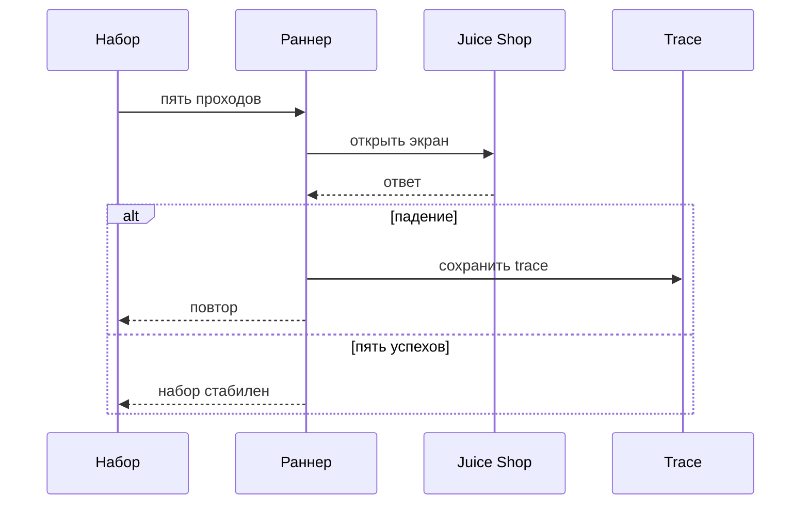
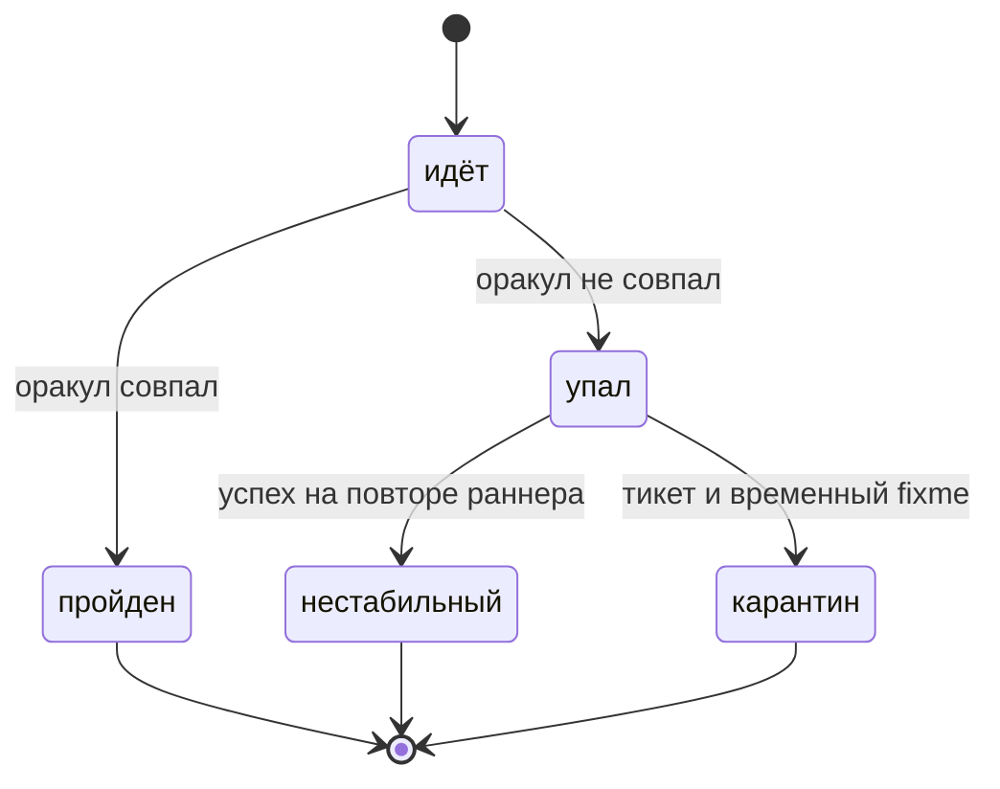

# Стабильность и отладка UI-тестов

## Содержание

- [Теория](#теория)
  - [Ситуация](#ситуация)
  - [Модель](#модель)
  - [Понятия и связь с автоматизацией тестирования](#понятия-и-связь-с-автоматизацией-тестирования)
  - [Зоны ответственности](#зоны-ответственности)
  - [Пример](#пример)
  - [Типичные сбои](#типичные-сбои)
  - [Полезные ссылки](#полезные-ссылки)
  - [Вопросы по теории](#вопросы-по-теории)
- [Практическое задание](#практическое-задание)
  - [1.1 Общее](#11-общее)
  - [1.2 Сценарии](#12-сценарии-user-stories)
  - [1.3 Контракт](#13-контракт)
  - [1.4 Ошибки и ограничения](#14-ошибки-и-ограничения)
  - [1.5 Аудит](#15-аудитлоги)
  - [1.6 Нефункциональные требования](#16-нефункциональные-требования)

# Теория

## Ситуация

Набор UI-тестов Juice Shop прогоняют несколько раз подряд. Дальше возможен один из исходов: пять проходов зелёные, тест падает и на повторе становится зелёным, тест падает одинаково и у него есть trace, стенд не принимает соединение.

Отдельная разработка не нужна: достаточно запущенного контейнера Juice Shop и команды `npx playwright test --grep @ui --repeat-each=5` (`pytest -m ui --count=5`, прогон с `[Repeat(5)]`).

## Модель

Участники — набор тестов, раннер, trace и Juice Shop. Раннер может повторить упавший тест. Статус flaky означает: в этой попытке было и падение, и успех. Решение о прохождении принимает оракул теста — требование, а не текущий ответ стенда. Повтор не меняет требование. Он только показывает, держится ли оно.



Диаграмма показывает проверку стабильности. Trace пишется на неуспешном проходе. Пять успехов подряд — условие этого файла для набора UI.



Диаграмма показывает одну серию. Успех после падения внутри ретраев — это flaky, не зелёный тест. Карантин — отдельное решение человека со ссылкой на тикет. Метка `known-issue` на эту стрелку не ведёт: она занята известным дефектом стенда из `1.0`.

Стенд здесь тот же Juice Shop. Отдельной сущности «нестабильность» в базе нет. Нестабильность — свойство прогона.

## Понятия и связь с автоматизацией тестирования

### Зачем ловить дрожание

Один зелёный прогон не отличает устойчивый тест от везения. UI трогает анимацию, сеть и общие данные. Набор этого курса обязан пройти пять раз подряд без падений. Команда TypeScript — `--repeat-each=5`. В Python пакет `pytest-repeat` и флаг `--count=5`. В C# атрибут NUnit `[Repeat(5)]`: он запускает метод пять раз и падает, если упал любой заход. Это не ретрай CI. Ретрай в CI равен 2 и включается только после падения. Повтор пять раз гоняют локально и перед тем, как считать набор UI готовым.

### Откуда берётся дрожание

Гонка: клик уходит раньше, чем Angular дорисовал кнопку. Лечится автоожиданием из `2.1`, не паузой. Общие данные: два воркера берут один email или одну корзину. Лечится новым `customer` и своим контекстом. Анимация: снэкбар успевает исчезнуть, если проверку поставили слишком поздно, или баннер из `2.0` перекрывает кнопку. Порядок тестов: второй тест зелёный только после первого. Каждый тест начинает с чистого контекста. Время: дата на экране меняет снимок из `2.5`, её закрывают маской. Сеть: стенд ещё не ответил на `GET /rest/admin/application-version`. Прогон ждут после **200**, а не фиксированные секунды.

### Статус flaky

В CI ретраев два. Если первая попытка упала, а следующая прошла, раннер Playwright помечает тест flaky. Это не успех. Flaky виден в отчёте и требует разбора. Локально ретраи выключены, поэтому дрожание ищут повтором `--repeat-each`, а не надеждой на второй шанс. В Python `--reruns` тоже повторяет падение. Успех на реране так же не делает тест устойчивым. В C# `[Retry(2)]` повторяет метод после провала проверки. Пять зелёных `[Repeat(5)]` и ретрай после красного — разные инструменты.

### Trace и видео

На первом ретрае TypeScript пишет `trace.zip`. Его открывают trace viewer из `2.0`: виден локатор, кадр до клика и запрос. Видео остаётся при падении. Скриншот — тоже при падении. По trace отличают «кнопку закрыл баннер» от «стенд ответил **500**». Пароль и JWT из trace в текст тикета не переписывают.

### Карантин — не known-issue

`known-issue` помечает тест, который падает стабильно, потому что стенд нарушает требование, и в метке стоит `BUG-xx`. Нестабильный тест так не помечают: завтра он может стать зелёным и спрятать поломку. Для flaky заводят тикет. Пока причину ищут, тест временно выключают: в TypeScript `test.fixme` со ссылкой на тикет, в Python `pytest.mark.skip` с той же ссылкой в причине, в C# `[Ignore]` с ссылкой. В ссылке есть номер тикета. Без ссылки выключение не проходит. Когда причина найдена, метку снимают и снова гоняют пять повторов.

Разбор причины коротко такой. Сначала повторить падение. Затем открыть trace на кадре клика. Затем проверить, не делят ли тесты email, корзину или файл `.auth`. Затем убрать паузу, если она маскирует гонку. Это тот же RCA, что в `0.5`, только предмет — тест, а не дефект продукта.

### Что остаётся после этого файла

Дальше курс уходит в доступность, нагрузку и безопасность. Набор UI к тому моменту уже умеет пять спокойных проходов. Нестабильный тест не тащат в эти разделы как «иногда красный».

### Сводка

| Понятие | Смысл в UI-прогоне | На что опирается реализация |
| --- | --- | --- |
| Пять повторов | Набор не дрожит | `--repeat-each=5`, `--count=5`, `[Repeat(5)]` |
| Ретрай CI | Второй шанс после падения | 2 в CI, 0 локально |
| flaky | В серии были и провал, и успех | отчёт раннера |
| Trace | Кадр, локатор, сеть | `trace.zip` при неуспехе |
| Карантин | Временное выключение со ссылкой | `test.fixme`, `skip`, `[Ignore]` |
| `known-issue` | Стабильный дефект стенда | не используется для flaky |

## Зоны ответственности

| Автотест | Фреймворк |
| --- | --- |
| Начинает с чистых данных и без паузы | Повторяет проверку локатора до 5 с |
| После flaky заводит тикет и временно выключает тест со ссылкой | Помечает flaky, если успех пришёл на ретрае |
| Пять раз прогоняет набор UI перед сдачей | Пишет trace и видео на падении |
| Не вешает `known-issue` на дрожащий тест | Хранит метку `known-issue` для `BUG-xx` |

Ретрай и карантин не чинят причину. Ретрай показывает дрожание. Карантин убирает шум, пока причину ищут.

## Пример

Программа пять раз открывает выдачу `apple` и проверяет три имени товаров. Паузы нет, покупатель не нужен. Каждый раннер сообщает о 5 пройденных проходах.

### TypeScript

**Node.js 22 или новее, @playwright/test.** Повтор `--repeat-each=5`.

```sh
npx playwright test --grep TC-SEARCH-10 --repeat-each=5
```

```ts
import { expect, test } from '@playwright/test';

test.use({ baseURL: 'http://localhost:3000' });

test('TC-SEARCH-10 ищет apple', { tag: ['@ui'] }, async ({ page }) => {
  await page.goto('/#/search');
  const search = page.locator('#searchQuery').getByRole('textbox');
  await search.fill('apple');
  await search.press('Enter');
  await expect(page.getByText('Apple Juice (1000ml)')).toBeVisible();
  await expect(page.getByText('Apple Pomace')).toBeVisible();
  await expect(page.getByText('Pineapple Juice (1000ml)')).toBeVisible();
});
```

### Python

**Python 3.10 или новее, pytest-playwright.** Пакет `pytest-repeat`, флаг `--count=5`.

```sh
pip install pytest-repeat
pytest -m ui -k TC-SEARCH-10 --count=5 --base-url http://localhost:3000
```

```python
import pytest
from playwright.sync_api import Page, expect

@pytest.mark.ui
def test_tc_search_10(page: Page) -> None:
    page.goto("/#/search")
    search = page.locator("#searchQuery").get_by_role("textbox")
    search.fill("apple")
    search.press("Enter")
    expect(page.get_by_text("Apple Juice (1000ml)")).to_be_visible()
    expect(page.get_by_text("Apple Pomace")).to_be_visible()
    expect(page.get_by_text("Pineapple Juice (1000ml)")).to_be_visible()
```

### C#

**.NET 8 или новее, Microsoft.Playwright.NUnit.** Атрибут `[Repeat(5)]` гоняет метод пять раз.

```sh
dotnet test --filter "Name~TC-SEARCH-10"
```

```csharp
[Test]
[Category("ui")]
[Repeat(5)]
public async Task TcSearch10FindsApple()
{
    await Page.GotoAsync("/#/search");
    var search = Page.Locator("#searchQuery").GetByRole(AriaRole.Textbox);
    await search.FillAsync("apple");
    await search.PressAsync("Enter");
    await Expect(Page.GetByText("Apple Juice (1000ml)")).ToBeVisibleAsync();
    await Expect(Page.GetByText("Apple Pomace")).ToBeVisibleAsync();
    await Expect(Page.GetByText("Pineapple Juice (1000ml)")).ToBeVisibleAsync();
}
```

---

Каждый раннер сообщает о 5 пройденных проходах. Пять строк успеха доказывают, что выдача `apple` не зависит от порядка и от паузы. Один зелёный проход этого не доказывает.

## Типичные сбои

| Что видно | Куда смотреть |
| --- | --- |
| Тест зелёный через раз | Trace кадра клика: баннер, анимация или данные соседа |
| В CI статус flaky | Ретрай добил тест. Причину всё равно разбирают |
| Локально падения не поймать | Ретраи локально 0. Нужен `--repeat-each` или `--count` |
| Второй тест падает, если запустить его одним | Он зависит от порядка. Контекст и `customer` должны быть своими |
| Два воркера дерутся за email | Адрес `aqa.<RUN_ID>.<воркер>.<номер>@example.test` |
| Снимок красный только по утрам | В кадр попало время или чужой email, нужна маска из `2.5` |
| На тесте висит `known-issue` без `BUG-xx` | Для flaky это ошибка. Нужен тикет и `fixme` или `skip` |
| `test.fixme` без ссылки | В причине должен быть номер тикета |
| Пауза `sleep` «чинит» тест | Убрать паузу, оставить автоожидание |
| Trace пустой | Локально ретраев нет. Повторить с trace на падении или с `--repeat-each` |

## Полезные ссылки

### Общие

- [Playwright — Retries](https://playwright.dev/docs/test-retries) — ретрай CI и статус flaky.
- [Playwright — Trace viewer](https://playwright.dev/docs/trace-viewer) — кадр, локатор и сеть упавшего прохода.
- [Playwright — Debugging Tests](https://playwright.dev/docs/debug) — Inspector, когда повтор уже пойман.

### По языку

#### TypeScript

**TypeScript, Playwright Test.** На JavaScript контракт стабильности UI остаётся тем же.

- [Playwright — Retries](https://playwright.dev/docs/test-retries) — `--repeat-each` и `trace: 'on-first-retry'`.
- [Playwright — Annotations](https://playwright.dev/docs/test-annotations) — `test.fixme` и ссылка на тикет.

#### Python

**Python, pytest-playwright.** На синхронном Playwright API без pytest или на async API контракт стабильности UI остаётся тем же.

- [Playwright — Trace viewer](https://playwright.dev/python/docs/trace-viewer) — просмотр trace после упавшего прохода.
- [pytest-repeat](https://pypi.org/project/pytest-repeat/) — флаг `--count` для пяти проходов.

#### C#

**C#, Playwright для .NET с NUnit.** На MSTest или xUnit контракт стабильности UI остаётся тем же.

- [NUnit — Repeat Attribute](https://docs.nunit.org/articles/nunit/writing-tests/attributes/repeat.html) — `[Repeat(5)]` гоняет метод указанное число раз.
- [Playwright — Trace viewer](https://playwright.dev/dotnet/docs/trace-viewer) — `Context.Tracing` и zip после падения.

## Вопросы по теории

1. Почему одного зелёного прогона мало?
2. Чем ретрай CI отличается от `--repeat-each=5`?
3. Что означает статус flaky?
4. Почему flaky не помечают `known-issue`?
5. Что смотреть в trace на кадре клика?
6. Почему общий email двух воркеров даёт дрожание?
7. Что писать в `test.fixme`, кроме самого выключения?

# Практическое задание

Автотесты устойчивости UI для Juice Shop.

Набор UI проходит пять раз подряд, падение разбирают по trace, а дрожащий тест уходит в тикет, а не в `known-issue`. Итог — правило пяти проходов и порядок карантина.

## 1) Пять спокойных проходов

### 1.1 Общее

**Назначение:** отличить устойчивый UI-набор от теста, который зелёный случайно.

**Пользователи/роли:**

- AQA-инженер — гоняет пять повторов и заводит тикет на flaky;
- разработчик — смотрит trace и чинит гонку или данные;
- CI — даёт 2 ретрая и показывает flaky, набор при этом не считается здоровым;
- `customer` — по-прежнему свой на каждый тест.

**Зависимости/связанные настройки:**

- `2.0` — ретраи, trace, скриншот, видео, воркеры;
- `2.1`–`2.5` — набор, который гоняют пять раз;
- `0.4` — тикет и жизненный цикл дефекта;
- `0.5` — разбор причины;
- `1.0` — `known-issue` только для `BUG-xx`.

Новых экранов этот файл не добавляет.

### 1.2 Сценарии (user stories)

1. **Пять проходов:** набор UI в `chromium` завершается без падений пять раз подряд.
2. **Разбор:** при падении открывают trace, называют причину из списка гонка, данные, анимация, порядок, время, сеть.
3. **Карантин:** пока причину не убрали, тест выключен ссылкой на тикет. Метки `known-issue` на нём нет.

### 1.3 Контракт

#### 1.3.1 Пять повторов

| Прогон | Правило |
| --- | --- |
| TypeScript | `npx playwright test --grep @ui --repeat-each=5 --project=chromium` |
| Python | `pytest -m ui --count=5` после установки `pytest-repeat` |
| C# | `[Repeat(5)]` на время проверки устойчивости, затем атрибут снимают |

**Логика/шаги:**

1. Поднять стенд и дождаться **200** от `GET /rest/admin/application-version`.
2. Запустить набор UI пять раз в `chromium`.
3. Остановить набор, если любой проход упал.
4. Открыть trace этого прохода.
5. Повторить после исправления, пока пять проходов не станут зелёными.

**Ответы:**

- **Успех:** пять проходов без падений.
- **Ошибки:** см. раздел 1.4.

#### 1.3.2 Карантин flaky

| Шаг | Правило |
| --- | --- |
| Тикет | Есть номер, ссылка попадает в тест |
| TypeScript | `test.fixme(true, 'TICKET-…')` |
| Python | `@pytest.mark.skip(reason='TICKET-…')` |
| C# | `[Ignore("TICKET-…")]` |
| Запрет | Тег `known-issue` и `BUG-xx` для этого случая не ставят |

**Логика/шаги:**

1. Убедиться, что падение не воспроизводится одинаково. Одинаковый дефект стенда остаётся в механизме `1.0`.
2. Завести тикет.
3. Выключить тест со ссылкой.
4. После исправления снять выключение и прогнать пять повторов.

**Ответы:**

- **Успех карантина:** тест не выполняется, в отчёте видна ссылка.
- **Ошибки:** см. раздел 1.4.

### 1.4 Ошибки и ограничения

- Пять проходов с одним падением — набор не сдан, даже если ретрай CI потом зелёный.
- flaky в отчёте CI — повод для тикета, не для игнора без номера.
- `known-issue` на дрожащем тесте — ошибка разметки. Метку снимают.
- Выключение без ссылки на тикет — ошибка карантина.
- Trace без кадров — ретрай не включён или trace не настроен, как в `2.0`.
- Соединение не установлено — сначала стенд и **200** версии, потом пять проходов.
- `[Repeat(5)]` не оставляют навсегда в CI: он умножает время. В CI остаётся `[Retry(2)]` только на время красного прогона.
- `waitForTimeout` как лечение запрещён.

Сначала стенд, затем повтор, затем trace. Пока стенд не ответил **200**, падение не называют flaky.

### 1.5 Аудит/логи

Логировать число проходов, id упавшего теста и ссылку на тикет.

В тикет не копируют пароль, JWT, cookie `token` и полный номер карты из trace. Кладут маршрут, локатор, кадр без секрета и короткий вывод: гонка, данные, анимация, порядок, время или сеть.

### 1.6 Нефункциональные требования

- Набор UI в `chromium` проходит 5 повторов подряд без падений.
- Таймаут теста — 30 с, таймаут проверки — 5 с.
- Ретраи CI — 2, локально — 0. Воркеров в CI — 2.
- `waitForTimeout`, `sleep` и `Thread.Sleep` запрещены.
- Trace — на неуспехе по правилу `2.0`. Видео и скриншот — при падении.
- Полный одиночный прогон API и UI в `chromium` — не дольше 10 минут. Пять повторов — отдельная проверка устойчивости, в эти 10 минут её не прячут.
- Общие лимиты прогона из словаря курса относятся и к этой проверке.
