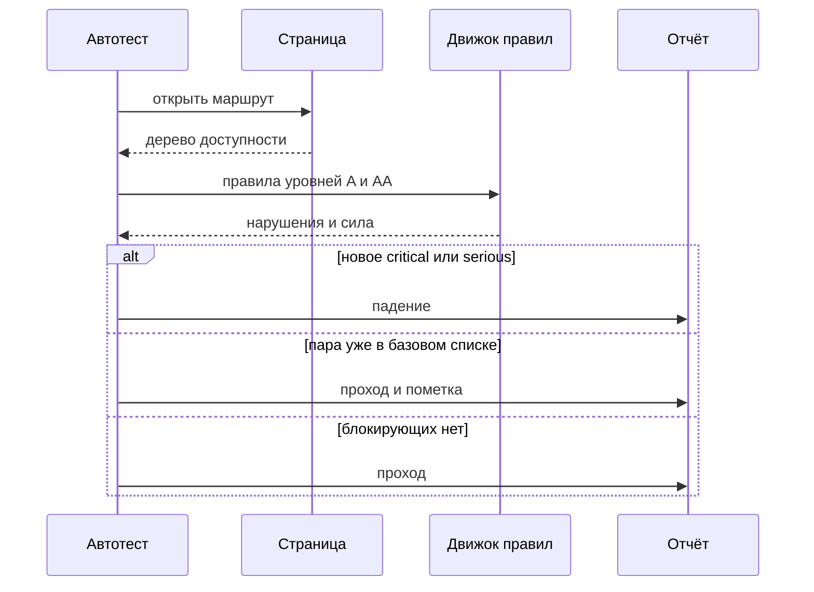
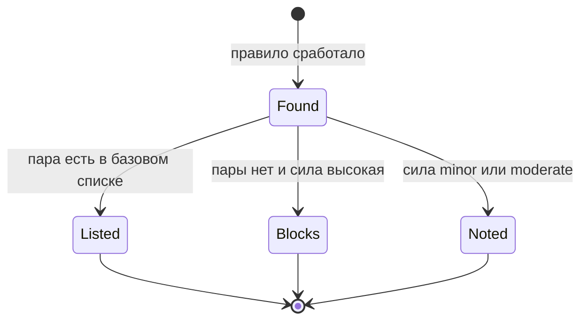

# Общие требования к проверкам доступности

## Содержание

- [Теория](#теория)
  - [Ситуация](#ситуация)
  - [Модель](#модель)
  - [Понятия и связь с автоматизацией тестирования](#понятия-и-связь-с-автоматизацией-тестирования)
  - [Зоны ответственности](#зоны-ответственности)
  - [Пример](#пример)
  - [Типичные сбои](#типичные-сбои)
  - [Полезные ссылки](#полезные-ссылки)
  - [Вопросы по теории](#вопросы-по-теории)
- [Практическое задание](#практическое-задание)
  - [1.1 Общее](#11-общее)
  - [1.2 Сценарии](#12-сценарии-user-stories)
  - [1.3 Контракт](#13-контракт)
  - [1.4 Ошибки и ограничения](#14-ошибки-и-ограничения)
  - [1.5 Аудит](#15-аудитлоги)
  - [1.6 Нефункциональные требования](#16-нефункциональные-требования)

# Теория

## Ситуация

Набор тестов открывает страницу Juice Shop и проверяет, может ли человек понять страницу и нажать нужный элемент, когда мыши нет или текст на экране не читается глазами. Дальше возможен один из исходов: автоматические правила уровней A и AA не находят нового блокирующего нарушения, прогон падает из-за нового нарушения силы `critical` или `serious`, такое нарушение уже лежит в базовом списке, либо стенд недоступен.

Отдельная разработка не нужна: достаточно запущенного контейнера Juice Shop и команды `npx playwright test --grep @a11y` (`pytest -m a11y`, `dotnet test --filter Category=a11y`).

## Модель

Участники: автотест, страница стенда, движок правил и отчёт. Автотест открывает маршрут и передаёт уже собранную страницу движку. Движок возвращает список нарушений и силу каждого. Решение о прохождении принимает оракул теста — требование WCAG уровней A и AA вместе с политикой порогов, а не текущая вёрстка стенда.



Диаграмма показывает порядок: сначала страница должна собраться, потом по ней проходят правила. Падение записывается только для нового нарушения высокой силы. Уже известная пара «правило + цель» остаётся в отчёте и прогон не останавливает.



В базовый список нарушение попадает раньше, чем становится блокирующим. Низкая сила остаётся заметкой в отчёте. Запрос «считать любое замечание падением» в эту схему не входит: его отсекает порог силы.

Возможный набор полей (набор страниц может быть и другим):

| `страница` | Описание |
| --- | --- |
| `route` | Hash-маршрут Juice Shop, например страница входа |
| `role` | `guest` или `customer`, от роли зависит содержимое |
| `ready` | Заголовок или контрол, по которому видно, что страница собрана |
| `known` | Пары «правило + цель», уже принятые для этого маршрута |

Проверка использует страницы Juice Shop в ролях `guest` и `customer` и не заводит собственных сущностей.

## Понятия и связь с автоматизацией тестирования

### Доступность

Человек должен понять, где он находится, и активировать нужный элемент. Кто-то не видит иконку и слушает имя элемента. Кто-то не пользуется мышью и доходит до кнопки клавишей Tab. Если у кнопки нет имени, программа чтения объявляет «кнопка», и действие угадывают. Такой пропуск называется нарушением доступности. Общий язык для этих требований — WCAG, Web Content Accessibility Guidelines. Для курса берётся редакция 2.2.

Вывод для контракта: набор проверяет требования WCAG, а не вкус к вёрстке.

### POUR

WCAG собран из четырёх групп. Их удобно держать в голове до названий критериев.

| Группа | Смысл | Пример на стенде |
| --- | --- | --- |
| Perceivable, воспринимаемость | Содержимое можно получить не только глазами | У поля входа есть имя, а не только серая рамка |
| Operable, управляемость | До действия можно добраться | Форма входа проходится с клавиатуры, см. `3.2` |
| Understandable, понятность | Понятно, что произошло | Ошибка входа помечена как `role=alert` |
| Robust, надёжность | Страницу понимают разные программы | Имя кнопки берётся из доступного имени, а не из цвета иконки |

Вывод для контракта: страница из списка ниже обязана закрывать все четыре группы на выбранном уровне.

### Уровни A, AA и AAA

У каждого критерия есть уровень. A — базовый барьер: без него частью людей страница не пользуема. AA — уровень, на который обычно соглашается продукт: контраст, видимый фокус, подписи полей. AAA — более строгий уровень, его требуют точечно, а не на весь сайт целиком.

Курс держит планку A и AA. Находка только уровня AAA прогон не останавливает. Её можно приложить к отчёту, чтобы разработчик видел запас.

Вывод для контракта: блокирующий прогон смотрит критерии A и AA редакции 2.2 и предыдущих редакций, которые в эти уровни входят.

### Что находит автоматика

Движок читает дерево доступности: роли, имена, состояния. Он видит кнопку без имени, картинку без текстовой замены, поле без подписи, пустой заголовок документа, язык страницы. Это быстрая проверка на каждой сборке.

Тот же движок не нажимает Tab как человек и не слушает страницу вслух. Он не решает, понятен ли текст ошибки и не перекрыт ли фокус всплывающим окном в середине сценария. Такой проход остаётся отдельным сценарием и ручным чек-листом, файл `3.2`.

Вывод для контракта: зелёный автоматический прогон означает «правила A/AA высокой силы не нашли нового нарушения», и только это.

### Сила нарушения

У срабатывания есть сила: `minor`, `moderate`, `serious`, `critical`. `critical` и `serious` закрывают сценарий для части людей. `moderate` и `minor` мешают, но обход часто ещё есть. Политика курса останавливает прогон на `critical` и `serious`. Более слабые попадают во вложение отчёта.

Пример: кнопки «−», «+» и «удалить» в корзине нарисованы иконками и не имеют доступного имени. Зрячий видит знак. Программа чтения говорит «кнопка». Правило называется `button-name`, сила у него высокая. Это ожидаемая находка страницы корзины, её держат в базовом списке, пока разработчик не добавит имя.

Вывод для контракта: в пороге участвуют только `critical` и `serious`.

### Базовый список

Базовый список — файл `a11y-baseline.json`. Запись — пара: идентификатор правила и селектор цели. Пара означает: «это нарушение уже известно, прогон из-за него не красный». Новая пара высокой силы прогон останавливает.

Список не отменяет требование. Он отделяет уже принятый долг от регрессии. Когда кнопку починили, пару удаляют. Иначе то же самое возвращение бага список проглотит.

Вывод для контракта: совпадение идёт по правилу и селектору цели, а не по тексту подсказки.

### Сравнение

| Инструмент | Что проверяет | Подходит для |
| --- | --- | --- |
| axe-core | Правила по дереву открытой страницы | Прогон в CI рядом с UI-тестами, подробно в `3.1` |
| Lighthouse | Сводная оценка страницы, в том числе доступность | Разовый обзор и бюджет скорости в `4.2` |
| WAVE | Подсветка нарушений прямо на странице | Разбор одной страницы человеком |
| Pa11y | Отчёт по URL из командной строки | Отдельный адрес вне UI-набора |
| Панель Accessibility в Chrome DevTools | Имя, роль и дерево одного элемента | Отладка конкретного контрола |
| NVDA, VoiceOver | То, что человек слышит | Ручной чек-лист из `3.2` |

Вывод для контракта: автоматический оракул курса — axe-core с тегами A/AA. Lighthouse, WAVE, Pa11y и скринридер его не подменяют.

### Что будет в `3.1` и `3.2`

`3.1` подключает axe, теги, `a11y-baseline.json` и вложение отчёта. Кейсы `TC-A11Y-01` … `TC-A11Y-05` идут по странице на пункт списка. `3.2` проверяет клавиатуру, видимый фокус, снимок дерева формы входа, закрытие меню по Escape и ручной чек-лист со скринридером.

### Сводка

| Понятие | Смысл в проверке доступности | На что опирается реализация |
| --- | --- | --- |
| WCAG 2.2 | Общий перечень требований | Уровни A и AA |
| POUR | Четыре группы требований | Страницы из контракта |
| Сила | Насколько нарушение закрывает сценарий | Порог `critical` и `serious` |
| Базовый список | Уже известная пара «правило + цель» | `a11y-baseline.json` |
| Автоматика | Правила по дереву страницы | axe-core в `3.1` |
| Ручная проверка | Клавиатура, фокус, звук скринридера | `3.2` |

## Зоны ответственности

| AQA-инженер | Разработчик |
| --- | --- |
| Держит список страниц, теги правил и порог силы | Даёт доступное имя, роль и видимый фокус |
| Кладёт известную пару в `a11y-baseline.json` и снимает её после исправления | Чинёт вёрстку так, чтобы пара из списка исчезла из отчёта axe |
| Оставляет слабые находки во вложении, не смешивая их с падением | Разбирает вложение и решает, какая находка идёт в работу |
| Ведёт ручной чек-лист скринридера из `3.2` | Правит то, что слышно и что не берётся правилом |

Движок правил и скринридер не заменяют друг друга. Первый стережёт регрессию имён и ролей на каждой сборке. Второй проверяет, понятна ли страница на слух.

## Пример

Программа открывает страницу входа, прогоняет правила A/AA и печатает, сколько нарушений имеют силу `serious` или `critical`. Прогон из-за этого числа не падает: порог подключает `3.1`.

### TypeScript

**Node.js 22 или новее, @playwright/test.** `@axe-core/playwright` гоняет axe-core внутри уже открытой страницы. Ключевой параметр — `withTags`: в прогон попадают правила с тегами уровней A и AA.

```sh
npm install --save-dev @playwright/test @axe-core/playwright
npx playwright test --grep @a11y
```

```typescript
import { test } from '@playwright/test';
import AxeBuilder from '@axe-core/playwright';

const tags = ['wcag2a', 'wcag2aa', 'wcag21a', 'wcag21aa', 'wcag22aa'];

test('вход: блокирующие нарушения', { tag: ['@a11y'] }, async ({ page }) => {
  await page.context().addCookies([
    { name: 'cookieconsent_status', value: 'dismiss', url: 'http://localhost:3000' },
    { name: 'language', value: 'en', url: 'http://localhost:3000' },
  ]);
  await page.goto('/#/login');
  const results = await new AxeBuilder({ page }).withTags(tags).analyze();
  const blocking = results.violations.filter(
    (item) => item.impact === 'serious' || item.impact === 'critical',
  );
  console.log(`blocking: ${blocking.length}`);
});
```

### Python

**Python 3.10 или новее, pytest-playwright.** `axe-playwright-python` принимает те же теги через `options.runOnly`. Маркер `a11y` регистрируется так же, как маркеры в `1.0`.

```sh
pip install pytest-playwright axe-playwright-python
pytest -m a11y -s
```

```python
import pytest
from playwright.sync_api import Page
from axe_playwright_python.sync_playwright import Axe

TAGS = ["wcag2a", "wcag2aa", "wcag21a", "wcag21aa", "wcag22aa"]

@pytest.mark.a11y
def test_login_blocking(page: Page) -> None:
    page.context.add_cookies([
        {"name": "cookieconsent_status", "value": "dismiss", "url": "http://localhost:3000"},
        {"name": "language", "value": "en", "url": "http://localhost:3000"},
    ])
    page.goto("/#/login")
    results = Axe().run(
        page,
        options={"runOnly": {"type": "tag", "values": TAGS}},
    )
    blocking = [
        item
        for item in results.response["violations"]
        if item["impact"] in ("serious", "critical")
    ]
    print(f"blocking: {len(blocking)}")
```

### C#

**.NET 8 или новее, Microsoft.Playwright.NUnit.** `Deque.AxeCore.Playwright` запускает те же теги через `AxeRunOptions.RunOnly`. Категория `a11y` фильтруется как остальные категории курса.

```sh
dotnet add package Microsoft.Playwright.NUnit
dotnet add package Deque.AxeCore.Playwright
dotnet test --filter Category=a11y
```

```csharp
using Deque.AxeCore.Commons;
using Deque.AxeCore.Playwright;
using Microsoft.Playwright;
using Microsoft.Playwright.NUnit;

public class LoginA11y : PageTest
{
    [Test]
    [Category("a11y")]
    public async Task LoginBlocking()
    {
        await Context.AddCookiesAsync(new[]
        {
            new Cookie { Name = "cookieconsent_status", Value = "dismiss", Url = "http://localhost:3000" },
            new Cookie { Name = "language", Value = "en", Url = "http://localhost:3000" },
        });
        await Page.GotoAsync("/#/login");
        var options = new AxeRunOptions
        {
            RunOnly = new RunOnlyOptions
            {
                Type = "tag",
                Values = ["wcag2a", "wcag2aa", "wcag21a", "wcag21aa", "wcag22aa"],
            },
        };
        AxeResult results = await Page.RunAxe(options);
        int blocking = results.Violations?.Count(
            item => item.Impact is "serious" or "critical") ?? 0;
        Console.WriteLine($"blocking: {blocking}");
    }
}
```

---

При выводе консоли каждая программа печатает одну строку `blocking: N`. N — число нарушений силы `serious` и `critical` на странице входа. Одинаковое N на трёх стеках значит, что правила и страница одни. Пример число не утверждает: решение, какое из этих нарушений уже принято, принимает `3.1`.

## Типичные сбои

| Что видно | Куда смотреть |
| --- | --- |
| Число скачет от прогона к прогону | Баннер cookie или приветствие перекрывает страницу. Нужны cookie `cookieconsent_status=dismiss` и `language=en`, стенд с `NODE_ENV=quiet` |
| Падение на корзине с правилом `button-name` | Пара ещё не записана в `a11y-baseline.json`, это ожидаемая находка, файл ведёт `3.1` |
| Ноль нарушений на пустом белом экране | Страница не дождалась маршрута. Сначала виден заголовок или поле, потом запуск правил |
| В списке только контраст и мелкие замечания | Сила `minor` и `moderate` в порог не входит, они остаются во вложении |
| Прогон зелёный, фокуса на форме не видно | Видимый фокус и звук скринридера этот файл не доказывает. Их проверяет `3.2` |
| `withTags` вернул пустой набор правил | Тег опечатан. Рабочие теги перечислены в контракте |
| Ошибка соединения с `localhost:3000` | Контейнер Juice Shop не готов. Готовность — `GET /rest/admin/application-version` → **200** |

## Полезные ссылки

### Общие

- [W3C — Web Content Accessibility Guidelines (WCAG) 2.2](https://www.w3.org/TR/WCAG22/) — текст требований, на которые опирается порог.
- [W3C WAI — Introduction to Web Accessibility](https://www.w3.org/WAI/fundamentals/accessibility-intro/) — зачем нужны имя, клавиатура и понятный текст.
- [W3C WAI — Understanding Conformance](https://www.w3.org/WAI/WCAG22/Understanding/conformance) — чем уровни A, AA и AAA отличаются.
- [axe-core — Rule descriptions](https://github.com/dequelabs/axe-core/blob/develop/doc/rule-descriptions.md) — идентификаторы правил, включая `button-name`.
- [Playwright — Accessibility testing](https://playwright.dev/docs/accessibility-testing) — как встроить проверку в тест страницы.
- [WAVE](https://wave.webaim.org/) — наглядный разбор одной страницы.
- [Pa11y](https://pa11y.org/) — проверка URL из командной строки.
- [NV Access — Download NVDA](https://www.nvaccess.org/download/) — скринридер для ручного чек-листа на Windows.
- [Apple — VoiceOver User Guide](https://support.apple.com/guide/voiceover/welcome/mac) — скринридер для ручного чек-листа на macOS.

### По языку

#### TypeScript

**TypeScript, Playwright Test.** На JavaScript контракт проверки доступности остаётся тем же.

- [Deque — @axe-core/playwright](https://github.com/dequelabs/axe-core-npm/blob/develop/packages/playwright/README.md) — `AxeBuilder`, `withTags`, `include`, `exclude`, `analyze`.

#### Python

**Python, pytest-playwright.** На синхронном Playwright API без pytest или на async API контракт проверки доступности остаётся тем же.

- [axe-playwright-python — Usage](https://pamelafox.github.io/axe-playwright-python/usage/) — `Axe.run` и поле `response`.

#### C#

**C#, Playwright для .NET с NUnit.** На MSTest или xUnit контракт проверки доступности остаётся тем же.

- [Deque — Deque.AxeCore.Playwright](https://github.com/dequelabs/axe-core-nuget/blob/develop/packages/playwright/README.md) — `RunAxe`, `AxeRunOptions`, `AxeRunContext`.

## Вопросы по теории

1. Почему зелёный прогон axe ещё не доказывает, что страницей можно пользоваться со скринридером?
2. Зачем останавливать сборку только на силе `critical` и `serious`?
3. Что произойдёт, если в `a11y-baseline.json` оставить пару, которую уже починили?
4. Чем уровень AA отличается от A и от AAA в этом курсе?
5. Как теги `wcag2aa` и `wcag22aa` связаны с уровнем AA?
6. Почему страница корзины в списке открывается ролью `customer`?
7. Почему иконка «удалить» без доступного имени считается дефектом?

# Практическое задание

Автотесты политики доступности для Juice Shop.
Набор фиксирует страницы, теги правил и силу, которая останавливает прогон. Сами проверки страниц пишутся в `3.1` и `3.2`.

## 1) Политика проверок доступности

### 1.1 Общее

**Назначение:** заранее решить, какие страницы проверяются и какое нарушение доступности делает прогон красным.

**Пользователи/роли:**

- AQA-инженер — ведёт список страниц, базовый список и ручной чек-лист;
- разработчик — исправляет имя, роль и фокус по отчёту;
- CI — запускает набор с тегом `a11y` на каждой сборке;
- `guest` — открывает вход, регистрацию, поиск и отзыв;
- `customer` — открывает корзину.

**Зависимости/связанные настройки:**

- `2.0` — cookie `cookieconsent_status=dismiss`, cookie `language=en`, hash-маршруты, `NODE_ENV=quiet`;
- `2.3` — сессия `customer` для корзины;
- `BASE_URL` — адрес стенда, по умолчанию `http://localhost:3000`;
- тег `a11y` — фильтр набора.

Клавиатура, снимок дерева и скринридер описаны в `3.2`. Запуск axe, базовый список и вложение отчёта описаны в `3.1`. Нагрузка, безопасность и письма в этот набор не входят.

### 1.2 Сценарии (user stories)

1. **Страница из списка:** автотест открывает маршрут в нужной роли, дожидается готовой страницы и прогоняет правила A/AA.
2. **Новое серьёзное нарушение:** в отчёте есть пара «правило + цель» силы `critical` или `serious`, которой нет в базовом списке, и прогон этой страницы падает.
3. **Уже известная корзина:** кнопки без имени дают правило `button-name`, пара лежит в базовом списке, прогон остаётся зелёным, а находка видна во вложении.
4. **Слабая находка:** нарушение силы `minor` или `moderate` попадает во вложение и прогон не останавливает.
5. **Ручной остаток:** после зелёного автоматического прогона страница всё ещё проходит чек-лист `3.2`, потому что звук и порядок фокуса правилами не закрыты.

### 1.3 Контракт

#### 1.3.1 Страницы

Пять маршрутов проверяются в этом порядке. Порядок совпадает с номерами кейсов в `3.1`.

| Страница | Проверки/валидация |
| --- | --- |
| `/#/login`, роль `guest` | Заголовок `Login`, поля почты и пароля видны до запуска правил |
| `/#/register`, роль `guest` | Заголовок `User Registration` |
| `/#/search`, роль `guest` | Заголовок `Search Results` или поле поиска |
| `/#/basket`, роль `customer` | Заголовок `Your Basket`. Ожидаемая находка — `button-name` у кнопок строки |
| `/#/contact`, роль `guest` | Поле отзыва и кнопка отправки видны |

**Логика/шаги:**

1. Установить cookie согласия и языка до перехода.
2. Открыть маршрут под ролью из таблицы.
3. Дождаться признака готовности из таблицы.
4. Запустить правила с тегами из п. 1.3.2.
5. Сравнить нарушения высокой силы с базовым списком.

Повтор безопасен: проверка ничего не записывает на стенд. Для корзины нужна живая сессия `customer`. Если сессия протухла, фикстура из `2.3` создаёт покупателя заново.

**Ответы:**

- **Проход:** нет новых пар силы `critical` и `serious`.
- **Ошибки:** см. раздел 1.4.
- В отчёте нет пароля, токена и текста отзыва.

#### 1.3.2 Порог и теги

**Общее правило:** прогон страницы падает, если найдена пара «правило + первый селектор цели» силы `critical` или `serious`, которой нет в `a11y-baseline.json`.

| Настройка | Входные данные и правила |
| --- | --- |
| Теги | `wcag2a`, `wcag2aa`, `wcag21a`, `wcag21aa`, `wcag22aa` |
| Сила | Блокируют `critical` и `serious` |
| Базовый список | Объект с полями `rule` и `target` |
| Известная находка корзины | Правило `button-name`, селектор копируется из отчёта axe |

**Логика/шаги:**

1. Оставить только нарушения с тегами из таблицы.
2. Отбросить силу `minor` и `moderate` из условия падения.
3. Считать цель первым элементом `target`, как его вернул axe.
4. Падать, если пара отсутствует в базовом списке.

**Ответы:**

- **Проход:** условие из общего правила ложно.
- **Ошибки:** см. раздел 1.4.

#### 1.3.3 Ручной остаток

**Общее правило:** автоматический проход не закрывает слух, смысл текста и видимый фокус в движении по странице.

| Проверка | Входные данные и правила |
| --- | --- |
| Клавиатура и фокус | Кейсы `3.2` |
| Скринридер | Чек-лист `3.2`, NVDA или VoiceOver |
| Оценка Lighthouse | Обзор. В порог этого набора не входит |

**Логика/шаги:**

1. Пройти автоматический набор.
2. Отдельно выполнить кейсы `3.2`.
3. Записать результат чек-листа рядом с отчётом, не подменяя им код выхода axe.

**Ответы:**

- **Проход автоматики:** см. п. 1.3.2.
- **Ошибки:** см. раздел 1.4.

### 1.4 Ошибки и ограничения

- Стенд недоступен — переход на `BASE_URL` не завершается, готовность `GET /rest/admin/application-version` не даёт **200**.
- Нет `BASE_URL` — прогон останавливается сразу, с понятным сообщением, как в `1.0`.
- Сессия `customer` не создана — `/#/basket` не показывает корзину этого покупателя.
- Новая пара силы `critical` или `serious` — падение кейса страницы.
- Пара есть в базовом списке — падения нет, запись видна во вложении.
- Сила `minor` или `moderate` — падения нет.
- Устаревшая пара в базовом списке — прогон зелёный, возврат того же дефекта будет скрыт, пока пару не удалят.
- Пустая страница из-за раннего запуска правил — ложный ноль. Сначала признак готовности.

Порядок такой: сначала готовность стенда и страницы, затем правила, затем сравнение с базовым списком. Иначе пустой экран выглядит как чистая страница.

### 1.5 Аудит/логи

Логировать: маршрут, роль, число нарушений по силам, идентификаторы новых блокирующих пар, факт совпадения с базовым списком.

Во вложение отчёта кладётся JSON нарушений без HTML-кода цели, если в этом HTML виден введённый текст. В журнал не попадают пароль, токен, cookie `token`, полный JWT и текст отзыва.

### 1.6 Нефункциональные требования

- Пять страниц политики покрываются кейсами `TC-A11Y-01` … `TC-A11Y-05` в `3.1`.
- Фиксированные паузы `waitForTimeout` и `sleep` в этих проверках запрещены. Готовность страницы определяется условием.
- Набор `a11y` укладывается в 3 минуты локально.
- Ретраи, скриншот, trace и видео — по словарю курса: ретраи 2 в CI и 0 локально, trace при первом ретрае, скриншот и видео только при падении.
- Воркеров в CI — 2. Таймаут теста 30 с, таймаут проверки 5 с.
- Пять повторов подряд без падений на стабильном стенде.
- Общие нефункциональные требования проекта из словаря курса относятся и к этому набору.
