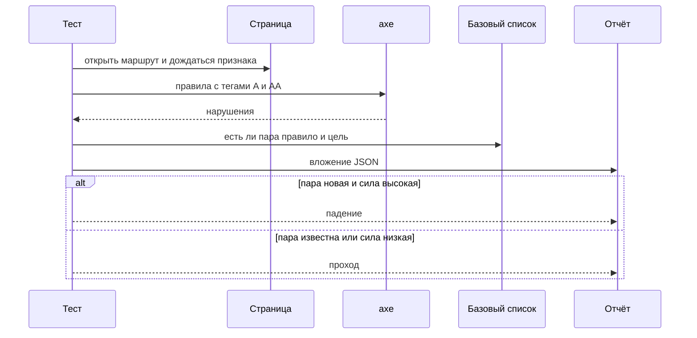
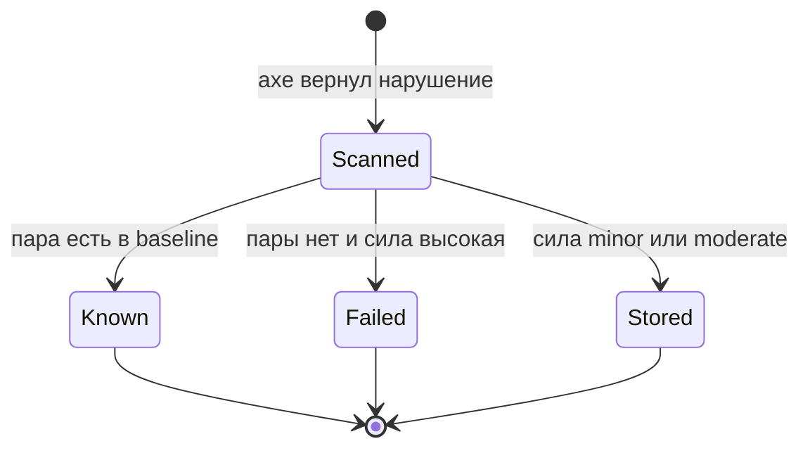

# Автоматические проверки axe

## Содержание

- [Теория](#теория)
  - [Ситуация](#ситуация)
  - [Модель](#модель)
  - [Понятия и связь с автоматизацией тестирования](#понятия-и-связь-с-автоматизацией-тестирования)
  - [Зоны ответственности](#зоны-ответственности)
  - [Пример](#пример)
  - [Типичные сбои](#типичные-сбои)
  - [Полезные ссылки](#полезные-ссылки)
  - [Вопросы по теории](#вопросы-по-теории)
- [Практическое задание](#практическое-задание)
  - [1.1 Общее](#11-общее)
  - [1.2 Сценарии](#12-сценарии-user-stories)
  - [1.3 Контракт](#13-контракт)
  - [1.4 Ошибки и ограничения](#14-ошибки-и-ограничения)
  - [1.5 Аудит](#15-аудитлоги)
  - [1.6 Нефункциональные требования](#16-нефункциональные-требования)

# Теория

## Ситуация

Автотест открывает одну страницу Juice Shop и прогоняет по ней axe-core. Дальше возможен один из исходов: новых нарушений силы `critical` и `serious` нет и тест зелёный, такая пара уже есть в `a11y-baseline.json` и тест зелёный с вложением, новая пара высокой силы делает тест красным, файл базового списка не читается и прогон останавливается сразу, либо стенд недоступен.

Отдельная разработка не нужна: достаточно запущенного контейнера Juice Shop и команды `npx playwright test --grep @a11y` (`pytest -m a11y`, `dotnet test --filter Category=a11y`).

## Модель

Участники: тест, страница, axe и файл `a11y-baseline.json`. Тест не решает, «нормально ли выглядит» кнопка. Он сравнивает пары из ответа axe с парами в файле. Решение о прохождении принимает оракул теста — требование из `3.0`, а не текущий ответ стенда.



Сначала страница готова, потом axe, потом сравнение. Вложение пишется и при проходе: по нему видно, какие известные находки ещё живы.



Высокая сила без пары в файле — единственный переход в падение. Низкая сила и уже записанная пара остаются в отчёте и тест не красят.

Возможный набор полей (запись списка может быть и другой):

| `baseline` | Описание |
| --- | --- |
| `rule` | Идентификатор правила axe, например `button-name` |
| `target` | Первый селектор цели, как его вернул axe |
| `impact` | В файле не хранится: сила читается из свежего ответа |

Проверка использует страницы Juice Shop и файл `a11y-baseline.json` в репозитории тестов. Отдельной сущности на стенде у axe нет.

## Понятия и связь с автоматизацией тестирования

### Запуск axe на открытой странице

axe-core — набор правил в браузере. Сам по себе он страницу не открывает. Тест сначала делает переход, убеждается, что признак готовности из `3.0` виден, и только потом зовёт движок. Иначе правила смотрят пустой документ и честно сообщают ноль.

На TypeScript движок обёрнут в `AxeBuilder` из `@axe-core/playwright`: метод `analyze` возвращает объект с массивом `violations`. На Python тот же вызов — `Axe().run`, нарушения лежат в `response["violations"]`. На C# это `Page.RunAxe`, массив называется `Violations`.

Вывод для контракта: все три стека читают одни и те же поля — идентификатор правила, силу и селектор цели.

### Теги правил

Полный прогон axe включает советы, которые не входят в согласованный уровень. Теги сужают прогон до WCAG. Курсу нужны `wcag2a`, `wcag2aa`, `wcag21a`, `wcag21aa`, `wcag22aa`. Тег `wcag2aa` — уровень AA редакции 2.0, `wcag22aa` — то, что редакция 2.2 добавила на том же уровне. Вместе они закрывают планку из `3.0`.

В TypeScript теги передаёт `withTags`. В Python — `options.runOnly` с `type: "tag"`. В C# — `AxeRunOptions.RunOnly` с `Type = "tag"`. Одновременно `withTags` и произвольный `options`, который затирает `runOnly`, не смешивают: второй вызов заменяет набор правил.

Вывод для контракта: у каждого кейса один и тот же список тегов.

### Include и exclude

Иногда на странице есть чужой виджет, который команда не чинит. `include` оставляет в проверке только указанный кусок. `exclude` вырезает кусок из проверки. Селектор — обычный CSS.

На страницах этого файла виджет, который нужно вырезать, не используется. Cookie-баннер закрывается cookie из `2.0`, а не исключением: баннер свой, и прятать его от правил значит пропустить его же дефекты. Методы всё равно есть у обёртки, чтобы следующий экран мог сузить область.

TypeScript: `.include('main').exclude('#widget')`. Python: аргумент `context` с ключами `include` и `exclude`, значения — списки селекторов. C#: `AxeRunContext` со списками `AxeSelector`.

Вывод для контракта: кейсы `TC-A11Y-01` … `TC-A11Y-05` сканируют страницу целиком, без `include` и `exclude`.

### Пара «правило + цель»

Одно правило может сработать на нескольких элементах. У каждого элемента axe отдаёт `target`. В JavaScript и Python это массив строк, нужен первый элемент. В C# без режима массивов тот же селектор приходит строкой. Перед сравнением цель приводят к одной строке: если пришёл массив, берут первый пункт, иначе саму строку.

Базовый список — JSON-массив объектов `{ "rule", "target" }`. Пара известна, когда склейка `rule|target` есть в файле. Сравнивают каждую цель отдельно: одно известное срабатывание не прячет второе, новое, у того же правила.

Сила в файл не записывается. Её читают из свежего ответа, потому что новая версия axe может поднять силу того же правила.

Вывод для контракта: ключ совпадения — `rule` плюс нормализованный `target`.

### Кнопки корзины

На `/#/basket` у кнопок уменьшения, увеличения и удаления нет доступного имени. axe называет это правилом `button-name`. Сила высокая, поэтому без записи в базовом списке `TC-A11Y-04` красный. Селектор в файл копируют из поля `target` реального прогона по Juice Shop v20.4.0, а не сочиняют по классу иконки: у движка селектор может включать предков.

Это не метка `known-issue` из `1.0`. Та метка ждёт падения проверки требования. Здесь требование по-прежнему «у кнопки есть имя», а файл лишь отделяет уже увиденную пару от новой. Когда имена появятся, строки `button-name` из файла удаляют.

Вывод для контракта: у `TC-A11Y-04` в базовом списке есть пары `button-name` для кнопок строки корзины.

### Вложение

Падение показывает новую пару. Проход тоже оставляет след: во вложение кладут JSON с полями `rule`, `impact`, `target` по каждому нарушению. Поле HTML элемента не кладут. В корзине и в отзыве в разметке может оказаться текст, который в отчёт тащить незачем.

Имя вложения — `axe-<ID кейса>.json`. В TypeScript его пишет `testInfo.attach`. В Python — вложение плагина Allure или файл рядом с отчётом pytest, тот же JSON. В C# — `TestContext` или вложение Allure, тело то же.

Вывод для контракта: у каждого из пяти кейсов одно JSON-вложение, и условие падения от вложения не зависит.

### Что будет в `3.2`

`3.2` не вызывает axe. Он идёт по странице с клавиатуры, проверяет видимый фокус, снимает дерево формы входа и закрывает меню по Escape. Базовый список к тем кейсам не применяется: там оракул — роль, имя и фокус, а не пара из файла.

### Сводка

| Понятие | Смысл в проверке axe | На что опирается реализация |
| --- | --- | --- |
| `analyze` / `run` / `RunAxe` | Запуск правил на открытой странице | Обёртка своего стека |
| Теги | Только уровни A и AA | Список из `3.0` |
| `include` / `exclude` | Граница области сканирования | На этих пяти страницах не используются |
| Пара | Правило и первый селектор цели | `a11y-baseline.json` |
| `button-name` | Кнопка без доступного имени | Ожидаемая находка корзины |
| Вложение | След всех нарушений кейса | JSON без HTML цели |

## Зоны ответственности

| Автотест | Фреймворк |
| --- | --- |
| Открывает маршрут и ждёт признак готовности | Даёт страницу, cookie из `2.0` и сессию `customer` из `2.3` |
| Передаёт теги и читает `violations` | Подключает библиотеку axe своего стека |
| Нормализует `target` и сравнивает с файлом | Хранит `a11y-baseline.json` в корне репозитория |
| Кладёт JSON во вложение | Пишет отчёт и код выхода |

Файл базового списка не заменяет исправление вёрстки. Он только удерживает уже известную пару, пока разработчик не даст кнопке имя.

## Пример

Программа выполняет `TC-A11Y-01`: страница входа, теги A/AA, сравнение с базовым списком, вложение, падение только на новой паре высокой силы. Cookie согласия и языка уже ставит фикстура проекта из `2.0`.

### TypeScript

**Node.js 22 или новее, @playwright/test.** `@axe-core/playwright` даёт `AxeBuilder.withTags` и `analyze`. Ключевой параметр — список тегов.

```sh
npm install --save-dev @axe-core/playwright
npx playwright test --grep @a11y
```

```typescript
import { test, expect } from '@playwright/test';
import AxeBuilder from '@axe-core/playwright';
import { readFileSync } from 'node:fs';

const tags = ['wcag2a', 'wcag2aa', 'wcag21a', 'wcag21aa', 'wcag22aa'];
const baseline = JSON.parse(readFileSync('a11y-baseline.json', 'utf8')) as {
  rule: string;
  target: string;
}[];

test('TC-A11Y-01 страница входа', { tag: ['@a11y'] }, async ({ page }, info) => {
  await page.goto('/#/login');
  await expect(page.getByRole('heading', { name: 'Login' })).toBeVisible();
  const results = await new AxeBuilder({ page }).withTags(tags).analyze();
  const known = new Set(baseline.map((item) => `${item.rule}|${item.target}`));
  const blocking = results.violations.flatMap((item) => {
    if (item.impact !== 'serious' && item.impact !== 'critical') return [];
    return item.nodes
      .map((node) => (Array.isArray(node.target) ? String(node.target[0]) : String(node.target)))
      .filter((target) => !known.has(`${item.id}|${target}`))
      .map((target) => ({ rule: item.id, target }));
  });
  await info.attach('axe-TC-A11Y-01.json', {
    body: JSON.stringify(results.violations.map((item) => ({ id: item.id, impact: item.impact }))),
    contentType: 'application/json',
  });
  expect(blocking).toEqual([]);
});
```

### Python

**Python 3.10 или новее, pytest-playwright.** `axe-playwright-python` принимает теги в `options.runOnly`. Маркер `a11y` зарегистрирован в конфигурации pytest.

```sh
pip install axe-playwright-python
pytest -m a11y
```

```python
import json
from pathlib import Path
import pytest
from playwright.sync_api import Page, expect
from axe_playwright_python.sync_playwright import Axe

TAGS = ["wcag2a", "wcag2aa", "wcag21a", "wcag21aa", "wcag22aa"]

@pytest.mark.a11y
def test_tc_a11y_01(page: Page) -> None:
    baseline = json.loads(Path("a11y-baseline.json").read_text(encoding="utf-8"))
    known = {f"{item['rule']}|{item['target']}" for item in baseline}
    page.goto("/#/login")
    expect(page.get_by_role("heading", name="Login")).to_be_visible()
    results = Axe().run(page, options={"runOnly": {"type": "tag", "values": TAGS}})
    blocking = []
    for item in results.response["violations"]:
        if item["impact"] not in ("serious", "critical"):
            continue
        for node in item["nodes"]:
            target = node["target"][0] if isinstance(node["target"], list) else node["target"]
            if f"{item['id']}|{target}" not in known:
                blocking.append({"rule": item["id"], "target": target})
    Path("axe-TC-A11Y-01.json").write_text(json.dumps(blocking), encoding="utf-8")
    assert blocking == []
```

### C#

**.NET 8 или новее, Microsoft.Playwright.NUnit.** `Deque.AxeCore.Playwright` запускает те же теги через `RunOnlyOptions`. Категория `a11y` стоит на тесте.

```sh
dotnet add package Deque.AxeCore.Playwright
dotnet test --filter Category=a11y
```

```csharp
using System.Text.Json;
using Deque.AxeCore.Commons;
using Deque.AxeCore.Playwright;
using Microsoft.Playwright;
using Microsoft.Playwright.NUnit;

public class A11yLogin : PageTest
{
    [Test]
    [Category("a11y")]
    public async Task TC_A11Y_01()
    {
        var baseline = JsonSerializer.Deserialize<List<Dictionary<string, string>>>(
            File.ReadAllText("a11y-baseline.json"))!;
        var known = baseline.Select(item => $"{item["rule"]}|{item["target"]}").ToHashSet();
        await Page.GotoAsync("/#/login");
        await Expect(Page.GetByRole(AriaRole.Heading, new() { Name = "Login" })).ToBeVisibleAsync();
        var options = new AxeRunOptions
        {
            RunOnly = new RunOnlyOptions
            {
                Type = "tag",
                Values = ["wcag2a", "wcag2aa", "wcag21a", "wcag21aa", "wcag22aa"],
            },
        };
        AxeResult results = await Page.RunAxe(options);
        var blocking = new List<string>();
        foreach (var item in results.Violations ?? [])
        {
            if (item.Impact is not ("serious" or "critical")) continue;
            foreach (var node in item.Nodes)
            {
                var key = $"{item.Id}|{node.Target}";
                if (!known.Contains(key)) blocking.Add(key);
            }
        }
        await File.WriteAllTextAsync("axe-TC-A11Y-01.json", JsonSerializer.Serialize(blocking));
        Assert.That(blocking, Is.Empty);
    }
}
```

---

Каждый раннер сообщает об 1 пройденном тесте, если на странице входа нет новой пары силы `serious` или `critical`. Рядом появляется файл или вложение `axe-TC-A11Y-01.json`. Ненулевой список `blocking` делает тот же тест красным на всех трёх стеках.

## Типичные сбои

| Что видно | Куда смотреть |
| --- | --- |
| Падение на пустом `blocking` из-за селектора | В C# `Target` строка, в других стеках массив. В ключ должна попасть одна и та же строка |
| `TC-A11Y-04` красный на `button-name` | В `a11y-baseline.json` нет пары с селектором из этого прогона |
| Все пять тестов красные одинаково | Не прочитался `a11y-baseline.json` или в нём не JSON |
| Ноль нарушений и белый экран | Признак готовности не дождались, axe прошёл по пустому документу |
| В отчёт попал кусок разметки с текстом поля | Во вложение ушёл `node.html`. Нужны только `id`, `impact`, `target` |
| Теги не отсекли лишние правила | Поверх `withTags` вызван `options`, и он заменил `runOnly` |
| Корзина открылась гостем | Нет сессии `customer` из `2.3`, заголовок корзины другой |
| Файл базового списка раздут старыми парами | Исправленные кнопки всё ещё перечислены, регрессия того же селектора не всплывёт |

## Полезные ссылки

### Общие

- [axe-core — API](https://www.deque.com/axe/core-documentation/api-documentation/) — `run`, контекст `include`/`exclude`, теги `runOnly`.
- [axe-core — Rule descriptions](https://github.com/dequelabs/axe-core/blob/develop/doc/rule-descriptions.md) — что означает идентификатор `button-name`.
- [Playwright — Accessibility testing](https://playwright.dev/docs/accessibility-testing) — место проверки в тесте страницы.
- [W3C — WCAG 2.2](https://www.w3.org/TR/WCAG22/) — уровни, которым соответствуют теги.

### По языку

#### TypeScript

**TypeScript, Playwright Test.** На JavaScript контракт проверки axe остаётся тем же.

- [Deque — @axe-core/playwright](https://github.com/dequelabs/axe-core-npm/blob/develop/packages/playwright/README.md) — `withTags`, `include`, `exclude`, `analyze`.
- [Playwright — TestInfo.attach](https://playwright.dev/docs/api/class-testinfo#test-info-attach) — вложение JSON в отчёт теста.

#### Python

**Python, pytest-playwright.** На синхронном Playwright API без pytest или на async API контракт проверки axe остаётся тем же.

- [axe-playwright-python — API](https://pamelafox.github.io/axe-playwright-python/api/) — `run(page, context, options)` и `response`.

#### C#

**C#, Playwright для .NET с NUnit.** На MSTest или xUnit контракт проверки axe остаётся тем же.

- [Deque — Deque.AxeCore.Playwright](https://github.com/dequelabs/axe-core-nuget/blob/develop/packages/playwright/README.md) — `RunAxe`, `AxeRunContext`, `AxeRunOptions`.

## Вопросы по теории

1. Почему axe запускают после появления заголовка, а не сразу после `goto`?
2. Зачем в ключе и правило, и селектор, если правило одно на всю страницу?
3. Что произойдёт с `TC-A11Y-04`, если удалить из базового списка строки `button-name` до исправления кнопок?
4. Чем базовая пара отличается от метки `known-issue`?
5. Почему cookie-баннер закрывают cookie, а не `exclude`?
6. Как одна и та же цель сравнивается, если C# отдал строку, а Python — массив?
7. Зачем вложение пишется и у зелёного теста?

# Практическое задание

Автотесты axe для Juice Shop.
Пять кейсов сканируют страницы из `3.0`, сравнивают высокую силу с `a11y-baseline.json` и прикладывают JSON к отчёту.

## 1) Проверки axe

### 1.1 Общее

**Назначение:** на каждой сборке ловить новое нарушение доступности силы `critical` или `serious` на пяти страницах.

**Пользователи/роли:**

- AQA-инженер — обновляет `a11y-baseline.json`, когда пару приняли или починили;
- разработчик — получает id правила и селектор из вложения;
- CI — job `a11y` в `.github/workflows/tests.yml`;
- `guest` — страницы входа, регистрации, поиска и отзыва;
- `customer` — корзина.

**Зависимости/связанные настройки:**

- `3.0` — страницы, теги, порог силы;
- `2.0` — cookie `cookieconsent_status=dismiss` и `language=en`;
- `2.3` — сессия `customer` для `TC-A11Y-04`;
- `BASE_URL` — адрес стенда;
- `a11y-baseline.json` — массив `{ "rule", "target" }` в корне репозитория.

Клавиатура и скринридер — в `3.2`. Политика уровней — в `3.0`. Этот файл не добавляет страниц сверх списка.

### 1.2 Сценарии (user stories)

1. **Вход:** `TC-A11Y-01` сканирует `/#/login` и проходит, если новых пар высокой силы нет.
2. **Регистрация:** `TC-A11Y-02` делает то же на `/#/register`.
3. **Поиск:** `TC-A11Y-03` делает то же на `/#/search`.
4. **Корзина:** `TC-A11Y-04` открывает `/#/basket` как `customer`. Пары `button-name` из базового списка прогон не красят.
5. **Отзыв:** `TC-A11Y-05` сканирует `/#/contact`.
6. **Новая пара:** на любой из страниц появляется высокая сила с неизвестным селектором, и краснеет только этот кейс.

### 1.3 Контракт

#### 1.3.1 Кейсы страниц

**Общее правило:** один кейс — одна страница. Тег `a11y`. ID стоит в начале имени теста.

| ID | Проверки/валидация |
| --- | --- |
| `TC-A11Y-01` | `/#/login`, заголовок `Login`, роль `guest` |
| `TC-A11Y-02` | `/#/register`, заголовок `User Registration`, роль `guest` |
| `TC-A11Y-03` | `/#/search`, готовность по полю поиска или заголовку выдачи, роль `guest` |
| `TC-A11Y-04` | `/#/basket`, заголовок `Your Basket`, роль `customer`, известное правило `button-name` |
| `TC-A11Y-05` | `/#/contact`, поле отзыва видно, роль `guest` |

**Логика/шаги:**

1. Прочитать `a11y-baseline.json`. При ошибке чтения остановить прогон.
2. Открыть маршрут в роли из таблицы.
3. Дождаться признака готовности.
4. Запустить axe с тегами `wcag2a`, `wcag2aa`, `wcag21a`, `wcag21aa`, `wcag22aa` по всей странице.
5. Нормализовать каждую цель до одной строки.
6. Собрать пары силы `critical` и `serious`, которых нет в файле.
7. Положить вложение `axe-<ID>.json`.
8. Считать тест пройденным, когда собранный список пуст.

Повтор безопасен для четырёх гостевых страниц: записи на стенде нет. `TC-A11Y-04` создаёт покупателя через фикстуру. Повтор создаёт нового покупателя, корзина для сканирования пустая, кнопки строки появляются после добавления товара. Чтобы правило `button-name` вообще сработало, перед сканом в корзину кладут товар 1 через API из `1.5` и открывают `/#/basket`. Пустая корзина кнопок строки не показывает, и известная находка не проверяется.

**Ответы:**

- **Проход:** список новых пар пуст, вложение записано.
- **Ошибки:** см. раздел 1.4.
- В ответе стенда для этих кейсов нет тела, которое нужно сохранять. Сохраняют только пары axe.

#### 1.3.2 Форма базового списка

**Общее правило:** файл — JSON-массив. Чужие поля игнорируют. Пустой массив значит «известных пар нет».

| Поле | Входные данные и правила |
| --- | --- |
| `rule` | Строка, идентификатор axe |
| `target` | Строка, первый селектор цели |
| пара корзины | `rule` равен `button-name`, `target` скопирован из прогона v20.4.0 |

**Логика/шаги:**

1. Разобрать файл до первого теста набора.
2. Построить множество ключей `rule|target`.
3. После исправления кнопок удалить из файла пары, которых больше нет в отчёте.

**Ответы:**

- **Проход чтения:** массив разобран.
- **Ошибки:** см. раздел 1.4.

### 1.4 Ошибки и ограничения

- Нет файла `a11y-baseline.json` или в нём не JSON — немедленный отказ прогона с путём файла в сообщении.
- Нет `BASE_URL` — отказ до открытия браузера, как в `1.0`.
- Стенд недоступен — переход не завершается, готовность `GET /rest/admin/application-version` не даёт **200**.
- Признак готовности не появился за таймаут проверки — падение этого кейса, axe не запускается.
- Нет сессии `customer` — `TC-A11Y-04` не видит `Your Basket`.
- Новая пара `critical` или `serious` — падение только этого кейса.
- Пара есть в файле — падения нет.
- Сила `minor` или `moderate` — падения нет, поля есть во вложении.
- `include` или `exclude` на этих кейсах — нарушением контракта: область становится уже страницы.
- Пустая корзина в `TC-A11Y-04` — кнопки строки отсутствуют, проверка `button-name` ничего не стережёт.

Порядок проверок: файл и переменные, готовность стенда, признак страницы, axe, сравнение. Первый сбой и есть код выхода.

### 1.5 Аудит/логи

Логировать: ID кейса, маршрут, число нарушений по силам, ключи новых блокирующих пар.

Вложение `axe-<ID>.json` содержит `id`, `impact` и нормализованный `target`. В журнал не попадают `node.html`, пароль, токен, cookie `token`, полный JWT и текст, введённый в форму.

### 1.6 Нефункциональные требования

- Кейсы `TC-A11Y-01` … `TC-A11Y-05` входят в job `a11y`.
- `waitForTimeout` и `sleep` запрещены. Готовность — видимый заголовок или поле.
- Пять кейсов укладываются в 3 минуты локально.
- Ретраи 2 в CI и 0 локально, trace при первом ретрае, скриншот и видео только при падении, таймаут теста 30 с, таймаут проверки 5 с, воркеров в CI — 2.
- Пять повторов подряд без падений, кроме случая, когда в базовый список сознательно не внесена живая пара.
- Общие нефункциональные требования проекта из словаря курса относятся и к этим операциям.
