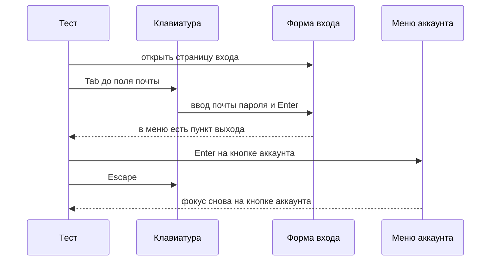
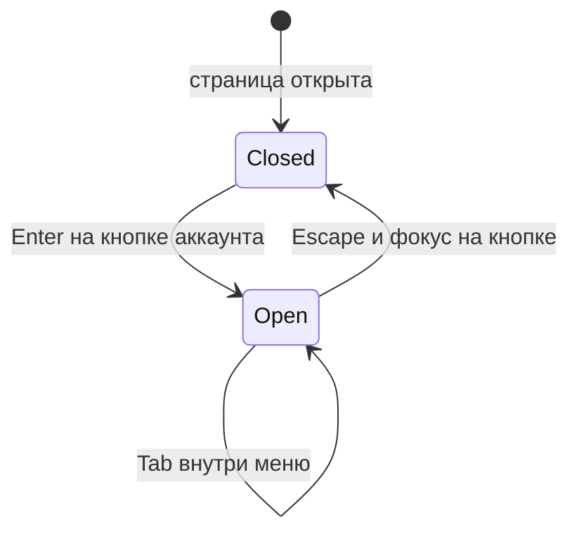

# Клавиатура, фокус и дерево доступности

## Содержание

- [Теория](#теория)
  - [Ситуация](#ситуация)
  - [Модель](#модель)
  - [Понятия и связь с автоматизацией тестирования](#понятия-и-связь-с-автоматизацией-тестирования)
  - [Зоны ответственности](#зоны-ответственности)
  - [Пример](#пример)
  - [Типичные сбои](#типичные-сбои)
  - [Полезные ссылки](#полезные-ссылки)
  - [Вопросы по теории](#вопросы-по-теории)
- [Практическое задание](#практическое-задание)
  - [1.1 Общее](#11-общее)
  - [1.2 Сценарии](#12-сценарии-user-stories)
  - [1.3 Контракт](#13-контракт)
  - [1.4 Ошибки и ограничения](#14-ошибки-и-ограничения)
  - [1.5 Аудит](#15-аудитлоги)
  - [1.6 Нефункциональные требования](#16-нефункциональные-требования)

# Теория

## Ситуация

Автотест проходит форму входа только клавиатурой и сверяет дерево доступности с ожидаемыми именами. Дальше возможен один из исходов: вход завершается, фокус виден, снимок дерева совпадает и меню закрывается по Escape; одно из этих условий ломается и тест красный; ручной проход со скринридером записан отдельно и на код выхода не влияет; стенд недоступен.

Отдельная разработка не нужна: достаточно запущенного контейнера Juice Shop и команды `npx playwright test --grep @a11y` (`pytest -m a11y`, `dotnet test --filter Category=a11y`).

## Модель

Участники: тест, страница, клавиатура браузера и дерево доступности. Указатель в этих кейсах не источник действия. Решение о прохождении принимает оракул теста — требование: до кнопки можно дойти с клавиатуры, фокус виден, у полей есть согласованные имена, Escape возвращает фокус. Привычка кликать по экрану в это требование не входит.



Диаграмма идёт от поля к отправке формы, затем к меню. Escape стоит после открытия: возвращать фокус некуда, пока меню не открыто.



Переход из открытого меню сразу в «страница забыла, кто его открыл» в схеме нет. Если после Escape фокус уехал в начало документа, кейс красный.

Возможный набор полей (имена берутся из разметки стенда):

| `контрол входа` | Описание |
| --- | --- |
| `#email` | Доступное имя `Text field for the login email` |
| `#password` | Доступное имя `Text field for the login password` |
| `#loginButton` | Доступное имя `Login`, текст на кнопке `Log in` |
| `#navbarAccount` | Кнопка меню, доступное имя `Show/hide account menu` |

Проверка использует форму входа и меню навбара Juice Shop. Отдельной сущности, которую тест записывает на стенд, у этих кейсов нет, кроме покупателя для входа.

## Понятия и связь с автоматизацией тестирования

### Доступ с клавиатуры

Часть людей не двигает указатель. Они переходят по элементам клавишей Tab и нажимают Enter или пробел. Если до кнопки входа нельзя дойти Tab, для них кнопки нет, даже когда она нарисована.

На странице входа перед формой стоит навбар: меню, поиск, аккаунт, язык, корзина. Поэтому первый Tab почти никогда не попадает сразу в `#email`. Тест нажимает Tab не больше 20 раз, пока активным элементом не станет `#email`. Двадцатый промах — падение: порядок либо сломан, либо фокус уехал в скрытый элемент. Фиксированная пауза между нажатиями не нужна, нажатие клавиши и так ждёт готовности страницы.

Дальше последовательность жёсткая: ввести почту, Tab, убедиться, что фокус на `#password`, ввести пароль, Tab, убедиться, что фокус на `#loginButton`, Enter. Пока поля пустые, кнопка неактивна. После заполнения она принимает Enter.

Вывод для контракта: `TC-A11Y-06` не вызывает `click` по полям и по кнопке входа.

### Видимый фокус

Мало попасть на элемент. Нужно видеть, где фокус. Иначе зрячий пользователь с клавиатуры не понимает, какое поле сейчас примет буквы. Критерий называется Focus Visible, уровень AA.

У полей Juice Shop индикатор рисует Angular Material: у обёртки `mat-form-field` появляется класс `mat-focused`. Рамка самого `input` при этом может остаться `outline: none`, потому что линию рисует обёртка. Проверять только `outline` у `#email` значит получить ложный провал на исправной форме.

Для `#email` и `#password` тест проверяет два факта вместе: элемент в фокусе и у предка `mat-form-field` есть класс `mat-focused`. Для `#loginButton` предка-поля нет. Там тест проверяет `:focus-visible`: браузер показывает фокус именно от клавиатуры.

Вывод для контракта: `TC-A11Y-07` считает фокус видимым по классу `mat-focused` у полей и по `:focus-visible` у кнопки входа.

### Дерево доступности

Браузер строит рядом с HTML другое дерево: роли, имена и состояния. Скринридер читает его, а не исходный код. Снимок этого дерева в Playwright называется aria snapshot.

Доступное имя поля входа берётся из `aria-label`, оно важнее видимой подписи `Email`. Поэтому в снимке поле называется `Text field for the login email`, а кнопка — `Login`, хотя на ней написано `Log in`.

Снимок снимают с формы, внутри которой лежит `#email`, а не со всей страницы: навбар в проверку имён формы не входит. В снимок обязательно входят три строки: текстовое поле почты, текстовое поле пароля и кнопка `Login`. Обёртки без имени, которые Angular добавляет вокруг, остаются в сохранённом снимке как есть. Их вычищение сделает тест красным на каждой сборке без единой потери имени.

Вывод для контракта: `TC-A11Y-08` падает, если из снимка формы пропало одно из трёх имён.

### Escape и возврат фокуса

Меню аккаунта открывается с кнопки `#navbarAccount`. Пока оно открыто, фокус находится внутри. Клавиша Escape закрывает меню. Фокус обязан вернуться на ту же кнопку: иначе человек теряет место и начинает обход сначала.

Проверка идёт гостем, вход не нужен. Enter на `#navbarAccount` показывает пункт с `#navbarLoginButton`. Escape скрывает этот пункт и оставляет фокус на `#navbarAccount`.

Вывод для контракта: `TC-A11Y-09` считает меню закрытым, когда пункт входа скрыт, а фокус стоит на кнопке, которая меню открыла.

### Скринридер

NVDA на Windows и VoiceOver на macOS произносят имя, роль и состояние. Автотест этого звука не слышит. Человек проходит короткий чек-лист и записывает расхождения. Запись не меняет код выхода job `a11y`: звук нельзя честно повторить на агенте CI без аудиоустройства.

Чек-лист смотрит форму входа, сообщение об ошибке с `role=alert` и кнопки корзины. Последние axe уже помечает как `button-name`. Ушами это звучит как «кнопка» без действия. Совпадение с отчётом `3.1` как раз и показывает, зачем правило существует.

Вывод для контракта: ручной чек-лист обязателен как запись результата и не входит в условие падения CI.

### Что будет дальше

Следующий блок курса — нагрузка, файлы `4.0`–`4.2`. К дереву доступности он не обращается. Имена контролов из этого файла остаются оракулом UI-кейсов, если подпись на стенде поменяют.

### Сводка

| Понятие | Смысл в проверке клавиатуры | На что опирается реализация |
| --- | --- | --- |
| Tab / Enter / Escape | Единственный способ дойти и отправить | `keyboard.press` своего стека |
| Видимый фокус | Понятно, какой элемент активен | `mat-focused` и `:focus-visible` |
| Доступное имя | Как контрол назван в дереве | `aria-label` стенда |
| Aria snapshot | Снимок имён формы | `toMatchAriaSnapshot` и аналоги |
| Скринридер | Как имя звучит вслух | Чек-лист NVDA или VoiceOver |

## Зоны ответственности

| Автотест | Стенд |
| --- | --- |
| Жмёт Tab, Enter и Escape и не кликает по форме входа | Отдаёт поля в порядке, в котором по ним можно пройти |
| Проверяет класс `mat-focused` и `:focus-visible` | Рисует индикатор фокуса на обёртке поля |
| Сравнивает снимок с тремя именами | Отдаёт эти имена через `aria-label` |
| После Escape ждёт фокус на `#navbarAccount` | Закрывает меню и возвращает фокус на кнопку |

Axe из `3.1` и клавиатура из этого файла смотрят на разные слои. Правила не нажимают Tab. Клавиатурный тест не заменяет базовый список `button-name`.

## Пример

Программа выполняет `TC-A11Y-06`: доходит до полей Tab, вводит данные покупателя из фикстуры `1.4` и отправляет форму Enter. В конце открывает меню аккаунта с клавиатуры и видит пункт `Logout`.

### TypeScript

**Node.js 22 или новее, @playwright/test.** `page.keyboard` шлёт клавиши в активный элемент. Ключевой параметр — `press('Tab')` и `press('Enter')` без `click` по форме.

```sh
npx playwright test --grep @a11y
```

```typescript
import { test, expect } from '../src/fixtures/test';

test('TC-A11Y-06 вход с клавиатуры', { tag: ['@a11y'] }, async ({ page, customer }) => {
  await page.goto('/#/login');
  for (let i = 0; i < 20; i++) {
    if (await page.locator('#email').evaluate((el) => el === document.activeElement)) break;
    await page.keyboard.press('Tab');
  }
  await expect(page.locator('#email')).toBeFocused();
  await page.keyboard.type(customer.email);
  await page.keyboard.press('Tab');
  await expect(page.locator('#password')).toBeFocused();
  await page.keyboard.type(customer.password);
  await page.keyboard.press('Tab');
  await expect(page.locator('#loginButton')).toBeFocused();
  await page.keyboard.press('Enter');
  await page.locator('#navbarAccount').focus();
  await page.keyboard.press('Enter');
  await expect(page.getByRole('menuitem', { name: 'Logout' })).toBeVisible();
});
```

### Python

**Python 3.10 или новее, pytest-playwright.** Синхронный `page.keyboard` делает тот же обход. Фикстура `customer` приходит из `conftest.py`.

```sh
pytest -m a11y
```

```python
import pytest
from playwright.sync_api import Page, expect

@pytest.mark.a11y
def test_tc_a11y_06(page: Page, customer: dict) -> None:
    page.goto("/#/login")
    for _ in range(20):
        if page.evaluate("() => document.activeElement?.id === 'email'"):
            break
        page.keyboard.press("Tab")
    expect(page.locator("#email")).to_be_focused()
    page.keyboard.type(customer["email"])
    page.keyboard.press("Tab")
    expect(page.locator("#password")).to_be_focused()
    page.keyboard.type(customer["password"])
    page.keyboard.press("Tab")
    expect(page.locator("#loginButton")).to_be_focused()
    page.keyboard.press("Enter")
    page.locator("#navbarAccount").focus()
    page.keyboard.press("Enter")
    expect(page.get_by_role("menuitem", name="Logout")).to_be_visible()
```

### C#

**.NET 8 или новее, Microsoft.Playwright.NUnit.** `Keyboard.PressAsync` шлёт те же клавиши. Покупателя даёт `CreateCustomerAsync` из базового класса `1.4`.

```sh
dotnet test --filter Category=a11y
```

```csharp
using Microsoft.Playwright;
using Microsoft.Playwright.NUnit;

public class KeyboardLogin : ApiTestBase
{
    [Test]
    [Category("a11y")]
    public async Task TC_A11Y_06()
    {
        var customer = await CreateCustomerAsync();
        await Page.GotoAsync("/#/login");
        for (var i = 0; i < 20; i++)
        {
            var id = await Page.EvaluateAsync<string>("() => document.activeElement?.id ?? ''");
            if (id == "email") break;
            await Page.Keyboard.PressAsync("Tab");
        }
        await Expect(Page.Locator("#email")).ToBeFocusedAsync();
        await Page.Keyboard.TypeAsync(customer.Email);
        await Page.Keyboard.PressAsync("Tab");
        await Expect(Page.Locator("#password")).ToBeFocusedAsync();
        await Page.Keyboard.TypeAsync(customer.Password);
        await Page.Keyboard.PressAsync("Tab");
        await Expect(Page.Locator("#loginButton")).ToBeFocusedAsync();
        await Page.Keyboard.PressAsync("Enter");
        await Page.Locator("#navbarAccount").FocusAsync();
        await Page.Keyboard.PressAsync("Enter");
        await Expect(Page.GetByRole(AriaRole.Menuitem, new() { Name = "Logout" })).ToBeVisibleAsync();
    }
}
```

---

Каждый раннер сообщает об 1 пройденном тесте. Это доказывает, что форма входа приняла почту и пароль с клавиатуры и после входа в меню аккаунта виден пункт `Logout`. Клик по полям и по `#loginButton` в этом тесте не используется.

## Типичные сбои

| Что видно | Куда смотреть |
| --- | --- |
| Цикл из 20 Tab не дошёл до `#email` | Фокус уехал в баннер. Cookie `cookieconsent_status=dismiss` и `language=en` ставятся до перехода |
| Tab с пароля ушёл не на `#loginButton` | Между полями появился лишний контрол, порядок в контракте сломан |
| Кнопка входа не принимает Enter | Поля для этого прогона пустые, кнопка ещё неактивна |
| `mat-focused` не появляется | Класс вешают на `mat-form-field`, а не на сам `input` |
| Снимок красный из-за безымянной обёртки | В сохранённый снимок входят и обёртки. Падение имеет смысл, когда пропала одна из трёх именованных строк |
| После Escape фокус на `body` | Меню закрылось и не вернуло фокус на `#navbarAccount` |
| Пункт `Logout` не виден | Вход не состоялся или открыто меню гостя, где пункт называется иначе |
| Чек-лист скринридера нечем запустить в CI | Так и задумано: запись делает человек, job ждёт только автоматические кейсы |

## Полезные ссылки

### Общие

- [W3C WAI — Understanding Keyboard](https://www.w3.org/WAI/WCAG22/Understanding/keyboard.html) — почему до действия доходят без мыши.
- [W3C WAI — Understanding Focus Visible](https://www.w3.org/WAI/WCAG22/Understanding/focus-visible.html) — что считается видимым фокусом.
- [W3C WAI — Understanding Focus Order](https://www.w3.org/WAI/WCAG22/Understanding/focus-order.html) — порядок обхода.
- [W3C WAI — Menu Button Pattern](https://www.w3.org/WAI/ARIA/apg/patterns/menu-button/) — Escape закрывает меню и возвращает фокус.
- [Playwright — Aria snapshots](https://playwright.dev/docs/aria-snapshots) — формат снимка дерева.
- [NV Access — Download NVDA](https://www.nvaccess.org/download/) — скринридер для чек-листа на Windows.
- [Apple — VoiceOver User Guide](https://support.apple.com/guide/voiceover/welcome/mac) — скринридер для чек-листа на macOS.

### По языку

#### TypeScript

**TypeScript, Playwright Test.** На JavaScript контракт клавиатуры и снимка остаётся тем же.

- [Playwright — Keyboard](https://playwright.dev/docs/api/class-keyboard) — `press` и `type`.
- [Playwright — toMatchAriaSnapshot](https://playwright.dev/docs/api/class-locatorassertions#locator-assertions-to-match-aria-snapshot) — утверждение снимка.

#### Python

**Python, pytest-playwright.** На синхронном Playwright API без pytest или на async API контракт клавиатуры и снимка остаётся тем же.

- [Playwright Python — Keyboard](https://playwright.dev/python/docs/api/class-keyboard) — `press` и `type`.
- [Playwright Python — Aria snapshots](https://playwright.dev/python/docs/aria-snapshots) — `to_match_aria_snapshot`.

#### C#

**C#, Playwright для .NET с NUnit.** На MSTest или xUnit контракт клавиатуры и снимка остаётся тем же.

- [Playwright .NET — Keyboard](https://playwright.dev/dotnet/docs/api/class-keyboard) — `PressAsync` и `TypeAsync`.
- [Playwright .NET — Aria snapshots](https://playwright.dev/dotnet/docs/aria-snapshots) — `ToMatchAriaSnapshotAsync`.

## Вопросы по теории

1. Почему тест жмёт Tab до 20 раз, а не фокусирует `#email` сразу?
2. Зачем смотреть класс `mat-focused`, если у `input` пустая рамка?
3. Почему доступное имя кнопки — `Login`, хотя на ней написано `Log in`?
4. Что произойдёт со снимком, если из него убрать безымянные обёртки Angular?
5. Куда должен встать фокус после Escape и почему провал «фокус на body» важен?
6. Почему результат скринридера не красит job `a11y`?
7. Чем эти кейсы отличаются от прогона axe в `3.1`?

# Практическое задание

Автотесты клавиатуры и дерева доступности для Juice Shop.
Четыре кейса проверяют вход, фокус, снимок формы и меню. Чек-лист скринридера выполняется человеком.

## 1) Клавиатура, фокус и дерево

### 1.1 Общее

**Назначение:** убедиться, что формой входа и меню аккаунта можно пользоваться с клавиатуры, а имена в дереве совпадают с разметкой стенда.

**Пользователи/роли:**

- AQA-инженер — запускает кейсы и проходит чек-лист скринридера;
- разработчик — чинит порядок Tab, индикатор фокуса и `aria-label`;
- CI — гоняет автоматические кейсы в job `a11y`;
- `customer` — учётка для `TC-A11Y-06` и `TC-A11Y-07`;
- `guest` — меню в `TC-A11Y-09`.

**Зависимости/связанные настройки:**

- `3.0` и `3.1` — политика и axe, без повторного скана в этих кейсах;
- `1.4` — фикстура `customer` с полями `email` и `password`;
- `2.0` — cookie согласия и языка, hash-маршрут `/#/login`;
- `BASE_URL` — адрес стенда;
- тег `a11y`.

Нагрузка, заголовки безопасности и письма здесь не проверяются.

### 1.2 Сценарии (user stories)

1. **Вход с клавиатуры:** `TC-A11Y-06` доходит до полей Tab, отправляет форму Enter и видит `Logout`.
2. **Видимый фокус:** `TC-A11Y-07` на каждом из трёх контролов формы видит признак фокуса.
3. **Снимок формы:** `TC-A11Y-08` требует три доступных имени внутри формы входа.
4. **Escape:** `TC-A11Y-09` закрывает меню аккаунта и возвращает фокус на `#navbarAccount`.
5. **Слух:** человек проходит чек-лист NVDA или VoiceOver и прикладывает запись к отчёту.

### 1.3 Контракт

#### 1.3.1 Вход и фокус

| ID | Проверки/валидация |
| --- | --- |
| `TC-A11Y-06` | Только клавиатура. После Enter в меню есть пункт `Logout` |
| `TC-A11Y-07` | `#email` и `#password`: фокус и предок `mat-form-field` с классом `mat-focused`. `#loginButton`: состояние `:focus-visible` |

**Логика/шаги:**

1. Открыть `/#/login` с cookie из `2.0`.
2. Нажать Tab не больше 20 раз, пока активен `#email`.
3. Ввести почту и пароль покупателя, между полями переходить Tab.
4. Нажать Enter на `#loginButton`.
5. Для `TC-A11Y-07` на каждом контроле снять признак видимого фокуса до отправки формы.
6. Открыть `#navbarAccount` клавишей Enter и дождаться пункта `Logout`.

Повтор создаёт нового покупателя фикстурой. Старый вход на стенде кейсу не нужен.

**Ответы:**

- **Проход `TC-A11Y-06`:** пункт `Logout` виден.
- **Проход `TC-A11Y-07`:** у обоих полей есть `mat-focused`, у кнопки есть `:focus-visible`.
- **Ошибки:** см. раздел 1.4.
- Пароль в отчёт не пишется.

#### 1.3.2 Снимок и меню

**Общее правило:** снимок снимается с формы, которая содержит `#email`. Меню проверяется гостем на `/#/login`.

| ID | Проверки/валидация |
| --- | --- |
| `TC-A11Y-08` | В снимке есть `textbox "Text field for the login email"`, `textbox "Text field for the login password"`, `button "Login"` |
| `TC-A11Y-09` | Enter на `#navbarAccount` показывает `#navbarLoginButton`. Escape скрывает пункт и оставляет фокус на `#navbarAccount` |

**Логика/шаги:**

1. Для снимка вызвать `toMatchAriaSnapshot` (`to_match_aria_snapshot`, `ToMatchAriaSnapshotAsync`) на локаторе формы.
2. Сохранить в ожидаемом тексте безымянные обёртки, которые страница отдаёт стабильно.
3. Для меню нажать Enter, затем Escape, затем проверить фокус и скрытие пункта.

**Ответы:**

- **Проход:** три имени на месте, после Escape фокус на кнопке меню.
- **Ошибки:** см. раздел 1.4.

#### 1.3.3 Ручной чек-лист

**Общее правило:** чек-лист выполняет человек на Windows (NVDA) или macOS (VoiceOver). Результат — короткая запись во вложении отчёта. Код выхода job от записи не зависит.

| Шаг | Что услышать или увидеть |
| --- | --- |
| Форма входа | Имена полей совпадают со снимком `TC-A11Y-08` |
| Неверный пароль | Объявляется область `alert` с текстом `Invalid email or password.` |
| Корзина `customer` с товаром | Кнопки строки звучат без названия действия |
| Обход Tab | Индикатор фокуса виден на поле и на кнопке |

**Логика/шаги:**

1. Включить скринридер и открыть `/#/login`.
2. Пройти форму стрелками или Tab, как принято в этом скринридере.
3. Повторить ошибку входа и корзину.
4. Приложить запись: дата, скринридер, три наблюдения.

**Ответы:**

- **Запись есть:** чек-лист выполнен.
- **Ошибки автоматики:** см. раздел 1.4. Расхождение слуха с снимком чинит разработчик, job из-за записи не краснеет.

### 1.4 Ошибки и ограничения

- Нет `BASE_URL` — отказ до браузера.
- Стенд недоступен — нет **200** на `GET /rest/admin/application-version`.
- За 20 нажатий Tab `#email` не стал активным — падение `TC-A11Y-06` и `TC-A11Y-07`.
- Фокус после Tab с почты не на `#password` или не на `#loginButton` — падение.
- Нет `mat-focused` или нет `:focus-visible` — падение `TC-A11Y-07`.
- В снимке нет одного из трёх имён — падение `TC-A11Y-08`.
- После Escape фокус не на `#navbarAccount` или пункт ещё виден — падение `TC-A11Y-09`.
- Клик мышью по форме входа в этих кейсах — нарушение контракта, даже если пункт `Logout` в конце виден.
- Скринридер в CI не запущен — автоматические кейсы от этого не падают.

Порядок внутри `TC-A11Y-06`: сначала фокус на почте, потом пароль, потом кнопка, потом Enter. Первое сломанное звено и есть причина падения.

### 1.5 Аудит/логи

Логировать: ID кейса, число нажатий Tab до `#email`, итог фокуса, совпадение трёх имён, куда встал фокус после Escape.

В журнал не попадают пароль, токен, cookie `token` и полный JWT. Запись скринридера не содержит пароль: в чек-листе ошибки достаточно чужого короткого слова, не пароля фикстуры.

### 1.6 Нефункциональные требования

- Автоматические кейсы — `TC-A11Y-06` … `TC-A11Y-09`, тег `a11y`, тот же job, что и `3.1`.
- `waitForTimeout` и `sleep` запрещены. Предел 20 нажатий Tab — это граница поиска, а не пауза.
- Четыре кейса укладываются в 2 минуты локально.
- Ретраи 2 в CI и 0 локально, trace при первом ретрае, скриншот и видео только при падении, таймаут теста 30 с, таймаут проверки 5 с.
- Пять повторов подряд без падений.
- Общие нефункциональные требования проекта из словаря курса относятся и к этим операциям.
