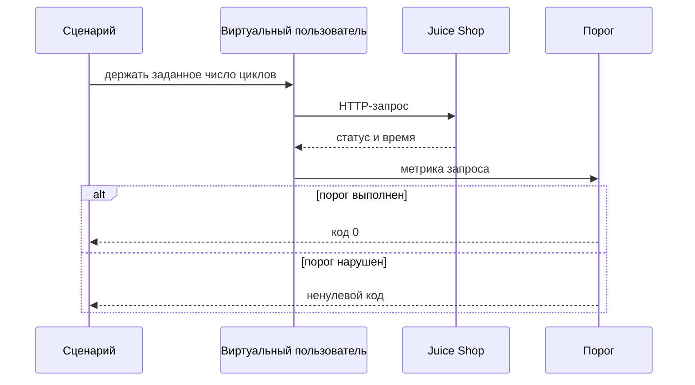
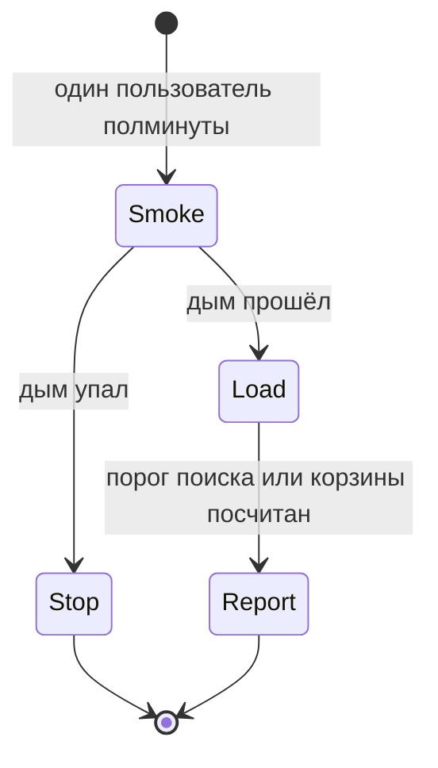

# Общие требования к нагрузочному тестированию

## Содержание

- [Теория](#теория)
  - [Ситуация](#ситуация)
  - [Модель](#модель)
  - [Понятия и связь с автоматизацией тестирования](#понятия-и-связь-с-автоматизацией-тестирования)
  - [Зоны ответственности](#зоны-ответственности)
  - [Пример](#пример)
  - [Типичные сбои](#типичные-сбои)
  - [Полезные ссылки](#полезные-ссылки)
  - [Вопросы по теории](#вопросы-по-теории)
- [Практическое задание](#практическое-задание)
  - [1.1 Общее](#11-общее)
  - [1.2 Сценарии](#12-сценарии-user-stories)
  - [1.3 Контракт](#13-контракт)
  - [1.4 Ошибки и ограничения](#14-ошибки-и-ограничения)
  - [1.5 Аудит](#15-аудитлоги)
  - [1.6 Нефункциональные требования](#16-нефункциональные-требования)

# Теория

## Ситуация

Набор нагрузки открывает локальный Juice Shop сразу многими запросами и смотрит, успевает ли стенд отвечать в заранее названный срок. Дальше возможен один из исходов: порог времени и доля ошибок выполнены, порог нарушен и прогон завершается ненулевым кодом, сценарий отказался стартовать, потому что адрес не локальный, либо стенд недоступен.

Отдельная разработка не нужна: достаточно запущенного контейнера Juice Shop и команды `k6 run -e BASE_URL=http://localhost:3000 perf/smoke.js`.

## Модель

Участники: сценарий k6, виртуальный пользователь, стенд и порог. Виртуальный пользователь — цикл, который шлёт запросы один за другим. Стенд отвечает как умеет. Решение о прохождении принимает оракул теста — порог из словаря курса, а не ощущение «на моём ноутбуке вроде быстро».



Запрос уходит только после старта сценария и только на адрес, который сценарий уже проверил. Порог считается по всему прогону, а не по одному удачному ответу в начале.



Большой прогон начинается после дыма. Дым, который уже не получает **200**, делает длинный прогон бессмысленным: он измерит обрыв, а не скорость.

Возможный набор полей (набор метрик может быть и другим):

| `прогон` | Описание |
| --- | --- |
| `vus` | Сколько циклов работает одновременно |
| `duration` | Сколько длится прогон |
| `http_req_duration` | Время ответа, по нему считают p95 |
| `http_req_failed` | Доля запросов со статусом 0 либо от **400** |
| `checks` | Доля проверок тела и статуса, которые прошли |

Проверка использует HTTP-операции локального Juice Shop. Отдельной базы у сценария нет: пользователи корзины создаются на стенде и живут до перезапуска контейнера.

## Понятия и связь с автоматизацией тестирования

### Зачем много запросов сразу

Функциональный тест спрашивает: «этот один покупатель получил **200** и нужные поля?». Нагрузка спрашивает другое: «когда таких запросов много одновременно, хвост времени и доля ошибок всё ещё внутри договорённости?». Один зелёный тест корзины не говорит, что будет, когда десять покупателей пишут в неё вместе.

Инструмент курса — k6. Сценарий — обычный файл JavaScript в каталоге `perf/`. Он не входит в раннер Playwright: у k6 свой процесс и свои метрики.

Вывод для контракта: сценарии лежат в `perf/` и ходят в стенд по HTTP сами.

### Виды прогона

Имена короткие, смысл у каждого свой.

Дым (smoke) проверяет, жив ли стенд под одним пользователем. В курсе это 1 виртуальный пользователь и 30 секунд. Ноль ошибок. Если дым красный, дальше смотреть нечего.

Нагрузка (load) держит ожидаемый поток и проверяет договорённость по времени. В курсе это поиск до 20 пользователей за 5 минут и корзина на 10 пользователей.

Стресс (stress) поднимает поток выше договорённости, чтобы увидеть, как стенд гнётся: растёт время или сразу сыпятся ошибки.

Скачок (spike) резко добавляет пользователей и так же резко убирает. Так ловят сбой на внезапной пачке, который плавный рост прячет.

Выдержка (soak) держит умеренный поток долго, часами. Так всплывают утечки, которых нет в пятиминутном прогоне.

Предел (breakpoint) поднимает поток, пока порог не сломается. У порога включают `abortOnFail`, и k6 останавливается на первой устойчивой поломке. Это поиск потолка, а не проверка релиза.

В CI курса входит только дым, job `perf-smoke`. Стресс, скачок, выдержка и предел запускают локально и по отдельному решению: они долго занимают машину.

Вывод для контракта: обязательные прогоны — дым, поиск и корзина. Остальные виды описаны, чтобы их не перепутать с дымом.

### Время ответа и хвост

Среднее прячет беду. Девять быстрых ответов и один на десять секунд дают приятное среднее, а человек попал на десятый.

p50 — время, быстрее которого была половина запросов. p95 — время, быстрее которого были 95 запросов из 100. Оставшиеся пять медленнее. p99 смотрит ещё более тонкий хвост. Для курса в пороге стоит p95: это уже хвост, и на коротком прогоне он устойчивее p99.

RPS — сколько запросов завершилось за секунду. Конкурентность — сколько запросов было в полёте одновременно. Виртуальные пользователи ограничивают конкурентность сверху, пока каждый ждёт свой ответ.

Доля ошибок — часть запросов, которые не удались. В k6 метрика `http_req_failed` считает неудачей обрыв и статус от **400** и выше. Поэтому бизнес-ответ **400** тоже попадает в долю. Сценарий корзины в `4.1` специально не вызывает такие **400**.

Вывод для контракта: порог времени пишется как `p(95)<…`, порог ошибок — как доля `http_req_failed`.

### SLO и порог

SLO — договорённость о скорости и ошибках простыми словами. Например: «95% поисков быстрее 500 мс, ошибок меньше 1%». Порог k6 — та же фраза в виде, который процесс умеет провалить. Прогон с красивым отчётом и нарушенным порогом считается неуспешным: k6 выходит с ненулевым кодом, для порогов это код 99.

Числа курса зафиксированы в словаре. Поиск: p95 меньше 500 мс. Корзина: p95 меньше 800 мс. Доля `http_req_failed` меньше 1% (`rate<0.01`). Проверки `checks` успешны больше чем в 99% (`rate>0.99`). У дыма доля ошибок равна нулю.

Вывод для контракта: числа порогов не подбирают под удачный прогон. Их берут из словаря.

### Закрытая и открытая модель

В закрытой модели следующий запрос виртуального пользователя начинается, когда закончился предыдущий. Если стенд замедлился, пользователь ждёт, и новых запросов в секунду становится меньше. Обычные `vus` и `stages` в k6 работают так. На уже медленном стенде такая модель сама снижает давление: это называют coordinated omission. p95 при этом растёт, а RPS падает. Закрытая модель отвечает на вопрос, каково N людям, которые ждут свой ответ.

Открытая модель шлёт новые итерации по расписанию, даже если старые ещё не вернулись. В k6 это executor `constant-arrival-rate` и `ramping-arrival-rate`. Очередь растёт, когда стенд не успевает. Такой прогон отвечает на вопрос «что будет при стольких новых запросах в секунду».

Сценарии курса закрытые: важно, как себя чувствуют 1, 10 и 20 пользователей на локальном стенде.

Вывод для контракта: `smoke.js`, `search-load.js` и `basket-load.js` не задают частоту прихода. Они задают число пользователей.

### Только свой стенд

Нагрузка легко становится атакой, если её направить на чужой адрес. Сценарий курса имеет право бить в контейнер, который поднят локально для учёбы. Перед стартом он смотрит хост `BASE_URL`. Разрешены `localhost` и `127.0.0.1`. Любой другой хост — немедленная ошибка, запросов нет.

Стенд для замера — отдельный запуск `bkimminich/juice-shop:v20.4.0` с `NODE_ENV=quiet`. Рядом не идёт функциональный набор: он сам создаёт пользователей и забирает процессор. Перед сравнением двух прогонов контейнер перезапускают, иначе старые корзины меняют время записи. Рядом с итогом записывают, на какой машине шёл прогон: p95 ноутбука не переносится на другой ноутбук как регрессия продукта.

Вывод для контракта: чужой хост в `BASE_URL` запрещён, прогон до запросов останавливается.

### Сравнение

| Инструмент | Что проверяет | Подходит для |
| --- | --- | --- |
| k6 | Сценарий HTTP, пороги, код выхода | Дым и два профиля курса |
| JMeter | План в графическом редакторе и CLI | Уже готовые планы команды |
| Gatling | Сценарий кодом, подробный отчёт | Нагрузка рядом с JVM-проектом |
| Locust | Сценарий на Python, пользователей пишут кодом | Команда, которая живёт в Python |
| Artillery | Сценарий YAML или JS | Короткий HTTP-профиль |
| Vegeta | Постоянный поток одним URL | Простая открытая модель без логики |
| NBomber | Сценарий на .NET | Команда, которая живёт в C# |
| Lighthouse | Скорость открытой страницы в лаборатории | Бюджет `4.2` |
| WebPageTest | Разбор загрузки страницы по шагам | Разовый разбор, не порог CI |

Подробно в курсе подключён k6. Lighthouse подключается в `4.2` как бюджет страницы, а не как замена RPS.

Вывод для контракта: оракул HTTP-нагрузки — пороги k6. Оценка страницы — отдельный бюджет.

### Что будет в `4.1` и `4.2`

`4.1` содержит три файла: `perf/smoke.js`, `perf/search-load.js`, `perf/basket-load.js`, и кейсы `TC-PERF-01` … `TC-PERF-03`. `4.2` учит читать итог, сравнивать с прошлой линией и ставить бюджет LCP, CLS и TBT на страницу поиска (`TC-PERF-04`).

### Сводка

| Понятие | Смысл в нагрузке | На что опирается реализация |
| --- | --- | --- |
| Виртуальный пользователь | Цикл запросов | `vus` и `stages` |
| p95 | Хвост времени | `http_req_duration` |
| Доля ошибок | Обрывы и статусы от **400** | `http_req_failed` |
| Порог | Договорённость, которую k6 умеет провалить | Словарь курса |
| Закрытая модель | Следующий запрос после ответа | Сценарии `perf/` |
| Свой стенд | Только `localhost` и `127.0.0.1` | Проверка хоста в скрипте |

## Зоны ответственности

| AQA-инженер | Разработчик |
| --- | --- |
| Выбирает вид прогона и не пускает стресс в job дыма | Чинит причину, если p95 или ошибки вышли за порог |
| Держит числа порогов равными словарю | Не просит «подкрутить порог» под один удачный замер |
| Запускает сценарий только против локального контейнера | Не выставляет учебный стенд в общую сеть |
| Записывает машину рядом с итогом | Сравнивает два итога, снятые на одной и той же машине |

k6 измеряет ответы снаружи. Он не заменяет профайлер Node.js и не показывает строку SQLite, которая держит запись. Это уже разбор в `4.2`.

## Пример

Программа полминуты одним пользователем запрашивает готовность стенда и требует ноль неудачных запросов. Это каркас дыма. Три стека вызывают один и тот же файл `perf/smoke.js`: k6 не зависит от языка проекта.

### TypeScript

**Node.js 22 или новее, k6 2.4 или новее.** k6 исполняет JavaScript сценария. Проект на Node.js передаёт `BASE_URL` и хранит файл в `perf/`.

```sh
k6 run -e BASE_URL=http://localhost:3000 perf/smoke.js
```

```javascript
import http from 'k6/http';
import { check, sleep } from 'k6';

const base = __ENV.BASE_URL || 'http://localhost:3000';
const host = base.replace(/^https?:\/\//, '').split('/')[0].split(':')[0];
if (host !== 'localhost' && host !== '127.0.0.1') {
  throw new Error('Сценарий запускается только против локального стенда');
}

export const options = {
  vus: 1,
  duration: '30s',
  thresholds: { http_req_failed: ['rate==0'], checks: ['rate>0.99'] },
};

export default function () {
  const res = http.get(`${base}/rest/admin/application-version`);
  check(res, {
    'status 200': (r) => r.status === 200,
    'есть version': (r) => String(r.body).includes('"version"'),
  });
  sleep(1);
}
```

### Python

**Python 3.10 или новее, k6 2.4 или новее.** Тот же файл `perf/smoke.js`. Проект на Python передаёт `BASE_URL` из своего окружения.

```sh
k6 run -e BASE_URL=http://localhost:3000 perf/smoke.js
```

```javascript
import http from 'k6/http';
import { check, sleep } from 'k6';

const base = __ENV.BASE_URL || 'http://localhost:3000';
const host = base.replace(/^https?:\/\//, '').split('/')[0].split(':')[0];
if (host !== 'localhost' && host !== '127.0.0.1') {
  throw new Error('Сценарий запускается только против локального стенда');
}

export const options = {
  vus: 1,
  duration: '30s',
  thresholds: { http_req_failed: ['rate==0'], checks: ['rate>0.99'] },
};

export default function () {
  const res = http.get(`${base}/rest/admin/application-version`);
  check(res, {
    'status 200': (r) => r.status === 200,
    'есть version': (r) => String(r.body).includes('"version"'),
  });
  sleep(1);
}
```

### C#

**.NET 8 или новее, k6 2.4 или новее.** Тот же файл `perf/smoke.js`. Проект на .NET передаёт `BASE_URL` из окружения прогона.

```sh
k6 run -e BASE_URL=http://localhost:3000 perf/smoke.js
```

```javascript
import http from 'k6/http';
import { check, sleep } from 'k6';

const base = __ENV.BASE_URL || 'http://localhost:3000';
const host = base.replace(/^https?:\/\//, '').split('/')[0].split(':')[0];
if (host !== 'localhost' && host !== '127.0.0.1') {
  throw new Error('Сценарий запускается только против локального стенда');
}

export const options = {
  vus: 1,
  duration: '30s',
  thresholds: { http_req_failed: ['rate==0'], checks: ['rate>0.99'] },
};

export default function () {
  const res = http.get(`${base}/rest/admin/application-version`);
  check(res, {
    'status 200': (r) => r.status === 200,
    'есть version': (r) => String(r.body).includes('"version"'),
  });
  sleep(1);
}
```

---

Каждый запуск печатает итог k6 с `http_req_failed` равным 0% и долей `checks` выше 99%, затем завершается с кодом 0. Строка `есть version` доказывает, что тело ответа содержит поле версии. Точное значение версии сценарий не требует. Если хост не локальный, процесс падает до первого запроса, и это одинаково для всех трёх проектов.

## Типичные сбои

| Что видно | Куда смотреть |
| --- | --- |
| Ошибка про хост до запросов | В `BASE_URL` не `localhost` и не `127.0.0.1` |
| Дым красный, в отчёте статусы 0 | Контейнер не слушает порт 3000 |
| `checks` ниже 99% при статусах **200** | В теле нет `"version"`. Это не тот URL |
| p95 огромный, RPS маленький | Закрытая модель ждёт медленный ответ. Смотреть и хвост, и число запросов |
| Порог зелёный на чужом ноутбуке и красный на своём | В заметке к прогону не записана машина |
| Функциональные тесты мигают во время нагрузки | Оба набора бьют в один контейнер. Нагрузку пускают отдельно |
| Код 99 | Порог нарушен. Это неуспех, даже если часть запросов быстрая |
| В CI ушёл пятиминутный поиск | В job `perf-smoke` должен быть только `smoke.js` |

## Полезные ссылки

### Общие

- [Grafana k6 — Documentation](https://grafana.com/docs/k6/latest/) — устройство сценария, метрик и кода выхода.
- [Grafana k6 — Thresholds](https://grafana.com/docs/k6/latest/using-k6/thresholds/) — как порог проваливает прогон.
- [Grafana k6 — Open and closed models](https://grafana.com/docs/k6/latest/using-k6/scenarios/concepts/open-vs-closed/) — чем `vus` отличается от частоты прихода.
- [Google SRE — Service Level Objectives](https://sre.google/sre-book/service-level-objectives/) — откуда берётся смысл SLO.
- [Apache JMeter](https://jmeter.apache.org/) — план нагрузки вне k6.
- [Gatling](https://gatling.io/docs/gatling/) — сценарии для JVM.
- [Locust](https://docs.locust.io/en/stable/) — сценарии на Python.
- [Artillery](https://www.artillery.io/docs) — короткие HTTP-профили.
- [Vegeta](https://github.com/tsenart/vegeta) — постоянный поток по URL.
- [NBomber](https://nbomber.com/) — нагрузка на .NET.
- [Chrome for Developers — Lighthouse](https://developer.chrome.com/docs/lighthouse/overview/) — лабораторная скорость страницы.
- [WebPageTest](https://www.webpagetest.org/) — пошаговый разбор загрузки.

### По языку

#### TypeScript

**TypeScript, Playwright Test.** На JavaScript контракт нагрузки остаётся тем же: его исполняет k6, не раннер UI.

- [Grafana k6 — HTTP](https://grafana.com/docs/k6/latest/javascript-api/k6-http/) — `http.get` и проверки.

#### Python

**Python, pytest-playwright.** На синхронном Playwright API без pytest или на async API контракт нагрузки остаётся тем же: сценарий k6 общий.

- [Grafana k6 — Test lifecycle](https://grafana.com/docs/k6/latest/using-k6/test-lifecycle/) — `setup` и функция по умолчанию.

#### C#

**C#, Playwright для .NET с NUnit.** На MSTest или xUnit контракт нагрузки остаётся тем же.

- [Grafana k6 — Options reference](https://grafana.com/docs/k6/latest/using-k6/k6-options/reference/) — `vus`, `stages`, `thresholds`.

## Вопросы по теории

1. Почему зелёная корзина в функциональном тесте ничего не говорит о десяти одновременных покупателях?
2. Зачем в пороге p95, если среднее считать проще?
3. Что произойдёт с RPS в закрытой модели, когда стенд внезапно замедлится?
4. Чем дым отличается от предела?
5. Почему сценарий падает до запросов на адресе, который не `localhost`?
6. Почему стресс не входит в job `perf-smoke`?
7. Почему **400** портит `http_req_failed`, даже если для функционального теста этот код ожидаем?

# Практическое задание

Набор правил нагрузочного прогона для Juice Shop.
Правила задают виды прогонов, пороги и запрет бить в чужой адрес. Скрипты пишет `4.1`.

## 1) Правила нагрузки

### 1.1 Общее

**Назначение:** договориться, какую нагрузку вообще разрешено пускать и какой номер считается неуспехом.

**Пользователи/роли:**

- AQA-инженер — запускает дым, поиск и корзину локально и кладёт в CI только дым;
- разработчик — разбирает прогон, который вышел за порог;
- CI — job `perf-smoke`;
- стенд — локальный контейнер Juice Shop, роль учётной записи появляется только в сценарии корзины (`4.1`).

**Зависимости/связанные настройки:**

- `1.0` — `BASE_URL` и команда запуска контейнера;
- словарь порогов — p95 поиска 500 мс, p95 корзины 800 мс, `http_req_failed` < 1%, `checks` > 99%;
- `4.1` — файлы сценариев и кейсы `TC-PERF-01` … `TC-PERF-03`;
- `4.2` — чтение итога и бюджет страницы.

Безопасность и письма этим прогоном не проверяются. Функциональный набор во время замера не запускают.

### 1.2 Сценарии (user stories)

1. **Дым:** один пользователь полминуты бьёт в готовность стенда, ошибок ноль.
2. **Поиск:** поток вырастает до 20 пользователей и держится в пределах пяти минут, p95 ниже 500 мс.
3. **Корзина:** десять пользователей пишут в свои корзины, p95 ниже 800 мс.
4. **Чужой адрес:** сценарий видит нелокальный хост и завершается без единого запроса.
5. **CI:** job выполняет только дым. Пятиминутный поиск остаётся локальной командой.

### 1.3 Контракт

#### 1.3.1 Куда можно стрелять

| Правило | Проверки/валидация |
| --- | --- |
| Хост | Только `localhost` или `127.0.0.1` |
| Образ | `bkimminich/juice-shop:v20.4.0`, `NODE_ENV=quiet`, порт 3000 |
| Соседство | Функциональный набор в этом контейнере в момент замера не идёт |

**Логика/шаги:**

1. Прочитать `BASE_URL`.
2. Выделить хост.
3. Остановить сценарий, если хост не из разрешённых.
4. Дождаться **200** от `GET /rest/admin/application-version`.
5. Только после этого запускать профиль.

**Ответы:**

- **Проход проверки адреса:** хост разрешён, запросов к чужому имени не было.
- **Ошибки:** см. раздел 1.4.

#### 1.3.2 Пороги

**Общее правило:** числа берутся из словаря. Подгонять порог под результат запрещено тем же изменением, которое этот результат получило.

| Профиль | Входные данные и правила |
| --- | --- |
| Дым | `http_req_failed` с `rate==0`, `checks` с `rate>0.99`, 1 VU, 30 с |
| Поиск | `p(95)<500`, `rate<0.01`, `checks` с `rate>0.99` |
| Корзина | `p(95)<800`, `rate<0.01`, `checks` с `rate>0.99` |

**Логика/шаги:**

1. Записать порог в `options.thresholds`.
2. Завершать прогон кодом 0 только когда все выражения истинны.
3. Код 99 считать неуспехом профиля.

**Ответы:**

- **Проход:** код 0 и выражения порога истинны.
- **Ошибки:** см. раздел 1.4.

### 1.4 Ошибки и ограничения

- Хост не `localhost` и не `127.0.0.1` — ошибка сценария до запросов.
- Нет `BASE_URL` — сценарий подставляет `http://localhost:3000` и всё равно проверяет хост. Пустой секрет здесь не используется: адреса по умолчанию достаточно, паролей в этом файле нет.
- Стенд недоступен — статусы 0, дым нарушает `rate==0`.
- Порог нарушен — код 99.
- **400** и **500** увеличивают `http_req_failed`. Сценарий, который специально ждёт деловой **400**, в этот набор не входит.
- Два прогона на разных машинах — числа не сравнивают как регрессию.
- Стресс, скачок, выдержка и предел в job `perf-smoke` — нарушение контракта.

Порядок: хост, готовность стенда, дым, и только потом длинный профиль.

### 1.5 Аудит/логи

Логировать: имя скрипта, `BASE_URL` без пути с секретами, итог p95, долю ошибок, долю checks, код выхода, краткое описание машины.

В журнал не попадают пароль, токен, cookie `token` и полный JWT. Сценарий дыма их не создаёт. Сценарий корзины в `4.1` не печатает токен, который получил в `setup`.

### 1.6 Нефункциональные требования

- Дым укладывается в 40 секунд вместе с раскладкой k6.
- Job `perf-smoke` не запускает профили длиннее дыма.
- `sleep` внутри k6 — пауза виртуального пользователя между действиями и в сценарии разрешён. `waitForTimeout` к этим файлам не относится: браузера в них нет.
- Пять повторов дыма подряд на свободном локальном стенде заканчиваются кодом 0.
- Общие нефункциональные требования проекта из словаря курса относятся к функциональному прогону. Нагрузочный job идёт отдельно и в лимит 10 минут API + UI не входит.
