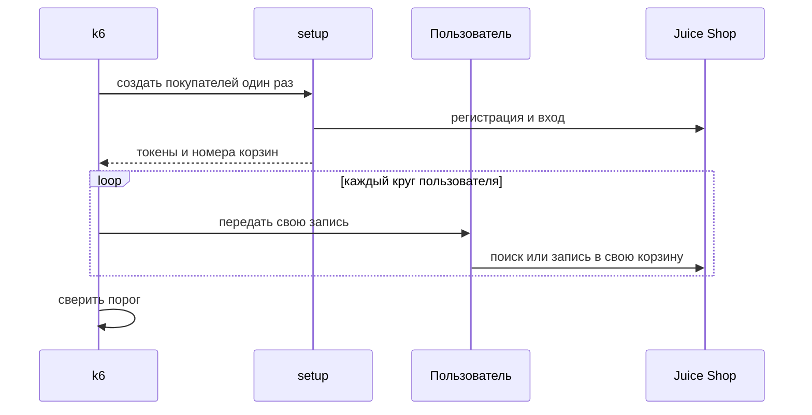
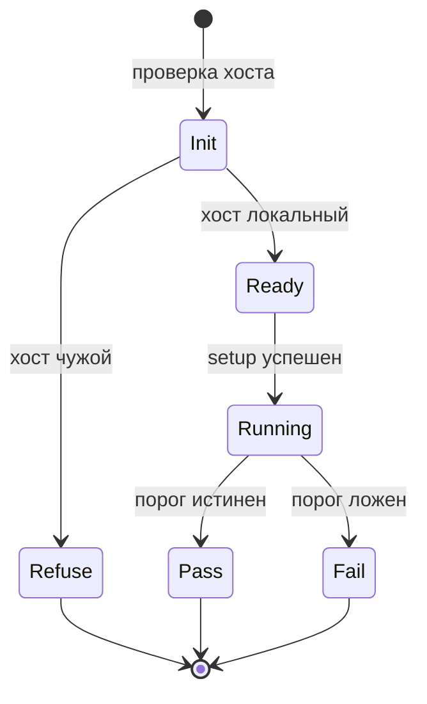

# Сценарии и пороги в k6

## Содержание

- [Теория](#теория)
  - [Ситуация](#ситуация)
  - [Модель](#модель)
  - [Понятия и связь с автоматизацией тестирования](#понятия-и-связь-с-автоматизацией-тестирования)
  - [Зоны ответственности](#зоны-ответственности)
  - [Пример](#пример)
  - [Типичные сбои](#типичные-сбои)
  - [Полезные ссылки](#полезные-ссылки)
  - [Вопросы по теории](#вопросы-по-теории)
- [Практическое задание](#практическое-задание)
  - [1.1 Общее](#11-общее)
  - [1.2 Сценарии](#12-сценарии-user-stories)
  - [1.3 Контракт](#13-контракт)
  - [1.4 Ошибки и ограничения](#14-ошибки-и-ограничения)
  - [1.5 Аудит](#15-аудитлоги)
  - [1.6 Нефункциональные требования](#16-нефункциональные-требования)

# Теория

## Ситуация

Сценарий k6 гоняет поиск или корзину локального Juice Shop и сам решает, уложился ли прогон в порог. Дальше возможен один из исходов: порог выполнен и код выхода 0, порог нарушен и код 99, `setup` не создал покупателей и сценарий корзины не стартовал, адрес не локальный и запросов не было, либо стенд недоступен.

Отдельная разработка не нужна: достаточно запущенного контейнера Juice Shop и команды `k6 run -e BASE_URL=http://localhost:3000 perf/search-load.js`.

## Модель

Участники: `setup`, функция по умолчанию, стенд и порог. `setup` выполняется один раз до пользователей. Функция по умолчанию — тело одного круга одного пользователя. Решение о прохождении принимает оракул теста — порог, а не текущий ответ стенда.



Регистрация стоит до цикла. Если создавать покупателя на каждый круг, время прогона смешается со временем записи учётки, и p95 корзины будет про другое.



Чужой хост не доходит до `setup`. Сломанный `setup` не доходит до порога: порог по пустому прогону ничего не доказывает.

Возможный набор полей (запись покупателя для корзины):

| `покупатель нагрузки` | Описание |
| --- | --- |
| `email` | `aqa.<RUN_ID>.0.<номер>@example.test` |
| `token` | JWT из `POST /rest/user/login`, в лог не пишется |
| `bid` | Номер корзины из `authentication.bid` |
| `productId` | Товар этого круга, числа 2–46 |

Проверка использует регистрацию, вход, поиск и позицию корзины локального Juice Shop.

## Понятия и связь с автоматизацией тестирования

### Файл сценария

k6 читает JavaScript. В начале файла — импорты и проверка хоста. Дальше `export const options` с профилем и порогами. `export default function` — один круг. Для корзины добавляется `export function setup`.

`__ENV.BASE_URL` приходит из `-e` или из окружения. `__VU` — номер пользователя с 1. `__ITER` — номер круга этого пользователя с 0. Эти значения разделяют данные, чтобы десять циклов не писали в одну корзину.

Клиенты из `1.4` здесь не вызываются. k6 — отдельный процесс и не видит фикстуры Playwright. Тела запросов совпадают с контрактами `1.1` и `1.5`, чтобы нагрузка мерила те же операции, что и функциональные тесты.

Вывод для контракта: три файла — `perf/smoke.js`, `perf/search-load.js`, `perf/basket-load.js`.

### Порог как выражение

Порог — строка `<агрегат><сравнение><число>` в массиве у имени метрики. `p(95)<500` значит: 95-й перцентиль времени короче 500 миллисекунд. `rate<0.01` значит: доля меньше 1%. `rate==0` значит: доля равна нулю. `rate>0.99` у метрики `checks` значит: больше 99% проверок истинны.

Проверка `check` сама прогон не роняет. Она копит долю. Роняет прогон порог на этой доле. Поэтому у каждого сценария есть и `check`, и порог `checks`.

Один красный запрос в пятиминутном поиске долю в 1% может не выбрать. Ноль ошибок у дыма строже: там `rate==0`, и один обрыв красит прогон.

Вывод для контракта: числа — из `4.0` и словаря, выражения лежат в `options.thresholds`.

### Дым и поиск

Дым (`TC-PERF-01`) — 1 пользователь, 30 секунд, `GET /rest/admin/application-version`, ноль неудач. Между кругами `sleep(1)`: пауза изображает человека, который не долбит готовность без остановки. Это не `waitForTimeout` браузера.

Поиск (`TC-PERF-02`) ходит в `GET /rest/products/search?q=apple`. Профиль ступенями: минута подъёма до 20 пользователей, три минуты на 20, минута спуска к нулю. Вместе пять минут. Проверка ждёт **200** и кусок `"status":"success"`. p95 короче 500 мс.

Слово `apple` уже известно по `1.2`: функционально оно находит три товара. Нагрузка количество товаров не утверждает. Ей важно, что ответ успешный и быстрый. Иначе смена каталога покрасит замер скорости.

Вывод для контракта: поиск не создаёт данных и безопасен для повтора на том же контейнере.

### Корзина и setup

Корзина (`TC-PERF-03`) — 10 пользователей. `setup` регистрирует десять покупателей и входит каждым. Тело регистрации то же, что в `1.1`: почта, пароль, повтор пароля, вопрос `id: 1` и ответ. Ответ входа даёт `token` и `bid`.

Каждый пользователь на круге кладёт один товар в свою корзину: `POST /api/BasketItems`, заголовок `Authorization: Bearer <token>`, `BasketId` строкой. Товар берётся как `(__ITER % 45) + 2`, то есть номера 2–46.

Товар 1 ограничен пятью штуками на покупателя, шестая попытка отвечает **400**. Повтор того же товара в ту же корзину сейчас отвечает **500** со стеком (`BUG-02`). Оба кода k6 считает неудачей запроса. Длинный прогон упёрся бы в эти ограничения и измерил бы их, а не скорость записи. Поэтому круг длится около трёх секунд (`sleep(3)`), прогон две минуты, и 45 разных товаров на пользователя не кончаются: за две минуты кругов меньше 45.

Пароль покупателя собирается в `setup` и на стенд уходит. В консоль его не печатают. Токен из возвращаемого значения тоже не печатают: k6 передаёт его в функцию молча.

Вывод для контракта: у каждого VU своя учётка и свой `bid`, товар 1 и повторные `ProductId` в прогон не входят.

### Что будет в `4.2`

`4.2` читает итог этих прогонов, объясняет, почему корзине дан более мягкий p95, и добавляет бюджет страницы поиска в Lighthouse. Пороги этого файла оно не переписывает.

### Сводка

| Понятие | Смысл в сценарии k6 | На что опирается реализация |
| --- | --- | --- |
| `options` | Длина, пользователи, порог | Три файла в `perf/` |
| `check` | Условие на один ответ | Порог на метрике `checks` |
| `stages` | Подъём и удержание поиска | 1 мин + 3 мин + 1 мин |
| `setup` | Покупатели до цикла | `POST /api/Users` и логин |
| `__VU` / `__ITER` | Чья корзина и какой товар | Числа 2–46 |
| Хост | Куда разрешено стрелять | `localhost`, `127.0.0.1` |

## Зоны ответственности

| Сценарий | Стенд |
| --- | --- |
| Проверяет хост до запросов | Слушает только локальный порт 3000 |
| В `setup` создаёт десять покупателей один раз | Хранит их до перезапуска контейнера |
| Кладёт в корзину товары 2–46 по одному разу | Отвечает **200** на такую запись |
| Считает p95 и долю ошибок | Не подменяет порог своим «обычно так и есть» |

Функциональный клиент и сценарий k6 не заменяют друг друга. Клиент удобен для одного ответа. k6 нужен, когда ответов тысячи и важен хвост.

## Пример

Программа выполняет `TC-PERF-02`: поиск `apple` со ступенями до 20 пользователей и порогом p95 500 мс. Файл один на три стека — `perf/search-load.js`.

### TypeScript

**Node.js 22 или новее, k6 2.4 или новее.** k6 исполняет сценарий. Проект на Node.js хранит его в `perf/` и передаёт `BASE_URL`.

```sh
k6 run -e BASE_URL=http://localhost:3000 perf/search-load.js
```

```javascript
import http from 'k6/http';
import { check, sleep } from 'k6';

const base = __ENV.BASE_URL || 'http://localhost:3000';
const host = base.replace(/^https?:\/\//, '').split('/')[0].split(':')[0];
if (host !== 'localhost' && host !== '127.0.0.1') {
  throw new Error('Сценарий запускается только против локального стенда');
}

export const options = {
  stages: [
    { duration: '1m', target: 20 },
    { duration: '3m', target: 20 },
    { duration: '1m', target: 0 },
  ],
  thresholds: {
    http_req_failed: ['rate<0.01'],
    http_req_duration: ['p(95)<500'],
    checks: ['rate>0.99'],
  },
};

export default function () {
  const res = http.get(`${base}/rest/products/search?q=apple`);
  check(res, {
    'status 200': (r) => r.status === 200,
    'обёртка success': (r) => String(r.body).includes('"status":"success"'),
  });
  sleep(1);
}
```

### Python

**Python 3.10 или новее, k6 2.4 или новее.** Тот же `perf/search-load.js`. Окружение Python передаёт `BASE_URL` в процесс k6.

```sh
k6 run -e BASE_URL=http://localhost:3000 perf/search-load.js
```

```javascript
import http from 'k6/http';
import { check, sleep } from 'k6';

const base = __ENV.BASE_URL || 'http://localhost:3000';
const host = base.replace(/^https?:\/\//, '').split('/')[0].split(':')[0];
if (host !== 'localhost' && host !== '127.0.0.1') {
  throw new Error('Сценарий запускается только против локального стенда');
}

export const options = {
  stages: [
    { duration: '1m', target: 20 },
    { duration: '3m', target: 20 },
    { duration: '1m', target: 0 },
  ],
  thresholds: {
    http_req_failed: ['rate<0.01'],
    http_req_duration: ['p(95)<500'],
    checks: ['rate>0.99'],
  },
};

export default function () {
  const res = http.get(`${base}/rest/products/search?q=apple`);
  check(res, {
    'status 200': (r) => r.status === 200,
    'обёртка success': (r) => String(r.body).includes('"status":"success"'),
  });
  sleep(1);
}
```

### C#

**.NET 8 или новее, k6 2.4 или новее.** Тот же `perf/search-load.js`. Прогон .NET передаёт `BASE_URL` так же.

```sh
k6 run -e BASE_URL=http://localhost:3000 perf/search-load.js
```

```javascript
import http from 'k6/http';
import { check, sleep } from 'k6';

const base = __ENV.BASE_URL || 'http://localhost:3000';
const host = base.replace(/^https?:\/\//, '').split('/')[0].split(':')[0];
if (host !== 'localhost' && host !== '127.0.0.1') {
  throw new Error('Сценарий запускается только против локального стенда');
}

export const options = {
  stages: [
    { duration: '1m', target: 20 },
    { duration: '3m', target: 20 },
    { duration: '1m', target: 0 },
  ],
  thresholds: {
    http_req_failed: ['rate<0.01'],
    http_req_duration: ['p(95)<500'],
    checks: ['rate>0.99'],
  },
};

export default function () {
  const res = http.get(`${base}/rest/products/search?q=apple`);
  check(res, {
    'status 200': (r) => r.status === 200,
    'обёртка success': (r) => String(r.body).includes('"status":"success"'),
  });
  sleep(1);
}
```

---

Каждый запуск завершается кодом 0, когда p95 короче 500 мс, доля неудачных запросов меньше 1% и доля checks выше 99%. Итог k6 показывает `http_req_duration` с `p(95)` и `http_req_failed`. Код 99 означает, что одно из трёх выражений ложно. Число запросов за пять минут на трёх стеках совпадает, потому что файл сценария один.

## Типичные сбои

| Что видно | Куда смотреть |
| --- | --- |
| Код 99, p95 чуть выше 500 | Порог словаря, не «почти прошло». Машину записывают рядом |
| Доля ошибок растёт на корзине к концу | Кончились товары 2–46, пошёл повтор и **500** из `BUG-02` |
| Много **400** `only up to 5 items` | В круг попал товар 1 |
| `setup` падает на регистрации | Тело без вопроса `id: 1` или стенд ещё не ответил **200** на готовность |
| Повторный корзинный прогон медленнее первого | Контейнер не перезапускали, старые строки остались в SQLite |
| В логе виден JWT | `console.log` на значении из `setup`. Печатать его нельзя |
| Поиск красит checks | Тело без `"status":"success"`: URL или прокси не тот |
| Пять минут ушли в CI | Job `perf-smoke` запускает только `smoke.js` |

## Полезные ссылки

### Общие

- [Grafana k6 — Thresholds](https://grafana.com/docs/k6/latest/using-k6/thresholds/) — синтаксис `p(95)`, `rate`, код порога.
- [Grafana k6 — Test lifecycle](https://grafana.com/docs/k6/latest/using-k6/test-lifecycle/) — когда выполняется `setup`.
- [Grafana k6 — Options reference](https://grafana.com/docs/k6/latest/using-k6/k6-options/reference/) — `stages`, `vus`, `duration`.
- [Grafana k6 — HTTP](https://grafana.com/docs/k6/latest/javascript-api/k6-http/) — `get`, `post`, заголовки.

### По языку

#### TypeScript

**TypeScript, Playwright Test.** На JavaScript контракт сценария k6 остаётся тем же.

- [Grafana k6 — k6/http](https://grafana.com/docs/k6/latest/javascript-api/k6-http/) — вызовы, которыми поиск ходит на стенд.

#### Python

**Python, pytest-playwright.** На синхронном Playwright API без pytest или на async API контракт сценария k6 остаётся тем же.

- [Grafana k6 — Test lifecycle](https://grafana.com/docs/k6/latest/using-k6/test-lifecycle/) — данные `setup` попадают в функцию круга.

#### C#

**C#, Playwright для .NET с NUnit.** На MSTest или xUnit контракт сценария k6 остаётся тем же.

- [Grafana k6 — Options](https://grafana.com/docs/k6/latest/using-k6/k6-options/how-to/) — откуда k6 берёт `BASE_URL`, если задать и флаг, и поле `options`.

## Вопросы по теории

1. Почему покупателей создают в `setup`, а не на каждом круге?
2. Зачем корзине товары с номерами 2–46, если в каталоге есть товар 1?
3. Что произойдёт с долей ошибок, если убрать `sleep(3)` и крутить корзину пять минут?
4. Чем упавший `check` отличается от нарушенного порога?
5. Почему поиск не проверяет, что товаров ровно три?
6. Куда девается токен из `setup` и почему его нет в консоли?
7. Почему пятиминутный поиск не стоит в job `perf-smoke`?

# Практическое задание

Автотесты нагрузки для Juice Shop.
Три сценария k6 проверяют дым, поиск и запись в корзину против локального стенда.

## 1) Сценарии k6

### 1.1 Общее

**Назначение:** измерить готовность, поиск и запись в корзину числами из словаря.

**Пользователи/роли:**

- AQA-инженер — запускает три файла локально и в CI оставляет дым;
- разработчик — получает код 0 или 99 и p95;
- CI — job `perf-smoke` только с `perf/smoke.js`;
- покупатель нагрузки — учётка, которую создаёт `setup` корзины.

**Зависимости/связанные настройки:**

- `4.0` — виды прогонов, запрет чужого хоста, смысл порога;
- `1.1` — тело регистрации и ответ входа;
- `1.5` — `POST /api/BasketItems` и лимит товара 1;
- `BASE_URL` — по умолчанию `http://localhost:3000`;
- `RUN_ID` — часть почты, локально можно не задавать.

Бюджет страницы в браузере — `4.2`. Этот файл браузер не открывает.

### 1.2 Сценарии (user stories)

1. **Дым:** `TC-PERF-01` одну минуту не занимает: 1 пользователь, 30 секунд, ноль неудач на готовности стенда.
2. **Поиск:** `TC-PERF-02` за пять минут поднимает 20 пользователей на `q=apple` и требует p95 < 500 мс.
3. **Корзина:** `TC-PERF-03` десятью пользователями две минуты кладёт разные товары 2–46 и требует p95 < 800 мс.
4. **Отказ адреса:** любой из файлов на нелокальном хосте завершается до HTTP.

### 1.3 Контракт

#### 1.3.1 Дым и поиск

| ID | Проверки/валидация |
| --- | --- |
| `TC-PERF-01` | `perf/smoke.js`, 1 VU, `30s`, `GET /rest/admin/application-version`, `rate==0`, в теле есть `"version"` |
| `TC-PERF-02` | `perf/search-load.js`, ступени 1м/3м/1м до 20 VU, `q=apple`, `p(95)<500`, `rate<0.01`, `checks` `rate>0.99` |

**Логика/шаги:**

1. Проверить хост `BASE_URL`.
2. Запустить профиль из таблицы.
3. На каждый ответ выполнить `check` статуса **200** и признака тела.
4. Между кругами вызвать `sleep(1)`.
5. Принять код 0 только при истинном пороге.

Повтор поиска данных не копит. Повтор дыма тоже. Контейнер между ними можно не перезапускать.

**Ответы:**

- **Проход:** код 0, выражения порога истинны.
- **Ошибки:** см. раздел 1.4.
- Точной строки версии в ответе нет: достаточно поля `version`.

#### 1.3.2 Корзина

**Общее правило:** 10 VU, длительность `2m`, `sleep(3)`, порог `p(95)<800`, `http_req_failed` `rate<0.01`, `checks` `rate>0.99`.

| Шаг | Входные данные и правила |
| --- | --- |
| `setup` | 10 регистраций и 10 входов. Почта `aqa.<RUN_ID или метка времени>.0.<i>@example.test` |
| Круг | `ProductId = (__ITER % 45) + 2`, `quantity` 1, `BasketId` строкой, свой токен |
| Запрет | Нет товара 1 и нет повторного `ProductId` у того же `bid` |

**Логика/шаги:**

1. В `setup` отправить `POST /api/Users`, затем `POST /rest/user/login`.
2. Вернуть массив из десяти `{ token, bid }` без печати.
3. В круге взять запись `__VU - 1`.
4. Отправить `POST /api/BasketItems`.
5. Проверить статус **200**.

Если регистрация в `setup` оборвалась на середине, контейнер перезапускают и запускают сценарий заново. Дописывать недостающих пользователей во второй `setup` поверх первого прогона нельзя: замес двух наборов учёток портит время записи.

**Ответы:**

- **Проход:** код 0, у кругов статус **200**.
- **Ошибки:** см. раздел 1.4.
- В итог не входят пароль и токен.

### 1.4 Ошибки и ограничения

- Хост не локальный — исключение до запросов.
- Стенд недоступен — статусы 0, дым нарушает `rate==0`, поиск и корзина нарушают `rate<0.01`.
- Порог ложен — код 99.
- Регистрация в `setup` не дала **201** — сценарий корзины не начинается.
- Вход не дал `authentication.token` — сценарий корзины не начинается.
- **400** лимита товара 1 — в доле ошибок. Контракт такой запрос не шлёт.
- **500** повтора позиции (`BUG-02`) — в доле ошибок. Контракт такой запрос не шлёт.
- Нет `RUN_ID` — в почте метка времени, прогон не останавливается: это не секрет.

Порядок: хост, готовность, `setup` для корзины, круги, порог.

### 1.5 Аудит/логи

Логировать: имя файла, хост, p95, `http_req_failed`, долю checks, код выхода.

В журнал не попадают пароль, токен, cookie `token`, полный JWT и тело входа целиком. `handleSummary` в `4.2` тоже не пишет эти поля.

### 1.6 Нефункциональные требования

- `TC-PERF-01` входит в job `perf-smoke` и укладывается в 40 секунд.
- `TC-PERF-02` длится пять минут и в job каждой сборки не входит.
- `TC-PERF-03` длится две минуты плюс `setup` и в job каждой сборки не входит.
- `sleep` в этих файлах — пауза между кругами виртуального пользователя.
- Пять дымовых прогонов подряд на свободном стенде дают код 0.
- Общие нефункциональные требования проекта из словаря курса к функциональному прогону этим job не отменяются: нагрузка идёт отдельным job и в лимит 10 минут API + UI не входит.
