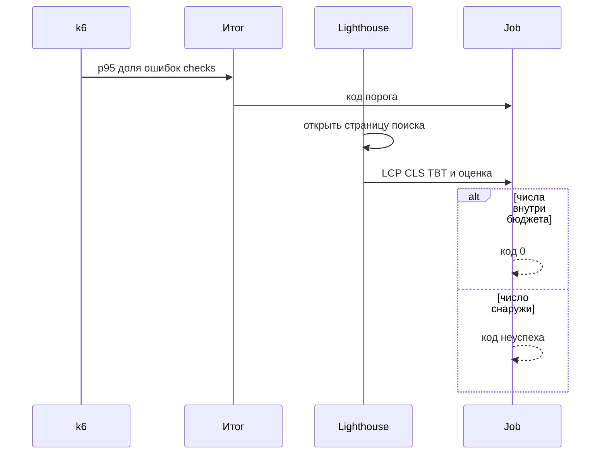
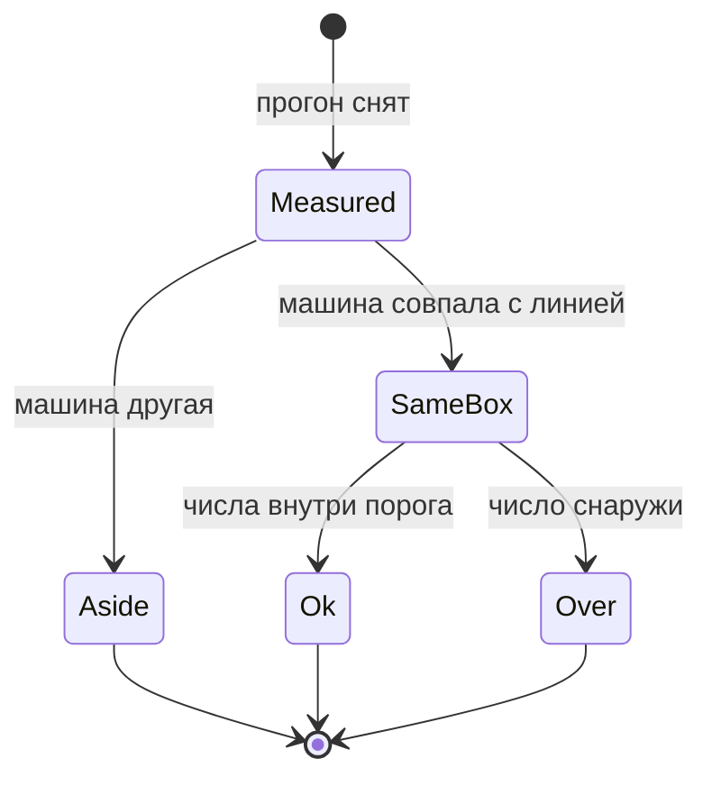

# Анализ результатов и производительность фронтенда

## Содержание

- [Теория](#теория)
  - [Ситуация](#ситуация)
  - [Модель](#модель)
  - [Понятия и связь с автоматизацией тестирования](#понятия-и-связь-с-автоматизацией-тестирования)
  - [Зоны ответственности](#зоны-ответственности)
  - [Пример](#пример)
  - [Типичные сбои](#типичные-сбои)
  - [Полезные ссылки](#полезные-ссылки)
  - [Вопросы по теории](#вопросы-по-теории)
- [Практическое задание](#практическое-задание)
  - [1.1 Общее](#11-общее)
  - [1.2 Сценарии](#12-сценарии-user-stories)
  - [1.3 Контракт](#13-контракт)
  - [1.4 Ошибки и ограничения](#14-ошибки-и-ограничения)
  - [1.5 Аудит](#15-аудитлоги)
  - [1.6 Нефункциональные требования](#16-нефункциональные-требования)

# Теория

## Ситуация

Программа читает итог k6 и отдельно снимает бюджет страницы поиска. Дальше возможен один из исходов: p95 и доля ошибок внутри порога, а лабораторные показатели внутри бюджета; порог или бюджет нарушен и job красный; два итога сняты на разных машинах и сравнением не считаются; стенд недоступен.

Отдельная разработка не нужна: достаточно итога `k6 run -e BASE_URL=http://localhost:3000 perf/search-load.js` и команды `npx @lhci/cli autorun --config=perf/lighthouserc.json`.

## Модель

Участники: итог k6, базовая линия, Lighthouse и job. Итог — числа. Базовая линия — такой же итог, снятый раньше на той же машине. Решение о прохождении принимает оракул теста — порог словаря и бюджет страницы, а не ощущение от одного графика.



k6 и Lighthouse смотрят разное. Первый меряет ответы API под несколькими пользователями. Второй меряет, как быстро собралась страница в одном браузере. Оба попадают в решение job, и успех одного не зачёркивает провал другого.



Чужая машина уходит в сторону: её p95 не доказывает регрессию. На своей машине число вне порога — неуспех, даже если «в прошлый раз было почти так же».

Возможный набор полей (краткий итог, который пишет сценарий):

| `summary` | Описание |
| --- | --- |
| `p95` | 95-й перцентиль `http_req_duration`, миллисекунды |
| `failed` | Доля `http_req_failed` |
| `checks` | Доля успешных checks |
| `host` | Заметка человека: какая машина снимала линию |

Проверка использует итог сценариев `4.1` и страницу поиска Juice Shop. В `summary.json` нет тел запросов.

## Понятия и связь с автоматизацией тестирования

### Что читать в итоге k6

В конце прогона k6 печатает таблицу. Для решения нужны три строки: `http_req_duration` и в ней `p(95)`, `http_req_failed` как доля, `checks` как доля. Рядом видно число кругов и виртуальных пользователей. Мало кругов — перцентиль шумный. Дым с паузой в секунду даёт около тридцати точек, этого хватает на «ошибки есть или нет» и мало для тонкого p95. Поэтому p95 в договоре стоит у пятиминутного поиска и у двухминутной корзины, а не у дыма.

Сценарий пишет `summary.json` функцией `handleSummary`. В файле только три числа: `p95`, `failed`, `checks`. Полный внутренний объект k6 в репозиторий не кладут: он большой и для порога ничего не добавляет.

Код 0 — выражения истинны. Код 99 — хотя бы одно ложно. Разбор начинают с того выражения, которое ложно, а не с переписывания порога.

Вывод для контракта: `summary.json` содержит три числа и больше ничего.

### Узкое место стенда

Juice Shop обслуживает HTTP в одном процессе Node.js. JavaScript сервера выполняется на одном основном потоке: параллельные запросы делят этот поток, а не получают по ядру каждый.

Запись лежит в SQLite внутри контейнера. Записи выстраиваются друг за другом. Поиск в основном читает, поэтому двадцати пользователям в словаре отведено 500 мс на p95. Корзина вставляет строку, хвост шире, и словарю хватает 800 мс.

Если оба p95 выросли вместе, смотрят загрузку одного процесса. Если вырос только p95 корзины, смотрят запись. Падение RPS при росте p95 в закрытой модели ожидаемо: пользователи ждут и реже начинают следующий круг. Это не «поток сохранился».

Вывод для контракта: разные миллисекунды у поиска и корзины — разные операции, а не опечатка словаря.

### Базовая линия

Линия — `summary.json` прогона, рядом с которым записана машина: модель CPU и то, что контейнер был один. Следующий прогон сравнивают с линией только на той же машине, тем же скриптом, после перезапуска контейнера.

Ноутбук коллеги — другая линия. Число с одного компьютера не переносят на другой как регрессию продукта. Регрессия — рост p95 на одной машине сверх порога либо сверх своей линии, если порог ещё держится и рост всё равно большой. В job порог важнее линии: линия объясняет, порог красит.

Вывод для контракта: в CI сравнивают с порогом. Линию хранят как заметку локального разбора.

### Скорость страницы

Человек ждёт не JSON, а картинку и возможность нажать. Для этого есть три показателя.

LCP, Largest Contentful Paint — момент, когда на экране появился самый крупный кусок. На странице поиска это часто карточка товара или крупный заголовок. Пока его нет, страница кажется пустой. Граница «хорошо» — 2,5 секунды.

CLS, Cumulative Layout Shift — насколько вёрстка прыгает во время загрузки. Прыжок под курсором нажимает не ту кнопку. Граница «хорошо» — 0,1.

INP, Interaction to Next Paint — пауза от нажатия до следующей отрисовки. Его честно меряют на живых сессиях: нужна настоящая рука или клавиатура в поле. Лаборатория этого не видит. Вместо INP Lighthouse считает TBT, Total Blocking Time: сколько миллисекунд основной поток был занят длинными задачами во время загрузки. Занятый поток — причина, по которой нажатие ждало бы. Бюджет курса для лаборатории — TBT не больше 300 мс.

Оценка Performance в отчёте Lighthouse — сводное число от 0 до 100. Бюджет — не ниже 80. В файле CI то же число задают долей `0.8`.

Вывод для контракта: `TC-PERF-04` утверждает LCP, CLS, TBT и оценку. INP в лабораторный прогон не подставляют.

### Регрессионный гейт

Job `perf-smoke` делает две проверки. Первая — `k6 run` файла `perf/smoke.js`. Ненулевой код красит job. Вторая — `npx @lhci/cli autorun` с конфигом `perf/lighthouserc.json` против `http://localhost:3000/#/search`. Утверждение уровня `error` красит job.

В CI у Lighthouse один проход: job должен оставаться коротким. Локально перед выводом «страница стала тяжелее» снимают три прохода и смотрят медиану. Один холодный проход шумит. Шум не повод менять бюджет в том же изменении, которое этот проход увидело. Красный бюджет сохраняют как результат.

Пятиминутный поиск и двухминутная корзина в этот job не входят. Их пороги проверяют локально по `4.1`.

Вывод для контракта: гейт сборки — дым k6 и один проход Lighthouse. Длинные профили остаются локальными.

### Сводка

| Понятие | Смысл в разборе | На что опирается реализация |
| --- | --- | --- |
| `summary.json` | Три числа прогона | `handleSummary` |
| Линия | Прошлый итог той же машины | Заметка рядом с файлом |
| LCP | Когда появился крупный кусок | Бюджет 2,5 с |
| CLS | Насколько прыгнула вёрстка | Бюджет 0,1 |
| TBT | Занятость потока в лаборатории | Бюджет 300 мс, вместо полевого INP |
| Гейт | Что красит job | Дым и `lhci autorun` |

## Зоны ответственности

| AQA-инженер | Разработчик |
| --- | --- |
| Снимает итог и записывает машину | Ищет, почему вырос хвост API или TBT страницы |
| Не сравнивает p95 разных компьютеров | Не просит ослабить бюджет из-за одного холодного прохода |
| Держит в job дым и один проход Lighthouse | Разбирает основной поток и запись SQLite по тому, какой p95 вырос |
| Оставляет длинные профили локальными | Получает код 99 или ошибку утверждения Lighthouse как неуспех |

Итог k6 не показывает строку кода, которая держала поток. Он показывает, какая операция вышла из бюджета. Дальше уже профайлер процесса, не новый порог.

## Пример

Программа читает `summary.json` после поиска и печатает p95, долю ошибок, долю checks и пометку, уложился ли поиск в бюджет словаря. Файл итога уже лежит рядом: его записал `handleSummary` сценария `4.1`.

### TypeScript

**Node.js 22 или новее, k6 2.4 или новее.** Читатель на Node.js открывает три числа. Ключевое сравнение — p95 < 500 и доля ошибок < 0,01.

```sh
k6 run -e BASE_URL=http://localhost:3000 perf/search-load.js
node read-summary.mjs
```

```javascript
import { readFileSync } from 'node:fs';

const data = JSON.parse(readFileSync('summary.json', 'utf8'));
if (typeof data.p95 !== 'number' || typeof data.failed !== 'number') {
  throw new Error('summary.json без p95 или failed');
}
const searchOk = data.p95 < 500 && data.failed < 0.01 && data.checks > 0.99;

console.log(`p95_ms: ${Math.round(data.p95)}`);
console.log(`failed: ${data.failed}`);
console.log(`checks: ${data.checks}`);
console.log(`search_budget: ${searchOk ? 'ok' : 'over'}`);
```

### Python

**Python 3.10 или новее, k6 2.4 или новее.** Тот же `summary.json`. Скрипт Python печатает те же четыре строки.

```sh
k6 run -e BASE_URL=http://localhost:3000 perf/search-load.js
python read_summary.py
```

```python
import json
from pathlib import Path

data = json.loads(Path("summary.json").read_text(encoding="utf-8"))
if "p95" not in data or "failed" not in data:
    raise SystemExit("summary.json без p95 или failed")
search_ok = data["p95"] < 500 and data["failed"] < 0.01 and data["checks"] > 0.99

print(f"p95_ms: {round(data['p95'])}")
print(f"failed: {data['failed']}")
print(f"checks: {data['checks']}")
print(f"search_budget: {'ok' if search_ok else 'over'}")
```

### C#

**.NET 8 или новее, k6 2.4 или новее.** Тот же `summary.json`. Программа на C# печатает те же четыре строки.

```sh
k6 run -e BASE_URL=http://localhost:3000 perf/search-load.js
dotnet run --project ReadSummary
```

```csharp
using System.Text.Json;

var data = JsonSerializer.Deserialize<Dictionary<string, double>>(
    File.ReadAllText("summary.json"))!;
if (!data.ContainsKey("p95") || !data.ContainsKey("failed"))
{
    throw new InvalidOperationException("summary.json без p95 или failed");
}
var searchOk = data["p95"] < 500 && data["failed"] < 0.01 && data["checks"] > 0.99;

Console.WriteLine($"p95_ms: {Math.Round(data["p95"])}");
Console.WriteLine($"failed: {data["failed"]}");
Console.WriteLine($"checks: {data["checks"]}");
Console.WriteLine($"search_budget: {(searchOk ? "ok" : "over")}");
```

---

Каждая программа печатает четыре строки: `p95_ms:`, `failed:`, `checks:`, `search_budget:`. Числа совпадают, потому что файл итога один. `search_budget: ok` значит, что поиск уложился в p95 500 мс, долю ошибок 1% и долю checks 99%. `over` значит, что хотя бы одно число снаружи. Код процесса-читателя в этом примере остаётся 0: красит job сам k6 кодом 99 и Lighthouse кодом утверждения.

## Типичные сбои

| Что видно | Куда смотреть |
| --- | --- |
| `search_budget: over` при коде k6 0 | Читатель и порог смотрят разные файлы итога |
| p95 вырос, RPS упал | Закрытая модель ждёт. Смотреть хвост, не только число запросов |
| Сравнивают 200 мс и 700 мс с двух ноутбуков | У прогонов разные машины, это две линии |
| Красный LCP на холодном старте | Локально снять три прохода. Бюджет в том же изменении не двигать |
| TBT в бюджете, клики на живой странице долгие | INP лаборатория не мерит. TBT — занятость при загрузке |
| Lighthouse открыл не каталог | В URL нет фрагмента страницы поиска |
| `summary.json` огромный | `handleSummary` записал весь объект k6, а не три поля |
| Оба p95 выросли после чужого функционального прогона | Контейнер не перезапускали, SQLite уже заполнена |

## Полезные ссылки

### Общие

- [Grafana k6 — Custom summary](https://grafana.com/docs/k6/latest/results-output/end-of-test/custom-summary/) — `handleSummary` и файл в конце прогона.
- [web.dev — Largest Contentful Paint](https://web.dev/articles/lcp) — что считается крупным куском и где граница 2,5 с.
- [web.dev — Cumulative Layout Shift](https://web.dev/articles/cls) — как считают прыжок вёрстки.
- [web.dev — Interaction to Next Paint](https://web.dev/articles/inp) — полевой показатель, которого нет в лабораторном проходе.
- [web.dev — Web Vitals](https://web.dev/articles/vitals) — как LCP, CLS и INP стоят рядом.
- [Lighthouse CI — Configuration](https://github.com/GoogleChrome/lighthouse-ci/blob/main/docs/configuration.md) — `assert` и `maxNumericValue`.
- [Chrome for Developers — Lighthouse performance scoring](https://developer.chrome.com/docs/lighthouse/performance/performance-scoring/) — откуда оценка 0–100.

### По языку

#### TypeScript

**TypeScript, Playwright Test.** На JavaScript контракт разбора итога остаётся тем же.

- [Grafana k6 — End of test](https://grafana.com/docs/k6/latest/results-output/end-of-test/) — что процесс печатает сам, до своего читателя.

#### Python

**Python, pytest-playwright.** На синхронном Playwright API без pytest или на async API контракт разбора итога остаётся тем же.

- [web.dev — Total Blocking Time](https://web.dev/articles/tbt) — лабораторная занятость потока, бюджет 300 мс.

#### C#

**C#, Playwright для .NET с NUnit.** На MSTest или xUnit контракт разбора итога остаётся тем же.

- [Lighthouse CI — Configuration](https://github.com/GoogleChrome/lighthouse-ci/blob/main/docs/configuration.md) — утверждения, которые красят шаг .NET-пайплайна так же, как остальные.

## Вопросы по теории

1. Почему p95 дыма не стоит в договоре, а p95 поиска стоит?
2. Почему корзине разрешено 800 мс, а поиску 500 мс?
3. Что произойдёт с выводом, если сравнить итоги двух разных ноутбуков?
4. Чем TBT отличается от INP и почему в бюджете стоит TBT?
5. Зачем локально три прохода Lighthouse, а в CI один?
6. Почему рост p95 и падение RPS в закрытой модели появляются вместе?
7. Почему `summary.json` хранит три числа, а не полный объект k6?

# Практическое задание

Разбор нагрузки и бюджет страницы поиска для Juice Shop.
Job принимает дым и один проход Lighthouse. Длинные профили остаются локальными и сравниваются на одной машине.

## 1) Разбор и бюджет страницы

### 1.1 Общее

**Назначение:** превратить таблицу k6 и лабораторную загрузку страницы в код выхода, который нельзя спутать с мнением о графике.

**Пользователи/роли:**

- AQA-инженер — хранит линию с пометкой машины и запускает три локальных прохода Lighthouse перед выводом;
- разработчик — разбирает поток Node.js или запись SQLite по тому, какое число вышло;
- CI — job `perf-smoke`.

**Зависимости/связанные настройки:**

- `4.1` — сценарии и пороги p95;
- `4.0` — закрытая модель и запрет чужого хоста;
- `BASE_URL` — `http://localhost:3000`;
- `perf/lighthouserc.json` — бюджет `TC-PERF-04`;
- страница `/#/search`.

Безопасность и письма в этот разбор не входят.

### 1.2 Сценарии (user stories)

1. **Итог поиска:** после `TC-PERF-02` на диске лежит `summary.json` с тремя числами, читатель печатает бюджет.
2. **Линия:** повтор на той же машине после перезапуска контейнера сравнивают с прошлым файлом и с порогом.
3. **Страница:** `TC-PERF-04` открывает поиск и требует LCP, CLS, TBT и оценку.
4. **Гейт:** job красный, если дым не дал код 0 или утверждение Lighthouse упало.
5. **Чужая машина:** итог откладывают и регрессией не называют.

### 1.3 Контракт

#### 1.3.1 Итог k6

| Поле | Проверки/валидация |
| --- | --- |
| `p95` | Число, миллисекунды, из `http_req_duration` |
| `failed` | Доля `http_req_failed` |
| `checks` | Доля checks |
| поиск | `p95 < 500`, `failed < 0.01`, `checks > 0.99` |
| корзина | `p95 < 800`, те же доли |

**Логика/шаги:**

1. В `handleSummary` записать только три поля.
2. Прочитать файл читателем своего стека.
3. Напечатать четыре строки из примера.
4. Код k6 99 считать неуспехом независимо от текста читателя.

Повтор: перезапустить контейнер, прогнать сценарий, перезаписать `summary.json`. Старый файл переименовывают в линию, если машина та же.

**Ответы:**

- **Проход поиска:** `search_budget: ok` и код k6 0.
- **Ошибки:** см. раздел 1.4.
- В файле нет токена и тел.

#### 1.3.2 Бюджет страницы

**Общее правило:** `TC-PERF-04` смотрит `http://localhost:3000/#/search`. В CI один проход, локально три, решение по медиане не ослабляет порог CI.

| Утверждение | Входные данные и правила |
| --- | --- |
| `largest-contentful-paint` | `maxNumericValue` 2500 |
| `cumulative-layout-shift` | `maxNumericValue` 0.1 |
| `total-blocking-time` | `maxNumericValue` 300 |
| `categories:performance` | `minScore` 0.8 |

**Логика/шаги:**

1. Поднять стенд и дождаться **200** готовности.
2. Запустить `npx @lhci/cli autorun --config=perf/lighthouserc.json`.
3. Принять шаг при коде 0.
4. Локальный шум перепроверить тремя проходами, бюджет в конфиге не менять.

**Ответы:**

- **Проход:** все четыре утверждения истинны.
- **Ошибки:** см. раздел 1.4.
- Полевой INP в этом ответе отсутствует.

### 1.4 Ошибки и ограничения

- Нет `summary.json` — читатель падает с именем файла.
- В файле не три числа — контракт `handleSummary` нарушен.
- Код k6 99 — неуспех профиля, даже если читатель ещё не запущен.
- Lighthouse не открыл стенд — шаг красный, готовность стенда проверяют первой.
- Утверждение бюджета ложно — шаг красный.
- Сравнение разных машин — в отчёт регрессии не идёт.
- Правка чисел в `lighthouserc.json` в том же изменении, которое увидело провал — нарушение контракта.
- Длинный k6 внутри `perf-smoke` — нарушение контракта `4.1`.

Порядок в job: готовность стенда, дым k6, один проход Lighthouse.

### 1.5 Аудит/логи

Логировать: машину, имя сценария, три числа, код k6, четыре числа Lighthouse (LCP, CLS, TBT, оценка), код `lhci`.

В журнал не попадают пароль, токен, cookie `token`, полный JWT и HTML страницы целиком. Отчёт Lighthouse кладут артефактом job без скриншотов, на которых виден введённый текст: страница поиска в этом прогоне пустая по вводу.

### 1.6 Нефункциональные требования

- `TC-PERF-04` входит в job `perf-smoke` одним проходом.
- Дым и один проход Lighthouse вместе укладываются в 8 минут на агенте CI.
- Три локальных прохода Lighthouse не блокируют сборку.
- `waitForTimeout` в этом файле не используется.
- Пять дымовых гейтов подряд на свободном стенде дают код 0 у k6.
- Общие нефункциональные требования проекта из словаря курса относятся к функциональному прогону. Этот job идёт отдельно.
