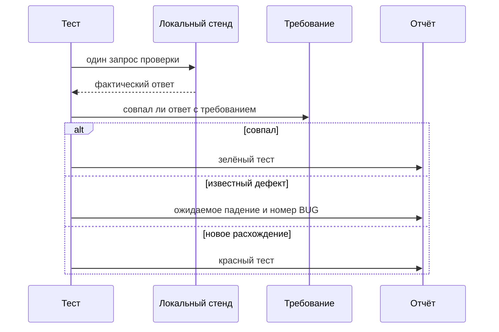
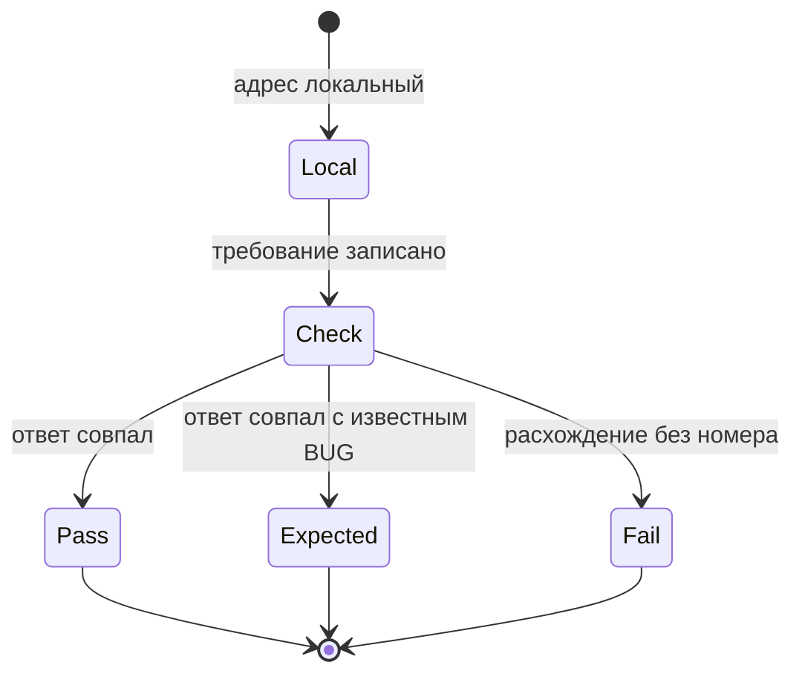

# Общие требования к тестированию безопасности

## Содержание

- [Теория](#теория)
  - [Ситуация](#ситуация)
  - [Модель](#модель)
  - [Понятия и связь с автоматизацией тестирования](#понятия-и-связь-с-автоматизацией-тестирования)
  - [Зоны ответственности](#зоны-ответственности)
  - [Пример](#пример)
  - [Типичные сбои](#типичные-сбои)
  - [Полезные ссылки](#полезные-ссылки)
  - [Вопросы по теории](#вопросы-по-теории)
- [Практическое задание](#практическое-задание)
  - [1.1 Общее](#11-общее)
  - [1.2 Сценарии](#12-сценарии-user-stories)
  - [1.3 Контракт](#13-контракт)
  - [1.4 Ошибки и ограничения](#14-ошибки-и-ограничения)
  - [1.5 Аудит](#15-аудитлоги)
  - [1.6 Нефункциональные требования](#16-нефункциональные-требования)

# Теория

## Ситуация

Автотест проверяет требование безопасности на локальном Juice Shop и не подменяет его сегодняшним ответом стенда. Дальше возможен один из исходов: стенд соблюдает требование и тест зелёный, стенд нарушает известное требование и тест идёт как ожидаемое падение `known-issue` с номером `BUG-xx`, расхождение новое и тест красный без этой метки, либо стенд недоступен.

Отдельная разработка не нужна: достаточно запущенного контейнера Juice Shop и команды `npx playwright test --grep @security` (`pytest -m security`, `dotnet test --filter Category=security`).

## Модель

Участники: тест, локальный стенд, требование и отчёт. Стенд курса специально уязвим. Тест всё равно записывает безопасное поведение. Решение о прохождении принимает оракул теста — требование, а не текущий ответ стенда.



Запрос уходит только на контейнер, поднятый для курса. Отчёт хранит номер дефекта и код ответа. Данные чужих учёток в отчёт не кладут.



Ожидаемое падение живёт, пока дефект воспроизводится. Когда стенд начнёт соблюдать требование, метку снимают. Иначе починенный стенд останется помеченным как больной.

Возможный набор полей (запись дефекта курса):

| `дефект` | Описание |
| --- | --- |
| `id` | `BUG-xx` из словаря |
| `requirement` | Какой код или какое поле должно быть |
| `fact` | Что Juice Shop v20.4.0 отвечает сейчас |
| `tag` | `known-issue` на тесте этого расхождения |

Проверка использует HTTP и страницы локального Juice Shop. Чужой хост в набор не входит.

## Понятия и связь с автоматизацией тестирования

### Требование важнее сегодняшнего ответа

Стенд может ответить **200** там, где по правилу нужен **403**. Если тест запишет «ждём **200**», дыра станет нормой. Тест записывает правило. Пока правило не выполнено, на тесте стоят `known-issue` и номер из словаря. Механизм тот же, что в `1.0`: падение ожидаемо, неожиданный успех тоже красный, и тогда метку снимают.

Вывод для контракта: кейсы `5.1` утверждают безопасное поведение. Номер `BUG-xx` стоит только если словарь уже описал факт.

### OWASP Top 10, редакция 2025

OWASP Top 10 — короткий список частых рисков веб-приложений. Курс опирается на редакцию 2025.

| ID | Риск простыми словами | Где в курсе |
| --- | --- | --- |
| A01 Broken Access Control | Чужой объект открывается по номеру | `BUG-06`, `BUG-07`, матрица `1.3` |
| A02 Security Misconfiguration | Защитные настройки не включены | `BUG-11` |
| A03 Software Supply Chain Failures | Библиотека или сборка уже с известной дырой | зависимости в `5.2` |
| A04 Cryptographic Failures | Секрет можно прочитать там, где его не должно быть | `BUG-09` |
| A05 Injection | Данные становятся командой | `BUG-08`, `BUG-13` |
| A06 Insecure Design | Опасность заложена в схему | `BUG-10` |
| A07 Authentication Failures | Вход нельзя отличить от перебора | `BUG-12` |
| A08 Software or Data Integrity Failures | Код или данные подменяют по пути | отдельного кейса нет |
| A09 Security Logging and Alerting Failures | Опасное действие не видно в журнале | журналы в `9.0` |
| A10 Mishandling of Exceptional Conditions | Сбой показывает внутренности | `BUG-04` |

Список даёт общее имя. Конкретный код ответа живёт в тесте, а не в имени риска.

Вывод для контракта: каждый `BUG-xx` из `5.1` относится к одной строке таблицы.

### CVSS и вектор атаки

CVSS ставит находке число по нескольким вопросам. Один вопрос называется Attack Vector: откуда до находки можно дотянуться. Network — по сети, в том числе обычным HTTP. Adjacent — из соседнего сегмента. Local — уже с самой машины. Physical — только держа устройство в руках.

Дыры этого стенда открываются HTTP-запросом. На боевом адресе вектор был бы Network. Упражнение при этом остаётся на `localhost`. Тот же запрос на чужой адрес курс не выполняет. Балл CVSS тесты не считают: им нужен код, заголовок или поле.

Вывод для контракта: в отчёте номер `BUG-xx`, а не вычисленный балл.

### Четыре способа смотреть

SAST читает исходники и ищет опасный шаблон. Приложение может быть выключено. DAST разговаривает с уже запущенным приложением. SCA сверяет версии библиотек со списком известных дыр. IAST сидит внутри процесса и видит, какая строка обработала вход.

В курсе DAST — ZAP по локальному стенду. SCA — менеджер пакетов своего стека. SAST и IAST здесь названы, чтобы не спутать их с прогоном запросов. Поиск секретов смотрит файлы и историю git: пароль, ключ, токен. Это `5.2`, не ответ магазина.

Вывод для контракта: job `security` гоняет пассивный ZAP и поиск секретов. Полный активный скан остаётся локальной командой.

### Граница

Контейнер поднимает сам участник. Данные учебные, дефекты заранее перечислены. Запросы `5.1` и сканер `5.2` идут только в этот контейнер. Тот же приём против чужого хоста упражнением не является.

Если такая же дыра встретится в чужом продукте, её описывают владельцу и ждут, прежде чем публиковать подробности. Для учебного стенда отдельная публикация не нужна. Запись — номер `BUG-xx` в тесте. Шагов сверх словаря курс не добавляет.

Вывод для контракта: `BASE_URL` этих проверок — локальный Juice Shop.

### Сравнение

| Инструмент | Что проверяет | Подходит для |
| --- | --- | --- |
| OWASP ZAP | Запросы к живому стенду | Пассивный скан в CI, полный скан локально |
| Burp Suite | Ручной разбор одного запроса | Отладка на своём стенде |
| Nuclei | Готовые шаблоны запросов | Точечный шаблон на своём стенде |
| Semgrep | Шаблоны по исходникам | SAST репозитория |
| CodeQL | Запросы к коду | SAST на GitHub |
| npm audit, pip-audit, dotnet list | Известные дыры библиотек | SCA своего стека |
| OSV-Scanner, Trivy | Дыры по своим базам | Второй взгляд на зависимости |
| gitleaks, TruffleHog | Секреты в файлах и истории | Поиск в `5.2` |

Вывод для контракта: поведение стенда проверяет тест с `BUG-xx`. Зависимости и секреты проверяют команды `5.2`.

### Что будет в `5.1` и `5.2`

`5.1` содержит `TC-SEC-01` … `TC-SEC-11`. Каждый утверждает требование и помечен известным дефектом. `5.2` добавляет пассивный ZAP в job `security`, полный скан только локально, проверку зависимостей и поиск секретов.

### Сводка

| Понятие | Смысл в проверке безопасности | На что опирается реализация |
| --- | --- | --- |
| Требование | Каким должен быть ответ | Кейсы `5.1` |
| `known-issue` | Факт уже описан и пока расходится | `BUG-xx` |
| Top 10:2025 | Общее имя риска | Таблица редакции 2025 |
| Attack Vector | Откуда до риска можно дотянуться | Упражнение остаётся на localhost |
| DAST | Разговор с живым стендом | ZAP в `5.2` |
| SCA и секреты | Библиотеки и файлы | Команды `5.2` |

## Зоны ответственности

| AQA-инженер | Разработчик |
| --- | --- |
| Пишет тест на требование и ставит `known-issue`, пока факт жив | Закрывает дефект так, чтобы тест требования стал зелёным |
| Снимает метку, когда расхождение исчезло | Не просит переписать тест на сегодняшний **200** |
| Пускает запросы и ZAP только в локальный контейнер | Не выставляет учебный стенд в сеть |
| Кладёт в отчёт номер `BUG-xx` без добытых данных | Чинит причину по номеру |

Матрица прав из `1.3` говорит, какой код верен. `5.1` держит те клетки, где стенд с матрицей не совпадает.

## Пример

Программа запрашивает готовность стенда и печатает, пришли ли заголовки `Content-Security-Policy` и `Strict-Transport-Security`. Это наблюдение. Требование «заголовки заданы» проверяет `TC-SEC-07`.

### TypeScript

**Node.js 22 или новее, @playwright/test.** `APIRequestContext` читает заголовки. Ключевые имена — `content-security-policy` и `strict-transport-security`.

```sh
npx playwright test --grep @security
```

```typescript
import { test } from '@playwright/test';

test('заголовки защиты на готовности', { tag: ['@security'] }, async ({ request }) => {
  const response = await request.get('http://localhost:3000/rest/admin/application-version');
  const headers = response.headers();
  const csp = Boolean(headers['content-security-policy']);
  const hsts = Boolean(headers['strict-transport-security']);
  console.log(`status: ${response.status()}`);
  console.log(`csp: ${csp ? 'yes' : 'no'}`);
  console.log(`hsts: ${hsts ? 'yes' : 'no'}`);
});
```

### Python

**Python 3.10 или новее, pytest-playwright.** Контекст запросов создаётся из `sync_playwright`, чтобы не столкнуться с фикстурой `request` самого pytest.

```sh
pytest -m security -s
```

```python
import pytest
from playwright.sync_api import sync_playwright

@pytest.mark.security
def test_security_headers() -> None:
    with sync_playwright() as playwright:
        request = playwright.request.new_context(base_url="http://localhost:3000")
        response = request.get("/rest/admin/application-version")
        headers = {key.lower(): value for key, value in response.headers.items()}
        csp = "content-security-policy" in headers
        hsts = "strict-transport-security" in headers
        print(f"status: {response.status}")
        print(f"csp: {'yes' if csp else 'no'}")
        print(f"hsts: {'yes' if hsts else 'no'}")
        request.dispose()
```

### C#

**.NET 8 или новее, Microsoft.Playwright.NUnit.** `APIRequestContext` читает те же заголовки.

```sh
dotnet test --filter Category=security
```

```csharp
using Microsoft.Playwright;
using Microsoft.Playwright.NUnit;

public class SecurityHeaders : PlaywrightTest
{
    [Test]
    [Category("security")]
    public async Task HeadersOnReady()
    {
        await using var request = await Playwright.APIRequest.NewContextAsync(new()
        {
            BaseURL = "http://localhost:3000",
        });
        var response = await request.GetAsync("/rest/admin/application-version");
        var headers = response.Headers;
        var csp = headers.ContainsKey("content-security-policy");
        var hsts = headers.ContainsKey("strict-transport-security");
        Console.WriteLine($"status: {response.Status}");
        Console.WriteLine($"csp: {(csp ? "yes" : "no")}");
        Console.WriteLine($"hsts: {(hsts ? "yes" : "no")}");
    }
}
```

---

На Juice Shop v20.4.0 каждая программа печатает `status: 200`, затем `csp: no` и `hsts: no`. Одинаковые строки значат, что смотрят один и тот же ответ готовности. Пример прогон не роняет: отсутствие заголовков здесь только показано. `TC-SEC-07` утверждает, что заголовки заданы, и помечает факт как `BUG-11`.

## Типичные сбои

| Что видно | Куда смотреть |
| --- | --- |
| `csp: yes` на этом образе | Это уже не v20.4.0 или перед стендом стоит прокси, который дописывает заголовок |
| Тест требования зелёный и всё ещё с `known-issue` | Дефект исчез, метку пора снять, иначе успех станет неожиданным падением |
| Тест ждёт сегодняшний **200** там, где нужен **403** | Оракул перепутан с фактом. Вернуть требование из словаря |
| Запрос ушёл не на порт 3000 | `BASE_URL` смотрит наружу. Для этого набора нужен локальный контейнер |
| В отчёте тело списка пользователей | Утверждение зацепило тело. Для чужих данных достаточно кода |
| ZAP в job завис надолго | В job попал полный активный скан. Там только пассивный, см. `5.2` |
| Секрет из `.env` в коммите | Файл не в `.gitignore`, поиск секретов это и ловит |
| Балл CVSS спорит с кодом теста | Тест не считает балл. Он проверяет код и поле |

## Полезные ссылки

### Общие

- [OWASP — Top 10:2025](https://owasp.org/Top10/2025/) — редакция списка, на которую опирается курс.
- [OWASP Top 10 — Introduction 2025](https://github.com/OWASP/Top10/blob/master/2025/docs/en/0x00_2025-Introduction.md) — формулировки десяти рисков.
- [FIRST — CVSS v4.0 Specification](https://www.first.org/cvss/v4.0/specification-document) — из чего складывается число и что такое Attack Vector.
- [OWASP — Vulnerability Disclosure Cheat Sheet](https://cheatsheetseries.owasp.org/cheatsheets/Vulnerability_Disclosure_Cheat_Sheet.html) — как сообщают о дыре в чужом продукте.
- [OWASP ZAP — Baseline Scan](https://www.zaproxy.org/docs/docker/baseline-scan/) — пассивный прогон, который уместен в CI.

### По языку

#### TypeScript

**TypeScript, Playwright Test.** На JavaScript контракт проверки требования остаётся тем же.

- [Playwright — APIRequestContext](https://playwright.dev/docs/api/class-apirequestcontext) — запрос без браузера и чтение заголовков.

#### Python

**Python, pytest-playwright.** На синхронном Playwright API без pytest или на async API контракт проверки требования остаётся тем же.

- [Playwright Python — APIRequestContext](https://playwright.dev/python/docs/api/class-apirequestcontext) — `request.new_context` и заголовки ответа.

#### C#

**C#, Playwright для .NET с NUnit.** На MSTest или xUnit контракт проверки требования остаётся тем же.

- [Playwright .NET — APIRequest](https://playwright.dev/dotnet/docs/api/class-apirequest) — `NewContextAsync` и словарь заголовков.

## Вопросы по теории

1. Почему тест записывает **403**, если стенд сегодня отвечает **200**?
2. Что произойдёт с меткой `known-issue`, когда дефект исправят?
3. Чем A01 отличается от проверки заголовков A02 в этом курсе?
4. Почему балл CVSS не подставляют в утверждение теста?
5. Чем DAST отличается от SCA?
6. Почему тот же запрос нельзя отправить на чужой хост?
7. Зачем матрица `1.3`, если коды ещё раз записаны в `5.1`?

# Практическое задание

Правила проверки безопасности для Juice Shop.
Правила задают, что тестом считается требование, куда разрешено стрелять и какие дефекты уже известны. Сами кейсы пишет `5.1`.

## 1) Правила проверки безопасности

### 1.1 Общее

**Назначение:** не дать сегодняшнему ответу уязвимого стенда стать ожиданием теста.

**Пользователи/роли:**

- AQA-инженер — держит требование, номер `BUG-xx` и границу localhost;
- разработчик — закрывает дефект и снимает причину красного теста после исправления;
- CI — job `security` из `5.2`;
- `customer` и `admin` — роли стенда в кейсах доступа и входа.

**Зависимости/связанные настройки:**

- `1.0` — механизм `known-issue`;
- `1.3` — матрица «роль × операция → код»;
- словарь `BUG-04`, `BUG-06` … `BUG-13`;
- `BASE_URL` — локальный стенд, по умолчанию `http://localhost:3000`;
- тег `security`.

Полный перечень запросов — в `5.1`. ZAP, зависимости и секреты — в `5.2`.

### 1.2 Сценарии (user stories)

1. **Требование:** тест ждёт безопасный код или отсутствие секретного поля.
2. **Известный факт:** ответ расходится со словарём, тест помечен `known-issue` и номером.
3. **Исправление:** стенд начал соблюдать требование, тест без снятой метки становится красным.
4. **Чужой хост:** набор не стартует, если `BASE_URL` не локальный.
5. **Отчёт:** в нём номер дефекта и код, без тел чужих объектов.

### 1.3 Контракт

#### 1.3.1 Оракул

| Правило | Проверки/валидация |
| --- | --- |
| Ожидание | Безопасное поведение из словаря дефектов |
| Метка | `known-issue` и `BUG-xx`, пока факт воспроизводится |
| Снятие метки | После исправления тест требования должен быть зелёным без метки |
| Хост | Только `localhost` или `127.0.0.1` |

**Логика/шаги:**

1. Проверить хост `BASE_URL`.
2. Выполнить один запрос проверки из `5.1`.
3. Сравнить ответ с требованием.
4. Оставить ожидаемое падение только при номере из словаря.

**Ответы:**

- **Проход требования:** ответ совпал, метки нет.
- **Ожидаемое падение:** ответ совпал с фактом `BUG-xx`.
- **Ошибки:** см. раздел 1.4.

#### 1.3.2 Что не входит

**Общее правило:** этот файл не добавляет запросов сверх `5.1` и не считает CVSS.

| Тема | Входные данные и правила |
| --- | --- |
| Пассивный и полный ZAP | `5.2` |
| Зависимости и секреты | `5.2` |
| Журналы | `9.0` |

**Логика/шаги:**

1. Оставить поведенческие кейсы в `5.1`.
2. Оставить сканеры в `5.2`.

**Ответы:**

- **Проход набора правил:** хост локальный, оракул — требование.
- **Ошибки:** см. раздел 1.4.

### 1.4 Ошибки и ограничения

- Хост не локальный — набор не стартует.
- Нет `BASE_URL` — для этого файла допустим `http://localhost:3000`, хост всё равно проверяют. Секреты подстановкой не закрывают.
- Стенд недоступен — нет **200** на `GET /rest/admin/application-version`.
- Тест утверждает факт вместо требования — нарушение контракта.
- Метка `known-issue` без номера из словаря — нарушение контракта.
- Метка осталась после исправления — неожиданный успех, прогон красный.
- Тело чужого объекта в утверждении или вложении — нарушение контракта.
- Запрос или скан на адрес вне локального контейнера — нарушение контракта.

Порядок: хост, готовность стенда, требование, только потом метка известного дефекта.

### 1.5 Аудит/логи

Логировать: ID кейса, номер `BUG-xx`, ожидаемый код или имя поля, фактический код.

В журнал не попадают пароль, токен, cookie `token`, полный JWT, хеш пароля, поле `answer` капчи, список пользователей и содержимое чужой корзины.

### 1.6 Нефункциональные требования

- Поведенческие кейсы перечислены в `5.1` и укладываются в 3 минуты локально.
- `waitForTimeout` и `sleep` в них запрещены.
- Ретраи 2 в CI и 0 локально, trace при первом ретрае, скриншот и видео только при падении, таймаут теста 30 с.
- Пять повторов подряд дают один и тот же исход: зелёный тест или ожидаемое падение с тем же номером.
- Общие нефункциональные требования проекта из словаря курса относятся и к этим операциям.
