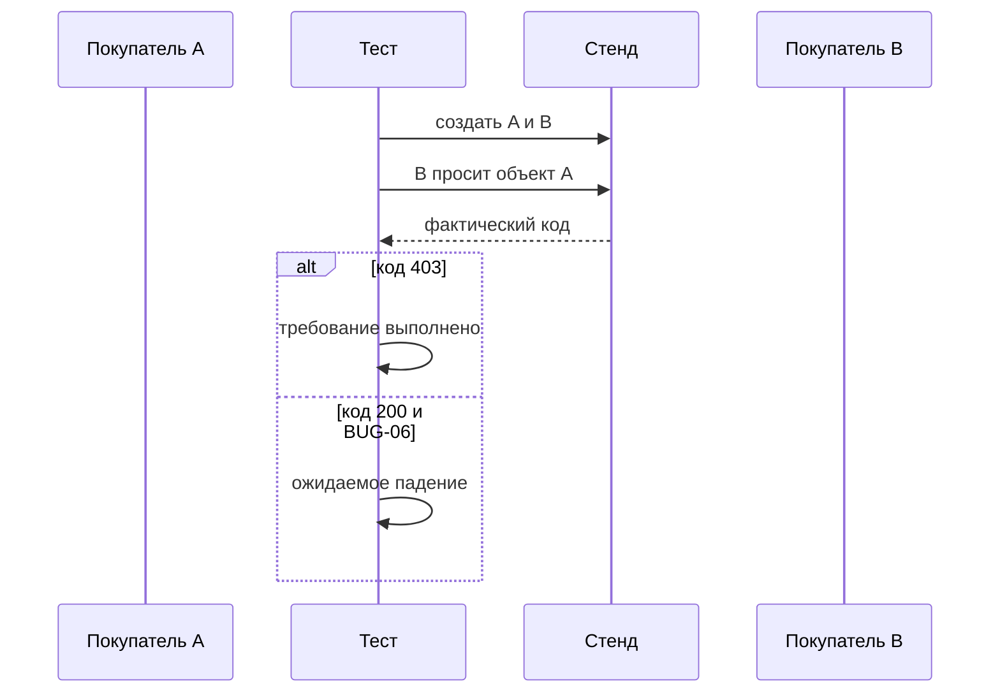
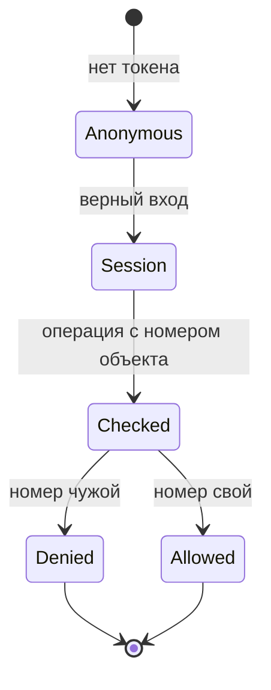

# Аутентификация, авторизация и сессии

## Содержание

- [Теория](#теория)
  - [Ситуация](#ситуация)
  - [Модель](#модель)
  - [Понятия и связь с автоматизацией тестирования](#понятия-и-связь-с-автоматизацией-тестирования)
  - [Зоны ответственности](#зоны-ответственности)
  - [Пример](#пример)
  - [Типичные сбои](#типичные-сбои)
  - [Полезные ссылки](#полезные-ссылки)
  - [Вопросы по теории](#вопросы-по-теории)
- [Практическое задание](#практическое-задание)
  - [1.1 Общее](#11-общее)
  - [1.2 Сценарии](#12-сценарии-user-stories)
  - [1.3 Контракт](#13-контракт)
  - [1.4 Ошибки и ограничения](#14-ошибки-и-ограничения)
  - [1.5 Аудит](#15-аудитлоги)
  - [1.6 Нефункциональные требования](#16-нефункциональные-требования)

# Теория

## Ситуация

Автотест отправляет на локальный Juice Shop один запрос про доступ, вход или сессию и сравнивает ответ с требованием. Дальше возможен один из исходов: требование выполнено и тест зелёный, ответ совпадает с известным `BUG-xx` и тест идёт как ожидаемое падение, расхождение новое и тест красный без метки, либо стенд недоступен.

Отдельная разработка не нужна: достаточно запущенного контейнера Juice Shop и команды `npx playwright test --grep @security` (`pytest -m security`, `dotnet test --filter Category=security`).

## Модель

Участники: тест, два покупателя или гость, стенд и метка дефекта. Второй покупатель нужен там, где проверяют чужой объект. Решение о прохождении принимает оракул теста — требование, а не текущий ответ стенда.



Сначала появляются две разные учётки. Только потом B просит корзину A. Один и тот же токен на свою корзину эту проверку не делает.



Чужой номер обязан заканчиваться отказом. Переход «чужой номер → **200**» в требовании нет. На стенде он есть и записан как `BUG-06` и `BUG-07`.

Возможный набор полей (что тест имеет право увидеть):

| `проверка` | Описание |
| --- | --- |
| `status` | Код ответа |
| `bug` | `BUG-xx`, если факт уже в словаре |
| `field` | Имя поля, которого не должно быть: `password`, `answer`, `stack` |
| `dialog` | Было ли окно `alert`. Для требования список пуст |

Проверка использует регистрацию, вход, корзину, поиск и страницу поиска локального Juice Shop.

## Понятия и связь с автоматизацией тестирования

### Чужая корзина и чужой профиль

Номер корзины — просто число в адресе. Если сервер отдаёт корзину любому, кто подставил число, владелец не защищён. Такое называют IDOR: ссылка на объект без проверки владельца. Требование из матрицы `1.3`: чужая корзина — **403**. Факт v20.4.0: **200**, `BUG-06`.

Тот же смысл у списка людей. `GET /api/Users` и `GET /api/Users/1` для `customer` по матрице — **403**. Факт: **200**, `BUG-07`. Тест смотрит только код. Имена и почты из тела в утверждение не попадают.

Вывод для контракта: `TC-SEC-01` и `TC-SEC-02` ждут **403** и помечены `BUG-06` и `BUG-07`.

### Данные, которые становятся командой

Поиск подставляет текст в фразу для базы. Если текст закрывает кавычку и комментирует хвост, база выполняет уже другую фразу и отдаёт весь каталог. Требование: текст остаётся значением, запрос к базе параметризован. Вход `q='))--` не должен возвращать столько же товаров, сколько пустой поиск. Факт: возвращает весь каталог, `BUG-08`.

Тот же класс на входе. Почта `' OR 1=1--` не должна открывать сессию. Требование — **401**. Факт: **200** и токен администратора, тот же `BUG-08`. Тест утверждает только **401** и тело не печатает.

На странице поиска тот же параметр `q` вставляют в HTML как разметку. Требование: показать его как текст. Факт: разметка исполняется, на адресе из словаря всплывает диалог, `BUG-13`. Оракул — событие `dialog`. Текст диалога в отчёт не кладут.

Вывод для контракта: входы ровно те, что в словаре, без вторых вариантов. `TC-SEC-03`, `TC-SEC-04`, `TC-SEC-10`.

### Что лежит в токене и в капче

JWT — три куска через точку. Средний кусок — JSON. Подпись проверяет, что кусок не подменили. Она не прячет его: любой, у кого есть токен, читает JSON. Требование: в JSON нет секрета и хеша пароля. Факт: поле `data.password` содержит MD5-хеш, `BUG-09`. Тест декодирует середину и проверяет, что ключа нет. Само значение не печатает.

Капча — задача, ответ на которую должен знать только сервер. `GET /rest/captcha` по требованию не содержит поле `answer`. Факт: поле есть, `BUG-10`.

Вывод для контракта: `TC-SEC-05` и `TC-SEC-06` проверяют отсутствие поля, а не его содержимое.

### Заголовки, чужой сайт и перебор

`Content-Security-Policy` говорит браузеру, откуда можно брать скрипты. `Strict-Transport-Security` просит браузер держаться HTTPS. Требование: оба заголовка есть. Факт: их нет, `BUG-11`.

CORS решает, может ли чужая страница читать ответ. Требование: `Access-Control-Allow-Origin` указывает доверенный сайт. Факт: на запрос с `Origin: https://evil.example` приходит `*`, тот же `BUG-11`. Звёздочка означает «любой сайт».

Перебор пароля упирается в ограничение частоты. После серии неверных входов требование — **429**. Факт: двадцать неверных `POST /rest/user/login` подряд остаются **401**, `BUG-12`. У сброса пароля лимит на стенде есть, у входа — нет. Тест бьёт только во вход.

Неизвестный путь по требованию — **404** без стека. Факт: **500** и стек, `BUG-04`. В утверждении нет текста стека, только код и отсутствие слова `stack`.

Вывод для контракта: `TC-SEC-07` … `TC-SEC-09` и `TC-SEC-11` помечены `BUG-11`, `BUG-12` и `BUG-04`.

### Метка

На каждом кейсе этого файла метка `known-issue` и номер. TypeScript: `test.fail()` и annotation `BUG-xx`. Python: `xfail(strict=True)`. C#: `KnownIssue.ExpectFailureAsync`. Пока стенд болен, падение ожидаемо. Когда требование начнёт выполняться, прогон покраснеет, и метку снимают.

Вывод для контракта: ни один из `TC-SEC-01` … `TC-SEC-11` не утверждает сегодняшний ошибочный код как норму.

### Сводка

| Понятие | Смысл в этих кейсах | На что опирается реализация |
| --- | --- | --- |
| IDOR | Чужой номер без проверки владельца | **403**, `BUG-06`, `BUG-07` |
| Инъекция | Данные стали командой или разметкой | `BUG-08`, `BUG-13` |
| JWT | Средняя часть читается без ключа | Нет `data.password`, `BUG-09` |
| Капча | Ответ не уходит клиенту | Нет поля `answer`, `BUG-10` |
| Заголовки и CORS | Браузеру заданы рамки | `BUG-11` |
| Частота входа | Серия ошибок упирается в **429** | `BUG-12` |

## Зоны ответственности

| Тест | Стенд |
| --- | --- |
| Создаёт двух покупателей, когда нужен чужой объект | Хранит корзины до перезапуска контейнера |
| Утверждает код требования | Сегодня отвечает кодом факта из словаря |
| Не читает тело в утверждение там, где в теле секрет | Кладёт секрет в тело, пока дефект жив |
| Помечен номером, пока факт воспроизводится | После исправления начинает соблюдать требование |

Матрица `1.3` задаёт верный код. Этот файл не расширяет матрицу новыми ролями.

## Пример

Программа выполняет `TC-SEC-01`: второй покупатель читает корзину первого. Утверждение — **403**. Пока стенд отвечает **200**, тест ожидаемо падает с `BUG-06`.

### TypeScript

**Node.js 22 или новее, @playwright/test.** `test.fail` вместе с annotation фиксирует известный дефект. Ключевое утверждение — статус **403**.

```sh
npx playwright test --grep TC-SEC-01
```

```typescript
import { test, expect } from '@playwright/test';

function person(n: number) {
  const email = `aqa.sec.0.${n}@example.test`;
  const password = 'Secret-a1!';
  return {
    email,
    password,
    passwordRepeat: password,
    securityQuestion: { id: 1, question: 'Your eldest siblings middle name?' },
    securityAnswer: 'apple',
  };
}

test('TC-SEC-01 чужая корзина', {
  tag: ['@security', '@known-issue'],
  annotation: { type: 'issue', description: 'BUG-06' },
}, async ({ request }) => {
  test.fail();
  await request.post('/api/Users', { data: person(1) });
  await request.post('/api/Users', { data: person(2) });
  const owner = await request.post('/rest/user/login', {
    data: { email: person(1).email, password: person(1).password },
  });
  const other = await request.post('/rest/user/login', {
    data: { email: person(2).email, password: person(2).password },
  });
  const bid = (await owner.json()).authentication.bid;
  const token = (await other.json()).authentication.token;
  const basket = await request.get(`/rest/basket/${bid}`, {
    headers: { Authorization: `Bearer ${token}` },
  });
  expect(basket.status()).toBe(403);
});
```

### Python

**Python 3.10 или новее, pytest-playwright.** `xfail(strict=True)` делает неожиданный успех падением. Маркер `known_issue` зарегистрирован в конфигурации.

```sh
pytest -m "security and known_issue"
```

```python
import pytest
from playwright.sync_api import sync_playwright

def person(n: int) -> dict:
    email = f"aqa.sec.0.{n}@example.test"
    password = "Secret-a1!"
    return {
        "email": email,
        "password": password,
        "passwordRepeat": password,
        "securityQuestion": {"id": 1, "question": "Your eldest siblings middle name?"},
        "securityAnswer": "apple",
    }

@pytest.mark.security
@pytest.mark.known_issue
@pytest.mark.xfail(strict=True, reason="BUG-06")
def test_tc_sec_01() -> None:
    with sync_playwright() as playwright:
        request = playwright.request.new_context(base_url="http://localhost:3000")
        request.post("/api/Users", data=person(1))
        request.post("/api/Users", data=person(2))
        owner = request.post("/rest/user/login", data={"email": person(1)["email"], "password": person(1)["password"]})
        other = request.post("/rest/user/login", data={"email": person(2)["email"], "password": person(2)["password"]})
        bid = owner.json()["authentication"]["bid"]
        token = other.json()["authentication"]["token"]
        basket = request.get(f"/rest/basket/{bid}", headers={"Authorization": f"Bearer {token}"})
        assert basket.status == 403
        request.dispose()
```

### C#

**.NET 8 или новее, Microsoft.Playwright.NUnit.** `KnownIssue.ExpectFailureAsync` из `1.0` ловит падение утверждения и краснеет, если падения не было.

```sh
dotnet test --filter "Category=security&TestName~TC_SEC_01"
```

```csharp
using Microsoft.Playwright;

public class SecBasket : ApiTestBase
{
    [Test]
    [Category("security")]
    [Category("known-issue")]
    [Property("issue", "BUG-06")]
    public async Task TC_SEC_01()
    {
        await KnownIssue.ExpectFailureAsync("BUG-06", async () =>
        {
            var owner = await CreateCustomerAsync();
            var other = await CreateCustomerAsync();
            await using var request = await Playwright.APIRequest.NewContextAsync(new()
            {
                BaseURL = "http://localhost:3000",
            });
            var basket = await request.GetAsync($"/rest/basket/{owner.BasketId}", new()
            {
                Headers = new Dictionary<string, string>
                {
                    ["Authorization"] = $"Bearer {other.Token}",
                },
            });
            Assert.That(basket.Status, Is.EqualTo(403));
        });
    }
}
```

---

Каждый раннер сообщает ожидаемое падение с `BUG-06`, пока чужая корзина открывается с **200**. Утверждение во всех трёх программах одно: статус **403**. Когда стенд начнёт отвечать **403**, тот же тест станет красным из-за метки, и метку снимают. Тело корзины программы не печатают.

## Типичные сбои

| Что видно | Куда смотреть |
| --- | --- |
| Неожиданный успех `BUG-06` | Стенд уже отвечает **403**. Метку `known-issue` снимают |
| Оба логина — один и тот же `bid` | Второй покупатель не создан, читают свою корзину |
| В отчёте список почт | У `TC-SEC-02` в утверждении оказалось тело, а не только статус |
| В логе виден токен после входа с `' OR 1=1--` | Ответ логина напечатали. Нужен только статус |
| Диалог не пойман | Слушатель `dialog` повесили после `goto` |
| Двадцать входов дали **401** и тест зелёный без метки | Пропала метка `BUG-12`, факт ещё жив |
| **500** на `/api/Nope` принят как норма | Оракул перепутан. Требование — **404** без `stack` |
| Запрос ушёл не на localhost | Граница `5.0` нарушена |

## Полезные ссылки

### Общие

- [OWASP — Authorization Cheat Sheet](https://cheatsheetseries.owasp.org/cheatsheets/Authorization_Cheat_Sheet.html) — почему номер объекта проверяют на сервере.
- [OWASP — Authentication Cheat Sheet](https://cheatsheetseries.owasp.org/cheatsheets/Authentication_Cheat_Sheet.html) — частота неудачных входов.
- [OWASP — Session Management Cheat Sheet](https://cheatsheetseries.owasp.org/cheatsheets/Session_Management_Cheat_Sheet.html) — что не кладут в сессию.
- [OWASP — SQL Injection Prevention Cheat Sheet](https://cheatsheetseries.owasp.org/cheatsheets/SQL_Injection_Prevention_Cheat_Sheet.html) — параметр вместо склейки строки.
- [OWASP — XSS Prevention Cheat Sheet](https://cheatsheetseries.owasp.org/cheatsheets/Cross_Site_Scripting_Prevention_Cheat_Sheet.html) — данные остаются текстом.
- [OWASP — Content Security Policy Cheat Sheet](https://cheatsheetseries.owasp.org/cheatsheets/Content_Security_Policy_Cheat_Sheet.html) — зачем заголовок CSP.
- [IETF — RFC 7519 JSON Web Token](https://datatracker.ietf.org/doc/html/rfc7519) — три части токена и то, что полезная нагрузка читается.
- [MDN — CORS](https://developer.mozilla.org/en-US/docs/Web/HTTP/CORS) — что означает `Access-Control-Allow-Origin`.

### По языку

#### TypeScript

**TypeScript, Playwright Test.** На JavaScript контракт этих кейсов остаётся тем же.

- [Playwright — test.fail](https://playwright.dev/docs/test-annotations#test-fail) — ожидаемое падение известного дефекта.
- [Playwright — Dialogs](https://playwright.dev/docs/dialogs) — событие `dialog` как оракул `TC-SEC-10`.

#### Python

**Python, pytest-playwright.** На синхронном Playwright API без pytest или на async API контракт этих кейсов остаётся тем же.

- [pytest — skip and xfail](https://docs.pytest.org/en/stable/how-to/skipping.html) — `xfail(strict=True)`.

#### C#

**C#, Playwright для .NET с NUnit.** На MSTest или xUnit контракт этих кейсов остаётся тем же.

- [Playwright .NET — Dialog](https://playwright.dev/dotnet/docs/dialogs) — событие диалога для `TC-SEC-10`.

## Вопросы по теории

1. Почему второй покупатель обязателен в `TC-SEC-01`?
2. Почему тест ждёт **403**, хотя корзина сегодня открывается?
3. Что в JWT можно прочитать без ключа сервера и почему хеш там лишний?
4. Чем пустой поиск и поиск `q='))--` должны отличаться по требованию?
5. Почему оракул `TC-SEC-10` — событие диалога, а не текст карточек?
6. Зачем двадцать входов, если уже первый отвечает **401**?
7. Что делать с меткой, когда утверждение **403** внезапно прошло?

# Практическое задание

Автотесты требований доступа и сессии для Juice Shop.
Одиннадцать кейсов утверждают безопасное поведение. Сегодняшнее расхождение помечено номером из словаря.

## 1) Требования доступа и сессии

### 1.1 Общее

**Назначение:** держать безопасные коды и пустые секретные поля, пока стенд отвечает иначе.

**Пользователи/роли:**

- AQA-инженер — запускает набор и снимает метку после исправления;
- разработчик — закрывает `BUG-xx`;
- `customer` — владелец и чужой читатель;
- `guest` — запросы без токена там, где токен не нужен.

**Зависимости/связанные настройки:**

- `5.0` — оракул, граница localhost, Top 10;
- `1.3` — матрица прав;
- `1.0` — `test.fail`, `xfail(strict=True)`, `KnownIssue.ExpectFailureAsync`;
- `BASE_URL` — локальный стенд;
- теги `security` и `known-issue`.

ZAP и секреты — в `5.2`. Новых входов сверх таблицы кейс не добавляет.

### 1.2 Сценарии (user stories)

1. **Чужая корзина:** `TC-SEC-01` ждёт **403**, факт **200**, `BUG-06`.
2. **Список и профиль:** `TC-SEC-02` ждёт **403** на `GET /api/Users` и `GET /api/Users/1`, факт **200**, `BUG-07`.
3. **Поиск:** `TC-SEC-03` с `q='))--` не совпадает с полным каталогом, факт совпадает, `BUG-08`.
4. **Вход:** `TC-SEC-04` с почтой `' OR 1=1--` ждёт **401**, факт **200**, `BUG-08`.
5. **Токен:** `TC-SEC-05` не находит `data.password` в середине JWT, факт находит, `BUG-09`.
6. **Капча:** `TC-SEC-06` не видит поле `answer`, факт видит, `BUG-10`.
7. **Заголовки:** `TC-SEC-07` требует CSP и HSTS, факта нет, `BUG-11`.
8. **CORS:** `TC-SEC-08` не принимает `*` для `Origin: https://evil.example`, факт `*`, `BUG-11`.
9. **Частота:** `TC-SEC-09` после 20 неверных входов ждёт **429**, факт сплошные **401**, `BUG-12`.
10. **Страница поиска:** `TC-SEC-10` не ловит `dialog` на адресе из словаря, факт ловит, `BUG-13`.
11. **Неизвестный путь:** `TC-SEC-11` ждёт **404** без `stack`, факт **500** со стеком, `BUG-04`.

### 1.3 Контракт

#### 1.3.1 Чужие объекты

| ID | Проверки/валидация |
| --- | --- |
| `TC-SEC-01` | Два `customer`. Второй делает `GET /rest/basket/{bid первого}`. Ожидание **403**. Факт **200**, `BUG-06` |
| `TC-SEC-02` | `customer` делает `GET /api/Users` и `GET /api/Users/1`. Ожидание **403**. Факт **200**, `BUG-07` |

**Логика/шаги:**

1. Создать двух покупателей с разными почтами.
2. Войти обоими и взять `bid` первого и токен второго.
3. Запросить чужую корзину.
4. Отдельным кейсом запросить список и профиль `1` токеном покупателя.
5. Утверждать только статус.

Повтор создаёт новые почты. Старые корзины на стенде остаются до перезапуска контейнера и на код не влияют.

**Ответы:**

- **Требование:** **403**.
- **Факт:** **200**, ожидаемое падение.
- Тела в ответе теста нет.

#### 1.3.2 Инъекции из словаря

**Общее правило:** строка входа ровно из словаря. Второй вариант не добавляют.

| ID | Проверки/валидация |
| --- | --- |
| `TC-SEC-03` | `GET /rest/products/search?q='))--`. Число товаров не равно числу при пустом `q`. Факт равен, `BUG-08` |
| `TC-SEC-04` | `POST /rest/user/login` с почтой `' OR 1=1--`. Ожидание **401**. Факт **200**, `BUG-08` |
| `TC-SEC-10` | Открыть `/#/search?q=<iframe src="javascript:alert(\`xss\`)">`. Ожидание: событий `dialog` нет. Факт: событие есть, `BUG-13` |

**Логика/шаги:**

1. Для поиска сравнить длину `data` с длиной полного каталога.
2. Для входа утвердить статус и не читать токен в лог.
3. Для страницы подписаться на `dialog` до перехода и закрыть диалог, если он пришёл, чтобы браузер не завис.

**Ответы:**

- **Требование:** каталог не целиком, **401**, пустой список диалогов.
- **Факт:** ожидаемое падение с номером из таблицы.
- Токен и текст диалога в отчёт не входят.

#### 1.3.3 Токен, капча, рамки, частота, ошибка

| ID | Проверки/валидация |
| --- | --- |
| `TC-SEC-05` | Середина JWT своего покупателя. Ключа `data.password` нет. Факт: ключ есть, `BUG-09` |
| `TC-SEC-06` | `GET /rest/captcha`. Ключа `answer` нет. Факт: ключ есть, `BUG-10` |
| `TC-SEC-07` | На ответе готовности есть `Content-Security-Policy` и `Strict-Transport-Security`. Факт: нет, `BUG-11` |
| `TC-SEC-08` | Заголовок `Origin: https://evil.example`. `Access-Control-Allow-Origin` не `*`. Факт: `*`, `BUG-11` |
| `TC-SEC-09` | 20 `POST /rest/user/login` с новой почтой и неверным паролем. Среди кодов есть **429**. Факт: все **401**, `BUG-12` |
| `TC-SEC-11` | `GET /api/Nope`. **404**, в теле нет `stack`. Факт: **500** и стек, `BUG-04` |

**Логика/шаги:**

1. Декодировать среднюю часть токена как base64url и разобрать JSON.
2. Проверить отсутствие ключа, не печатая значение.
3. Проверить заголовки и звёздочку CORS одним запросом каждый.
4. Повторить неверный вход двадцать раз без паузы.
5. На неизвестном пути утвердить **404** и отсутствие подстроки `stack`.

**Ответы:**

- **Требование:** по таблице.
- **Факт:** ожидаемое падение.
- Хеш, ответ капчи и стек в отчёт не входят.

### 1.4 Ошибки и ограничения

- Хост не локальный — набор не стартует (`5.0`).
- Стенд недоступен — нет **200** на готовности.
- Нет метки или номер не из словаря — нарушение контракта.
- Утверждение сегодняшнего **200**, **500** или наличия `answer` — нарушение контракта.
- Неожиданный успех — дефект закрыт, метку снимают.
- Тело корзины, список пользователей, токен входа, хеш, `answer`, стек — в утверждение и вложение не попадают.
- Вход с почтой администратора в `TC-SEC-09` — не используется. Серия идёт на новую учебную почту.
- Дополнительная строка инъекции сверх словаря — нарушение контракта.

Порядок внутри кейса: создать данные, отправить один вид запроса из таблицы, утвердить требование.

### 1.5 Аудит/логи

Логировать: ID, номер `BUG-xx`, ожидаемый статус или имя отсутствующего поля, фактический статус.

В журнал не попадают пароль, токен, cookie `token`, полный JWT, хеш, `answer`, список пользователей, содержимое корзины, текст диалога и стек.

### 1.6 Нефункциональные требования

- Кейсы `TC-SEC-01` … `TC-SEC-11` входят в набор с тегом `security`.
- `waitForTimeout` и `sleep` запрещены. Двадцать входов идут подряд.
- Набор укладывается в 3 минуты локально.
- Ретраи 2 в CI и 0 локально, таймаут теста 30 с, таймаут проверки 5 с.
- Пять повторов подряд дают ожидаемое падение с тем же номером, пока дефект жив.
- Общие нефункциональные требования проекта из словаря курса относятся и к этим операциям.
