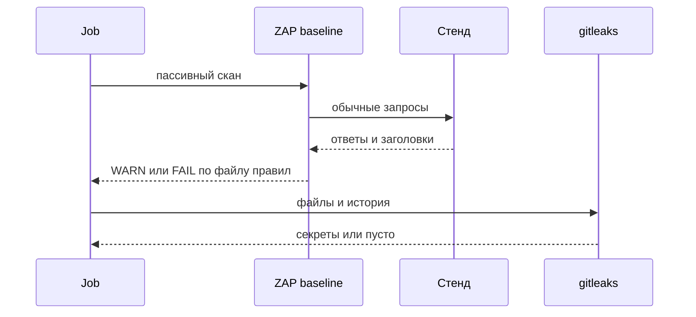
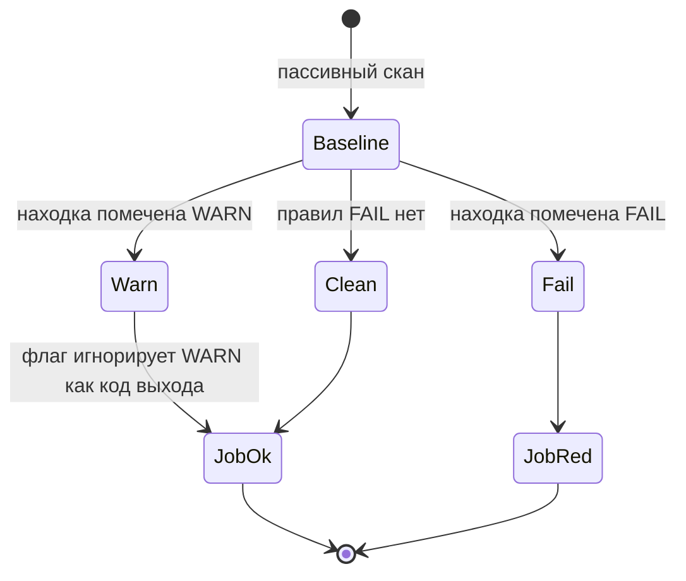

# Сканирование уязвимостей и секреты

## Содержание

- [Теория](#теория)
  - [Ситуация](#ситуация)
  - [Модель](#модель)
  - [Понятия и связь с автоматизацией тестирования](#понятия-и-связь-с-автоматизацией-тестирования)
  - [Зоны ответственности](#зоны-ответственности)
  - [Пример](#пример)
  - [Типичные сбои](#типичные-сбои)
  - [Полезные ссылки](#полезные-ссылки)
  - [Вопросы по теории](#вопросы-по-теории)
- [Практическое задание](#практическое-задание)
  - [1.1 Общее](#11-общее)
  - [1.2 Сценарии](#12-сценарии-user-stories)
  - [1.3 Контракт](#13-контракт)
  - [1.4 Ошибки и ограничения](#14-ошибки-и-ограничения)
  - [1.5 Аудит](#15-аудитлоги)
  - [1.6 Нефункциональные требования](#16-нефункциональные-требования)

# Теория

## Ситуация

Пайплайн CI смотрит локальный Juice Shop пассивным сканером и отдельно проверяет библиотеки и файлы репозитория на уже известные дыры и секреты. Дальше возможен один из исходов: новых находок уровня FAIL нет и job зелёный, сканер нашёл правило из списка FAIL и job красный, в git попал секрет и job красный, полный активный скан запущен только локально, либо стенд недоступен.

Отдельная разработка не нужна: достаточно локального контейнера Juice Shop и команды пассивного скана из контракта. Job в репозитории называется `security`.

## Модель

Участники: ZAP, файл правил, менеджер пакетов, gitleaks и job. ZAP разговаривает со стендом и сам ничего не чинит. Файл правил решает, какая находка красит сборку. Решение о прохождении принимает оракул теста — правило FAIL, отчёт зависимостей и пустой отчёт секретов, а не молчание сканера по умолчанию.



Пассивный скан не подбирает пароль и не шлёт отдельные атакующие шаблоны. Он смотрит то, что стенд и так отдаёт. Полный скан в эту последовательность не входит: его запускают локально и отдельно.



WARN остаётся в отчёте и при флаге из контракта не красит job. FAIL красит. Так известные заголовки стенда видны, а новое жёсткое правило сборку останавливает.

Возможный набор полей (строка файла правил):

| `правило ZAP` | Описание |
| --- | --- |
| `id` | Числовой идентификатор из отчёта или из файла, сгенерированного `-g` |
| `action` | `IGNORE`, `WARN` или `FAIL` |
| `comment` | Человеческое имя правила, на решение не влияет |

Проверка использует локальный Juice Shop и файлы репозитория тестов. Чужой сайт сканером не открывают.

## Понятия и связь с автоматизацией тестирования

### Пассивный и полный скан

Пассивный baseline смотрит ответы, которые и так пришли, пока ZAP обходит ссылки. Это несколько минут, без отдельных атакующих запросов. Такой прогон уместен в CI: он ловит отсутствующий заголовок и похожую конфигурацию.

Полный скан добавляет активные проверки. Он длиннее и шлёт запросы, которыми ищут известные слабости. На учебном стенде его запускают локально, когда нужно увидеть отчёт руками. В job каждой сборки его нет: job должен заканчиваться предсказуемо и не превращаться в долгий прогон по живому процессу.

Образ — `ghcr.io/zaproxy/zaproxy:stable`. Цель — локальный стенд. Из compose это `http://juice-shop:3000`. Из отдельного `docker run` на Docker Desktop это `http://host.docker.internal:3000`. Оба адреса смотрят на контейнер участника.

Вывод для контракта: job `security` вызывает `zap-baseline.py`. `zap-full-scan.py` остаётся локальной командой.

### Файл правил

По умолчанию ZAP помечает находки как WARN и возвращает код 2, если WARN есть. Код 1 — хотя бы один FAIL. Код 0 — успех. Код 3 — сбой самого сканера.

Файл `security/zap-rules.tsv` переопределяет действие. Столбцы разделены табом: идентификатор, действие, комментарий. Действия курса — `IGNORE`, `WARN`, `FAIL`. Идентификаторы не выписывают по памяти: первый прогон с `-g` генерирует файл, где у каждого правила уже стоит WARN, и в нём меняют действие.

Находки, которые совпадают с `BUG-11` и соседними известными фактами стенда, оставляют WARN: они видны в отчёте и не спорят с кейсами `5.1`. Новое правило, которое команда считает блокирующим, ставят в FAIL. Флаг `-I` говорит baseline не возвращать код 2 из-за WARN. FAIL по-прежнему даёт код 1.

Вывод для контракта: job зелёный при коде 0. Код 1 красит job. WARN без `-I` тоже покрасил бы job, поэтому флаг в команде обязателен.

### Зависимости

Библиотека в проекте тестов может быть старой и уже иметь известную дыру. Это A03 из `5.0`. Свой стек смотрит своим инструментом: `npm audit` для TypeScript, `pip-audit` для Python, `dotnet list package --vulnerable --include-transitive` для C#. OSV-Scanner и Trivy делают тот же класс проверки другой базой. В курсе обязателен инструмент своего стека.

Счётчик примера — число находок high и critical. Ноль значит, что сканер их не сообщил. Ненулевое число красит job, если идентификатора нет в `security/sca-allow.txt`. Строка файла — идентификатор и короткая причина. Пустой файл значит «исключений нет».

Вывод для контракта: job вызывает сканер своего стека и падает на high или critical вне списка исключений.

### Секреты

Пароль стенда, токен и ключ не живут в git. gitleaks проходит по файлам и истории и ищет такие строки. В выводе включают скрытие значения, чтобы сам отчёт секрет не повторил.

`.env` лежит в `.gitignore`. Рядом `.env.example` с именами переменных и пустыми значениями: `BASE_URL`, `ADMIN_PASSWORD`, `ACCOUNTANT_PASSWORD`, `MAILPIT_URL`, `GITEA_URL`. Настоящие пароли встроенных учёток участник кладёт в локальный `.env` по документации Juice Shop и в секреты CI `ADMIN_PASSWORD` и `ACCOUNTANT_PASSWORD`. В текст урока и в тесты литералом их не пишут.

TruffleHog решает ту же задачу другой базой сигнатур. В job курса достаточно gitleaks.

Вывод для контракта: job красный, если gitleaks нашёл секрет. Пример значений в репозитории не хранят.

### Сводка

| Понятие | Смысл в сканировании | На что опирается реализация |
| --- | --- | --- |
| Baseline | Пассивный обход живого стенда | `zap-baseline.py` в job |
| Full scan | Активные проверки | Только локально |
| `zap-rules.tsv` | Какие находки красят сборку | `IGNORE` / `WARN` / `FAIL` |
| SCA | Известные дыры библиотек | Инструмент своего стека |
| Секрет | Пароль или ключ в файлах | gitleaks и `.gitignore` |

## Зоны ответственности

| Пайплайн CI | Разработчик |
| --- | --- |
| Запускает baseline, SCA и gitleaks на каждой сборке | Разбирает FAIL и обновляет зависимость или правило |
| Не запускает полный активный скан | Запускает полный скан локально, если отчёт baseline мало что объяснил |
| Хранит пароли стенда в секретах | Не коммитит `.env` |
| Оставляет известные WARN видимыми | Закрывает причину `BUG-xx` в продукте, а не только строку WARN |

Пассивный отчёт не заменяет кейсы `5.1`. Те кейсы утверждают конкретный код. ZAP показывает класс находки по своим правилам.

## Пример

Программа своего стека печатает `vulnerable: N` — сколько находок high и critical увидел менеджер пакетов. Ноль значит, что таких записей сканер не вернул.

### TypeScript

**Node.js 22 или новее, npm.** `npm audit --json` кладёт счётчики в `metadata.vulnerabilities`. Ключевые поля — `high` и `critical`.

```sh
npm audit --json
node count-audit.mjs
```

```javascript
import { execSync } from 'node:child_process';

let raw = '';
try {
  raw = execSync('npm audit --json', { encoding: 'utf8' });
} catch (error) {
  raw = String(error.stdout ?? '');
}
const data = JSON.parse(raw || '{}');
const counts = data.metadata?.vulnerabilities ?? {};
const vulnerable = Number(counts.high ?? 0) + Number(counts.critical ?? 0);
console.log(`vulnerable: ${vulnerable}`);
```

### Python

**Python 3.10 или новее, pip-audit.** JSON pip-audit — список зависимостей с массивом `vulns`. Считают элементы этих массивов.

```sh
pip install pip-audit
python count_audit.py
```

```python
import json
import subprocess

proc = subprocess.run(["pip-audit", "-f", "json"], capture_output=True, text=True)
items = json.loads(proc.stdout or "[]")
vulnerable = 0
for item in items:
    vulnerable += len(item.get("vulns") or [])
print(f"vulnerable: {vulnerable}")
```

### C#

**.NET 8 или новее, dotnet CLI.** Команда печатает уязвимые пакеты текстом. Программа считает строки пакетов после фразы SDK и печатает то же имя счётчика.

```sh
dotnet list package --vulnerable --include-transitive
dotnet run --project CountAudit
```

```csharp
using System.Diagnostics;

var info = new ProcessStartInfo("dotnet", "list package --vulnerable --include-transitive")
{
    RedirectStandardOutput = true,
};
using var process = Process.Start(info)!;
var output = process.StandardOutput.ReadToEnd();
process.WaitForExit();
var vulnerable = 0;
var armed = false;
foreach (var line in output.Split('\n'))
{
    if (line.Contains("vulnerable packages")) armed = true;
    else if (armed && line.Trim().StartsWith('>')) vulnerable++;
}
Console.WriteLine($"vulnerable: {vulnerable}");
```

---

Каждая программа печатает одну строку `vulnerable: N`. N относится к менеджеру пакетов своего стека, поэтому числа трёх проектов могут различаться. Ноль значит, что этот сканер не сообщил находок. Ненулевое N без строки в `security/sca-allow.txt` красит job. Сами идентификаторы бюллетеней пример не печатает списком: их смотрят в полном выводе сканера, когда N больше нуля.

## Типичные сбои

| Что видно | Куда смотреть |
| --- | --- |
| Код ZAP 2, хотя FAIL нет | В команде нет `-I`, WARN стал кодом выхода |
| Код ZAP 1 | В tsv есть FAIL, и правило сработало |
| Код ZAP 3 | Сканер не достучался до цели. Адрес не `juice-shop` и не `host.docker.internal` |
| Отчёт пустой за секунду | Цель не локальный стенд или контейнер ещё не ответил **200** |
| Полный скан попал в job | Должен остаться `zap-baseline.py` |
| `npm audit` падает, а счётчик 0 | `execSync` бросил ошибку, и stdout не прочитали |
| gitleaks красный на `.env` | Файл не в `.gitignore` или секрет уже в истории |
| В `.env.example` стоит настоящий пароль | В примере только имена переменных |

## Полезные ссылки

### Общие

- [OWASP ZAP — Baseline Scan](https://www.zaproxy.org/docs/docker/baseline-scan/) — коды выхода, `-c`, `-g`, `-I`.
- [OWASP ZAP — Full Scan](https://www.zaproxy.org/docs/docker/full-scan/) — активный прогон, в курсе только локально.
- [gitleaks](https://github.com/gitleaks/gitleaks) — поиск секретов и флаг скрытия значения.
- [OSV-Scanner](https://google.github.io/osv-scanner/) — вторая база для зависимостей.
- [Trivy](https://trivy.dev/docs/latest/) — зависимости и образы.
- [TruffleHog](https://github.com/trufflesecurity/trufflehog) — другой поиск секретов.

### По языку

#### TypeScript

**TypeScript, Playwright Test.** На JavaScript контракт SCA остаётся тем же по смыслу счётчика.

- [npm — npm-audit](https://docs.npmjs.com/cli/commands/npm-audit) — JSON и уровни `high`, `critical`.

#### Python

**Python, pytest-playwright.** На синхронном Playwright API без pytest или на async API контракт SCA остаётся тем же по смыслу счётчика.

- [pip-audit](https://pypi.org/project/pip-audit/) — `-f json` и поле `vulns`.

#### C#

**C#, Playwright для .NET с NUnit.** На MSTest или xUnit контракт SCA остаётся тем же по смыслу счётчика.

- [Microsoft — dotnet list package](https://learn.microsoft.com/dotnet/core/tools/dotnet-list-package) — `--vulnerable` и транзитивные пакеты.

## Вопросы по теории

1. Почему в CI стоит baseline, а полный скан остаётся локальным?
2. Зачем флаг `-I`, если WARN всё равно пишут в отчёт?
3. Откуда брать числовой id правила, если его не помнят?
4. Что произойдёт с job, когда в git попадёт `.env` с паролем?
5. Чем `IGNORE` отличается от `WARN` для уже известного `BUG-11`?
6. Почему у трёх стеков разные команды, а строка результата одна?
7. Почему пароль администратора стенда не пишут в `.env.example`?

# Практическое задание

Сканеры зависимостей, секретов и пассивный ZAP для локального Juice Shop.
Job `security` красит сборку на FAIL, на high/critical вне списка и на секрет в git.

## 1) Сканеры

### 1.1 Общее

**Назначение:** ловить новую конфигурационную находку, дыру в библиотеке и секрет в репозитории, не подменяя кейсы `5.1`.

**Пользователи/роли:**

- AQA-инженер — держит `zap-rules.tsv` и пустой или обоснованный allow-список;
- разработчик — обновляет пакет или убирает секрет из истории;
- CI — job `security`.

**Зависимости/связанные настройки:**

- `5.0` и `5.1` — смысл дефектов стенда и граница localhost;
- `security/zap-rules.tsv` — действия правил;
- `security/sca-allow.txt` — исключения SCA, по умолчанию пустой;
- секреты CI `ADMIN_PASSWORD`, `ACCOUNTANT_PASSWORD`;
- `.gitignore` содержит `.env`.

Полный скан в job не входит.

### 1.2 Сценарии (user stories)

1. **Baseline:** job обходит локальный стенд пассивно и завершается кодом 0, пока нет FAIL.
2. **Известные WARN:** находки класса `BUG-11` остаются в отчёте и job не красят.
3. **Полный скан:** человек запускает его локально и не кладёт в workflow.
4. **Библиотеки:** сканер стека печатает `vulnerable: N`, job красный, если N > 0 и id нет в allow-списке.
5. **Секрет:** gitleaks не находит значений, `.env.example` без значений.

### 1.3 Контракт

#### 1.3.1 ZAP

| Команда | Проверки/валидация |
| --- | --- |
| Baseline в job | `zap-baseline.py -t <локальный стенд> -c security/zap-rules.tsv -I` |
| Генерация правил | `-g` один раз, дальше правят действия |
| Full scan | `zap-full-scan.py` только локально, в workflow строки нет |

**Логика/шаги:**

1. Дождаться **200** готовности стенда.
2. Запустить baseline с примонтированным каталогом правил.
3. Принять код 0.
4. Код 1 считать неуспехом job.
5. Полный скан не добавлять в `.github/workflows/tests.yml`.

Образ `ghcr.io/zaproxy/zaproxy:stable`. Каталог монтируют в `/zap/wrk`.

**Ответы:**

- **Проход:** код 0, отчёт приложен к job.
- **Ошибки:** см. раздел 1.4.
- Тела ответов стенда с токенами в артефакт не кладут. Кладут сводку правил.

#### 1.3.2 Зависимости и секреты

**Общее правило:** один стек — один обязательный сканер. gitleaks общий.

| Проверка | Входные данные и правила |
| --- | --- |
| npm | `high` и `critical` из `npm audit --json` |
| pip-audit | сумма длин `vulns` |
| dotnet | пакеты из вывода `--vulnerable --include-transitive` |
| allow | `security/sca-allow.txt`, идентификатор и причина |
| gitleaks | `gitleaks detect --source . --redact`, код 0 |
| пример окружения | `.env.example` без значений, `.env` в `.gitignore` |

**Логика/шаги:**

1. Запустить сканер стека.
2. Вычесть идентификаторы из allow-списка.
3. Падать, если остаток не пуст.
4. Запустить gitleaks и принять только код 0.

**Ответы:**

- **Проход:** `vulnerable` после исключений равен 0, gitleaks молчит.
- **Ошибки:** см. раздел 1.4.

### 1.4 Ошибки и ограничения

- Цель ZAP не локальный стенд — команду не запускают.
- Код ZAP 1 — неуспех job.
- Код ZAP 2 — в команде забыли `-I`.
- Код ZAP 3 — стенд или Docker недоступен.
- Полный скан в workflow — нарушение контракта.
- `vulnerable` больше нуля и id нет в allow-списке — неуспех job.
- Строка allow без причины — нарушение контракта.
- gitleaks нашёл совпадение — неуспех job.
- Значение пароля в `.env.example`, в тесте или в уроке — нарушение контракта.
- Секреты CI отсутствуют — функциональный job, которому они нужны, падает отдельно. Сканер секретов от этого не начинает читать чужой vault.

Порядок в job: готовность стенда, baseline, SCA своего стека, gitleaks.

### 1.5 Аудит/логи

Логировать: код ZAP, число WARN, число FAIL, `vulnerable` после allow-списка, код gitleaks.

В журнал не попадают пароль, токен, cookie `token`, полный JWT, найденный секрет целиком и тела ответов стенда. gitleaks запускают с скрытием значения.

### 1.6 Нефункциональные требования

- Baseline в job укладывается в 10 минут на локальном стенде.
- Полный скан в этот предел не входит и в job не входит.
- `waitForTimeout` не используется.
- Пять прогонов job подряд на неизменном репозитории и живом стенде дают один и тот же код.
- Общие нефункциональные требования проекта из словаря курса относятся и к job `security` в части секретов CI, ретраев workflow и артефактов.
