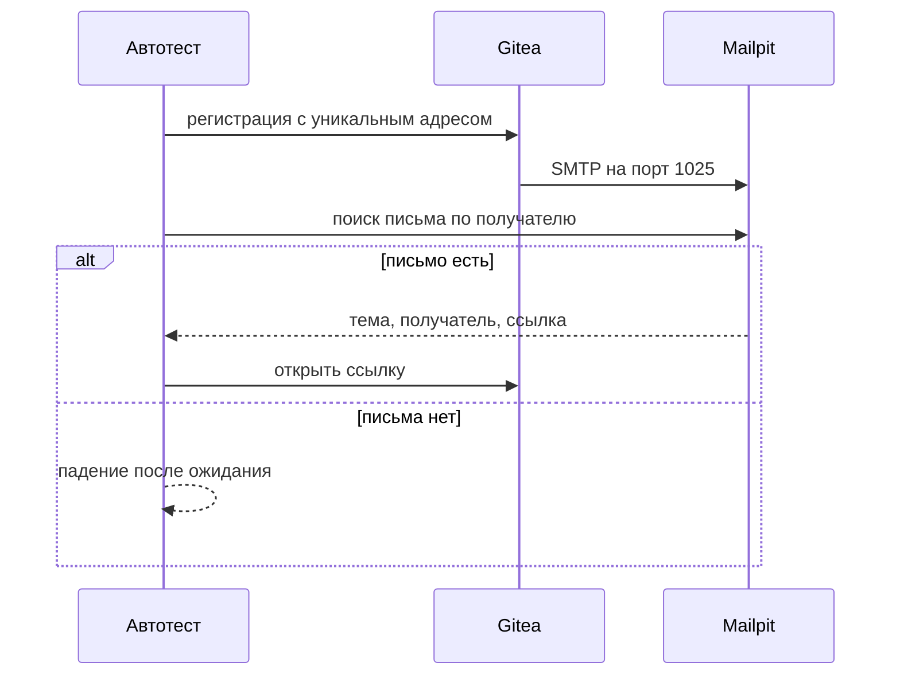
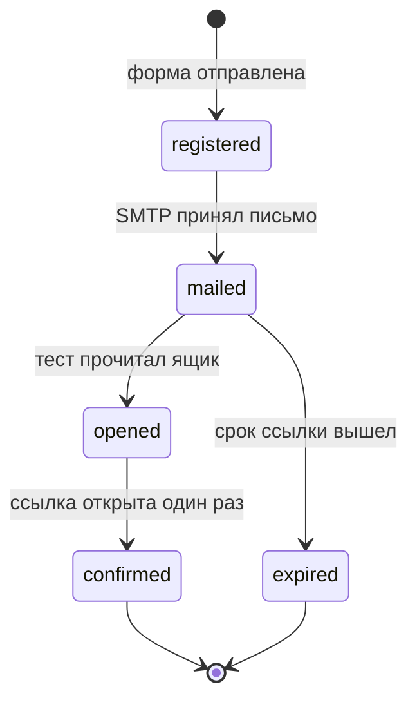

# Общие требования к тестированию писем

## Содержание

- [Теория](#теория)
  - [Ситуация](#ситуация)
  - [Модель](#модель)
  - [Понятия и связь с автоматизацией тестирования](#понятия-и-связь-с-автоматизацией-тестирования)
  - [Зоны ответственности](#зоны-ответственности)
  - [Пример](#пример)
  - [Типичные сбои](#типичные-сбои)
  - [Полезные ссылки](#полезные-ссылки)
  - [Вопросы по теории](#вопросы-по-теории)
- [Практическое задание](#практическое-задание)
  - [1.1 Общее](#11-общее)
  - [1.2 Сценарии](#12-сценарии-user-stories)
  - [1.3 Контракт](#13-контракт)
  - [1.4 Ошибки и ограничения](#14-ошибки-и-ограничения)
  - [1.5 Аудит](#15-аудитлоги)
  - [1.6 Нефункциональные требования](#16-нефункциональные-требования)

# Теория

## Ситуация

Автотест регистрирует пользователя и ждёт письмо с ссылкой. Дальше возможен один из исходов: письмо пришло нужному адресату и ссылка ведёт на свой стенд, письмо не пришло за отведённое время, письмо ушло на чужой ящик, ссылка ведёт наружу, либо почтовый ящик курса вообще не поднят.

Отдельная разработка не нужна: достаточно контейнеров Gitea и Mailpit и команды `npx playwright test --grep @email` (`pytest -m email`, `dotnet test --filter Category=email`).

## Модель

Juice Shop писем не отправляет. Для этого блока стенд — Gitea: он умеет подтверждать регистрацию и сбрасывать пароль по почте. Письмо не уходит в интернет. Gitea сдаёт его по SMTP в Mailpit, а тест читает ящик через HTTP API Mailpit.

Решение о прохождении принимает тест. Ящик только хранит то, что уже отправлено. Если письма нет, тест не считает регистрацию успешной: пользователь ещё не доказал, что владеет адресом.



Сначала действие в приложении, потом письмо, потом переход по ссылке. Обратный порядок ничего не проверяет: пустой ящик до регистрации — это норма, а не дефект.



Повторный переход по уже использованной ссылке не возвращает состояние в `confirmed`. Это отдельная проверка в `6.1`.

| Что смотреть в письме | Зачем |
| --- | --- |
| Получатель | письмо не ушло чужому адресу |
| Отправитель | адрес из настройки `FROM`, а не случайный ящик разработчика |
| Тема | человек понимает, зачем письмо |
| Ссылка | ведёт на `GITEA_URL`, а не на чужой сайт |
| Срок ссылки | протухшая ссылка не активирует аккаунт |
| Текст и HTML | оба варианта говорят одно и то же |

Нормальная форма не вводится. Письмо — сообщение в Mailpit, не строка в базе тестов.

## Понятия и связь с автоматизацией тестирования

### Песочница вместо настоящей почты

Настоящий SMTP доставит письмо человеку. В учебном прогоне это вредно: адрес может совпасть с чужим, а ящик забьётся служебными письмами. Песочница принимает SMTP и никуда его не пересылает. Курс использует Mailpit: порт `1025` для приёма, порт `8025` для интерфейса и API.

Остальные инструменты решают ту же задачу по-разному. Подробно в курсе разбирается только Mailpit.

| Инструмент | Где крутится | Подходит для |
| --- | --- | --- |
| Mailpit | свой контейнер рядом с тестом | локальный прогон и CI |
| smtp4dev | свой процесс на Windows или в контейнере | локальная отладка без Docker Compose |
| GreenMail | библиотека в JVM-тесте | Java-проект, которому ящик нужен внутри процесса |
| Mailtrap | чужой сервис | команда, которая не хочет поднимать SMTP сама |
| Mailinator и MailSlurp | чужой сервис с API ящика | тесты против уже развёрнутого стенда |
| gmail-tester | настоящий ящик Gmail | редкая проверка боевого SMTP, не для каждого прогона |

Вывод для контракта: тест ходит только в `MAILPIT_URL`. Учётка Gmail и ключ чужого сервиса в репозиторий не кладутся.

### Что именно обязано совпасть

Получатель сравнивается целиком, включая домен. Тема — точная строка, которую отдаёт Gitea для этого действия, а не «что-то про регистрацию». Отправитель — `gitea@example.test`, как задано в `GITEA__mailer__FROM`.

Ссылка из письма разбирается как URL. Хост обязан совпасть с хостом `GITEA_URL`. Ссылка с другим хостом — дефект, даже если страница открывается. Так отсекается письмо, которое ведёт на фишинговую копию.

Срок жизни кода в Gitea по умолчанию — 180 минут и для активации, и для сброса пароля. Тест не ждёт три часа. Он проверяет, что ссылка жива сразу после письма. Отдельную проверку «через 181 минуту ссылка мертва» курс не требует: для неё пришлось бы подменять часы сервера.

HTML и текстовая часть не должны противоречить друг другу. Если в HTML есть ссылка активации, в тексте есть тот же URL. Картинки и вёрстка в почтовых клиентах в этот курс не входят: для них нужен набор настоящих клиентов, а не API ящика.

Подпись SPF, DKIM и DMARC и ссылка отписки из рассылки здесь только называются. У песочницы нет боевого домена, поэтому тест их не валидирует.

### Уникальный адрес

Каждый тест получает свой адрес `aqa.<RUN_ID>.<номер воркера>.<порядковый номер>@example.test`. Домен `.test` никуда не маршрутизируется, даже если SMTP случайно смотрит в интернет. Общий ящик на весь файл запрещён: второй тест прочитает письмо первого.

Перед сценарием тест не чистит весь Mailpit. Он ищет только свой адрес. Чужие письма прогона остаются в ящике и не мешают, пока поиск фильтрует получателя.

### Что будет в письмах со ссылками

`6.1` берёт этот стенд и проверяет четыре сценария: активация, повтор ссылки, сброс пароля и проверка всех ссылок письма. Здесь задаются только контейнеры, переменные и правило «не отправлять наружу».

### Сводка

| Понятие | Смысл для писем | На что опирается реализация |
| --- | --- | --- |
| Песочница | SMTP не покидает машину прогона | Mailpit `1025` и `8025` |
| Источник писем | приложение, которое реально пишет письмо | Gitea, не Juice Shop |
| Получатель | адрес конкретного теста | уникальный `aqa.…@example.test` |
| Ссылка | только свой хост | сравнение с `GITEA_URL` |
| Ожидание | письмо приходит не мгновенно | опрос API, не `sleep` фиксированной длины |

## Зоны ответственности

| Автотест | Стенд |
| --- | --- |
| Создаёт уникальный адрес | Отправляет письмо только на свой SMTP |
| Ждёт письмо опросом API | Кладёт письмо в Mailpit, а не в интернет |
| Сверяет получателя, отправителя и хост ссылки | Не выбирает, в какой ящик человека доставить письмо |
| Не печатает одноразовый токен ссылки в отчёт целиком | Хранит письмо, пока его не удалили |

Настройка «отправить копию себе на Gmail» стенд курса не поддерживает. Её появление в compose-файле — ошибка конфигурации, а не удобство отладки.

## Пример

Программа один раз спрашивает Mailpit, жив ли API, и печатает статус. Писем она не создаёт: готовность ящика не зависит от Gitea.

### TypeScript

**Node.js 22 или новее, @playwright/test.** Контекст запросов смотрит на `MAILPIT_URL`, не на Juice Shop.

```sh
npx playwright test tests/email/mailpit-ready.spec.ts
```

```typescript
import { test, expect, request } from '@playwright/test';

test('ящик отвечает', async () => {
  const api = await request.newContext({ baseURL: process.env.MAILPIT_URL });
  const response = await api.get('/api/v1/info');
  expect(response.status()).toBe(200);
  console.log(response.status());
  await api.dispose();
});
```

### Python

**Python 3.10 или новее, pytest-playwright.** Тот же путь API, базовый URL из окружения.

```sh
pytest tests/email/test_mailpit_ready.py -q
```

```python
import os

def test_mailbox_ready(playwright):
    api = playwright.request.new_context(base_url=os.environ["MAILPIT_URL"])
    response = api.get("/api/v1/info")
    print(response.status)
    api.dispose()
    assert response.status == 200
```

### C#

**.NET 8 или новее, Microsoft.Playwright.NUnit.** Контекст освобождается после одного запроса.

```sh
dotnet test --filter FullyQualifiedName~MailboxReady
```

```csharp
[Test, Category("email")]
public async Task MailboxReady()
{
    var baseUrl = Environment.GetEnvironmentVariable("MAILPIT_URL");
    using var playwright = await Playwright.CreateAsync();
    await using var api = await playwright.APIRequest.NewContextAsync(new() { BaseURL = baseUrl });
    var response = await api.GetAsync("/api/v1/info");
    TestContext.Out.WriteLine(response.Status);
    Assert.That(response.Status, Is.EqualTo(200));
}
```

---

Каждый раннер сообщает об одном пройденном тесте и печатает `200`. Это значит, что API ящика открыт. Наличия писем эта строка не доказывает.

## Типичные сбои

| Что видно | Куда смотреть |
| --- | --- |
| Тест ищет письмо Juice Shop | у Juice Shop нет SMTP, источник — Gitea |
| Письмо пришло на личную почту | `SMTP_ADDR` смотрит не на `mailpit` |
| Ящик пуст, а Gitea пишет ошибку отправки | сервис `mailpit` не в той сети, что `gitea` |
| Два теста читают одно письмо | адрес без `RUN_ID` и номера воркера |
| Ссылка в письме ведёт на `localhost` внутри контейнера, а тест открывает её снаружи | `ROOT_URL` должен быть тем адресом, которым тест открывает Gitea |
| В отчёте виден полный URL активации | токен ссылки попал в лог |

## Полезные ссылки

### Общие

- [Mailpit — API v1](https://mailpit.axllent.org/docs/api-v1/) — поиск и чтение писем, которыми пользуется тест.
- [Gitea — config cheat sheet](https://docs.gitea.com/administration/config-cheat-sheet) — почта, подтверждение регистрации и `ROOT_URL`.
- [RFC 2606 — reserved names](https://www.rfc-editor.org/rfc/rfc2606) — почему домен `.test` не маршрутизируется.

### По языку

#### TypeScript

**TypeScript, Playwright Test.** На JavaScript контракт ящика остаётся тем же.

- [Playwright — API testing](https://playwright.dev/docs/api-testing) — контекст, которым тест ходит в Mailpit.

#### Python

**Python, pytest-playwright.** На синхронном Playwright API без pytest или на async API контракт ящика остаётся тем же.

- [Playwright Python — APIRequestContext](https://playwright.dev/python/docs/api/class-apirequestcontext) — `get` к API ящика.

#### C#

**C#, Playwright для .NET с NUnit.** На MSTest или xUnit контракт ящика остаётся тем же.

- [Playwright .NET — API testing](https://playwright.dev/dotnet/docs/api-testing) — тот же запрос готовности.

## Вопросы по теории

1. Почему письма этого блока шлёт Gitea, а не Juice Shop?
2. Что сломается, если SMTP Gitea смотрит в интернет, а адрес теста случайно совпал с чужим?
3. Почему хост ссылки сравнивается с `GITEA_URL`, даже когда страница по ссылке открывается?
4. Зачем каждому тесту свой адрес, если Mailpit и так один?
5. Почему тест не проверяет SPF и DKIM на этом стенде?
6. Чем ожидание письма опросом отличается от паузы в десять секунд?
7. Какой вывод делает тест, если ящик поднят, а письма после регистрации нет?

# Практическое задание

Конфигурация почтового стенда для автотестов.
Участник поднимает Gitea и Mailpit так, чтобы регистрация оставляла письмо в локальном ящике и никуда больше.

## 1) Общие требования к тестированию писем

### 1.1 Общее

**Назначение:** дать тестам локальный SMTP и приложение, которое отправляет письмо со ссылкой.

**Пользователи/роли:**

- AQA-инженер — описывает compose-файл и переменные;
- CI — поднимает те же сервисы в job с тегом `email`.

**Зависимости/связанные настройки:**

- `MAILPIT_URL` — по умолчанию `http://localhost:8025`;
- `GITEA_URL` — по умолчанию `http://localhost:3001`;
- `RUN_ID` — уже задан в `1.0`.

Juice Shop в этом файле не участвует. Сценарии активации и сброса пароля — в `6.1`.

### 1.2 Сценарии (user stories)

1. **Ящик поднят:** `GET /api/v1/info` на Mailpit возвращает **200**.
2. **Почта включена:** Gitea после установки шлёт почту на `mailpit:1025` и требует подтверждение регистрации.
3. **Наружу ничего не уходит:** в конфигурации нет внешнего SMTP и нет копии на личный адрес.
4. **Свой адрес:** тест умеет собрать `aqa.<RUN_ID>.<воркер>.<номер>@example.test` и искать письмо только по нему.

### 1.3 Контракт

#### 1.3.1 Сервисы

| Сервис | Порт | Правило |
| --- | --- | --- |
| `mailpit` | `1025` SMTP, `8025` HTTP | приём писем и API |
| `gitea` | `3001` HTTP | приложение, которое пишет письма |

**Логика/шаги:**

1. Добавить оба сервиса в `infra/docker-compose.yml`.
2. Задать Gitea переменные окружения из таблицы ниже.
3. Дождаться **200** на `MAILPIT_URL/api/v1/info` и на `GITEA_URL`.
4. Не начинать сценарии `6.1`, пока оба адреса не отвечают.

Если контейнер не поднялся, повтор — новый запуск compose. Писем от неудачного старта в зачёт не идёт.

#### 1.3.2 Переменные Gitea

| Переменная | Значение |
| --- | --- |
| `GITEA__security__INSTALL_LOCK` | `true` |
| `GITEA__server__ROOT_URL` | `http://localhost:3001/` |
| `GITEA__service__DISABLE_REGISTRATION` | `false` |
| `GITEA__service__REGISTER_EMAIL_CONFIRM` | `true` |
| `GITEA__mailer__ENABLED` | `true` |
| `GITEA__mailer__PROTOCOL` | `smtp` |
| `GITEA__mailer__SMTP_ADDR` | `mailpit` |
| `GITEA__mailer__SMTP_PORT` | `1025` |
| `GITEA__mailer__FROM` | `gitea@example.test` |

**Логика/шаги:**

1. Не подставлять внешний хост в `SMTP_ADDR`.
2. Держать `ROOT_URL` равным адресу, которым тест открывает Gitea.
3. Оставить подтверждение регистрации включённым. Без него письмо активации не появится.

**Ответы:**

- Успех — оба сервиса отвечают **200**, SMTP указывает на `mailpit`.
- Ошибки — см. раздел 1.4.

### 1.4 Ошибки и ограничения

- **Ящик недоступен** — нет **200** на `/api/v1/info`. Сценарии писем не стартуют.
- **Gitea недоступен** — нет **200** на `GITEA_URL`.
- **Почта выключена** — `REGISTER_EMAIL_CONFIRM` не `true` или `mailer` не `ENABLED`. Это ошибка конфигурации, не дефект теста.
- **Внешний SMTP** — запрещён. Прогон с таким значением считается неверным стендом.
- Juice Shop по-прежнему не источник писем.

### 1.5 Аудит/логи

Логировать: `RUN_ID`, адрес теста, факт готовности Mailpit и Gitea.

В журнал не попадают тело письма, одноразовый токен ссылки и пароль пользователя Gitea.

### 1.6 Нефункциональные требования

- Ожидание готовности сервисов — не дольше 60 секунд, опрос не чаще раза в секунду.
- Фиксированная пауза `sleep` вместо опроса запрещена.
- Job с тегом `email` не отправляет писем вне compose-сети.
- Общие нефункциональные требования проекта — таймаут теста 30 секунд — относятся и к проверке готовности ящика.
