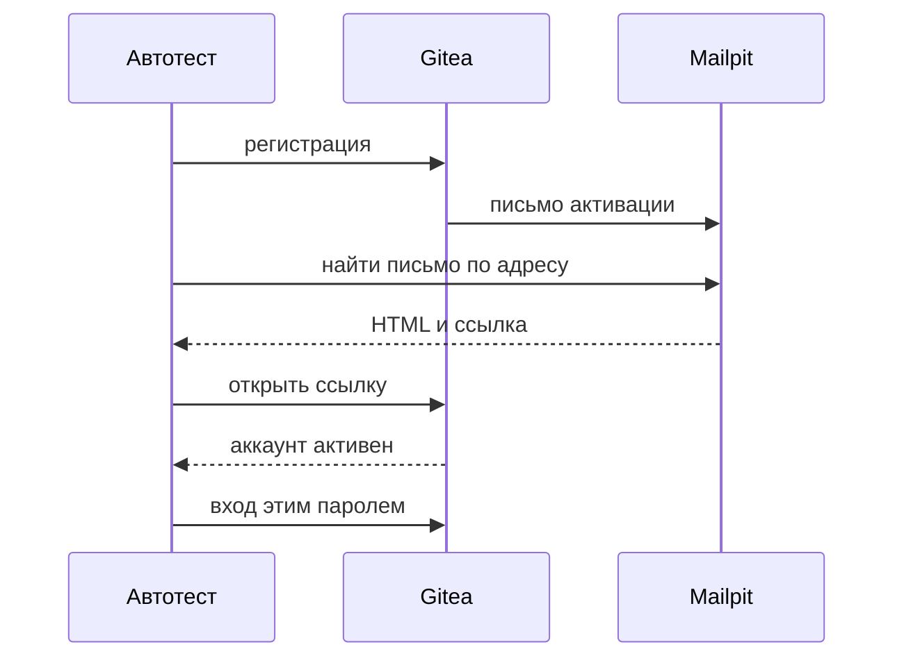
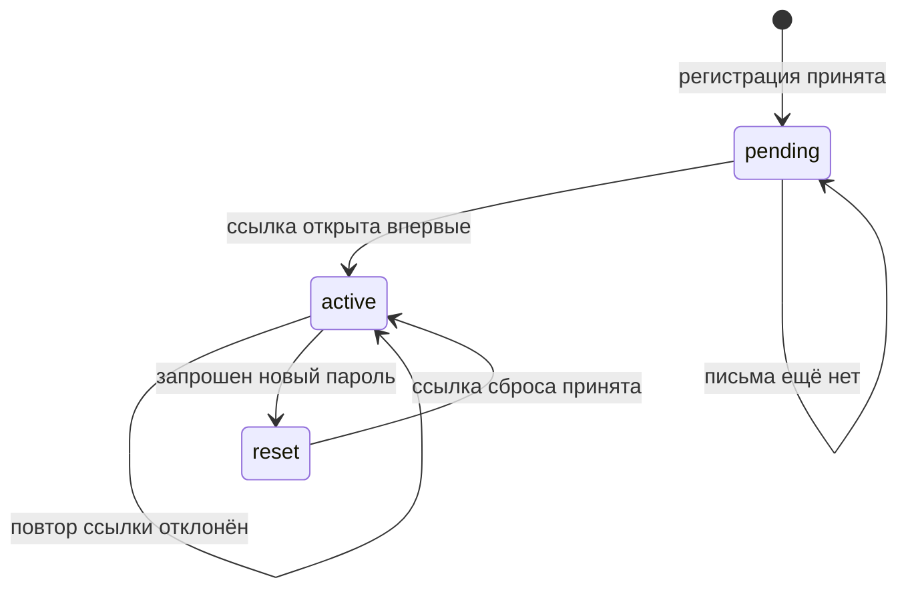

# Письма со ссылками

## Содержание

- [Теория](#теория)
  - [Ситуация](#ситуация)
  - [Модель](#модель)
  - [Понятия и связь с автоматизацией тестирования](#понятия-и-связь-с-автоматизацией-тестирования)
  - [Зоны ответственности](#зоны-ответственности)
  - [Пример](#пример)
  - [Типичные сбои](#типичные-сбои)
  - [Полезные ссылки](#полезные-ссылки)
  - [Вопросы по теории](#вопросы-по-теории)
- [Практическое задание](#практическое-задание)
  - [1.1 Общее](#11-общее)
  - [1.2 Сценарии](#12-сценарии-user-stories)
  - [1.3 Контракт](#13-контракт)
  - [1.4 Ошибки и ограничения](#14-ошибки-и-ограничения)
  - [1.5 Аудит](#15-аудитлоги)
  - [1.6 Нефункциональные требования](#16-нефункциональные-требования)

# Теория

## Ситуация

Человек регистрируется и не может войти, пока не откроет ссылку из письма. То же самое со сбросом пароля: новое слово действует только после письма. Дальше возможен один из исходов: ссылка активирует аккаунт, повтор той же ссылки отклоняется, ссылка сброса задаёт новый пароль и пускает им войти, у письма есть битая ссылка, письмо так и не пришло, либо ящик из `6.0` не поднят.

Отдельная разработка не нужна: достаточно контейнеров Gitea и Mailpit и команды `npx playwright test --grep @email` (`pytest -m email`, `dotnet test --filter Category=email`).

## Модель

Участники — тест, Gitea и Mailpit. Тест создаёт пользователя с уникальным адресом, затем читает ящик и сам открывает ссылку. Gitea решает, жива ли ссылка. Mailpit только отдаёт уже принятое письмо.

Решение о прохождении принимает тест. Надпись «проверьте почту» на странице регистрации ещё не доказательство: письмо могло не уйти.



Поиск письма идёт после регистрации, не параллельно с ней. Иначе тест прочитает старое письмо того же адреса.



Пока состояние `pending`, вход с паролем регистрации не считается успехом сценария. Аккаунт есть, но он не подтверждён.

| Поле письма | Что с ним делает тест |
| --- | --- |
| `To` | совпадает с адресом этого теста |
| `From` | `gitea@example.test` |
| Тема | различает активацию и сброс пароля |
| Ссылка | хост равен хосту `GITEA_URL` |

Нормальная форма не вводится. Ссылка — URL внутри письма, не отдельная таблица теста.

## Понятия и связь с автоматизацией тестирования

### Ожидание конкретного письма

Письмо появляется через долю секунды или через несколько секунд. Тест опрашивает поиск Mailpit по получателю, пока не найдёт одно новое письмо или не выйдет лимит 15 секунд. Интервал опроса — одна секунда. Фиксированная пауза перед единственной попыткой не годится: на медленном CI письмо опаздывает, на быстром пауза просто сжигает время.

Поиск фильтрует адрес теста. Письмо другого воркера в выборку не попадает. Если писем два, тест берёт самое позднее: повторная отправка не должна оживлять старую ссылку.

Клиент `MailpitClient` умеет четыре вещи: ждать письмо по адресу, прочитать его, достать ссылки, запросить у Mailpit проверку этих ссылок. Разбор HTML руками в каждом тесте не копируется.

### Активация

Регистрация с включённым подтверждением создаёт пользователя и шлёт письмо. Вход до перехода по ссылке не завершает сценарий. Тест открывает ссылку один раз и только потом входит тем же паролем.

Повторное открытие той же ссылки Gitea отклоняет. Тест ожидает отказ, а не вторую успешную активацию. Так проверяется, что ссылка одноразовая: чужой человек, который перехватил уже использованное письмо, аккаунт заново не подтвердит.

Ссылка обязана вести на хост `GITEA_URL`. Тест не переходит по адресу с другим хостом и не следует редиректу на внешний сайт.

### Сброс пароля

Пользователь уже активирован. Тест просит сброс, ждёт второе письмо на тот же адрес и отличает его от письма активации по теме. Ссылка из нового письма задаёт новый пароль. Старый пароль после этого не входит. Новый пароль входит.

Письмо сброса, пришедшее на другой адрес, проваливает тест даже если ссылка открывается. Иначе можно сменить пароль жертве, подставив свой ящик.

### Проверка ссылок

У письма бывает несколько ссылок: действие и, например, адрес сайта в подписи. Mailpit умеет обойти их и сказать, какая отвечает ошибкой. Тест вызывает эту проверку для письма активации и считает успехом ответ без битых ссылок. Сам он по каждой ссылке браузером не кликает: проверка ящика уже ходит по URL.

Внешние ссылки, если они появятся в шаблоне, тоже не должны вести на хост вне `GITEA_URL` для действия активации и сброса. Ссылка-действие и декоративная ссылка различаются. Декоративную тест может лишь проверить, что она отвечает. Действие он открывает сам и только на своём хосте.

### Сводка

| Понятие | Смысл в сценарии | На что опирается реализация |
| --- | --- | --- |
| Ожидание | письмо ищется, а не считается мгновенным | опрос до 15 секунд |
| Активация | вход только после первой ссылки | `TC-MAIL-01`, `TC-MAIL-02` |
| Одноразовость | вторая попытка той же ссылки отклоняется | `TC-MAIL-03` |
| Сброс | новый пароль действует, старый нет | `TC-MAIL-04` |
| Целые ссылки | в письме нет URL с ошибкой | `TC-MAIL-05` |

## Зоны ответственности

| Автотест | Gitea |
| --- | --- |
| Создаёт свежий адрес и пароль | Решает, подтверждён ли аккаунт |
| Читает письмо из Mailpit | Отправляет письмо на адрес из формы |
| Открывает ссылку один раз и проверяет повтор | Гасит уже использованный код |
| Не принимает ссылку с чужим хостом | Подставляет в письмо `ROOT_URL` |

Mailpit не подтверждает аккаунт. Он только хранит текст, который прислал Gitea.

## Пример

Программа ищет в уже полученном тексте письма первую ссылку на `http://localhost:3001/` и печатает, нашлась ли она. Сеть не нужна: пример про разбор, не про доставку.

### TypeScript

**Node.js 22 или новее, без браузера.** Регулярное выражение берёт абсолютный URL и сразу отбрасывает чужой хост.

```sh
npx tsx read-link.ts
```

```typescript
const html = '<a href="http://localhost:3001/user/activate?code=abc">ok</a>';
const match = html.match(/https?:\/\/[^"']+/);
const link = match?.[0] ?? '';
const allowed = link.startsWith('http://localhost:3001/');
console.log(allowed);
console.log(link.includes('code='));
```

### Python

**Python 3.10 или новее.** Та же строка и тот же признак хоста.

```sh
python read_link.py
```

```python
import re

html = '<a href="http://localhost:3001/user/activate?code=abc">ok</a>'
match = re.search(r"https?://[^\"']+", html)
link = match.group(0) if match else ""
print(str(link.startswith("http://localhost:3001/")).lower())
print(str("code=" in link).lower())
```

### C#

**.NET 8 или новее.** Проверка хоста идёт до любого перехода по ссылке.

```sh
dotnet run
```

```csharp
var html = "<a href=\"http://localhost:3001/user/activate?code=abc\">ok</a>";
var match = System.Text.RegularExpressions.Regex.Match(html, "https?://[^\"']+");
var link = match.Success ? match.Value : "";
Console.WriteLine(link.StartsWith("http://localhost:3001/").ToString().ToLowerInvariant());
Console.WriteLine(link.Contains("code=").ToString().ToLowerInvariant());
```

---

Каждая программа печатает `true` и `true`. Первая строка — ссылка на свой стенд. Вторая — в ней есть параметр кода. Сам код `abc` в этих двух строках не печатается отдельным секретом: в настоящем тесте в отчёт попадает только хост.

## Типичные сбои

| Что видно | Куда смотреть |
| --- | --- |
| Тест вошёл до письма | сценарий принял неподтверждённый аккаунт |
| Повтор ссылки тоже зелёный | тест не отличает отказ Gitea от успеха |
| Сброс пускает старым паролем | смена пароля не дошла до конца или открыта не та ссылка |
| Найдено письмо другого теста | фильтр поиска без полного адреса |
| Ссылка ведёт на хост внутри Docker-сети | `ROOT_URL` не равен `GITEA_URL` |
| Проверка ссылок красная из-за картинки с внешнего CDN | в шаблоне письма зависимость не из стенда; для курса действие должно быть на `GITEA_URL` |
| В логе полный `code=` | клиент напечатал письмо целиком |

## Полезные ссылки

### Общие

- [Mailpit — API v1](https://mailpit.axllent.org/docs/api-v1/) — поиск письма, чтение и проверка ссылок.
- [Gitea — email activation](https://docs.gitea.com/administration/config-cheat-sheet) — подтверждение регистрации и срок кода.

### По языку

#### TypeScript

**TypeScript, Playwright Test.** На JavaScript контракт писем остаётся тем же.

- [Playwright — APIRequestContext](https://playwright.dev/docs/api/class-apirequestcontext) — ожидание ответа поиска письмом опроса.

#### Python

**Python, pytest-playwright.** На синхронном Playwright API без pytest или на async API контракт писем остаётся тем же.

- [Playwright Python — polling](https://playwright.dev/python/docs/test-assertions) — как ждать условие без фиксированной паузы. Для API ящика тот же приём делает цикл с пределом 15 секунд.

#### C#

**C#, Playwright для .NET с NUnit.** На MSTest или xUnit контракт писем остаётся тем же.

- [Playwright .NET — APIRequest](https://playwright.dev/dotnet/docs/api-testing) — чтение JSON письма.

## Вопросы по теории

1. Почему вход сразу после регистрации не закрывает сценарий активации?
2. Что доказывает повторный переход по той же ссылке?
3. Как тест отличает письмо сброса от письма активации на одном адресе?
4. Почему берётся самое позднее письмо, а не первое?
5. Что делает тест со ссылкой, хост которой не совпал с `GITEA_URL`?
6. Зачем проверка всех ссылок, если действие тест и так открывает сам?
7. Почему токен из ссылки не попадает в отчёт целиком?

# Практическое задание

Автотесты писем со ссылками для Gitea.
Набор активирует аккаунт, отвергает повтор ссылки, меняет пароль через письмо и проверяет, что ссылки письма открываются.

## 1) Письма со ссылками

### 1.1 Общее

**Назначение:** проверить, что ссылка из письма делает ровно одно обещанное действие и только на своём стенде.

**Пользователи/роли:**

- AQA-инженер — пишет кейсы `TC-MAIL-*`;
- новый пользователь Gitea — адресат письма, у каждого теста свой.

**Зависимости/связанные настройки:**

- `6.0` — Mailpit, Gitea, `MAILPIT_URL`, `GITEA_URL`, подтверждение регистрации;
- `RUN_ID` — часть адреса.

Juice Shop, роли магазина и `BUG-xx` здесь не используются.

### 1.2 Сценарии (user stories)

1. **Письмо активации:** после регистрации на адрес теста приходит письмо с нужным отправителем и ссылкой на `GITEA_URL`.
2. **Первый переход:** ссылка активирует аккаунт, и тот же пароль входит.
3. **Второй переход:** та же ссылка больше не активирует.
4. **Сброс пароля:** новое письмо задаёт новый пароль, старый не входит, новый входит.
5. **Ссылки целы:** проверка ссылок Mailpit для письма активации не находит ошибок.

### 1.3 Контракт

#### 1.3.1 Клиент ящика

| Метод | Поведение |
| --- | --- |
| дождаться письмо | опрос поиска по полному адресу, не дольше 15 секунд |
| прочитать | тема, отправитель, получатель, текст, HTML |
| ссылки | абсолютные URL из HTML |
| проверка ссылок | вызов проверки Mailpit для этого письма |

**Логика/шаги:**

1. Собрать адрес `aqa.<RUN_ID>.<воркер>.<номер>@example.test`.
2. Выполнить действие в Gitea.
3. Дождаться одного нового письма на этот адрес.
4. Отбросить письмо, если получатель, отправитель или хост ссылки-действия не совпали.
5. Открыть ссылку-действие и сверить результат сценария.

Если письмо не пришло за 15 секунд, тест падает. Повтор всего сценария использует новый порядковый номер, чтобы не прочитать старое письмо.

#### 1.3.2 Кейсы

| ID | Действие | Ожидание |
| --- | --- | --- |
| `TC-MAIL-01` | регистрация | письмо на этот адрес, отправитель `gitea@example.test`, ссылка на хост `GITEA_URL` |
| `TC-MAIL-02` | открыть ссылку из `TC-MAIL-01` | аккаунт активирован, вход паролем регистрации успешен |
| `TC-MAIL-03` | открыть ту же ссылку ещё раз | Gitea отклоняет повтор, второй вход не нужен |
| `TC-MAIL-04` | сброс пароля активированного пользователя | новое письмо, новый пароль входит, старый нет |
| `TC-MAIL-05` | проверка ссылок письма активации | битых ссылок нет |

**Ответы:**

- Успех `TC-MAIL-02` и `TC-MAIL-04` — вход через форму или API Gitea, не через надпись на странице «письмо отправлено».
- Ошибки — см. раздел 1.4.
- В ответе теста нет полного URL с кодом.

### 1.4 Ошибки и ограничения

- **Письма нет** — 15 секунд опроса прошли. Это падение теста, не `known-issue`.
- **Чужой получатель или отправитель** — падение, даже если ссылка открывается.
- **Чужой хост ссылки-действия** — тест по ней не переходит и падает.
- **Повтор активации принят** — падение `TC-MAIL-03`.
- **Старый пароль всё ещё входит после сброса** — падение `TC-MAIL-04`.
- **Ящик или Gitea недоступны** — сценарий не начинается, см. `6.0`.

Срок кода 180 минут тест не дожидается и не подменяет. Проверяется только свежая ссылка.

### 1.5 Аудит/логи

Логировать: идентификатор кейса, адрес получателя, тему, хост ссылки, число найденных писем, итог входа без пароля.

В журнал не попадают пароль, полный URL с кодом, тело письма и заголовки, где может быть тот же код.

### 1.6 Нефункциональные требования

- Ожидание одного письма — не дольше 15 секунд и не чаще одного запроса в секунду.
- `sleep` фиксированной длины вместо опроса запрещён.
- Пять кейсов укладываются в таймаут теста 30 секунд каждый, кроме ожидания, которое входит в эти 30 секунд. Если 15 секунд ожидания плюс вход не укладываются, лимит теста для `email` поднимается до 45 секунд только у этих кейсов.
- Покрыты `TC-MAIL-01`…`TC-MAIL-05`.
- Общие нефункциональные требования проекта — два воркера и уникальный адрес — относятся и к письмам.
