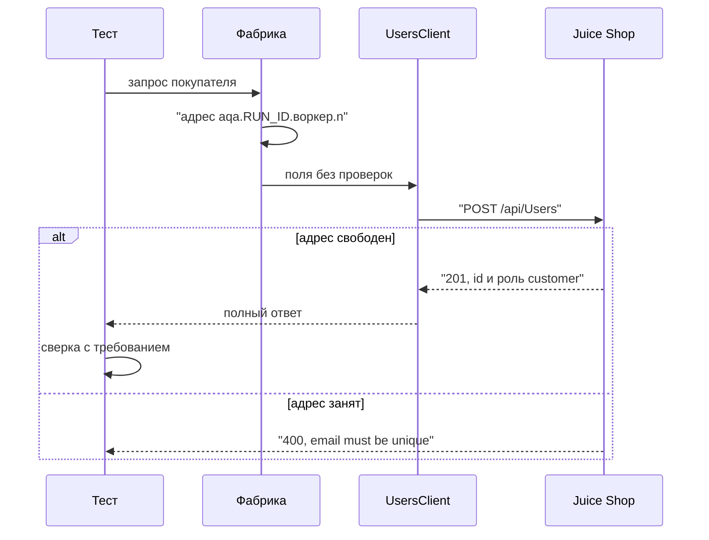
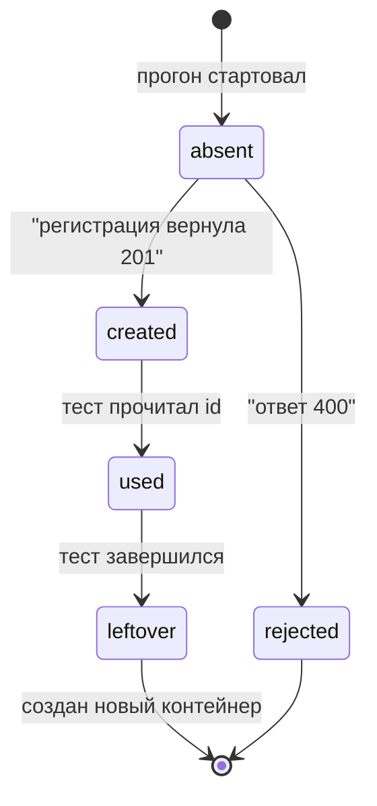

# Общие требования к тестовым данным

## Содержание

- [Теория](#теория)
  - [Ситуация](#ситуация)
  - [Модель](#модель)
  - [Понятия и связь с автоматизацией тестирования](#понятия-и-связь-с-автоматизацией-тестирования)
  - [Зоны ответственности](#зоны-ответственности)
  - [Пример](#пример)
  - [Типичные сбои](#типичные-сбои)
  - [Полезные ссылки](#полезные-ссылки)
  - [Вопросы по теории](#вопросы-по-теории)
- [Практическое задание](#практическое-задание)
  - [1.1 Общее](#11-общее)
  - [1.2 Сценарии](#12-сценарии-user-stories)
  - [1.3 Контракт](#13-контракт)
  - [1.4 Ошибки и ограничения](#14-ошибки-и-ограничения)
  - [1.5 Аудит](#15-аудитлоги)
  - [1.6 Нефункциональные требования](#16-нефункциональные-требования)

# Теория

## Ситуация

Набор тестов регистрирует покупателя, чтобы проверить корзину и заказ. Дальше возможен один из исходов: новый адрес принимается с **201**, в теле есть `data.id` и `data.role = customer`; тот же адрес повторно уходит на стенд и приходит **400** `email must be unique`; пустые email и пароль дают **400** `Invalid email/password cannot be empty`; заведомо короткий пароль даёт **201** вместо **400** (`BUG-01`, метка `known-issue`); контейнер не запущен, и проверка `GET /rest/admin/application-version` не получает **200**.

Падение на чужом email ломает сценарий корзины, хотя корзина здесь ни при чём. Адрес, пароль и ответ на секретный вопрос готовятся до запроса, по правилам этого файла.

Отдельная разработка не нужна: достаточно запущенного контейнера Juice Shop и команды `npx playwright test --grep @api` (`pytest -m api`, `dotnet test --filter Category=api`).

## Модель

Участники: тест, фабрика данных, `UsersClient` и Juice Shop. Фабрика собирает поля покупателя. Клиент отправляет их и возвращает статус, заголовки и тело. Проверок в клиенте нет. Решение о прохождении принимает оракул теста — требование, а не текущий ответ стенда.



Диаграмма показывает, почему адрес собирается до HTTP-запроса. Стенд отклоняет дубликат уже после записи первого пользователя, и второй тест получает чужую ошибку.



Пользователь после теста остаётся в базе контейнера: переход `used → leftover` нормален. Удаления через API нет, поэтому следующий прогон либо берёт новый адрес, либо начинает с нового контейнера. Запроса «удалить» на диаграмме нет, и набор его не отправляет.

Возможный набор полей (схема может быть и другой):

| `user` | Описание |
| --- | --- |
| `id` | Число, которое стенд присваивает при **201** |
| `email` | Адрес по шаблону `aqa.<RUN_ID>.<воркер>.<n>@example.test` |
| `role` | У нового покупателя всегда `customer` |
| `password` | Уходит в запросе, в ответе **201** отсутствует вместе с `totpSecret` |

Файл использует пользователя из `POST /api/Users`, секретный вопрос из `GET /api/SecurityQuestions` и товары каталога, которые уже лежат в образе.

## Понятия и связь с автоматизацией тестирования

### Четыре вида данных

Стенду для одного сценария нужны значения разной природы. Справочные уже лежат в образе: 46 товаров, вопрос `id = 1` «Your eldest siblings middle name?», доставка `One Day Delivery` за `0.99`, встроенные `admin@juice-sh.op` и `accountant@juice-sh.op`. Повторное создание товара ломает `TC-SEARCH-01`, который ждёт этот каталог.

Создаваемые данные появляются по ходу теста: покупатель фикстуры `customer`, его адрес, карта и отзыв. Конфигурация говорит, куда стучаться: `BASE_URL` по умолчанию `http://localhost:3000`, у контейнера `NODE_ENV=quiet` убирает приветственный баннер. Секрет доказывает право роли: `ADMIN_PASSWORD` и `ACCOUNTANT_PASSWORD` читаются из окружения. Контракт каталога относит каждое значение к одному виду и к одному источнику.

### Откуда брать значение

Значение получают пятью способами. Выбор зависит от того, кто владеет данными и можно ли показать их в git.

Создать через API — тест вызывает тот же `POST /api/Users`, что и форма, и запись принадлежит этому прогону. Так берут покупателя, адрес, карту и отзыв. Положить готовый набор до тестов — сид. Образ уже поднимается с sqlite: товары, вопросы, встроенные роли. Этот сид только читают. Снять снимок базы и вернуть его перед прогоном — снапшот. Он удобен, когда граф данных долго собирать запросами. База Juice Shop лежит в distroless-контейнере, поэтому здесь снапшот заменяет новый контейнер (`7.1`).

Взять кусок продакшена и заменить имена, почту, телефоны и карты — маскированное подмножество. Форма поля остаётся, человека в значении нет. У учебного стенда продакшена нет; на рабочем проекте маскирование делают до попадания дампа в git и в артефакт CI. Собрать значения, которых не было у живого человека, — синтетические данные. `@faker-js/faker`, `Faker` и `Bogus` дают имя, улицу и слово ответа. Домен в адрес подставляет шаблон ниже: у генератора свой правдоподобный домен.

Контракт набора: покупатель, адрес, карта и отзыв создаются через API из синтетических полей; каталог, вопросы и встроенные роли читаются из сида образа.

### Изоляция параллельного прогона

Два воркера пишут в один Juice Shop. Общий ящик `jim@juice-sh.op` или один счётчик на процесс приводит к **400** `email must be unique` у того теста, который пришёл вторым. Падает проверка корзины, хотя корзина собрана верно.

Адрес собирается по шаблону `aqa.<RUN_ID>.<воркер>.<n>@example.test`. `RUN_ID` в CI равен `${{ github.run_id }}`, локально его генерируют один раз на старте прогона. Номер воркера — индекс процесса: в TypeScript это `testInfo.parallelIndex`, в Python — число из `PYTEST_XDIST_WORKER`, в C# — `TestContext.CurrentContext.WorkerId`. Порядковый номер `n` растёт внутри воркера на каждого нового покупателя.

Повтор теста тоже создаёт пользователя, если первый заход успел получить **201** и упал позже. Повтор с тем же `n` снова получит **400**, поэтому `n` растёт и на ретрае: в CI их 2, локально 0. Домен `.test` зарезервирован RFC 2606, письмо на него не доставляется. Контракт изоляции: один покупатель — один адрес по этому шаблону.

### Что остаётся после теста

`DELETE /api/Users/{id}` для покупателя запрещён. Вызов удаления не очищает стенд, а добавляет шум: операция либо отклоняется, либо упирается в известный дефект прав. Данные изолируют уникальностью адреса. Полный сброс — новый контейнер: база создаётся заново при создании контейнера. `docker restart` сохраняет файловый слой, и старые пользователи остаются. Это разберут в `7.1`.

Пока контейнер жив, следующий прогон опирается на новый `RUN_ID` или на следующий `n`. Иначе вчерашний адрес снова даст **400**. Контракт очистки: тест не вызывает удаление пользователя; сброс стенда делает новый контейнер.

### Повторяемость

Упавший заказ легче читать, когда улица и карта при том же `RUN_ID` совпадают с прошлым логом. Генератору задают seed — целое от `RUN_ID`, и последовательность имён повторяется. В email seed не входит: уникальность держит шаблон. Если `RUN_ID` не влезает в целое генератора, для seed берут остаток от деления, а в адресе оставляют полный `RUN_ID`.

Пароль покупателя — 12 символов: буквы обоих регистров, цифра и спецсимвол. Форма регистрации пускает от 5 до 40, но короткий выброс генератора попадёт в `BUG-01` и тест станет зелёным по дефекту. Функция фабрики доводит пароль до правила. Ответ на секретный вопрос — одно слово. Номер карты — 16 цифр.

Контракт повторяемости: seed фиксируется `RUN_ID`, пароль проходит правило фабрики, email остаётся шаблонным.

### Чужие персональные данные

Персональные данные — сведения, по которым узнают человека: имя, почта, телефон, номер карты. Репозиторий копируют, логи CI хранят, отчёт скачивают, и живой адрес из фикстуры остаётся в истории git.

Маскирование заменяет такие поля и сохраняет форму: 16 цифр, допустимый домен, длина телефона. Синтетический покупатель маскирования не требует: человека за значением нет. Адреса образа на домене `juice-sh.op` — часть сида. Контракт приватности: в репозитории и в отчёте нет живых адресов, телефонов и номеров карт, почта теста заканчивается на `@example.test`.

### Каталог тестовых данных

Список «что откуда берётся» держат рядом с фабриками, иначе правило живёт в голове автора теста. Каталог — таблица: имя, вид, источник, время жизни, можно ли писать значение в git.

Для этого курса строки каталога такие. Покупатель — создаваемый, `POST /api/Users`, живёт до нового контейнера, в git не пишется. Товар, вопрос, доставка — справочные, сид образа, живут вместе с контейнером, идентификаторы в тексте уроков фиксированы. `BASE_URL` и `RUN_ID` — конфигурация, окружение, `BASE_URL` имеет значение по умолчанию. `ADMIN_PASSWORD` и `ACCOUNTANT_PASSWORD` — секреты, только окружение и секрет CI, в коде литерала нет. Пароль покупателя — секрет на время теста, в памяти процесса, в отчёт не кладётся.

Контракт каталога: у каждого значения есть вид и источник; секрет без переменной окружения останавливает прогон.

### Сравнение

| Инструмент | Подходит для |
| --- | --- |
| `@faker-js/faker`, `Faker`, `Bogus` | Синтетические поля одной записи внутри теста |
| Testcontainers | Поднять базу или стенд в контейнере на время набора |
| Снапшот базы | Быстро вернуть свой стенд к известной точке |
| Delphix, Tonic | Маскированная копия большого продакшена для команды |
| Mockaroo | Файл синтетических строк, который готовят до прогона |

В курсе поля покупателя собирает библиотека Faker своего стека, стенд поднимается контейнером Juice Shop, сброс делается новым контейнером. Delphix, Tonic и Mockaroo здесь не подключают: продакшена нет, а строки нужны в момент теста, а не файлом на неделю вперёд.

### Что будет в фабриках и data-driven тестах

`7.1` даст функции `buildCustomer()`, `buildAddress()`, `buildCard()`, `buildFeedback()` с seed от `RUN_ID`, файл `registration-cases.json` для `TC-REG-04`…`TC-REG-08` и команду нового контейнера. Тот же `RUN_ID` позже попадёт в `User-Agent` (`9.1`) и в окружение отчёта (`8.1`). Пароль в эти каналы не кладут.

### Сводка

| Понятие | Смысл в тестовых данных | На что опирается реализация |
| --- | --- | --- |
| Вид данных | Справочные, создаваемые, конфигурация, секрет | Каталог и источник каждой строки |
| Создание через API | Запись принадлежит прогону | `UsersClient.register` и сид образа `bkimminich/juice-shop:v20.4.0` |
| Уникальный email | Воркеры не делят ящик | `aqa.<RUN_ID>.<воркер>.<n>@example.test` |
| Seed | Повтор прогона даёт ту же улицу и карту | Число от `RUN_ID` |
| Новый контейнер | Полный сброс базы | Запуск контейнера, не `docker restart` |
| Маскирование | Форма поля жива, человека в значении нет | Запрет живых адресов в git |

## Зоны ответственности

| Автотест | Фреймворк |
| --- | --- |
| Называет, какой покупатель нужен сценарию | Собирает email, пароль и ответ на секретный вопрос |
| Сверяет статус и поля с требованием | Возвращает ответ клиента без своих проверок |
| Берёт следующий `n` на ретрае | Хранит счётчик внутри воркера |
| Читает каталог и вопрос, не создаёт их заново | Отдаёт товар и вопрос из сида образа |
| Останавливает прогон, если нет секрета роли | Читает `ADMIN_PASSWORD` и `ACCOUNTANT_PASSWORD` из окружения |

Сид даёт магазин с уже лежащим соком. Фабрика даёт покупателя, которого в образе не было. Пока контейнер один на все воркеры, адрес всё равно различается.

## Пример

Программа собирает адрес для `RUN_ID=42`, воркера `0` и номера `1`, проверяет образец пароля и домен. На всех стеках она записывает один и тот же `result.txt`.

### TypeScript

**Node.js 22 или новее, @playwright/test.** Правило адреса не требует браузера: его позже вызовет фикстура `customer`.

```sh
npm init -y
npm install -D @playwright/test@1.65
export RUN_ID=42
npx playwright test email-rule.spec.ts
cat result.txt
```

```typescript
import { test, expect } from '@playwright/test';
import { writeFileSync } from 'node:fs';

function uniqueEmail(runId: string, worker: number, n: number): string {
  return `aqa.${runId}.${worker}.${n}@example.test`;
}

function passwordAccepted(password: string): boolean {
  return password.length === 12 && /[a-z]/.test(password) && /[A-Z]/.test(password) && /[0-9]/.test(password) && /[^A-Za-z0-9]/.test(password);
}

test('правило email и пароля', () => {
  const email = uniqueEmail(process.env.RUN_ID ?? '', 0, 1);
  const lines = [
    email,
    passwordAccepted('Aa1!bcdefghi') ? 'password_ok' : 'password_bad',
    email.endsWith('@example.test') ? 'domain_reserved' : 'domain_real',
  ];
  expect(lines[0]).toBe('aqa.42.0.1@example.test');
  writeFileSync('result.txt', `${lines.join('\n')}\n`);
});
```

### Python

**Python 3.10 или новее, pytest-playwright.** Та же функция адреса живёт рядом с фикстурой покупателя, браузер для неё не запускается.

```sh
python -m pip install pytest pytest-playwright
export RUN_ID=42
pytest -q email_rule.py
cat result.txt
```

```python
import os
import re

def unique_email(run_id, worker, n):
    return f"aqa.{run_id}.{worker}.{n}@example.test"

def password_accepted(password):
    return len(password) == 12 and re.search(r"[a-z]", password) and re.search(r"[A-Z]", password) and re.search(r"[0-9]", password) and re.search(r"[^A-Za-z0-9]", password)

def test_email_rule():
    email = unique_email(os.environ["RUN_ID"], 0, 1)
    lines = [
        email,
        "password_ok" if password_accepted("Aa1!bcdefghi") else "password_bad",
        "domain_reserved" if email.endswith("@example.test") else "domain_real",
    ]
    assert lines[0] == "aqa.42.0.1@example.test"
    open("result.txt", "w", encoding="utf-8").write("\n".join(lines) + "\n")
```

### C#

**.NET 8 или новее, Microsoft.Playwright.NUnit.** Правило адреса проверяется тестом NUnit до любого вызова браузера.

```sh
dotnet new nunit -n EmailRule -o .
dotnet add package Microsoft.Playwright.NUnit --version 1.64.1
export RUN_ID=42
dotnet test
cat result.txt
```

```csharp
using System.Text.RegularExpressions;
using NUnit.Framework;

public class EmailRule
{
    static string UniqueEmail(string runId, int worker, int n) =>
        $"aqa.{runId}.{worker}.{n}@example.test";

    static bool PasswordAccepted(string password) =>
        password.Length == 12 && Regex.IsMatch(password, "[a-z]") && Regex.IsMatch(password, "[A-Z]") && Regex.IsMatch(password, "[0-9]") && Regex.IsMatch(password, "[^A-Za-z0-9]");

    [Test]
    public void Rule()
    {
        var email = UniqueEmail(Environment.GetEnvironmentVariable("RUN_ID")!, 0, 1);
        var lines = new[]
        {
            email,
            PasswordAccepted("Aa1!bcdefghi") ? "password_ok" : "password_bad",
            email.EndsWith("@example.test") ? "domain_reserved" : "domain_real",
        };
        Assert.That(lines[0], Is.EqualTo("aqa.42.0.1@example.test"));
        File.WriteAllText("result.txt", string.Join('\n', lines) + "\n");
    }
}
```

---

Все программы записывают в `result.txt` строки `aqa.42.0.1@example.test`, `password_ok`, `domain_reserved`, и раннер сообщает об одном пройденном тесте. Первая строка собирает прогон, воркер и порядковый номер, поэтому соседний воркер получает другой ящик. `password_ok` значит, что образец из 12 символов содержит оба регистра, цифру и спецсимвол. `domain_reserved` значит, что адрес лежит в зарезервированном домене `.test`.

## Типичные сбои

| Что видно | Куда смотреть |
| --- | --- |
| **400** `email must be unique` у нового теста | В адресе нет номера воркера или `RUN_ID` пустой |
| Ретрай падает на том же адресе | `n` не увеличился после **201** первого захода |
| После `docker restart` старые пользователи на месте | Сброс делает новый контейнер, рестарт хранит слой |
| В коде литерал пароля роли `admin` | Секрет читается из `ADMIN_PASSWORD` |
| Короткий пароль фабрики, тест зелёный | Сработал `BUG-01`, метки `known-issue` нет |
| `TC-SEARCH-01` видит не 46 товаров | Тест создал товар вместо чтения сида |
| В фикстуре адрес на публичном домене | Домен должен быть `@example.test` |
| Улицы разные при одном `RUN_ID` | Генератору не задан seed |
| В отчёте лежит пароль или JWT | Вложение собрали из сырого тела регистрации |

## Полезные ссылки

### Общие

- [RFC 2606 — Reserved Top Level DNS Names](https://www.rfc-editor.org/rfc/rfc2606) — почему домен `.test` не доставляет почту.
- [Playwright — Parallelism](https://playwright.dev/docs/test-parallel) — воркеры и индекс, который попадает в email.
- [Testcontainers](https://testcontainers.com/) — когда зависимость поднимают контейнером на время набора.
- [EUR-Lex — Regulation (EU) 2016/679](https://eur-lex.europa.eu/eli/reg/2016/679/oj) — что считается персональными данными, если набор уедет на рабочий проект.

### По языку

#### TypeScript

**TypeScript, Playwright Test.** На JavaScript контракт тестовых данных остаётся тем же.

- [Faker — Usage](https://fakerjs.dev/guide/usage.html) — seed и синтетические поля до шаблона email.
- [Playwright — Fixtures](https://playwright.dev/docs/test-fixtures) — где фикстура `customer` вызывает фабрику.

#### Python

**Python, pytest-playwright.** На синхронном Playwright API без pytest или на async API контракт тестовых данных остаётся тем же.

- [Faker — документация](https://faker.readthedocs.io/en/master/) — `Faker.seed` перед сборкой покупателя.
- [pytest — Fixtures](https://docs.pytest.org/en/stable/how-to/fixtures.html) — область function для нового покупателя на тест.

#### C#

**C#, Playwright для .NET с NUnit.** На MSTest или xUnit контракт тестовых данных остаётся тем же.

- [Bogus](https://github.com/bchavez/Bogus) — `Randomizer` с seed для адреса и карты.
- [NUnit — TestContext](https://docs.nunit.org/articles/nunit/writing-tests/TestContext.html) — `WorkerId` для номера воркера в email.

## Вопросы по теории

1. Зачем в адресе одновременно `RUN_ID`, номер воркера и порядковый номер?
2. Почему пароль покупателя собирают из 12 символов четырёх классов, хотя форма принимает и 5?
3. Куда девается пользователь, если удалить его через API нельзя?
4. Чем товар из образа отличается от покупателя фикстуры `customer`?
5. Почему у `BASE_URL` есть значение по умолчанию, а у `ADMIN_PASSWORD` нет?
6. Когда маскированная копия продакшена повредит учебному набору?
7. Что даёт один и тот же seed при разборе упавшего прогона?

# Практическое задание

Функциональность подготовки тестовых данных в системе.
Набор автотестов Juice Shop заводит покупателя через API и читает каталог из образа. Каталог фиксирует вид каждого значения, источник и запрет записывать секреты в репозиторий.

## 1) Каталог и правила тестовых данных

### 1.1 Общее

**Назначение:** собрать правила, по которым набор получает покупателя, справочник и секреты ролей.

**Пользователи/роли:**

- AQA-инженер — ведёт каталог и шаблон адреса;
- разработчик — читает отчёт и не ищет пароль в коде теста;
- CI — передаёт `RUN_ID`, `ADMIN_PASSWORD`, `ACCOUNTANT_PASSWORD`;
- `customer` — создаётся на тест;
- `admin` и `accounting` — берутся из образа, пароль только из окружения;
- `guest` — токена не имеет, своих данных не создаёт.

**Зависимости/связанные настройки:**

- `1.1` — контракт `POST /api/Users` и границы пароля 5–40;
- `1.4` — фикстура `customer` и клиент `UsersClient`;
- `BASE_URL` — адрес стенда, по умолчанию `http://localhost:3000`;
- `RUN_ID` — идентификатор прогона, без значения по умолчанию;
- `ADMIN_EMAIL` — `admin@juice-sh.op`;
- `ACCOUNTANT_EMAIL` — `accountant@juice-sh.op`;
- `ADMIN_PASSWORD`, `ACCOUNTANT_PASSWORD` — секреты, только окружение.

Файл не реализует фабрики полей адреса и карты и не переписывает граничные регистрации: это `7.1`. Отчёт и вложения — `8.1`. Журнал по `RUN_ID` — `9.1`.

### 1.2 Сценарии (user stories)

1. **Свой покупатель:** тест просит покупателя, получает адрес `aqa.<RUN_ID>.<воркер>.<n>@example.test` и регистрацию **201**.
2. **Чужой воркер:** второй воркер регистрирует другой адрес и не видит **400** из-за первого.
3. **Ретрай:** повтор после уже созданного пользователя берёт следующий `n`.
4. **Справочник:** тест читает товар 1 `Apple Juice (1000ml)` и вопрос `id = 1`, не создавая их.
5. **Секрет роли:** нет `ADMIN_PASSWORD` — прогон останавливается до запросов к стенду.
6. **Сброс:** новый контейнер поднимает пустой список созданных покупателей, сид образа на месте.

### 1.3 Контракт

#### 1.3.1 Уникальный email

| Поле | Проверки/валидация |
| --- | --- |
| `email` | `aqa.<RUN_ID>.<воркер>.<n>@example.test`, домен только `example.test` |
| `RUN_ID` | Обязателен на весь прогон, в CI — `${{ github.run_id }}` |
| воркер | Индекс воркера с нуля, стабилен внутри процесса |
| `n` | Целое с 1, растёт на каждого покупателя и на ретрай |

**Логика/шаги:**

1. Прочитать `RUN_ID`. При пустом значении остановить прогон с именем переменной.
2. Взять номер воркера из раннера.
3. Увеличить порядковый номер и собрать email.
4. Передать поля в `UsersClient.register`.
5. Сохранить `id` из **201** для фикстуры `customer`.

Если **201** уже получен, а следующая проверка упала, пользователь на стенде остаётся. Повтор идёт с новым `n`. Повтор с тем же адресом ждёт **400** и сценарий на этом заканчивается.

**Ответы:**

- **201 Created:** `data.role = customer`, заголовок `Location: /api/Users/{id}`, в теле нет `password` и `totpSecret`.
- **Ошибки:** см. раздел 1.4.

#### 1.3.2 Каталог

**Общее правило:** у строки каталога один вид и один источник. Тест не подменяет источник «на один раз».

| Строка | Вид и источник |
| --- | --- |
| Покупатель, адрес, карта, отзыв | Создаваемые, API, синтетические поля |
| Товары, вопросы, доставка, `admin`, `accounting` | Справочные, сид образа |
| `BASE_URL`, `RUN_ID`, `NODE_ENV=quiet` | Конфигурация окружения |
| `ADMIN_PASSWORD`, `ACCOUNTANT_PASSWORD`, пароль покупателя | Секреты, не в git |

**Логика/шаги:**

1. Отнести новое значение к строке каталога до написания теста.
2. Для справочной строки прочитать API образа.
3. Для секрета прочитать окружение и прервать прогон, если переменная пуста.
4. Для создаваемой строки вызвать фабрику и API.

**Ответы:**

- **Успех:** покупатель создан по 1.3.1, справочник прочитан без новых товаров.
- **Ошибки:** см. раздел 1.4.

#### 1.3.3 Пароль и секрет роли

| Поле | Проверки/валидация |
| --- | --- |
| Пароль покупателя | 12 символов, оба регистра, цифра, спецсимвол |
| Ответ на вопрос | Одно слово |
| Номер карты | 16 цифр, когда строка дойдёт до `7.1` |
| `ADMIN_PASSWORD` | Непустая строка из окружения, в коде нет литерала |

**Логика/шаги:**

1. Собрать пароль по правилу длины и классов.
2. Подставить вопрос `id = 1`, прочитав текст вопроса со стенда.
3. Для входа `admin` или `accounting` взять пароль из окружения.

**Ответы:**

- **201** на пароль фабрики у нового покупателя.
- Пустой секрет роли до HTTP не доходит: прогон завершается сообщением об имени переменной.

### 1.4 Ошибки и ограничения

- **201 Created** — новый покупатель по правилам фабрики, `data.role = customer`.
- **400** `email must be unique` — адрес уже есть; для нового теста это ошибка данных, не дефект продукта.
- **400** `Invalid email/password cannot be empty` — в запросе пустые email или пароль, тело `text/html`.
- **201** вместо **400** на пароль короче 5, длиннее 40, невалидный email или другой `passwordRepeat` — `BUG-01`. Такие ряды помечают `known-issue`. Фабрика счастливого пути их не генерирует.
- Нет HTTP-ответа — контейнер не запущен или `BASE_URL` указывает мимо. Сначала `GET /rest/admin/application-version` ждёт **200**.
- Пустые `RUN_ID`, `ADMIN_PASSWORD`, `ACCOUNTANT_PASSWORD` — немедленный отказ прогона с именем переменной.
- Удаление пользователя через API недоступно. Ответ на `DELETE /api/Users/{id}` не используют как очистку.

Сначала проверяются переменные окружения, потом готовность стенда, потом регистрация. Иначе пустой секрет выглядит как **401** стенда.

### 1.5 Аудит/логи

В журнал прогона писать email, статус регистрации и `RUN_ID`.

В журнал и во вложения не попадают пароль покупателя, `ADMIN_PASSWORD`, `ACCOUNTANT_PASSWORD`, cookie `token`, полный JWT, `totpSecret` и хеш пароля из payload токена.

### 1.6 Нефункциональные требования

- Регистрация одного покупателя укладывается в таймаут теста 30 с и таймаут проверки 5 с.
- В тесте нет `waitForTimeout`, `sleep` и `Thread.Sleep`. Готовность стенда — опрос `GET /rest/admin/application-version` до **200**.
- В CI 2 воркера, у них разные номера в email. Ретраи: 2 в CI, 0 локально. Ретрай берёт новый `n`.
- Полный прогон API и UI (chromium) в CI — не дольше 10 минут.
- Каталог из 1.3.2 покрыт правилами фабрики: счастливый путь не создаёт товары и не пишет секреты в репозиторий.
