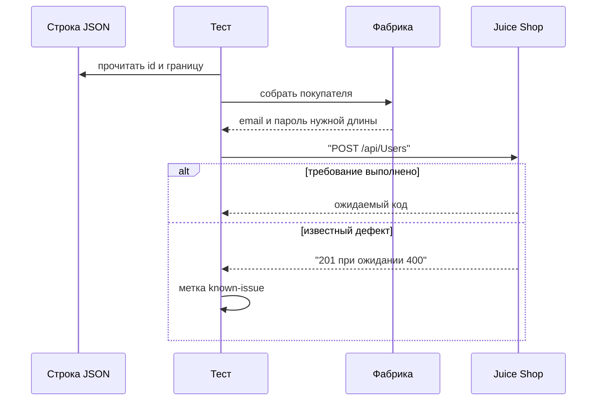
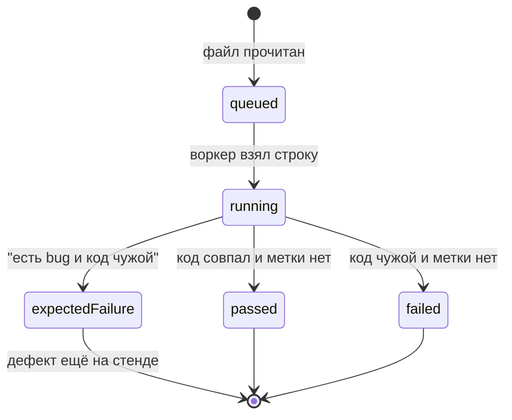

# Фабрики и data-driven тесты

## Содержание

- [Теория](#теория)
  - [Ситуация](#ситуация)
  - [Модель](#модель)
  - [Понятия и связь с автоматизацией тестирования](#понятия-и-связь-с-автоматизацией-тестирования)
  - [Зоны ответственности](#зоны-ответственности)
  - [Пример](#пример)
  - [Типичные сбои](#типичные-сбои)
  - [Полезные ссылки](#полезные-ссылки)
  - [Вопросы по теории](#вопросы-по-теории)
- [Практическое задание](#практическое-задание)
  - [1.1 Общее](#11-общее)
  - [1.2 Сценарии](#12-сценарии-user-stories)
  - [1.3 Контракт](#13-контракт)
  - [1.4 Ошибки и ограничения](#14-ошибки-и-ограничения)
  - [1.5 Аудит](#15-аудитлоги)
  - [1.6 Нефункциональные требования](#16-нефункциональные-требования)

# Теория

## Ситуация

Набор тестов проверяет границы регистрации одним прогоном по файлу строк. Дальше возможен один из исходов: пароль из 5 или 40 символов даёт **201**; пароль из 4 или 41 символа, невалидный email и другой `passwordRepeat` по требованию дают **400**, а стенд отвечает **201** (`BUG-01`, метка `known-issue`); адрес строки уже занят и приходит **400** `email must be unique`; контейнер не запущен, и `GET /rest/admin/application-version` не получает **200**.

Строки отличаются входом, шаги у них общие. Фабрика собирает покупателя, файл задаёт границу, оракул сверяет код с требованием.

Отдельная разработка не нужна: достаточно запущенного контейнера Juice Shop и команды `npx playwright test --grep @api` (`pytest -m api`, `dotnet test --filter Category=api`).

## Модель

Участники: строка из `registration-cases.json`, фабрика, `UsersClient`, Juice Shop. Фабрика подставляет длину пароля и вид email из строки и добавляет уникальный адрес там, где строка просит валидную почту. Клиент возвращает ответ без проверок. Решение о прохождении принимает оракул теста — требование, а не текущий ответ стенда.



Сначала читается строка, потом собирается тело. Иначе длина пароля окажется правилом счастливого пути из `7.0`, и граница 4 символа в запрос не попадёт.



`passed` — стенд совпал с требованием, у строки нет `bug`. `expectedFailure` — требование нарушено, и строка назвала `BUG-01`. Когда дефект исправят, та же строка уйдёт в `failed`: метка `known-issue` при успехе проверки останавливает прогон, чтобы её сняли. Перехода «забыть метку молча» на диаграмме нет.

Возможный набор полей (схема может быть и другой):

| `registrationCase` | Описание |
| --- | --- |
| `id` | `TC-REG-04` … `TC-REG-08`, попадает в имя теста |
| `variant` | Чем строка отличается: длина, `invalid-email`, `repeat-mismatch` |
| `expectedStatus` | Код по требованию, для границ с дефектом это **400** |
| `bug` | `BUG-01` или пусто |

Файл использует тело `POST /api/Users` и пользователя, которого этот запрос создаёт на стенде.

## Понятия и связь с автоматизацией тестирования

### Фабрика

Один и тот же покупатель описан в регистрации, корзине и заказе. Литерал в каждом тесте расходится: в одном пароль короткий, в другом домен случайный. Фабрика — функция, которая собирает поля по каталогу из `7.0`.

Имена фиксированы. TypeScript, `src/data/factories.ts`, `@faker-js/faker`: `buildCustomer()`, `buildAddress()`, `buildCard()`, `buildFeedback()`. Python, `aqa/data/factories.py`, `Faker`: `build_customer()` и те же суффиксы. C#, `AqaJuiceShop.Tests/Data/TestData.cs`, `Bogus`: `TestData.Customer()`, `TestData.Address()`, `TestData.Card()`, `TestData.Feedback()`.

`buildCustomer()` возвращает email по шаблону `aqa.<RUN_ID>.<воркер>.<n>@example.test`, пароль из 12 символов (оба регистра, цифра, спецсимвол), слово ответа и `securityQuestionId = 1`. `buildAddress()` даёт `fullName`, `mobileNum`, `zipCode`, `streetAddress`, `city`, `state`, `country`. `buildCard()` даёт `fullName`, `cardNum` из 16 цифр, `expMonth`, `expYear`. `buildFeedback()` даёт `comment` и `rating`. Капчу фабрика не вычисляет: её читает `FeedbackClient` в момент отзыва.

Пароль генератора — черновик. Функция фабрики дописывает классы символов и держит длину 12, потому что удачный короткий пароль на этом стенде получает **201** (`BUG-01`) и прячет ошибку фабрики. Контракт: счастливый путь берёт поля только из этих функций.

### Seed и номер воркера

Seed — стартовое целое генератора. Одинаковый seed даёт ту же улицу и ту же карту при повторе прогона. Его берут из числового `RUN_ID`; если число больше предела генератора, в seed идёт остаток, в email — полный `RUN_ID`.

Вызовы: `faker.seed(seed)` в `@faker-js/faker`, `Faker.seed(seed)` в Python, `new Bogus.Randomizer(seed)` в C#. Seed задают до первого поля.

Номер воркера в seed не заменяет шаблон email. Два воркера с одним seed получат похожую улицу и разные ящики: `testInfo.parallelIndex`, суффикс `PYTEST_XDIST_WORKER` (`gw0` → `0`), `TestContext.CurrentContext.WorkerId`. Счётчик `n` в TypeScript и Python живёт в процессе воркера. В NUnit потоки делят процесс, счётчик увеличивают через `Interlocked.Increment`. Ретрай берёт новый `n`, потому что первый заход мог уже получить **201**.

Контракт: seed один на `RUN_ID`, email содержит воркер и новый `n` на каждую попытку.

### Один тест на файл строк

`TC-REG-04` … `TC-REG-08` делают одно и то же: собрать пользователя, отправить `POST /api/Users`, сверить код. Меняются длина пароля, вид email и повтор пароля. Это классы границ из `0.3`: 4 и 41 за краем, 5 и 40 на краю, отдельный класс у формата почты и у `passwordRepeat`.

Data-driven тест читает `registration-cases.json` и поднимает по строке отдельный результат с id в имени: `TC-REG-04 пароль из 4 символов`. Две строки носят `TC-REG-06`: длины 5 и 40. Id в имени сохраняется, вариант виден рядом.

| id | variant | Ожидание | Факт стенда |
| --- | --- | --- | --- |
| `TC-REG-04` | длина 4 | **400** | **201**, `BUG-01` |
| `TC-REG-05` | длина 41 | **400** | **201**, `BUG-01` |
| `TC-REG-06` | длина 5 | **201** | **201** |
| `TC-REG-06` | длина 40 | **201** | **201** |
| `TC-REG-07` | email без домена | **400** | **201**, `BUG-01` |
| `TC-REG-08` | другой `passwordRepeat` | **400** | **201**, `BUG-01` |

У `TC-REG-07` локальная часть всё равно уникальна (`aqa.<RUN_ID>.<воркер>.<n>` без `@example.test`). Иначе второй прогон получит `email must be unique`, проверка требования случайно станет зелёной, и метка `known-issue` заорёт «дефект исчез».

Метка вешается на строку с непустым `bug`. TypeScript: `test.fail()` и `annotation` с `BUG-01`, теги `@api` и `@known-issue`. Python: `@pytest.mark.known_issue` и `@pytest.mark.xfail(strict=True, reason="BUG-01")`. C#: `[Category("known-issue")]`, `[Property("issue", "BUG-01")]` и `KnownIssue.ExpectFailureAsync` из `1.0`. `strict` и `test.fail()` делают неожиданный успех падением.

Контракт: шесть строк, id в имени результата, ожидание в проверке — колонка «Ожидание».

### Новый контейнер

База Juice Shop — файл sqlite в слое контейнера. Она появляется при создании контейнера из образа. `docker restart` процесс поднимает заново и слой не трогает: вчерашние `aqa.…@example.test` на месте. Сброс — удалить контейнер и создать новый той же командой, что в `1.0`.

```sh
docker rm -f juice-shop
docker run -d --name juice-shop -p 3000:3000 -e NODE_ENV=quiet bkimminich/juice-shop:v20.4.0
```

Дальше опрос `GET /rest/admin/application-version` до **200**. В compose то же самое делает `docker compose -f infra/docker-compose.yml up -d --force-recreate --no-deps juice-shop`. Образ distroless: `docker exec … sh` и `--health-cmd` с curl недоступны, готовность смотрит отдельный шаг.

Контракт сброса: новый контейнер, затем **200** на версии. Удаление пользователей через API в этот шаг не входит.

### SharedArray для k6

У виртуального пользователя k6 свой интерпретатор. `open()` и `JSON.parse` внутри функции сценария повторяются на каждой итерации и попадают во время ответа, которое `4.1` сравнивает с порогом. `SharedArray` разбирает файл один раз в контексте инициализации и отдаёт строкам общую память только на чтение.

Список слов для `perf/search-load.js` лежит в `perf/search-words.json` и читается так на верхнем уровне скрипта, до `export default`. Покупателей для `basket-load.js` по-прежнему создаёт `setup()`: это запись на стенд, а не файл. Контракт: слова поиска приходят из `SharedArray`, пороги `4.1` считаются без разбора JSON внутри итерации.

### Что будет в отчётности

`8.0` считает каждую строку отдельным результатом: у `TC-REG-06` их два. `8.1` покажет параметр строки в отчёте и не приложит пароль. Метка `known-issue` попадёт в долю ожидаемых падений, а не в обычный fail.

### Сводка

| Понятие | Смысл в фабриках | На что опирается реализация |
| --- | --- | --- |
| Фабрика | Одно место для полей покупателя | `buildCustomer` и аналоги стека |
| Seed | Повтор `RUN_ID` даёт ту же улицу | `faker.seed` / `Faker.seed` / `Randomizer` |
| Строка данных | Граница регистрации с id кейса | `registration-cases.json` |
| `known-issue` | Ожидаемое нарушение `BUG-01` | `test.fail`, `xfail(strict=True)`, `KnownIssue` |
| Новый контейнер | Пустая база поверх сида образа | `docker rm` и новый `docker run` |
| `SharedArray` | Файл читается один раз на прогон k6 | `perf/search-words.json` |

## Зоны ответственности

| Автотест | Фреймворк |
| --- | --- |
| Называет id кейса и ожидаемый код | Читает JSON и собирает тело через фабрику |
| Помечает строку с `bug` как `known-issue` | Даёт `test.fail` / `xfail` / `KnownIssue` |
| Проверяет требование, а не факт **201** | Не подменяет ожидание текущим кодом стенда |
| Просит новый контейнер перед чистым прогоном | Поднимает образ и ждёт **200** версии |

Файл строк описывает границы. Фабрика счастливого пути описывает покупателя для корзины и заказа. Подмена одной другой сдвигает либо длину пароля, либо уникальность адреса.

## Пример

Программа ставит seed `42`, собирает первый email воркера `0` и печатает шесть строк регистрации так, как их увидит раннер: id, вариант, код требования, дефект. Juice Shop для этого фрагмента не нужен.

### TypeScript

**Node.js 22 или новее, @playwright/test.** Seed берётся из `@faker-js/faker`, адрес — из шаблона `7.0`, строки — из того же списка, что ляжет в `src/data/registration-cases.json`.

```sh
npm init -y
npm install -D @playwright/test@1.65 @faker-js/faker
export RUN_ID=42
npx playwright test cases.spec.ts
cat result.txt
```

```typescript
import { test, expect } from '@playwright/test';
import { faker } from '@faker-js/faker';
import { writeFileSync } from 'node:fs';

const cases = [
  ['TC-REG-04', 'len-4', '400', 'BUG-01'],
  ['TC-REG-05', 'len-41', '400', 'BUG-01'],
  ['TC-REG-06', 'len-5', '201', '-'],
  ['TC-REG-06', 'len-40', '201', '-'],
  ['TC-REG-07', 'invalid-email', '400', 'BUG-01'],
  ['TC-REG-08', 'repeat-mismatch', '400', 'BUG-01'],
];

test('строки регистрации', () => {
  const seed = Number(process.env.RUN_ID);
  faker.seed(seed);
  const email = `aqa.${process.env.RUN_ID}.0.1@example.test`;
  const lines = [`seed=${seed}`, `email=${email}`, ...cases.map((c) => c.join(' '))];
  expect(lines[1]).toBe('email=aqa.42.0.1@example.test');
  writeFileSync('result.txt', `${lines.join('\n')}\n`);
});
```

### Python

**Python 3.10 или новее, pytest-playwright.** `Faker.seed` фиксирует генератор, список строк совпадает с `aqa/data/registration_cases.json`.

```sh
python -m pip install pytest pytest-playwright Faker
export RUN_ID=42
pytest -q cases_rule.py
cat result.txt
```

```python
import os
from faker import Faker

CASES = [
    ("TC-REG-04", "len-4", "400", "BUG-01"),
    ("TC-REG-05", "len-41", "400", "BUG-01"),
    ("TC-REG-06", "len-5", "201", "-"),
    ("TC-REG-06", "len-40", "201", "-"),
    ("TC-REG-07", "invalid-email", "400", "BUG-01"),
    ("TC-REG-08", "repeat-mismatch", "400", "BUG-01"),
]

def test_registration_rows():
    seed = int(os.environ["RUN_ID"])
    Faker.seed(seed)
    email = f"aqa.{os.environ['RUN_ID']}.0.1@example.test"
    lines = [f"seed={seed}", f"email={email}", *[" ".join(row) for row in CASES]]
    assert lines[1] == "email=aqa.42.0.1@example.test"
    open("result.txt", "w", encoding="utf-8").write("\n".join(lines) + "\n")
```

### C#

**.NET 8 или новее, Microsoft.Playwright.NUnit.** `Randomizer` получает тот же seed, строки совпадают с `Data/registration-cases.json`.

```sh
dotnet new nunit -n CasesRule -o .
dotnet add package Microsoft.Playwright.NUnit --version 1.64.1
dotnet add package Bogus
export RUN_ID=42
dotnet test
cat result.txt
```

```csharp
using Bogus;
using NUnit.Framework;

public class CasesRule
{
    static readonly string[][] Cases =
    {
        new[] { "TC-REG-04", "len-4", "400", "BUG-01" },
        new[] { "TC-REG-05", "len-41", "400", "BUG-01" },
        new[] { "TC-REG-06", "len-5", "201", "-" },
        new[] { "TC-REG-06", "len-40", "201", "-" },
        new[] { "TC-REG-07", "invalid-email", "400", "BUG-01" },
        new[] { "TC-REG-08", "repeat-mismatch", "400", "BUG-01" },
    };

    [Test]
    public void Rows()
    {
        var runId = Environment.GetEnvironmentVariable("RUN_ID")!;
        var seed = int.Parse(runId);
        _ = new Randomizer(seed);
        var email = $"aqa.{runId}.0.1@example.test";
        var lines = new List<string> { $"seed={seed}", $"email={email}" };
        lines.AddRange(Cases.Select(c => string.Join(' ', c)));
        Assert.That(lines[1], Is.EqualTo("email=aqa.42.0.1@example.test"));
        File.WriteAllText("result.txt", string.Join('\n', lines) + "\n");
    }
}
```

---

Все программы записывают `seed=42`, `email=aqa.42.0.1@example.test` и шесть строк от `TC-REG-04 len-4 400 BUG-01` до `TC-REG-08 repeat-mismatch 400 BUG-01`. Две строки `TC-REG-06` несут длины 5 и 40 и код **201** без дефекта. Остальные четыре называют `BUG-01` и код требования **400**. Раннер сообщает об одном пройденном тесте: фрагмент проверяет каталог строк, живой `POST` делает задание ниже.

## Типичные сбои

| Что видно | Куда смотреть |
| --- | --- |
| `TC-REG-07` внезапно зелёный на втором прогоне | Email не уникален, пришёл `email must be unique`, а не проверка формата |
| Все границы зелёные без `known-issue` | Ожидание подменили фактом **201** |
| После исправления `BUG-01` набор красный | `test.fail` / `xfail(strict=True)` просит снять метку |
| `TC-REG-06` один результат вместо двух | В JSON потеряна длина 5 или 40 |
| Пароль счастливого пути короче 12 | Фабрика отдала черновик генератора без доводки классов |
| Одинаковый email у `gw0` и `gw1` | В шаблон не попал номер воркера |
| `docker restart` не убрал пользователей | Нужен `docker rm` и новый `docker run` |
| k6: время поиска выросло после выноса слов в JSON | `open` и `JSON.parse` стоят внутри функции VU, а не в `SharedArray` |
| Имена и улицы прыгают при том же `RUN_ID` | `faker.seed` вызван после первого поля |

## Полезные ссылки

### Общие

- [Playwright — Parameterize tests](https://playwright.dev/docs/test-parameterize) — цикл по строкам и id в имени теста.
- [k6 — SharedArray](https://grafana.com/docs/k6/latest/javascript-api/k6-data/sharedarray/) — один разбор JSON на все VU.
- [Docker — docker rm](https://docs.docker.com/reference/cli/docker/container/rm/) — удаление контейнера вместе со слоем, где лежит sqlite.

### По языку

#### TypeScript

**TypeScript, Playwright Test.** На JavaScript контракт фабрик и data-driven теста остаётся тем же.

- [Faker — Usage](https://fakerjs.dev/guide/usage.html) — `faker.seed` до сборки адреса и карты.
- [Playwright — Annotations](https://playwright.dev/docs/test-annotations) — `test.fail()` и annotation `BUG-01`.

#### Python

**Python, pytest-playwright.** На синхронном Playwright API без pytest или на async API контракт фабрик и data-driven теста остаётся тем же.

- [pytest — Parametrizing tests](https://docs.pytest.org/en/stable/how-to/parametrize.html) — строка JSON как параметр и `xfail(strict=True)`.
- [Faker — документация](https://faker.readthedocs.io/en/master/) — `Faker.seed` на процесс воркера.

#### C#

**C#, Playwright для .NET с NUnit.** На MSTest или xUnit контракт фабрик и data-driven теста остаётся тем же.

- [NUnit — TestCaseSource](https://docs.nunit.org/articles/nunit/writing-tests/attributes/testcasesource.html) — имя теста из id строки.
- [Bogus](https://github.com/bchavez/Bogus) — `Randomizer` с seed для `TestData`.

## Вопросы по теории

1. Почему границы `TC-REG-04`…`TC-REG-08` живут в одном файле, а не в пяти копиях теста?
2. Зачем пароль фабрики доводят до 12 символов, если генератор уже что-то вернул?
3. Почему у `TC-REG-07` email без домена всё равно содержит `RUN_ID` и номер воркера?
4. Что изменится в результате, когда `BUG-01` исправят, а метка `known-issue` останется?
5. Почему `docker restart` оставляет вчерашних покупателей?
6. Почему список слов k6 читают через `SharedArray`, а покупателей нагрузки создают в `setup()`?
7. Чем `buildCustomer()` отличается от строки в `registration-cases.json`?

# Практическое задание

Функциональность фабрик и data-driven регистрации в системе.
Набор автотестов собирает покупателя, адрес, карту и отзыв через фабрики и прогоняет `TC-REG-04`…`TC-REG-08` из одного JSON. Полный сброс покупателей делает новый контейнер Juice Shop.

## 1) Фабрики, строки регистрации и сброс

### 1.1 Общее

**Назначение:** заменить ручные литералы фабриками и одним data-driven тестом границ регистрации.

**Пользователи/роли:**

- AQA-инженер — ведёт JSON и seed;
- разработчик — по красному `known-issue` видит, что `BUG-01` исчез;
- CI — передаёт `RUN_ID` и два воркера;
- `customer` — каждая строка и каждая фикстура получают своего.

**Зависимости/связанные настройки:**

- `7.0` — шаблон email, каталог, секрет роли;
- `1.1` — контракт регистрации и текст `BUG-01`;
- `1.4` — `UsersClient.register` и фикстура `customer`;
- `4.1` — `perf/search-load.js`, пороги времени;
- `RUN_ID` — seed и часть email, без значения по умолчанию.

Отчёт по строкам — `8.1`. Корреляция журнала — `9.1`. Здесь нет нового id вне диапазона `TC-REG-04`…`TC-REG-08`.

### 1.2 Сценарии (user stories)

1. **Счастливый покупатель:** фикстура вызывает `buildCustomer()`, регистрация даёт **201**, пароль в отчёт не попадает.
2. **Граница 5 и 40:** две строки `TC-REG-06` заканчиваются **201**, в имени есть id.
3. **Край и формат:** `TC-REG-04`, `TC-REG-05`, `TC-REG-07`, `TC-REG-08` ждут **400**, помечены `BUG-01` и падают ожидаемо, пока стенд отвечает **201**.
4. **Чистый стенд:** новый контейнер, затем версия **200**, старых `aqa.…@example.test` нет.
5. **Нагрузка поиска:** `search-load.js` берёт слово из `SharedArray`, разбор файла не сидит внутри итерации.

### 1.3 Контракт

#### 1.3.1 Фабрики

| Функция | Проверки/валидация |
| --- | --- |
| `buildCustomer()` | email по шаблону, пароль 12 символов четырёх классов, ответ — слово, вопрос `1` |
| `buildAddress()` | все поля `POST /api/Addresss` непустые |
| `buildCard()` | `cardNum` — 16 цифр |
| `buildFeedback()` | `comment` непустой, `rating` от 1 до 5 |

**Логика/шаги:**

1. Прочитать `RUN_ID` и остановить прогон, если он пуст.
2. Задать seed и взять номер воркера.
3. Увеличить `n` и собрать поля.
4. Вернуть объект тесту. Проверок HTTP внутри фабрики нет.

Повтор после **201** берёт следующий `n`. Уже созданный пользователь на стенде остаётся до нового контейнера.

**Ответы:**

- **201** на `buildCustomer()` с валидным шаблоном.
- **Ошибки:** см. раздел 1.4.

#### 1.3.2 Строки `registration-cases.json`

**Общее правило:** тест один, результатов шесть. Имя начинается с `id`. Ожидаемый код — требование. Непустое поле `bug` включает `known-issue`.

| id и variant | Вход и правило |
| --- | --- |
| `TC-REG-04` `len-4` | Пароль из 4 символов, валидный уникальный email, `passwordRepeat` совпадает, ожидание **400**, `BUG-01` |
| `TC-REG-05` `len-41` | Пароль из 41 символа, ожидание **400**, `BUG-01` |
| `TC-REG-06` `len-5` и `len-40` | Граничные длины, ожидание **201**, `bug` пуст |
| `TC-REG-07` `invalid-email` | Уникальная строка без домена, ожидание **400**, `BUG-01` |
| `TC-REG-08` `repeat-mismatch` | Пароль фабрики и другой `passwordRepeat`, ожидание **400**, `BUG-01` |

Путь файла: `src/data/registration-cases.json`, `aqa/data/registration_cases.json`, `AqaJuiceShop.Tests/Data/registration-cases.json`.

**Логика/шаги:**

1. Прочитать JSON.
2. Для строки собрать пользователя: валидный email — шаблоном, невалидный — тем же префиксом без `@example.test`.
3. Вызвать `UsersClient.register`.
4. Сверить статус с `expectedStatus`.
5. Для непустого `bug` включить ожидаемое падение по механизму `1.0`.

**Ответы:**

- **201** — строки `TC-REG-06`, `data.role = customer`.
- **400** — требование остальных строк. Факт стенда сегодня **201** (`BUG-01`).
- **Ошибки:** см. раздел 1.4.

#### 1.3.3 Новый контейнер и слова k6

| Шаг | Проверки/валидация |
| --- | --- |
| `docker rm -f juice-shop` и новый `docker run` | Тот же образ и `NODE_ENV=quiet`, порт `3000` |
| Опрос версии | **200**, в теле есть поле `version` |
| `SharedArray` | Создан на верхнем уровне `search-load.js` из `perf/search-words.json` |

**Логика/шаги:**

1. Удалить контейнер и создать новый командой из раздела про новый контейнер.
2. Ждать **200** версии опросом, без фиксированной паузы.
3. В k6 открыть JSON внутри колбэка `new SharedArray(...)`.

**Ответы:**

- **200** версии — стенд готов, созданных тестом пользователей нет.
- **Ошибки:** см. раздел 1.4.

### 1.4 Ошибки и ограничения

- **201** — валидная регистрация (`TC-REG-06` и `buildCustomer`).
- **400** `email must be unique` — столкновение адреса, для новой строки это ошибка данных.
- **400** по требованию на длине 4 и 41, невалидном email и другом `passwordRepeat`. Факт — **201**, `BUG-01`, тест ожидаемо падает.
- Пустой `RUN_ID` — отказ до запросов.
- Нет **200** версии — контейнер не поднялся, строки не отправлять.
- `docker restart` не считается сбросом.
- `open()` внутри итерации k6 в этот контракт не входит.

Сначала окружение и seed, потом тело, потом HTTP. Метку `known-issue` ставят по полю `bug` в JSON, не по тому, красный тест сейчас или нет.

### 1.5 Аудит/логи

В журнал строки писать `id`, `variant`, ожидаемый статус и фактический статус.

В журнал не попадают пароль, `passwordRepeat`, cookie `token`, полный JWT и хеш пароля.

### 1.6 Нефункциональные требования

- Шесть результатов укладываются в таймаут теста 30 с каждый, проверка — 5 с.
- Нет `waitForTimeout`, `sleep`, `Thread.Sleep`. Готовность контейнера — опрос до **200**.
- В CI 2 воркера и 2 ретрая. Ретрай строки берёт новый `n`. Локально ретраев 0.
- Data-driven тест покрывает `TC-REG-04`, `TC-REG-05`, обе длины `TC-REG-06`, `TC-REG-07`, `TC-REG-08`.
- Полный прогон API и UI (chromium) в CI — не дольше 10 минут.
