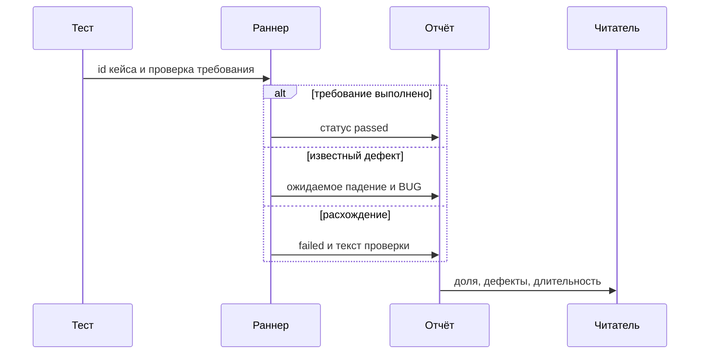
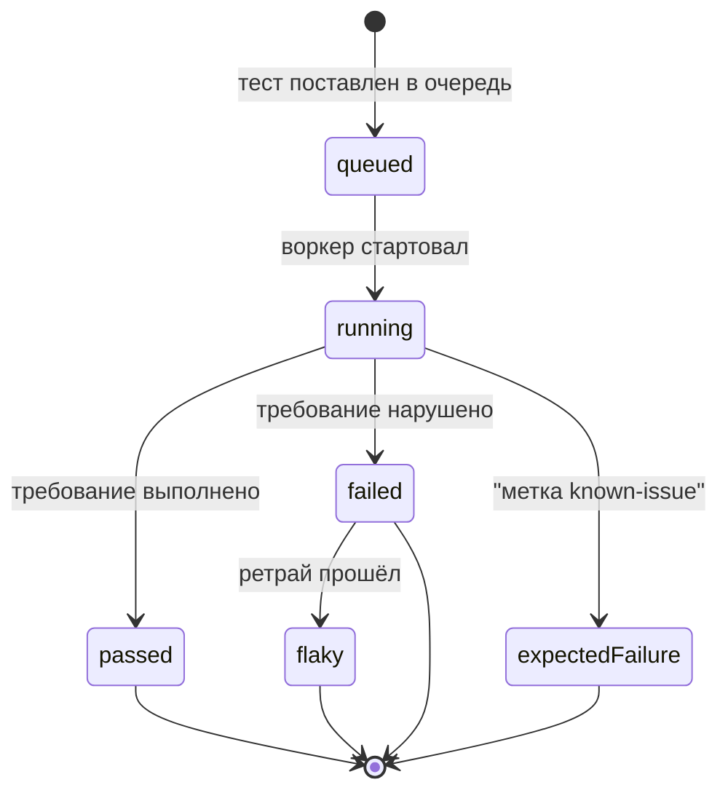

# Общие требования к отчётности

## Содержание

- [Теория](#теория)
  - [Ситуация](#ситуация)
  - [Модель](#модель)
  - [Понятия и связь с автоматизацией тестирования](#понятия-и-связь-с-автоматизацией-тестирования)
  - [Зоны ответственности](#зоны-ответственности)
  - [Пример](#пример)
  - [Типичные сбои](#типичные-сбои)
  - [Полезные ссылки](#полезные-ссылки)
  - [Вопросы по теории](#вопросы-по-теории)
- [Практическое задание](#практическое-задание)
  - [1.1 Общее](#11-общее)
  - [1.2 Сценарии](#12-сценарии-user-stories)
  - [1.3 Контракт](#13-контракт)
  - [1.4 Ошибки и ограничения](#14-ошибки-и-ограничения)
  - [1.5 Аудит](#15-аудитлоги)
  - [1.6 Нефункциональные требования](#16-нефункциональные-требования)

# Теория

## Ситуация

Пайплайн CI заканчивает прогон API и UI. Дальше возможен один из исходов: все проверки совпали с требованием; часть тестов упала на расхождении со стендом; строки с `BUG-01` и другими известными дефектами завершились ожидаемым падением (`known-issue`); стенд не ответил **200** на `GET /rest/admin/application-version`, и падения идут пачкой из-за соединения.

Без сводки эти четыре картины выглядят одинаково красным крестом job. Отчёт разделяет их до того, как человек откроет первый стек.

Отдельная разработка не нужна: достаточно запущенного контейнера Juice Shop и команды `npx playwright test --grep @api` (`pytest -m api`, `dotnet test --filter Category=api`). Итог смотрят в репортере раннера.

## Модель

Участники: тест, раннер, отчёт, читатель. Тест называет требование и id кейса. Раннер пишет статус, длительность и вложения. Отчёт собирает числа для трёх читателей. Решение о прохождении принимает оракул теста — требование, а не текущий ответ стенда. Отчёт это решение показывает и не подменяет.



Статус пишется после проверки, а не до неё. Иначе ожидаемое падение `known-issue` сольётся с новой регрессией.



`flaky` — на первом заходе требование не выполнилось, на ретрае выполнилось. В CI ретраев 2, локально 0, поэтому локальный одиночный прогон статуса `flaky` не получает. `expectedFailure` остаётся ожидаемым падением и в ретрай за новой удачей не превращается: дефект известен.

Возможный набор полей (схема может быть и другой):

| `testResult` | Описание |
| --- | --- |
| `name` | Имя с id в начале, например `TC-AUTH-01` |
| `status` | `passed`, `failed`, `flaky`, `expectedFailure` |
| `durationMs` | Длительность этого результата |
| `bug` | `BUG-xx` или пусто |
| `runId` | `RUN_ID` прогона |

Файл использует результаты раннера и id кейсов, уже заведённых в `1.1`–`7.1`. Новых операций Juice Shop он не добавляет.

## Понятия и связь с автоматизацией тестирования

### Три читателя

Разработчику на pull request нужен один упавший тест: имя, текст проверки, запрос и след из `2.6`. Он открывает отчёт, чтобы чинить, и закрывает его, когда причина ясна.

QA ведёт набор целиком. Ему нужны список id, какие `BUG-xx` ещё живы, какие тесты прошли только со второй попытки. Это вход для итогового отчёта о тестировании из `0.4`.

Менеджеру релиза хватает короткой сводки: можно ли считать прогон зелёным для кандидата, сколько он занял, какие дефекты остались осознанно. Стек трейса ему не нужен.

Один экран всех троих обслуживает плохо: след прячет долю, доля прячет строку проверки. Контракт отчёта хранит и машину статуса, и человеческий рассказ, а сводка берёт из них четыре числа.

### Что лежит в результате

У каждого результата есть имя с `TC-…` в начале, статус, длительность, текст проверки и окружение прогона: `BASE_URL`, браузер или пометка API, commit, `RUN_ID`. У ожидаемого падения рядом стоит `BUG-xx` из annotation, `reason` или `Property("issue")`.

Вложения при падении берутся из настроек `3.6`: trace при первом ретрае, скриншот только при падении, видео только при падении. Тело API кладут после вырезания секретов. Как именно вырезать и куда публиковать — в `8.1`. Здесь фиксируется состав: без пароля, cookie `token`, полного JWT и хеша пароля вложение не считается готовым.

Контракт состава: по результату можно назвать кейс, статус, дефект и прогон, не открывая исходный код.

### Четыре числа

Доля прохождения считает финальный успех среди тестов, которые претендуют на зелёный кандидат. Ожидаемое падение `known-issue` в знаменатель не входит: оно уже заведено как дефект и не говорит, что сборка сломалась сегодня. Прошедший с ретрая тест в долю входит как успех и одновременно попадает в долю нестабильных. Иначе зелёная доля прячет ретраи.

На четырёх результатах `passed`, `failed`, `flaky`, `expectedFailure` доля прохождения равна `(1 + 1) / (4 - 1) = 0.67`. Доля нестабильных равна `1 / 3 = 0.33`. Открытые дефекты — число разных `BUG-xx` на ожидаемых падениях, здесь `1`. Длительность для менеджера — время job от старта до артефакта, в примере `125` секунд. Сумма длительностей тестов отвечает на другой вопрос: сколько работы сделал набор. Её тоже хранят, в долю она не подменяет время ожидания.

Покрытие требований — сколько id из каталога кейсов курса реально запустилось. Каталог ведут в именах тестов с `0.4`. Прогон, который не вызвал `TC-ORDER-01`, не закрывает заказ, даже если доля прохождения равна единице.

Если стенд не поднялся, падения — одна причина на много тестов. Сводка называет отсутствие **200** у версии отдельно, чтобы долю не читали как сорок дефектов магазина. Контракт чисел: доля, доля нестабильных, открытые `BUG-xx`, длительность job, покрытие id.

### Итоговый отчёт и TMS

Итоговый отчёт о тестировании из `0.4` — короткая записка цикла: что входило в прогон, окружение, числа из этого файла, открытые дефекты, остаточный риск. CI её не заменяет. Он поставляет числа и ссылку на артефакт.

TMS из `0.4` (TestRail, Zephyr, Qase, TestLink, qTest) хранит кейс. Автотест ссылается на тот же `TC-…`, что и карточка. Этот курс не отправляет результаты в API TMS. Связь — id в имени теста. Расхождение id рвёт трассируемость: карточка зелёная, тест красный, и это уже разные объекты.

Контракт связи: каждый автоматический результат носит id кейса; итоговая записка берёт числа отсюда и форму из `0.4`.

### Сравнение

| Инструмент | Подходит для |
| --- | --- |
| Репортеры Playwright (`list`, `line`, `html`, `blob`, `github`) | Прогон TypeScript и сырьё для слияния шардов |
| `pytest-html` | Один HTML-файл прогона Python |
| TRX | Родной журнал `dotnet test` |
| JUnit XML | Сводка, которую умеют читать разные CI |
| Allure Report | Общий человеческий отчёт трёх стеков, шаги и вложения |
| ReportPortal | История прогонов на своём сервере |
| TestRail, Qase, Zephyr | Каталог кейсов и ручной статус |

Подробно Allure, JUnit XML и публикация из CI разобраны в `8.1`. ReportPortal и TMS в репозиторий курса не ставят.

### Что будет в отчётах Playwright и Allure

`8.1` включит адаптер стека, вложения без секретов, epic/feature/story, историю тренда и job `report`. Числа из этого файла там печатаются в окружение отчёта и в итоговую записку, а не вычисляются заново другими формулами.

### Сводка

| Понятие | Смысл в отчётности | На что опирается реализация |
| --- | --- | --- |
| Читатель | Разработчик, QA, менеджер | Состав результата и четыре числа |
| Статус | passed, failed, flaky, expectedFailure | Оракул и метка `known-issue` |
| Доля прохождения | Успех среди тестов без ожидаемого дефекта | `(passed + flaky) / (всего − expectedFailure)` |
| Доля нестабильных | Успех только после ретрая | Число `flaky` в том же знаменателе |
| Итоговая записка | Слова цикла поверх чисел | `0.4` и артефакт CI |
| Id кейса | Связь с TMS | Префикс `TC-…` в имени |

## Зоны ответственности

| Автотест | Фреймворк |
| --- | --- |
| Кладёт `TC-…` в имя и проверяет требование | Пишет статус, длительность и текст проверки |
| Помечает известный дефект id `BUG-xx` | Отделяет ожидаемое падение от нового failed |
| Не кладёт секрет в шаг и во вложение | Сохраняет trace и скриншот по настройкам `3.6` |
| Называет окружение, от которого зависит оракул | Прокидывает `BASE_URL`, `RUN_ID` и commit в отчёт |

Репортер раннера и итоговая записка не заменяют друг друга. Репортер фиксирует прогон. Записка из `0.4` говорит, какой из этого вывод для кандидата.

## Пример

Программа считает четыре числа на фиксированных статусах `passed`, `failed`, `flaky`, `expectedFailure` и длительности job 125 секунд. Формулы — те, что выше. На всех стеках файл `result.txt` совпадает.

### TypeScript

**Node.js 22 или новее, @playwright/test.** Расчёт лежит рядом с тестом, чтобы доля в записке и доля в голове автора совпадали.

```sh
npm init -y
npm install -D @playwright/test@1.65
npx playwright test summary.spec.ts
cat result.txt
```

```typescript
import { test, expect } from '@playwright/test';
import { writeFileSync } from 'node:fs';

test('числа сводки', () => {
  const statuses = ['passed', 'failed', 'flaky', 'expectedFailure'];
  const live = statuses.filter((s) => s !== 'expectedFailure');
  const passRate = (live.filter((s) => s === 'passed' || s === 'flaky').length / live.length).toFixed(2);
  const flakyRate = (live.filter((s) => s === 'flaky').length / live.length).toFixed(2);
  const openBugs = statuses.filter((s) => s === 'expectedFailure').length;
  const lines = [`pass_rate=${passRate}`, `flaky_rate=${flakyRate}`, `open_bugs=${openBugs}`, 'duration_s=125'];
  expect(lines[0]).toBe('pass_rate=0.67');
  writeFileSync('result.txt', `${lines.join('\n')}\n`);
});
```

### Python

**Python 3.10 или новее, pytest-playwright.** Тот же знаменатель: ожидаемое падение в долю прохождения не входит.

```sh
python -m pip install pytest pytest-playwright
pytest -q summary_rule.py
cat result.txt
```

```python
def test_summary_numbers():
    statuses = ["passed", "failed", "flaky", "expectedFailure"]
    live = [s for s in statuses if s != "expectedFailure"]
    pass_rate = f"{sum(s in ('passed', 'flaky') for s in live) / len(live):.2f}"
    flaky_rate = f"{sum(s == 'flaky' for s in live) / len(live):.2f}"
    open_bugs = sum(s == "expectedFailure" for s in statuses)
    lines = [
        f"pass_rate={pass_rate}",
        f"flaky_rate={flaky_rate}",
        f"open_bugs={open_bugs}",
        "duration_s=125",
    ]
    assert lines[0] == "pass_rate=0.67"
    open("result.txt", "w", encoding="utf-8").write("\n".join(lines) + "\n")
```

### C#

**.NET 8 или новее, Microsoft.Playwright.NUnit.** Формат числа фиксируют инвариантной культурой, чтобы сводка была `0.67`, а не строкой с запятой.

```sh
dotnet new nunit -n SummaryRule -o .
dotnet add package Microsoft.Playwright.NUnit --version 1.64.1
dotnet test
cat result.txt
```

```csharp
using System.Globalization;
using NUnit.Framework;

public class SummaryRule
{
    [Test]
    public void Numbers()
    {
        var statuses = new[] { "passed", "failed", "flaky", "expectedFailure" };
        var live = statuses.Where(s => s != "expectedFailure").ToArray();
        var pass = live.Count(s => s is "passed" or "flaky") / (double)live.Length;
        var flaky = live.Count(s => s == "flaky") / (double)live.Length;
        var bugs = statuses.Count(s => s == "expectedFailure");
        var culture = CultureInfo.InvariantCulture;
        var lines = new[]
        {
            $"pass_rate={pass.ToString("0.00", culture)}",
            $"flaky_rate={flaky.ToString("0.00", culture)}",
            $"open_bugs={bugs}",
            "duration_s=125",
        };
        Assert.That(lines[0], Is.EqualTo("pass_rate=0.67"));
        File.WriteAllText("result.txt", string.Join('\n', lines) + "\n");
    }
}
```

---

Все программы записывают `pass_rate=0.67`, `flaky_rate=0.33`, `open_bugs=1`, `duration_s=125` и раннер сообщает об одном пройденном тесте. `0.67` — два финальных успеха из трёх тестов без ожидаемого дефекта. `0.33` — один из этих трёх прошёл только ретраем. `open_bugs=1` — одно ожидаемое падение. `125` — время job, которое ждёт читатель, а не сумма секунд тестов.

## Типичные сбои

| Что видно | Куда смотреть |
| --- | --- |
| Доля 100% при живом `BUG-01` | Ожидаемые падения попали в числитель как passed |
| Доля упала из-за одного выключенного стенда | Нет отдельной строки про отсутствие **200** версии |
| Зелёный прогон, заказ никто не вызывал | Покрытие id не посчитано, смотрели только долю |
| Нестабильный тест не виден менеджеру | `flaky` растворили в passed и не вывели второе число |
| В TMS кейс другой, чем имя теста | Префикс `TC-…` не совпал с карточкой |
| В HTML лежит пароль регистрации | Вложение собрали из сырого тела |
| Локально нет статуса flaky | Ретраи локально 0, статус появляется в CI |
| Итоговая записка спорит с job | Числа пересчитаны другими формулами |
| Длительность «два часа» при коротких тестах | В сводку положили сумму длительностей вместо времени job |

## Полезные ссылки

### Общие

- [Playwright — Reporters](https://playwright.dev/docs/test-reporters) — какие репортеры пишет прогон TypeScript.
- [ISTQB Glossary — test summary report](https://glossary.istqb.org/en_US/term/test-summary-report) — записка по итогам цикла, форму которой ведёт `0.4`.

### По языку

#### TypeScript

**TypeScript, Playwright Test.** На JavaScript контракт отчётности остаётся тем же.

- [Playwright — Reporters](https://playwright.dev/docs/test-reporters) — `html`, `blob` и `github` для разных читателей одного прогона.
- [Playwright — Annotations](https://playwright.dev/docs/test-annotations) — откуда в результате берётся `BUG-xx`.

#### Python

**Python, pytest-playwright.** На синхронном Playwright API без pytest или на async API контракт отчётности остаётся тем же.

- [pytest — Output and reporting](https://docs.pytest.org/en/stable/how-to/output.html) — junitxml и коды выхода прогона.
- [pytest-html](https://github.com/pytest-dev/pytest-html) — один HTML, когда Allure ещё не подключён.

#### C#

**C#, Playwright для .NET с NUnit.** На MSTest или xUnit контракт отчётности остаётся тем же.

- [dotnet test](https://learn.microsoft.com/dotnet/core/tools/dotnet-test) — логгеры TRX и выход прогона.
- [NUnit — TestResult](https://docs.nunit.org/articles/nunit/writing-tests/TestContext.html) — статус и свойства теста, включая issue.

## Вопросы по теории

1. Почему разработчику, QA и менеджеру не хватает одного и того же экрана?
2. Почему ожидаемое падение `known-issue` не стоит в знаменателе доли прохождения?
3. Почему тест со статусом `flaky` одновременно считается успехом и нестабильностью?
4. Что итоговая записка из `0.4` добавляет к логу CI?
5. Что ломается, если id в имени теста и id в TMS различаются?
6. Как сводка показывает, что стенд не поднялся?
7. Какое из двух времён говорит, сколько ждали результат job?

# Практическое задание

Функциональность сводки прогона в системе.
Пайплайн считает долю прохождения, долю нестабильных, открытые `BUG-xx`, длительность job и покрытие id. Эти числа попадают в итоговую записку из `0.4`. Человеческий отчёт и публикация — в `8.1`.

## 1) Сводка прогона

### 1.1 Общее

**Назначение:** определить состав результата и формулы чисел, по которым читают прогон.

**Пользователи/роли:**

- разработчик — открывает failed и trace;
- AQA-инженер — сверяет id, дефекты и нестабильные;
- менеджер — читает четыре числа и рекомендацию записки;
- CI — сохраняет артефакт и время job.

**Зависимости/связанные настройки:**

- `0.4` — кейс, TMS, итоговый отчёт о тестировании;
- `1.0` — механизм `known-issue`;
- `3.6` в словаре курса — trace, скриншот, видео, ретраи, 2 воркера;
- `RUN_ID`, `BASE_URL` — поля окружения результата.

Вложения, Allure и JUnit XML собирает `8.1`. Здесь формулы не дублируют другим определением.

### 1.2 Сценарии (user stories)

1. **Зелёный кандидат:** нет `failed`, ожидаемые падения вынесены, доля посчитана по живым тестам.
2. **Новая регрессия:** один `failed` виден разработчику по имени `TC-…` и тексту проверки.
3. **Нестабильность:** ретрай в CI перевёл результат в `flaky`, доля нестабильных выросла.
4. **Стенд молчит:** нет **200** версии, сводка говорит об этом отдельно от дефектов продукта.
5. **Записка:** QA переносит числа в итоговый отчёт, id совпадают с TMS.

### 1.3 Контракт

#### 1.3.1 Результат теста

| Поле | Проверки/валидация |
| --- | --- |
| `name` | Начинается с `TC-…` |
| `status` | Одно из `passed`, `failed`, `flaky`, `expectedFailure` |
| `bug` | `BUG-xx` только у `expectedFailure` |
| `runId` | Равен `RUN_ID` прогона |

**Логика/шаги:**

1. Взять финальный статус после ретраев.
2. Если метка `known-issue` и проверка требования не прошла, поставить `expectedFailure` и id дефекта.
3. Если успех случился только на ретрае, поставить `flaky`.
4. Записать длительность результата и `RUN_ID`.

**Ответы:**

- Успех учёта — четыре поля заполнены, секрет в них не встречается.
- **Ошибки:** см. раздел 1.4.

#### 1.3.2 Числа сводки

**Общее правило:** знаменатель доли — результаты без `expectedFailure`. Числитель доли прохождения — `passed` и `flaky`. Числитель доли нестабильных — только `flaky`.

| Число | Правило |
| --- | --- |
| Доля прохождения | `(passed + flaky) / (всего − expectedFailure)` |
| Доля нестабильных | `flaky / (всего − expectedFailure)` |
| Открытые дефекты | Число разных `BUG-xx` |
| Длительность | Секунды job, отдельно от суммы тестов |
| Покрытие | Запущенные id / id каталога затронутого цикла |

На примере из раздела «Четыре числа» доля `0.67`, нестабильные `0.33`, дефектов `1`.

**Логика/шаги:**

1. Отделить ожидаемые падения.
2. Посчитать обе доли с одним знаменателем.
3. Если версия стенда не дала **200**, записать причину «стенд недоступен» рядом с долей.
4. Передать числа в записку `0.4` без повторного округления другим правилом.

**Ответы:**

- Успех — числа воспроизводятся из статусов тем же правилом, что в примере.
- **Ошибки:** см. раздел 1.4.

### 1.4 Ошибки и ограничения

- `passed` — требование выполнено с первого захода.
- `failed` — требование нарушено, метки `known-issue` нет. Для читателя это новый сигнал.
- `flaky` — успех только после ретрая. Локально при нуле ретраев этот статус не появляется.
- `expectedFailure` — метка `known-issue` и известный `BUG-xx`. В знаменатель доли не входит.
- Нет **200** версии — пачка падений объясняется стендом, в записке это отдельная строка.
- Пустой `RUN_ID` — отказ прогона до тестов, сводку «зелёного» кандидата не публикуют.
- Секрет в тексте результата — результат бракуют, даже если статус верный.

Формулы из 1.3.2 не заменяют «число красных / число всех». Вторая дробь смешивает дефект и регрессию.

### 1.5 Аудит/логи

В сводку писать id, статус, `BUG-xx`, `RUN_ID`, `BASE_URL`, commit и длительность job.

В сводку и в текст результата не попадают пароли, cookie `token`, полный JWT, `totpSecret` и хеш пароля.

### 1.6 Нефункциональные требования

- Расчёт сводки по результатам прогона укладывается в секунды и не добавляет `sleep`.
- В CI ретраи 2, воркеры 2, trace `on-first-retry`, скриншот и видео только при падении.
- Полный прогон API и UI (chromium) — не дольше 10 минут, это и есть верхняя граница `duration_s` для такого прогона.
- Сводка покрывает статусы из 1.3.1 и все пять чисел из 1.3.2.
