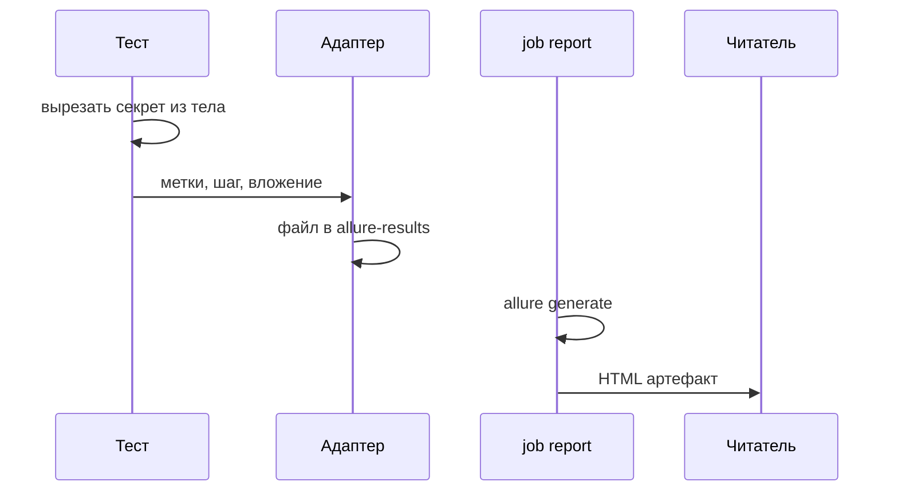
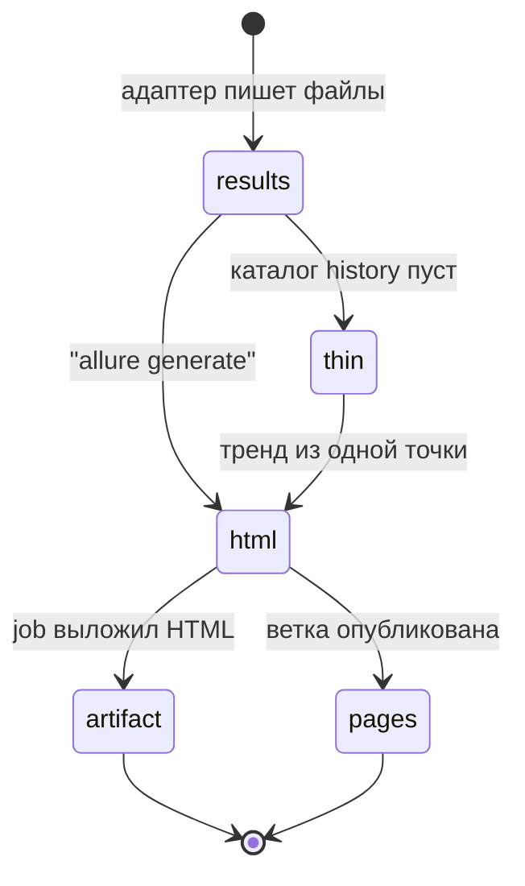

# Отчёты Playwright и Allure

## Содержание

- [Теория](#теория)
  - [Ситуация](#ситуация)
  - [Модель](#модель)
  - [Понятия и связь с автоматизацией тестирования](#понятия-и-связь-с-автоматизацией-тестирования)
  - [Зоны ответственности](#зоны-ответственности)
  - [Пример](#пример)
  - [Типичные сбои](#типичные-сбои)
  - [Полезные ссылки](#полезные-ссылки)
  - [Вопросы по теории](#вопросы-по-теории)
- [Практическое задание](#практическое-задание)
  - [1.1 Общее](#11-общее)
  - [1.2 Сценарии](#12-сценарии-user-stories)
  - [1.3 Контракт](#13-контракт)
  - [1.4 Ошибки и ограничения](#14-ошибки-и-ограничения)
  - [1.5 Аудит](#15-аудитлоги)
  - [1.6 Нефункциональные требования](#16-нефункциональные-требования)

# Теория

## Ситуация

Пайплайн CI собрал прогон и должен отдать его людям из `8.0`. Дальше возможен один из исходов: HTML открывается, у упавшего теста есть trace и тело ответа без секрета; отчёт есть, но в нём пароль и JWT; прогон красный, а в сводке CI пусто, потому что нет JUnit XML; каталог `allure-results` пуст, и `allure generate` нечего собирать; стенд не дал **200** версии, и это видно в окружении отчёта.

Числа доли уже определены. Здесь их кладут в отчёт, который можно открыть без локального раннера.

Отдельная разработка не нужна: достаточно запущенного контейнера Juice Shop и команды `npx playwright test --grep @api` (`pytest -m api`, `dotnet test --filter Category=api`) с репортером Allure. HTML смотрят после `npx allure generate`.

## Модель

Участники: тест, адаптер Allure, каталог результатов, job `report`, читатель. Тест ставит метки и вложение. Адаптер пишет файлы результата. Job собирает HTML и кладёт его в артефакт. Решение о прохождении принимает оракул теста — требование, а не текущий ответ стенда. Отчёт повторяет это решение.



Секрет вырезают до вложения. Адаптер не угадывает, какое поле пароль: он сохраняет то, что ему передали.



`thin` — нормальный первый прогон: делиться нечем. Со второго прогона в `allure-results` кладут каталог `history` прошлого отчёта, и тренд показывает несколько точек. Публикация в GitHub Pages и артефакт job — два выхода одного HTML. Артефакт живёт вместе с прогоном. Pages держит ссылку на свежий отчёт ветки, которую открывают без захода в Actions.

Возможный набор полей (схема может быть и другой):

| `reportMeta` | Описание |
| --- | --- |
| `epic` | Крупный сценарий, например «Покупка» |
| `feature` | Часть сценария, например «Вход» |
| `story` | Уточнение, например «Верные данные» |
| `severity` | `trivial`, `minor`, `normal`, `critical` или `blocker` |
| `owner` | В курсе строка `aqa` |
| `tc` | Id кейса, `TC-AUTH-01` |
| `bug` | `BUG-xx` или пусто |

Файл использует результаты тестов Juice Shop и не добавляет операций стенда. Окружение отчёта читает `BASE_URL` и `RUN_ID`.

## Понятия и связь с автоматизацией тестирования

### Адаптер и командная строка

Allure Report 3 читает каталог файлов результата и строит HTML. Адаптер стека эти файлы пишет. Командная строка от стека не зависит: пакет `allure` ставится в проект (`npm install --save-dev allure`), дальше `npx allure generate allure-results` кладёт HTML в `allure-report`, `npx allure open` его показывает.

Адаптеры курса: `allure-playwright` (репортер в `playwright.config.ts`, каталог `allure-results`), `allure-pytest` (`--alluredir=allure-results`), `Allure.NUnit`. В C# на класс теста нужен атрибут `[AllureNUnit]`, иначе каталог результатов не появится. Если страница адаптера на момент установки описывает только формат Allure 2, генерацию берут с той страницы. Поля ниже от этого не меняются: линия курса — Allure Report 3, результат адаптера она читает.

```typescript
import { defineConfig } from '@playwright/test';

export default defineConfig({
  reporter: [['line'], ['allure-playwright', { resultsDir: 'allure-results' }]],
});
```

Контракт запуска: прогон создаёт `allure-results`, пустой каталог до тестов означает, что репортер не подключён.

### Метки, шаги и параметры

Метки отвечают на вопрос «где этот тест в сценарии покупателя». Для входа верными данными: epic «Покупка», feature «Вход», story «Верные данные», severity `critical`, owner `aqa`. Поиск по каталогу — `normal`: он не блокирует оплату. Шкала адаптера: `trivial`, `minor`, `normal`, `critical`, `blocker`.

Id кейса и дефекта — ссылки отчёта. Подпись равна `TC-…` или `BUG-…`. В курсе нет URL трекера, поэтому адрес ссылки пока совпадает с подписью. Когда появится TMS из `0.4`, адрес станет карточкой, подпись останется. Порядок аргументов `link` / `tms` / `issue` сверяют со страницей адаптера: у `allure-js-commons` адрес идёт первым.

В TypeScript метки ставят в начале теста, чтобы они попали в результат даже при раннем падении:

```typescript
import * as allure from 'allure-js-commons';

await allure.epic('Покупка');
await allure.feature('Вход');
await allure.story('Верные данные');
await allure.severity('critical');
await allure.owner('aqa');
await allure.parameter('variant', 'len-5');
```

Шаг дробит тест на фразы, которые читают без кода. В TypeScript подходит `test.step`, его подхватывает `allure-playwright`, и `allure.step` из того же пакета. В Python — `with allure.step("..."):`. В C# — атрибут шага на методе, имя сверяют с документацией `Allure.NUnit` (`AllureStep`). Две строки `TC-REG-06` из `7.1` различаются параметром `variant` (`len-5` и `len-40`), иначе в отчёте это один и тот же заголовок.

Контракт меток: у теста есть epic, feature, story, severity, owner и подпись `TC-…`. У `known-issue` есть подпись `BUG-…`.

### Вложения без секрета

Trace, скриншот и видео уже включены настройками прогона: trace при первом ретрае, скриншот и видео только при падении. `allure-playwright` узнаёт trace Playwright и открывает его из HTML. Тело API само не становится вложением, пока тест его не передаст.

Перед передачей из объекта убирают `password`, `passwordRepeat`, `token`, cookie `token`, полный JWT и `totpSecret`. На их месте строка `***`. Email `aqa.<RUN_ID>.<воркер>.<n>@example.test` оставить можно: это синтетический адрес из `7.0`, по нему ищут строку в журнале (`9.1`).

```typescript
await allure.attachment('response', JSON.stringify(redacted), 'application/json');
```

Контракт вложения: упавший API-тест несёт trace или тело, и в теле нет секрета. Успешный тест не копит видео.

### Окружение, история, JUnit XML

Блок окружения объясняет, на каком стенде взяты числа из `8.0`. В `environmentInfo` репортера (или в файл окружения адаптера) пишут `BASE_URL`, `RUN_ID`, commit и браузер. Пароли ролей туда не входят. Несколько прогонов Playwright подряд оставляют окружение последнего: так устроен адаптер, поэтому job `report` собирает один общий прогон, а не серию поверх одного каталога без разбора.

История тренда — каталог `history` прошлого HTML. Его копируют в `allure-results/history` до `allure generate`. Без этой копии график честный и короткий: одна точка. Имя каталога при смене мажорной линии Allure сверяют с allurereport.org.

JUnit XML читает сводка CI. TypeScript: репортер `junit` и файл `results.xml`. Python: `--junitxml=results.xml`. C#: TRX через `dotnet test --logger trx`, а общий для всех job XML — логгер JUnit, пакет сверяют с документацией .NET на момент установки. Allure остаётся человеческим отчётом. JUnit остаётся машинной сводкой. Оба файла пишутся за один прогон.

Контракт публикации: job `report` в `.github/workflows/tests.yml` забирает `allure-results` и `results.xml` даже если тесты красные (`if: ${{ !cancelled() }}`), генерирует HTML и кладёт его в артефакт. GitHub Pages публикует тот же каталог для ветки, которую открывают по ссылке.

### Что будет в мониторинге

`9.1` при падении добавит во вложение строки журнала этого теста. Правило вырезания секрета на эти строки тоже действует: User-Agent `aqa/<RUN_ID>/<id>` остаётся, заголовок `Authorization` нет.

### Сводка

| Понятие | Смысл в отчёте | На что опирается реализация |
| --- | --- | --- |
| Адаптер | Пишет `allure-results` | `allure-playwright`, `allure-pytest`, `Allure.NUnit` |
| Метки | Место теста в сценарии | epic, feature, story, severity, owner |
| Ссылка | Id кейса и дефекта | Подпись `TC-…` и `BUG-…` |
| Вложение | Trace и тело без секрета | `attachment` после вырезания |
| История | Тренд длиннее одной точки | Каталог `history` прошлого прогона |
| job `report` | HTML для человека | `npx allure generate` и артефакт |

## Зоны ответственности

| Автотест | Фреймворк |
| --- | --- |
| Ставит epic, feature, story, severity и id | Пишет файлы `allure-results` |
| Вырезает секрет до вложения | Сохраняет trace по `on-first-retry` |
| Передаёт параметр строки data-driven | Показывает параметр в карточке теста |
| Кладёт `RUN_ID` и `BASE_URL` в окружение | Job `report` собирает HTML и JUnit XML |

Репортер `github` или JUnit XML и Allure HTML отвечают разным читателям из `8.0`. Оба остаются в пайплайне.

## Пример

Программа вырезает пароль и токен из тела регистрации и записывает метки, с которыми тест входа попадёт в отчёт. Стенд и CLI Allure для фрагмента не нужны.

### TypeScript

**Node.js 22 или новее, @playwright/test.** Вырезание — чистая функция. В полном наборе её результат уходит в `allure.attachment`.

```sh
npm init -y
npm install -D @playwright/test@1.65 allure-playwright allure
npx playwright test redact.spec.ts
cat result.txt
```

```typescript
import { test, expect } from '@playwright/test';
import { writeFileSync } from 'node:fs';

const secretKeys = ['password', 'passwordRepeat', 'token', 'totpSecret'];

function redact(body: Record<string, string>): Record<string, string> {
  const copy: Record<string, string> = {};
  for (const [key, value] of Object.entries(body)) copy[key] = secretKeys.includes(key) ? '***' : value;
  return copy;
}

test('тело без секрета', () => {
  const safe = redact({ email: 'aqa.42.0.1@example.test', password: 'Aa1!bcdefghi', token: 'jwt' });
  const lines = [`email=${safe.email}`, `password=${safe.password}`, `token=${safe.token}`, 'tms=TC-AUTH-01', 'severity=critical'];
  expect(lines[1]).toBe('password=***');
  writeFileSync('result.txt', `${lines.join('\n')}\n`);
});
```

### Python

**Python 3.10 или новее, pytest-playwright.** Та же функция готовит текст для `allure.attach` в тесте с `--alluredir`.

```sh
python -m pip install pytest pytest-playwright allure-pytest
pytest -q redact_rule.py
cat result.txt
```

```python
SECRET_KEYS = {"password", "passwordRepeat", "token", "totpSecret"}

def redact(body):
    return {key: ("***" if key in SECRET_KEYS else value) for key, value in body.items()}

def test_redact_body():
    safe = redact({"email": "aqa.42.0.1@example.test", "password": "Aa1!bcdefghi", "token": "jwt"})
    lines = [f"email={safe['email']}", f"password={safe['password']}", f"token={safe['token']}", "tms=TC-AUTH-01", "severity=critical"]
    assert lines[1] == "password=***"
    open("result.txt", "w", encoding="utf-8").write("\n".join(lines) + "\n")
```

### C#

**.NET 8 или новее, Microsoft.Playwright.NUnit.** Функция готовит словарь для вложения `Allure.NUnit`. Атрибуты epic и severity в полном тесте вешают на метод.

```sh
dotnet new nunit -n RedactRule -o .
dotnet add package Microsoft.Playwright.NUnit --version 1.64.1
dotnet add package Allure.NUnit
dotnet test
cat result.txt
```

```csharp
using NUnit.Framework;

public class RedactRule
{
    static readonly string[] SecretKeys = { "password", "passwordRepeat", "token", "totpSecret" };

    static Dictionary<string, string> Redact(Dictionary<string, string> body) =>
        body.ToDictionary(pair => pair.Key, pair => SecretKeys.Contains(pair.Key) ? "***" : pair.Value);

    [Test]
    public void Body()
    {
        var safe = Redact(new Dictionary<string, string>
        {
            ["email"] = "aqa.42.0.1@example.test",
            ["password"] = "Aa1!bcdefghi",
            ["token"] = "jwt",
        });
        var lines = new[] { $"email={safe["email"]}", $"password={safe["password"]}", $"token={safe["token"]}", "tms=TC-AUTH-01", "severity=critical" };
        Assert.That(lines[1], Is.EqualTo("password=***"));
        File.WriteAllText("result.txt", string.Join('\n', lines) + "\n");
    }
}
```

---

Все программы записывают `email=aqa.42.0.1@example.test`, `password=***`, `token=***`, `tms=TC-AUTH-01`, `severity=critical`. Email остаётся: по нему ищут прогон. Пароль и токен в отчёт не попадают. Раннер сообщает об одном пройденном тесте.

## Типичные сбои

| Что видно | Куда смотреть |
| --- | --- |
| `allure generate` пишет пустой отчёт | Прогон не создал `allure-results`, репортер не включён |
| В HTML виден пароль | В `attachment` ушло сырое тело |
| Тренд всегда из одной точки | В новый `allure-results` не скопирован `history` |
| Два `TC-REG-06` неразличимы | Нет параметра `variant` |
| У упавшего теста нет trace | В конфиге trace не `on-first-retry` или упал первый заход без ретрая в CI |
| Сводка Checks пустая | Нет `results.xml` или TRX в артефакте job |
| В окружении отчёта пароль роли | В `environmentInfo` попала переменная секрета |
| Метки пропали у рано упавшего теста | `allure.epic` стоит после действия, которое бросило ошибку |
| Pages показывает чужой прогон | Опубликовали каталог не того commit |

## Полезные ссылки

### Общие

- [Allure Report — Playwright](https://allurereport.org/docs/playwright/) — репортер, метки, вложения и `environmentInfo`.
- [Playwright — Trace viewer](https://playwright.dev/docs/trace-viewer) — что лежит в trace, который Allure открывает из карточки.
- [Playwright — JUnit reporter](https://playwright.dev/docs/test-reporters#junit-reporter) — `results.xml` для сводки CI.

### По языку

#### TypeScript

**TypeScript, Playwright Test.** На JavaScript контракт отчёта Allure остаётся тем же.

- [Allure Report — Playwright reference](https://allurereport.org/docs/playwright-reference/) — `epic`, `severity`, `parameter`, `attachment`.
- [Playwright — Reporters](https://playwright.dev/docs/test-reporters) — несколько репортеров в одном конфиге.

#### Python

**Python, pytest-playwright.** На синхронном Playwright API без pytest или на async API контракт отчёта Allure остаётся тем же.

- [Allure Report — pytest](https://allurereport.org/docs/pytest/) — `--alluredir` и шаги `allure.step`.
- [pytest — Output](https://docs.pytest.org/en/stable/how-to/output.html) — `--junitxml` рядом с каталогом Allure.

#### C#

**C#, Playwright для .NET с NUnit.** На MSTest или xUnit контракт отчёта Allure остаётся тем же.

- [Allure Report — NUnit](https://allurereport.org/docs/nunit/) — пакет `Allure.NUnit` и атрибуты меток.
- [dotnet test](https://learn.microsoft.com/dotnet/core/tools/dotnet-test) — логгер TRX рядом с `allure-results`.

## Вопросы по теории

1. Зачем вырезать секрет до вызова `attachment`, если отчёт и так «внутренний»?
2. Почему метки ставят в начале теста?
3. Чем артефакт job отличается от GitHub Pages для одного и того же HTML?
4. Откуда берётся вторая точка на тренде?
5. Зачем рядом с Allure писать JUnit XML?
6. Как в отчёте различить две строки `TC-REG-06`?
7. Почему email теста во вложении оставляют, а `token` заменяют на `***`?

# Практическое задание

Функциональность отчёта Allure и сводки CI в системе.
Прогон трёх стеков пишет `allure-results` и JUnit XML или TRX. Job `report` собирает HTML без секретов и публикует его артефактом. Числа сводки берутся из `8.0`.

## 1) Отчёт прогона

### 1.1 Общее

**Назначение:** подключить адаптер Allure, вырезание секретов и публикацию HTML из CI.

**Пользователи/роли:**

- AQA-инженер — открывает HTML и тренд;
- разработчик — из карточки теста переходит в trace;
- CI — job `report` и артефакт;
- читатель Pages — открывает последний отчёт ветки по ссылке.

**Зависимости/связанные настройки:**

- `8.0` — статусы и формулы чисел;
- `3.6` — trace, скриншот, видео;
- `7.1` — параметр `variant` у строк регистрации;
- `BASE_URL`, `RUN_ID` — окружение отчёта;
- `.github/workflows/tests.yml` — job `report`.

Журнал во вложении при падении добавляет `9.1`. Шарды UI и слияние blob — `10.1`.

### 1.2 Сценарии (user stories)

1. **Карточка входа:** у `TC-AUTH-01` есть epic «Покупка», severity `critical` и ссылка с подписью `TC-AUTH-01`.
2. **Тело регистрации:** во вложении email на месте, `password` и `token` равны `***`.
3. **Известный дефект:** у строки с `BUG-01` есть ссылка с этой подписью и статус ожидаемого падения.
4. **Публикация:** красный прогон всё равно оставляет HTML в артефакте.
5. **Тренд:** второй прогон на той же ветке показывает две точки, если в результаты попал прошлый `history`.

### 1.3 Контракт

#### 1.3.1 Метки и вложение

| Поле | Проверки/валидация |
| --- | --- |
| epic, feature, story | Непустые строки сценария |
| severity | Одно из пяти значений адаптера |
| `TC-…`, `BUG-…` | Подпись ссылки совпадает с id теста и дефекта |
| тело | Ключи `password`, `passwordRepeat`, `token`, `totpSecret` заменены на `***` |

**Логика/шаги:**

1. В начале теста записать метки и ссылки.
2. Для data-driven строки записать параметр `variant`.
3. Собрать тело ответа, вырезать секреты, вложить результат.
4. Оставить trace на настройке `on-first-retry`.

Если вложение уже ушло с секретом, правка теста его из старого HTML не сотрёт. Следующий прогон пишет новое вложение. Артефакт прошлого прогона не пересобирают руками.

**Ответы:**

- Успех — в `allure-results` есть результат с метками, HTML открывает trace упавшего теста.
- **Ошибки:** см. раздел 1.4.

#### 1.3.2 Job `report`

**Общее правило:** job выполняется при отмене отдельных тестов и при красном наборе. Секреты `ADMIN_PASSWORD` и `ACCOUNTANT_PASSWORD` в окружение отчёта не копируют.

| Шаг | Правило |
| --- | --- |
| Скачать артефакты | Все каталоги `allure-results` и файлы `results.xml` или TRX |
| История | Скопировать `history` прошлого отчёта, если артефакт есть |
| Генерация | `npx allure generate allure-results -o allure-report` |
| Публикация | Артефакт HTML, для постоянной ссылки — GitHub Pages |

Команду генерации сверяют с Allure Report 3. Если адаптер стека требует Allure 2, берут команду его страницы, каталог результатов тот же.

**Логика/шаги:**

1. Дождаться тестовых job.
2. Сложить результаты в один каталог.
3. Сгенерировать HTML и выложить артефакт.
4. Записать в окружение `BASE_URL`, `RUN_ID`, commit.

**Ответы:**

- Успех — артефакт `allure-report` скачивается из прогона.
- **Ошибки:** см. раздел 1.4.

### 1.4 Ошибки и ограничения

- Пустой `allure-results` — репортер не подключён или путь каталога другой.
- HTML без trace при падении в CI — trace не `on-first-retry` либо смотрят первый заход, а trace лежит на ретрае.
- Секрет в HTML — вырезание пропущено. Такой артефакт не пересылают дальше команды.
- Нет JUnit XML или TRX — сводка Checks не видит тесты, Allure при этом может быть полным.
- Нет `history` — тренд из одной точки, это не поломка генерации.
- Job `report` пропущен из-за `if: success()` — красный прогон остаётся без HTML. Условие — `!cancelled()`.
- Пустой `RUN_ID` — прогон останавливается раньше отчёта, «зелёный» HTML не публикуют.

### 1.5 Аудит/логи

В окружение отчёта писать `BASE_URL`, `RUN_ID`, commit, браузер и числа сводки из `8.0`.

Во вложения, шаги и окружение не попадают пароли, cookie `token`, полный JWT, `totpSecret`, хеш пароля и значения `ADMIN_PASSWORD`, `ACCOUNTANT_PASSWORD`.

### 1.6 Нефункциональные требования

- Генерация HTML не использует фиксированную паузу. Она стартует, когда артефакты job скачаны.
- Trace `on-first-retry`, скриншот и видео только при падении, ретраи CI — 2, воркеры — 2.
- В отчёте различимы оба `TC-REG-06` и ссылки `BUG-xx` у строк `known-issue`.
- Полный прогон API и UI (chromium) вместе с публикацией отчёта остаётся в пределе 10 минут на сами тесты. Генерация HTML идёт отдельным job и не удлиняет этот предел тестов.
