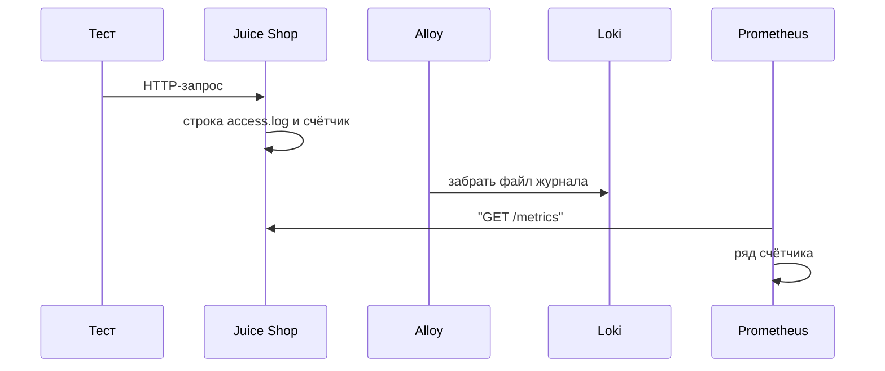
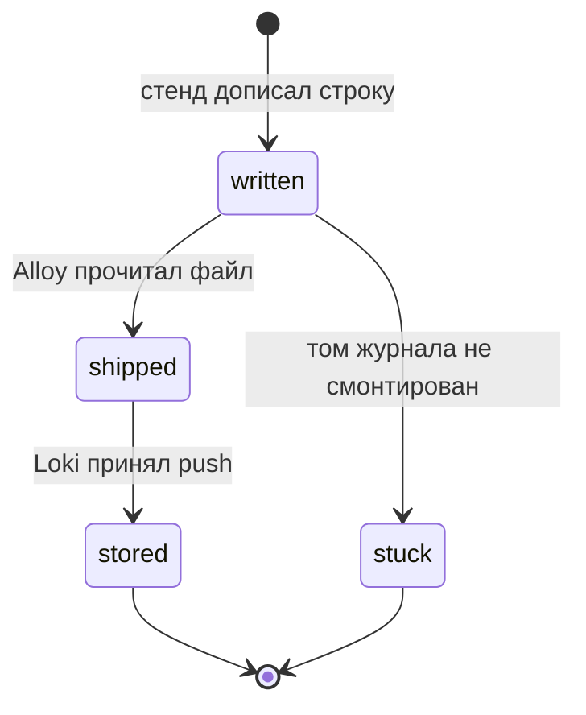

# Общие требования к мониторингу и логам

## Содержание

- [Теория](#теория)
  - [Ситуация](#ситуация)
  - [Модель](#модель)
  - [Понятия и связь с автоматизацией тестирования](#понятия-и-связь-с-автоматизацией-тестирования)
  - [Зоны ответственности](#зоны-ответственности)
  - [Пример](#пример)
  - [Типичные сбои](#типичные-сбои)
  - [Полезные ссылки](#полезные-ссылки)
  - [Вопросы по теории](#вопросы-по-теории)
- [Практическое задание](#практическое-задание)
  - [1.1 Общее](#11-общее)
  - [1.2 Сценарии](#12-сценарии-user-stories)
  - [1.3 Контракт](#13-контракт)
  - [1.4 Ошибки и ограничения](#14-ошибки-и-ограничения)
  - [1.5 Аудит](#15-аудитлоги)
  - [1.6 Нефункциональные требования](#16-нефункциональные-требования)

# Теория

## Ситуация

Набор тестов гоняет Juice Shop, и после прогона нужно понять, что делал стенд. Дальше возможен один из исходов: в журнале доступа есть строка запроса со статусом; счётчик `http_requests_count` вырос, но не говорит, какой тест его увеличил; трассы запроса нет, потому что стенд её не пишет; Prometheus или Loki недоступны, опрос не получает **200**; сам Juice Shop не отвечает **200** на `GET /rest/admin/application-version`.

Журнал, метрика и трасса отвечают на разные вопросы. Этот файл заводит стек, в котором журнал и метрика читаются. Привязку строки к тесту делает `9.1`.

Отдельная разработка не нужна: достаточно `infra/docker-compose.yml` с сервисами стенда и команды `npx playwright test --grep @api` (`pytest -m api`, `dotnet test --filter Category=api`).

## Модель

Участники: тест, Juice Shop, журнал доступа, Alloy, Loki, Prometheus, Grafana. Тест бьёт в API. Стенд дописывает строку combined и увеличивает счётчик. Alloy уносит строку в Loki. Prometheus забирает `/metrics`. Grafana показывает оба ряда. Решение о прохождении принимает оракул теста — требование, а не текущий ответ стенда. Мониторинг это решение не выносит.



Строка пишется на запросе теста. Сборщик забирает её следом, поэтому сразу после ответа в Loki строки может ещё не быть. Опрос с пределом времени — в `9.1`.



`stuck` значит, что файл в контейнере есть, а у Alloy его нет. Перехода «прочитать журнал по HTTP `/support/logs`» на диаграмме нет: этот каталог открыт у Juice Shop как уязвимость, и набор на него не опирается.

Возможный набор полей (схема может быть и другой):

| `accessLine` | Описание |
| --- | --- |
| метод и путь | Внутри кавычек запроса, например `POST /api/Users` |
| статус | Код ответа сразу после кавычек запроса |
| размер | Длина тела в байтах |
| User-Agent | Последнее поле в кавычках |

Файл использует журнал доступа Juice Shop, текст Prometheus на `/metrics` и сервисы `prometheus`, `loki`, `alloy`, `grafana`.

## Понятия и связь с автоматизацией тестирования

### Три сигнала

Журнал — строка про одно событие. В ней видны метод, путь, код и клиент. По ней отвечают на вопрос «что сделал вот этот запрос».

Метрика — число во времени. Счётчик `http_requests_count{status_code="5XX",app="juiceshop"}` говорит, сколько ответов класса **5xx** отдал процесс целиком. `juiceshop_orders_placed_total` говорит, сколько заказов учтено. Часть gauge появляется в выдаче только после первого ненулевого значения и обновляется раз в 5 секунд: `TC-ORDER-02` поэтому опрашивает метрику до 15 секунд.

Трасса — дерево промежутков одного запроса через несколько сервисов. У Juice Shop трасс нет, отдельный сборщик трасс не поднимают. Пока стенд один процесс, строка журнала закрывает вопрос «какой запрос», а метрика — вопрос «как процесс вёл себя в эту минуту».

Контракт сигналов: набор читает журнал и `/metrics`. Ожидать span от этого стенда не нужно.

### Журнал доступа

Формат — Apache combined. Файл дня лежит в контейнере по пути `/juice-shop/logs/access.log.YYYY-MM-DD`. Пример поля клиента — последнее значение в кавычках:

```text
::1 - - [12/Nov/2026:21:45:03 +0000] "POST /api/Users HTTP/1.1" 201 420 "-" "aqa/42/TC-REG-01"
```

Stdout контейнера — строки winston (`info: …`). В них нет User-Agent запроса. Для связи с тестом берут файл доступа, не stdout. Каталог `/support/logs` по HTTP не используют.

Контракт журнала: строка combined содержит код и User-Agent. Метка потока в Loki — `service=juice-shop`.

### Метрика процесса

`GET /metrics` отдаёт текст Prometheus, у рядов общий label `app="juiceshop"`. Счётчик `http_requests_count` режется по `status_code` (`2XX`, `4XX`, `5XX`). Это один ряд на процесс. Два воркера и синтетический пробник увеличивают его вместе, поэтому по приросту нельзя назвать тест. Для «стенд в эту минуту отдавал пятьсотые» ряд годится. Для «этот тест получил **500**» годится строка журнала — разбор в `9.1`.

Prometheus забирает метрики сам, scrape `juice-shop:3000`, путь `/metrics`. User-Agent Prometheus приложение не считает в челленджах. Менять его на браузерный нельзя: обход задуман как чтение, а не как игрок.

Контракт scrape: цель `juice-shop:3000/metrics`, отдельный User-Agent клиента Prometheus не подменяют.

### Стек в compose

Сервисы живут в `infra/docker-compose.yml` рядом с уже существующими `juice-shop`, `mailpit`, `gitea`.

| Сервис | Порт | Зачем он в наборе |
| --- | --- | --- |
| `prometheus` | `9090` | Забирает `/metrics` и хранит ряды |
| `loki` | `3100` | Хранит строки журнала |
| `alloy` | `12345` | Читает файл доступа и stdout контейнеров и шлёт их в Loki |
| `grafana` | `3002` | Рисует ряды и строки на одном экране |

Порт Grafana `3002`, потому что `3000` занят Juice Shop, а `3001` — Gitea. Том `juice-logs` смонтирован в Juice Shop как `/juice-shop/logs` и в Alloy как каталог, который читает `local.file_match`. Конфиг Prometheus — `infra/prometheus.yml`, конфиг Alloy — `infra/config.alloy`.

`LOKI_URL` по умолчанию `http://localhost:3100`, `PROMETHEUS_URL` — `http://localhost:9090`. Из другого контейнера хост меняется на имя сервиса (`http://loki:3100`). Пустая строка вместо адреса останавливает тот прогон, который идёт в этот сервис: молча подставлять чужой хост нельзя. Секретом эти переменные не являются.

Контракт стека: четыре сервиса, том журнала общий, адреса читаются из окружения.

### Сравнение

| Инструмент | Подходит для |
| --- | --- |
| Kibana / ELK | Поиск по журналам, если журнал уже в Elasticsearch |
| Datadog, New Relic | Журналы, метрики и трассы как услуга |
| Sentry | Ошибки приложения с группировкой исключений |
| PagerDuty | Дежурство и маршрут оповещения |
| Checkly | Синтетические проверки по расписанию снаружи |
| BlazeMeter API Monitoring (ex-Runscope) | Цепочки HTTP-проверок API по расписанию |

В курсе журнал и метрики учебного стенда держат Prometheus, Loki, Alloy и Grafana. Checkly и BlazeMeter близки по задаче к `9.2`, но пробник курса — свой контейнер. PagerDuty не подключают: правило оповещения рисует Grafana.

### Что будет в корреляции и синтетике

`9.1` поставит тесту User-Agent `aqa/<RUN_ID>/<id теста>` и найдёт его строки в Loki. `9.2` будет писать исход короткого smoke в Pushgateway. Переменные и имена сервисов отсюда не переименовывают.

### Сводка

| Понятие | Смысл в мониторинге | На что опирается реализация |
| --- | --- | --- |
| Журнал доступа | Один запрос, код и клиент | Файл combined и Loki |
| Метрика | Число всего процесса | `/metrics`, Prometheus |
| Трасса | На этом стенде отсутствует | Набор её не ждёт |
| Alloy | Доставка файла в Loki | Том `juice-logs` |
| `LOKI_URL`, `PROMETHEUS_URL` | Куда ходить за строками и рядами | Окружение, локальные порты `3100` и `9090` |

## Зоны ответственности

| Автотест | Стенд |
| --- | --- |
| Шлёт обычный HTTP и позже свой User-Agent | Пишет combined и `/metrics` |
| Читает Loki и Prometheus по URL из окружения | Не вписывает id теста в winston сам |
| Не ходит в `/support/logs` | Отдаёт каталог журналов по HTTP как известную дыру |
| Не подменяет User-Agent scrape | Игнорирует UA Prometheus в подсчёте челленджей |

Журнал и метрика не заменяют оракул. Они объясняют фон прогона. Вердикт теста по-прежнему в проверке требования.

## Пример

Программа разбирает одну строку combined и записывает метод, путь, код и User-Agent. Так видно, почему последнее поле в кавычках — будущий ключ поиска теста.

### TypeScript

**Node.js 22 или новее, @playwright/test.** Разбор строки не требует Loki: тот же разбор позже проверит ответ запроса.

```sh
npm init -y
npm install -D @playwright/test@1.65
npx playwright test access-line.spec.ts
cat result.txt
```

```typescript
import { test, expect } from '@playwright/test';
import { writeFileSync } from 'node:fs';

const line = '::1 - - [12/Nov/2026:21:45:03 +0000] "POST /api/Users HTTP/1.1" 201 420 "-" "aqa/42/TC-REG-01"';

function parseAccess(raw: string) {
  const parts = raw.split('"');
  const [method, path] = parts[1].split(' ');
  const status = parts[2].trim().split(' ')[0];
  return { method, path, status, userAgent: parts[5] };
}

test('строка combined', () => {
  const row = parseAccess(line);
  const lines = [`method=${row.method}`, `path=${row.path}`, `status=${row.status}`, `user_agent=${row.userAgent}`];
  expect(lines[3]).toBe('user_agent=aqa/42/TC-REG-01');
  writeFileSync('result.txt', `${lines.join('\n')}\n`);
});
```

### Python

**Python 3.10 или новее, pytest-playwright.** Индексы кавычек те же: запрос, затем код, затем User-Agent.

```sh
python -m pip install pytest pytest-playwright
pytest -q access_line.py
cat result.txt
```

```python
LINE = '::1 - - [12/Nov/2026:21:45:03 +0000] "POST /api/Users HTTP/1.1" 201 420 "-" "aqa/42/TC-REG-01"'

def parse_access(raw):
    parts = raw.split('"')
    method, path, _proto = parts[1].split(" ")
    status = parts[2].strip().split(" ")[0]
    return method, path, status, parts[5]

def test_access_line():
    method, path, status, user_agent = parse_access(LINE)
    lines = [f"method={method}", f"path={path}", f"status={status}", f"user_agent={user_agent}"]
    assert lines[3] == "user_agent=aqa/42/TC-REG-01"
    open("result.txt", "w", encoding="utf-8").write("\n".join(lines) + "\n")
```

### C#

**.NET 8 или новее, Microsoft.Playwright.NUnit.** Разбор совпадает с двумя другими стеками, чтобы LogQL в `9.1` искал ту же подстроку.

```sh
dotnet new nunit -n AccessLine -o .
dotnet add package Microsoft.Playwright.NUnit --version 1.64.1
dotnet test
cat result.txt
```

```csharp
using NUnit.Framework;

public class AccessLine
{
    const string Line = "::1 - - [12/Nov/2026:21:45:03 +0000] \"POST /api/Users HTTP/1.1\" 201 420 \"-\" \"aqa/42/TC-REG-01\"";

    [Test]
    public void Parse()
    {
        var parts = Line.Split('"');
        var request = parts[1].Split(' ');
        var status = parts[2].Trim().Split(' ')[0];
        var lines = new[] { $"method={request[0]}", $"path={request[1]}", $"status={status}", $"user_agent={parts[5]}" };
        Assert.That(lines[3], Is.EqualTo("user_agent=aqa/42/TC-REG-01"));
        File.WriteAllText("result.txt", string.Join('\n', lines) + "\n");
    }
}
```

---

Все программы записывают `method=POST`, `path=/api/Users`, `status=201`, `user_agent=aqa/42/TC-REG-01`. Код берётся из промежутка после запроса, клиент — из последних кавычек. Раннер сообщает об одном пройденном тесте.

## Типичные сбои

| Что видно | Куда смотреть |
| --- | --- |
| В Loki пусто, файл в контейнере растёт | Том `juice-logs` не смонтирован в Alloy |
| В поиске нет User-Agent | Читают stdout winston, а не access.log |
| Счётчик **5xx** вырос, тест не найти | Ряд общий на процесс, нужен журнал |
| Челленджи растут от scrape | У scrape подменён User-Agent Prometheus |
| Grafana не открывается на `3000` | UI стека слушает `3002` |
| `LOKI_URL` указывает на `localhost` из контейнера теста | Внутри compose хост — имя сервиса `loki` |
| Опрос `/metrics` сразу после заказа не видит gauge | Ряд обновляется раз в 5 секунд, нужен опрос до 15 секунд |
| Тест скачивает `/support/logs` | Этот путь — дыра стенда, источник для набора — Loki |
| Пустой `PROMETHEUS_URL` и тихий пропуск | Прогон, который читает ряды, останавливается |

## Полезные ссылки

### Общие

- [Prometheus — Metric types](https://prometheus.io/docs/concepts/metric_types/) — чем счётчик отличается от gauge на `/metrics`.
- [Prometheus — Exposition formats](https://prometheus.io/docs/instrumenting/exposition_formats/) — текст, который отдаёт Juice Shop.
- [Grafana Loki — Log queries](https://grafana.com/docs/loki/latest/query/log_queries/) — язык, которым `9.1` достанет строку.
- [Grafana Alloy](https://grafana.com/docs/alloy/latest/) — сбор файла журнала в Loki.

### По языку

#### TypeScript

**TypeScript, Playwright Test.** На JavaScript контракт мониторинга остаётся тем же.

- [Playwright — APIRequestContext](https://playwright.dev/docs/api-testing) — клиент, которому в `9.1` добавят User-Agent.
- [Prometheus HTTP API](https://prometheus.io/docs/prometheus/latest/querying/api/) — мгновенный запрос ряда из теста.

#### Python

**Python, pytest-playwright.** На синхронном Playwright API без pytest или на async API контракт мониторинга остаётся тем же.

- [Playwright Python — API testing](https://playwright.dev/python/docs/api-testing) — контекст запроса к Juice Shop и к Loki.
- [Prometheus HTTP API](https://prometheus.io/docs/prometheus/latest/querying/api/) — тот же запрос ряда, клиент другой.

#### C#

**C#, Playwright для .NET с NUnit.** На MSTest или xUnit контракт мониторинга остаётся тем же.

- [Playwright .NET — APIRequest](https://playwright.dev/dotnet/docs/api/class-apirequest) — заголовки контекста для журнала.
- [Prometheus HTTP API](https://prometheus.io/docs/prometheus/latest/querying/api/) — чтение `PROMETHEUS_URL` из теста.

## Вопросы по теории

1. Какой вопрос закрывает строка журнала, а какой — счётчик `http_requests_count`?
2. Почему трассу для Juice Shop не поднимают отдельным сервисом?
3. Почему Alloy читает файл, а тест не ходит в `/support/logs`?
4. Зачем у Grafana порт `3002`?
5. Почему User-Agent scrape Prometheus оставляют как есть?
6. Что происходит с поиском теста, если открыть stdout, а не access.log?
7. Когда пустой `LOKI_URL` останавливает прогон, а когда у переменной есть локальный адрес по умолчанию?

# Практическое задание

Функциональность стека журналов и метрик в системе.
Рядом с Juice Shop поднимаются Prometheus, Loki, Alloy и Grafana. Журнал доступа попадает в Loki, `/metrics` — в Prometheus. Тесты читают `LOKI_URL` и `PROMETHEUS_URL`.

## 1) Стек наблюдения

### 1.1 Общее

**Назначение:** поднять чтение журнала и метрик учебного стенда и зафиксировать адреса.

**Пользователи/роли:**

- AQA-инженер — открывает Grafana `3002` и сверяет прогон;
- разработчик — смотрит **5xx** процесса, когда пачка тестов красная;
- CI — поднимает те же сервисы, что локальный compose;
- Juice Shop — пишет журнал и метрики, сам их не хранит.

**Зависимости/связанные настройки:**

- `1.5` — `juiceshop_orders_placed_total` и опрос до 15 секунд;
- `8.1` — куда позже ляжет выдержка журнала;
- `LOKI_URL` — по умолчанию `http://localhost:3100`;
- `PROMETHEUS_URL` — по умолчанию `http://localhost:9090`;
- `infra/docker-compose.yml`, `infra/prometheus.yml`, `infra/config.alloy`.

Привязка User-Agent — `9.1`. Пробник по расписанию — `9.2`.

### 1.2 Сценарии (user stories)

1. **Строка запроса:** после `POST /api/Users` в Loki есть combined-строка с кодом и User-Agent.
2. **Счётчик процесса:** Prometheus видит `http_requests_count` с `app="juiceshop"`.
3. **Заказ:** `juiceshop_orders_placed_total` догоняет тест опросом до 15 секунд.
4. **Чужой URL:** пустой `LOKI_URL` останавливает прогон, который ищет строки.
5. **Дыра каталога:** набор не использует `GET /support/logs`.

### 1.3 Контракт

#### 1.3.1 Журнал и scrape

| Поле | Проверки/валидация |
| --- | --- |
| Файл | `/juice-shop/logs/access.log.YYYY-MM-DD`, формат combined |
| Метка Loki | `service=juice-shop` |
| Scrape | `juice-shop:3000`, путь `/metrics` |
| Том | `juice-logs` у Juice Shop и у Alloy |

**Логика/шаги:**

1. Поднять сервисы compose.
2. Смонтировать `juice-logs` в `/juice-shop/logs`.
3. Настроить Alloy: `local.file_match` на `access.log.*`, метка `service=juice-shop`, запись в `http://loki:3100`.
4. Настроить scrape Prometheus на `juice-shop:3000`.
5. Дождаться **200** у `GET /rest/admin/application-version` и у `GET /ready` Loki.

Синтаксис блоков Alloy сверяют с документацией Grafana Alloy на момент написания конфига. Смысл блоков один: найти файл, повесить метку, отправить в Loki.

**Ответы:**

- **200** версии Juice Shop и доступный ряд в Prometheus.
- **Ошибки:** см. раздел 1.4.

#### 1.3.2 Адреса

**Общее правило:** с хоста порты `3100`, `9090`, `3002`, `12345`. Из контейнера — имена сервисов.

| Переменная | Значение |
| --- | --- |
| `LOKI_URL` | `http://localhost:3100`, в compose-сети `http://loki:3100` |
| `PROMETHEUS_URL` | `http://localhost:9090`, в compose-сети `http://prometheus:9090` |

**Логика/шаги:**

1. Прочитать переменную.
2. Если она не задана, взять локальный адрес по умолчанию.
3. Если задана пустой строкой, остановить прогон с именем переменной.
4. Не писать эти адреса в код клиента литералом мимо `src/config`.

**Ответы:**

- Успех — клиент логов открывает непустой URL.
- **Ошибки:** см. раздел 1.4.

### 1.4 Ошибки и ограничения

- Нет **200** версии Juice Shop — журнал пуст закономерно, сначала стенд.
- Loki или Prometheus не отвечают — тест, который их читает, падает с адресом и именем сервиса, а не с «пустым списком как нормой».
- Пустая переменная — отказ до запросов.
- `docker restart` не чинит потерянный том: файл останется в старом слое, если том не подключён.
- Gauge заказа отсутствует, пока значение 0. Опрос трактует отсутствие ряда как ноль и ждёт до 15 секунд.
- **5xx** в `http_requests_count` не называют виноватый тест.
- `GET /support/logs` в набор не входит.

### 1.5 Аудит/логи

В отладочный вывод стека писать имя сервиса, порт и факт, что scrape прошёл.

В Grafana и в будущие вложения не кладут пароли, cookie `token`, полный JWT и заголовок `Authorization`. User-Agent теста — можно, это не секрет.

### 1.6 Нефункциональные требования

- Готовность сервисов ждут опросом, без `sleep` как единственного способа.
- Scrape не меняет User-Agent Prometheus.
- Опрос заказа — до 15 секунд, шаг короче 5 секунд обновления gauge.
- Порты стека совпадают со словарём курса: `9090`, `3100`, `12345`, `3002`.
