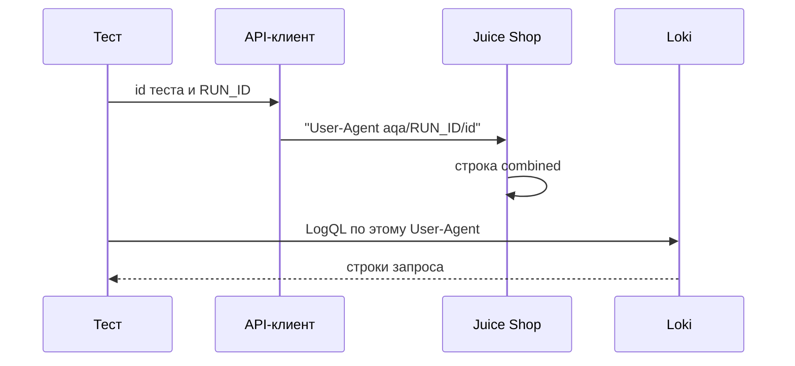
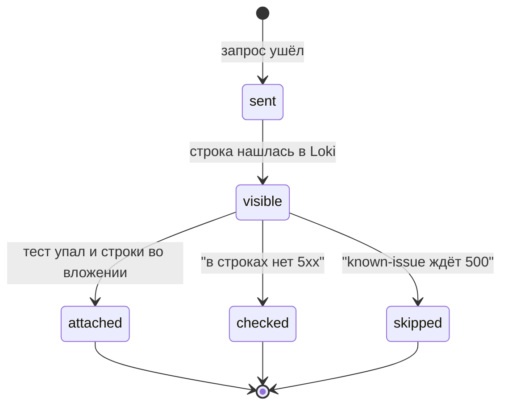

# Корреляция автотестов с логами

## Содержание

- [Теория](#теория)
  - [Ситуация](#ситуация)
  - [Модель](#модель)
  - [Понятия и связь с автоматизацией тестирования](#понятия-и-связь-с-автоматизацией-тестирования)
  - [Зоны ответственности](#зоны-ответственности)
  - [Пример](#пример)
  - [Типичные сбои](#типичные-сбои)
  - [Полезные ссылки](#полезные-ссылки)
  - [Вопросы по теории](#вопросы-по-теории)
- [Практическое задание](#практическое-задание)
  - [1.1 Общее](#11-общее)
  - [1.2 Сценарии](#12-сценарии-user-stories)
  - [1.3 Контракт](#13-контракт)
  - [1.4 Ошибки и ограничения](#14-ошибки-и-ограничения)
  - [1.5 Аудит](#15-аудитлоги)
  - [1.6 Нефункциональные требования](#16-нефункциональные-требования)

# Теория

## Ситуация

Автотест вызывает API Juice Shop в параллельном прогоне. Дальше возможен один из исходов: в журнале доступа есть строки с его User-Agent и кодами этого теста; у теста **500**, и строка это показывает; тест с `known-issue` ждёт **500** как факт `BUG-02` или `BUG-04`, и правило «в строках нет **5xx**» для него выключено; Loki не отвечает, опрос не получает **200**; стенд не даёт **200** на `GET /rest/admin/application-version`.

Счётчик `http_requests_count{status_code="5XX"}` за ту же секунду мог вырасти из-за соседа-воркера. Строка с User-Agent принадлежит одному тесту.

Отдельная разработка не нужна: достаточно стека из `9.0` и команды `npx playwright test --grep @api` (`pytest -m api`, `dotnet test --filter Category=api`).

## Модель

Участники: тест, API-клиент, Juice Shop, Loki, отчёт. Клиент ставит заголовок. Стенд пишет его последним полем combined. Помощник `logs` опрашивает Loki и при падении кладёт строки во вложение. Решение о прохождении принимает оракул теста — требование, а не текущий ответ стенда. Журнал это требование не заменяет: он показывает, каким кодом стенд ответил именно этому клиенту.



Заголовок ставится до запроса. Искать строку раньше, чем Alloy успел отправить файл, рано: помощник опрашивает Loki, а не спит фиксированную паузу.



`skipped` — не пропуск теста. Это пропуск только проверки «нет **5xx**». Строки всё равно ищут и при падении вкладывают. Тест без метки, у которого в своих строках есть **5xx**, остаётся красным даже если оракул продукта случайно зелёный.

Возможный набор полей (схема может быть и другой):

| `logQuery` | Описание |
| --- | --- |
| `userAgent` | `aqa/<RUN_ID>/<id теста>` |
| `selector` | Селектор `service=juice-shop` и подстрока User-Agent |
| `assertNo5xx` | Истина, если тест не входит в список ожидаемых **500** |

Файл использует журнал доступа и API Loki. Тело бизнес-запроса по-прежнему уходит в Juice Shop через клиенты из `1.4`.

## Понятия и связь с автоматизацией тестирования

### User-Agent прогона

Журнал combined пишет клиента последним полем в кавычках. Значит, тест может назвать себя так, чтобы строка нашлась без доступа к базе. Шаблон заголовка: `aqa/<RUN_ID>/<id теста>`. `RUN_ID` тот же, что в email `aqa.<RUN_ID>.<воркер>.<n>@example.test`. Id — префикс имени, например `TC-REG-01`.

Заголовок ставит API-клиент на контекст запроса, один раз на тест, а не вручную в каждом вызове. TypeScript: `extraHTTPHeaders` у `APIRequestContext`. Python и C#: тот же заголовок `User-Agent` на контексте Playwright. Браузерный UI-тест для API-вызовов страницы этот заголовок сам не добавляет: корреляция курса покрывает запросы клиентов `src/clients`. UI остаётся в trace из `8.1`.

Контракт заголовка: каждый запрос API-теста несёт `aqa/<RUN_ID>/<id теста>`.

### Почему счётчик не называет тест

`http_requests_count{status_code="5XX"}` — один ряд процесса. Параллельные воркеры, ретрай и чужой тест увеличивают его вместе. Прирост «на единицу за время теста» не доказывает, что единица — этот тест.

Строка журнала хранит User-Agent и код рядом. Если в строке с `aqa/42/TC-REG-01` стоит **201**, пятьсотая принадлежит кому-то другому. Если в строке стоит **500**, она принадлежит этому id.

Контракт выбора источника: проверка «у этого теста нет **5xx**» читает строки Loki, не дельту счётчика.

### Запрос LogQL

Помощник живёт в `src/support/logs.ts`, `aqa/support/logs.py`, `AqaJuiceShop.Tests/Support/Logs.cs`. Он собирает запрос:

```text
{service="juice-shop"} |= "aqa/<RUN_ID>/<id теста>"
```

Метка `service` — из `9.0`. `|=` оставляет строки, где подстрока встретилась. HTTP API Loki: `GET {LOKI_URL}/loki/api/v1/query_range` с параметром `query`. Ответ **200** и список строк. Помощник повторяет запрос, пока строки есть или не вышли 10 секунд. Шаг опроса — условие «список не пуст», не `sleep` как способ синхронизации теста.

На падении теста строки вкладывают в отчёт по правилу `8.1`. Из текста вырезают `Authorization`, cookie `token` и пароль, если они вдруг попали в строку. User-Agent и код остаются.

Контракт помощника: вход — `RUN_ID` и id, выход — строки этого теста или ясный отказ Loki.

### Кого исключают из правила «нет 5xx»

Часть известных дефектов как раз проявляется **500**. `TC-CART-05` ждёт отказ на повторную позицию корзины, а стенд отвечает **500** со stack (`BUG-02`). `TC-SEC-11` ждёт **404** без stack на неизвестный путь, а факт — **500** (`BUG-04`). У таких тестов метка `known-issue`, и ожидаемый факт — **500**.

Правило «в строках этого User-Agent нет **5xx**» для них выключено. Иначе набор всегда красный там, где дефект ещё жив, и красный не от нового бага. Оракул продукта у этих тестов свой: требование **400**/**404**, метка ожидаемого падения из `1.0`. Журнал для них всё равно сохраняют.

Остальные тесты, включая обычные **400** и **401**, правило держат. **4xx** в строке — норма негативного кейса. **5xx** в строке без метки — дефект прогона или стенда.

Контракт исключения: список — тесты `known-issue`, у которых описанный факт равен **500**. Признак хранят рядом с `BUG-xx`, не вычисляют по «тест и так красный».

### Что будет в синтетическом мониторинге

`9.2` поставит отдельный User-Agent пробника, чтобы его **5xx** не путались со строками набора. Счётчик процесса по-прежнему общий. Пробник пишет свой исход в Pushgateway, а не в дельту `http_requests_count`.

### Сводка

| Понятие | Смысл в корреляции | На что опирается реализация |
| --- | --- | --- |
| User-Agent | Имя теста в последнем поле журнала | `aqa/<RUN_ID>/<id теста>` |
| LogQL | Найти только эти строки | Селектор сервиса и подстрока User-Agent |
| Опрос | Дождаться доставки Alloy | До 10 секунд, пока список не пуст |
| Правило **5xx** | Чужой **500** не проходит | Строки этого User-Agent |
| Исключение | Ожидаемый факт **500** | `BUG-02`, `BUG-04` и метка `known-issue` |
| Вложение | Строки в карточке упавшего теста | Отчёт `8.1` после вырезания секрета |

## Зоны ответственности

| Автотест | Фреймворк |
| --- | --- |
| Называет свой `TC-…` | Ставит User-Agent на контекст клиента |
| Проверяет требование продукта | Достаёт строки из Loki |
| Молчит про **5xx**, если факт дефекта — **500** | Вкладывает строки при падении |
| Не читает общий счётчик как улику теста | Ходит в `LOKI_URL` |

Счётчик процесса и журнал теста смотрят рядом и отвечают разным вопросам. Оба остаются в стеке.

## Пример

Программа собирает User-Agent, строку LogQL и решает, проверять ли отсутствие **5xx**. Для `TC-REG-01` проверка включена. Для `TC-CART-05` она выключена: факт `BUG-02` — **500**.

### TypeScript

**Node.js 22 или новее, @playwright/test.** Функция — сердце `src/support/logs.ts`. Живой Loki в этом фрагменте не вызывается.

```sh
npm init -y
npm install -D @playwright/test@1.65
export RUN_ID=42
npx playwright test correlate.spec.ts
cat result.txt
```

```typescript
import { test, expect } from '@playwright/test';
import { writeFileSync } from 'node:fs';

const expect500 = new Set(['TC-CART-05', 'TC-SEC-11']);

function plan(runId: string, testId: string) {
  const userAgent = `aqa/${runId}/${testId}`;
  const logql = `{service="juice-shop"} |= "${userAgent}"`;
  const mode = expect500.has(testId) ? 'skip_5xx' : 'assert_no_5xx';
  return { userAgent, logql, mode };
}

test('план корреляции', () => {
  const runId = process.env.RUN_ID ?? '';
  const reg = plan(runId, 'TC-REG-01');
  const cart = plan(runId, 'TC-CART-05');
  const lines = [`user_agent=${reg.userAgent}`, `logql=${reg.logql}`, `TC-REG-01=${reg.mode}`, `TC-CART-05=${cart.mode}`];
  expect(lines[2]).toBe('TC-REG-01=assert_no_5xx');
  writeFileSync('result.txt', `${lines.join('\n')}\n`);
});
```

### Python

**Python 3.10 или новее, pytest-playwright.** Тот же план ляжет в `aqa/support/logs.py`.

```sh
python -m pip install pytest pytest-playwright
export RUN_ID=42
pytest -q correlate_rule.py
cat result.txt
```

```python
import os

EXPECT_500 = {"TC-CART-05", "TC-SEC-11"}

def plan(run_id, test_id):
    user_agent = f"aqa/{run_id}/{test_id}"
    logql = '{service="juice-shop"} |= "%s"' % user_agent
    mode = "skip_5xx" if test_id in EXPECT_500 else "assert_no_5xx"
    return user_agent, logql, mode

def test_correlation_plan():
    run_id = os.environ["RUN_ID"]
    reg_ua, reg_q, reg_mode = plan(run_id, "TC-REG-01")
    _ua, _q, cart_mode = plan(run_id, "TC-CART-05")
    lines = [f"user_agent={reg_ua}", f"logql={reg_q}", f"TC-REG-01={reg_mode}", f"TC-CART-05={cart_mode}"]
    assert lines[2] == "TC-REG-01=assert_no_5xx"
    open("result.txt", "w", encoding="utf-8").write("\n".join(lines) + "\n")
```

### C#

**.NET 8 или новее, Microsoft.Playwright.NUnit.** План совпадает с `Support/Logs.cs`.

```sh
dotnet new nunit -n CorrelateRule -o .
dotnet add package Microsoft.Playwright.NUnit --version 1.64.1
export RUN_ID=42
dotnet test
cat result.txt
```

```csharp
using NUnit.Framework;

public class CorrelateRule
{
    static readonly HashSet<string> Expect500 = new() { "TC-CART-05", "TC-SEC-11" };

    static (string Ua, string Query, string Mode) Plan(string runId, string testId)
    {
        var ua = $"aqa/{runId}/{testId}";
        var query = "{service=\"juice-shop\"} |= \"" + ua + "\"";
        var mode = Expect500.Contains(testId) ? "skip_5xx" : "assert_no_5xx";
        return (ua, query, mode);
    }

    [Test]
    public void PlanLines()
    {
        var runId = Environment.GetEnvironmentVariable("RUN_ID")!;
        var reg = Plan(runId, "TC-REG-01");
        var cart = Plan(runId, "TC-CART-05");
        var lines = new[] { $"user_agent={reg.Ua}", $"logql={reg.Query}", $"TC-REG-01={reg.Mode}", $"TC-CART-05={cart.Mode}" };
        Assert.That(lines[2], Is.EqualTo("TC-REG-01=assert_no_5xx"));
        File.WriteAllText("result.txt", string.Join('\n', lines) + "\n");
    }
}
```

---

Все программы записывают `user_agent=aqa/42/TC-REG-01`, `logql={service="juice-shop"} |= "aqa/42/TC-REG-01"`, `TC-REG-01=assert_no_5xx`, `TC-CART-05=skip_5xx`. Первая строка — заголовок, вторая — поиск в Loki, третья включает правило для обычного теста, четвёртая выключает его для ожидаемого **500**. Раннер сообщает об одном пройденном тесте.

## Типичные сбои

| Что видно | Куда смотреть |
| --- | --- |
| В Loki нет строк теста | Заголовок не стоит на контексте, в журнале чужой User-Agent |
| Строки есть у соседа | В заголовке нет id, только `RUN_ID` |
| Тест зелёный, в его строках **500** | Правило смотрело на счётчик процесса, а не на User-Agent |
| `TC-CART-05` всегда красный из-за журнала | Исключение для факта **500** не включено |
| Обычный тест пропускает **500** | Исключение повесили на все `known-issue`, а не на факт **500** |
| Вложение пустое сразу после ответа | Нет опроса, Alloy ещё не отправил файл |
| Во вложении виден `Authorization` | Вырезание из `8.1` не применили к строкам |
| Запрос Loki падает с пустым хостом | `LOKI_URL` пустая строка, нужен отказ до тестов |
| LogQL без метки `service` тащит чужие контейнеры | Селектор потока из `9.0` потерян |

## Полезные ссылки

### Общие

- [Grafana Loki — Log queries](https://grafana.com/docs/loki/latest/query/log_queries/) — селектор потока и фильтр `|=`.
- [Grafana Loki — HTTP API](https://grafana.com/docs/loki/latest/reference/loki-http-api/) — `query_range`, которым опрашивает помощник.
- [Prometheus — When to use the Pushgateway](https://prometheus.io/docs/practices/pushing/) — почему общий счётчик scrape не хранит исход одного короткого теста. Исход пробника — в `9.2`.

### По языку

#### TypeScript

**TypeScript, Playwright Test.** На JavaScript контракт корреляции остаётся тем же.

- [Playwright — APIRequest.newContext](https://playwright.dev/docs/api/class-apirequest#api-request-new-context) — `extraHTTPHeaders` для User-Agent.
- [Allure — Attachments](https://allurereport.org/docs/attachments/) — куда класть строки при падении.

#### Python

**Python, pytest-playwright.** На синхронном Playwright API без pytest или на async API контракт корреляции остаётся тем же.

- [Playwright Python — APIRequest](https://playwright.dev/python/docs/api/class-apirequest) — заголовок контекста.
- [Allure pytest](https://allurereport.org/docs/pytest/) — `allure.attach` для выдержки журнала.

#### C#

**C#, Playwright для .NET с NUnit.** На MSTest или xUnit контракт корреляции остаётся тем же.

- [Playwright .NET — APIRequestContext](https://playwright.dev/dotnet/docs/api/class-apirequestcontext) — заголовки запроса.
- [Allure NUnit](https://allurereport.org/docs/nunit/) — вложение строк в результат.

## Вопросы по теории

1. Почему User-Agent содержит и `RUN_ID`, и id теста?
2. Почему прирост `http_requests_count{status_code="5XX"}` не доказывает вину теста?
3. Зачем опрашивать Loki до 10 секунд?
4. Почему `TC-CART-05` не подчиняется правилу «нет **5xx**», хотя **500** — плохой код?
5. Что во вложении журнала оставляют, а что вырезают?
6. Чем пропуск правила **5xx** отличается от пропуска самого теста?
7. Где в цепочке теряется строка, если заголовок поставили, а в Loki пусто?

# Практическое задание

Функциональность корреляции API-тестов с журналом в системе.
Каждый API-тест представляется User-Agent `aqa/<RUN_ID>/<id теста>`. Помощник находит его строки в Loki, при падении вкладывает их в отчёт и проверяет отсутствие **5xx**, кроме известных дефектов с фактом **500**.

## 1) Корреляция с журналом

### 1.1 Общее

**Назначение:** связать запрос теста со строкой combined и отделить его **5xx** от общего счётчика.

**Пользователи/роли:**

- AQA-инженер — по падению открывает строки этого id;
- разработчик — видит код и путь, не весь журнал стенда;
- CI — передаёт `RUN_ID` и `LOKI_URL`;
- тест с `known-issue` и фактом **500** — остаётся в своём оракуле продукта.

**Зависимости/связанные настройки:**

- `9.0` — Loki, метка `service=juice-shop`, формат строки;
- `8.1` — вложение и вырезание секрета;
- `1.0` — метка `known-issue`;
- `BUG-02` (`TC-CART-05`), `BUG-04` (`TC-SEC-11`);
- `RUN_ID`, `LOKI_URL`.

Синтетический пробник — `9.2`. UI-trace — `2.6` и `8.1`.

### 1.2 Сценарии (user stories)

1. **Своя строка:** `TC-REG-01` находит в Loki только строки `aqa/<RUN_ID>/TC-REG-01`.
2. **Чужой воркер:** второй тест с другим id не проходит правило из-за **500** первого.
3. **Падение:** строки теста лежат во вложении, `Authorization` вырезан.
4. **Ожидаемый 500:** `TC-CART-05` не краснеет от правила журнала.
5. **Loki молчит:** помощник падает с адресом, а не с пустым списком как успехом.

### 1.3 Контракт

#### 1.3.1 Заголовок и запрос

| Поле | Проверки/валидация |
| --- | --- |
| `User-Agent` | `aqa/<RUN_ID>/<id теста>` |
| LogQL | Селектор `service=juice-shop` и подстрока этого User-Agent |
| Опрос | Повтор до появления строк или до 10 секунд |
| Вложение | Только при падении теста, секрет вырезан |

**Логика/шаги:**

1. Прочитать `RUN_ID` и `LOKI_URL`. Пустую строку отвергнуть.
2. Поставить заголовок на контекст клиента до первого запроса.
3. После сценария опросить `query_range`.
4. Если тест упал, вложить строки.
5. Если id не в списке ожидаемых **500**, проверить, что в строках нет кода **5xx**.

Нет строк за 10 секунд при живых запросах — сбой доставки, не зелёный «тихий» тест. Запрос, который тест не отправлял, строк не порождает.

**Ответы:**

- **200** Loki и список строк с этим User-Agent.
- **Ошибки:** см. раздел 1.4.

#### 1.3.2 Исключение ожидаемого 500

**Общее правило:** исключение включается парой «метка `known-issue` и описанный факт **500**». Одного красного теста мало.

| Тест | Факт журнала |
| --- | --- |
| `TC-CART-05` | **500**, `BUG-02`, правило **5xx** выключено |
| `TC-SEC-11` | **500**, `BUG-04`, правило **5xx** выключено |
| Остальные | **5xx** в своих строках роняет тест |

**Логика/шаги:**

1. Прочитать метку и id дефекта.
2. Сверить, что для этого id в курсе зафиксирован факт **500**.
3. Выключить только проверку кодов журнала.
4. Оракул продукта и вложение строк оставить.

**Ответы:**

- Успех учёта — `TC-CART-05` может ожидаемо падать по `BUG-02` и не получать второй провал от журнала.
- **Ошибки:** см. раздел 1.4.

### 1.4 Ошибки и ограничения

- **200** Loki — запрос выполнен, список может быть пуст, пока Alloy не догнал файл.
- Пустой список дольше 10 секунд после реального HTTP к стенду — ошибка корреляции.
- Loki недоступен — ошибка с `LOKI_URL`, тест не делает вид, что **5xx** не было.
- **5xx** в строке обычного теста — падение правила журнала.
- **5xx** в строке `TC-CART-05` или `TC-SEC-11` — не падение этого правила.
- **4xx** в строке негативного теста — ожидаемый код продукта, правило **5xx** его не трогает.
- Пустые `RUN_ID` или `LOKI_URL` — отказ до запросов.
- Прирост общего счётчика в это правило не входит.

### 1.5 Аудит/логи

В отчёт писать User-Agent, LogQL и найденные коды.

Не писать `Authorization`, cookie `token`, пароль, полный JWT и хеш пароля. Email в строке регистрации допустим.

### 1.6 Нефункциональные требования

- Опрос Loki — не дольше 10 секунд, без `waitForTimeout` как замены условию.
- Заголовок стоит на всех запросах API-теста, воркеры CI — 2, ретраи — 2. Ретрай носит тот же id и тот же `RUN_ID`, строки обоих заходов находятся одним запросом.
- Правило покрывает обычные API-тесты и два исключения `TC-CART-05`, `TC-SEC-11`.
- Таймаут теста 30 секунд включает этот опрос. Опрос не раздувает прогон сверх 10 минут на API и UI.
