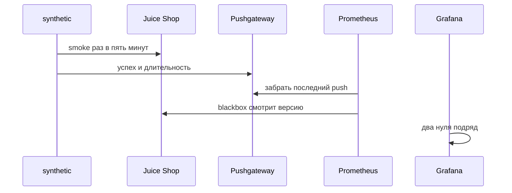
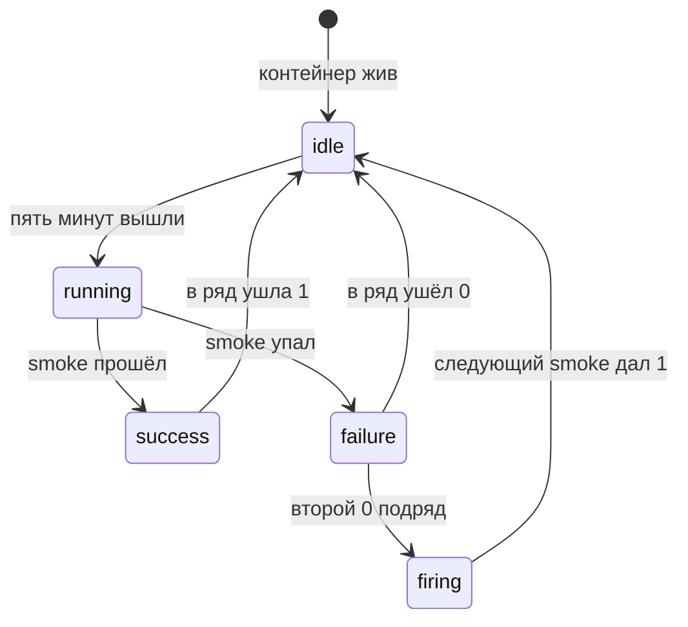

# Синтетический мониторинг

## Содержание

- [Теория](#теория)
  - [Ситуация](#ситуация)
  - [Модель](#модель)
  - [Понятия и связь с автоматизацией тестирования](#понятия-и-связь-с-автоматизацией-тестирования)
  - [Зоны ответственности](#зоны-ответственности)
  - [Пример](#пример)
  - [Типичные сбои](#типичные-сбои)
  - [Полезные ссылки](#полезные-ссылки)
  - [Вопросы по теории](#вопросы-по-теории)
- [Практическое задание](#практическое-задание)
  - [1.1 Общее](#11-общее)
  - [1.2 Сценарии](#12-сценарии-user-stories)
  - [1.3 Контракт](#13-контракт)
  - [1.4 Ошибки и ограничения](#14-ошибки-и-ограничения)
  - [1.5 Аудит](#15-аудитлоги)
  - [1.6 Нефункциональные требования](#16-нефункциональные-требования)

# Теория

## Ситуация

Постоянный стенд Juice Shop работает после того, как пайплайн коммита уже зелёный. Дальше возможен один из исходов: короткий smoke проходит, в Pushgateway уходит успех `1`; smoke падает, уходит `0`, одного раза мало для тревоги; два прогона подряд неуспешны, Grafana поднимает тревогу; пробник замолчал и последнее значение так и осталось `1`; blackbox не получает **200** от `GET /rest/admin/application-version`.

Проверка коммита не видит стенд, который сломался ночью. Проверка по расписанию задаёт тот же вопрос, что покупатель: магазин отвечает и вход жив.

Отдельная разработка не нужна: достаточно compose из `9.0` с сервисами `synthetic`, `pushgateway`, `blackbox` и тестов с тегом `smoke`.

## Модель

Участники: контейнер `synthetic`, Juice Shop, Pushgateway, blackbox exporter, Prometheus, Grafana. Контейнер раз в пять минут гоняет smoke и кладёт два числа. Blackbox отдельно опрашивает версию. Prometheus забирает оба источника. Grafana смотрит два неуспеха подряд. Решение о прохождении smoke принимает оракул теста — требование, а не текущий ответ стенда. Тревога только повторяет уже посчитанный исход.



Push идёт после smoke, иначе в ряд попадёт пустое число. Blackbox не ждёт Playwright: ему нужен только HTTP версии.



Один `failure` возвращает контейнер в `idle` и тревогу не включает. `firing` начинается со второго нуля подряд. Молчание пробника на диаграмме отдельным переходом не рисуется: его ловит возраст push, а не значение `0`.

Возможный набор полей (схема может быть и другой):

| `syntheticSample` | Описание |
| --- | --- |
| `aqa_synthetic_success` | `1` прошёл, `0` упал |
| `aqa_synthetic_duration_seconds` | Длительность smoke в секундах |
| `job` | Группа push `aqa-synthetic`, без метки машины |

Файл использует тег `smoke`, Pushgateway и blackbox. Покупателя smoke создаёт тот же `POST /api/Users`, что и набор.

## Понятия и связь с автоматизацией тестирования

### Проверка после выпуска

CI из `1.6` отвечает на вопрос коммита. Стенд после этого живёт своей жизнью: кончилось место, контейнер не пересоздали, завис процесс. Shift-right из `0.5` — проверки, которые идут на уже выданном стенде, а не только до слияния.

Синтетический мониторинг — короткий сценарий по расписанию, похожий на шаг пользователя. Здесь это тег `smoke`: чёрный ящик версии через blackbox и один живой вход. Нагрузка `4.1` в эти пять минут не входит. User-Agent пробника — `aqa/<RUN_ID>/synthetic`, чтобы строки не смешались с набором из `9.1`. `RUN_ID` пробника — метка времени этого захода.

Контракт расписания: шаг пять минут, сценарий короткий, тег `smoke`.

### Что именно гоняют

Blackbox exporter на порту `9115` опрашивает `http://juice-shop:3000/rest/admin/application-version` модулем HTTP, который ждёт **200**. Это ответ на вопрос «процесс слушает». У scrape Prometheus для такой цели есть метрика `up`.

Playwright внутри контейнера `synthetic` запускает тесты с тегом `smoke`. В тег входит путь входа `TC-AUTH-01`: фикстура создаёт покупателя и входит. Email по шаблону `aqa.<RUN_ID>.<воркер>.<n>@example.test`, иначе заходы каждые пять минут столкнутся. Раз в сутки контейнер Juice Shop создают заново, как в `7.1`, чтобы база не копила покупателей пробника.

Образ контейнера — официальный образ Playwright выбранного стека, тот же, что в `10.1`:

| Стек | Образ |
| --- | --- |
| TypeScript | `mcr.microsoft.com/playwright:v1.65.0-noble` |
| Python | `mcr.microsoft.com/playwright/python:v1.65.1-noble` |
| C# | `mcr.microsoft.com/playwright/dotnet:v1.64.1-noble` |

Тег образа совпадает с версией библиотеки в проекте. Иначе браузер в контейнере не находится. Контейнер долгоживущий: цикл «тест, пауза пять минут», а не новый `docker pull` на каждый заход. Флаги `--ipc=host` и `--init` те же, что в `10.1`: Chromium упирается в маленький `/dev/shm`, а процесс без init оставляет зомби.

Контракт пробника: blackbox смотрит версию, Playwright гоняет `smoke`, образ равен библиотеке.

### Куда девается исход

Prometheus сам забирает цели. Контейнер smoke к моменту следующего scrape уже спит и своего `/metrics` не держит. Pushgateway на порту `9091` помнит последний push. Это как раз короткий пакетный исход, для которого Prometheus оставляет push: не метрики машины, а результат работы.

В теле push две строки, группа `job=aqa-synthetic`, без метки `instance`. Метка машины пережила бы смену контейнера и оставила мёртвый ряд. Имена фиксированы: `aqa_synthetic_success`, `aqa_synthetic_duration_seconds`.

Pushgateway не забывает ряд сам и не даёт `up` по здоровью пробника. Последняя `1` выглядит здоровой и после того, как цикл умер. Поэтому рядом два предохранителя. Blackbox и его `up` отвечают за процесс Juice Shop. Возраст push (`push_time_seconds` группы `aqa-synthetic`) отвечает за молчание пробника: старше 600 секунд — два пропущенных пятиминутных захода.

Контракт ряда: успех `0` или `1`, длительность в секундах, группа без метки машины.

### Тревога

Один неуспех бывает на перезапуске стенда. Тревога Grafana включается, когда `aqa_synthetic_success` равен `0` два захода подряд. Шаг оценки совпадает с пятью минутами. Следующая `1` тревогу снимает.

Отдельное правило смотрит возраст push. Оно нужно, потому что значение `1` само не протухает. Оба правила лежат в `infra/grafana`. PagerDuty курс не подключает: получатель тревоги — канал, который команда укажет в Grafana.

Вариант без долгого контейнера — workflow `.github/workflows/synthetic.yml` с `schedule: "*/5 * * * *"`. Его берёт постоянный стенд, когда раннер — GitHub Actions. Расписание Actions может прийти позже пяти минут. Для стенда, который и так в compose, основной цикл — сервис `synthetic`.

Контракт тревоги: два нуля подряд по успеху и отдельно возраст push больше 600 секунд.

### Что будет в headless

`10.0` объяснит, чем запуск без окна отличается от окна на столе. `10.1` разберёт те же флаги контейнера в job CI. Образ и `--ipc=host` здесь уже выбраны, чтобы smoke не падал из-за памяти Chromium.

### Сводка

| Понятие | Смысл в синтетике | На что опирается реализация |
| --- | --- | --- |
| Smoke по расписанию | Вопрос покупателя каждые пять минут | Тег `smoke` и blackbox |
| Pushgateway | Запомнить исход короткой работы | Порт `9091`, группа `aqa-synthetic` |
| `aqa_synthetic_success` | `1` или `0` последнего захода | Push после прогона |
| Blackbox | Процесс версии жив | Порт `9115`, путь версии |
| Два нуля подряд | Тревога не на каждый рестарт | Правило Grafana |
| Возраст push | Пробник не замолчал с последней единицей | `push_time_seconds` старше 600 секунд |

## Зоны ответственности

| AQA-инженер | CI и compose |
| --- | --- |
| Выбирает, какие тесты носят тег `smoke` | Сервис `synthetic` крутит их каждые пять минут |
| Держит email пробника уникальным | Раз в сутки пересоздаёт контейнер Juice Shop |
| Описывает два правила тревоги | Grafana их считает |
| Не путает исход пробника со счётчиком процесса | Pushgateway хранит только два ряда курса |

Blackbox и Playwright-smoke отвечают на разные вопросы и оба остаются. Версия может отвечать **200**, пока вход уже сломан, и наоборот.

## Пример

Программа принимает прошлый успех `1`, текущий исход `0` и длительность `4.2`. Один ноль тревогу не включает. Так устроено правило «два подряд».

### TypeScript

**Node.js 22 или новее, @playwright/test.** Функция — решение, которое потом повторит правило Grafana.

```sh
npm init -y
npm install -D @playwright/test@1.65
npx playwright test synthetic-rule.spec.ts
cat result.txt
```

```typescript
import { test, expect } from '@playwright/test';
import { writeFileSync } from 'node:fs';

function sample(previousSuccess: number, success: number, duration: number) {
  const consecutive = success === 0 ? (previousSuccess === 0 ? 2 : 1) : 0;
  const alert = consecutive >= 2 ? 'firing' : 'ok';
  return [`aqa_synthetic_success ${success}`, `aqa_synthetic_duration_seconds ${duration.toFixed(1)}`, `consecutive_failures ${consecutive}`, `alert=${alert}`];
}

test('один неуспех', () => {
  const lines = sample(1, 0, 4.2);
  expect(lines[3]).toBe('alert=ok');
  writeFileSync('result.txt', `${lines.join('\n')}\n`);
});
```

### Python

**Python 3.10 или новее, pytest-playwright.** Числа те же, формат длительности с одной цифрой после точки.

```sh
python -m pip install pytest pytest-playwright
pytest -q synthetic_rule.py
cat result.txt
```

```python
def sample(previous_success, success, duration):
    consecutive = (2 if previous_success == 0 else 1) if success == 0 else 0
    alert = "firing" if consecutive >= 2 else "ok"
    return [
        f"aqa_synthetic_success {success}",
        f"aqa_synthetic_duration_seconds {duration:.1f}",
        f"consecutive_failures {consecutive}",
        f"alert={alert}",
    ]

def test_one_failure():
    lines = sample(1, 0, 4.2)
    assert lines[3] == "alert=ok"
    open("result.txt", "w", encoding="utf-8").write("\n".join(lines) + "\n")
```

### C#

**.NET 8 или новее, Microsoft.Playwright.NUnit.** Длительность печатают инвариантной культурой, чтобы в ряде была точка.

```sh
dotnet new nunit -n SyntheticRule -o .
dotnet add package Microsoft.Playwright.NUnit --version 1.64.1
dotnet test
cat result.txt
```

```csharp
using System.Globalization;
using NUnit.Framework;

public class SyntheticRule
{
    static string[] Sample(int previousSuccess, int success, double duration)
    {
        var consecutive = success == 0 ? (previousSuccess == 0 ? 2 : 1) : 0;
        var alert = consecutive >= 2 ? "firing" : "ok";
        var seconds = duration.ToString("0.0", CultureInfo.InvariantCulture);
        return new[] { $"aqa_synthetic_success {success}", $"aqa_synthetic_duration_seconds {seconds}", $"consecutive_failures {consecutive}", $"alert={alert}" };
    }

    [Test]
    public void OneFailure()
    {
        var lines = Sample(1, 0, 4.2);
        Assert.That(lines[3], Is.EqualTo("alert=ok"));
        File.WriteAllText("result.txt", string.Join('\n', lines) + "\n");
    }
}
```

---

Все программы записывают `aqa_synthetic_success 0`, `aqa_synthetic_duration_seconds 4.2`, `consecutive_failures 1`, `alert=ok`. Ноль — этот заход упал. Единица в счётчике подряд значит, что предыдущий заход был успешен. Тревога ждёт второй ноль. Раннер сообщает об одном пройденном тесте.

## Типичные сбои

| Что видно | Куда смотреть |
| --- | --- |
| Тревога молчит, пробник умер, на графике `1` | Нет правила на возраст `push_time_seconds` |
| Тревога на каждый рестарт стенда | Порог стоит на одном нуле, а не на двух подряд |
| В Pushgateway копятся ряды с разными `instance` | В группировке push есть метка машины |
| Smoke падает сразу в контейнере | Образ не той версии, что библиотека, или нет `--ipc=host` |
| **400** `email must be unique` каждые пять минут | У пробника общий email, нет шаблона из `7.0` |
| Blackbox зелёный, вход сломан | Смотрят только версию, тег `smoke` не гоняется |
| Playwright зелёный, порт мёртв между заходами | Нет blackbox, дыру в пять минут никто не видит |
| Actions пришёл через двадцать минут | Для ровного шага нужен сервис `synthetic`, не только `schedule` |
| База за неделю раздута покупателями | Нет суточного нового контейнера |

## Полезные ссылки

### Общие

- [Prometheus — When to use the Pushgateway](https://prometheus.io/docs/practices/pushing/) — когда push уместен и почему ряд не забывается сам.
- [Prometheus — Pushing metrics](https://prometheus.io/docs/instrumenting/pushing/) — путь `POST /metrics/job/<имя>`.
- [blackbox exporter](https://github.com/prometheus/blackbox_exporter) — HTTP-проверка **200** версии.
- [Grafana — Alert rules](https://grafana.com/docs/grafana/latest/alerting/fundamentals/alert-rules/) — правило на два нуля подряд.

### По языку

#### TypeScript

**TypeScript, Playwright Test.** На JavaScript контракт синтетического прогона остаётся тем же.

- [Playwright — Docker](https://playwright.dev/docs/docker) — образ `mcr.microsoft.com/playwright:v1.65.0-noble`, `--ipc=host`, `--init`.
- [GitHub Actions — schedule](https://docs.github.com/en/actions/using-workflows/events-that-trigger-workflows#schedule) — `synthetic.yml`, если раннер — Actions.

#### Python

**Python, pytest-playwright.** На синхронном Playwright API без pytest или на async API контракт синтетического прогона остаётся тем же.

- [Playwright Python — Docker](https://playwright.dev/python/docs/docker) — образ `mcr.microsoft.com/playwright/python:v1.65.1-noble`.
- [pytest — markers](https://docs.pytest.org/en/stable/how-to/mark.html) — отбор `-m smoke`.

#### C#

**C#, Playwright для .NET с NUnit.** На MSTest или xUnit контракт синтетического прогона остаётся тем же.

- [Playwright .NET — Docker](https://playwright.dev/dotnet/docs/docker) — образ `mcr.microsoft.com/playwright/dotnet:v1.64.1-noble`.
- [dotnet test](https://learn.microsoft.com/dotnet/core/tools/dotnet-test) — `--filter Category=smoke` внутри цикла контейнера.

## Вопросы по теории

1. Почему зелёного пайплайна коммита мало для постоянного стенда?
2. Почему исход smoke кладут в Pushgateway, а не ждут scrape самого контейнера?
3. Почему одной единицы в Pushgateway мало, чтобы считать пробник живым?
4. Зачем blackbox, если Playwright и так открывает версию?
5. Почему тревога ждёт два нуля, а не один?
6. Откуда у пробника берутся покупатели и куда они деваются?
7. Когда уместен `.github/workflows/synthetic.yml`, а когда сервис `synthetic`?

# Практическое задание

Функциональность синтетического smoke в системе.
Контейнер `synthetic` каждые пять минут гоняет тег `smoke` и пишет `aqa_synthetic_success` и `aqa_synthetic_duration_seconds` в Pushgateway. Blackbox проверяет версию. Grafana поднимает тревогу на двух неуспехах подряд и на молчании push.

## 1) Пробник стенда

### 1.1 Общее

**Назначение:** проверять постоянный стенд после выпуска коротким сценарием и двумя рядами.

**Пользователи/роли:**

- AQA-инженер — выбирает состав `smoke` и порог тревоги;
- дежурный — видит тревогу Grafana, а не лог Actions недельной давности;
- CI — по желанию дублирует цикл файлом `synthetic.yml`;
- покупатель пробника — одноразовая учётка по шаблону email.

**Зависимости/связанные настройки:**

- `9.0` — Prometheus и Grafana;
- `7.0`, `7.1` — email и новый контейнер раз в сутки;
- `0.5` — shift-right;
- `10.1` — образ и флаги контейнера;
- порты `9091` и `9115`.

Корреляция набора — `9.1`. Пробник ходит со своим User-Agent `aqa/<RUN_ID>/synthetic`.

### 1.2 Сценарии (user stories)

1. **Живой вход:** раз в пять минут `TC-AUTH-01` в составе `smoke` проходит, в ряд уходит `1`.
2. **Версия:** blackbox видит **200** на `/rest/admin/application-version` между заходами Playwright.
3. **Один сбой:** success `0`, тревога ещё `ok`.
4. **Два сбоя:** второй `0` подряд, тревога `firing`.
5. **Молчание:** push старше 600 секунд, отдельная тревога, даже если последнее значение `1`.

### 1.3 Контракт

#### 1.3.1 Цикл и push

| Поле | Проверки/валидация |
| --- | --- |
| Период | 5 минут |
| Команда | Отбор тега `smoke` стека |
| `aqa_synthetic_success` | `1` или `0` |
| `aqa_synthetic_duration_seconds` | Секунды этого захода |
| Группа | `job=aqa-synthetic`, без `instance` |

**Логика/шаги:**

1. Поднять `synthetic` на образе своего стека с `--ipc=host` и `--init`.
2. Выполнить smoke. Поставить User-Agent `aqa/<RUN_ID>/synthetic`.
3. Посчитать длительность.
4. Отправить push на `http://pushgateway:9091/metrics/job/aqa-synthetic`.
5. Ждать пять минут и повторить. Ожидание цикла — таймер сервиса, не `sleep` внутри теста.

Падение smoke всё равно заканчивается push со значением `0`. Пропуск push оставляет прошлое значение.

**Ответы:**

- Успех push — Prometheus видит оба имени рядов.
- **Ошибки:** см. раздел 1.4.

#### 1.3.2 Blackbox и тревоги

**Общее правило:** версия и smoke независимы. Тревога успеха смотрит только на `aqa_synthetic_success`.

| Правило | Условие |
| --- | --- |
| Версия | Blackbox, цель `/rest/admin/application-version`, ждёт **200** |
| Два нуля | `aqa_synthetic_success == 0` два захода подряд |
| Молчание | `push_time_seconds` группы старше 600 секунд |

**Логика/шаги:**

1. Добавить scrape blackbox и Pushgateway в `infra/prometheus.yml`.
2. Завести два правила в Grafana.
3. Раз в сутки пересоздать контейнер `juice-shop`.
4. Для постоянного стенда на Actions добавить `.github/workflows/synthetic.yml` с тем же периодом.

**Ответы:**

- **200** версии у blackbox и ряды push в Prometheus.
- **Ошибки:** см. раздел 1.4.

### 1.4 Ошибки и ограничения

- **200** версии — процесс слушает. Это не вердикт `TC-AUTH-01`.
- `aqa_synthetic_success = 0` — smoke упал. Один такой заход тревогу не включает.
- Два нуля подряд — тревога.
- Push старше 600 секунд — тревога молчания.
- **400** `email must be unique` у пробника — ошибка данных, шаблон email или суточный сброс.
- Нет браузера в контейнере — тег образа не совпал с библиотекой.
- Пустой push при падении теста — прошлый `1` врёт. Push обязателен в обоих исходах.
- Нагрузка k6 в этот цикл не входит.

### 1.5 Аудит/логи

В ряд и в лог контейнера писать исход, длительность и `RUN_ID` захода.

Не писать пароль покупателя, `ADMIN_PASSWORD` и токен. User-Agent пробника — можно.

### 1.6 Нефункциональные требования

- Шаг цикла — 5 минут. Один smoke короче этого шага и короче таймаута теста 30 секунд на каждый тест тега.
- Внутри теста нет `sleep`. Пауза между заходами принадлежит циклу сервиса.
- Суточный новый контейнер Juice Shop обязателен для долгого стенда.
- Тревога покрывает два нуля и возраст push. Blackbox покрывает **200** версии.
